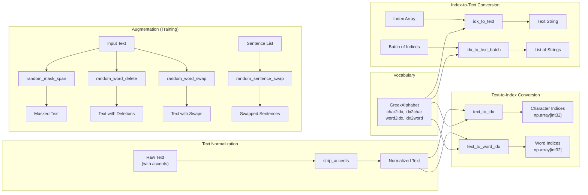
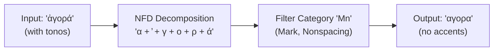
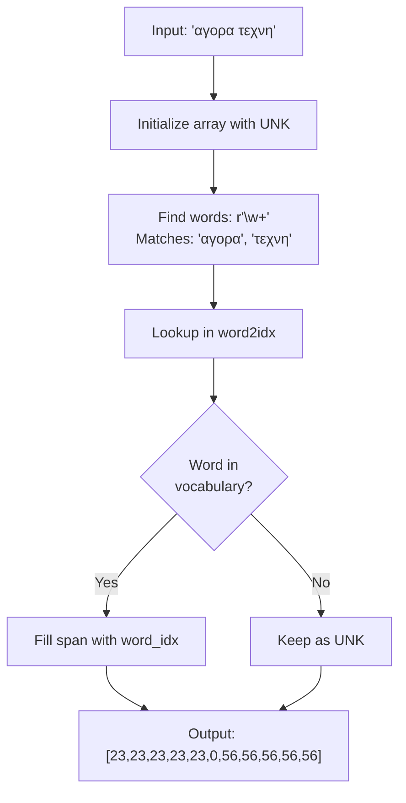
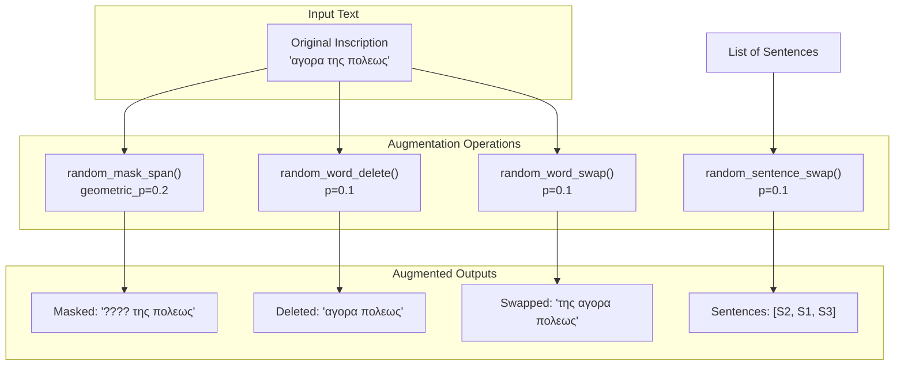
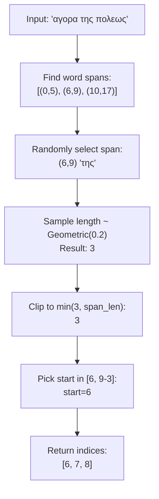
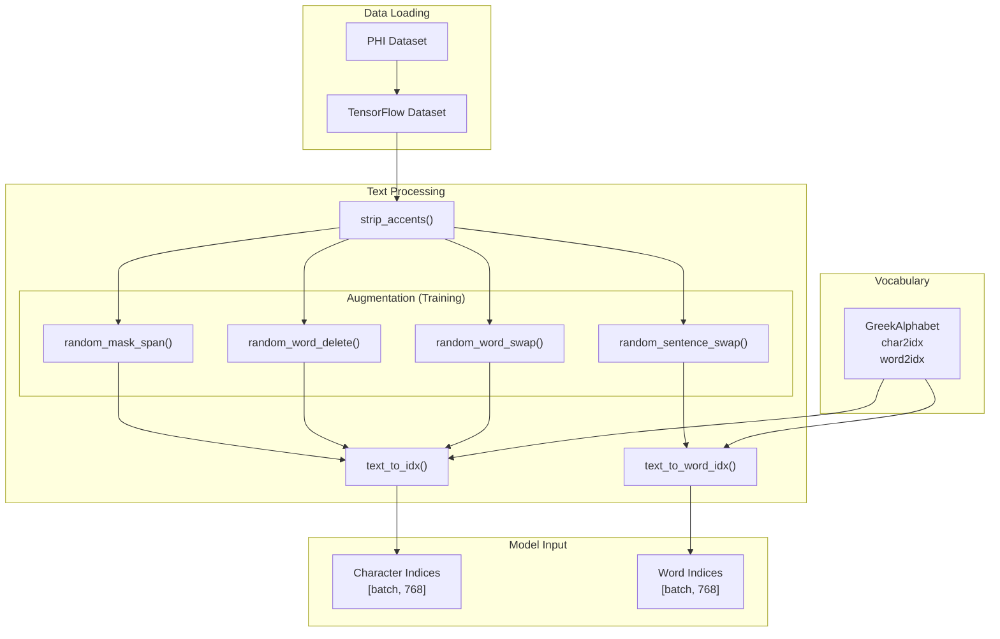
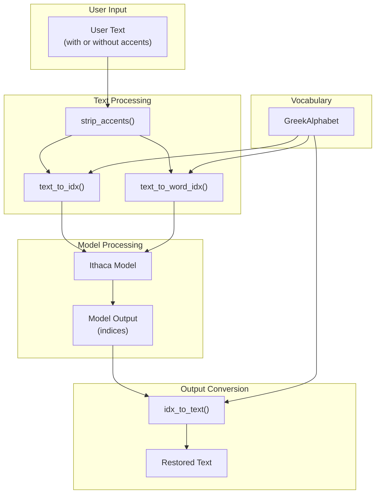

<!-- source: DeepWiki mcp.deepwiki.com · repo google-deepmind/ithaca · page 6.1 Text Processing · fetched 2026-10-26 -->

# Text Processing

<details>
<summary>Relevant source files</summary>

The following files were used as context for generating this wiki page:

- [ithaca/util/text.py](ithaca/util/text.py)

</details>


## Purpose and Scope

This page documents the text processing utilities in the `ithaca/util/text.py` module. These functions handle transformations between text strings and numerical indices, text normalization, and data augmentation operations used during model training.

For information about the Greek alphabet vocabulary system and character mappings, see [Greek Alphabet](#6.2). For date and region processing, see [Date Processing](#6.3) and [Region Mappings](#6.4).

**Sources:** [ithaca/util/text.py:1-187]()

---

## Overview

The text processing module provides bidirectional conversion between text representations and numerical indices, along with augmentation functions for robust training. All functions operate on Ancient Greek text and work in conjunction with the `GreekAlphabet` class to maintain vocabulary consistency.

### Text Processing Pipeline



**Sources:** [ithaca/util/text.py:1-187]()

---

## Text Normalization

### strip_accents()

The `strip_accents()` function removes diacritical marks from Unicode text using NFD normalization. This is essential for Ancient Greek text processing where accent marks need to be standardized.



**Implementation:** The function uses `unicodedata.normalize('NFD', s)` to decompose characters into base characters and combining marks, then filters out all characters in the 'Mn' (Mark, nonspacing) category.

**Code Reference:** [ithaca/util/text.py:168-171]()

```python
def strip_accents(s):
  return ''.join(
      c for c in unicodedata.normalize('NFD', s)
      if unicodedata.category(c) != 'Mn')
```

**Sources:** [ithaca/util/text.py:168-171]()

---

## Text-to-Index Conversion

These functions convert text strings to numerical indices using the `GreekAlphabet` vocabulary mappings. This is a critical step for feeding text into neural network models.

### text_to_idx()

Converts a text string to character-level indices.

**Function Signature:** `text_to_idx(t, alphabet) -> np.ndarray`

**Parameters:**
| Parameter | Type | Description |
|-----------|------|-------------|
| `t` | `str` | Input text string |
| `alphabet` | `GreekAlphabet` | Alphabet instance containing `char2idx` mapping |

**Returns:** `np.array` of `int32` indices, one per character

**Implementation:** [ithaca/util/text.py:174-176]()

```python
def text_to_idx(t, alphabet):
  """Converts a string to character indices."""
  return np.array([alphabet.char2idx[c] for c in t], dtype=np.int32)
```

**Sources:** [ithaca/util/text.py:174-176]()

### text_to_word_idx()

Converts a text string to word-level indices, using regular expressions to identify word boundaries.

**Function Signature:** `text_to_word_idx(t, alphabet) -> np.ndarray`

**Parameters:**
| Parameter | Type | Description |
|-----------|------|-------------|
| `t` | `str` | Input text string |
| `alphabet` | `GreekAlphabet` | Alphabet instance containing `word2idx` mapping |

**Returns:** `np.array` of `int32` indices, one per character position (words span multiple indices)

**Behavior:**
1. Initializes output array filled with unknown token index (`alphabet.word2idx[alphabet.unk]`)
2. Uses `re.finditer(r'\w+', t)` to find word boundaries
3. For each word found in vocabulary, sets all character positions in that word's span to the word's index
4. Characters not part of known words retain the unknown token index

**Code Reference:** [ithaca/util/text.py:179-185]()



**Sources:** [ithaca/util/text.py:179-185]()

---

## Index-to-Text Conversion

These functions perform the reverse operation, converting numerical indices back to text strings.

### idx_to_text()

Converts a single sequence of indices to a text string.

**Function Signature:** `idx_to_text(idxs, alphabet, strip_sos=True, strip_pad=True) -> str`

**Parameters:**
| Parameter | Type | Default | Description |
|-----------|------|---------|-------------|
| `idxs` | `array-like` | - | Sequence of character indices |
| `alphabet` | `GreekAlphabet` | - | Alphabet instance containing `idx2char` mapping |
| `strip_sos` | `bool` | `True` | Skip start-of-sequence token |
| `strip_pad` | `bool` | `True` | Stop at first padding token |

**Returns:** Reconstructed text string

**Behavior:**
- Iterates through indices, mapping each to its character via `alphabet.idx2char`
- If `strip_pad=True`, stops at first padding token
- If `strip_sos=True`, skips start-of-sequence tokens
- Concatenates characters into output string

**Code Reference:** [ithaca/util/text.py:23-35]()

**Sources:** [ithaca/util/text.py:23-35]()

### idx_to_text_batch()

Converts a batch of index sequences to a list of text strings.

**Function Signature:** `idx_to_text_batch(idxs, alphabet, lengths=None) -> list[str]`

**Parameters:**
| Parameter | Type | Description |
|-----------|------|-------------|
| `idxs` | `np.ndarray` | Batch of index sequences, shape `[batch_size, seq_len]` |
| `alphabet` | `GreekAlphabet` | Alphabet instance |
| `lengths` | `list[int]` or `None` | Optional sequence lengths for each batch element |

**Returns:** List of text strings, one per batch element

**Behavior:**
- Iterates over batch dimension
- If `lengths` is provided, truncates each sequence to its specified length
- Calls `idx_to_text()` for each sequence

**Code Reference:** [ithaca/util/text.py:38-46]()

**Sources:** [ithaca/util/text.py:38-46]()

---

## Text Augmentation

Text augmentation functions introduce controlled noise during training to improve model robustness. These operations are applied stochastically to training data.

### Augmentation Pipeline Overview



**Sources:** [ithaca/util/text.py:49-165]()

---

### random_mask_span()

Masks a contiguous span of characters for masked language modeling (MLM) tasks. Uses geometric distribution to sample span length.

**Function Signature:** `random_mask_span(t, geometric_p=0.2, limit_chars=None) -> list[int]`

**Parameters:**
| Parameter | Type | Default | Description |
|-----------|------|---------|-------------|
| `t` | `str` | - | Input text string |
| `geometric_p` | `float` | `0.2` | Parameter for geometric distribution |
| `limit_chars` | `int` or `None` | `None` | Maximum span length |

**Returns:** List of character indices to mask

**Algorithm:**
1. Extract word spans using regex `r'[\w\s]+'`
2. Randomly select one span
3. Sample span length from geometric distribution with parameter `geometric_p`
4. Clip span length to `limit_chars` if specified
5. Randomly select start position within chosen span
6. Return list of indices `[start, start+1, ..., start+length-1]`

**Geometric Distribution:** The geometric distribution with parameter `p` gives the number of trials needed for the first success. This naturally produces shorter spans more frequently than longer spans, which is desirable for MLM.

**Code Reference:** [ithaca/util/text.py:49-85]()



**Sources:** [ithaca/util/text.py:49-85]()

---

### random_sentence_swap()

Swaps sentences within a document with specified probability. Used for Next Sentence Prediction (NSP) task.

**Function Signature:** `random_sentence_swap(sentences, p) -> list`

**Parameters:**
| Parameter | Type | Description |
|-----------|------|-------------|
| `sentences` | `list` | List of sentence strings |
| `p` | `float` | Probability of swapping (determines number of swaps) |

**Returns:** New list with swapped sentences

**Algorithm:**
1. Calculate number of swaps: `n = int(p * len(sentences))`
2. For each swap:
   - Randomly select two distinct indices
   - Swap sentences at those positions
   - Retry up to 3 times if same index selected twice

**Code Reference:** [ithaca/util/text.py:88-110]()

**Sources:** [ithaca/util/text.py:88-110]()

---

### random_word_delete()

Randomly deletes words from a sentence to improve robustness to missing text.

**Function Signature:** `random_word_delete(sentence, p) -> str`

**Parameters:**
| Parameter | Type | Description |
|-----------|------|-------------|
| `sentence` | `str` | Input sentence (space-separated words) |
| `p` | `float` | Deletion probability per word |

**Returns:** Sentence with some words deleted

**Behavior:**
- Splits sentence on spaces
- For each word, deletes with probability `p`
- If all words deleted, returns one random word
- If single word, returns unchanged

**Code Reference:** [ithaca/util/text.py:113-135]()

**Sources:** [ithaca/util/text.py:113-135]()

---

### random_word_swap()

Randomly swaps words within a sentence to improve robustness to word order variations.

**Function Signature:** `random_word_swap(sentence, p) -> str`

**Parameters:**
| Parameter | Type | Description |
|-----------|------|-------------|
| `sentence` | `str` | Input sentence (space-separated words) |
| `p` | `float` | Swap probability (determines number of swaps) |

**Returns:** Sentence with some words swapped

**Algorithm:**
1. Split sentence into words
2. Calculate number of swaps: `n = int(p * len(words))`
3. For each swap:
   - Randomly select two distinct word positions
   - Swap words at those positions
   - Retry up to 3 times if same position selected twice

**Code Reference:** [ithaca/util/text.py:138-165]()

**Sources:** [ithaca/util/text.py:138-165]()

---

## Integration with Training and Inference

### Training Pipeline Integration



During training, text processing follows this sequence:
1. Load raw inscription text from dataset
2. Normalize with `strip_accents()`
3. Apply augmentation functions stochastically
4. Convert to character indices with `text_to_idx()`
5. Convert to word indices with `text_to_word_idx()`
6. Batch and pad to fixed length (768 tokens)

**Sources:** [ithaca/util/text.py:1-187]()

---

### Inference Pipeline Integration



During inference, text processing is simpler:
1. User provides input text (possibly with missing characters marked as `?`)
2. Normalize with `strip_accents()`
3. Convert to indices with `text_to_idx()` and `text_to_word_idx()`
4. Model processes inputs and produces predictions
5. Convert predictions back to text with `idx_to_text()`

**Note:** Augmentation functions are **not** applied during inference.

**Sources:** [ithaca/util/text.py:1-187]()

---

## Usage Examples

### Converting Text to Indices

```python
from ithaca.util.alphabet import GreekAlphabet
from ithaca.util.text import text_to_idx, text_to_word_idx

alphabet = GreekAlphabet()
text = "αγορα"

# Character-level conversion
char_indices = text_to_idx(text, alphabet)
# Result: array([3, 4, 15, 17, 3], dtype=int32)

# Word-level conversion  
word_indices = text_to_word_idx(text, alphabet)
# Result: array([23, 23, 23, 23, 23], dtype=int32) if "αγορα" is word 23
```

### Converting Indices to Text

```python
from ithaca.util.text import idx_to_text, idx_to_text_batch

# Single sequence
indices = [3, 4, 15, 17, 3]
text = idx_to_text(indices, alphabet)
# Result: "αγορα"

# Batch of sequences
batch_indices = [[3, 4, 15], [10, 11, 12]]
batch_texts = idx_to_text_batch(batch_indices, alphabet)
# Result: ["αγο", "xyz"]
```

### Applying Augmentation

```python
from ithaca.util.text import (
    random_mask_span, 
    random_word_delete,
    random_word_swap
)

text = "αγορα της πολεως"

# Get mask indices
mask_indices = random_mask_span(text, geometric_p=0.2, limit_chars=5)
# Result: [6, 7, 8] (masks "της")

# Delete words
augmented = random_word_delete(text, p=0.1)
# Result: "αγορα πολεως" (deleted "της")

# Swap words  
augmented = random_word_swap(text, p=0.3)
# Result: "της αγορα πολεως" (swapped order)
```

**Sources:** [ithaca/util/text.py:1-187]()

---

## Summary

The text processing module provides essential utilities for:

| Function Category | Functions | Primary Use Case |
|------------------|-----------|------------------|
| **Normalization** | `strip_accents()` | Remove diacritical marks from Greek text |
| **Text → Indices** | `text_to_idx()`, `text_to_word_idx()` | Convert text to model inputs |
| **Indices → Text** | `idx_to_text()`, `idx_to_text_batch()` | Convert model outputs to readable text |
| **Augmentation** | `random_mask_span()`, `random_word_delete()`, `random_word_swap()`, `random_sentence_swap()` | Improve training robustness |

All functions operate in conjunction with the `GreekAlphabet` class (see [Greek Alphabet](#6.2)) to maintain vocabulary consistency throughout the processing pipeline.

**Sources:** [ithaca/util/text.py:1-187]()

---

