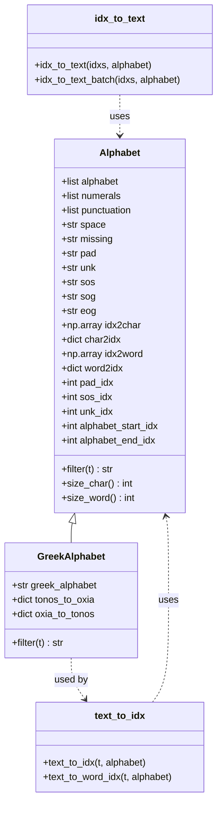
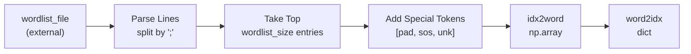
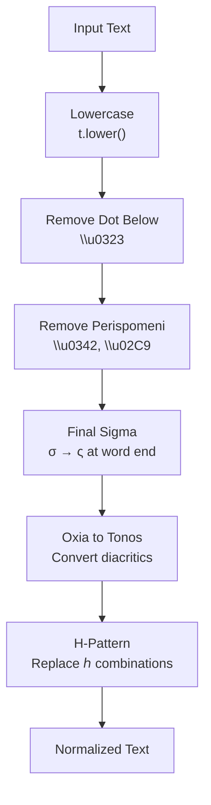
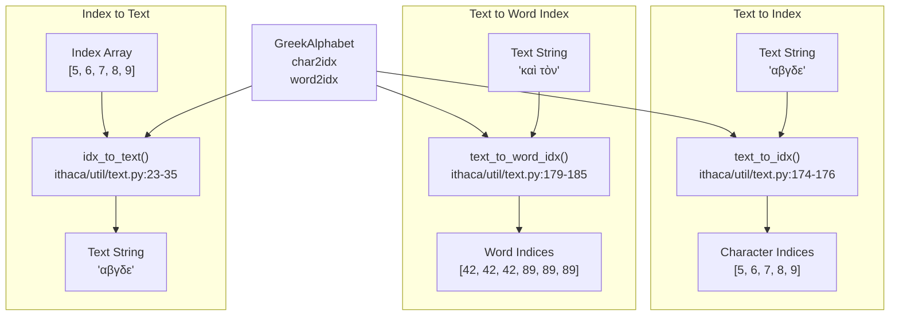
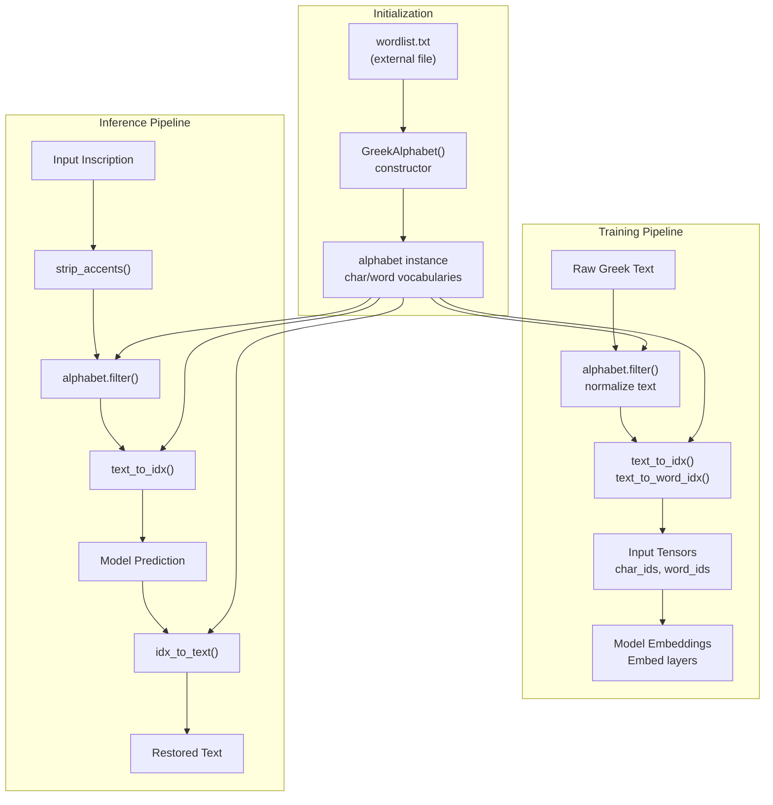

<!-- source: DeepWiki mcp.deepwiki.com · repo google-deepmind/ithaca · page 6.2 Greek Alphabet · fetched 2026-10-26 -->

# Greek Alphabet

<details>
<summary>Relevant source files</summary>

The following files were used as context for generating this wiki page:

- [ithaca/util/alphabet.py](ithaca/util/alphabet.py)
- [ithaca/util/text.py](ithaca/util/text.py)

</details>


This document describes the Greek alphabet handling system used throughout Ithaca for text processing and tokenization. The system provides vocabulary mappings, diacritic normalization, and text filtering specifically designed for ancient Greek inscriptions.

For information about text processing functions that use these alphabet classes, see [Text Processing](#6.1). For the complete data processing pipeline, see [Data Loading and Augmentation](#4.5).

## Overview

The Greek alphabet system is implemented through two classes in [ithaca/util/alphabet.py:21-172]():

- **`Alphabet`**: Base class providing generic character and word vocabulary management
- **`GreekAlphabet`**: Specialized subclass handling ancient Greek text normalization and diacritic conversion

These classes serve as the vocabulary backbone for all text-to-index conversions in the Ithaca system, supporting both character-level (fine-grained) and word-level (semantic) tokenization.

## Class Architecture



**Sources:** [ithaca/util/alphabet.py:21-172](), [ithaca/util/text.py:174-186]()

## Character Vocabulary

The character vocabulary provides mappings between individual characters and integer indices. The `GreekAlphabet` class initializes with the following character set:

| Category | Characters | Description |
|----------|-----------|-------------|
| Greek Letters | `αβγδεζηθικλμνξοπρςστυφχψωϙϛ` | 28 lowercase Greek letters including archaic forms |
| Special Tokens | `# < ^ [space] -` | Pad, SOS, Unknown, Space, Missing |
| Numerals | `0` | Digit characters |
| Punctuation | `.` | Punctuation marks |

The vocabulary is constructed in [ithaca/util/alphabet.py:59-62]():

```python
self.idx2char = np.array(
    [self.pad, self.sos, self.unk, self.space, self.missing] +
    self.alphabet + self.numerals + self.punctuation)
self.char2idx = {self.idx2char[i]: i for i in range(len(self.idx2char))}
```

### Special Character Indices

| Token | Symbol | Index Variable | Purpose |
|-------|--------|----------------|---------|
| Padding | `#` | `pad_idx` | Right-padding to fixed sequence length |
| Start of Sentence | `<` | `sos_idx` | Marks sequence beginning |
| Unknown | `^` | `unk_idx` | Out-of-vocabulary characters |
| Space | ` ` | N/A | Word boundaries |
| Missing | `-` | N/A | Damaged or illegible characters |
| Start of Guess | `[` | N/A | Marks restoration start |
| End of Guess | `]` | N/A | Marks restoration end |

**Sources:** [ithaca/util/alphabet.py:24-46](), [ithaca/util/alphabet.py:64-69]()

## Word Vocabulary

The word vocabulary enables word-level tokenization alongside character-level processing. Words are loaded from an external wordlist file and mapped to indices:



The initialization is performed in [ithaca/util/alphabet.py:48-56]():

```python
idx2word = [self.pad, self.sos, self.unk]
if wordlist_file:
  idx2word += [
      w_c.split(';')[0]
      for w_c in wordlist_file.read().strip().split('\n')[:wordlist_size]
  ]
self.idx2word = np.array(idx2word)
self.word2idx = {self.idx2word[i]: i for i in range(len(self.idx2word))}
```

By default, `wordlist_size=100000`, creating a vocabulary of approximately 100,003 entries (including special tokens).

**Sources:** [ithaca/util/alphabet.py:48-56](), [ithaca/util/alphabet.py:84-90]()

## Greek Text Normalization

The `GreekAlphabet.filter()` method [ithaca/util/alphabet.py:113-171]() performs comprehensive text normalization to handle variations in ancient Greek orthography:



### Normalization Steps

1. **Lowercase Conversion** [ithaca/util/alphabet.py:115]()
   - Converts all text to lowercase for consistency

2. **Diacritic Removal** [ithaca/util/alphabet.py:118-122]()
   - Removes dot below (U+0323)
   - Removes perispomeni (U+0342, U+02C9)

3. **Sigma Handling** [ithaca/util/alphabet.py:125]()
   - Converts word-final σ to ς using regex: `([\w\[\]])σ(?![\[\]])(\b)`

4. **Oxia to Tonos Conversion** [ithaca/util/alphabet.py:128-129]()
   - Converts polytonic oxia accents to monotonic tonos equivalents

5. **Rough Breathing (H) Patterns** [ithaca/util/alphabet.py:132-169]()
   - Replaces `ℎ` prefix with appropriate rough breathing marks
   - Handles 20 different vowel combinations with accents

**Sources:** [ithaca/util/alphabet.py:113-171]()

## Tonos-Oxia Conversion

Ancient Greek can be written with either tonos (monotonic) or oxia (polytonic) accent systems. The `GreekAlphabet` class maintains bidirectional mappings for conversion:

### Tonos → Oxia Mapping

The `tonos_to_oxia` dictionary [ithaca/util/alphabet.py:91-110]() contains 18 mappings:

| Tonos (Monotonic) | Oxia (Polytonic) | Letter |
|-------------------|------------------|--------|
| U+0386 (Ά) | U+1FBB (Ά) | Capital Alpha |
| U+0388 (Έ) | U+1FC9 (Έ) | Capital Epsilon |
| U+0389 (Ή) | U+1FCB (Ή) | Capital Eta |
| U+038C (Ό) | U+1FF9 (Ό) | Capital Omicron |
| U+038A (Ί) | U+1FDB (Ί) | Capital Iota |
| U+038E (Ύ) | U+1FF9 (Ύ) | Capital Upsilon |
| U+038F (Ώ) | U+1FFB (Ώ) | Capital Omega |
| U+03AC (ά) | U+1F71 (ά) | Small Alpha |
| U+03AD (έ) | U+1F73 (έ) | Small Epsilon |
| U+03AE (ή) | U+1F75 (ή) | Small Eta |
| U+0390 (ΐ) | U+1FD3 (ΐ) | Small Iota + dialytika |
| U+03AF (ί) | U+1F77 (ί) | Small Iota |
| U+03CC (ό) | U+1F79 (ό) | Small Omicron |
| U+03B0 (ΰ) | U+1FE3 (ΰ) | Small Upsilon + dialytika |
| U+03CD (ύ) | U+1F7B (ύ) | Small Upsilon |
| U+03CE (ώ) | U+1F7D (ώ) | Small Omega |

### Oxia → Tonos Mapping

The inverse mapping `oxia_to_tonos` [ithaca/util/alphabet.py:111]() is automatically generated:

```python
self.oxia_to_tonos = {v: k for k, v in self.tonos_to_oxia.items()}
```

This bidirectional mapping ensures consistent text representation regardless of input accent system.

**Sources:** [ithaca/util/alphabet.py:91-111]()

## Text-Index Conversion Functions

The alphabet classes work with conversion functions in [ithaca/util/text.py]() to transform between text and numerical representations:



### Character-Level Conversion

**`text_to_idx(t, alphabet)`** [ithaca/util/text.py:174-176]()
- Converts each character to its vocabulary index
- Returns `np.array` of `int32` indices
- Raises `KeyError` if character not in `char2idx`

**`idx_to_text(idxs, alphabet, strip_sos=True, strip_pad=True)`** [ithaca/util/text.py:23-35]()
- Converts index array back to text string
- Optionally strips SOS tokens and padding
- Stops at first padding token if `strip_pad=True`

### Word-Level Conversion

**`text_to_word_idx(t, alphabet)`** [ithaca/util/text.py:179-185]()
- Uses regex `\w+` to identify words
- Maps each character position to the index of the word it belongs to
- Uses `alphabet.unk` for out-of-vocabulary words
- Returns array of length `len(t)` (character-aligned word indices)

**Sources:** [ithaca/util/text.py:23-35](), [ithaca/util/text.py:174-186]()

## Integration with Ithaca System

The `GreekAlphabet` class is instantiated throughout the Ithaca system and serves as the central vocabulary for all text processing:



### Usage Locations

1. **Data Loading** [Section 4.5](#4.5)
   - Text normalization before batching
   - Character and word tokenization
   
2. **Model Input Processing** [Section 3.4](#3.4)
   - Embedding layer lookups
   - `Embed` class uses `alphabet.size_char()` and `alphabet.size_word()`

3. **Inference** [Section 5.1](#5.1)
   - Input text preparation
   - Output text decoding
   - Saliency map alignment with text positions

4. **Text Augmentation** [Section 6.1](#6.1)
   - `random_mask_span()` operates on filtered text
   - `random_word_swap()` and `random_word_delete()` use word boundaries

**Sources:** [ithaca/util/alphabet.py:21-172](), [ithaca/util/text.py:1-187]()

## Vocabulary Sizes

The actual vocabulary sizes depend on initialization parameters:

| Vocabulary Type | Default Size | Components | Method |
|----------------|--------------|------------|--------|
| Character | ~43 | 28 letters + 5 special + numerals + punctuation | `size_char()` |
| Word | ~100,003 | 3 special + 100,000 from wordlist | `size_word()` |

The `size_char()` and `size_word()` methods [ithaca/util/alphabet.py:74-78]() return the vocabulary dimensions used to initialize embedding layers in the model.

**Sources:** [ithaca/util/alphabet.py:74-78](), [ithaca/util/alphabet.py:84-90]()

---

