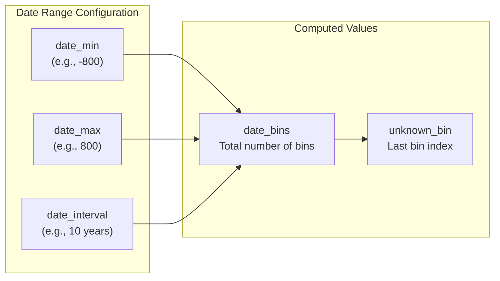
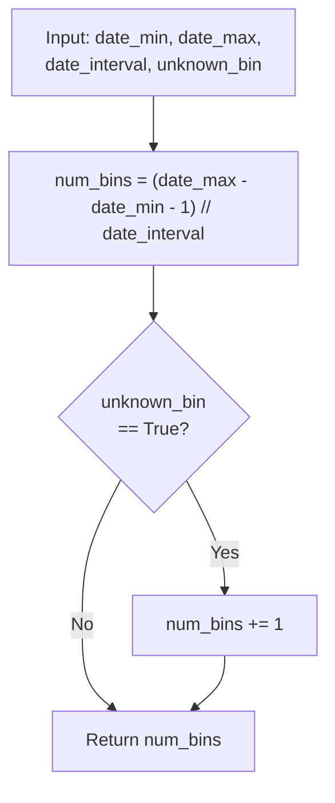
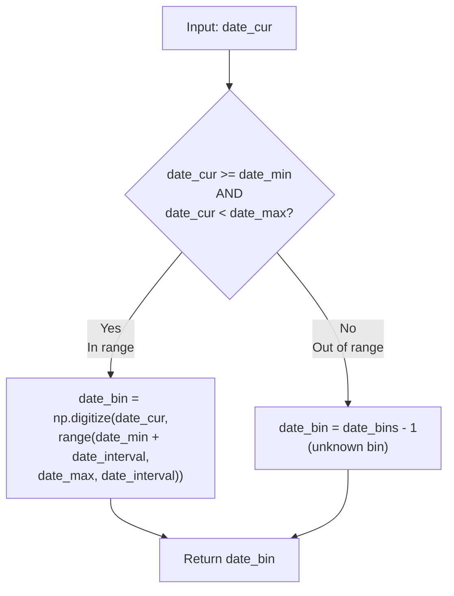
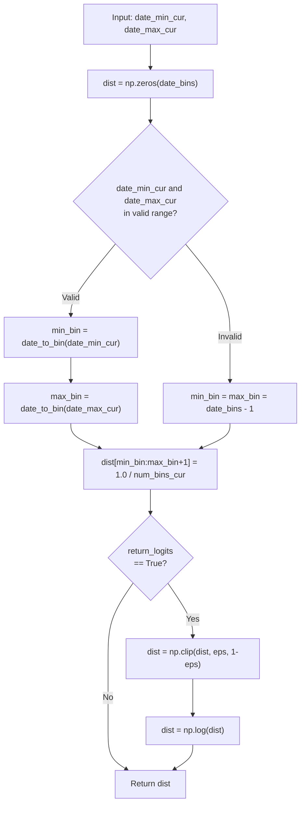
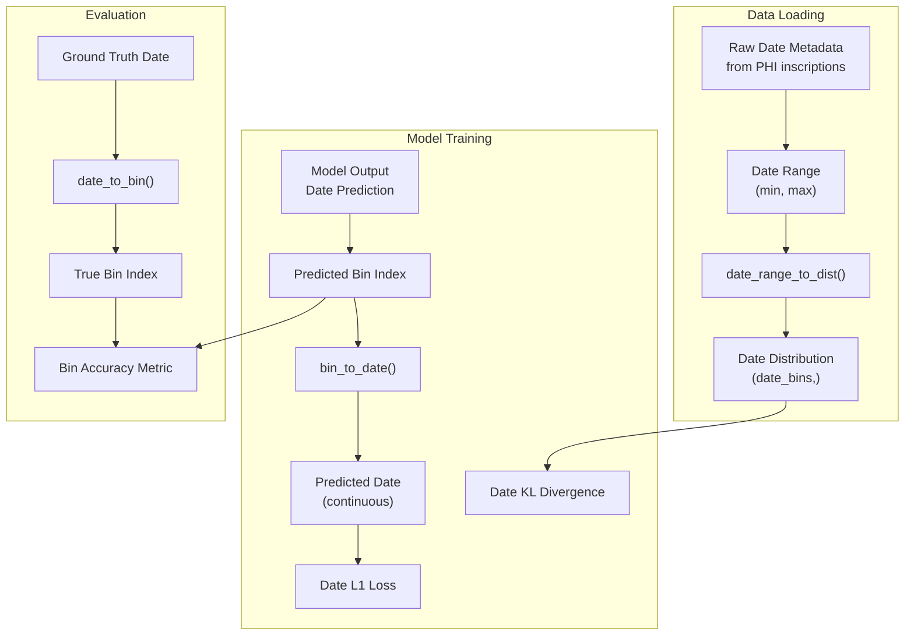

<!-- source: DeepWiki mcp.deepwiki.com · repo google-deepmind/ithaca · page 6.3 Date Processing · fetched 2026-10-26 -->

# Date Processing

<details>
<summary>Relevant source files</summary>

The following files were used as context for generating this wiki page:

- [ithaca/util/dates.py](ithaca/util/dates.py)

</details>


## Purpose and Scope

This document describes the date processing utilities in the Ithaca project, specifically the functions in [ithaca/util/dates.py](). These utilities handle the conversion of date values from ancient Greek inscriptions into discrete bins for neural network training and inference, and support the creation of date range distributions for uncertain or partially known dates.

For information about how date predictions are made by the model and evaluated, see [Multi-Task Output Heads](#3.5). For the loss functions used to train the date prediction head, see [Loss Functions](#4.4).

**Sources:** [ithaca/util/dates.py:1-68]()

## Overview

Ancient Greek inscriptions are dated across a wide historical range (approximately 800 BCE to 800 CE). The Ithaca model processes these dates by:

1. **Binning**: Discretizing the continuous date range into fixed intervals (bins)
2. **Distribution modeling**: Representing date uncertainty as probability distributions over bins
3. **Bidirectional conversion**: Converting between raw dates and bin indices

This discretization approach enables the model to predict dates as a classification problem while also supporting L1 regression loss on the continuous date values.

**Sources:** [ithaca/util/dates.py:1-68]()

## Date Binning System

The date binning system divides the historical timeline into fixed-width intervals. Each inscription's date is mapped to a specific bin index, with an additional "unknown" bin for dates outside the valid range.

### Configuration Parameters



**Diagram: Date Binning Configuration Parameters**

| Parameter | Type | Description | Example Value |
|-----------|------|-------------|---------------|
| `date_min` | `int` | Minimum date in the valid range (BCE as negative) | `-800` (800 BCE) |
| `date_max` | `int` | Maximum date in the valid range (CE as positive) | `800` (800 CE) |
| `date_interval` | `int` | Width of each bin in years | `10` (decade intervals) |
| `date_bins` | `int` | Total number of bins including unknown | `161` (for example above) |
| `unknown_bin` | `bool` | Whether to include an extra bin for out-of-range dates | `True` |

**Sources:** [ithaca/util/dates.py:18-22]()

## Core Functions

### date_num_bins()

Calculates the total number of date bins based on the date range and interval size.

```python
date_num_bins(date_min, date_max, date_interval, unknown_bin=True)
```

**Implementation Logic:**



**Diagram: date_num_bins() Logic Flow**

**Parameters:**
- `date_min` (`int`): Minimum date value
- `date_max` (`int`): Maximum date value  
- `date_interval` (`int`): Size of each bin interval
- `unknown_bin` (`bool`, default=`True`): Whether to reserve a bin for unknown dates

**Returns:** `int` - Total number of bins

**Example:**
- With `date_min=-800`, `date_max=800`, `date_interval=10`, `unknown_bin=True`
- Number of bins = `(800 - (-800) - 1) // 10 + 1 = 160 + 1 = 161`

**Sources:** [ithaca/util/dates.py:18-22]()

### date_to_bin()

Converts a specific date value to its corresponding bin index.

```python
date_to_bin(date_cur, date_min, date_max, date_interval, date_bins)
```

**Implementation Logic:**



**Diagram: date_to_bin() Conversion Logic**

**Parameters:**
- `date_cur` (`int`): The date to convert
- `date_min` (`int`): Minimum valid date
- `date_max` (`int`): Maximum valid date
- `date_interval` (`int`): Bin interval size
- `date_bins` (`int`): Total number of bins

**Returns:** `int` - Bin index (0 to `date_bins-1`)

**Behavior:**
- Dates within `[date_min, date_max)` are mapped to bins using `np.digitize()`
- Dates outside the valid range are mapped to the last bin (`date_bins - 1`)
- The digitization boundaries are at `date_min + date_interval`, `date_min + 2*date_interval`, etc.

**Sources:** [ithaca/util/dates.py:25-32]()

### bin_to_date()

Converts a bin index back to a representative date value (the midpoint of the bin interval).

```python
bin_to_date(date_cur_bin, date_min, date_interval)
```

**Formula:**
```
representative_date = date_min + date_cur_bin × date_interval + (date_interval / 2)
```

**Parameters:**
- `date_cur_bin` (`int`): The bin index
- `date_min` (`int`): Minimum date value
- `date_interval` (`int`): Bin interval size

**Returns:** `int` - The midpoint date of the bin

**Example:**
- With `date_min=-800`, `date_interval=10`, `date_cur_bin=0`
- Returns: `-800 + 0*10 + 10/2 = -795` (795 BCE)

**Sources:** [ithaca/util/dates.py:35-36]()

## Date Range Distribution

The `date_range_to_dist()` function handles inscriptions with uncertain or partially known dates by creating a uniform probability distribution over the possible date bins.

```python
date_range_to_dist(date_min_cur, date_max_cur, date_min, date_max, 
                   date_interval, date_bins, return_logits=True)
```

### Distribution Creation Process



**Diagram: date_range_to_dist() Distribution Creation**

**Parameters:**
- `date_min_cur` (`int` or `None`): Minimum date of the range
- `date_max_cur` (`int` or `None`): Maximum date of the range
- `date_min` (`int`): Global minimum date
- `date_max` (`int`): Global maximum date
- `date_interval` (`int`): Bin interval size
- `date_bins` (`int`): Total number of bins
- `return_logits` (`bool`, default=`True`): Whether to return log probabilities

**Returns:** `np.ndarray` - Array of shape `(date_bins,)` containing probabilities or log-probabilities

**Behavior:**

1. **Initialization**: Creates a zero array of length `date_bins`

2. **Validation**: Checks if the date range is valid:
   - Both `date_min_cur` and `date_max_cur` must be provided
   - Must be within `[date_min, date_max)` 
   - `date_min_cur` must be ≤ `date_max_cur`

3. **Bin Conversion**:
   - Valid ranges: Convert both bounds to bin indices
   - Invalid ranges: Use the unknown bin (`date_bins - 1`)

4. **Uniform Distribution**: Assigns equal probability to all bins in the range
   - `probability = 1.0 / (max_bin - min_bin + 1)`

5. **Logit Conversion** (if `return_logits=True`):
   - Clips probabilities to `[1e-6, 1-1e-6]` to avoid log(0)
   - Applies log transformation: `log(probability)`

**Use Cases:**

| Scenario | Example | Resulting Distribution |
|----------|---------|----------------------|
| Precise date | `date_min_cur=100, date_max_cur=100` | Single bin at index for year 100 |
| Date range | `date_min_cur=-500, date_max_cur=-450` | Uniform over bins covering 500-450 BCE |
| Unknown date | `date_min_cur=None` or out of range | Single bin at unknown index |
| Century estimate | `date_min_cur=-400, date_max_cur=-300` | Uniform over ~10 bins (4th century BCE) |

**Sources:** [ithaca/util/dates.py:39-67]()

## Integration with the Model

The date processing utilities integrate with the Ithaca model at multiple stages:



**Diagram: Date Processing Integration in Training and Evaluation Pipeline**

### Training Phase

1. **Data Preparation**:
   - Raw date metadata (often a range) is converted to a distribution using `date_range_to_dist()`
   - The distribution serves as the target for KL divergence loss
   - Example: An inscription dated "400-300 BCE" becomes a uniform distribution over ~10 bins

2. **Loss Computation**:
   - **KL Divergence**: Measures how well the model's predicted distribution matches the target distribution
   - **L1 Loss**: The predicted bin is converted back to a date using `bin_to_date()`, then L1 distance is computed against the ground truth

### Inference Phase

1. **Attribution**: The model outputs a distribution over date bins
2. **Conversion**: The predicted bin index is converted to a representative date using `bin_to_date()`
3. **Interpretation**: The midpoint of the predicted bin is returned as the estimated date

### Typical Configuration

Based on the architecture diagrams and codebase context, typical date processing configuration is:

| Parameter | Value | Description |
|-----------|-------|-------------|
| `date_min` | `-800` | 800 BCE |
| `date_max` | `800` | 800 CE |
| `date_interval` | `10` | Decade intervals |
| `date_bins` | `161` | 160 bins + 1 unknown |

This results in bins covering: 800-790 BCE (bin 0), 790-780 BCE (bin 1), ..., 790-800 CE (bin 159), unknown (bin 160).

**Sources:** [ithaca/util/dates.py:1-68]()

## Function Reference Summary

| Function | Purpose | Input | Output |
|----------|---------|-------|--------|
| `date_num_bins()` | Calculate total number of bins | Date range and interval | Integer bin count |
| `date_to_bin()` | Convert date to bin index | Date value | Bin index (0 to `date_bins-1`) |
| `bin_to_date()` | Convert bin to representative date | Bin index | Date value (bin midpoint) |
| `date_range_to_dist()` | Create distribution from date range | Date range (min, max) | Probability distribution array |

All functions use consistent parameter ordering: date values → date range configuration → bin configuration.

**Sources:** [ithaca/util/dates.py:18-67]()

---

