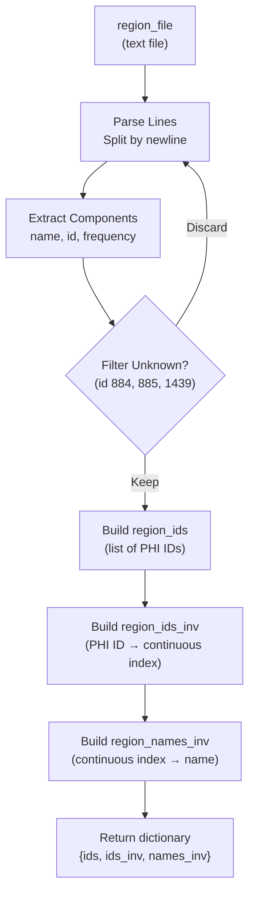
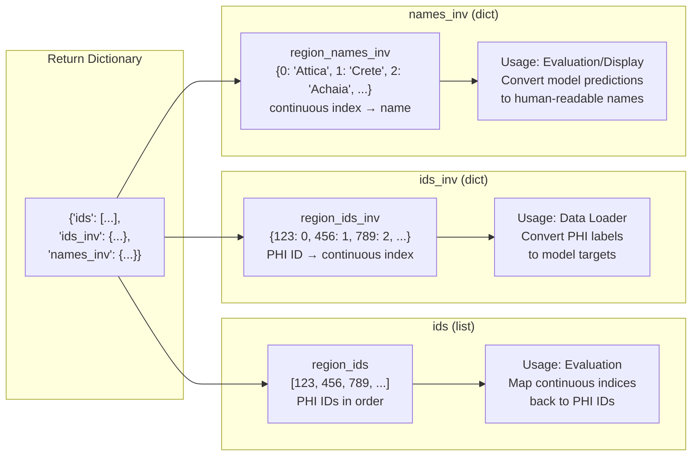
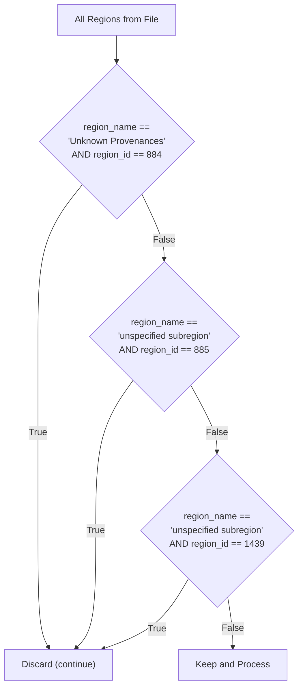
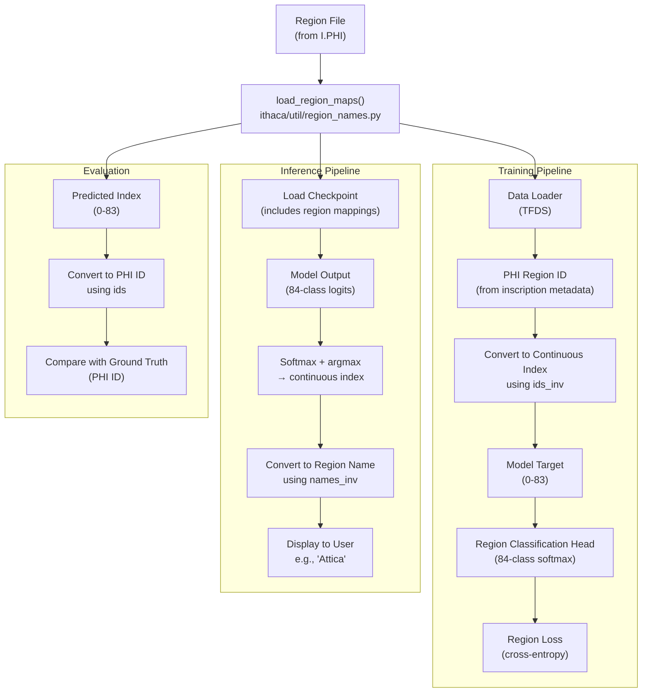

<!-- source: DeepWiki mcp.deepwiki.com · repo google-deepmind/ithaca · page 6.4 Region Mappings · fetched 2026-10-26 -->

# Region Mappings

<details>
<summary>Relevant source files</summary>

The following files were used as context for generating this wiki page:

- [ithaca/util/region_names.py](ithaca/util/region_names.py)

</details>


This document describes the region mapping system in Ithaca, which converts geographical provenance data from the PHI dataset into model-compatible representations. Region mappings provide the vocabulary for the geographical attribution task, mapping between PHI region IDs, continuous model indices, and human-readable region names.

For information about how region predictions are generated during inference, see [Attribution](#5.2). For details on the region classification loss function used during training, see [Loss Functions](#4.4).

## Overview

The Ithaca model performs geographical attribution by classifying inscriptions into one of 84 ancient Greek subregions. The region mapping system bridges three representations:

1. **PHI Region IDs**: Original identifiers from the I.PHI dataset (non-contiguous integers)
2. **Continuous Model Indices**: Zero-indexed contiguous integers (0-83) used as model outputs
3. **Region Names**: Human-readable geographical names (e.g., "Attica", "Crete")

The region mappings are loaded from a region file during training and inference, with unknown or unspecified regions filtered out to produce the final set of 84 regions.

**Sources:** [ithaca/util/region_names.py:1-45]()

## Region Data Format

Region data originates from the I.PHI generator, which processes the PHI dataset into machine-actionable format. The region file contains one line per region with the format:

```
<region_name>_<region_id>;<frequency>
```

Example entries:
```
Attica_123;4523
Crete_456;2891
Unknown Provenances_884;127
```

The frequency field (second value after semicolon) indicates how many inscriptions originate from that region but is not used by the mapping system.

**Sources:** [ithaca/util/region_names.py:26-28]()

## The `load_region_maps()` Function



**Diagram: Region Mapping Loading Pipeline**

The `load_region_maps()` function in [ithaca/util/region_names.py:21-44]() performs the following operations:

1. **Read and Parse**: Reads the region file and splits into lines
2. **Extract Components**: Splits each line by `;` and `_` to extract region name and ID
3. **Filter Unknowns**: Excludes three specific unknown/unspecified region entries
4. **Build Mappings**: Creates three different mapping structures
5. **Return Dictionary**: Returns all three mappings in a dictionary

**Sources:** [ithaca/util/region_names.py:21-44]()

## Mapping Types and Data Structures

The function returns a dictionary with three keys, each serving a specific purpose in the training and inference pipelines:



**Diagram: Three Region Mapping Structures**

### Mapping Details

| Mapping | Type | Key | Value | Primary Use Case |
|---------|------|-----|-------|------------------|
| `ids` | `list[int]` | Continuous index (implicit) | PHI region ID | Evaluation: continuous → PHI ID |
| `ids_inv` | `dict[int, int]` | PHI region ID | Continuous index | Training: PHI ID → model target |
| `names_inv` | `dict[int, str]` | Continuous index | Region name | Inference: model output → name |

The continuous indices range from 0 to 83 (84 total regions) and are assigned in the order regions appear in the file (after filtering).

**Code Construction:**

```python
# From region_names.py:36-38
region_ids.append(region_id)                      # Add to list
region_ids_inv[region_id] = len(region_ids_inv)  # Map PHI ID to continuous
region_names_inv[len(region_names_inv)] = region_name  # Map continuous to name
```

**Sources:** [ithaca/util/region_names.py:23-43]()

## Filtering Unknown Regions

The function filters out three specific region entries that represent unknown or unspecified provenances:



**Diagram: Unknown Region Filtering Logic**

### Filtered Entries

| Region Name | Region ID | Reason |
|-------------|-----------|--------|
| Unknown Provenances | 884 | No geographical information available |
| unspecified subregion | 885 | Region not specified in original inscription |
| unspecified subregion | 1439 | Duplicate unspecified entry |

This filtering ensures the model only trains on and predicts regions with known geographical locations, resulting in the final set of 84 valid regions. The filtering logic is implemented in [ithaca/util/region_names.py:32-35]().

**Why Filter These Regions?**

1. **Training Quality**: Unknown regions provide no geographical signal for the model to learn
2. **Evaluation Validity**: Cannot measure accuracy of predictions for unknown locations
3. **User Utility**: Predictions of "Unknown Provenances" provide no actionable information

**Sources:** [ithaca/util/region_names.py:31-35]()

## Integration with Training and Inference

The region mappings integrate with multiple components of the Ithaca system:



**Diagram: Region Mappings in the Ithaca Pipeline**

### Usage Patterns

**During Training:**
```python
# Data loader converts PHI labels to model targets
phi_region_id = 123  # From inscription metadata
continuous_index = region_maps['ids_inv'][phi_region_id]  # → 0
# Use continuous_index as target for cross-entropy loss
```

**During Inference:**
```python
# Model outputs 84-class probabilities
logits = model(text)  # Shape: (batch_size, 84)
predicted_index = jnp.argmax(logits, axis=-1)  # → 5
region_name = region_maps['names_inv'][predicted_index]  # → "Crete"
# Display region_name to user
```

**During Evaluation:**
```python
# Convert predicted continuous index back to PHI ID for comparison
predicted_index = 5
phi_id = region_maps['ids'][predicted_index]  # → 456
# Compare phi_id with ground truth PHI ID
```

**Sources:** [ithaca/util/region_names.py:21-44]()

## Region Count and Distribution

The system supports exactly **84 regions** after filtering. This count is determined by:

1. Total regions in I.PHI region file: 87
2. Minus filtered unknown regions: -3
3. Final valid regions: **84**

The 84 regions represent the major geographical areas of the ancient Greek world where inscriptions have been discovered, including:

- **Mainland Greece**: Attica, Boeotia, Achaia, etc.
- **Greek Islands**: Crete, Rhodes, Delos, etc.
- **Asia Minor**: Ionia, Lycia, Caria, etc.
- **Other Mediterranean**: Sicily, Southern Italy, Egypt, etc.

The specific region names and their frequencies depend on the PHI dataset version and are loaded dynamically from the region file rather than being hardcoded.

**Sources:** [ithaca/util/region_names.py:14-18](), [ithaca/util/region_names.py:31-38]()

## Implementation Notes

### Thread Safety
The `load_region_maps()` function is a pure function with no side effects and can be safely called from multiple threads or processes.

### Version Compatibility
The docstring in [ithaca/util/region_names.py:14-18]() notes that "subregion IDs originate from the I.PHI generator and may be subject to change in future versions of the PHI dataset." Code using region mappings should:

1. Always load mappings from the region file (never hardcode IDs)
2. Save region mappings with model checkpoints for reproducibility
3. Verify region compatibility when loading checkpoints trained on different PHI versions

### Memory Footprint
With 84 regions, the mapping structures are small:
- `ids`: 84 integers (≈672 bytes)
- `ids_inv`: 84 key-value pairs (≈2 KB)
- `names_inv`: 84 key-value pairs + strings (≈5 KB)

Total memory footprint is negligible (<10 KB).

**Sources:** [ithaca/util/region_names.py:14-18](), [ithaca/util/region_names.py:21-44]()

---

