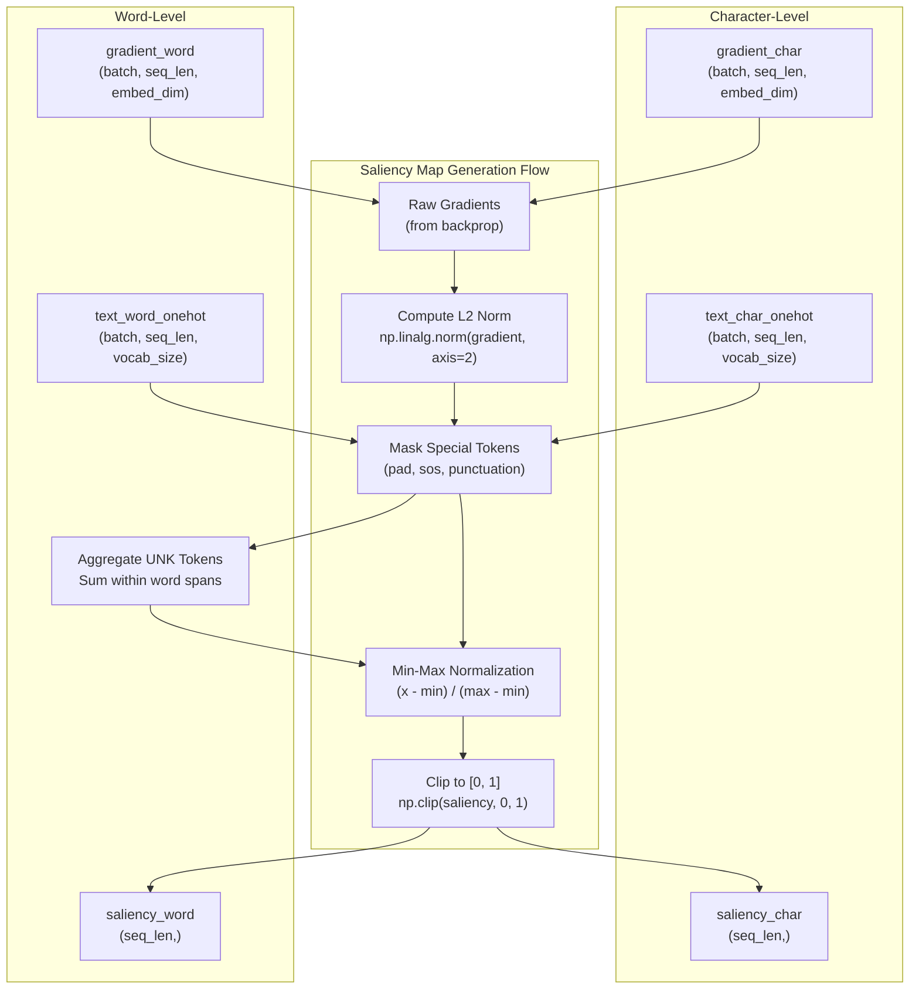
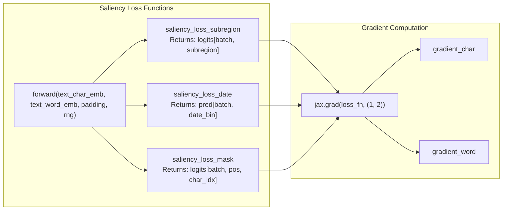
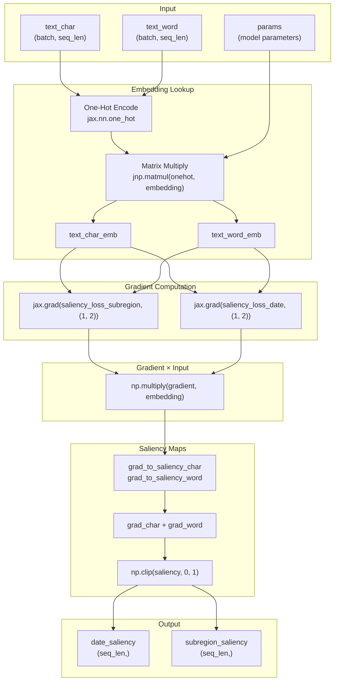
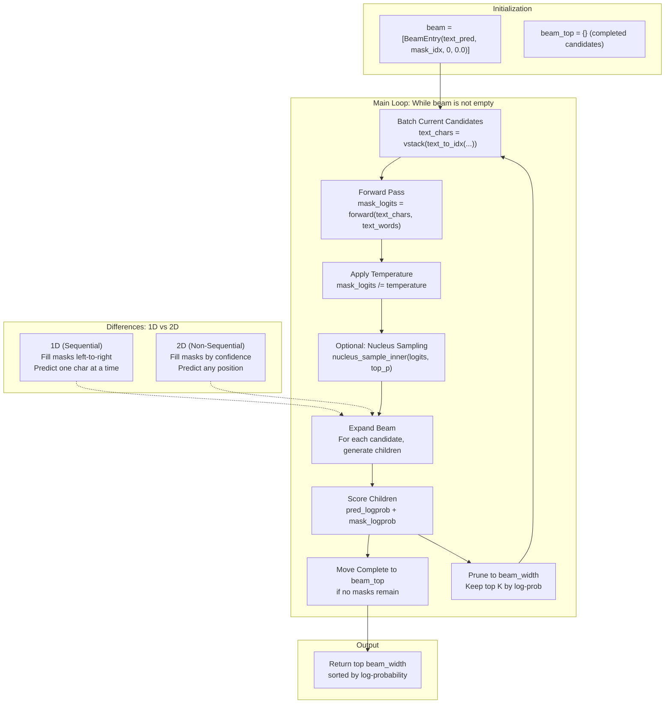
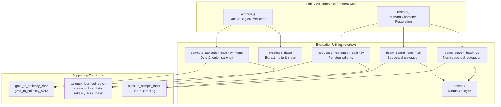

<!-- source: DeepWiki mcp.deepwiki.com · repo google-deepmind/ithaca · page 6.5 Evaluation Utilities · fetched 2026-10-26 -->

# Evaluation Utilities

<details>
<summary>Relevant source files</summary>

The following files were used as context for generating this wiki page:

- [ithaca/util/eval.py](ithaca/util/eval.py)

</details>


## Purpose and Scope

This page documents the evaluation utilities in `ithaca/util/eval.py`, which provide low-level functions for computing predictions, generating saliency maps, and performing beam search for text restoration. These utilities are used by the inference system to produce interpretable predictions and restore missing characters.

For information about the high-level inference API that uses these utilities, see [Inference System](#5). For text processing and vocabulary handling, see [Text Processing](#6.1) and [Greek Alphabet](#6.2).

**Sources:** [ithaca/util/eval.py:1-563]()

## Overview

The evaluation utilities module provides three categories of functions:

| Category | Functions | Purpose |
|----------|-----------|---------|
| **Loss & Prediction** | `date_loss_l1`, `softmax`, `log_softmax`, `predicted_dates` | Compute losses and extract predictions from model outputs |
| **Saliency Generation** | `grad_to_saliency_char`, `grad_to_saliency_word`, `compute_attribution_saliency_maps`, `sequential_restoration_saliency` | Generate gradient-based saliency maps showing input feature importance |
| **Beam Search** | `BeamEntry`, `beam_search_batch_2d`, `beam_search_batch_1d`, `nucleus_sample_inner` | Search for optimal character sequences during text restoration |

These utilities operate on raw model outputs (logits, gradients) and produce evaluation metrics, interpretable visualizations, and restoration candidates.

**Sources:** [ithaca/util/eval.py:1-563]()

## Loss and Prediction Functions

### Date L1 Loss

The `date_loss_l1` function computes L1 loss for date predictions, accounting for the fact that dates may fall within a range [target_min, target_max]:

```python
date_loss_l1(pred, target_min, target_max)
```

The loss is zero if the prediction falls within the target range, and increases linearly with distance outside the range. This is useful for evaluating date predictions where inscriptions may be dated to a century or decade rather than a specific year.

**Sources:** [ithaca/util/eval.py:27-34]()

### Softmax Functions

Two softmax implementations are provided:

- **`softmax(x, axis=-1)`**: Standard softmax normalization, computing `exp(x) / sum(exp(x))`
- **`log_softmax(x, axis=-1)`**: Numerically stable log-softmax, computing `log(softmax(x))` for use in log-probability calculations

Both functions use the max-subtraction trick for numerical stability.

**Sources:** [ithaca/util/eval.py:85-94]()

### Predicted Dates

The `predicted_dates` function extracts interpretable date predictions from a probability distribution over date bins:

```python
predicted_dates(date_pred_probs, date_min, date_max, date_interval)
```

Returns two estimates:
- **Mode**: The most likely date bin center (argmax of probability distribution)
- **Mean**: The expected value under the probability distribution

Both predictions are in years (e.g., -450 for 450 BCE).

**Sources:** [ithaca/util/eval.py:385-397]()

## Saliency Map Generation

Saliency maps highlight which input tokens most influenced a model's prediction using gradient-based attribution. The module provides separate functions for character-level and word-level saliency.

### Gradient-to-Saliency Conversion



**Character-Level Saliency** (`grad_to_saliency_char`):
1. Compute L2 norm of gradients across embedding dimension
2. Mask special tokens (indices outside alphabet range)
3. Min-max normalize remaining tokens to [0, 1]

**Word-Level Saliency** (`grad_to_saliency_word`):
1. Compute L2 norm of gradients
2. Aggregate saliency for unknown token spans (characters within words)
3. Mask unknown tokens and normalize

**Sources:** [ithaca/util/eval.py:37-82]()

### Saliency Loss Functions

Three loss functions extract specific outputs for gradient computation:



Each function:
1. Runs forward pass with embeddings as inputs (not indices)
2. Extracts specific output (region logit, date probability, mask logit)
3. Used with `jax.grad` to compute gradients w.r.t. embeddings

The gradients indicate how changing input embeddings would affect the output, revealing which tokens were most important.

**Sources:** [ithaca/util/eval.py:352-383]()

### Attribution Saliency Maps

The `compute_attribution_saliency_maps` function generates saliency maps for both date and region predictions:



The function uses the "gradient × input" method:
1. Convert indices to embeddings via one-hot encoding and matrix multiplication
2. Compute gradients of loss functions w.r.t. embeddings
3. Multiply gradients by embeddings (input attribution)
4. Convert to visualization-ready saliency maps
5. Combine character and word saliency, clip to [0, 1]

**Sources:** [ithaca/util/eval.py:400-468]()

### Sequential Restoration Saliency

The `sequential_restoration_saliency` generator produces per-step saliency maps during text restoration:

```python
def sequential_restoration_saliency(text_str, text_len, forward, params,
                                    alphabet, mask_idx, vocab_char_size,
                                    vocab_word_size):
    # Yields SequentialRestorationSaliencyResult for each restored character
```

**SequentialRestorationSaliencyResult** structure:
- `text`: Predicted text string so far
- `pred_char_pos`: Position of newly restored character
- `saliency_map`: Saliency showing which tokens influenced this restoration

**Algorithm:**
1. For each missing character position (non-sequentially):
   - Run forward pass to get mask predictions
   - Greedily select highest-probability prediction from remaining masks
   - Update text with predicted character
   - Compute gradients of mask loss w.r.t. embeddings
   - Generate saliency map showing attribution for this prediction
   - Yield result and continue

This enables visualization of how the model's confidence builds as more characters are restored.

**Sources:** [ithaca/util/eval.py:486-562]()

## Beam Search Algorithms

Beam search explores multiple candidate sequences simultaneously to find optimal text restorations. The module provides two variants: sequential (1D) and non-sequential (2D).

### BeamEntry Structure

```python
class BeamEntry(NamedTuple):
  text_pred: str           # Candidate text (with some masks filled)
  mask_idx: int            # Indices of remaining masks
  pred_len: int            # Number of characters predicted so far
  pred_logprob: float      # Log-probability of this candidate
```

Beam search maintains a list of `BeamEntry` objects, ranked by cumulative log-probability.

**Sources:** [ithaca/util/eval.py:110-114]()

### Beam Search Workflow



**Sources:** [ithaca/util/eval.py:117-349]()

### Non-Sequential Beam Search (2D)

`beam_search_batch_2d` fills missing characters in any order, choosing the most confident predictions first:

**Parameters:**
- `forward`: Model forward function
- `alphabet`: GreekAlphabet instance
- `text_pred`: Initial text with '?' for missing characters
- `mask_idx`: List of indices with missing characters
- `beam_width`: Number of candidates to maintain (default: 20)
- `temperature`: Softmax temperature for sampling (default: 1.0)
- `nucleus`: Whether to use nucleus sampling (default: False)
- `nucleus_top_p`: Top-p threshold for nucleus sampling (default: 0.8)

**Algorithm:**
1. Batch all current beam candidates
2. Run forward pass to get mask predictions for all candidates
3. For each candidate:
   - Find highest-probability (position, character) pairs
   - Filter to only positions in `mask_idx`
   - Create child candidates for top predictions
   - Track completed candidates (no masks left)
4. De-duplicate and keep top `beam_width` candidates
5. Repeat until all candidates complete

The non-sequential approach allows the model to fill easy characters first, building confidence before tackling difficult ones.

**Sources:** [ithaca/util/eval.py:117-237]()

### Sequential Beam Search (1D)

`beam_search_batch_1d` fills missing characters left-to-right:

**Key Differences from 2D:**
- Processes `mask_idx[0]` (leftmost position) only
- Expands beam with all valid character predictions at that position
- More structured but less flexible than non-sequential

**Use Case:** Sequential beam search is useful when left context strongly constrains right predictions (e.g., grammatical structures, word boundaries).

**Sources:** [ithaca/util/eval.py:240-349]()

### Nucleus Sampling

The `nucleus_sample_inner` function implements top-p (nucleus) sampling:

```python
nucleus_sample_inner(logits, top_p=0.95, temp=1.0)
```

**Algorithm:**
1. Sort logits in ascending order
2. Compute cumulative probability mass
3. Find threshold where cumulative mass reaches `1 - top_p`
4. Mask out all logits below threshold (set to -∞)
5. Apply temperature scaling

This limits beam search to probable characters, avoiding exploring very unlikely candidates.

**Sources:** [ithaca/util/eval.py:97-107]()

## Integration with Inference System



The evaluation utilities serve as building blocks for the inference system:

| Inference Function | Utilities Used | Purpose |
|-------------------|----------------|---------|
| `attribute()` | `predicted_dates`, `compute_attribution_saliency_maps` | Convert date logits to years, generate saliency maps |
| `restore()` | `beam_search_batch_2d`, `beam_search_batch_1d` | Search for optimal character sequences |
| Saliency visualization | `sequential_restoration_saliency`, `grad_to_saliency_*` | Show per-step attribution during restoration |

All saliency functions use JAX's automatic differentiation (`jax.grad`) to compute gradients, enabling efficient interpretability without modifying the model architecture.

**Sources:** [ithaca/util/eval.py:1-563]()

---

