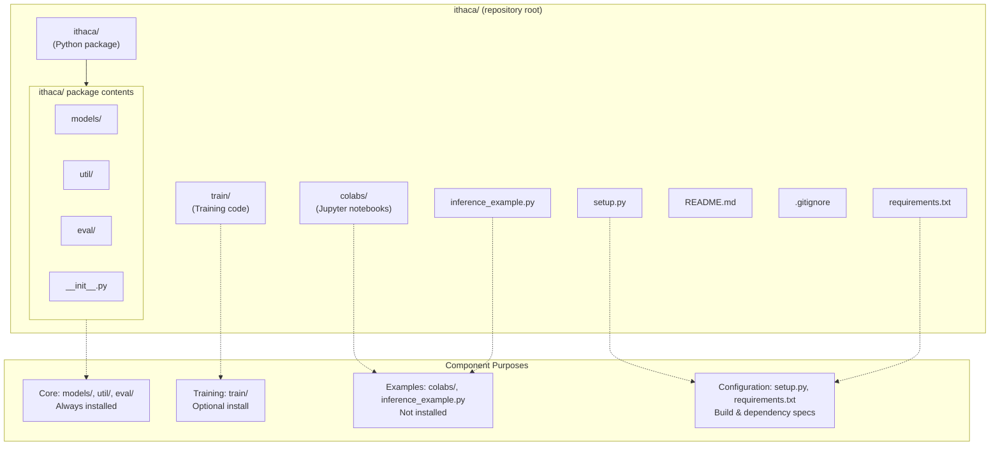
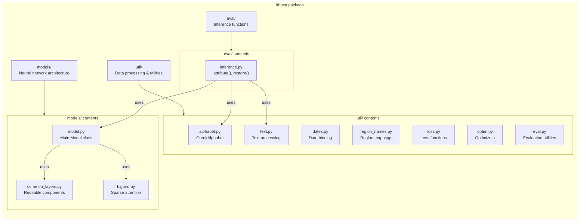
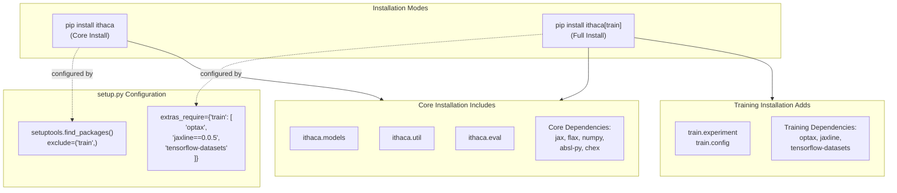
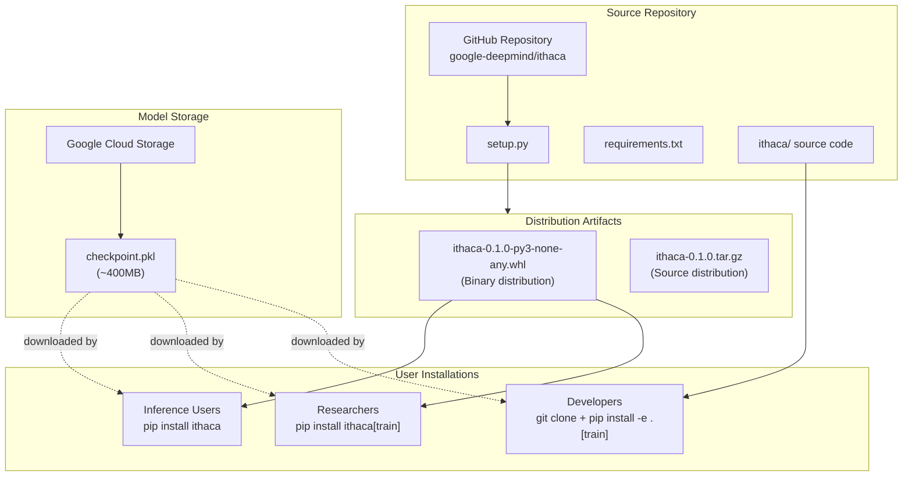

<!-- source: DeepWiki mcp.deepwiki.com · repo google-deepmind/ithaca · page 7.1 Project Structure · fetched 2026-10-26 -->

# Project Structure

<details>
<summary>Relevant source files</summary>

The following files were used as context for generating this wiki page:

- [.gitignore](.gitignore)
- [ithaca/__init__.py](ithaca/__init__.py)
- [setup.py](setup.py)

</details>


## Purpose and Scope

This document describes the organization of the Ithaca repository and package structure. It covers the directory layout, module hierarchy, and the intentional separation between inference (core) and training components. For details on setting up the development environment, see [Installation](#2.1). For contribution guidelines, see [Contributing](#7.2).

## Repository Layout

The Ithaca repository follows a standard Python package structure with clear separation between core functionality, training infrastructure, examples, and documentation.



**Sources:** [setup.py:1-53](), [.gitignore:1-8](), [ithaca/__init__.py:1-14]()

### Top-Level Files

| File | Purpose |
|------|---------|
| `setup.py` | Package distribution configuration, defines installation modes |
| `requirements.txt` | Core dependencies required for inference |
| `README.md` | Project documentation and quickstart guide |
| `.gitignore` | Excludes build artifacts, bytecode, and model checkpoints |
| `inference_example.py` | Command-line inference demonstration script |

### Directory Structure

| Directory | Contents | Installed By Default |
|-----------|----------|---------------------|
| `ithaca/` | Core package: models, utilities, inference | ✓ Yes |
| `train/` | Training infrastructure and experiment code | ✗ No (extras) |
| `colabs/` | Interactive Jupyter notebooks | ✗ No (examples) |

## Package Structure

The `ithaca/` package is organized into three primary modules, each serving a distinct role in the system architecture.



**Sources:** [setup.py:35]()

### ithaca/models/

Contains the neural network architecture implementation:

- **`model.py`**: Main `Model` class implementing the Ithaca transformer with multi-task heads
- **`common_layers.py`**: Reusable neural network components (`Embed`, `MlpBlock`, `LayerNorm`, `AddPositionEmbs`)
- **`bigbird.py`**: Sparse attention implementation (`BigBirdBlock`, `BigBirdSelfAttention`)

See [Model Architecture](#3) for detailed documentation of these components.

### ithaca/util/

Contains data processing utilities and helper functions:

- **`alphabet.py`**: `GreekAlphabet` class for character/word vocabulary management
- **`text.py`**: Text manipulation functions (`strip_accents`, `text_to_idx`, augmentation)
- **`dates.py`**: Date binning and range utilities for temporal predictions
- **`region_names.py`**: Geographical region mappings (84 subregions)
- **`loss.py`**: Loss function implementations (date, region, mask losses)
- **`optim.py`**: Learning rate schedules and gradient processing
- **`eval.py`**: Evaluation utilities (saliency, beam search, metrics)

See [Data Processing Utilities](#6) for detailed documentation.

### ithaca/eval/

Contains inference functionality:

- **`inference.py`**: Public API with `attribute()` and `restore()` functions, returns `AttributionResults` and `RestorationResults` namedtuples

See [Inference System](#5) for usage documentation.

## Training Code Separation

The `train/` directory is intentionally excluded from the core package installation to minimize dependencies for inference-only users.



**Sources:** [setup.py:35](), [setup.py:38-44]()

### Core Installation (Default)

When users run `pip install ithaca`, the package includes:

- All modules under `ithaca/` (models, util, eval)
- Core dependencies from `requirements.txt`
- **Excludes** the `train/` directory

This is achieved via [setup.py:35]():
```python
packages=setuptools.find_packages(exclude=('train',))
```

### Full Installation (Extras)

Researchers and developers can install training components with:

```bash
pip install ithaca[train]
```

This adds the following dependencies specified in [setup.py:38-44]():

| Dependency | Purpose |
|------------|---------|
| `optax` | Gradient processing and optimization |
| `jaxline==0.0.5` | Training platform and experiment management |
| `tensorflow-datasets` | Data loading pipeline |

The `train/` directory contains:

- **`experiment.py`**: JAXline experiment implementation with training loop
- **`config.py`**: Model hyperparameters and training configuration
- Additional training utilities

See [Training System](#4) for details on the training infrastructure.

## Configuration and Build Files

### setup.py

The package distribution configuration [setup.py:1-53]() defines:

**Package Metadata:**
- Name: `ithaca`
- Version: `0.1.0`
- License: Apache License 2.0
- Authors: Ithaca team (deepmind-ithaca-team@google.com)

**Installation Behavior:**
- Core packages: `ithaca.models`, `ithaca.util`, `ithaca.eval`
- Excluded: `train` module
- Package data: Includes `*.txt` files (region mappings, vocabularies)

**Dependencies:**
- Base requirements from `requirements.txt`
- Optional `[train]` extras for training infrastructure

**Classifiers:**
- Development Status: Beta
- Intended Audience: Developers, Science/Research
- Topic: AI/Scientific Engineering

### requirements.txt

Specifies core dependencies required for inference. Key dependencies include:

- `jax` and `jaxlib`: Core computation framework
- `flax`: Neural network library
- `numpy`: Array operations
- `absl-py`: Command-line flags and logging
- `chex`: Testing and validation utilities

See [Technology Stack](#1.3) for a complete dependency overview.

### .gitignore

The version control exclusion file [.gitignore:1-8]() prevents committing:

| Pattern | Purpose |
|---------|---------|
| `__pycache__/`, `*.py[cod]` | Python bytecode |
| `build/`, `dist/`, `*.egg-info/`, `*.egg` | Build artifacts |
| `checkpoint.pkl` | Trained model weights |

**Key Design Decision:** Model checkpoints are excluded from Git because:
1. Large file size (hundreds of MB)
2. Separate versioning from code
3. Hosted on Google Cloud Storage for public access
4. Allows code updates without re-downloading weights

## Distribution Strategy



**Sources:** [setup.py:1-53](), [.gitignore:7]()

### Package Distribution (PyPI)

The package is distributed via Python Package Index (PyPI) as:

1. **Wheel distribution** (`.whl`): Pre-built binary package for fast installation
2. **Source distribution** (`.tar.gz`): Contains all source files for custom builds

Both are created from [setup.py:26-52]() using standard Python packaging tools.

### Model Checkpoint Distribution

Pre-trained model weights are stored separately:

- **Location**: Google Cloud Storage (public bucket)
- **File**: `checkpoint.pkl` (~400MB)
- **Download**: Required before inference, obtained via inference scripts or Colab notebooks
- **Versioning**: Independent of code version, allows model updates without code changes

This separation enables:
- Lightweight package installation (code only, <1MB)
- Fast dependency resolution
- Multiple model versions with same codebase
- Reduced repository clone time

### User Workflows

| User Type | Installation Command | Gets |
|-----------|---------------------|------|
| End User (Inference only) | `pip install ithaca` | Core package + download checkpoint |
| Researcher (Training) | `pip install ithaca[train]` | Core + training dependencies |
| Developer (Contributing) | `git clone` + `pip install -e .[train]` | Editable install for development |

See [Installation](#2.1) for detailed setup instructions.

## Module Import Structure

The package initialization file [ithaca/__init__.py:1-14]() contains only copyright headers, meaning:

- No automatic imports at package level
- Users must explicitly import submodules:
  ```python
  from ithaca.eval import inference
  from ithaca.models import model
  from ithaca.util import alphabet
  ```
- Avoids importing heavy dependencies (JAX, Flax) until needed
- Enables tree-shaking for lighter deployment

This design choice supports the lightweight inference-only installation by deferring dependency loading until actual use.

**Sources:** [ithaca/__init__.py:1-14](), [setup.py:35]()

---

