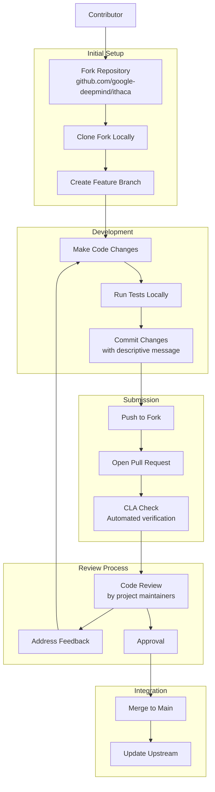
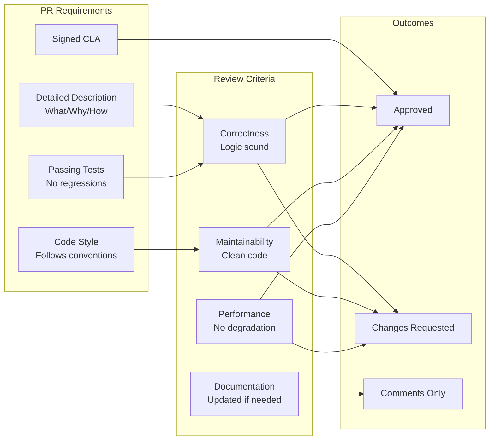

<!-- source: DeepWiki mcp.deepwiki.com · repo google-deepmind/ithaca · page 7.2 Contributing · fetched 2026-10-26 -->

# Contributing

Relevant source files

The following files were used as context for generating this wiki page:

- [AUTHORS](AUTHORS)
- [CONTRIBUTING.md](CONTRIBUTING.md)

This page provides guidelines for contributing to the Ithaca project, including legal requirements, code review processes, and community standards. For information about the repository structure and module organization, see [Project Structure](#7.1). For licensing terms, see [License](#7.3).

## Overview

Ithaca is an open-source research project hosted on GitHub at `https://github.com/google-deepmind/ithaca`. The project welcomes contributions from the community, including bug fixes, feature enhancements, documentation improvements, and research extensions. All contributions must follow the processes outlined in this document.

**Sources:** [CONTRIBUTING.md:1-30]()

## Contributor License Agreement

All contributions to Ithaca must be accompanied by a signed Contributor License Agreement (CLA). This legal requirement ensures proper intellectual property handling while allowing contributors to retain copyright to their work.

### CLA Requirements

| Aspect | Description |
|--------|-------------|
| **Purpose** | Grants permission to use and redistribute contributions as part of the project |
| **Copyright** | Contributors or their employers retain copyright |
| **Signing** | Submit via https://cla.developers.google.com/ |
| **Frequency** | Generally only required once across all Google open-source projects |
| **Verification** | Automatically checked when pull requests are submitted |

The CLA is managed by Google's CLA system. If you have previously signed a Google CLA for another project, you typically do not need to sign again for Ithaca.

**Sources:** [CONTRIBUTING.md:6-17]()

## Contribution Workflow

The following diagram illustrates the complete contribution process from initial setup to merge:

### Step-by-Step Process

1. **Fork and Clone**: Fork the repository and clone your fork locally
2. **Create Branch**: Create a descriptive feature branch (e.g., `fix-bigbird-attention`, `add-region-filtering`)
3. **Develop**: Make your changes following the codebase conventions
4. **Test**: Verify your changes work correctly
5. **Commit**: Write clear, descriptive commit messages
6. **Push**: Push changes to your fork
7. **Pull Request**: Open a PR against the main repository with detailed description
8. **CLA**: Automated system verifies CLA signature
9. **Review**: Address feedback from maintainers
10. **Merge**: Once approved, changes are merged by maintainers

**Sources:** [CONTRIBUTING.md:19-24]()

## Code Review Process

All submissions, including those from project members, require code review before merging. The review process uses GitHub's pull request system.

### Review Requirements

### Review Process Details

| Stage | Description | Responsibility |
|-------|-------------|----------------|
| **Submission** | PR opened with description and linked issues | Contributor |
| **CLA Verification** | Automated check for signed CLA | System |
| **Initial Review** | Maintainer assesses scope and approach | Maintainer |
| **Detailed Review** | Line-by-line code review with comments | Maintainer |
| **Discussion** | Contributor addresses feedback | Contributor |
| **Approval** | Maintainer approves changes | Maintainer |
| **Merge** | Changes integrated into main branch | Maintainer |

Reviewers evaluate:
- **Code Quality**: Readability, maintainability, adherence to style
- **Correctness**: Logic correctness, edge case handling
- **Testing**: Adequate test coverage, no regressions
- **Documentation**: Updated docstrings, README changes if needed
- **Performance**: No significant performance degradation

**Sources:** [CONTRIBUTING.md:19-24]()

## Contribution Types and Target Areas

Different types of contributions map to different areas of the codebase:

```mermaid
graph TB
    subgraph "Contribution Types"
        BUG["Bug Fixes"]
        FEATURE["New Features"]
        DOC["Documentation"]
        PERF["Performance"]
        RESEARCH["Research Extensions"]
    end
    
    subgraph "Core Model Components"
        MODEL["ithaca/models/model.py<br/>Model architecture"]
        LAYERS["ithaca/models/common_layers.py<br/>Neural network layers"]
        BIGBIRD["ithaca/models/bigbird.py<br/>Attention mechanism"]
    end
    
    subgraph "Training Infrastructure"
        EXPERIMENT["train/experiment.py<br/>Training loop"]
        OPTIM["ithaca/util/optim.py<br/>Optimization"]
        LOSS["ithaca/util/loss.py<br/>Loss functions"]
    end
    
    subgraph "Inference System"
        INFER["ithaca/eval/inference.py<br/>Attribution/Restoration"]
        EVAL["ithaca/util/eval.py<br/>Evaluation utilities"]
    end
    
    subgraph "Data Processing"
        ALPHABET["ithaca/util/alphabet.py<br/>Greek alphabet"]
        TEXT["ithaca/util/text.py<br/>Text processing"]
        DATES["ithaca/util/dates.py<br/>Date handling"]
        REGIONS["ithaca/util/region_names.py<br/>Region mappings"]
    end
    
    subgraph "Examples & Documentation"
        README["README.md"]
        COLAB["colabs/ithaca_inference.ipynb"]
        EXAMPLE["inference_example.py"]
    end
    
    BUG --> MODEL
    BUG --> LAYERS
    BUG --> BIGBIRD
    BUG --> INFER
    BUG --> TEXT
    
    FEATURE --> MODEL
    FEATURE --> EXPERIMENT
    FEATURE --> INFER
    
    DOC --> README
    DOC --> COLAB
    DOC --> MODEL
    DOC --> INFER
    
    PERF --> BIGBIRD
    PERF --> EXPERIMENT
    PERF --> OPTIM
    
    RESEARCH --> MODEL
    RESEARCH --> LAYERS
    RESEARCH --> LOSS
    RESEARCH --> EXPERIMENT
```

### Contribution Guidelines by Area

**Model Architecture** ([ithaca/models/]())
- Maintain compatibility with existing checkpoints where possible
- Add unit tests for new layers or attention mechanisms
- Document architectural changes in docstrings and README
- Consider impact on inference performance

**Training System** ([train/experiment.py](), [ithaca/util/]())
- Ensure reproducibility with fixed random seeds
- Test with multiple batch sizes and device configurations
- Update configuration schema if adding new hyperparameters
- Profile performance impact on training speed

**Inference** ([ithaca/eval/inference.py]())
- Maintain backward compatibility with existing checkpoint format
- Add integration tests using sample inscriptions
- Document new inference capabilities in Colab notebook
- Consider memory and latency implications

**Utilities** ([ithaca/util/]())
- Add comprehensive unit tests
- Maintain consistency with existing Greek text processing conventions
- Document edge cases and special character handling
- Ensure compatibility with both training and inference pipelines

**Documentation** ([README.md](), [colabs/]())
- Test code examples to ensure they work
- Update installation instructions if dependencies change
- Add citations for research contributions
- Keep Colab notebooks executable and up-to-date

**Sources:** [CONTRIBUTING.md:1-30](), Repository structure

## Community Guidelines

All interactions within the Ithaca project must follow Google's Open Source Community Guidelines. These guidelines ensure a welcoming, inclusive, and professional environment.

### Core Principles

| Principle | Description |
|-----------|-------------|
| **Be Respectful** | Treat all contributors with respect regardless of background or experience level |
| **Be Constructive** | Provide helpful, actionable feedback in code reviews and discussions |
| **Be Collaborative** | Work together toward project goals; assume good intentions |
| **Be Patient** | Allow time for responses; recognize that contributors have varying availability |

### Expected Behavior

- Use welcoming and inclusive language
- Respect differing viewpoints and experiences
- Accept constructive criticism gracefully
- Focus on what is best for the project and community
- Show empathy toward other community members

### Unacceptable Behavior

- Harassment, discriminatory language, or personal attacks
- Publishing others' private information without permission
- Trolling, insulting comments, or inflammatory interactions
- Other conduct inappropriate in a professional setting

Full guidelines available at: https://opensource.google/conduct/

**Sources:** [CONTRIBUTING.md:26-29]()

## Copyright and Authorship

Contributors retain copyright to their contributions, but copyright may be held by contributors' employers depending on employment agreements.

### Copyright Holders

The [AUTHORS]() file lists copyright holders for the Ithaca project:

| Entity | Role |
|--------|------|
| DeepMind Technologies Limited | Primary developer and copyright holder |
| Google LLC | Parent organization and copyright holder |
| Individual Researchers | Domain experts and research contributors |

Individual contributors are acknowledged in git history and may be listed in the AUTHORS file if they hold copyright independently.

**Code Changes Tracking:**
- All contributors visible in git commit history
- Use `git log --follow <file>` to see contributor history for specific files
- GitHub contribution graphs show aggregate contribution metrics

**Sources:** [AUTHORS:1-13]()

## Getting Started as a Contributor

For new contributors, we recommend the following approach:

### Step 1: Understand the Codebase

1. Read the [Overview](#1) and [System Architecture](#1.2) documentation
2. Review the [Getting Started](#2) guide to set up your development environment
3. Explore the [Project Structure](#7.1) to understand module organization
4. Run the [inference examples](#2.4) to verify your setup

### Step 2: Find an Issue

- Browse GitHub Issues for `good-first-issue` labels
- Look for `help-wanted` tags on feature requests
- Check documentation for areas needing improvement
- Identify bugs through your own usage

### Step 3: Start Small

Recommended first contributions:
- Fix typos or improve documentation
- Add unit tests for uncovered code paths
- Improve error messages or logging
- Optimize small performance bottlenecks

### Step 4: Engage with the Community

- Comment on issues before starting work to avoid duplication
- Ask questions in pull request discussions
- Share your use cases and research applications
- Provide feedback on proposed features

**Sources:** [CONTRIBUTING.md:1-30](), Repository structure

## Summary

Contributing to Ithaca involves:

1. **Legal**: Sign the CLA at https://cla.developers.google.com/
2. **Technical**: Follow the fork-branch-PR workflow on GitHub
3. **Quality**: Ensure code passes review criteria (correctness, tests, documentation)
4. **Community**: Follow Google's Open Source Community Guidelines

All submissions require code review via GitHub pull requests. Project maintainers will guide you through the process and provide feedback to help your contribution succeed.

For questions about contributing, open a GitHub issue with the `question` label or comment on existing relevant issues.

**Sources:** [CONTRIBUTING.md:1-30](), [AUTHORS:1-13]()

---

