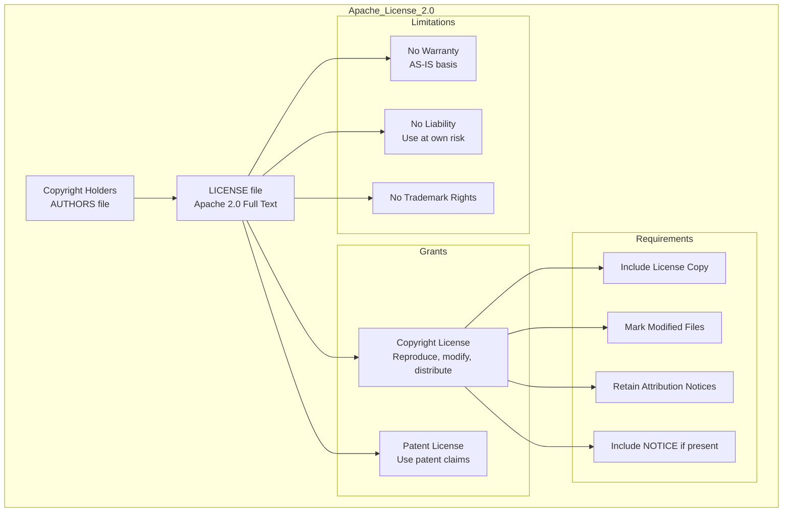
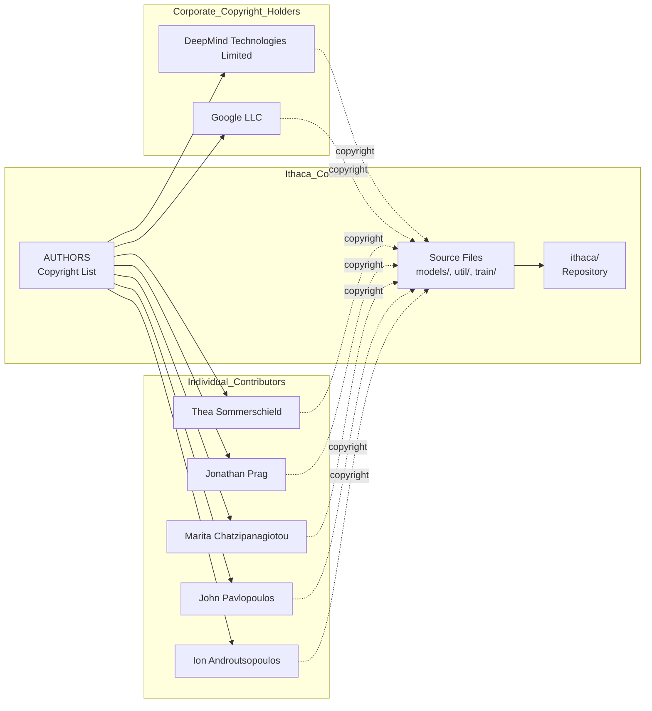
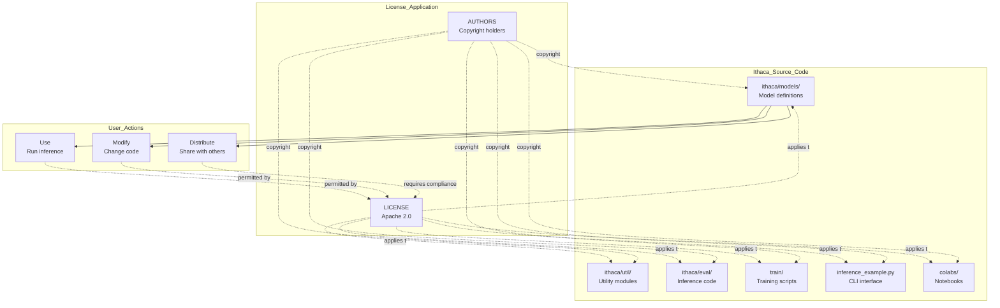

<!-- source: DeepWiki mcp.deepwiki.com · repo google-deepmind/ithaca · page 7.3 License · fetched 2026-10-26 -->

# License

<details>
<summary>Relevant source files</summary>

The following files were used as context for generating this wiki page:

- [AUTHORS](AUTHORS)
- [LICENSE](LICENSE)

</details>


## Purpose and Scope

This page documents the licensing terms and copyright information for the Ithaca project. It covers the Apache License 2.0 terms under which the software is distributed, identifies copyright holders, and explains permissions and obligations for users and contributors. For contribution guidelines, see [Contributing](#7.2). For general project information, see [Overview](#1).

## License Overview

The Ithaca project is licensed under the **Apache License, Version 2.0** (January 2004). This is a permissive open-source license that allows users to freely use, modify, and distribute the software, subject to certain conditions.

The complete license text is available at [LICENSE:1-203]().

### License Summary



**Diagram: Apache License 2.0 Structure and Key Provisions**

**Sources:** [LICENSE:1-203](), [AUTHORS:1-13]()

## Copyright Holders

The Ithaca project has multiple copyright holders as listed in the `AUTHORS` file:

| Copyright Holder | Type |
|-----------------|------|
| DeepMind Technologies Limited | Corporate Entity |
| Google LLC | Corporate Entity |
| Thea Sommerschield | Individual Contributor |
| Jonathan Prag | Individual Contributor |
| Marita Chatzipanagiotou | Individual Contributor |
| John Pavlopoulos | Individual Contributor |
| Ion Androutsopoulos | Individual Contributor |

The `AUTHORS` file specifically notes that it lists copyright holders for copyright purposes, and that not all code contributors may appear if their employer is the copyright holder. The full list of contributors can be found in the source control revision history.

**Sources:** [AUTHORS:1-13]()

### Copyright Holder Relationships



**Diagram: Copyright Holder Relationships to Codebase**

**Sources:** [AUTHORS:1-13]()

## License Terms and Conditions

### Definitions

The Apache License 2.0 defines several key terms that govern its application:

| Term | Definition | Reference |
|------|------------|-----------|
| License | Terms and conditions for use, reproduction, and distribution | [LICENSE:8-11]() |
| Licensor | Copyright owner granting the License | [LICENSE:13-14]() |
| Legal Entity | Individual or entity exercising license permissions | [LICENSE:16-22]() |
| You/Your | Individual or Legal Entity using the software | [LICENSE:24-25]() |
| Source Form | Preferred form for modifications (source code, docs, configs) | [LICENSE:27-29]() |
| Object Form | Compiled or transformed output (binaries, generated docs) | [LICENSE:31-34]() |
| Work | Software under license, indicated by copyright notice | [LICENSE:36-39]() |
| Derivative Works | Modified or derived works based on the original | [LICENSE:41-47]() |
| Contribution | Modifications submitted for inclusion by copyright owner | [LICENSE:49-61]() |
| Contributor | Licensor or entity whose contribution was incorporated | [LICENSE:63-65]() |

**Sources:** [LICENSE:8-65]()

### Grants of Rights

The Apache License 2.0 provides two primary grants:

#### Copyright License Grant

Each Contributor grants users a **perpetual, worldwide, non-exclusive, no-charge, royalty-free, irrevocable** copyright license to:

- Reproduce the Work
- Prepare Derivative Works
- Publicly display the Work
- Publicly perform the Work
- Sublicense the Work
- Distribute the Work and Derivative Works in Source or Object form

**Sources:** [LICENSE:67-72]()

#### Patent License Grant

Each Contributor grants users a **perpetual, worldwide, non-exclusive, no-charge, royalty-free, irrevocable** patent license to:

- Make, have made, use, offer to sell, sell, import, and otherwise transfer the Work
- Applies only to patent claims necessarily infringed by the Contribution

**Important:** Patent license terminates if you institute patent litigation alleging the Work infringes a patent.

**Sources:** [LICENSE:74-88]()

### Redistribution Conditions

When redistributing the Work or Derivative Works, you **must**:

| Requirement | Description | Reference |
|-------------|-------------|-----------|
| Include License Copy | Provide a copy of the Apache License 2.0 | [LICENSE:95-96]() |
| Mark Modified Files | Add prominent notices stating files were changed | [LICENSE:98-99]() |
| Retain Attribution Notices | Keep copyright, patent, trademark, and attribution notices from Source form | [LICENSE:101-105]() |
| Include NOTICE File | If present, include readable copy in Derivative Works | [LICENSE:107-122]() |

You **may**:
- Add your own copyright statement to modifications
- Provide different license terms for your modifications
- Provided you comply with the conditions of this License

**Sources:** [LICENSE:90-129]()

### License Application to Ithaca



**Diagram: License Application to Ithaca Components**

**Sources:** [LICENSE:1-203](), [AUTHORS:1-13]()

### Contribution Terms

Unless explicitly stated otherwise, any Contribution intentionally submitted for inclusion in Ithaca shall be under the Apache License 2.0 terms, without any additional terms or conditions. This does not supersede any separate license agreements between contributors and copyright holders.

**Sources:** [LICENSE:131-137]()

## Limitations and Disclaimers

### No Warranty

The Work is provided on an **"AS IS" BASIS, WITHOUT WARRANTIES OR CONDITIONS OF ANY KIND**, either express or implied, including but not limited to warranties of:

- Title
- Non-infringement
- Merchantability
- Fitness for a particular purpose

Users are solely responsible for determining the appropriateness of using or redistributing the Work and assume any risks associated with exercising permissions under the License.

**Sources:** [LICENSE:144-152]()

### Limitation of Liability

No Contributor shall be liable for damages, including:
- Direct, indirect, special, incidental, or consequential damages
- Loss of goodwill
- Work stoppage
- Computer failure or malfunction
- Any and all other commercial damages or losses

This applies even if the Contributor has been advised of the possibility of such damages.

**Sources:** [LICENSE:154-164]()

### Trademark Restrictions

The License **does not** grant permission to use:
- Trade names
- Trademarks
- Service marks
- Product names of the Licensor

Exception: Reasonable and customary use for describing the origin of the Work and reproducing the NOTICE file content.

**Sources:** [LICENSE:139-142]()

## Applying the License to Your Work

If you create Derivative Works or modifications of Ithaca, the Apache License 2.0 provides guidance on applying the license to your work [LICENSE:179-188]():

### Standard Boilerplate

Attach the following boilerplate notice to your files (in appropriate comment syntax):

```
Copyright [yyyy] [name of copyright owner]

Licensed under the Apache License, Version 2.0 (the "License");
you may not use this file except in compliance with the License.
You may obtain a copy of the License at

    http://www.apache.org/licenses/LICENSE-2.0

Unless required by applicable law or agreed to in writing, software
distributed under the License is distributed on an "AS IS" BASIS,
WITHOUT WARRANTIES OR CONDITIONS OF ANY KIND, either express or implied.
See the License for the specific language governing permissions and
limitations under the License.
```

### Required Actions for Derivative Works

| Action | Description |
|--------|-------------|
| Include LICENSE file | Copy the full Apache License 2.0 text |
| Update AUTHORS file | Add your copyright holder information |
| Mark modified files | Add comments indicating changes made |
| Retain original notices | Keep existing copyright and attribution notices |
| Document changes | Clearly state what was modified |

**Sources:** [LICENSE:179-202]()

## License Compliance Checklist

When using Ithaca in your project, ensure compliance with these requirements:

### For Direct Use (Without Modifications)

- [ ] Include a copy of [LICENSE:1-203]() in your distribution
- [ ] Acknowledge the original copyright holders from [AUTHORS:1-13]()
- [ ] Respect the "AS IS" warranty disclaimer
- [ ] Do not use DeepMind or Google trademarks without permission

### For Modified/Derivative Works

- [ ] Include a copy of the Apache License 2.0
- [ ] Mark modified files with prominent change notices
- [ ] Retain all original copyright and attribution notices
- [ ] Include the AUTHORS file or equivalent attribution
- [ ] Document your modifications
- [ ] Optionally add your own copyright statement for your modifications
- [ ] Ensure your distribution complies with all Apache 2.0 conditions

### For Redistribution

- [ ] Provide License copy to recipients
- [ ] Include attribution to original authors
- [ ] If distributing Object form (compiled), provide Source form or offer to provide it
- [ ] Maintain the same license terms for the Ithaca portions

**Sources:** [LICENSE:90-129]()

## Summary

The Ithaca project uses the **Apache License 2.0**, a permissive open-source license that allows:

- ✅ Commercial use
- ✅ Modification
- ✅ Distribution
- ✅ Patent use
- ✅ Private use

With requirements to:

- ⚠️ Include license and copyright notice
- ⚠️ State changes made to the code
- ⚠️ Retain original attribution notices

And limitations:

- ❌ No trademark use
- ❌ No liability
- ❌ No warranty

Copyright is held by DeepMind Technologies Limited, Google LLC, and individual contributors as listed in the [AUTHORS:1-13]() file.

**Sources:** [LICENSE:1-203](), [AUTHORS:1-13]()

---

