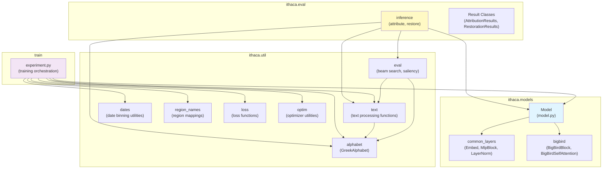
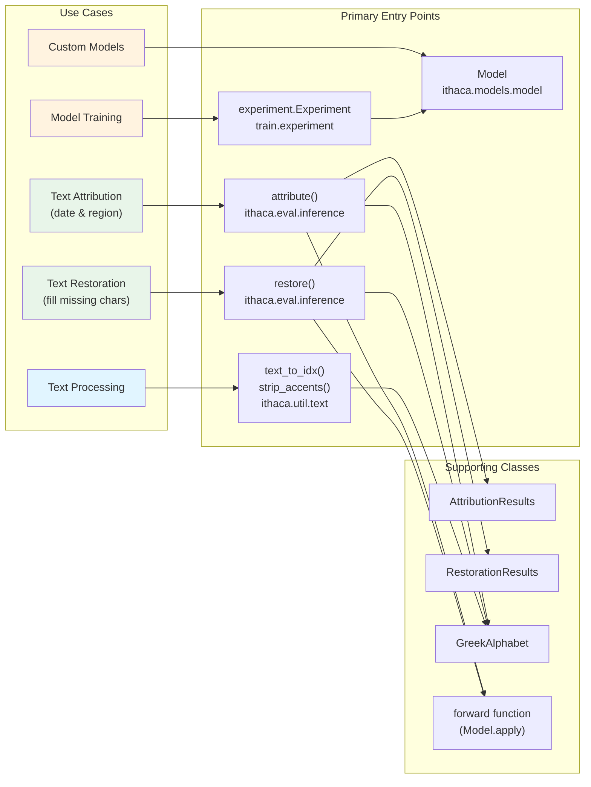
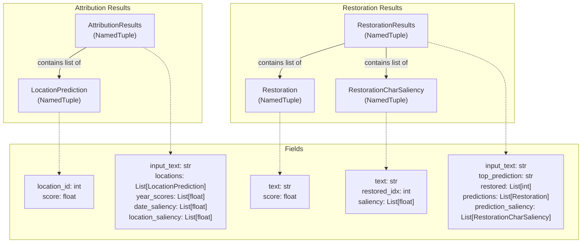
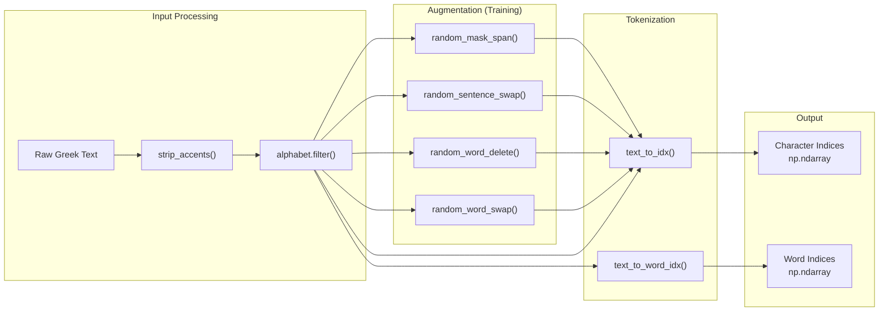
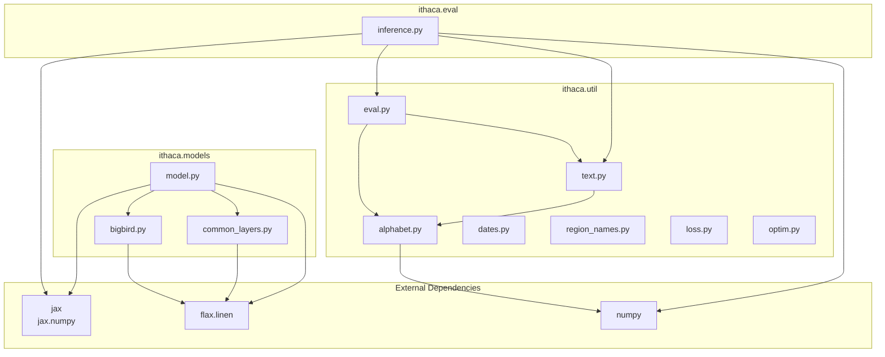

<!-- source: DeepWiki mcp.deepwiki.com · repo google-deepmind/ithaca · page 8 API Reference · fetched 2026-10-26 -->

# API Reference

<details>
<summary>Relevant source files</summary>

The following files were used as context for generating this wiki page:

- [ithaca/eval/inference.py](ithaca/eval/inference.py)
- [ithaca/models/model.py](ithaca/models/model.py)
- [ithaca/util/alphabet.py](ithaca/util/alphabet.py)

</details>


This document provides a complete API reference for the Ithaca package. It covers all public modules, classes, and functions available for text attribution, restoration, model definition, and utility operations. For installation and usage examples, see [Getting Started](#2). For architectural details, see [Model Architecture](#3) and [Training System](#4).

The Ithaca API is organized into three main modules:
- **`ithaca.models`**: Model architecture components and layer definitions (see [8.1](#8.1))
- **`ithaca.eval`**: Inference functions for attribution and restoration (see [8.2](#8.2))
- **`ithaca.util`**: Utilities for text processing, vocabularies, and data handling (see [8.3](#8.3))

---

## Package Structure

The Ithaca package follows a modular design with clear separation between model definition, inference operations, and supporting utilities.



**Sources:** [ithaca/models/model.py](), [ithaca/eval/inference.py](), [ithaca/util/alphabet.py]()

---

## API Entry Points by Use Case

Different use cases require different entry points into the Ithaca API. This diagram maps common tasks to the primary functions and classes used.



**Sources:** [ithaca/eval/inference.py:186-223](), [ithaca/eval/inference.py:226-268](), [train/experiment.py](), [ithaca/models/model.py:24-243]()

---

## Core Data Structures

The Ithaca API uses `NamedTuple` classes to provide structured, immutable results from inference operations. These data structures can be serialized to JSON and provide type safety.

### Result Classes Hierarchy



| Class | Location | Purpose |
|-------|----------|---------|
| `AttributionResults` | [ithaca/eval/inference.py:48-73]() | Contains date predictions, region predictions, and saliency maps from attribution |
| `LocationPrediction` | [ithaca/eval/inference.py:35-45]() | Single region prediction with ID and probability score |
| `RestorationResults` | [ithaca/eval/inference.py:99-127]() | Contains beam search results and saliency maps from restoration |
| `Restoration` | [ithaca/eval/inference.py:76-82]() | Single restored text candidate with score |
| `RestorationCharSaliency` | [ithaca/eval/inference.py:85-96]() | Saliency map for one predicted character in restoration sequence |

**Sources:** [ithaca/eval/inference.py:35-127]()

---

## Inference API

The `ithaca.eval.inference` module provides two primary functions for inference operations.

### Function Signatures

```python
# Attribution: Predict date and geographical region
def attribute(
    text: str,
    forward: Callable,
    params: Any,
    alphabet: GreekAlphabet,
    vocab_char_size: int,
    vocab_word_size: int,
    region_map: Dict
) -> AttributionResults

# Restoration: Fill missing characters marked with '?'
def restore(
    text: str,
    forward: Callable,
    params: Any,
    alphabet: GreekAlphabet,
    vocab_char_size: int,
    vocab_word_size: int
) -> RestorationResults
```

### Key Parameters

| Parameter | Type | Description |
|-----------|------|-------------|
| `text` | `str` | Input Greek inscription text. For restoration, missing characters marked with `'?'` |
| `forward` | `Callable` | Model forward function, typically `functools.partial(Model.apply, params)` |
| `params` | `Any` | Model parameters (Flax frozen dict) |
| `alphabet` | `GreekAlphabet` | Greek alphabet instance with vocabulary mappings |
| `vocab_char_size` | `int` | Size of character vocabulary (typically 164) |
| `vocab_word_size` | `int` | Size of word vocabulary (typically 100004) |
| `region_map` | `Dict` | Region ID mappings (required only for `attribute()`) |

### Input Requirements

Both functions enforce specific text length constraints:

| Constraint | Value | Location |
|------------|-------|----------|
| `MIN_TEXT_LEN` | 50 characters | [ithaca/eval/inference.py:131]() |
| `TEXT_LEN` | 768 characters (including padding) | [ithaca/eval/inference.py:132]() |
| Date range | -800 to 800 CE | [ithaca/eval/inference.py:133-134]() |
| Date interval | 10 years | [ithaca/eval/inference.py:135]() |

**Sources:** [ithaca/eval/inference.py:186-223](), [ithaca/eval/inference.py:226-268](), [ithaca/eval/inference.py:131-139]()

---

## Model API

The `ithaca.models.model` module defines the main `Model` class, which is a Flax neural network module.

### Model Class

```python
class Model(nn.Module):
    """Transformer Model for sequence tagging."""
    
    # Vocabulary sizes
    vocab_char_size: int = 164
    vocab_word_size: int = 100004
    
    # Output dimensions
    output_subregions: int = 85
    output_date: int = 160
    
    # Architecture parameters
    num_heads: int = 8
    num_layers: int = 6
    emb_dim: int = 512
    mlp_dim: int = 2048
    
    # ... additional parameters
    
    def __call__(
        self,
        text_char: Optional[Array] = None,
        text_word: Optional[Array] = None,
        text_char_onehot: Optional[Array] = None,
        text_word_onehot: Optional[Array] = None,
        padding: Optional[Array] = None,
        is_training: bool = True
    ) -> Tuple[Array, Array, Array, Array]
```

### Model Configuration Parameters

| Parameter | Default | Description |
|-----------|---------|-------------|
| `vocab_char_size` | 164 | Character vocabulary size |
| `vocab_word_size` | 100004 | Word vocabulary size |
| `output_subregions` | 85 | Number of geographical regions |
| `output_date` | 160 | Number of date bins (decades from -800 to 800) |
| `num_heads` | 8 | Number of attention heads |
| `num_layers` | 6 | Number of transformer layers |
| `word_char_emb_dim` | 192 | Embedding dimension for char/word |
| `emb_dim` | 512 | Hidden dimension |
| `qkv_dim` | 512 | Query/key/value dimension |
| `mlp_dim` | 2048 | Feed-forward dimension |
| `max_len` | 1024 | Maximum sequence length |
| `dropout_rate` | 0.1 | Dropout rate |
| `attention_dropout_rate` | 0.1 | Attention dropout rate |
| `model_type` | `'bigbird'` | Attention mechanism type |
| `feature_combine_type` | `'concat'` | How to combine char/word embeddings (`'concat'` or `'add'`) |
| `region_date_pooling` | `'first'` | Pooling strategy (`'first'`, `'average'`, or `'sum'`) |

### Model Output

The model returns a tuple of four elements:

```python
(pred_date, logits_subregion, logits_mask, logits_nsp)
```

| Output | Shape | Description |
|--------|-------|-------------|
| `pred_date` | `(batch, 160)` or `(batch, 1)` | Date prediction logits or distribution |
| `logits_subregion` | `(batch, 85)` | Region classification logits |
| `logits_mask` | `(batch, seq_len, vocab_char_size)` | Masked language modeling logits |
| `logits_nsp` | `(batch, seq_len, 2)` | Next sentence prediction logits |

**Sources:** [ithaca/models/model.py:24-243]()

---

## Vocabulary API

The `ithaca.util.alphabet` module provides classes for handling Greek text vocabularies.

### GreekAlphabet Class

```python
class GreekAlphabet(Alphabet):
    """Greek alphabet class with character and word vocabularies."""
    
    def __init__(
        self,
        wordlist_file: Optional[TextIO] = None,
        wordlist_size: int = 100000
    )
    
    # Key attributes
    alphabet: List[str]  # Greek letters
    idx2char: np.ndarray  # Index to character mapping
    char2idx: Dict[str, int]  # Character to index mapping
    idx2word: np.ndarray  # Index to word mapping
    word2idx: Dict[str, int]  # Word to index mapping
    
    # Special tokens
    pad: str = '#'  # Padding
    sos: str = '<'  # Start of sequence
    unk: str = '^'  # Unknown
    space: str = ' '  # Space
    missing: str = '-'  # Missing character
    
    # Special token indices
    pad_idx: int
    sos_idx: int
    unk_idx: int
    
    def filter(self, t: str) -> str:
        """Normalize Greek text (lowercase, diacritics, sigma)."""
    
    def size_char(self) -> int:
        """Return character vocabulary size."""
    
    def size_word(self) -> int:
        """Return word vocabulary size."""
```

### GreekAlphabet Normalization

The `filter()` method performs the following normalization steps:

1. **Lowercasing**: Converts all text to lowercase
2. **Diacritic normalization**: Removes dot below, perispomeni
3. **Sigma handling**: Converts final sigma (σ → ς) based on word boundaries
4. **Tonos-oxia conversion**: Standardizes accent marks to tonos form
5. **Aspirate handling**: Converts ℎ patterns to appropriate breathing marks

| Feature | Implementation | Location |
|---------|----------------|----------|
| Greek letters | 26 characters: `αβγδεζηθικλμνξοπρςστυφχψωϙϛ` | [ithaca/util/alphabet.py:85]() |
| Tonos-oxia map | Dictionary with 16 mappings | [ithaca/util/alphabet.py:91-111]() |
| Sigma conversion | Regex-based: `([\w\[\]])σ(?![\[\]])(\b)` → `\1ς\2` | [ithaca/util/alphabet.py:125]() |
| H patterns | 20 breathing mark patterns | [ithaca/util/alphabet.py:132-160]() |

**Sources:** [ithaca/util/alphabet.py:21-172]()

---

## Text Processing API

The `ithaca.util.text` module provides functions for text manipulation and conversion.

### Core Text Processing Functions



### Key Functions

| Function | Purpose | Location |
|----------|---------|----------|
| `strip_accents(text)` | Remove Greek accent marks | [ithaca/util/text.py]() |
| `text_to_idx(text, alphabet)` | Convert text to character indices | [ithaca/util/text.py]() |
| `text_to_word_idx(text, alphabet)` | Convert text to word indices | [ithaca/util/text.py]() |
| `random_mask_span(text, ...)` | Mask random span for MLM task | [ithaca/util/text.py]() |
| `random_sentence_swap(text, ...)` | Swap sentences for NSP task | [ithaca/util/text.py]() |
| `random_word_delete(text, ...)` | Delete random words | [ithaca/util/text.py]() |
| `random_word_swap(text, ...)` | Swap random words | [ithaca/util/text.py]() |

**Sources:** [ithaca/util/text.py](), [ithaca/eval/inference.py:142-183]()

---

## Evaluation Utilities API

The `ithaca.util.eval` module provides functions for beam search, saliency computation, and evaluation metrics.

### Beam Search Functions

```python
def beam_search_batch_2d(
    forward: Callable,
    alphabet: GreekAlphabet,
    text_padded: str,
    restore_mask_idx: List[int],
    beam_width: int = 20,
    temperature: float = 1.0,
    rng: PRNGKey
) -> List[BeamEntry]
```

| Function | Purpose | Returns |
|----------|---------|---------|
| `beam_search_batch_2d()` | Beam search for text restoration | List of `BeamEntry` with restored text and scores |
| `nucleus_sample()` | Sample from top-p distribution | Sampled indices |
| `sequential_restoration_saliency()` | Compute saliency for each restoration step | List of saliency maps |
| `compute_attribution_saliency_maps()` | Compute date/region saliency | Tuple of saliency arrays |

### Evaluation Metrics

| Function | Purpose | Location |
|----------|---------|----------|
| `softmax(logits)` | Apply softmax activation | [ithaca/util/eval.py]() |
| `log_softmax(logits)` | Apply log-softmax | [ithaca/util/eval.py]() |
| `predicted_date()` | Convert date distribution to year | [ithaca/util/eval.py]() |
| `date_l1_loss()` | Compute L1 loss for date prediction | [ithaca/util/eval.py]() |

**Sources:** [ithaca/util/eval.py](), [ithaca/eval/inference.py:213-215](), [ithaca/eval/inference.py:236-242](), [ithaca/eval/inference.py:255-257]()

---

## Date and Region Utilities API

### Date Processing

The `ithaca.util.dates` module handles conversion between dates and binned intervals.

| Function | Purpose |
|----------|---------|
| `date_to_bin(date, interval)` | Convert date to bin index |
| `bin_to_date(bin_idx, interval)` | Convert bin index to date |
| `create_date_distribution(date, interval, num_bins)` | Create distribution centered on date |

Date bins cover the range from 800 BCE to 800 CE in 10-year intervals, resulting in 160 bins.

### Region Processing

The `ithaca.util.region_names` module provides mappings between region IDs and names.

| Function | Purpose |
|----------|---------|
| `load_region_map(file)` | Load region ID-to-name mappings from file |
| `filter_unknown_regions(regions)` | Remove unknown region entries |

The region map contains 84 subregions from the PHI dataset, organized hierarchically by main region and subregion.

**Sources:** [ithaca/util/dates.py](), [ithaca/util/region_names.py]()

---

## Training API

The `train.experiment` module provides the training infrastructure using JAXline.

### Experiment Class

```python
class Experiment(jaxline.experiment.AbstractExperiment):
    """Main training experiment class."""
    
    def __init__(self, mode, init_rng, config)
    
    def step(self, global_step, rng, **unused_args):
        """Single training step with multi-task loss."""
    
    def evaluate(self, global_step, rng, **unused_args):
        """Evaluation on validation set."""
```

### Training Configuration

The experiment uses `ml_collections.ConfigDict` for configuration. Key parameters include:

| Parameter | Purpose |
|-----------|---------|
| `model_config` | Model architecture parameters |
| `optimizer_config` | Learning rate, warmup steps, gradient clipping |
| `training_config` | Batch size, epochs, loss weights |
| `data_config` | Dataset paths, augmentation settings |

**Sources:** [train/experiment.py]()

---

## Module Dependencies

The following diagram shows import dependencies between API modules:



**Sources:** [ithaca/models/model.py:16-21](), [ithaca/eval/inference.py:23-32](), [ithaca/util/alphabet.py:16-18]()

---

## JSON Serialization

All result classes provide JSON serialization through `build_json()` and `json()` methods:

```python
# AttributionResults example
result = attribute(text, forward, params, alphabet, vocab_char, vocab_word, region_map)
json_str = result.json(indent=2)  # Pretty-printed JSON
json_dict = result.build_json()   # Python dictionary

# RestorationResults example
result = restore(text, forward, params, alphabet, vocab_char, vocab_word)
json_str = result.json()
```

Each result class serializes its nested structures recursively:
- `AttributionResults` → `LocationPrediction` objects
- `RestorationResults` → `Restoration` and `RestorationCharSaliency` objects

**Sources:** [ithaca/eval/inference.py:63-73](), [ithaca/eval/inference.py:112-127]()

---

## Constants and Configuration

The inference module defines several constants that govern model behavior:

| Constant | Value | Purpose | Location |
|----------|-------|---------|----------|
| `MIN_TEXT_LEN` | 50 | Minimum input text length | [ithaca/eval/inference.py:131]() |
| `TEXT_LEN` | 768 | Fixed model sequence length | [ithaca/eval/inference.py:132]() |
| `DATE_MIN` | -800 | Minimum date (800 BCE) | [ithaca/eval/inference.py:133]() |
| `DATE_MAX` | 800 | Maximum date (800 CE) | [ithaca/eval/inference.py:134]() |
| `DATE_INTERVAL` | 10 | Date binning interval (years) | [ithaca/eval/inference.py:135]() |
| `RESTORATION_BEAM_WIDTH` | 20 | Beam search width | [ithaca/eval/inference.py:136]() |
| `RESTORATION_TEMPERATURE` | 1.0 | Sampling temperature | [ithaca/eval/inference.py:137]() |
| `SEED` | 1 | Random seed for inference | [ithaca/eval/inference.py:138]() |
| `ALPHABET_MISSING_RESTORE` | `'?'` | Missing character marker | [ithaca/eval/inference.py:139]() |

**Sources:** [ithaca/eval/inference.py:130-139]()

---

