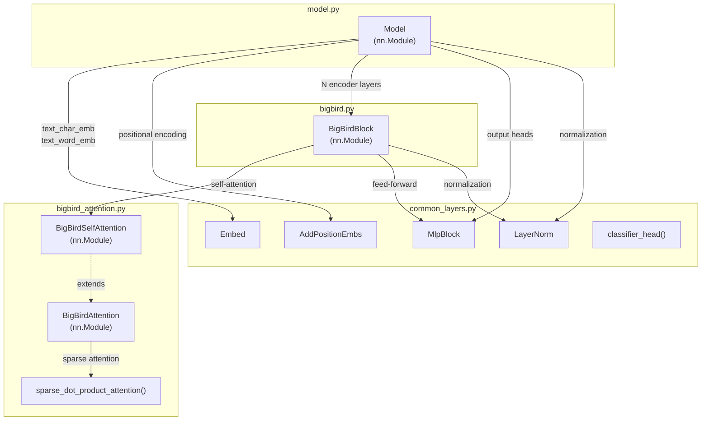
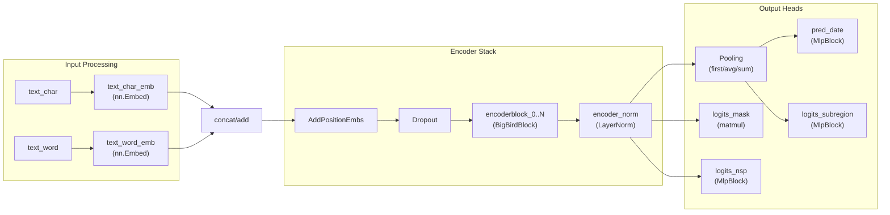
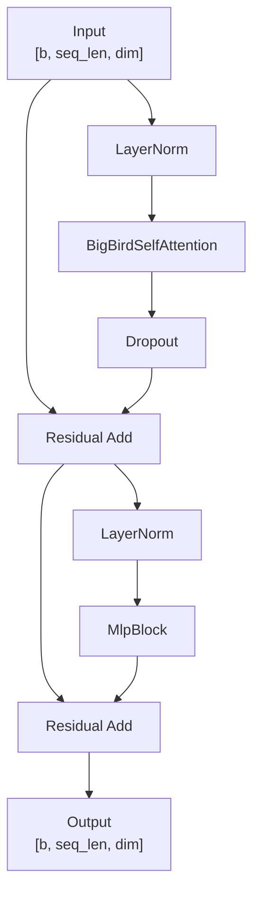
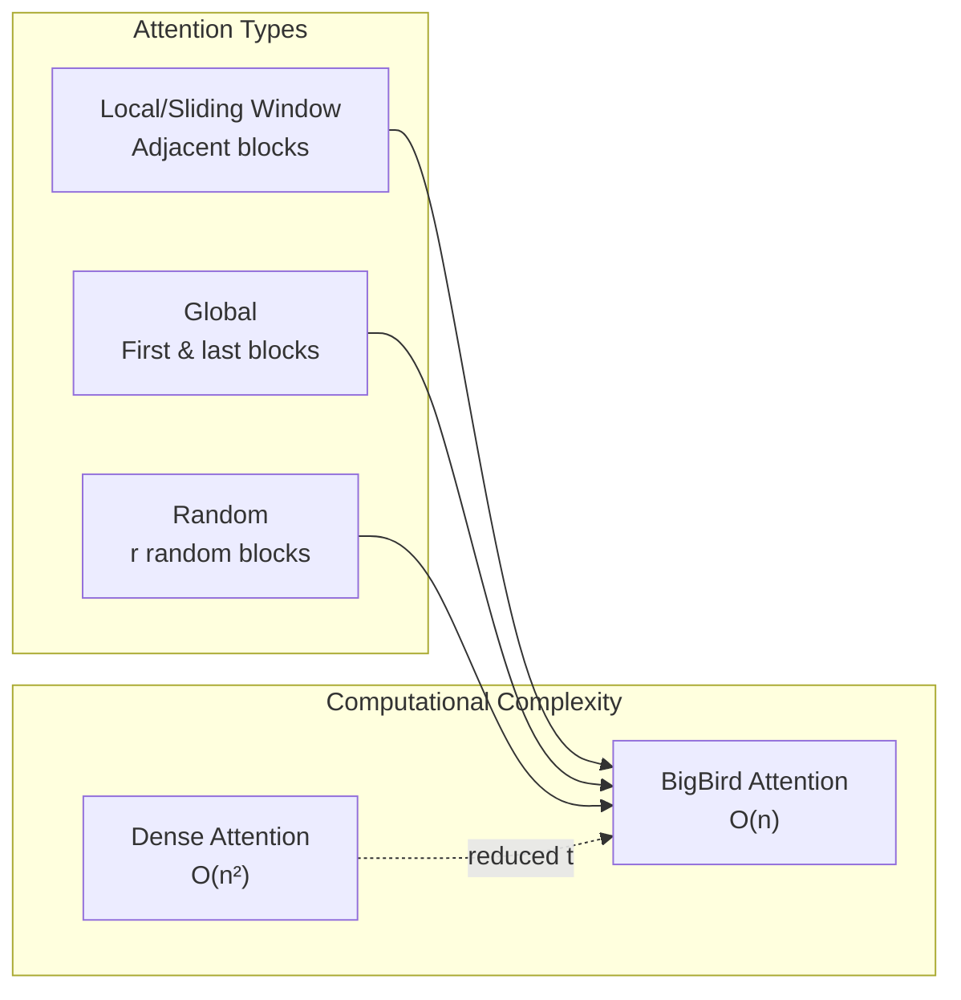

<!-- source: DeepWiki mcp.deepwiki.com · repo google-deepmind/ithaca · page 8.1 ithaca.models · fetched 2026-10-26 -->

# ithaca.models

<details>
<summary>Relevant source files</summary>

The following files were used as context for generating this wiki page:

- [ithaca/models/bigbird.py](ithaca/models/bigbird.py)
- [ithaca/models/bigbird_attention.py](ithaca/models/bigbird_attention.py)
- [ithaca/models/common_layers.py](ithaca/models/common_layers.py)
- [ithaca/models/model.py](ithaca/models/model.py)

</details>


This page provides the API reference for the neural network model components in the Ithaca system. These modules define the core Transformer architecture with BigBird sparse attention, reusable neural network layers, and embedding mechanisms.

For information about training the model, see [Training System](#4). For information about using the model for inference, see [Inference System](#5).

**Scope**: This page documents the classes and functions in:
- `ithaca/models/model.py` - Main `Model` class
- `ithaca/models/common_layers.py` - Reusable layer components
- `ithaca/models/bigbird.py` - BigBird transformer blocks
- `ithaca/models/bigbird_attention.py` - Sparse attention mechanism

---

## Model Architecture Overview

The following diagram shows how the main model components relate to each other:



**Sources:** [ithaca/models/model.py:1-244](), [ithaca/models/bigbird.py:1-111](), [ithaca/models/bigbird_attention.py:1-603](), [ithaca/models/common_layers.py:1-319]()

---

## ithaca.models.model

### Model Class

The `Model` class is the main Ithaca neural network, implementing a Transformer encoder with multi-task output heads.



#### Class Signature

**Location:** [ithaca/models/model.py:24-243]()

```python
class Model(nn.Module):
  """Transformer Model for sequence tagging."""
```

#### Configuration Attributes

| Attribute | Type | Default | Description |
|-----------|------|---------|-------------|
| `vocab_char_size` | int | 164 | Character vocabulary size |
| `vocab_word_size` | int | 100004 | Word vocabulary size |
| `output_subregions` | int | 85 | Number of geographical regions |
| `output_date` | int | 160 | Number of date bins |
| `output_date_dist` | bool | True | Output date distribution |
| `output_return_emb` | bool | False | Return embeddings |
| `use_output_mlp` | bool | True | Use MLP for output heads |
| `num_heads` | int | 8 | Number of attention heads |
| `num_layers` | int | 6 | Number of encoder layers |
| `word_char_emb_dim` | int | 192 | Character/word embedding dimension |
| `emb_dim` | int | 512 | Main model dimension |
| `qkv_dim` | int | 512 | Query/Key/Value dimension |
| `mlp_dim` | int | 2048 | MLP hidden dimension |
| `max_len` | int | 1024 | Maximum sequence length |
| `causal_mask` | bool | False | Use causal masking |
| `feature_combine_type` | str | 'concat' | How to combine char/word embeddings ('concat' or 'add') |
| `posemb_combine_type` | str | 'add' | How to add positional embeddings ('concat' or 'add') |
| `region_date_pooling` | str | 'first' | Pooling strategy ('first', 'average', 'sum') |
| `learn_pos_emb` | bool | True | Use learned positional embeddings |
| `use_bfloat16` | bool | False | Use bfloat16 precision |
| `dropout_rate` | float | 0.1 | Dropout rate |
| `attention_dropout_rate` | float | 0.1 | Attention dropout rate |
| `activation_fn` | str | 'gelu' | Activation function |
| `model_type` | str | 'bigbird' | Transformer type |

#### Methods

**`setup()`** - [ithaca/models/model.py:51-61]()

Initializes character and word embedding layers.

```python
def setup(self):
  self.text_char_emb = nn.Embed(...)  # Character embeddings
  self.text_word_emb = nn.Embed(...)  # Word embeddings
```

**`__call__(...)`** - [ithaca/models/model.py:63-243]()

Forward pass through the model.

**Parameters:**
- `text_char` (Array, optional): Character indices, shape `[batch, length]`
- `text_word` (Array, optional): Word indices, shape `[batch, length]`
- `text_char_onehot` (Array, optional): One-hot character vectors, shape `[batch, length, vocab_char_size]`
- `text_word_onehot` (Array, optional): One-hot word vectors, shape `[batch, length, vocab_word_size]`
- `text_char_emb` (Array, optional): Pre-computed character embeddings
- `text_word_emb` (Array, optional): Pre-computed word embeddings
- `padding` (Array, optional): Padding mask, shape `[batch, length]`
- `is_training` (bool): Whether in training mode (affects dropout)

**Returns:**
- Tuple of `(pred_date, logits_subregion, logits_mask, logits_nsp)`:
  - `pred_date`: Date predictions, shape `[batch, output_date]` or `[batch, 1]`
  - `logits_subregion`: Region logits, shape `[batch, output_subregions]`
  - `logits_mask`: Masked character logits, shape `[batch, length, vocab_char_size]`
  - `logits_nsp`: Next sentence prediction logits, shape `[batch, length, 2]`

**Sources:** [ithaca/models/model.py:1-244]()

---

## ithaca.models.common_layers

This module contains reusable neural network components shared across different model architectures.

### Embed

**Location:** [ithaca/models/common_layers.py:74-107]()

Embedding layer that converts integer indices to dense vectors (input mode) or computes output logits via matrix multiplication (output mode).

```python
class Embed(nn.Module):
  mode: str = 'input'  # 'input' or 'output'
  emb_init: Callable = nn.initializers.normal(stddev=1.0)
```

**`__call__(inputs, num_embeddings, features)`**

- **Input mode** (`mode='input'`): Takes integer indices, returns embeddings via lookup [ithaca/models/common_layers.py:101-104]()
- **Output mode** (`mode='output'`): Takes embeddings, returns logits via matrix multiplication [ithaca/models/common_layers.py:105-106]()

### AddPositionEmbs

**Location:** [ithaca/models/common_layers.py:143-219]()

Adds positional embeddings to input sequences. Supports both learned and fixed sinusoidal embeddings.

```python
class AddPositionEmbs(nn.Module):
  posemb_init: Optional[Callable] = None  # If None, uses sinusoidal
  posemb_dim: Optional[int] = None
  max_len: int = 512
  combine_type: str = 'concat'  # 'concat' or 'add'
  replicate_tf: bool = False
```

**`__call__(inputs, inputs_positions=None, cache=None)`**

**Parameters:**
- `inputs`: Input sequences, shape `[batch, seq_len, emb_dim]`
- `inputs_positions` (optional): Position indices for packed sequences
- `cache` (optional): Attention cache for fast decoding

**Returns:** 
- If `combine_type='add'`: Returns `inputs + positional_embeddings`
- If `combine_type='concat'`: Returns concatenation along feature dimension

**Positional Embedding Types:**

| Configuration | Behavior |
|---------------|----------|
| `posemb_init=None` | Fixed sinusoidal embeddings (non-learned) |
| `posemb_init=<function>` | Learned positional embeddings |
| `replicate_tf=True` | Replicates TensorFlow sinusoidal encoding exactly |

### sinusoidal_init

**Location:** [ithaca/models/common_layers.py:109-141]()

Creates a 1D sinusoidal position embedding initializer.

```python
def sinusoidal_init(max_len=2048, replicate_tf=False):
  """Returns init function for sinusoidal embeddings."""
```

The sinusoidal encoding uses alternating sine and cosine functions:
- Even dimensions: `sin(position / 10000^(2i/d_model))`
- Odd dimensions: `cos(position / 10000^(2i/d_model))`

### MlpBlock

**Location:** [ithaca/models/common_layers.py:221-256]()

Two-layer feed-forward network with activation and dropout, used in Transformer blocks.

```python
class MlpBlock(nn.Module):
  mlp_dim: int  # Hidden dimension
  dtype: Any = jnp.float32
  out_dim: Optional[int] = None  # Output dimension (defaults to input dim)
  out_dropout: bool = True
  dropout_rate: float = 0.1
  deterministic: bool = False
  kernel_init: Callable = nn.initializers.xavier_uniform()
  bias_init: Callable = nn.initializers.normal(stddev=1e-6)
  activation_fn: str = 'gelu'  # 'gelu' or 'relu'
```

**Architecture:** Input → Dense(mlp_dim) → Activation → Dropout → Dense(out_dim) → Dropout

### LayerNorm

**Location:** [ithaca/models/common_layers.py:289-319]()

Layer normalization that replicates TensorFlow's `tf.contrib.layers.layer_norm` behavior.

```python
class LayerNorm(nn.Module):
  epsilon: Optional[float] = None  # Defaults: 1e-12 for float32, 1e-3 for float16
  dtype: Any = jnp.float32
  use_bias: bool = True
  use_scale: bool = True
  bias_init: Callable = initializers.zeros
  scale_init: Callable = initializers.ones
```

Normalizes across the last dimension: `output = scale * (x - mean) / sqrt(var + epsilon) + bias`

### classifier_head

**Location:** [ithaca/models/common_layers.py:258-287]()

A standard classifier head that pools sequence representations and projects to class logits.

```python
def classifier_head(encoded, num_classes, mlp_dim, pooling_mode='MEAN'):
```

**Parameters:**
- `encoded`: Encoder output, shape `[batch, seq_len, dim]`
- `num_classes`: Number of output classes
- `mlp_dim`: Hidden dimension of intermediate MLP
- `pooling_mode`: Pooling strategy

**Pooling Modes:**

| Mode | Behavior |
|------|----------|
| `MEAN` | Average pooling over sequence length |
| `SUM` | Sum pooling over sequence length |
| `FLATTEN` | Flatten all positions |
| `CLS` | Use first token only (like BERT's [CLS]) |

**Architecture:** Pooling → Dense(mlp_dim) → ReLU → Dense(num_classes)

### Helper Functions

**`grid_restack(all_vecs)`** - [ithaca/models/common_layers.py:40-62]()

Interleaves multiple sequences position-wise. Used in meta-performer architectures.

**`shift_right(x)`** - [ithaca/models/common_layers.py:65-72]()

Shifts input right by one position with zero padding. Used for autoregressive models.

**Sources:** [ithaca/models/common_layers.py:1-319]()

---

## ithaca.models.bigbird

### BigBirdBlock

**Location:** [ithaca/models/bigbird.py:32-111]()

A single Transformer encoder layer using BigBird sparse attention, implementing the architecture from [BigBird: Transformers for Longer Sequences](https://arxiv.org/abs/2007.14062).



```python
class BigBirdBlock(nn.Module):
  qkv_dim: Any  # Query/Key/Value dimension
  mlp_dim: Any  # MLP hidden dimension
  num_heads: Any  # Number of attention heads
  dtype: Any = jnp.float32
  causal_mask: bool = False
  dropout_rate: float = 0.1
  attention_dropout_rate: float = 0.1
  deterministic: bool = False
  activation_fn: str = 'relu'
  block_size: int = 64  # Sparse attention block size
  num_rand_blocks: int = 3  # Number of random attention blocks
  connectivity_seed: Optional[int] = None  # Seed for random connectivity
```

**`__call__(inputs, inputs_segmentation=None, padding_mask=None)`**

Applies pre-norm Transformer layer with sparse attention.

**Parameters:**
- `inputs`: Input sequence, shape `[batch, seq_len, dim]`
- `inputs_segmentation` (optional): Segmentation info for packed examples
- `padding_mask`: Boolean mask for padding tokens, shape `[batch, seq_len, 1]`

**Returns:** Transformed sequence, same shape as input

**Default Values:**
- `block_size=64`: Each block contains 64 tokens
- `num_rand_blocks=3`: Each query block attends to 3 random key blocks

**Sources:** [ithaca/models/bigbird.py:1-111]()

---

## ithaca.models.bigbird_attention

This module implements the sparse attention mechanism from the BigBird paper.

### BigBird Attention Pattern

BigBird uses a hybrid sparse attention pattern combining three types of connections:



**Block Structure:**
- Sequence divided into blocks of size `block_size` (default: 64)
- Each block attends to:
  1. **First block** (global tokens)
  2. **Last block** (global tokens)
  3. **Adjacent blocks** (local window)
  4. **Random blocks** (random connectivity)

### BigBirdAttention

**Location:** [ithaca/models/bigbird_attention.py:415-548]()

Multi-head sparse attention layer with BigBird pattern.

```python
class BigBirdAttention(nn.Module):
  num_heads: int
  block_size: int = 64
  num_rand_blocks: int = 3
  dtype: Any = jnp.float32
  qkv_features: Optional[int] = None
  out_features: Optional[int] = None
  broadcast_dropout: bool = True
  dropout_rate: float = 0.
  deterministic: bool = False
  precision: Any = None
  kernel_init: Callable = nn.linear.default_kernel_init
  bias_init: Callable = nn.initializers.zeros
  use_bias: bool = True
  connectivity_seed: Optional[int] = None
```

**`__call__(inputs_q, inputs_kv, padding_mask=None, segmentation=None, dropout_rng=None)`**

**Parameters:**
- `inputs_q`: Query inputs, shape `[batch, length, features]`
- `inputs_kv`: Key/value inputs (if None, uses `inputs_q` for self-attention)
- `padding_mask`: Padding mask, shape `[batch, length, 1]`
- `segmentation`: Segment indices for packed sequences
- `dropout_rng`: PRNGKey for dropout

**Returns:** Attention output, shape `[batch, length, features]`

### BigBirdSelfAttention

**Location:** [ithaca/models/bigbird_attention.py:550-603]()

Specialized version of `BigBirdAttention` for self-attention (where queries, keys, and values all come from the same input).

```python
class BigBirdSelfAttention(BigBirdAttention):
  """Multi-head dot-product self-attention."""
```

**`__call__(inputs_q, padding_mask=None, segmentation=None, dropout_rng=None)`**

Simplified interface that automatically uses `inputs_q` for both queries and keys/values.

### sparse_dot_product_attention

**Location:** [ithaca/models/bigbird_attention.py:325-413]()

Core function implementing the sparse attention computation.

```python
def sparse_dot_product_attention(
    queries,
    keys,
    values,
    connectivity_seed,
    input_mask=None,
    block_size=64,
    num_rand_blocks=3):
```

**Parameters:**
- `queries`: Shape `[batch, length, num_heads, mem_channels]`
- `keys`: Shape `[batch, length, num_heads, mem_channels]`
- `values`: Shape `[batch, length, num_heads, value_channels]`
- `connectivity_seed`: Integer seed for random block selection
- `input_mask`: Optional mask, shape `[batch, length]`
- `block_size`: Size of attention blocks
- `num_rand_blocks`: Number of random blocks per row

**Returns:** Context layer, shape `[batch, length, num_heads, value_channels]`

**Process:**
1. Pad sequences to multiple of `block_size`
2. Generate random block connectivity using `get_block_rand_mask()`
3. Create band and random masks using `create_band_mask_from_inputs()` and `create_rand_mask_from_inputs()`
4. Compute sparse attention via `band_start_block_rand_multi_attention_pad()`

### Mask Creation Functions

**`get_block_rand_mask(m, n, wm, wn, r, last_idx=-1)`** - [ithaca/models/bigbird_attention.py:32-75]()

Generates random block connectivity pattern. Returns indices of `r` random blocks to attend to for each query block.

**`create_band_mask_from_inputs(from_blocked_mask, to_blocked_mask)`** - [ithaca/models/bigbird_attention.py:77-98]()

Creates 3D attention mask for local sliding window (band) attention.

**`create_rand_mask_from_inputs(from_blocked_mask, to_blocked_mask, rand_attn)`** - [ithaca/models/bigbird_attention.py:100-126]()

Creates 3D attention mask for random block attention.

### Attention Computation

**`band_start_block_rand_multi_attention_pad(...)`** - [ithaca/models/bigbird_attention.py:138-323]()

Performs the actual sparse attention computation with special handling for:
- **First block**: Full attention to entire sequence
- **Second block**: Attention to first 3 blocks, last block, and random blocks
- **Middle blocks**: Local band + random blocks + first/last blocks
- **Second-to-last block**: Similar to second block
- **Last block**: Full attention to entire sequence

This ensures all tokens have sufficient connectivity while maintaining O(n) complexity.

**Attention Pattern Table:**

| Query Block Position | Attends To |
|---------------------|------------|
| Block 0 (first) | All blocks (full attention) |
| Block 1 (second) | Blocks 0, 1, 2, last, + 3 random |
| Blocks 2 to N-3 (middle) | First, last, 3 adjacent blocks, + 3 random |
| Block N-2 (second-to-last) | Blocks 0, N-3, N-2, N-1, + 3 random |
| Block N-1 (last) | All blocks (full attention) |

**Sources:** [ithaca/models/bigbird_attention.py:1-603]()

---

## Usage Examples

### Instantiating the Model

```python
from ithaca.models.model import Model

# Create model with default configuration
model = Model()

# Create model with custom configuration
model = Model(
    vocab_char_size=164,
    vocab_word_size=100004,
    num_layers=6,
    num_heads=8,
    emb_dim=512,
    output_subregions=85,
    output_date=160
)
```

### Forward Pass

```python
import jax.numpy as jnp

# Prepare inputs
batch_size = 4
seq_len = 512
text_char = jnp.array([...])  # shape: [4, 512]
text_word = jnp.array([...])  # shape: [4, 512]

# Initialize model parameters
variables = model.init(
    jax.random.PRNGKey(0),
    text_char=text_char,
    text_word=text_word,
    is_training=False
)

# Run inference
pred_date, logits_region, logits_mask, logits_nsp = model.apply(
    variables,
    text_char=text_char,
    text_word=text_word,
    is_training=False
)
```

### Using Individual Layers

```python
from ithaca.models.common_layers import (
    Embed, AddPositionEmbs, MlpBlock, LayerNorm
)

# Character embeddings
embed_layer = Embed(mode='input')
char_embeddings = embed_layer(
    char_indices,
    num_embeddings=164,
    features=192
)

# Positional embeddings
pos_emb_layer = AddPositionEmbs(
    max_len=1024,
    combine_type='add'
)
x = pos_emb_layer(char_embeddings)

# Feed-forward network
mlp = MlpBlock(mlp_dim=2048, dropout_rate=0.1)
x = mlp(x)

# Layer normalization
norm = LayerNorm()
x = norm(x)
```

**Sources:** [ithaca/models/model.py:1-244](), [ithaca/models/common_layers.py:1-319]()

---

## Implementation Notes

### Sparse Attention Benefits

The BigBird attention mechanism reduces computational complexity from O(n²) to O(n) for sequence length n, enabling processing of longer sequences:

| Sequence Length | Dense Attention | BigBird Attention |
|----------------|----------------|-------------------|
| 512 tokens | 262,144 computations | ~49,152 computations |
| 1024 tokens | 1,048,576 computations | ~98,304 computations |
| 2048 tokens | 4,194,304 computations | ~196,608 computations |

*Assuming block_size=64, num_rand_blocks=3, 8 attention heads*

### Precision Support

The model supports both float32 and bfloat16 precision:
- **float32**: Standard precision, used by default
- **bfloat16**: Reduced precision for faster training on TPUs, enabled via `use_bfloat16=True`

The dtype is set at [ithaca/models/model.py:130-134]() and propagated to all layers.

### Embedding Combination

The model supports two strategies for combining character and word embeddings:
- **concat** (default): Concatenates embeddings, doubling the feature dimension
- **add**: Adds embeddings element-wise, maintaining dimension

This is controlled by `feature_combine_type` at [ithaca/models/model.py:109-114]().

### Pooling Strategies

For sequence-level tasks (date and region prediction), the model supports three pooling modes:
- **first** (default): Uses the first token representation (like BERT's [CLS])
- **average**: Averages all token representations
- **sum**: Sums all token representations

This is implemented at [ithaca/models/model.py:194-204]().

**Sources:** [ithaca/models/model.py:1-244](), [ithaca/models/bigbird_attention.py:325-413]()

---

