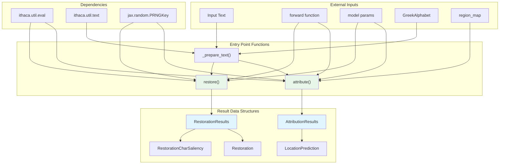
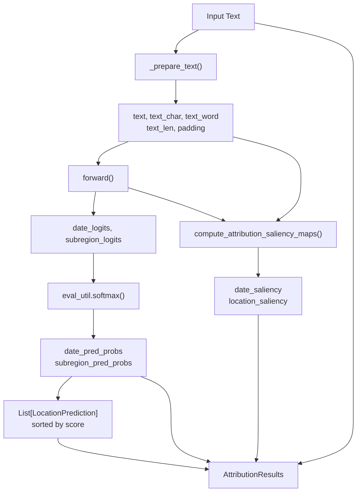
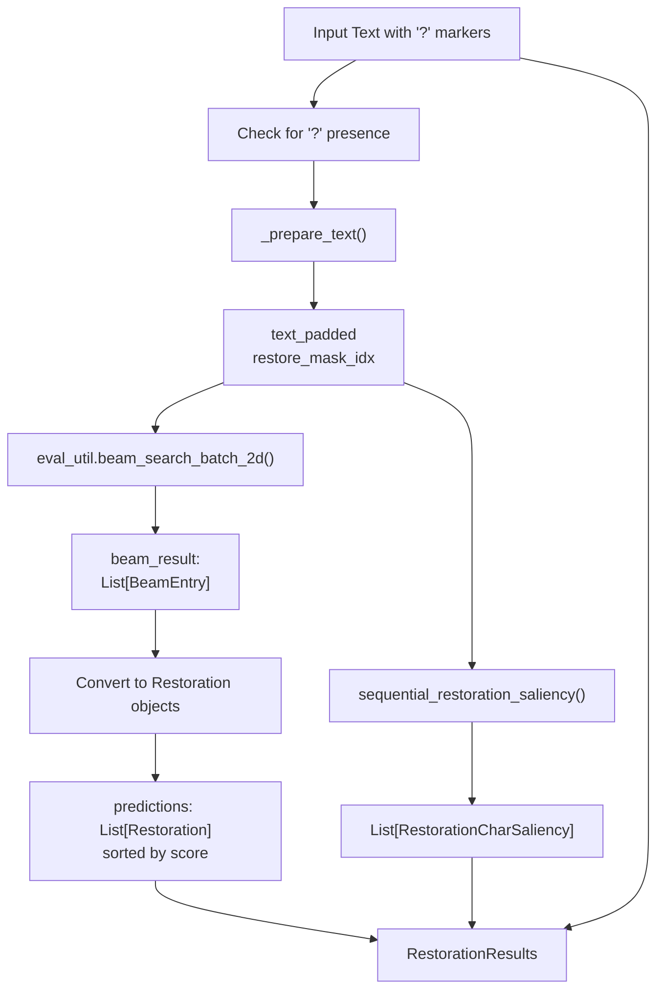
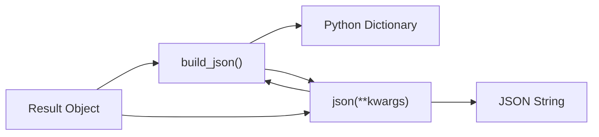

<!-- source: DeepWiki mcp.deepwiki.com · repo google-deepmind/ithaca · page 8.2 ithaca.eval · fetched 2026-10-26 -->

# ithaca.eval

<details>
<summary>Relevant source files</summary>

The following files were used as context for generating this wiki page:

- [ithaca/eval/inference.py](ithaca/eval/inference.py)

</details>


## Purpose and Scope

The `ithaca.eval` module provides the primary inference API for the Ithaca system. It contains two main entry points for performing predictions on ancient Greek inscriptions:

- **`attribute()`**: Predicts the date and geographical region of an inscription
- **`restore()`**: Reconstructs missing characters in damaged inscriptions using beam search

This module also defines the structured data types (`AttributionResults`, `RestorationResults`) that encapsulate prediction outputs with associated metadata and saliency maps for interpretability.

For information about the underlying beam search and saliency computation implementations, see [ithaca.util](#8.3). For higher-level inference workflows and examples, see [Inference System](#5).

**Sources:** [ithaca/eval/inference.py:1-269]()

---

## Module Overview



**Diagram: Module structure showing entry points, data structures, and dependencies**

The module is organized around two main workflows (attribution and restoration), each returning a structured result object that can be serialized to JSON for downstream applications.

**Sources:** [ithaca/eval/inference.py:1-269]()

---

## Constants and Configuration

The module defines several constants that control inference behavior:

| Constant | Value | Description |
|----------|-------|-------------|
| `MIN_TEXT_LEN` | 50 | Minimum text length required for inference |
| `TEXT_LEN` | 768 | Fixed model sequence length (with padding) |
| `DATE_MIN` | -800 | Earliest date in BCE (800 BCE) |
| `DATE_MAX` | 800 | Latest date in CE (800 CE) |
| `DATE_INTERVAL` | 10 | Date binning interval in years (decades) |
| `RESTORATION_BEAM_WIDTH` | 20 | Number of candidates to maintain in beam search |
| `RESTORATION_TEMPERATURE` | 1.0 | Sampling temperature for restoration |
| `SEED` | 1 | Random seed for reproducibility |
| `ALPHABET_MISSING_RESTORE` | '?' | Character marking missing text to restore |

**Sources:** [ithaca/eval/inference.py:130-140]()

---

## Data Structures

### LocationPrediction

```python
LocationPrediction(location_id: int, score: float)
```

Represents a single geographical region prediction with its confidence score.

**Fields:**
- `location_id`: Integer ID corresponding to one of 84 subregions
- `score`: Probability score in range [0, 1]

**Methods:**
- `build_json()`: Returns dictionary representation for JSON serialization

**Sources:** [ithaca/eval/inference.py:35-46]()

---

### AttributionResults

```python
AttributionResults(
    input_text: str,
    locations: List[LocationPrediction],
    year_scores: List[float],
    date_saliency: List[float],
    location_saliency: List[float]
)
```

Contains complete attribution predictions including date, region, and interpretability information.

**Fields:**

| Field | Type | Description |
|-------|------|-------------|
| `input_text` | `str` | Original input text (without SOS/padding) |
| `locations` | `List[LocationPrediction]` | Region predictions sorted by score (descending) |
| `year_scores` | `List[float]` | Length-160 array of probabilities over decade bins from -800 to 800 |
| `date_saliency` | `List[float]` | Per-character saliency scores for date prediction |
| `location_saliency` | `List[float]` | Per-character saliency scores for region prediction |

**Methods:**
- `build_json()`: Returns dictionary representation
- `json(**kwargs)`: Returns JSON string (passes kwargs to `json.dumps()`)

**Notes:**
- `year_scores` has 160 elements covering years [-800, -790, -780, ..., 790, 800]
- Saliency maps have length equal to input text (excluding SOS token)
- Higher saliency values indicate characters with greater influence on prediction

**Sources:** [ithaca/eval/inference.py:48-74]()

---

### Restoration

```python
Restoration(text: str, score: float)
```

Represents a single candidate restoration from beam search.

**Fields:**
- `text`: Restored text with missing characters filled in
- `score`: Probability score (exponentiated log probability)

**Methods:**
- `build_json()`: Returns dictionary representation

**Sources:** [ithaca/eval/inference.py:76-83]()

---

### RestorationCharSaliency

```python
RestorationCharSaliency(
    text: str,
    restored_idx: int,
    saliency: List[float]
)
```

Saliency map for one predicted character during sequential restoration.

**Fields:**
- `text`: Current state of restored text
- `restored_idx`: Index of the character this saliency map corresponds to
- `saliency`: Per-character saliency scores showing influence on this prediction

**Methods:**
- `build_json()`: Returns dictionary representation

**Sources:** [ithaca/eval/inference.py:85-97]()

---

### RestorationResults

```python
RestorationResults(
    input_text: str,
    top_prediction: str,
    restored: List[int],
    predictions: List[Restoration],
    prediction_saliency: List[RestorationCharSaliency]
)
```

Contains complete restoration predictions from beam search with saliency maps.

**Fields:**

| Field | Type | Description |
|-------|------|-------------|
| `input_text` | `str` | Original input with '?' marking missing characters |
| `top_prediction` | `str` | Best restoration (highest score) |
| `restored` | `List[int]` | Character indices that were originally missing |
| `predictions` | `List[Restoration]` | Top-N candidates from beam search (default N=20) |
| `prediction_saliency` | `List[RestorationCharSaliency]` | Saliency maps for each sequential prediction step |

**Methods:**
- `build_json()`: Returns dictionary representation
- `json(**kwargs)`: Returns JSON string (passes kwargs to `json.dumps()`)

**Notes:**
- `predictions` are sorted by score in descending order
- `prediction_saliency` contains one entry per restored character
- Indices in `restored` are adjusted to exclude SOS token

**Sources:** [ithaca/eval/inference.py:99-128]()

---

## Main Functions

### attribute()

```python
def attribute(
    text: str,
    forward: Callable,
    params: PyTree,
    alphabet: GreekAlphabet,
    vocab_char_size: int,
    vocab_word_size: int,
    region_map: Dict
) -> AttributionResults
```

Computes predicted date and geographical region for an inscription.



**Diagram: Attribution data flow from input text to structured results**

**Parameters:**

| Parameter | Type | Description |
|-----------|------|-------------|
| `text` | `str` | Input inscription text (minimum 50 characters) |
| `forward` | `Callable` | Model forward function (typically `functools.partial(model.apply, params)`) |
| `params` | `PyTree` | Model parameters for saliency computation |
| `alphabet` | `GreekAlphabet` | Greek alphabet instance for text processing |
| `vocab_char_size` | `int` | Character vocabulary size |
| `vocab_word_size` | `int` | Word vocabulary size |
| `region_map` | `Dict` | Region ID-to-name mappings with structure `{'sub': {'ids': [...], 'names': [...]}}` |

**Returns:**
- `AttributionResults` containing date predictions, region predictions, and saliency maps

**Raises:**
- `ValueError`: If text length is less than `MIN_TEXT_LEN` (50) or greater than or equal to `TEXT_LEN - 1` (767)

**Implementation Details:**

1. **Text Preprocessing** [ithaca/eval/inference.py:190-191]():
   - Strips accents and normalizes whitespace
   - Adds SOS token and padding to reach `TEXT_LEN` (768)
   - Converts to character and word indices

2. **Model Forward Pass** [ithaca/eval/inference.py:193-198]():
   - Runs model with `is_training=False`
   - Uses fixed random seed for reproducibility
   - Outputs date and region logits

3. **Region Processing** [ithaca/eval/inference.py:200-207]():
   - Applies softmax to region logits
   - Creates `LocationPrediction` objects
   - Sorts by probability score (descending)

4. **Date Processing** [ithaca/eval/inference.py:209-210]():
   - Applies softmax to date logits
   - Returns 160-element probability distribution over decade bins

5. **Saliency Computation** [ithaca/eval/inference.py:212-215]():
   - Computes gradients via `eval_util.compute_attribution_saliency_maps()`
   - Generates per-character attribution scores for date and region predictions

6. **Result Assembly** [ithaca/eval/inference.py:217-223]():
   - Strips SOS token from saliency maps
   - Returns `AttributionResults` with all predictions and metadata

**Sources:** [ithaca/eval/inference.py:186-224]()

---

### restore()

```python
def restore(
    text: str,
    forward: Callable,
    params: PyTree,
    alphabet: GreekAlphabet,
    vocab_char_size: int,
    vocab_word_size: int
) -> RestorationResults
```

Performs beam search to reconstruct missing characters marked with '?' in the input text.



**Diagram: Restoration data flow from damaged text to restored candidates**

**Parameters:**

| Parameter | Type | Description |
|-----------|------|-------------|
| `text` | `str` | Input text with '?' marking missing characters |
| `forward` | `Callable` | Model forward function |
| `params` | `PyTree` | Model parameters for saliency computation |
| `alphabet` | `GreekAlphabet` | Greek alphabet instance |
| `vocab_char_size` | `int` | Character vocabulary size |
| `vocab_word_size` | `int` | Word vocabulary size |

**Returns:**
- `RestorationResults` containing top predictions, beam search candidates, and saliency maps

**Raises:**
- `ValueError`: If no '?' characters are present in input text
- `ValueError`: If text length is less than `MIN_TEXT_LEN` or greater than `TEXT_LEN - 1`

**Implementation Details:**

1. **Validation** [ithaca/eval/inference.py:230-231]():
   - Ensures at least one '?' character is present

2. **Text Preprocessing** [ithaca/eval/inference.py:233-234]():
   - Identifies positions of '?' characters
   - Replaces '?' with alphabet's missing token
   - Adds SOS and padding

3. **Beam Search** [ithaca/eval/inference.py:236-243]():
   - Runs `beam_search_batch_2d()` with width 20
   - Uses temperature 1.0 for sampling
   - Returns top-N candidates with log probabilities

4. **Result Post-processing** [ithaca/eval/inference.py:246-252]():
   - Strips SOS token and padding from predictions
   - Converts log probabilities to regular probabilities (`math.exp()`)
   - Adjusts restored indices to account for removed SOS

5. **Sequential Saliency** [ithaca/eval/inference.py:254-257]():
   - Computes saliency maps for greedy (sequential) restoration
   - One saliency map per restored character
   - Shows which input characters influenced each prediction

6. **Result Assembly** [ithaca/eval/inference.py:259-268]():
   - Returns `RestorationResults` with all predictions and saliency data

**Sources:** [ithaca/eval/inference.py:226-269]()

---

## Internal Functions

### _prepare_text()

```python
def _prepare_text(
    text: str,
    alphabet: GreekAlphabet
) -> Tuple[str, str, str, np.ndarray, np.ndarray, List[int], np.ndarray, List[int]]
```

Internal function that normalizes, tokenizes, and pads input text for model consumption.

```mermaid
graph LR
    RAW["Raw Text"]
    
    STRIP_WS["Strip whitespace<br/>re.sub()"]
    STRIP_ACC["Strip accents<br/>util_text.strip_accents()"]
    VALIDATE["Validate length"]
    
    ADD_SOS["Add SOS token"]
    IDENTIFY["Identify '?' positions"]
    REPLACE["Replace '?' with<br/>alphabet.missing"]
    ADD_PAD["Add padding to 768"]
    
    CONVERT["Convert to indices<br/>text_to_idx()<br/>text_to_word_idx()"]
    MASK["Create padding mask"]
    
    OUTPUT["text, text_sos, text_padded<br/>text_char, text_word<br/>text_len, padding<br/>restore_mask_idx"]
    
    RAW --> STRIP_WS
    STRIP_WS --> STRIP_ACC
    STRIP_ACC --> VALIDATE
    VALIDATE --> ADD_SOS
    ADD_SOS --> IDENTIFY
    IDENTIFY --> REPLACE
    REPLACE --> ADD_PAD
    ADD_PAD --> CONVERT
    CONVERT --> MASK
    MASK --> OUTPUT
```



**Diagram: Text preparation pipeline from raw input to model-ready tensors**

**Parameters:**
- `text`: Raw input string without padding or SOS
- `alphabet`: GreekAlphabet instance

**Returns:**
Tuple of 8 elements:
1. `text` (str): Cleaned text without SOS/padding
2. `text_sos` (str): Text with SOS prepended
3. `text_padded` (str): Text with SOS and padding
4. `text_char` (np.ndarray): Character indices, shape (1, 768)
5. `text_word` (np.ndarray): Word indices, shape (1, 768)
6. `text_len` (List[int]): List with single element: length including SOS but not padding
7. `padding` (np.ndarray): Binary mask (1 for valid tokens, 0 for padding)
8. `restore_mask_idx` (List[int]): Indices of '?' characters in padded text

**Processing Steps:**

1. **Whitespace Normalization** [ithaca/eval/inference.py:159]():
   - Collapses multiple spaces to single space
   - Strips leading/trailing whitespace

2. **Accent Stripping** [ithaca/eval/inference.py:160]():
   - Removes diacritical marks from Greek text

3. **Length Validation** [ithaca/eval/inference.py:162-166]():
   - Raises `ValueError` if text < 50 characters
   - Raises `ValueError` if text >= 767 characters (must leave room for SOS)

4. **SOS and Padding** [ithaca/eval/inference.py:168-171]():
   - Prepends `alphabet.sos` token
   - Appends `alphabet.pad` tokens to reach length 768

5. **Missing Character Handling** [ithaca/eval/inference.py:173-176]():
   - Records positions of '?' characters
   - Replaces '?' with `alphabet.missing` token

6. **Index Conversion** [ithaca/eval/inference.py:178-180]():
   - Converts characters to indices via `text_to_idx()`
   - Converts words to indices via `text_to_word_idx()`
   - Creates binary padding mask

**Sources:** [ithaca/eval/inference.py:142-184]()

---

## Usage Examples

### Basic Attribution

```python
import functools
from ithaca.eval import inference
from ithaca.util import alphabet

# Assume model and params are already loaded
forward = functools.partial(model.apply, params)
greek_alphabet = alphabet.GreekAlphabet()

text = "επι αρχοντος λυσιστρατου"
results = inference.attribute(
    text=text,
    forward=forward,
    params=params,
    alphabet=greek_alphabet,
    vocab_char_size=55,
    vocab_word_size=100000,
    region_map=region_map
)

# Access predictions
top_location = results.locations[0]
print(f"Region: {top_location.location_id}, Score: {top_location.score}")

# Find most likely date
max_idx = results.year_scores.index(max(results.year_scores))
predicted_year = -800 + (max_idx * 10)
print(f"Predicted year: {predicted_year}")

# Export to JSON
json_str = results.json(indent=2)
```

### Basic Restoration

```python
# Text with missing characters
damaged_text = "επι αρχοντο? λυσιστρ????"

results = inference.restore(
    text=damaged_text,
    forward=forward,
    params=params,
    alphabet=greek_alphabet,
    vocab_char_size=55,
    vocab_word_size=100000
)

# Get top prediction
print(f"Original: {results.input_text}")
print(f"Restored: {results.top_prediction}")

# See alternative candidates
for i, pred in enumerate(results.predictions[:5]):
    print(f"{i+1}. {pred.text} (score: {pred.score:.4f})")

# Check saliency for first restored character
first_saliency = results.prediction_saliency[0]
print(f"Saliency for char at index {first_saliency.restored_idx}")
```

**Sources:** [ithaca/eval/inference.py:186-269]()

---

## Integration with Utilities

The inference module depends on several utility functions from `ithaca.util.eval`:

| Function | Purpose | Used By |
|----------|---------|---------|
| `softmax()` | Converts logits to probabilities | `attribute()` |
| `compute_attribution_saliency_maps()` | Computes gradient-based saliency | `attribute()` |
| `beam_search_batch_2d()` | Performs 2D beam search | `restore()` |
| `sequential_restoration_saliency()` | Computes sequential saliency maps | `restore()` |

Text preprocessing relies on `ithaca.util.text`:

| Function | Purpose | Used By |
|----------|---------|---------|
| `strip_accents()` | Removes Greek diacritical marks | `_prepare_text()` |
| `text_to_idx()` | Converts text to character indices | `_prepare_text()` |
| `text_to_word_idx()` | Converts text to word indices | `_prepare_text()` |

For detailed documentation of these utility functions, see [ithaca.util](#8.3).

**Sources:** [ithaca/eval/inference.py:28-32]()

---

## Error Handling

The module performs validation at multiple points:

### Text Length Validation

```python
if len(text) < MIN_TEXT_LEN:
    raise ValueError('Input text too short.')

if len(text) >= TEXT_LEN - 1:
    raise ValueError('Input text too long.')
```

- **Minimum**: 50 characters ensures sufficient context
- **Maximum**: 767 characters leaves room for SOS token

**Sources:** [ithaca/eval/inference.py:162-166]()

### Missing Character Validation

```python
if ALPHABET_MISSING_RESTORE not in text:
    raise ValueError('At least one character must be missing.')
```

The `restore()` function requires at least one '?' character to indicate missing text.

**Sources:** [ithaca/eval/inference.py:230-231]()

---

## JSON Serialization

All result types implement serialization methods for easy export:



**Diagram: JSON serialization path for result objects**

Example serialized output:

```json
{
  "input_text": "επι αρχοντος",
  "locations": [
    {"location_id": 42, "score": 0.85},
    {"location_id": 17, "score": 0.12}
  ],
  "year_scores": [0.001, 0.002, ..., 0.045],
  "date_saliency": [0.12, 0.45, 0.33, ...],
  "location_saliency": [0.08, 0.67, 0.21, ...]
}
```

**Sources:** [ithaca/eval/inference.py:41-45, 63-73, 81-82, 91-96, 112-127]()

---

