<!-- source: DeepWiki mcp.deepwiki.com · repo google-deepmind/ithaca · page 8.3 ithaca.util · fetched 2026-10-26 -->

# ithaca.util

<details>
<summary>Relevant source files</summary>

The following files were used as context for generating this wiki page:

- [ithaca/util/alphabet.py](ithaca/util/alphabet.py)
- [ithaca/util/dates.py](ithaca/util/dates.py)
- [ithaca/util/eval.py](ithaca/util/eval.py)
- [ithaca/util/loss.py](ithaca/util/loss.py)
- [ithaca/util/optim.py](ithaca/util/optim.py)
- [ithaca/util/region_names.py](ithaca/util/region_names.py)
- [ithaca/util/text.py](ithaca/util/text.py)

</details>


This document provides a complete API reference for the `ithaca.util` package, which contains utility modules supporting text processing, optimization, loss computation, and evaluation. These utilities are used throughout the Ithaca system by training, inference, and data loading components.

For information about how these utilities are used in training, see [Training System](#4). For inference-specific functionality, see [ithaca.eval](#8.2). For model architecture details, see [ithaca.models](#8.1).

## Overview

The `ithaca.util` package contains six main modules:

| Module | Purpose | Primary Users |
|--------|---------|---------------|
| `alphabet.py` | Greek text vocabulary and character mapping | Data loading, inference |
| `text.py` | Text manipulation and augmentation | Data loading, training |
| `dates.py` | Date binning and distribution conversion | Data loading, loss computation |
| `region_names.py` | Geographical region ID mappings | Data loading, inference |
| `optim.py` | Learning rate scheduling and gradient clipping | Training |
| `loss.py` | Multi-task loss functions | Training |
| `eval.py` | Beam search, saliency maps, evaluation metrics | Inference, evaluation |

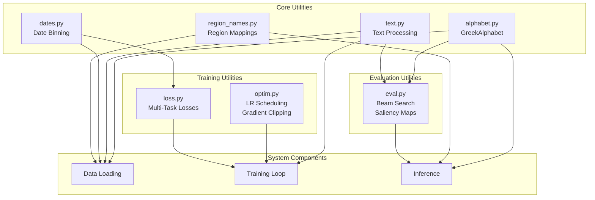

**Sources:** [ithaca/util/alphabet.py:1-172](), [ithaca/util/text.py:1-187](), [ithaca/util/dates.py:1-68](), [ithaca/util/region_names.py:1-45](), [ithaca/util/optim.py:1-168](), [ithaca/util/loss.py:1-118](), [ithaca/util/eval.py:1-563]()

---

## alphabet.py

The `alphabet` module defines vocabulary mappings for Greek text, handling character-to-index and word-to-index conversions. The primary class is `GreekAlphabet`, which provides specialized filtering for ancient Greek inscriptions.

### Class: Alphabet

Base class for alphabet handling with character and word vocabularies.

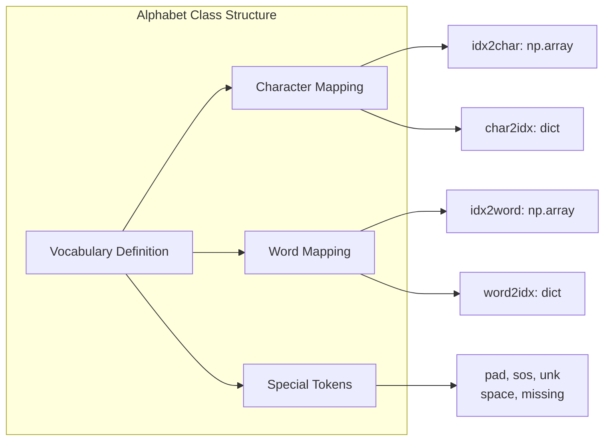

**Constructor Parameters:**
- `alphabet`: Base alphabet characters (e.g., Greek letters)
- `numerals`: Numeric characters (default: '0')
- `punctuation`: Punctuation marks (default: '.')
- `space`: Space character (default: ' ')
- `missing`: Missing character marker (default: '-')
- `pad`: Padding token (default: '#')
- `unk`: Unknown token (default: '^')
- `sos`: Start of sentence (default: '<')
- `sog`: Start of guess (default: '[')
- `eog`: End of guess (default: ']')
- `wordlist_file`: Optional file containing word vocabulary
- `wordlist_size`: Maximum vocabulary size (default: 100000)

**Key Attributes:**
- `idx2char`: Array mapping indices to characters
- `char2idx`: Dictionary mapping characters to indices
- `idx2word`: Array mapping indices to words
- `word2idx`: Dictionary mapping words to indices
- `pad_idx`, `sos_idx`, `unk_idx`: Special token indices
- `alphabet_start_idx`, `alphabet_end_idx`: Alphabet range indices

**Sources:** [ithaca/util/alphabet.py:21-79]()

### Class: GreekAlphabet

Specialized alphabet for ancient Greek text with sophisticated normalization.

**Greek Alphabet:**
```
αβγδεζηθικλμνξοπρςστυφχψωϙϛ
```

**Key Features:**

| Feature | Purpose | Implementation |
|---------|---------|----------------|
| Lowercase normalization | Standardize text | `.lower()` |
| Diacritic removal | Remove dot below, perispomeni | Replace unicode |
| Sigma handling | Convert word-final σ to ς | Regex pattern |
| Tonos/Oxia conversion | Normalize accent marks | Character mapping |
| Rough breathing (h) | Convert ℎ + vowel patterns | Regex substitution |

**Tonos to Oxia Mapping:**
The class maintains bidirectional mappings between tonos and oxia accent forms for proper normalization:
- Capital letters: Α (alpha), Ε (epsilon), Η (eta), Ο (omicron), Ι (iota), Υ (upsilon), Ω (omega)
- Small letters with variants including dialytika combinations

**Example Usage:**
```python
# Instantiate with optional wordlist
greek_alpha = GreekAlphabet(wordlist_file=open('words.txt'), wordlist_size=50000)

# Filter text (lowercase, normalize diacritics, handle sigmas)
filtered_text = greek_alpha.filter(raw_text)

# Character vocabulary size
vocab_char_size = greek_alpha.size_char()  # ~50 characters

# Word vocabulary size
vocab_word_size = greek_alpha.size_word()  # Up to wordlist_size + 3
```

**Sources:** [ithaca/util/alphabet.py:81-172]()

---

## text.py

The `text` module provides functions for text manipulation, augmentation, and conversion between strings and indices.

### Text Conversion Functions

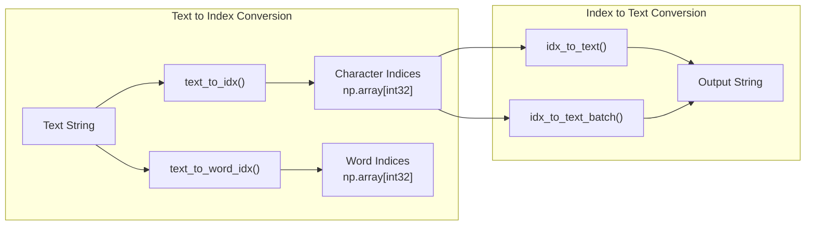

#### `text_to_idx(t, alphabet)`

Converts a string to character indices using the alphabet's `char2idx` mapping.

**Parameters:**
- `t`: Input text string
- `alphabet`: Alphabet instance

**Returns:** `np.array` of `int32` character indices

**Sources:** [ithaca/util/text.py:174-176]()

#### `text_to_word_idx(t, alphabet)`

Converts a string to word indices, marking unknown words with `alphabet.unk`.

**Parameters:**
- `t`: Input text string
- `alphabet`: Alphabet instance

**Returns:** `np.array` of `int32` word indices (same length as input string)

**Implementation Details:**
- Initializes array with unknown token
- Uses regex `r'\w+'` to find word boundaries
- Maps known words to their indices
- Replicates word index across all character positions in the word

**Sources:** [ithaca/util/text.py:179-185]()

#### `idx_to_text(idxs, alphabet, strip_sos=True, strip_pad=True)`

Converts character indices back to a string.

**Parameters:**
- `idxs`: Array of character indices
- `alphabet`: Alphabet instance
- `strip_sos`: Remove start-of-sentence tokens (default: True)
- `strip_pad`: Stop at padding tokens (default: True)

**Returns:** Decoded string

**Sources:** [ithaca/util/text.py:23-35]()

#### `idx_to_text_batch(idxs, alphabet, lengths=None)`

Batch version of `idx_to_text` for multiple sequences.

**Parameters:**
- `idxs`: 2D array of character indices (batch_size × seq_len)
- `alphabet`: Alphabet instance
- `lengths`: Optional list of sequence lengths for truncation

**Returns:** List of decoded strings

**Sources:** [ithaca/util/text.py:38-46]()

### Text Augmentation Functions

These functions are used during training for data augmentation and creating pretext tasks.

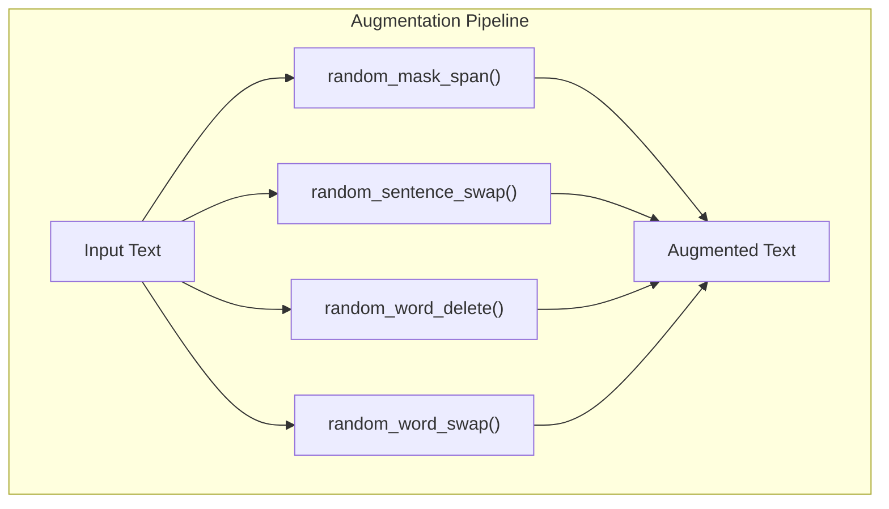

#### `random_mask_span(t, geometric_p=0.2, limit_chars=None)`

Selects a contiguous span of characters to mask for the masked language modeling task.

**Parameters:**
- `t`: Input text string
- `geometric_p`: Geometric distribution parameter for span length (default: 0.2)
- `limit_chars`: Maximum span length (optional)

**Returns:** List of character indices to mask

**Algorithm:**
1. Find all word spans using regex `r'[\w\s]+'`
2. Randomly select one span
3. Sample span length from geometric distribution
4. Clip to `limit_chars` if specified
5. Randomly position the mask within the span
6. Return list of indices `[span_start, ..., span_start + span_len - 1]`

**Sources:** [ithaca/util/text.py:49-85]()

#### `random_sentence_swap(sentences, p)`

Swaps pairs of sentences with probability `p` for next sentence prediction task.

**Parameters:**
- `sentences`: List of sentence strings
- `p`: Probability of swapping (fraction of sentences to swap)

**Returns:** List of sentences with swaps applied

**Sources:** [ithaca/util/text.py:88-110]()

#### `random_word_delete(sentence, p)`

Randomly deletes words from a sentence for robustness training.

**Parameters:**
- `sentence`: Input sentence string
- `p`: Probability of deleting each word

**Returns:** Modified sentence with some words removed

**Safeguards:**
- Returns original word if sentence has only one word
- Returns a random word if all words would be deleted

**Sources:** [ithaca/util/text.py:113-135]()

#### `random_word_swap(sentence, p)`

Randomly swaps pairs of words within a sentence.

**Parameters:**
- `sentence`: Input sentence string
- `p`: Swap rate (fraction of word count determines number of swaps)

**Returns:** Modified sentence with word positions shuffled

**Sources:** [ithaca/util/text.py:138-165]()

### Utility Functions

#### `strip_accents(s)`

Removes diacritical marks from text using Unicode NFD normalization.

**Parameters:**
- `s`: Input string

**Returns:** String with accent marks removed

**Implementation:** Decomposes characters into base + combining marks, then filters out marks (Unicode category 'Mn').

**Sources:** [ithaca/util/text.py:168-171]()

---

## dates.py

The `dates` module handles date binning and distribution conversion for the date prediction task. Dates are discretized into bins (typically decade intervals) spanning 800 BCE to 800 CE.

### Date Binning Architecture

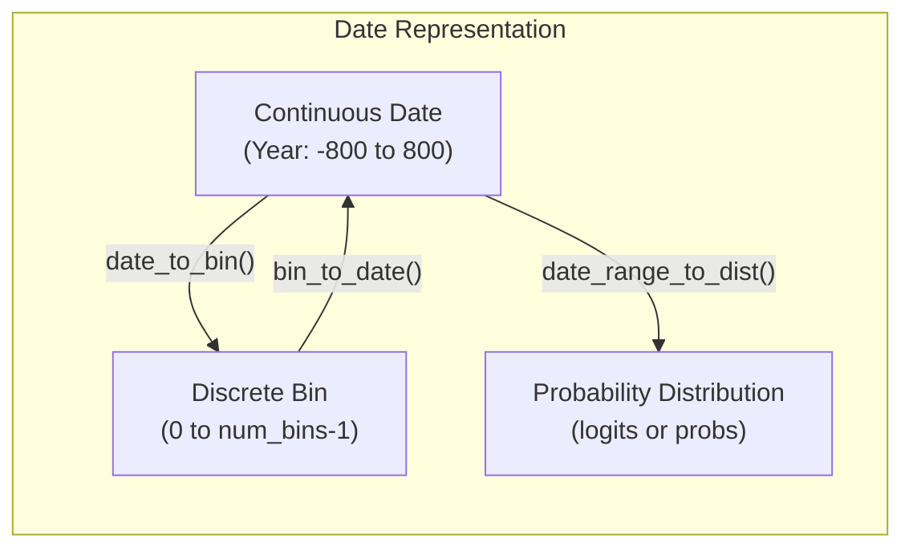

### Configuration Parameters

**Standard Configuration:**
- `date_min`: -800 (800 BCE)
- `date_max`: 800 (800 CE)
- `date_interval`: 10 (decades)
- `unknown_bin`: True (adds bin for unknown dates)

This configuration produces **161 bins**: 160 decade bins + 1 unknown bin.

### Functions

#### `date_num_bins(date_min, date_max, date_interval, unknown_bin=True)`

Computes the number of date bins.

**Parameters:**
- `date_min`: Earliest date (e.g., -800)
- `date_max`: Latest date (e.g., 800)
- `date_interval`: Bin width (e.g., 10 years)
- `unknown_bin`: Whether to add bin for unknown dates

**Returns:** Integer number of bins

**Formula:** `(date_max - date_min - 1) // date_interval + (1 if unknown_bin else 0)`

**Sources:** [ithaca/util/dates.py:18-22]()

#### `date_to_bin(date_cur, date_min, date_max, date_interval, date_bins)`

Converts a continuous date to a bin index.

**Parameters:**
- `date_cur`: Date to convert
- `date_min`, `date_max`, `date_interval`: Binning configuration
- `date_bins`: Total number of bins

**Returns:** Bin index (0 to `date_bins - 1`)

**Behavior:**
- Dates within `[date_min, date_max)` map to bins 0 to `date_bins - 2`
- Out-of-range dates map to bin `date_bins - 1` (unknown)

**Implementation:** Uses `np.digitize()` with bin edges at `[date_min + date_interval, date_min + 2*date_interval, ..., date_max - date_interval]`

**Sources:** [ithaca/util/dates.py:25-32]()

#### `bin_to_date(date_cur_bin, date_min, date_interval)`

Converts a bin index back to the bin's center date.

**Parameters:**
- `date_cur_bin`: Bin index
- `date_min`: Earliest date
- `date_interval`: Bin width

**Returns:** Date at the center of the bin

**Formula:** `date_min + date_cur_bin * date_interval + date_interval // 2`

**Example:** For bin 0 with `date_min=-800` and `date_interval=10`, returns -795 (center of [-800, -790])

**Sources:** [ithaca/util/dates.py:35-36]()

#### `date_range_to_dist(date_min_cur, date_max_cur, date_min, date_max, date_interval, date_bins, return_logits=True)`

Converts a date range (e.g., "350-375 BCE") to a uniform probability distribution over bins.

**Parameters:**
- `date_min_cur`, `date_max_cur`: Range to convert
- `date_min`, `date_max`, `date_interval`, `date_bins`: Binning configuration
- `return_logits`: Whether to return log-space distribution (default: True)

**Returns:** Array of length `date_bins` with uniform probability over the range

**Algorithm:**
1. Convert `date_min_cur` and `date_max_cur` to bin indices
2. Create uniform distribution: `dist[min_bin:max_bin+1] = 1 / num_bins_in_range`
3. If invalid range, assign probability to unknown bin
4. If `return_logits=True`, apply `log()` with epsilon clipping

**Use Case:** Training labels for inscriptions with date ranges rather than exact dates.

**Sources:** [ithaca/util/dates.py:39-67]()

---

## region_names.py

The `region_names` module loads geographical region mappings from the PHI dataset, filtering out unknown regions and creating bidirectional ID mappings.

### Function: load_region_maps

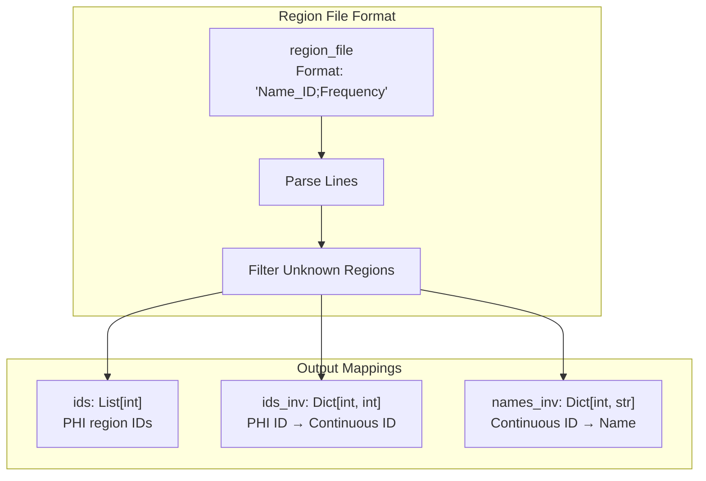

#### `load_region_maps(region_file)`

Extracts region mappings from a PHI-formatted region file.

**Parameters:**
- `region_file`: File handle with region data

**File Format:**
Each line: `<region_name>_<region_id>;<frequency>`

**Example:**
```
Attica_123;1500
Boeotia_456;800
Unknown Provenances_884;50
```

**Returns:** Dictionary with three keys:
- `'ids'`: List of valid PHI region IDs
- `'ids_inv'`: Mapping from PHI ID to continuous index (0 to N-1)
- `'names_inv'`: Mapping from continuous index to region name

**Filtered Regions:**
The function excludes three unknown region IDs:
- `Unknown Provenances` (ID: 884)
- `unspecified subregion` (ID: 885)
- `unspecified subregion` (ID: 1439)

**Result:** Typically produces 84 valid regions for the standard PHI dataset.

**Usage Example:**
```python
with open('regions.txt') as f:
    region_maps = load_region_maps(f)
    
# PHI ID 123 maps to continuous index (e.g., 0)
continuous_id = region_maps['ids_inv'][123]

# Get region name for continuous index
region_name = region_maps['names_inv'][continuous_id]  # "Attica"
```

**Sources:** [ithaca/util/region_names.py:21-44]()

---

## optim.py

The `optim` module provides optimization utilities for training, including learning rate scheduling and adaptive gradient clipping.

### Learning Rate Scheduling

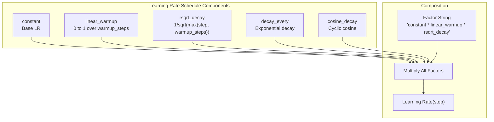

#### `linear_warmup_and_sqrt_decay(global_step, max_lr, warmup_steps)`

Implements the common "linear warmup + inverse square root decay" schedule.

**Parameters:**
- `global_step`: Current training step
- `max_lr`: Peak learning rate (reached at `warmup_steps`)
- `warmup_steps`: Number of warmup steps

**Returns:** Learning rate for the current step

**Formula:**
- Warmup phase (step < warmup_steps): `lr = max_lr * (step / warmup_steps)`
- Decay phase (step >= warmup_steps): `lr = max_lr * sqrt(warmup_steps / step)`

**Sources:** [ithaca/util/optim.py:31-36]()

#### `create_learning_rate_scheduler(...)`

Creates a flexible learning rate schedule by composing multiple factors.

**Parameters:**
- `factors`: String of factors separated by '*' (default: `'constant * linear_warmup * rsqrt_decay'`)
- `base_learning_rate`: Starting constant (default: 0.5)
- `warmup_steps`: Warmup duration (default: 1000)
- `decay_factor`: Decay multiplier for 'decay_every' (default: 0.5)
- `steps_per_decay`: Interval for 'decay_every' (default: 20000)
- `steps_per_cycle`: Period for 'cosine_decay' (default: 100000)

**Returns:** Function `step_fn(step)` that returns learning rate

**Available Factors:**

| Factor | Formula | Purpose |
|--------|---------|---------|
| `constant` | `base_learning_rate` | Base LR value |
| `linear_warmup` | `min(1.0, step / warmup_steps)` | Gradual warmup |
| `rsqrt_decay` | `1 / sqrt(max(step, warmup_steps))` | Inverse sqrt decay |
| `rsqrt_normalized_decay` | `sqrt(warmup_steps) / sqrt(max(step, warmup_steps))` | Normalized decay |
| `decay_every` | `decay_factor ^ (step // steps_per_decay)` | Step decay |
| `cosine_decay` | `0.5 * (1 + cos(π * progress))` | Cosine annealing |

**Example Usage:**
```python
# Create Transformer-style schedule
schedule = create_learning_rate_scheduler(
    factors='constant * linear_warmup * rsqrt_decay',
    base_learning_rate=1.0,
    warmup_steps=4000
)

# Get LR for step 10000
lr = schedule(10000)
```

**Sources:** [ithaca/util/optim.py:39-94]()

### Gradient Transformation

#### Class: GradientTransformation

NamedTuple defining an Optax-style gradient transformation with `init` and `update` functions.

**Fields:**
- `init`: Function `(Params) -> OptState` to initialize transformation state
- `update`: Function `(Updates, OptState, Params) -> (Updates, OptState)` to apply transformation

**Sources:** [ithaca/util/optim.py:103-108]()

### Adaptive Gradient Clipping

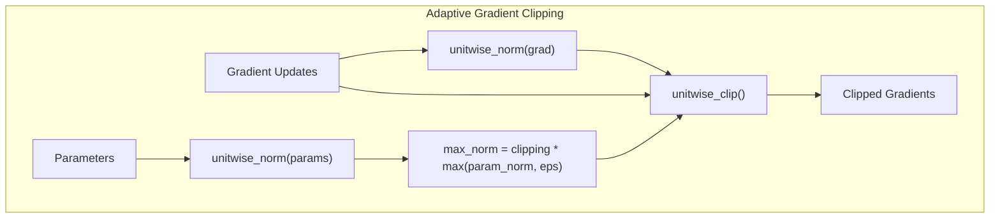

#### `unitwise_norm(x)`

Computes norms for each output unit separately based on parameter shape.

**Shape Handling:**
- Scalars/vectors (1D): Global norm
- Matrices (2D, 3D): Norm over input dimension (axis 0)
- Conv kernels (4D): Norm over spatial + input dimensions (axes [0,1,2])

**Returns:** Norms with shape preserving output dimensions

**Sources:** [ithaca/util/optim.py:115-128]()

#### `unitwise_clip(g_norm, max_norm, grad)`

Clips gradients to maximum norm per unit.

**Parameters:**
- `g_norm`: Gradient norms
- `max_norm`: Maximum allowed norms
- `grad`: Gradient values

**Returns:** Clipped gradients

**Formula:** If `g_norm > max_norm`, scale by `max_norm / g_norm`

**Sources:** [ithaca/util/optim.py:131-137]()

#### `adaptive_grad_clip(clipping, eps=1e-3)`

Creates adaptive gradient clipping transformation (AGC) from [Brock et al., 2021].

**Parameters:**
- `clipping`: Maximum allowed ratio of `||update|| / ||param||`
- `eps`: Epsilon to prevent clipping zero-initialized params

**Returns:** `GradientTransformation` (init_fn, update_fn)

**Algorithm:**
For each parameter unit:
1. Compute `g_norm = ||gradient||`
2. Compute `p_norm = ||parameter||`
3. Set `max_norm = clipping * max(p_norm, eps)`
4. If `g_norm > max_norm`, scale gradient by `max_norm / g_norm`

**Use Case:** Enables stable training with high learning rates by preventing large updates relative to parameter magnitudes.

**Sources:** [ithaca/util/optim.py:140-167]()

---

## loss.py

The `loss` module implements multi-task loss functions for date prediction, region classification, and masked language modeling.

### Loss Function Overview

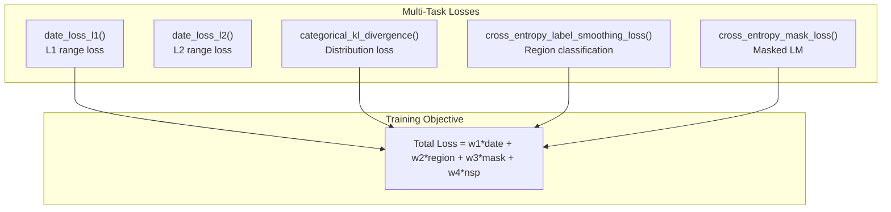

### Date Loss Functions

#### `date_loss_l1(pred, target_min, target_max, mask)`

L1 loss for date predictions with range targets.

**Parameters:**
- `pred`: Predicted date (continuous value)
- `target_min`, `target_max`: Valid date range
- `mask`: Binary mask for valid examples

**Returns:** Masked L1 loss

**Loss Formula:**
```
loss = 0  if target_min <= pred <= target_max
loss = |pred - target_min|  if pred < target_min
loss = |pred - target_max|  if pred > target_max
```

**Rationale:** Penalizes predictions outside the known date range but doesn't penalize predictions within the range.

**Sources:** [ithaca/util/loss.py:102-117]()

#### `date_loss_l2(pred, target_min, target_max, mask)`

L2 variant of date range loss (squared error instead of absolute).

**Sources:** [ithaca/util/loss.py:84-99]()

#### `categorical_kl_divergence(p_logits, q_logits, temperature=1.)`

Computes KL divergence between two categorical distributions for date distribution loss.

**Parameters:**
- `p_logits`: Predicted logits
- `q_logits`: Target logits (from `date_range_to_dist`)
- `temperature`: Temperature for softmax (default: 1.0)

**Returns:** KL divergence (non-negative)

**Formula:** `KL(P || Q) = Σ P(i) * (log P(i) - log Q(i))`

**Use Case:** Date prediction head outputs a distribution over decade bins. This loss matches the predicted distribution to a uniform distribution over the known date range.

**Sources:** [ithaca/util/loss.py:32-52]()

### Classification Loss Functions

#### `cross_entropy_label_smoothing_loss(logits, labels, mask=None, label_smoothing=0.1)`

Cross-entropy loss with optional label smoothing for region classification.

**Parameters:**
- `logits`: Model predictions (shape: batch × num_classes)
- `labels`: Ground truth class indices
- `mask`: Optional mask for valid examples
- `label_smoothing`: Smoothing factor (default: 0.1)

**Returns:** Per-example cross-entropy loss

**Label Smoothing Formula:**
```
hard_label = [0, 0, ..., 1, ..., 0]  # one-hot
smoothed = (1 - α) * hard_label + α / num_classes
```
where α = `label_smoothing`

**Purpose:** Prevents overconfident predictions and improves generalization.

**Sources:** [ithaca/util/loss.py:55-69]()

#### `cross_entropy_loss(logits, label)`

Simple cross-entropy loss without smoothing.

**Decorator:** `@jax.vmap` for automatic batching

**Sources:** [ithaca/util/loss.py:72-75]()

#### `cross_entropy_mask_loss(logits, label, mask)`

Cross-entropy loss with masking for masked language modeling.

**Parameters:**
- `logits`: Character predictions (shape: seq_len × vocab_size)
- `label`: True character indices
- `mask`: Binary mask (1 for masked positions, 0 otherwise)

**Returns:** Masked cross-entropy loss

**Application:** Only computes loss for masked positions during training.

**Sources:** [ithaca/util/loss.py:78-81]()

### Utility: smooth_labels

Helper function for label smoothing.

**Parameters:**
- `labels`: One-hot encoded labels
- `num_classes`: Number of classes
- `label_smoothing`: Smoothing factor

**Returns:** Smoothed labels

**Sources:** [ithaca/util/loss.py:21-29]()

---

## eval.py

The `eval` module provides evaluation utilities including beam search for text restoration, saliency map generation, and various helper functions.

### Beam Search Architecture

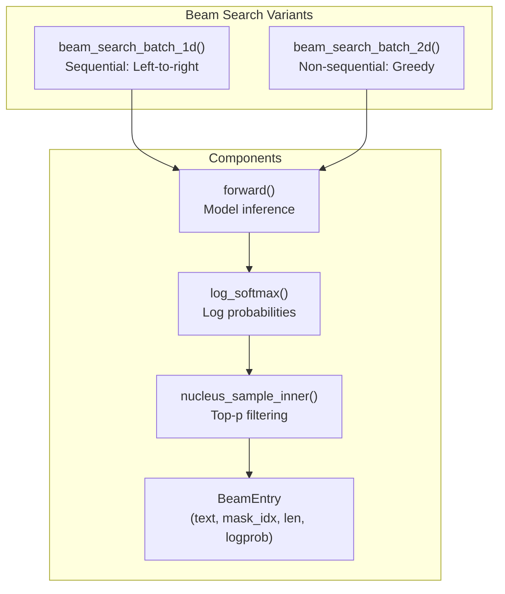

### Beam Search Functions

#### Class: BeamEntry

NamedTuple representing a beam search candidate.

**Fields:**
- `text_pred`: Current predicted text string
- `mask_idx`: List of remaining masked indices
- `pred_len`: Number of characters predicted so far
- `pred_logprob`: Cumulative log probability

**Sources:** [ithaca/util/eval.py:110-114]()

#### `beam_search_batch_2d(forward, alphabet, text_pred, mask_idx, ...)`

Non-sequential beam search that greedily fills the most confident character at each step.

**Parameters:**
- `forward`: Model forward function
- `alphabet`: GreekAlphabet instance
- `text_pred`: Initial text with masked positions
- `mask_idx`: List of masked character indices
- `rng`: JAX random key (optional)
- `beam_width`: Number of candidates to maintain (default: 20)
- `temperature`: Sampling temperature (default: 1.0)
- `nucleus`: Whether to use nucleus sampling (default: False)
- `nucleus_top_p`: Top-p threshold for nucleus sampling (default: 0.8)
- `display_progress`: Show tqdm progress bar (default: False)

**Returns:** List of `BeamEntry` sorted by log probability

**Algorithm:**
1. Start with initial text and mask indices
2. For each beam candidate:
   - Batch inference on all current candidates
   - For each position in `mask_idx`:
     - Generate top predictions
     - Create new candidates by filling that position
   - Keep top `beam_width` candidates by log probability
3. Repeat until all positions filled
4. Return top `beam_width` complete sequences

**Key Feature:** Fills most confident positions first (non-sequential), which often works better than left-to-right.

**Sources:** [ithaca/util/eval.py:117-237]()

#### `beam_search_batch_1d(forward, alphabet, text_pred, mask_idx, ...)`

Sequential beam search that fills masked positions from left to right.

**Parameters:** Same as `beam_search_batch_2d`

**Returns:** List of `BeamEntry` sorted by log probability

**Algorithm:** Similar to `beam_search_batch_2d` but fills positions in order from `mask_idx[0]`, `mask_idx[1]`, etc.

**When to Use:**
- Sequential: Better when context flows left-to-right
- Non-sequential: Better when some positions are easier to predict than others

**Sources:** [ithaca/util/eval.py:240-349]()

### Saliency Map Functions

Saliency maps show which input characters most influenced model predictions.

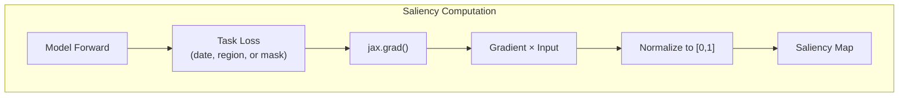

#### `compute_attribution_saliency_maps(text_char, text_word, text_len, padding, forward, params, rng, alphabet, vocab_char_size, vocab_word_size, subregion_loss_kwargs=None)`

Computes saliency maps for date and region predictions.

**Parameters:**
- `text_char`, `text_word`: Character and word indices
- `text_len`: Sequence length
- `padding`: Padding mask
- `forward`: Model forward function (takes embeddings)
- `params`: Model parameters
- `rng`: Random key
- `alphabet`: GreekAlphabet instance
- `vocab_char_size`, `vocab_word_size`: Vocabulary sizes
- `subregion_loss_kwargs`: Optional kwargs for region loss

**Returns:** Tuple `(date_saliency, subregion_saliency)` as normalized arrays

**Algorithm:**
1. Convert indices to one-hot
2. Compute embeddings from parameters
3. Compute gradients of date/region loss w.r.t. embeddings
4. Multiply gradients by embeddings (gradient × input)
5. Convert to per-character saliency maps
6. Normalize to [0, 1]

**Sources:** [ithaca/util/eval.py:400-468]()

#### `sequential_restoration_saliency(text_str, text_len, forward, params, alphabet, mask_idx, vocab_char_size, vocab_word_size)`

Generator that yields saliency maps for each step of greedy restoration.

**Parameters:**
- `text_str`: Text with masked positions
- `text_len`: Sequence length
- `forward`: Model forward function
- `params`: Model parameters
- `alphabet`: GreekAlphabet instance
- `mask_idx`: List of masked indices
- `vocab_char_size`, `vocab_word_size`: Vocabulary sizes

**Yields:** `SequentialRestorationSaliencyResult` namedtuples:
- `text`: Current predicted text
- `pred_char_pos`: Position of newly restored character
- `saliency_map`: Saliency showing which characters influenced the prediction

**Use Case:** Interactive visualization of restoration process showing how each decision was made.

**Sources:** [ithaca/util/eval.py:492-562]()

#### `grad_to_saliency_char(gradient_char, text_char_onehot, text_len, alphabet)`

Converts character-level gradients to a normalized saliency map.

**Processing:**
1. Compute L2 norm across embedding dimension
2. Mask non-alphabet characters (punctuation, special tokens)
3. Normalize to [0, 1] range

**Sources:** [ithaca/util/eval.py:37-54]()

#### `grad_to_saliency_word(gradient_word, text_word_onehot, text_len, alphabet)`

Converts word-level gradients to a normalized saliency map.

**Processing:**
1. Compute L2 norm across embedding dimension
2. Aggregate gradients for multi-character words
3. Mask unknown word tokens
4. Normalize to [0, 1] range

**Sources:** [ithaca/util/eval.py:57-82]()

### Loss Functions for Saliency

These functions compute scalar losses for specific tasks, used as targets for gradient computation.

#### `saliency_loss_subregion(forward, text_char_emb, text_word_emb, padding, rng, subregion=None)`

Returns the logit for a specific subregion (or argmax if not specified).

**Sources:** [ithaca/util/eval.py:352-368]()

#### `saliency_loss_date(forward, text_char_emb, text_word_emb, padding, rng)`

Returns the logit for the predicted date bin.

**Sources:** [ithaca/util/eval.py:371-382]()

#### `saliency_loss_mask(forward, text_char_emb, text_word_emb, padding, rng, char_pos, char_idx)`

Returns the logit for a specific character at a specific position.

**Sources:** [ithaca/util/eval.py:471-483]()

### Evaluation Utilities

#### `date_loss_l1(pred, target_min, target_max)`

NumPy version of date L1 loss for evaluation (without mask).

**Sources:** [ithaca/util/eval.py:27-34]()

#### `predicted_dates(date_pred_probs, date_min, date_max, date_interval)`

Extracts mode and mean date predictions from a probability distribution.

**Parameters:**
- `date_pred_probs`: Probability distribution over date bins
- `date_min`, `date_max`, `date_interval`: Date configuration

**Returns:** Tuple `(date_pred_argmax, date_pred_avg)`
- `date_pred_argmax`: Mode (most likely decade)
- `date_pred_avg`: Mean (weighted average)

**Sources:** [ithaca/util/eval.py:385-397]()

#### `softmax(x, axis=-1)` and `log_softmax(x, axis=-1)`

NumPy implementations of softmax and log-softmax.

**Sources:** [ithaca/util/eval.py:85-94]()

#### `nucleus_sample_inner(logits, top_p=0.95, temp=1.0)`

Nucleus (top-p) sampling filter for beam search.

**Parameters:**
- `logits`: Unnormalized scores
- `top_p`: Cumulative probability threshold (default: 0.95)
- `temp`: Temperature for scaling (default: 1.0)

**Returns:** Filtered logits with low-probability tokens set to -inf

**Algorithm:**
1. Sort logits in ascending order
2. Compute cumulative probability from lowest to highest
3. Find threshold where cumulative prob reaches `1 - top_p`
4. Mask out all logits below threshold
5. Apply temperature scaling

**Sources:** [ithaca/util/eval.py:97-107]()

---

## Usage Summary

### Typical Workflow: Training

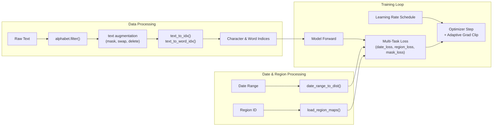

### Typical Workflow: Inference

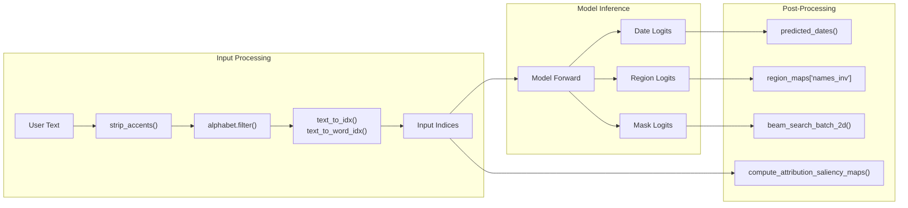

**Sources:** [ithaca/util/alphabet.py:1-172](), [ithaca/util/text.py:1-187](), [ithaca/util/dates.py:1-68](), [ithaca/util/region_names.py:1-45](), [ithaca/util/optim.py:1-168](), [ithaca/util/loss.py:1-118](), [ithaca/util/eval.py:1-563]()