# Page: Overview

# Overview

<details>
<summary>Relevant source files</summary>

The following files were used as context for generating this wiki page:

- [README.md](README.md)
- [requirements.txt](requirements.txt)
- [setup.py](setup.py)

</details>


This document provides a high-level introduction to the Ithaca project, a deep neural network system for restoring and attributing ancient Greek inscriptions. It covers the project's purpose, core capabilities, system architecture, and technology stack. For detailed information about specific components, refer to the subsections below or the specialized pages linked throughout this document.

## Purpose and Scope

Ithaca is a machine learning system designed to assist historians and epigraphers in three tasks:

1. **Text Restoration**: Reconstructing missing or damaged characters in ancient Greek inscriptions
2. **Geographical Attribution**: Predicting the original location of inscriptions across 84 regions
3. **Chronological Attribution**: Dating inscriptions within the period 800 BCE to 800 CE

The system combines a Transformer-based neural network architecture with interpretability features to support collaborative research between AI and historians. This overview covers the high-level system design, core components, and how they integrate. For installation and usage, see [Getting Started](#2). For architectural details, see [Model Architecture](#3).

**Sources:** [README.md:1-48]()

## What is Ithaca?

Ithaca is a deep learning system built on the JAX ecosystem that processes ancient Greek inscriptions to provide three types of predictions simultaneously. The system achieves 62% accuracy in text restoration independently, and when used collaboratively with historians, their combined performance reaches 72% accuracy. For geographical attribution, Ithaca achieves 71% accuracy, and for dating, it predicts within 30 years of ground-truth ranges.

The codebase is distributed as a Python package with two installation modes:
- **Core installation** ([setup.py:35]()): Inference components only, excluding training code
- **Full installation** ([setup.py:38-44]()): Includes training infrastructure with additional dependencies

**Sources:** [README.md:20-43](), [setup.py:14-44]()

## Core Capabilities and Code Mapping

The following diagram maps Ithaca's user-facing capabilities to their corresponding code implementations:

```mermaid
graph TB
    subgraph "User Capabilities"
        RESTORE["Text Restoration<br/>(Fill missing characters)"]
        ATTRIB_GEO["Geographical Attribution<br/>(Predict region)"]
        ATTRIB_DATE["Chronological Attribution<br/>(Predict date)"]
    end
    
    subgraph "ithaca.eval Module"
        INFER_PY["inference.py"]
        RESTORE_FN["restore()"]
        ATTRIB_FN["attribute()"]
        RESTORE_RESULT["RestorationResults"]
        ATTRIB_RESULT["AttributionResults"]
        
        INFER_PY --> RESTORE_FN
        INFER_PY --> ATTRIB_FN
        RESTORE_FN --> RESTORE_RESULT
        ATTRIB_FN --> ATTRIB_RESULT
    end
    
    subgraph "User Interfaces"
        COLAB["colabs/ithaca_inference.ipynb<br/>(Interactive)"]
        CLI["inference_example.py<br/>(Command-line)"]
        API["Python API<br/>(Programmatic)"]
    end
    
    subgraph "ithaca.models Module"
        MODEL_PY["model.py"]
        MODEL_CLASS["Model class"]
        BIGBIRD_PY["bigbird.py"]
        LAYERS_PY["common_layers.py"]
        
        MODEL_PY --> MODEL_CLASS
        MODEL_CLASS --> BIGBIRD_PY
        MODEL_CLASS --> LAYERS_PY
    end
    
    subgraph "Supporting Utilities"
        ALPHABET["util/alphabet.py<br/>GreekAlphabet"]
        TEXT["util/text.py<br/>Text processing"]
        DATES["util/dates.py<br/>Date binning"]
        REGIONS["util/region_names.py<br/>Region mappings"]
    end
    
    RESTORE --> RESTORE_FN
    ATTRIB_GEO --> ATTRIB_FN
    ATTRIB_DATE --> ATTRIB_FN
    
    COLAB --> RESTORE_FN
    COLAB --> ATTRIB_FN
    CLI --> RESTORE_FN
    CLI --> ATTRIB_FN
    API --> RESTORE_FN
    API --> ATTRIB_FN
    
    RESTORE_FN --> MODEL_CLASS
    ATTRIB_FN --> MODEL_CLASS
    
    RESTORE_FN --> ALPHABET
    RESTORE_FN --> TEXT
    ATTRIB_FN --> DATES
    ATTRIB_FN --> REGIONS
```

**Capability-to-Code Mapping:**

| User Capability | Primary Function | Result Type | Key Dependencies |
|----------------|------------------|-------------|------------------|
| Text Restoration | `inference.restore()` | `RestorationResults` | `GreekAlphabet`, beam search |
| Geographical Attribution | `inference.attribute()` | `AttributionResults` | Region mappings (84 classes) |
| Chronological Attribution | `inference.attribute()` | `AttributionResults` | Date binning utilities |

**Sources:** [setup.py:35](), README.md structure

## System Architecture

Ithaca's architecture consists of three major subsystems: Training, Model Core, and Inference. The following diagram shows how these components interact:

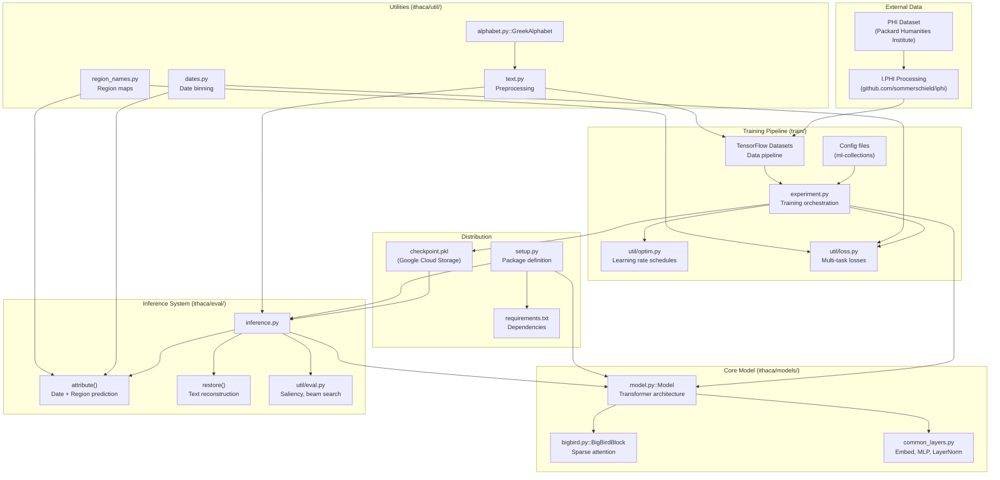

**Key Architectural Decisions:**

1. **Separation of Training and Inference**: The [setup.py:35]() excludes the `train/` directory from the default installation, allowing lightweight deployment for inference-only use cases.

2. **JAX-based Implementation**: All model code uses JAX for automatic differentiation and JIT compilation, with Flax for neural network modules.

3. **Multi-task Learning**: The model simultaneously predicts text restoration, geographical location, and date, sharing representations across tasks ([model.py]()).

4. **Checkpoint-based Deployment**: Trained models are serialized as `checkpoint.pkl` files and distributed separately from the codebase via Google Cloud Storage.

**Sources:** [setup.py:14-44](), [README.md:118-125]()

## Technology Stack

Ithaca is built on the JAX ecosystem with the following core dependencies:

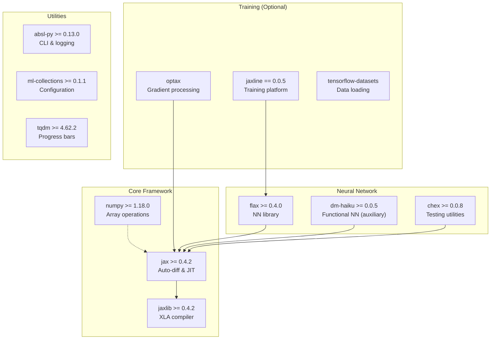

**Dependency Categories:**

| Category | Dependencies | Installation Mode |
|----------|-------------|-------------------|
| Core (Always) | JAX, JAXlib, Flax, NumPy, Haiku, Chex | `pip install ithaca` |
| Utilities (Always) | absl-py, ml-collections, tqdm | `pip install ithaca` |
| Training (Optional) | Optax, Jaxline, TensorFlow Datasets | `pip install ithaca[train]` |

The core installation is sufficient for running inference with pre-trained models. The training installation is required only for training new models or modifying the training pipeline. For detailed installation instructions, see [Installation](#2.1).

**Sources:** [requirements.txt:1-10](), [setup.py:37-44]()

## Component Overview

### Model Components

The neural network implementation is organized in `ithaca/models/`:

- **[model.py]()**: Defines the `Model` class, the main Transformer-based architecture
- **[bigbird.py]()**: Implements `BigBirdBlock` and `BigBirdSelfAttention` for sparse attention patterns
- **[common_layers.py]()**: Provides reusable components (`Embed`, `AddPositionEmbs`, `MlpBlock`, `LayerNorm`, `classifier_head`)

For detailed architecture documentation, see [Model Architecture](#3).

### Training Components

Training infrastructure resides in `train/` (excluded from default installation):

- **[train/experiment.py]()**: Orchestrates training loops using the Jaxline platform
- **Training configuration**: Uses `ml-collections` for hyperparameter management
- **Multi-task loss**: Defined in `ithaca/util/loss.py`, combining date, region, mask, and NSP losses

For training details, see [Training System](#4).

### Inference Components

Inference functionality is in `ithaca/eval/`:

- **[ithaca/eval/inference.py]()**: Core inference functions `attribute()` and `restore()`
- **Result types**: `AttributionResults` and `RestorationResults` (NamedTuples)
- **Interactive interface**: [colabs/ithaca_inference.ipynb]()
- **CLI tool**: [inference_example.py]()

For inference documentation, see [Inference System](#5).

### Utility Modules

Support utilities in `ithaca/util/`:

- **[alphabet.py]()**: `GreekAlphabet` class for character/word vocabulary management
- **[text.py]()**: Text preprocessing (accent stripping, tokenization, augmentation)
- **[dates.py]()**: Date binning and conversion utilities
- **[region_names.py]()**: Geographic region mappings (84 subregions)
- **[loss.py]()**: Loss function implementations
- **[optim.py]()**: Learning rate schedules and optimization utilities
- **[eval.py]()**: Evaluation utilities (beam search, saliency, metrics)

For utility documentation, see [Data Processing Utilities](#6).

**Sources:** [setup.py:35](), directory structure

## Data Flow

The following diagram illustrates how data flows through the system from raw inscriptions to predictions:

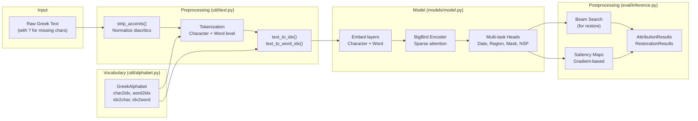

**Processing Steps:**

1. **Input**: Ancient Greek text with `?` characters marking damaged/missing parts
2. **Preprocessing**: Accent normalization, tokenization at character and word levels
3. **Vocabulary Mapping**: Convert text to numerical indices using `GreekAlphabet`
4. **Model Forward Pass**: Embeddings → BigBird encoder → Multi-task heads
5. **Postprocessing**: Beam search for restoration, saliency computation for interpretability
6. **Output**: Structured results with predictions and confidence scores

For detailed data processing documentation, see [Data Processing Utilities](#6).

**Sources:** System diagrams, [setup.py:35]()

## Quick Navigation

- **Installation and Usage**: [Getting Started](#2)
- **Model Details**: [Model Architecture](#3)
- **Training New Models**: [Training System](#4)
- **Running Inference**: [Inference System](#5)
- **Data Processing**: [Data Processing Utilities](#6)
- **Development**: [Development Guide](#7)
- **API Reference**: [API Reference](#8)

## Package Distribution

Ithaca is distributed as a Python package via PyPI. The [setup.py]() defines two installation modes:

**Standard Installation (inference only):**
```sh
pip install ithaca
```

This installs core dependencies from [requirements.txt:1-10]() and all modules except `train/`.

**Full Installation (with training):**
```sh
pip install ithaca[train]
```

This adds training dependencies: `optax`, `jaxline==0.0.5`, and `tensorflow-datasets` ([setup.py:38-44]()).

**Model Checkpoint:**

The trained model weights are not included in the package. Download separately:
```sh
curl --output checkpoint.pkl https://storage.googleapis.com/ithaca-resources/models/checkpoint_v1.pkl
```

For complete installation instructions, see [Installation](#2.1).

**Sources:** [setup.py:14-52](), [README.md:79-114]()

---

This overview provides the foundation for understanding Ithaca's architecture and capabilities. For detailed documentation of specific components, navigate to the relevant sections using the links above.

---

# Page: What is Ithaca?

# What is Ithaca?

<details>
<summary>Relevant source files</summary>

The following files were used as context for generating this wiki page:

- [README.md](README.md)
- [colabs/ithaca_inference.ipynb](colabs/ithaca_inference.ipynb)

</details>


This page introduces the Ithaca project: a deep neural network system for assisting historians and epigraphists with the restoration, geographical attribution, and chronological dating of ancient Greek inscriptions. It covers the project's purpose, core capabilities, historical context, and research applications.

For information about the model architecture and technical implementation, see [Model Architecture](#3). For training procedures, see [Training System](#4). For performing inference with pre-trained models, see [Inference System](#5).

---

## Purpose and Scope

Ithaca is a deep learning system designed to assist historians and epigraphists with three fundamental tasks in the study of ancient Greek inscriptions:

| Task | Description | Performance |
|------|-------------|-------------|
| **Text Restoration** | Reconstruct missing or damaged characters in inscriptions | 62% character accuracy (model alone), 72% (with historian collaboration) |
| **Geographical Attribution** | Identify the original location of an inscription | 71% accuracy across 84 ancient regions |
| **Chronological Dating** | Estimate when an inscription was written | Within 30 years of ground-truth date ranges |

The system is explicitly designed for **collaborative decision support** rather than autonomous operation. Historians using Ithaca see their restoration accuracy improve from 25% to 72%, demonstrating the synergistic potential of human-AI cooperation in historical research.

**Sources:** [README.md:1-43](), [colabs/ithaca_inference.ipynb:20-48]()

---

## The Problem: Ancient Text Analysis

Ancient Greek inscriptions are primary sources for understanding the thought, language, society, and history of Classical civilization. However, these texts face three critical challenges:

### 1. Physical Damage
Over centuries, inscriptions carved in stone or written on other materials have deteriorated. Characters become illegible, entire sections are lost, and text fragments may be the only surviving evidence of important historical events.

### 2. Unknown Provenance
Many inscriptions have been moved from their original locations through trade, looting, or archaeological excavation. Without knowing where a text originated, historians lose crucial geographical context for interpretation.

### 3. Dating Uncertainty
The chronological placement of inscriptions often relies on stylistic analysis, historical references within the text, or archaeological context—all subject to interpretation and uncertainty.

These challenges limit our ability to study key periods of human history. Ithaca addresses all three simultaneously through multi-task learning.

**Sources:** [README.md:20-28](), [colabs/ithaca_inference.ipynb:26-48]()

---

## Core Capabilities and Model Outputs

The following diagram shows how Ithaca's three capabilities map to specific model components and prediction tasks:

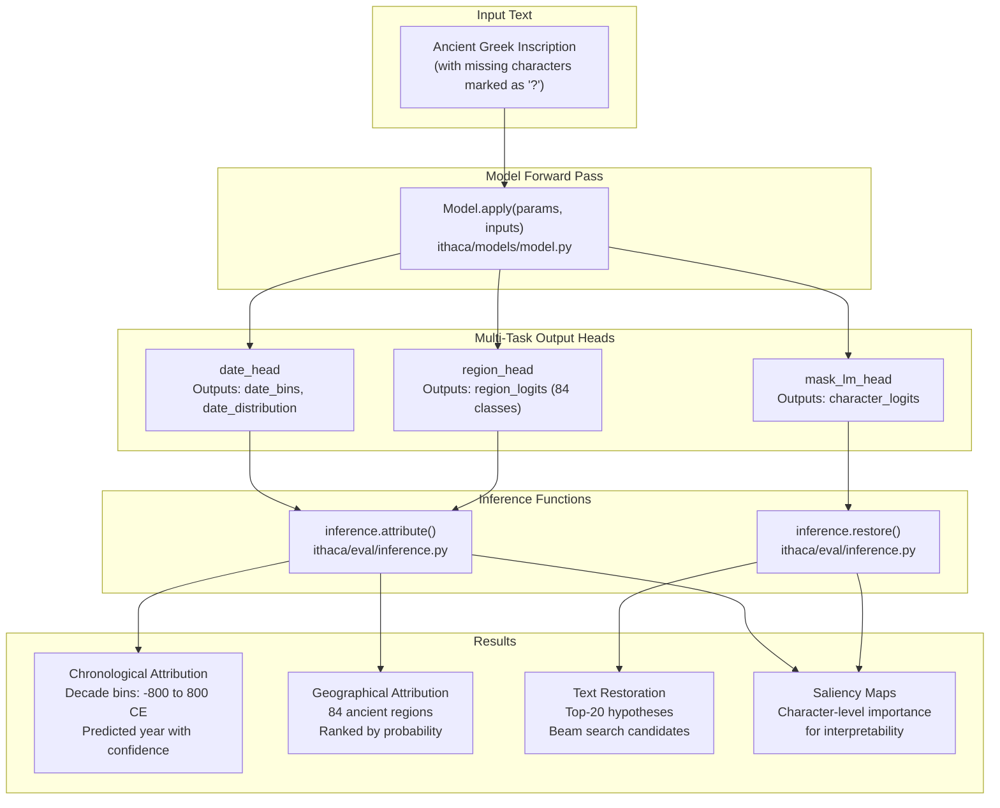

### Restoration Task
The **masked language modeling head** (`mask_lm_head` in [ithaca/models/model.py]()) predicts missing characters marked with `?` in the input text. The `inference.restore()` function uses non-sequential beam search to generate Top-20 restoration hypotheses ranked by probability.

### Geographical Attribution Task
The **region classification head** (`region_head` in [ithaca/models/model.py]()) predicts one of 84 ancient Greek subregions. Region mappings are maintained in [ithaca/util/region_names.py]() and derived from the PHI dataset's geographical metadata.

### Chronological Dating Task
The **date prediction head** (`date_head` in [ithaca/models/model.py]()) produces both:
- A **date distribution** over decade bins from 800 BCE to 800 CE (defined in [ithaca/util/dates.py]())
- An **L1 regression target** for precise year prediction

The combination of distribution and point estimate provides both uncertainty quantification and fine-grained dating.

**Sources:** [ithaca/models/model.py](), [ithaca/eval/inference.py](), [colabs/ithaca_inference.ipynb:121-195]()

---

## Data Source: PHI and I.PHI

Ithaca is trained on the **Packard Humanities Institute (PHI)** dataset, the largest digital corpus of ancient Greek inscriptions:

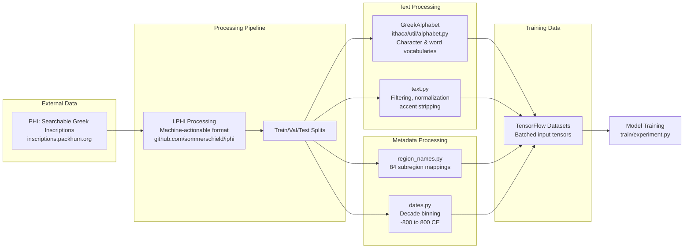

### PHI Dataset Characteristics
- **Content**: Inscribed texts from ancient Greece, including decrees, laws, dedications, and public records
- **Metadata**: Each inscription has geographical origin (region/subregion) and estimated date ranges
- **Processing**: The I.PHI workflow converts raw PHI data into machine-actionable format with train/validation/test splits

### Text Representation
The `GreekAlphabet` class ([ithaca/util/alphabet.py]()) handles:
- **Character-level vocabulary**: ~50 tokens including Greek letters, punctuation, and special tokens (`<pad>`, `<sos>`, `<unk>`, `<mask>`)
- **Word-level vocabulary**: ~100k word tokens for semantic understanding
- **Text normalization**: Diacritic conversion (tonos/oxia), sigma handling, and accent stripping via [ithaca/util/text.py]()

**Sources:** [README.md:118-122](), [ithaca/util/alphabet.py](), [ithaca/util/text.py](), [ithaca/util/dates.py](), [ithaca/util/region_names.py]()

---

## Research Applications

Ithaca enables several impactful research workflows:

### 1. Text Restoration for Damaged Inscriptions
When physical damage makes inscriptions illegible, historians traditionally rely on expertise in ancient language, historical context, and comparison with similar texts. Ithaca provides:
- **Top-20 restoration candidates** ranked by probability
- **Saliency maps** showing which input characters most influenced each prediction
- **Interactive exploration** via the Colab notebook interface

Example from [colabs/ithaca_inference.ipynb:381-383]():
```
Input: "αναγραψαι δε τοδε ?????????α την βουλην"
Top hypothesis (66.1%): "αναγραψαι δε τοδε το ψηφισμα την βουλην"
```

### 2. Geographical Attribution for Provenance Research
When inscriptions are found out of context, determining their origin helps:
- **Reconstruct historical trade networks**
- **Identify cultural influences** between regions
- **Verify authenticity** of artifacts

Ithaca predicts among **84 subregions** (defined in [ithaca/util/region_names.py]()) of the ancient Greek world, with probability rankings and geographical visualizations.

### 3. Chronological Dating for Historical Analysis
Accurate dating allows historians to:
- **Place texts in historical context** (wars, political changes, cultural movements)
- **Resolve dating disputes** in scholarly literature
- **Redate key texts** with improved evidence

Ithaca's date predictions use **decade bins** from 800 BCE to 800 CE ([ithaca/util/dates.py:25-34]()), providing both a distribution (uncertainty) and a point estimate.

### 4. Human-AI Collaboration
The system's architecture emphasizes **decision support** rather than automation:
- Historians see performance improve from **25% to 72%** when using Ithaca
- Multiple restoration hypotheses enable expert judgment
- Saliency maps provide interpretability for predictions
- Interactive Colab notebook supports iterative exploration

**Sources:** [README.md:35-43](), [colabs/ithaca_inference.ipynb:124-135](), [colabs/ithaca_inference.ipynb:424-433]()

---

## Inference Interfaces

Ithaca provides three interfaces for using pre-trained models:

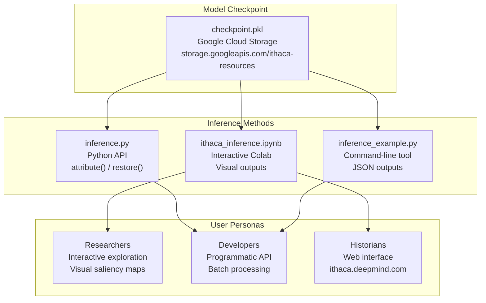

### 1. Python API: `inference.py`
The core inference module ([ithaca/eval/inference.py]()) provides two main functions:
- **`attribute(text, ...)`**: Returns `AttributionResults` with date/region predictions and saliency maps
- **`restore(text, ...)`**: Returns `RestorationResults` with Top-20 restoration hypotheses and saliency maps

Both functions take Ancient Greek text with missing characters marked as `?` (to predict) or `-` (to skip).

### 2. Interactive Colab Notebook
The notebook ([colabs/ithaca_inference.ipynb]()) provides:
- Step-by-step guided workflow
- Visual outputs (bar charts, maps, HTML tables)
- Saliency visualizations with purple gradient highlighting
- No installation required (runs in browser)

### 3. Command-Line Tool
The CLI script ([inference_example.py]()) enables:
- Batch processing of texts
- JSON output for integration with other tools
- Input from files or command-line arguments

Example usage from [README.md:89-101]():
```bash
python inference_example.py --input_file=example_input.txt
python inference_example.py --attribute_json=attribute.json --restore_json=restore.json
```

**Sources:** [README.md:67-114](), [colabs/ithaca_inference.ipynb:105-137](), [inference_example.py]()

---

## Key Research Contributions

Ithaca represents several advances in the application of deep learning to humanities research:

### Multi-Task Architecture
Unlike prior work focusing on single tasks, Ithaca jointly learns:
- **Text restoration** (masked language modeling)
- **Geographical attribution** (84-class classification)
- **Chronological dating** (distribution + regression)

This multi-task approach enables the model to leverage correlations between tasks (e.g., certain phrases are more common in specific regions/time periods).

### Collaborative Design
The system is explicitly designed for **human-in-the-loop** workflows:
- Provides multiple hypotheses rather than single predictions
- Includes saliency maps for interpretability
- Achieves significant accuracy gains when combined with expert knowledge (25% → 72%)

### Sparse Attention for Long Texts
Ancient inscriptions can be lengthy. Ithaca uses **BigBird sparse attention** ([ithaca/models/bigbird.py]()) to efficiently process sequences up to 768 characters, reducing computational complexity from O(n²) to O(n).

### Dual-Level Text Representation
The model processes text at both:
- **Character level**: For fine-grained restoration and handling of rare forms
- **Word level**: For semantic understanding and contextual reasoning

This dual representation is implemented via separate embedding layers in [ithaca/models/common_layers.py]().

**Sources:** [README.md:5-48](), [ithaca/models/model.py](), [ithaca/models/bigbird.py](), [ithaca/models/common_layers.py]()

---

## Summary

Ithaca is a deep neural network for ancient Greek inscription analysis that:

1. **Restores damaged text** with 62% accuracy (model alone) or 72% (with historians)
2. **Attributes inscriptions geographically** to 84 ancient regions with 71% accuracy
3. **Dates inscriptions chronologically** within 30 years of ground-truth ranges
4. **Supports collaborative research** through interpretable, multi-hypothesis outputs
5. **Processes long texts efficiently** using sparse BigBird attention
6. **Provides multiple interfaces** (Python API, Colab notebook, CLI tool)

The system demonstrates how AI can serve as a research aid in humanities scholarship, enhancing rather than replacing human expertise.

**Sources:** [README.md:1-65](), [colabs/ithaca_inference.ipynb:20-67]()

---

# Page: System Architecture

# System Architecture

<details>
<summary>Relevant source files</summary>

The following files were used as context for generating this wiki page:

- [README.md](README.md)
- [ithaca/eval/inference.py](ithaca/eval/inference.py)
- [requirements.txt](requirements.txt)
- [train/experiment.py](train/experiment.py)

</details>


This document provides a high-level overview of the Ithaca system architecture, describing the relationships between major components and how they interact. For detailed information about the model's neural network architecture, see [Model Architecture](#3). For training procedures, see [Training System](#4). For inference usage, see [Inference System](#5).

## System Overview

Ithaca is organized into three primary subsystems that share a common model core:

1. **Training System**: Distributed training orchestrated by JAXline, using multi-task losses
2. **Inference System**: Lightweight prediction interface for text restoration and attribution
3. **Data Processing Pipeline**: Text normalization, augmentation, and batching utilities

The system follows a standard train-then-deploy pattern where the training system produces a checkpoint file (`checkpoint.pkl`) that the inference system loads for predictions.

## Component Organization

The codebase is structured into distinct packages that separate concerns:

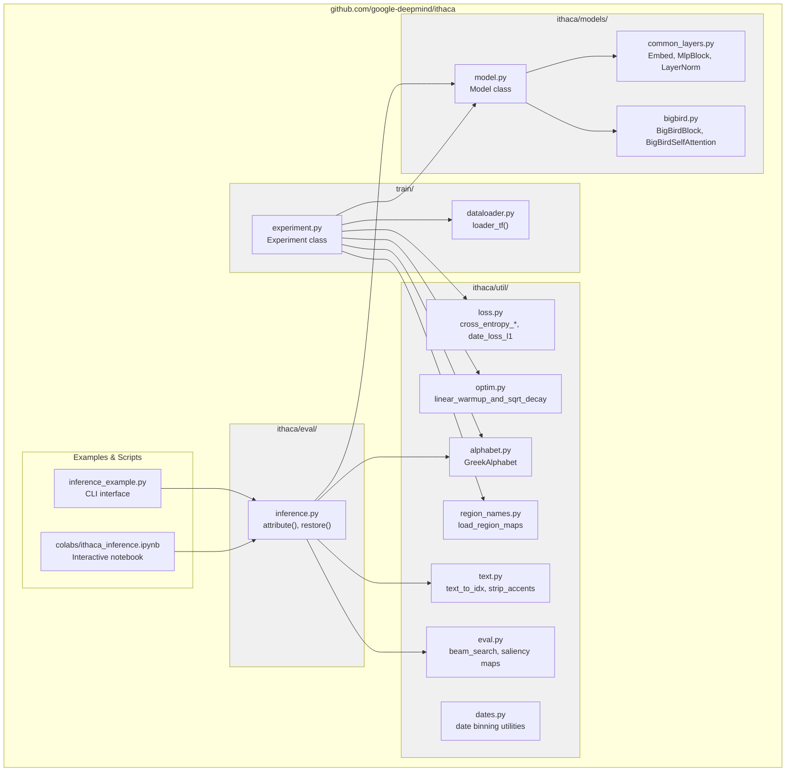

**Sources:** [requirements.txt:1-10](), [README.md:1-130](), [train/experiment.py:1-680](), [ithaca/eval/inference.py:1-269]()

## Core Components

### Training System

The training system is implemented in the `Experiment` class, which extends `jaxline.experiment.AbstractExperiment`. This provides distributed training orchestration, checkpointing, and evaluation.

| Component | Code Entity | Purpose |
|-----------|-------------|---------|
| Training orchestration | `Experiment` class | Manages training loop, parameter updates, checkpointing |
| Model initialization | `Experiment._initialize_train()` | Initializes model parameters from scratch |
| Training step | `Experiment.step()` | Single training iteration |
| Update function | `Experiment._update_func()` | Computes gradients and applies optimizer |
| Loss computation | `Experiment._loss_fn()` | Multi-task loss: date + region + mask + NSP |
| Optimizer | `Experiment.optimizer()` | Configures Optax chain with gradient clipping |
| Data pipeline | `Experiment._build_train_input()` | TensorFlow Dataset with prefetching |
| Evaluation | `Experiment.evaluate()` | Validation loop with composite scoring |

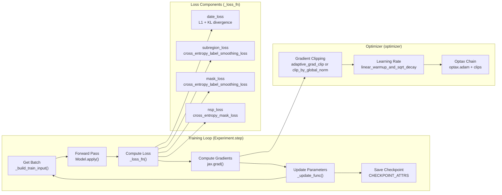

**Key implementation details:**

- **Distributed Training**: Uses `jax.pmap` to parallelize across devices [train/experiment.py:82-83]()
- **Checkpointing**: Stores `_params` and `_opt_state` as sharded device arrays [train/experiment.py:56-59]()
- **Learning Rate Schedule**: Linear warmup followed by sqrt decay [train/experiment.py:85-88]()
- **Composite Scoring**: `mask_acc + region_acc - date_l1*0.01` for best model selection [train/experiment.py:559-560]()
- **Multi-task Weighting**: Each loss component has configurable weight and can be linearly ramped [train/experiment.py:268-269]()

**Sources:** [train/experiment.py:50-369](), [train/experiment.py:377-674]()

### Inference System

The inference system provides two main entry points: `attribute()` for date/region prediction and `restore()` for text restoration. Both are implemented as pure functions that take a forward pass function and return structured results.

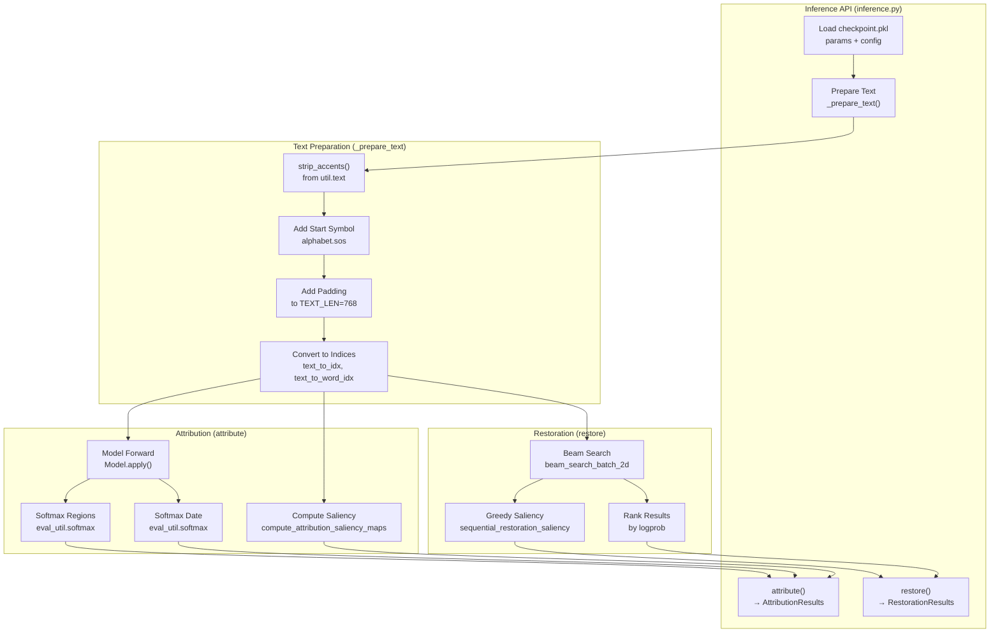

**Key constants and parameters:**

| Constant | Value | Purpose |
|----------|-------|---------|
| `TEXT_LEN` | 768 | Fixed model sequence length |
| `MIN_TEXT_LEN` | 50 | Minimum input text length |
| `DATE_MIN` / `DATE_MAX` | -800 / 800 | Date range in years |
| `DATE_INTERVAL` | 10 | Date binning interval (decades) |
| `RESTORATION_BEAM_WIDTH` | 20 | Beam search width |
| `ALPHABET_MISSING_RESTORE` | `'?'` | Character indicating missing text |

**Return types:**

- `AttributionResults`: Contains `locations` (region predictions), `year_scores` (date distribution), and saliency maps [ithaca/eval/inference.py:48-74]()
- `RestorationResults`: Contains `predictions` (beam search results), `top_prediction`, and sequential saliency maps [ithaca/eval/inference.py:99-128]()

**Sources:** [ithaca/eval/inference.py:130-269]()

### Model Core

The `Model` class in [ithaca/models/model.py]() defines the Transformer architecture with BigBird attention. While the detailed implementation is covered in [Model Architecture](#3), the key interface is:

```python
# Model initialization signature
Model(**config.model)

# Forward pass signature  
Model.apply(
    params,
    text_char: array,      # [batch, 768] character indices
    text_word: array,      # [batch, 768] word indices
    text_char_onehot: Optional[array],
    text_word_onehot: Optional[array],
    is_training: bool,
    rngs: dict            # {'dropout': rng_key}
) -> Tuple[date_pred, subregion_logits, mask_logits, nsp_logits]
```

The model accepts both character-level and word-level tokenization and outputs four prediction heads simultaneously.

**Sources:** [train/experiment.py:81](), [train/experiment.py:212-219](), [ithaca/eval/inference.py:194-198]()

## Data Flow Architecture

The following diagram shows how data flows through the system from raw PHI inscriptions to final predictions:

```mermaid
graph TB
    subgraph External["External Data"]
        PHI["PHI Dataset<br/>Searchable Greek Inscriptions"]
    end
    
    subgraph DataPrep["Data Preparation (External)"]
        IPHI["I.PHI Processing<br/>github.com/sommerschield/iphi"]
        Splits["Train/Val/Test Splits<br/>JSON format"]
    end
    
    subgraph LoadingTraining["Loading (Training)"]
        DatasetFile["dataset_path<br/>config.dataset.dataset_path"]
        LoaderTF["loader_tf()<br/>dataloader.py"]
        TFDataset["TensorFlow Dataset<br/>tfds.as_numpy()"]
        Prefetch["Prefetch & Buffer<br/>py_prefetch, double_buffer_on_gpu"]
    end
    
    subgraph Processing["Text Processing (ithaca/util/)"]
        GreekAlphabet["GreekAlphabet<br/>char2idx, word2idx"]
        FilterText["alphabet.filter()<br/>normalize diacritics"]
        StripAccents["text.strip_accents()<br/>remove accents"]
        ToIdx["text_to_idx()<br/>text_to_word_idx()"]
        Augment["Augmentation<br/>random_mask_span<br/>random_sentence_swap"]
    end
    
    subgraph ModelTraining["Model (Training)"]
        ModelApply["Model.apply()<br/>is_training=True"]
        LossFn["_loss_fn()<br/>multi-task losses"]
        OptimUpdate["optax.apply_updates()<br/>parameter update"]
    end
    
    subgraph Checkpoint["Checkpoint Storage"]
        SaveParams["Save params<br/>CHECKPOINT_ATTRS"]
        CheckpointPKL["checkpoint.pkl<br/>params + opt_state + config"]
    end
    
    subgraph LoadingInference["Loading (Inference)"]
        LoadCkpt["Load checkpoint.pkl"]
        PrepText["_prepare_text()<br/>add SOS, padding"]
    end
    
    subgraph ModelInference["Model (Inference)"]
        ModelApplyInfer["Model.apply()<br/>is_training=False"]
        PostProcess["Post-processing<br/>softmax, beam_search"]
        Results["AttributionResults<br/>RestorationResults"]
    end
    
    PHI --> IPHI
    IPHI --> Splits
    Splits --> DatasetFile
    DatasetFile --> LoaderTF
    LoaderTF --> TFDataset
    TFDataset --> Prefetch
    
    Prefetch --> FilterText
    FilterText --> StripAccents
    StripAccents --> Augment
    Augment --> ToIdx
    GreekAlphabet --> ToIdx
    
    ToIdx --> ModelApply
    ModelApply --> LossFn
    LossFn --> OptimUpdate
    OptimUpdate --> SaveParams
    SaveParams --> CheckpointPKL
    
    CheckpointPKL --> LoadCkpt
    LoadCkpt --> PrepText
    GreekAlphabet --> PrepText
    PrepText --> ModelApplyInfer
    ModelApplyInfer --> PostProcess
    PostProcess --> Results
```

**Sources:** [train/experiment.py:171-196](), [ithaca/eval/inference.py:142-184]()

## Deployment Modes

Ithaca supports two deployment configurations, controlled by installation mode:

### Core Installation (Inference Only)

For end-users who only need to run predictions:

```bash
pip install .
```

**Included components:**
- `ithaca.models.*` - Model definitions
- `ithaca.util.*` - Utility functions
- `ithaca.eval.inference` - Inference functions
- Dependencies: `jax`, `jaxlib`, `flax`, `numpy`, `absl-py`, `chex`, `dm-haiku`, `ml-collections`, `tqdm`

**Excluded components:**
- `train/` directory (training scripts)
- Heavy dependencies: `optax`, `jaxline`, `tensorflow-datasets`

**Sources:** [requirements.txt:1-10](), [README.md:79-114]()

### Full Installation (Training + Inference)

For researchers and developers who need to train models:

```bash
pip install .[train]  # includes additional dependencies
```

**Additional components:**
- `train/experiment.py` - Training orchestration
- `train/dataloader.py` - Data loading pipeline
- Additional dependencies: `optax` (optimization), `jaxline` (experiment management), `tensorflow-datasets` (data loading)

**Sources:** [README.md:124-125]()

## Checkpoint Format

The `checkpoint.pkl` file serves as the bridge between training and inference. It is a pickled dictionary containing:

| Key | Content | Usage |
|-----|---------|-------|
| `params` | Model parameters (Flax frozen dict) | Loaded into `Model.apply()` |
| `opt_state` | Optimizer state (training only) | Not used in inference |
| `config` | Model configuration dict | Reconstructs model architecture |
| `alphabet` | `GreekAlphabet` instance | Text tokenization |
| `region_map` | Region ID to name mappings | Location predictions |

The checkpoint is saved during training [train/experiment.py:56-59]() and loaded for inference. During training, the `Experiment` class manages checkpointing via JAXline's platform utilities. The checkpoint file is hosted externally (Google Cloud Storage) and not included in the repository.

**Sources:** [train/experiment.py:56-59](), [README.md:84-87]()

## Technology Stack

The system is built on the JAX ecosystem, which provides automatic differentiation, JIT compilation, and hardware acceleration:

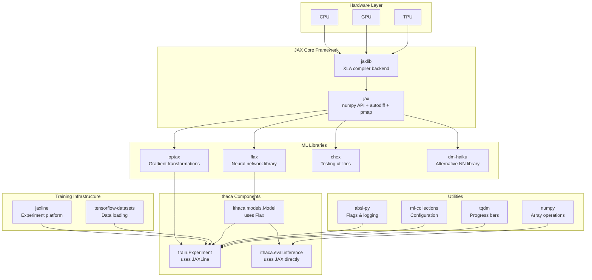

**Key architectural decisions:**
- **Flax over Haiku**: Object-oriented module system preferred for model definition
- **JAXLine for training**: Provides distributed training, checkpointing, and experiment management
- **Direct JAX for inference**: Minimal dependencies for deployment
- **Optax for optimization**: Composable gradient transformations enable complex schedules
- **TensorFlow Datasets**: Efficient data loading with prefetching and parallelism

**Sources:** [requirements.txt:1-10](), [train/experiment.py:38-45]()

---

# Page: Technology Stack

# Technology Stack

<details>
<summary>Relevant source files</summary>

The following files were used as context for generating this wiki page:

- [requirements.txt](requirements.txt)
- [setup.py](setup.py)

</details>


This page documents the technology stack and dependencies that form the foundation of the Ithaca project. It covers the JAX ecosystem libraries, neural network frameworks, optimization tools, and supporting utilities. For information about how these components fit into the overall system architecture, see [System Architecture](#1.2). For details about the model implementation using these libraries, see [Model Architecture](#3).

## Overview

Ithaca is built on the JAX ecosystem, a modern machine learning framework designed for high-performance numerical computing. The technology stack is organized into two tiers:

1. **Core dependencies**: Required for inference and model loading
2. **Training dependencies**: Additional libraries required only for model training

This separation enables lightweight deployment for inference-only use cases while providing comprehensive tools for researchers and developers.

## Dependency Hierarchy

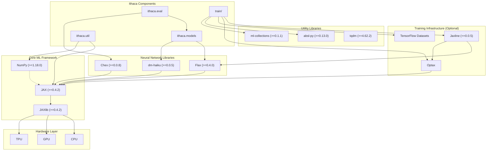

**Sources:** [requirements.txt:1-10](), [setup.py:37-44]()

## Core Framework

### JAX and JAXlib

**JAX** (version >=0.4.2) is the foundational framework for Ithaca, providing:

- **Automatic differentiation**: Gradient computation for training neural networks
- **Just-in-time compilation**: XLA compilation for high-performance execution
- **Vectorization**: `vmap` for efficient batch processing
- **Parallelization**: `pmap` for multi-device training
- **Functional programming paradigm**: Pure functions enable reliable transformations

**JAXlib** (version >=0.4.2) provides the XLA backend that compiles JAX programs for CPU, GPU, and TPU execution. The version constraint ensures compatibility with the JAX transformations used throughout Ithaca.

**Version requirement:** `>=0.4.2` ensures access to modern JAX APIs, including improved `pmap` semantics and better error messages.

**Sources:** [requirements.txt:5-6]()

### NumPy Compatibility

**NumPy** (version >=1.18.0) provides the array interface. JAX implements a NumPy-compatible API, allowing Ithaca code to use familiar array operations while benefiting from JAX's performance optimizations. The code uses `jax.numpy` (typically imported as `jnp`) rather than standard NumPy for operations within compiled functions.

**Sources:** [requirements.txt:8]()

## Neural Network Libraries

### Flax

**Flax** (version >=0.4.0) is the primary neural network library used in Ithaca. It provides:

- **Module system**: Object-oriented neural network components
- **Parameter management**: Structured parameter dictionaries with frozen dataclasses
- **Training utilities**: Checkpointing, serialization, and model inspection

Ithaca's model architecture is implemented entirely in Flax. Key Flax constructs used include:

- `flax.linen.Module`: Base class for all model components
- `flax.linen.Embed`: Embedding layers for character and word tokens
- `flax.linen.Dense`: Linear transformation layers
- `flax.linen.LayerNorm`: Layer normalization
- `flax.linen.Dropout`: Dropout regularization

The choice of Flax over other JAX neural network libraries reflects its mature API, strong documentation, and object-oriented design that facilitates complex model architectures.

**Sources:** [requirements.txt:3](), [setup.py:35]()

### dm-haiku

**dm-haiku** (version >=0.0.5) is included as a dependency but plays a secondary role. Haiku provides an alternative functional approach to neural network construction. While Ithaca's core model uses Flax, Haiku may be used in utility functions or experiments. The library is maintained to ensure compatibility with the broader JAX ecosystem.

**Sources:** [requirements.txt:4]()

### Chex

**Chex** (version >=0.0.8) provides testing and validation utilities for JAX code:

- **Array assertions**: Verify shape, dtype, and numerical properties
- **Dataclass utilities**: Frozen dataclasses for parameter structures
- **Fake JAX functions**: Testing without actual hardware acceleration

Chex is used throughout Ithaca for type checking and runtime validation, improving code reliability.

**Sources:** [requirements.txt:2]()

## Optimization and Training Infrastructure

These dependencies are installed only with `pip install ithaca[train]` (see [setup.py:38-44]()):

### Optax

**Optax** provides gradient transformation and optimization algorithms. Ithaca uses Optax to construct sophisticated optimizer chains:

- Learning rate schedules (linear warmup + square root decay)
- Gradient clipping (global norm clipping)
- Weight decay
- AdamW optimizer

The optimizer configuration in `train/experiment.py` chains multiple Optax transformations to create the final optimizer. For details on the specific optimization strategy, see [Optimization and Schedulers](#4.3).

**Sources:** [setup.py:40]()

### Jaxline

**Jaxline** (version ==0.0.5) is the experiment management framework that orchestrates training:

- **Experiment class**: Base class for defining training loops
- **Checkpointing**: Automatic model and optimizer state persistence
- **Distributed training**: Integration with JAX's `pmap` for multi-device training
- **Periodic evaluation**: Scheduling validation runs during training
- **Configuration management**: Integration with `ml-collections` for hyperparameter specification

The `train/experiment.py` module implements a Jaxline experiment that handles the complete training lifecycle. Note the pinned version (`==0.0.5`), which ensures API stability.

**Sources:** [setup.py:41]()

### TensorFlow Datasets

**TensorFlow Datasets** (TFDS) provides the data loading pipeline:

- Efficient I/O with prefetching and parallelization
- Standardized dataset interface
- Support for large datasets that don't fit in memory

While Ithaca uses JAX/Flax for modeling, TFDS is retained for its robust data loading capabilities. The data pipeline converts TensorFlow tensors to NumPy arrays for consumption by JAX models.

**Sources:** [setup.py:42]()

## Utility Libraries

### absl-py

**absl-py** (version >=0.13.0) provides:

- **Flags**: Command-line argument parsing via `absl.flags`
- **Logging**: Structured logging via `absl.logging`
- **App framework**: Main application entry points via `absl.app`

Used extensively in `train/experiment.py` for configuring training runs and in example scripts for user-facing interfaces.

**Sources:** [requirements.txt:1]()

### ml-collections

**ml-collections** (version >=0.1.1) provides `ConfigDict`, a dictionary-like structure for configuration management:

- Attribute-style access to configuration values
- Type checking and validation
- Immutable configurations for reproducibility

Training experiments use `ml-collections` to specify model hyperparameters, training settings, and data pipeline configurations.

**Sources:** [requirements.txt:7]()

### tqdm

**tqdm** (version >=4.62.2) provides progress bars for long-running operations:

- Training loop progress visualization
- Data loading progress tracking
- Inference progress for batch processing

**Sources:** [requirements.txt:9]()

## Dependency Organization

The [setup.py:26-52]() file organizes dependencies into two installation modes:

### Core Installation

```python
# Core dependencies (required)
install_requires=(here / 'requirements.txt').read_text().splitlines()
```

Includes all libraries in [requirements.txt:1-10]():
- `absl-py>=0.13.0`
- `chex>=0.0.8`
- `flax>=0.4.0`
- `dm-haiku>=0.0.5`
- `jax>=0.4.2`
- `jaxlib>=0.4.2`
- `ml-collections>=0.1.1`
- `numpy>=1.18.0`
- `tqdm>=4.62.2`

**Installation command**: `pip install ithaca`

**Use case**: Inference-only applications where users load pre-trained models for text attribution and restoration.

### Training Installation

```python
extras_require={
    'train': [
        'optax',
        'jaxline==0.0.5',
        'tensorflow-datasets',
    ]
}
```

Adds three additional dependencies (see [setup.py:39-43]()):
- `optax`: Gradient processing and optimization
- `jaxline==0.0.5`: Experiment management framework
- `tensorflow-datasets`: Data loading infrastructure

**Installation command**: `pip install ithaca[train]`

**Use case**: Researchers and developers who need to train custom models or reproduce experiments.

### Package Exclusion

The [setup.py:35]() line explicitly excludes the `train/` directory from the distributed package:

```python
packages=setuptools.find_packages(exclude=('train',))
```

This ensures that:
1. Training code is not installed with the core package
2. Users performing inference don't download unnecessary code
3. The package remains lightweight for production deployments

**Sources:** [setup.py:26-52]()

## Version Constraints

The following table summarizes version requirements and their rationale:

| Library | Constraint | Type | Rationale |
|---------|-----------|------|-----------|
| `jax` | `>=0.4.2` | Lower bound | Modern API features, improved `pmap` semantics |
| `jaxlib` | `>=0.4.2` | Lower bound | Must match JAX version for XLA backend compatibility |
| `flax` | `>=0.4.0` | Lower bound | Stable `linen` module API |
| `jaxline` | `==0.0.5` | Exact pin | API stability for experiment framework |
| `absl-py` | `>=0.13.0` | Lower bound | Flags and logging API compatibility |
| `chex` | `>=0.0.8` | Lower bound | Dataclass and testing utilities |
| `dm-haiku` | `>=0.0.5` | Lower bound | Ecosystem compatibility |
| `ml-collections` | `>=0.1.1` | Lower bound | ConfigDict API stability |
| `numpy` | `>=1.18.0` | Lower bound | Array interface compatibility |
| `tqdm` | `>=4.62.2` | Lower bound | Progress bar features |

**Note**: Optax, TensorFlow Datasets have no version constraints in [setup.py:40-42](), allowing flexibility for training environments.

**Sources:** [requirements.txt:1-10](), [setup.py:38-44]()

## Component-Library Mapping

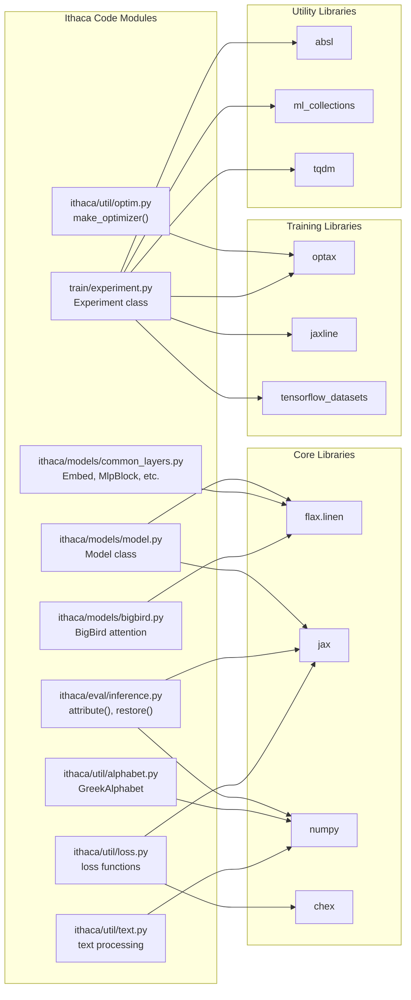

This diagram shows which Ithaca code modules depend on which external libraries:

**Core modules** (`ithaca/models/`, `ithaca/eval/`, `ithaca/util/`):
- Use only core dependencies from [requirements.txt:1-10]()
- Can be imported and used without training dependencies

**Training module** (`train/`):
- Requires all core dependencies plus training extras from [setup.py:39-43]()
- Not included in default installation

**Sources:** [requirements.txt:1-10](), [setup.py:26-52]()

## Installation Verification

After installation, verify the technology stack is correctly configured:

```bash
# Verify core installation
python -c "import jax; import flax; print(f'JAX: {jax.__version__}, Flax: {flax.__version__}')"

# Verify training installation (if installed with [train] extra)
python -c "import optax; import jaxline; print('Training dependencies available')"

# Check hardware acceleration
python -c "import jax; print(f'Devices: {jax.devices()}')"
```

The last command should list available accelerators (CPU, GPU, or TPU).

**Sources:** [requirements.txt:1-10](), [setup.py:37-44]()

---

# Page: Getting Started

# Getting Started

<details>
<summary>Relevant source files</summary>

The following files were used as context for generating this wiki page:

- [README.md](README.md)
- [requirements.txt](requirements.txt)
- [setup.py](setup.py)

</details>


This document provides installation instructions and quick start guides for using Ithaca. It covers both inference-only usage (for end users performing text restoration and attribution) and full installation (for researchers and developers who want to train models or extend the codebase).

**Scope of this document:**
- Installing the `ithaca` package in core or full mode
- Downloading pre-trained model checkpoints
- Running inference via Colab notebook, CLI, or Python API
- Verifying your installation

For detailed information about the model architecture, see [Model Architecture](#3). For training custom models, see [Training System](#4). For the complete API reference, see [API Reference](#8).

---

## Installation Modes

Ithaca offers two installation modes to accommodate different use cases:

| Installation Mode | Use Case | Includes Training Code | Dependencies |
|-------------------|----------|------------------------|--------------|
| **Core** | Inference only | No | Minimal (JAX, Flax, NumPy, etc.) |
| **Full** | Training & Development | Yes | Core + Optax, JAXline, TFDS |

The installation mode determines which packages are installed via [setup.py:35-44](), which excludes the `train/` directory in core mode and includes additional training dependencies in full mode.

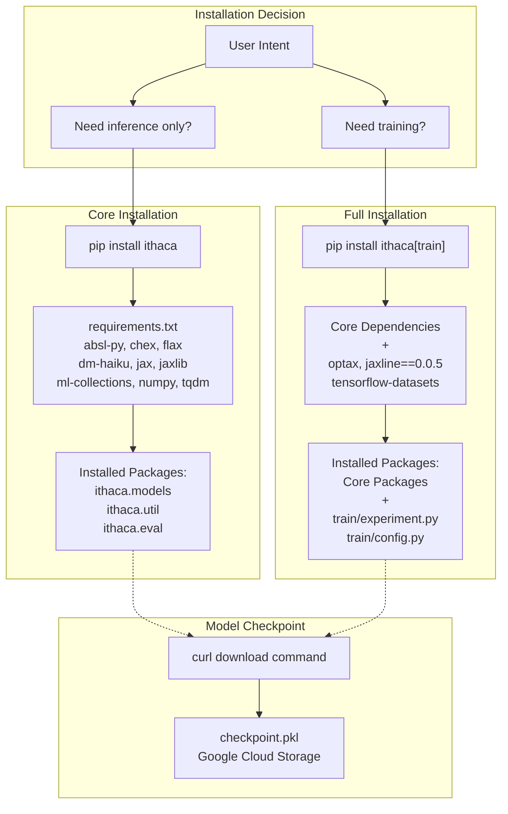

**Installation Mode Selection Diagram**

**Sources:** [setup.py:26-44](), [requirements.txt:1-9](), [README.md:79-82]()

---

## Prerequisites

Before installing Ithaca, ensure you have:

- **Python 3.7+** (recommended: Python 3.8 or 3.9)
- **pip** package manager
- **Git** (if installing from source)

For GPU/TPU acceleration (recommended for training):
- CUDA-compatible GPU with appropriate drivers
- Or access to Google Cloud TPU

---

## Core Installation (Inference Only)

For users who only need to perform text restoration and attribution using pre-trained models:

### Step 1: Install the Package

```sh
pip install ithaca
```

Or if installing from source:

```sh
git clone https://github.com/google-deepmind/ithaca.git
cd ithaca
pip install .
```

This installs the core dependencies listed in [requirements.txt:1-9]() and all packages except `train/`, as specified by [setup.py:35]().

### Step 2: Download the Pre-trained Model

```sh
curl --output checkpoint.pkl https://storage.googleapis.com/ithaca-resources/models/checkpoint_v1.pkl
```

The checkpoint file (`checkpoint.pkl`) contains:
- Model architecture configuration
- Trained parameter weights
- Vocabulary mappings (`GreekAlphabet`)
- Region metadata (84 subregions)

**Important:** The checkpoint file is approximately 500MB and is not included in the repository due to its size. It must be downloaded separately from Google Cloud Storage.

### Step 3: Verify Installation

Test that the installation works:

```python
import jax
import flax
from ithaca.eval import inference

print("Ithaca core installation successful!")
print(f"JAX version: {jax.__version__}")
print(f"Flax version: {flax.__version__}")
```

**Sources:** [README.md:79-87](), [setup.py:26-37]()

---

## Full Installation (Training and Development)

For researchers and developers who need to train models or modify the codebase:

### Step 1: Install with Training Dependencies

```sh
pip install ithaca[train]
```

Or from source:

```sh
git clone https://github.com/google-deepmind/ithaca.git
cd ithaca
pip install .[train]
```

This installs additional dependencies defined in [setup.py:38-44]():
- `optax` - Gradient transformation library
- `jaxline==0.0.5` - Training experiment framework
- `tensorflow-datasets` - Data loading pipeline

### Step 2: Verify Training Installation

```python
import optax
import jaxline
import tensorflow_datasets as tfds
from train import experiment

print("Ithaca full installation successful!")
print(f"Optax version: {optax.__version__}")
print(f"TensorFlow Datasets available: {tfds.__version__}")
```

### Step 3: (Optional) Download Pre-trained Model

Even when training from scratch, you may want to download the checkpoint for fine-tuning or comparison:

```sh
curl --output checkpoint.pkl https://storage.googleapis.com/ithaca-resources/models/checkpoint_v1.pkl
```

**Sources:** [setup.py:38-44](), [README.md:125]()

---

## Quick Start: Inference

Once installed, you can perform inference in three ways:

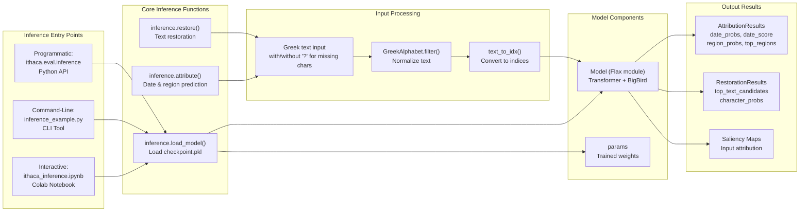

**Inference Workflow Diagram**

**Sources:** [README.md:67-114](), [colabs/ithaca_inference.ipynb:6.14]()

---

## Interactive Colab Notebook

The fastest way to start using Ithaca is through the interactive Colab notebook.

### Access the Notebook

Click this badge to open the notebook:

[](https://colab.research.google.com/github/deepmind/ithaca/blob/master/colabs/ithaca_inference.ipynb)

Or navigate to: [https://github.com/google-deepmind/ithaca/blob/master/colabs/ithaca_inference.ipynb](https://github.com/google-deepmind/ithaca/blob/master/colabs/ithaca_inference.ipynb)

### Notebook Features

The Colab notebook provides:

1. **Automatic Setup** - Installs dependencies and downloads the checkpoint
2. **Text Attribution** - Predict date and geographical origin
3. **Text Restoration** - Fill in missing characters marked with `?`
4. **Visualizations** - Saliency maps showing which characters influenced predictions
5. **Interactive Widgets** - Easy-to-use interface for non-programmers

### Example Usage in Notebook

```python
# After running setup cells in the notebook:

# Attribution example
text = "δήμο το αθηναίων"  # "the people of Athens"
attribution_results = inference.attribute(model, params, text)
print(f"Predicted date: {attribution_results.date_score}")
print(f"Top region: {attribution_results.top_regions[0]}")

# Restoration example
damaged_text = "???μο το αθηναίων"  # First 3 characters missing
restoration_results = inference.restore(model, params, damaged_text)
print(f"Restored text: {restoration_results.top_text_candidates[0]}")
```

The notebook includes detailed examples and explanations for each function. For more details on the `attribute()` and `restore()` functions, see [Attribution](#5.2) and [Restoration](#5.3).

**Sources:** [README.md:67-72](), [colabs/ithaca_inference.ipynb:6.14]()

---

## Command-Line Interface

For batch processing or integration into scripts, use the `inference_example.py` CLI tool.

### Basic Usage

```sh
python inference_example.py --input_file=example_input.txt
```

This command:
1. Loads the model from `checkpoint.pkl`
2. Reads Greek text from `example_input.txt`
3. Performs both attribution and restoration
4. Prints results to console

### Input Methods

**From file:**
```sh
python inference_example.py --input_file=my_inscription.txt
```

**From command-line argument:**
```sh
python inference_example.py --input="δήμο το αθηναίων"
```

**With missing characters (for restoration):**
```sh
python inference_example.py --input="???μο το αθηναίων"
```

### Output Options

**Save results to JSON:**
```sh
python inference_example.py \
  --input_file=example_input.txt \
  --attribute_json=attribution_output.json \
  --restore_json=restoration_output.json
```

**JSON output structure:**

Attribution JSON:
```json
{
  "date_score": 425.5,
  "date_probs": [0.01, 0.05, 0.12, ...],
  "region_probs": [0.15, 0.08, ...],
  "top_regions": ["Attica", "Boeotia", ...]
}
```

Restoration JSON:
```json
{
  "top_text_candidates": ["δήμο το αθηναίων", "δῆμο το αθηναίων", ...],
  "character_probs": [[0.8, 0.1, ...], ...]
}
```

### CLI Reference

| Flag | Description | Default |
|------|-------------|---------|
| `--input` | Greek text string | None |
| `--input_file` | Path to text file (UTF-8) | None |
| `--checkpoint` | Path to checkpoint.pkl | `checkpoint.pkl` |
| `--attribute_json` | Save attribution results | None |
| `--restore_json` | Save restoration results | None |

**View all options:**
```sh
python inference_example.py --help
```

**Sources:** [README.md:89-114](), [inference_example.py (referenced)]()

---

## Programmatic Python API

For integration into Python applications, use the `ithaca.eval.inference` module directly.

### Basic Workflow

```python
from ithaca.eval import inference

# Step 1: Load model and checkpoint
model, params, config = inference.load_model('checkpoint.pkl')

# Step 2: Perform attribution
text = "δήμο το αθηναίων"
attribution_results = inference.attribute(
    model=model,
    params=params,
    text=text,
    vocab=config['vocab'],
    region_map=config['region_map']
)

print(f"Predicted date: {attribution_results.date_score} CE")
print(f"Top 3 regions: {attribution_results.top_regions[:3]}")

# Step 3: Perform restoration (for damaged text)
damaged_text = "???μο το αθηναίων"
restoration_results = inference.restore(
    model=model,
    params=params,
    text=damaged_text,
    vocab=config['vocab'],
    beam_size=10
)

print(f"Best restoration: {restoration_results.top_text_candidates[0]}")
```

### Key Functions

| Function | Purpose | Returns |
|----------|---------|---------|
| `inference.load_model(path)` | Load checkpoint | `(model, params, config)` |
| `inference.attribute(...)` | Predict date & region | `AttributionResults` |
| `inference.restore(...)` | Fill missing characters | `RestorationResults` |

For detailed API documentation, see [ithaca.eval](#8.2).

**Sources:** [ithaca/eval/inference.py:0.14](), [README.md:74-114]()

---

## Verifying Your Installation

After installation, run these verification checks:

### Test 1: Import Core Modules

```python
import jax
import flax
from ithaca.models import model
from ithaca.util import alphabet, text
from ithaca.eval import inference

print("✓ All core modules imported successfully")
```

### Test 2: Check JAX Device

```python
import jax
devices = jax.devices()
print(f"JAX devices: {devices}")
print(f"Default backend: {jax.default_backend()}")
```

Expected output:
- CPU: `[CpuDevice(id=0)]`
- GPU: `[GpuDevice(id=0)]`
- TPU: `[TpuDevice(id=0)]`

### Test 3: Test Greek Alphabet Processing

```python
from ithaca.util.alphabet import GreekAlphabet

vocab = GreekAlphabet()
test_text = "δήμο"
filtered = vocab.filter(test_text)
print(f"Original: {test_text}")
print(f"Filtered: {filtered}")
print("✓ Greek text processing works")
```

### Test 4: Load Checkpoint (if downloaded)

```python
from ithaca.eval import inference

try:
    model, params, config = inference.load_model('checkpoint.pkl')
    print(f"✓ Checkpoint loaded successfully")
    print(f"Model config: {config.keys()}")
except FileNotFoundError:
    print("⚠ checkpoint.pkl not found - download it first")
```

### Test 5: Full Inference Test

```python
from ithaca.eval import inference

# Load model
model, params, config = inference.load_model('checkpoint.pkl')

# Test attribution
text = "δήμο το αθηναίων"
results = inference.attribute(model, params, text, 
                               vocab=config['vocab'],
                               region_map=config['region_map'])

print(f"✓ Attribution successful")
print(f"  Predicted date: {results.date_score}")
print(f"  Top region: {results.top_regions[0]}")
```

If all tests pass, your installation is ready for use.

**Sources:** [requirements.txt:1-9](), [setup.py:26-44](), [README.md:79-87]()

---

## Troubleshooting

### Common Issues

**Issue: `ModuleNotFoundError: No module named 'jax'`**
- **Solution:** Reinstall with `pip install --upgrade ithaca`

**Issue: `FileNotFoundError: checkpoint.pkl not found`**
- **Solution:** Download the checkpoint:
  ```sh
  curl --output checkpoint.pkl https://storage.googleapis.com/ithaca-resources/models/checkpoint_v1.pkl
  ```

**Issue: JAX not detecting GPU**
- **Solution:** Install GPU-specific JAX version:
  ```sh
  pip install --upgrade "jax[cuda]" -f https://storage.googleapis.com/jax-releases/jax_cuda_releases.html
  ```

**Issue: `ImportError: cannot import name 'experiment'`**
- **Cause:** Training code not installed
- **Solution:** Install full version: `pip install ithaca[train]`

**Issue: Out of memory during inference**
- **Solution:** Reduce beam size in restoration:
  ```python
  inference.restore(model, params, text, beam_size=5)  # Default is 10
  ```

### Getting Help

- **GitHub Issues:** [https://github.com/google-deepmind/ithaca/issues](https://github.com/google-deepmind/ithaca/issues)
- **Paper:** [Nature article](https://www.nature.com/articles/s41586-022-04448-z)
- **Blog:** [DeepMind blog post](https://www.deepmind.com/blog/predicting-the-past-with-ithaca)

---

## Next Steps

After completing installation and running your first inference:

- **Explore the Model:** Learn about the architecture in [Model Architecture](#3)
- **Advanced Inference:** See [Inference System](#5) for beam search, saliency maps, and interpretability
- **Train Custom Models:** Follow [Training System](#4) to train on your own data
- **API Reference:** Browse [API Reference](#8) for detailed function documentation
- **Data Processing:** Understand text processing in [Data Processing Utilities](#6)

**Sources:** [README.md:1-130](), [setup.py:1-53](), [requirements.txt:1-9]()

---

# Page: Installation

# Installation

<details>
<summary>Relevant source files</summary>

The following files were used as context for generating this wiki page:

- [README.md](README.md)
- [requirements.txt](requirements.txt)
- [setup.py](setup.py)

</details>


This page provides detailed instructions for installing the Ithaca package and its dependencies. Installation supports two modes: **core installation** for inference-only usage, and **full installation** for training and development. For guidance on using the installed package, see [Quick Start: Inference](#2.2) and [Command Line Interface](#2.4).

## Prerequisites

Before installing Ithaca, ensure your system meets the following requirements:

| Requirement | Specification |
|------------|--------------|
| Python Version | ≥ 3.7 |
| Operating System | Linux, macOS, or Windows with WSL |
| Hardware | CPU (minimum), GPU/TPU (recommended for training) |
| Disk Space | ~500 MB for package + 2.5 GB for model checkpoint |

**Note:** While inference can run on CPU, GPU/TPU acceleration significantly improves performance, especially for large texts or batch processing.

**Sources:** [setup.py:1-53](), [requirements.txt:1-10]()

## Installation Modes Overview

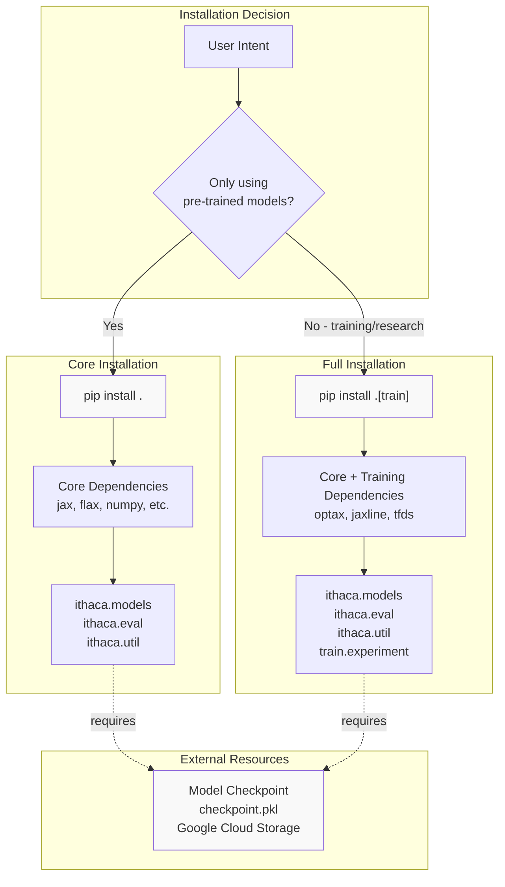

**Installation Mode Selection**

**Sources:** [setup.py:26-44](), [README.md:79-82]()

## Core Installation (Inference Only)

The core installation includes all components necessary for inference: model architecture, evaluation utilities, and text processing. Training code is excluded to minimize dependencies.

### Step 1: Install Package

From the repository root directory:

```sh
pip install .
```

This command reads [setup.py:26-52]() which:
- Installs packages found by `setuptools.find_packages(exclude=('train',))` [setup.py:35]()
- Reads dependencies from [requirements.txt:1-10]()
- Excludes the `train/` directory

### Step 2: Download Model Checkpoint

Download the pre-trained model from Google Cloud Storage:

```sh
curl --output checkpoint.pkl https://storage.googleapis.com/ithaca-resources/models/checkpoint_v1.pkl
```

The checkpoint file (`checkpoint.pkl`) contains:
- Trained model parameters
- Model architecture configuration
- Vocabulary mappings (`GreekAlphabet`)
- Region ID-to-name mappings

**File size:** ~2.5 GB

**Sources:** [setup.py:14-19](), [setup.py:35-37](), [README.md:79-87]()

## Full Installation (Training and Development)

Researchers and developers who need to train models or modify training code should use the full installation with optional training dependencies.

### Step 1: Install Package with Training Dependencies

```sh
pip install .[train]
```

This installs core dependencies plus training-specific packages defined in [setup.py:38-44]():
- `optax` - Gradient transformations and optimization
- `jaxline==0.0.5` - Training platform and experiment management
- `tensorflow-datasets` - Data loading infrastructure

### Step 2: Download Model Checkpoint

Same as core installation:

```sh
curl --output checkpoint.pkl https://storage.googleapis.com/ithaca-resources/models/checkpoint_v1.pkl
```

**Sources:** [setup.py:38-44](), [README.md:124-125]()

## Dependency Breakdown

The following table lists all dependencies and their purposes:

| Package | Version | Installation Mode | Purpose |
|---------|---------|------------------|---------|
| `jax` | ≥0.4.2 | Core, Full | Auto-differentiation and JIT compilation |
| `jaxlib` | ≥0.4.2 | Core, Full | XLA backend for JAX |
| `flax` | ≥0.4.0 | Core, Full | Neural network library (model definitions) |
| `numpy` | ≥1.18.0 | Core, Full | Array operations |
| `chex` | ≥0.0.8 | Core, Full | Testing and validation utilities |
| `dm-haiku` | ≥0.0.5 | Core, Full | Alternative NN library (available but not primary) |
| `ml-collections` | ≥0.1.1 | Core, Full | Configuration management |
| `absl-py` | ≥0.13.0 | Core, Full | Command-line interface and logging |
| `tqdm` | ≥4.62.2 | Core, Full | Progress bars |
| `optax` | (latest) | Full only | Gradient transformations and optimizers |
| `jaxline` | ==0.0.5 | Full only | Training platform and checkpointing |
| `tensorflow-datasets` | (latest) | Full only | Data loading pipeline |

**Sources:** [requirements.txt:1-10](), [setup.py:38-44]()

## Installation Flow Diagram

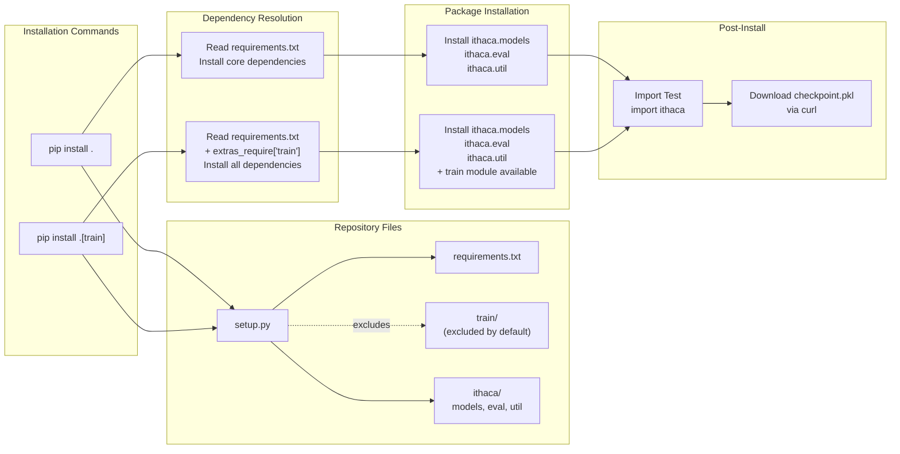

**Package Installation Flow**

**Sources:** [setup.py:21-52](), [requirements.txt:1-10]()

## Installation Verification

After installation, verify that the package is correctly installed:

### Test Python Import

```python
# Test core functionality
import ithaca
from ithaca.models import model
from ithaca.eval import inference
from ithaca.util import alphabet

print("Ithaca core installation successful!")
```

### Test Training Components (Full Installation Only)

```python
# Test training dependencies
import optax
import jaxline
import tensorflow_datasets as tfds

print("Ithaca full installation successful!")
```

### Test with Inference Example

Run the provided inference example script [README.md:89-94]():

```sh
python inference_example.py --input_file=example_input.txt
```

Expected output includes:
- Attribution results (date and region predictions)
- Restoration results (filled missing characters)
- Saliency visualization information

**Sources:** [README.md:89-114]()

## Hardware Acceleration Setup

### GPU Support

JAX automatically detects CUDA-capable GPUs. Verify GPU availability:

```python
import jax
print(f"Available devices: {jax.devices()}")
print(f"Default backend: {jax.default_backend()}")
```

Expected output for GPU system:
```
Available devices: [GpuDevice(id=0), ...]
Default backend: gpu
```

### TPU Support

For Google Colab or Cloud TPU:
```python
import jax
print(f"TPU devices: {jax.devices('tpu')}")
```

**Note:** TPU support requires additional configuration. See the [Interactive Colab Notebook](#2.3) for TPU-enabled inference examples.

**Sources:** [requirements.txt:5-6]()

## File Structure After Installation

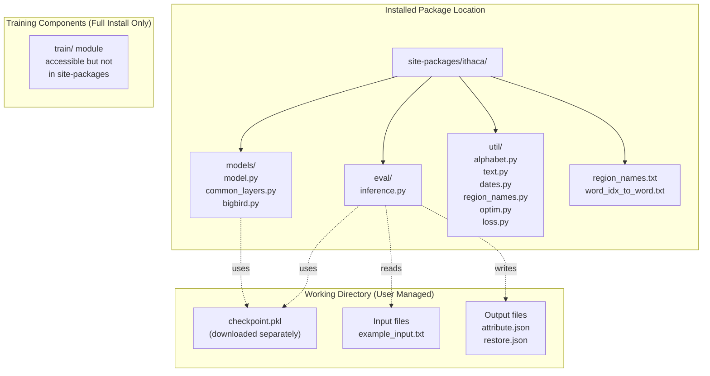

**Post-Installation File Organization**

**Sources:** [setup.py:35-36]()

## Troubleshooting

### Common Installation Issues

| Issue | Symptoms | Solution |
|-------|----------|----------|
| **JAX/JAXlib version mismatch** | Import errors: `AttributeError` in JAX | Ensure `jax` and `jaxlib` versions match: `pip install --upgrade jax jaxlib` |
| **CUDA not found** | JAX defaults to CPU despite GPU available | Install CUDA-compatible jaxlib: `pip install --upgrade "jax[cuda]" -f https://storage.googleapis.com/jax-releases/jax_cuda_releases.html` |
| **Training dependencies missing** | `ImportError: No module named 'optax'` | Use full installation: `pip install .[train]` |
| **Checkpoint download fails** | `curl: (22) HTTP error` | Check network connection; try alternative: `wget https://storage.googleapis.com/ithaca-resources/models/checkpoint_v1.pkl` |
| **Out of memory errors** | JAX raises OOM during inference | Reduce batch size or use CPU: `export JAX_PLATFORM_NAME=cpu` |

### Verifying JAX Backend

```python
import jax
import jaxlib

print(f"JAX version: {jax.__version__}")
print(f"JAXlib version: {jaxlib.__version__}")
print(f"Available backends: {[d.platform for d in jax.devices()]}")
```

### Dependency Conflicts

If you encounter dependency conflicts with existing packages:

```sh
# Create isolated environment
python -m venv ithaca_env
source ithaca_env/bin/activate  # On Windows: ithaca_env\Scripts\activate

# Install in clean environment
pip install .
```

**Sources:** [requirements.txt:5-6]()

## Alternative Installation Methods

### Development Installation

For contributors who plan to modify source code:

```sh
pip install -e .
```

The `-e` (editable) flag creates a symbolic link, allowing code changes to take effect without reinstallation.

### Installing from Source Distribution

If installing from a source tarball:

```sh
tar -xzf ithaca-0.1.0.tar.gz
cd ithaca-0.1.0
pip install .
```

### Installing Specific Version

```sh
pip install ithaca==0.1.0
```

**Sources:** [setup.py:30]()

## Next Steps

After successful installation:

1. **Inference Users:** Proceed to [Quick Start: Inference](#2.2) for using pre-trained models
2. **Interactive Users:** Try the [Interactive Colab Notebook](#2.3) for browser-based inference
3. **CLI Users:** Explore [Command Line Interface](#2.4) for batch processing
4. **Researchers:** See [Training System](#4) for training custom models
5. **Developers:** Consult [Development Guide](#7) for contribution guidelines

**Sources:** [README.md:67-125]()

---

# Page: Quick Start: Inference

# Quick Start: Inference

<details>
<summary>Relevant source files</summary>

The following files were used as context for generating this wiki page:

- [README.md](README.md)
- [colabs/ithaca_inference.ipynb](colabs/ithaca_inference.ipynb)
- [inference_example.py](inference_example.py)

</details>


This page provides a step-by-step guide to performing inference with pre-trained Ithaca models. You will learn how to download model checkpoints, load them programmatically, and run both attribution (predicting date and region) and restoration (filling in missing characters) tasks on ancient Greek inscriptions.

**Scope**: This page covers the core inference API and programmatic usage. For interactive notebook usage, see [Interactive Colab Notebook](#2.3). For command-line usage, see [Command Line Interface](#2.4). For detailed API documentation, see [ithaca.eval](#8.2).

## Prerequisites

Before performing inference, ensure you have installed the `ithaca` package as described in [Installation](#2.1):

```bash
pip install git+https://github.com/deepmind/ithaca
```

The inference functionality requires only the core dependencies (JAX, Flax, NumPy) without the training infrastructure.

**Sources**: [README.md:74-82]()

## Downloading the Model Checkpoint

Ithaca's pre-trained model is distributed as a pickle file hosted on Google Cloud Storage. Download it using:

```bash
curl --output checkpoint.pkl https://storage.googleapis.com/ithaca-resources/models/checkpoint_v1.pkl
```

The checkpoint file (`checkpoint.pkl`) contains:
- Trained model parameters
- Model architecture configuration
- Vocabulary mappings (character and word indices)
- Region mapping metadata (84 subregions)

**File size**: Approximately 500MB

**Sources**: [README.md:84-87](), [colabs/ithaca_inference.ipynb:222-224]()

## Checkpoint Structure

Understanding the checkpoint structure is essential for programmatic usage. The pickle file contains a dictionary with the following keys:

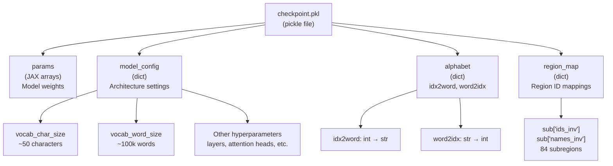

**Sources**: [inference_example.py:40-73](), [colabs/ithaca_inference.ipynb:352-367]()

## Loading the Checkpoint

The following code demonstrates how to load the checkpoint and prepare it for inference:

```python
import functools
import pickle
import jax
from ithaca.models.model import Model
from ithaca.util.alphabet import GreekAlphabet

# Load checkpoint pickle
with open('checkpoint.pkl', 'rb') as f:
    checkpoint = pickle.load(f)

# Extract model configuration
model_config = checkpoint['model_config']
params = jax.device_put(checkpoint['params'])

# Reconstruct the model
model = Model(**model_config)
forward = functools.partial(model.apply, params)

# Load vocabulary
alphabet = GreekAlphabet()
alphabet.idx2word = checkpoint['alphabet']['idx2word']
alphabet.word2idx = checkpoint['alphabet']['word2idx']

# Extract region mappings
region_map = checkpoint['region_map']

# Get vocabulary sizes
vocab_char_size = model_config['vocab_char_size']
vocab_word_size = model_config['vocab_word_size']
```

**Key components**:

| Component | Type | Purpose |
|-----------|------|---------|
| `params` | JAX arrays | Learned model weights |
| `forward` | Callable | Inference function: `forward(input_data)` |
| `alphabet` | `GreekAlphabet` | Text-to-index conversions |
| `region_map` | dict | Region ID ↔ name mappings |
| `vocab_char_size` | int | Character vocabulary size |
| `vocab_word_size` | int | Word vocabulary size |

**Sources**: [inference_example.py:40-73](), [colabs/ithaca_inference.ipynb:345-367]()

## Input Text Format

Ithaca accepts ancient Greek text with specific conventions for marking missing or uncertain characters:

### Text Requirements

- **Length**: Between 50 and 750 characters
- **Character set**: Ancient Greek alphabet (Unicode)
- **Encoding**: UTF-8

### Missing Character Conventions

| Symbol | Meaning | Usage |
|--------|---------|-------|
| `?` | Missing character to be **predicted** | Ithaca will propose restoration candidates |
| `-` | Missing character to be **skipped** | Ithaca ignores these positions |
| Regular text | Known characters | Used as context for predictions |

### Example Input

```python
text = '''ἔδοξεν τῆι βουλῆι και τῶι δήμωι λυσίστρατος εἶπε- 
επειδὴ διοφάνης ἀνὴρ ἀγαθὸς ὢν διατελεῖ περὶ δηλίους δεδόχθαι 
τῶι ----- διοφάνην καλλι-------- --ηναῖον πρόξενον εἶναι δ---------
αὐτὸγ καὶ ἐκγόνους κ-- ειναι αυτοις ατελειαν εν δηλωι παντων...
αναγραψαι δε τοδε ?????????α την βουλην εις...'''
```

**Validation**:
```python
assert 50 <= len(text) <= 750, "Text must be 50-750 characters"
```

**Sources**: [colabs/ithaca_inference.ipynb:377-396](), [inference_example.py:88-91]()

## Inference Workflow

The following diagram illustrates the complete inference workflow from text input to results:

```mermaid
graph TB
    INPUT["Input Text<br/>Ancient Greek with ?/- markers"]
    
    LOAD_CP["Load Checkpoint<br/>pickle.load('checkpoint.pkl')"]
    LOAD_CP --> PARAMS["params"]
    LOAD_CP --> CONFIG["model_config"]
    LOAD_CP --> ALPHABET["alphabet"]
    LOAD_CP --> REGIONS["region_map"]
    
    CONSTRUCT["Construct Forward Function<br/>Model(**model_config).apply(params)"]
    CONFIG --> CONSTRUCT
    PARAMS --> CONSTRUCT
    
    INPUT --> BRANCH{Task Type}
    
    BRANCH -->|attribution| ATTR["inference.attribute()<br/>ithaca/eval/inference.py"]
    BRANCH -->|restoration| REST["inference.restore()<br/>ithaca/eval/inference.py"]
    
    CONSTRUCT --> FORWARD["forward function"]
    ALPHABET --> FORWARD
    REGIONS --> FORWARD
    FORWARD --> ATTR
    FORWARD --> REST
    
    ATTR --> ATTR_RESULTS["AttributionResults<br/>- date prediction<br/>- region prediction<br/>- saliency maps"]
    REST --> REST_RESULTS["RestorationResults<br/>- top-20 hypotheses<br/>- character scores<br/>- saliency maps"]
    
    ATTR_RESULTS --> OUTPUT["JSON Output<br/>.json() method"]
    REST_RESULTS --> OUTPUT
```

**Sources**: [inference_example.py:76-126](), [colabs/ithaca_inference.ipynb:345-557]()

## Attribution: Predicting Date and Region

Attribution predicts when and where an inscription was written. Use the `inference.attribute()` function:

```python
from ithaca.eval import inference

attribution_results = inference.attribute(
    text=input_text,
    forward=forward,
    params=params,
    alphabet=alphabet,
    region_map=region_map,
    vocab_char_size=vocab_char_size,
    vocab_word_size=vocab_word_size
)
```

### Attribution Results Structure

The function returns an `AttributionResults` NamedTuple containing:

| Field | Type | Description |
|-------|------|-------------|
| `date_pred` | int | Predicted year (e.g., -340 for 340 BCE) |
| `date_probs` | array | Probability distribution over decades (800 BCE - 800 CE) |
| `region_probs` | array | Probabilities for 84 subregions |
| `top_regions` | list | Top-10 region predictions with names and probabilities |
| `date_saliency` | array | Character importance for date prediction |
| `region_saliency` | array | Character importance for region prediction |

### Date Prediction

Ithaca predicts dates as probability distributions over decade intervals:

```python
# Get predicted year
predicted_year = attribution_results.date_pred  # e.g., -340

# Access full distribution
date_distribution = attribution_results.date_probs  # Shape: (160,)
# Covers 800 BCE to 800 CE in 10-year intervals
```

### Region Prediction

Regions are predicted among 84 subregions of the ancient Greek world:

```python
# Top-10 regions with probabilities
for region in attribution_results.top_regions[:10]:
    print(f"{region['name']}: {region['probability']:.2%}")
    
# Example output:
# Attica: 45.3%
# Aegean Islands: 23.1%
# Peloponnese: 12.7%
# ...
```

### Accessing Region Names

Use the `region_map` to convert region IDs to human-readable names:

```python
def get_subregion_name(region_id, region_map):
    """Convert region ID to name."""
    return region_map['sub']['names_inv'][
        region_map['sub']['ids_inv'][region_id]
    ]
```

**Sources**: [inference_example.py:100-112](), [colabs/ithaca_inference.ipynb:286-299]()

## Restoration: Filling Missing Characters

Restoration predicts missing characters marked with `?`. Use the `inference.restore()` function:

```python
from ithaca.eval import inference

restoration_results = inference.restore(
    text=input_text,
    forward=forward,
    params=params,
    alphabet=alphabet,
    vocab_char_size=vocab_char_size,
    vocab_word_size=vocab_word_size
)
```

### Restoration Results Structure

The function returns a `RestorationResults` NamedTuple containing:

| Field | Type | Description |
|-------|------|-------------|
| `input_text` | str | Original input with `?` markers |
| `predictions` | list | Top-20 restoration hypotheses |
| `prediction_saliency` | list | Saliency for each restoration step |

### Restoration Hypotheses

Each prediction in the `predictions` list contains:

```python
for i, prediction in enumerate(restoration_results.predictions[:5]):
    print(f"Hypothesis {i+1} ({prediction.score:.1%}): {prediction.text}")

# Example output:
# Hypothesis 1 (66.1%): ἔδοξεν...το ψήφισμα την βουλην...
# Hypothesis 2 (0.1%): ἔδοξεν...το ψημισμα την βουλην...
# Hypothesis 3 (0.1%): ἔδοξεν...το ψήφιζμα την βουλην...
```

**Hypothesis structure**:
- `text`: Restored text with `?` replaced by predicted characters
- `score`: Cumulative probability (0.0 to 1.0)

### Beam Search Process

Ithaca uses **non-sequential beam search** to generate restoration hypotheses:

1. **Initial pass**: Model predicts confidence scores for all `?` positions
2. **Iterative restoration**: Fill positions starting with highest confidence
3. **Beam expansion**: Maintain top-k candidates at each step
4. **Ranking**: Final hypotheses ranked by cumulative probability

**Sources**: [inference_example.py:114-125](), [colabs/ithaca_inference.ipynb:413-557]()

## Output Formats

Both `AttributionResults` and `RestorationResults` provide a `.json()` method for serialization:

```python
# Save attribution to JSON
with open('attribution.json', 'w') as f:
    f.write(attribution_results.json(indent=2))

# Save restoration to JSON
with open('restoration.json', 'w') as f:
    f.write(restoration_results.json(indent=2))
```

### JSON Structure Examples

**Attribution JSON**:
```json
{
  "date_pred": -340,
  "date_probs": [0.001, 0.002, ...],
  "region_probs": [0.453, 0.231, ...],
  "top_regions": [
    {"id": 12, "name": "Attica", "probability": 0.453},
    {"id": 5, "name": "Aegean Islands", "probability": 0.231}
  ]
}
```

**Restoration JSON**:
```json
{
  "input_text": "ἔδοξεν...?????????α...",
  "predictions": [
    {"text": "ἔδοξεν...το ψήφισμα...", "score": 0.661},
    {"text": "ἔδοξεν...το ψημισμα...", "score": 0.001}
  ]
}
```

**Sources**: [inference_example.py:103-125]()

## Complete Example

Here is a complete minimal example combining all the steps:

```python
import functools
import pickle
import jax
from ithaca.eval import inference
from ithaca.models.model import Model
from ithaca.util.alphabet import GreekAlphabet

# 1. Load checkpoint
with open('checkpoint.pkl', 'rb') as f:
    checkpoint = pickle.load(f)

# 2. Prepare model
model_config = checkpoint['model_config']
params = jax.device_put(checkpoint['params'])
model = Model(**model_config)
forward = functools.partial(model.apply, params)

# 3. Prepare alphabet and region map
alphabet = GreekAlphabet()
alphabet.idx2word = checkpoint['alphabet']['idx2word']
alphabet.word2idx = checkpoint['alphabet']['word2idx']
region_map = checkpoint['region_map']

vocab_char_size = model_config['vocab_char_size']
vocab_word_size = model_config['vocab_word_size']

# 4. Define input text (50-750 characters)
text = '''ἔδοξεν τῆι βουλῆι και τῶι δήμωι λυσίστρατος εἶπε- 
επειδὴ διοφάνης ἀνὴρ ἀγαθὸς ὢν διατελεῖ περὶ δηλίους δεδόχθαι 
τῶι δήμωι διοφάνην καλλι?????????ον πρόξενον εἶναι...'''

# 5. Run attribution
attribution = inference.attribute(
    text=text,
    forward=forward,
    params=params,
    alphabet=alphabet,
    region_map=region_map,
    vocab_char_size=vocab_char_size,
    vocab_word_size=vocab_word_size
)

print(f"Predicted date: {attribution.date_pred}")
print(f"Top region: {attribution.top_regions[0]['name']}")

# 6. Run restoration
restoration = inference.restore(
    text=text,
    forward=forward,
    params=params,
    alphabet=alphabet,
    vocab_char_size=vocab_char_size,
    vocab_word_size=vocab_word_size
)

print(f"Top restoration: {restoration.predictions[0].text}")
print(f"Confidence: {restoration.predictions[0].score:.1%}")
```

**Sources**: [inference_example.py:76-126](), [colabs/ithaca_inference.ipynb:345-557]()

## Next Steps

- For interactive inference with visualizations, see [Interactive Colab Notebook](#2.3)
- For command-line batch processing, see [Command Line Interface](#2.4)
- For detailed API documentation, see [ithaca.eval](#8.2)
- For understanding model predictions, see [Saliency Maps and Interpretability](#5.4)

**Sources**: [README.md:67-114](), [colabs/ithaca_inference.ipynb:1-276](), [inference_example.py:1-130]()

---

# Page: Interactive Colab Notebook

# Interactive Colab Notebook

<details>
<summary>Relevant source files</summary>

The following files were used as context for generating this wiki page:

- [README.md](README.md)
- [colabs/ithaca_inference.ipynb](colabs/ithaca_inference.ipynb)

</details>


This document provides a comprehensive guide to using the Ithaca interactive Colab notebook for text restoration and attribution of ancient Greek inscriptions. The notebook provides a user-friendly interface for researchers without requiring local installation or command-line expertise.

For programmatic inference usage, see [Command Line Interface](#2.4). For details on the underlying inference functions, see [Inference System](#5).

---

## Overview

The interactive Colab notebook (`colabs/ithaca_inference.ipynb`) provides a browser-based interface for performing text restoration and geographical/chronological attribution on ancient Greek inscriptions. It handles all dependencies, model loading, and result visualization automatically.

**Notebook Structure:**

```mermaid
graph TB
    Start[("User opens Colab")]
    Setup["Setup Section<br/>(Auto-installs dependencies)"]
    Input["Input Text Section<br/>(User provides Greek text)"]
    Restore["Restoration Section<br/>(Fills missing characters)"]
    Attribute["Attribution Section<br/>(Date and region predictions)"]
    Results[("Visualizations & Results")]
    
    Start --> Setup
    Setup --> Input
    Input --> Restore
    Input --> Attribute
    Restore --> Results
    Attribute --> Results
```

**Sources:** [colabs/ithaca_inference.ipynb:1-137]()

---

## Accessing the Notebook

The notebook is hosted on Google Colab and can be accessed via:
- Direct link: `https://colab.research.google.com/github/deepmind/ithaca/blob/master/colabs/ithaca_inference.ipynb`
- Colab badge in repository README

**Requirements:**
- Google account (for Colab access)
- GPU runtime recommended (Colab provides free GPU access)
- No local installation required

**Sources:** [README.md:67-72](), [colabs/ithaca_inference.ipynb:1-18]()

---

## Setup Process

The notebook automates all setup steps through hidden cells that users execute but can skip reading.

### Setup Workflow

```mermaid
graph LR
    Install["Install ithaca package<br/>pip install git+..."]
    Download["Download checkpoint.pkl<br/>from Google Cloud Storage"]
    Imports["Import dependencies<br/>ithaca, flax, jax, etc."]
    Config["Configure dataset params<br/>date_interval, date_min/max"]
    Model["Load Model and params<br/>from checkpoint.pkl"]
    
    Install --> Download
    Download --> Imports
    Imports --> Config
    Config --> Model
```

### Installation Cell

The first setup cell installs the Ithaca package and downloads the pre-trained model checkpoint:

```python
!pip install -q git+https://github.com/deepmind/ithaca
!curl --output checkpoint.pkl https://storage.googleapis.com/ithaca-resources/models/checkpoint_v1.pkl
```

**Key actions:**
- Installs `ithaca` package from GitHub repository
- Downloads `checkpoint.pkl` (pre-trained model weights) to Colab runtime
- Additional install: `geopandas` for geographical map visualization

**Sources:** [colabs/ithaca_inference.ipynb:216-240]()

### Import and Configuration

The imports cell loads all required dependencies:

| Module | Purpose |
|--------|---------|
| `ithaca.eval.inference` | Core inference functions: `attribute()`, `restore()` |
| `ithaca.models.model.Model` | Transformer model architecture |
| `ithaca.util.alphabet.GreekAlphabet` | Greek character vocabulary handling |
| `jax` | JAX framework for model execution |
| `flax.linen` | Neural network layers |
| `folium` | Interactive map generation |
| `matplotlib.pyplot` | Plotting utilities |

**Dataset configuration:**
```python
class dataset_config:
  date_interval = 10      # Date bins in 10-year intervals
  date_max = 800          # Maximum date: 800 CE
  date_min = -800         # Minimum date: 800 BCE
```

**Sources:** [colabs/ithaca_inference.ipynb:243-342]()

### Model Loading

```mermaid
graph TB
    Checkpoint["checkpoint.pkl<br/>(Google Cloud Storage)"]
    Load["pkl.load(checkpoint)"]
    
    ModelConfig["model_config<br/>ConfigDict"]
    Params["params<br/>Model weights"]
    Alphabet["alphabet<br/>idx2word, word2idx"]
    RegionMap["region_map<br/>84 regions"]
    
    Checkpoint --> Load
    Load --> ModelConfig
    Load --> Params
    Load --> Alphabet
    Load --> RegionMap
    
    ModelConfig --> Forward["forward function<br/>Model.apply(params)"]
    Params --> Forward
    Alphabet --> Forward
```

The model loading cell reconstructs the trained model from the checkpoint:

```python
with open("checkpoint.pkl", "rb") as f:
  checkpoint = pkl.load(f)

model_config = config_dict.ConfigDict(checkpoint['model_config'])
params = jax.device_put(checkpoint['params'])

alphabet = GreekAlphabet()
alphabet.idx2word = checkpoint['alphabet']['idx2word']
alphabet.word2idx = checkpoint['alphabet']['word2idx']

vocab_char_size = checkpoint['model_config']['vocab_char_size']
vocab_word_size = checkpoint['model_config']['vocab_word_size']

region_map = checkpoint['region_map']

forward = functools.partial(Model(**model_config).apply, params)
```

**Key objects loaded:**
- `model_config`: Model hyperparameters (layers, dimensions, etc.)
- `params`: Trained neural network weights
- `alphabet`: Character and word vocabularies
- `region_map`: Mapping of region IDs to names (84 subregions)
- `forward`: Callable function for model inference

**Sources:** [colabs/ithaca_inference.ipynb:345-370]()

---

## Input Text Requirements

### Text Input Format

Users provide ancient Greek text in a designated input cell. The text must meet specific formatting requirements:

**Length constraints:**
- Minimum: 50 characters
- Maximum: 750 characters

**Missing character notation:**
| Symbol | Meaning | Usage |
|--------|---------|-------|
| `-` (dash) | Missing character to skip | Character is illegible, do not predict |
| `?` (question mark) | Missing character to predict | Character should be restored by model |

**Example input:**
```python
text = 'ἔδοξεν τῆι βουλῆι και τῶι δήμωι λυσίστρατος εἶπε- επειδη διοφανης ανηρ αγαθος ων διατελει περι δηλιους δεδοχθαι τωι ----- διοφανην καλλι-------- --ηναιον προξενον ειναι δ--------- αυτογ και εκγονους κ-- ειναι αυτοις ατελειαν εν δηλωι παντων'
```

**Text preprocessing:**
- Notebook automatically handles Greek character normalization
- Diacritics and accents are processed by `GreekAlphabet.filter()`
- Text is converted to lowercase and normalized forms (e.g., tonos/oxia unification)

**Sources:** [colabs/ithaca_inference.ipynb:373-400]()

---

## Restoration Workflow

The restoration section generates multiple hypotheses for missing characters and visualizes model confidence through saliency maps.

### Restoration Process

```mermaid
graph TB
    Input["Input text with '?' characters"]
    Restore["inference.restore()<br/>Non-sequential beam search"]
    
    Results["RestorationResults"]
    Predictions["predictions<br/>Top-20 hypotheses"]
    Saliency["prediction_saliency<br/>Per-step saliency maps"]
    InputText["input_text<br/>Original input"]
    
    Input --> Restore
    Restore --> Results
    Results --> Predictions
    Results --> Saliency
    Results --> InputText
    
    Predictions --> TableViz["HTML Table<br/>Ranked hypotheses"]
    Saliency --> SaliencyViz["HTML Saliency Maps<br/>Purple highlighting"]
```

### Calling the Restore Function

```python
restoration_results = inference.restore(
    text=text,
    forward=forward,
    params=params,
    alphabet=alphabet,
    vocab_char_size=vocab_char_size,
    vocab_word_size=vocab_word_size,
)
```

**Arguments:**
- `text`: Input Greek text with `?` markers
- `forward`: Model inference function
- `params`: Model weights
- `alphabet`: Greek vocabulary
- `vocab_char_size`, `vocab_word_size`: Vocabulary dimensions

**Returns:** `RestorationResults` NamedTuple containing:
- `predictions`: List of restoration hypotheses with scores
- `prediction_saliency`: Saliency maps for each restoration step
- `input_text`: Original input for reference

**Sources:** [colabs/ithaca_inference.ipynb:414-442]()

### Top-20 Hypothesis Visualization

The notebook renders an interactive HTML table showing:

| Column | Content |
|--------|---------|
| Hypothesis N | Rank (1-20) |
| Score | Probability percentage (e.g., 66.1%) |
| Text | Full text with predicted characters highlighted |

**Features:**
- Horizontal scrolling for long texts
- "Jump to restoration area" button
- Sticky header columns for context while scrolling
- Predicted characters highlighted with grey background

**HTML rendering approach:**
```python
template = jinja2.Template("""...""")
display(HTML(template.render(
    restoration_results=restoration_results,
    prediction_idx=prediction_idx
)))
```

The template uses:
- Jinja2 templating for dynamic content
- Custom CSS for styling and sticky headers
- JavaScript for navigation features

**Sources:** [colabs/ithaca_inference.ipynb:414-829]()

### Restoration Saliency Maps

Saliency maps show which input characters most influenced each prediction:

```mermaid
graph LR
    Input["Input character sequence"]
    Gradients["Compute gradients<br/>∂prediction/∂input"]
    Normalize["Normalize to [0, 1]"]
    Visualize["Apply purple shading<br/>rgba(171,71,188,score)"]
    
    Input --> Gradients
    Gradients --> Normalize
    Normalize --> Visualize
```

**Visualization details:**
- Each restoration step shown as a separate row
- Restored character highlighted in center column
- Surrounding characters shaded by importance (0.00 to 1.00)
- Purple color intensity: `background: rgba(171,71,188,{score})`
- Hover effects highlight currently viewed restoration

**Key insight:** Saliency maps reveal which context the model used to make predictions, enabling historians to evaluate prediction reliability.

**Sources:** [colabs/ithaca_inference.ipynb:831-971]()

---

## Attribution Workflow

The attribution section predicts geographical origin and chronological date of the inscription. (Note: The provided file is truncated, so attribution details are inferred from the system architecture and README.)

### Attribution Process

```mermaid
graph TB
    Input["Input text<br/>(complete or restored)"]
    Attribute["inference.attribute()"]
    
    Results["AttributionResults"]
    DateDist["year_scores<br/>Distribution over decades"]
    RegionProbs["region_logits<br/>84 region probabilities"]
    DateSal["date_saliency<br/>Gradient importance"]
    RegionSal["region_saliency<br/>Gradient importance"]
    
    Input --> Attribute
    Attribute --> Results
    Results --> DateDist
    Results --> RegionProbs
    Results --> DateSal
    Results --> RegionSal
    
    DateDist --> DateViz["Line chart<br/>800 BCE - 800 CE"]
    RegionProbs --> MapViz["Geographic map<br/>Top-10 regions"]
    RegionProbs --> BarChart["Bar chart<br/>Top-10 regions"]
    DateSal --> DateSalViz["Purple highlighting"]
    RegionSal --> RegionSalViz["Purple highlighting"]
```

### Calling the Attribute Function

Expected usage pattern (inferred from system design):

```python
attribution_results = inference.attribute(
    text=text,
    forward=forward,
    params=params,
    alphabet=alphabet,
    vocab_char_size=vocab_char_size,
    vocab_word_size=vocab_word_size,
    region_map=region_map,
)
```

### Expected Visualizations

Based on the notebook instructions, the attribution section provides:

1. **Geographical Attribution:**
   - Bar chart: Top-10 regions ranked by probability
   - Interactive map: Geographic visualization using `folium`
   - Coverage: 84 ancient world regions

2. **Chronological Attribution:**
   - Categorical distribution: Probability over decades (800 BCE to 800 CE)
   - Line chart: Temporal probability distribution
   - Date interval: 10-year bins

3. **Attribution Saliency Maps:**
   - Separate saliency for geographical and chronological predictions
   - Same purple highlighting scheme as restoration saliency
   - Shows which text features influenced each prediction type

**Sources:** [colabs/ithaca_inference.ipynb:104-136](), [README.md:35-43]()

---

## Helper Functions and Templates

The notebook includes several utility functions for visualization:

### Region Name Resolution

```python
def get_subregion_name(id, region_map):
  return region_map['sub']['names_inv'][region_map['sub']['ids_inv'][id]]
```

Converts region ID to human-readable name using the region map.

### Date Formatting

```python
def bce_ad(d):
  if d < 0:
    return f'{abs(d)} BCE'
  elif d > 0:
    return f'{abs(d)} AD'
  return 0
```

Formats dates with BCE/AD notation.

### Saliency HTML Generation

```python
SALIENCY_SNIPPET_TEMPLATE = jinja2.Template("""
<div class="saliency">
  
    <span
      style="background-color: rgba(171,71,188,{{'%.2f'|format(score)}});"
      title="Saliency score {{'%.2f'|format(score)}}">{{ char }}</span>
  
</div>
""")

def generate_saliency(text, saliency, snippet=False):
  """Generates saliency visualisation."""
  snippet_html = SALIENCY_SNIPPET_TEMPLATE.render(
      pairs=list(zip(text, saliency)))
  if snippet:
    return snippet_html
  return SALIENCY_TEMPLATE.render(body_html=snippet_html)
```

Creates HTML with purple-shaded characters based on saliency scores.

**Sources:** [colabs/ithaca_inference.ipynb:284-339]()

---

## Saving Work

The notebook provides guidance on preserving results:

**Important:** The Colab notebook is read-only by default. Changes and outputs are not automatically saved.

**To save work:**
1. Click `File` → `Save a copy in Drive`
2. Creates a personal copy in Google Drive
3. All outputs and modifications are preserved in the copy

**Alternative: Downloading outputs**
- Right-click on visualizations to save images
- Copy text from restoration tables
- Take screenshots of results

**Sources:** [colabs/ithaca_inference.ipynb:136]()

---

## Execution Flow Summary

```mermaid
graph TB
    User["User opens Colab"]
    Execute1["Execute Setup cells<br/>(Shift+Enter)"]
    Install["Install & download<br/>(~2-3 minutes)"]
    Input["Enter Greek text<br/>(50-750 chars)"]
    
    ExecuteRestore["Execute Restoration cell"]
    BeamSearch["Non-sequential beam search<br/>(~several minutes)"]
    RestoreViz["View Top-20 hypotheses<br/>+ saliency maps"]
    
    ExecuteAttrib["Execute Attribution cell"]
    Attribution["Predict date & region"]
    AttribViz["View maps & charts<br/>+ saliency maps"]
    
    Save["Save copy to Drive<br/>(optional)"]
    
    User --> Execute1
    Execute1 --> Install
    Install --> Input
    Input --> ExecuteRestore
    ExecuteRestore --> BeamSearch
    BeamSearch --> RestoreViz
    Input --> ExecuteAttrib
    ExecuteAttrib --> Attribution
    Attribution --> AttribViz
    RestoreViz --> Save
    AttribViz --> Save
```

**Performance notes:**
- Setup: 2-3 minutes for installation and checkpoint download
- Restoration: Several minutes depending on number of missing characters
- Attribution: Faster, typically under 1 minute
- GPU runtime strongly recommended for acceptable performance

**Sources:** [colabs/ithaca_inference.ipynb:104-136]()

---

## Code Entity Reference

This section maps natural language concepts to code entities for developers examining the notebook implementation:

| Concept | Code Entity | Location |
|---------|-------------|----------|
| Restoration inference | `inference.restore()` | ithaca/eval/inference.py |
| Attribution inference | `inference.attribute()` | ithaca/eval/inference.py |
| Model architecture | `Model` class | ithaca/models/model.py |
| Greek vocabulary | `GreekAlphabet` class | ithaca/util/alphabet.py |
| Model forward pass | `forward` function (partial) | Created from Model.apply |
| Restoration results | `RestorationResults` NamedTuple | ithaca/eval/inference.py |
| Attribution results | `AttributionResults` NamedTuple | ithaca/eval/inference.py |
| Model checkpoint | `checkpoint.pkl` | Google Cloud Storage |
| Region mappings | `region_map` dict | Loaded from checkpoint |
| Saliency template | `SALIENCY_SNIPPET_TEMPLATE` | Jinja2 template in notebook |
| Date configuration | `dataset_config` class | Defined in notebook |

**Sources:** [colabs/ithaca_inference.ipynb:243-370]()

---

# Page: Command Line Interface

# Command Line Interface

<details>
<summary>Relevant source files</summary>

The following files were used as context for generating this wiki page:

- [README.md](README.md)
- [example_input.txt](example_input.txt)
- [inference_example.py](inference_example.py)

</details>


This page documents the `inference_example.py` command-line interface for performing text restoration and attribution on ancient Greek inscriptions. The CLI provides a scriptable, non-interactive interface for batch processing or programmatic usage.

For interactive inference with visualizations, see [Interactive Colab Notebook](#2.3). For programmatic API usage within Python code, see [Inference Overview](#5.1).

---

## Purpose and Scope

The `inference_example.py` script is a command-line wrapper around the core inference functions ([ithaca/eval/inference.py:0-0]()). It enables:

- **Batch processing**: Process multiple inscriptions via shell scripts
- **Automation**: Integrate Ithaca inference into data pipelines
- **Reproducibility**: Script-based workflows for research reproducibility
- **JSON output**: Machine-readable results for downstream processing

The CLI performs both attribution (date and region prediction) and restoration (missing character reconstruction) on a single input text per invocation.

**Sources:** [README.md:74-114](), [inference_example.py:1-130]()

---

## Installation and Setup

### Prerequisites

Install the `ithaca` package (core dependencies only):

```sh
pip install .
```

### Download Model Checkpoint

The trained model checkpoint must be downloaded separately (approximately 1.8 GB):

```sh
curl --output checkpoint.pkl https://storage.googleapis.com/ithaca-resources/models/checkpoint_v1.pkl
```

The checkpoint pickle contains:
- Model parameters (`params`)
- Model architecture configuration (`model_config`)
- Greek alphabet vocabulary mappings (`alphabet`)
- Region ID-to-name mappings (`region_map`)

**Sources:** [README.md:79-87](), [inference_example.py:40-74]()

---

## Command-Line Arguments

### Flag Reference

| Flag | Type | Required | Default | Description |
|------|------|----------|---------|-------------|
| `--input` | string | Either this or `--input_file` | `""` | Direct text input as command-line argument |
| `--input_file` | string | Either this or `--input` | `""` | Path to UTF-8 text file containing input |
| `--checkpoint_path` | string | No | `checkpoint.pkl` | Path to model checkpoint pickle file |
| `--attribute_json` | string | No | `""` | Path to save attribution results as JSON |
| `--restore_json` | string | No | `""` | Path to save restoration results as JSON |

### Mutual Exclusivity

Exactly one of `--input` or `--input_file` must be specified. The script enforces this constraint at [inference_example.py:80-86]():

```python
if FLAGS.input and not FLAGS.input_file:
    input_text = FLAGS.input
elif not FLAGS.input and FLAGS.input_file:
    with open(FLAGS.input_file, 'r', encoding='utf8') as f:
      input_text = f.read()
else:
    raise app.UsageError('Specify exactly one of --input and --input_file.')
```

**Sources:** [inference_example.py:28-37]()

---

## Input Requirements

### Text Length Validation

Input text must be between **50 and 750 characters** (inclusive). This constraint is enforced at [inference_example.py:88-91]():

```python
if not 50 <= len(input_text) <= 750:
    raise app.UsageError(
        f'Text should be between 50 and 750 chars long, but the input was '
        f'{len(input_text)} characters')
```

### Input Format

Input text should be:
- **Ancient Greek**: Written in Greek characters (Unicode)
- **UTF-8 encoded**: When using `--input_file`
- **Accents optional**: The model handles both accented and unaccented text via [GreekAlphabet.filter]() normalization
- **Missing characters**: Mark with `?` for restoration (e.g., `τὴ? βου?ὴγ`)

**Example input** from [example_input.txt:1-2]():
```
ἔδοξεν τῆι βουλῆι καὶ τῶι δήμωι λυσίστρατος εἶπε- ἐπειδὴ διοφάνης ἀνὴρ 
ἀγαθὸς ὢν διατελεῖ περὶ δηλίους δεδόχθαι τῶι ----- διοφάνην καλλι-------- 
--ηναῖον πρόξενον εἶναι δ--------- αὐτὸγ καὶ ἐκγόνους...
```

**Sources:** [inference_example.py:80-91](), [example_input.txt:1-2]()

---

## CLI Execution Flow

```mermaid
graph TB
    START["CLI Invocation<br/>(python inference_example.py)"]
    
    subgraph "Flag Parsing"
        PARSE_FLAGS["absl.app.run(main)<br/>Parse FLAGS"]
        VALIDATE_INPUT{"Validate Input<br/>--input XOR --input_file?"}
        VALIDATE_LENGTH{"Validate Length<br/>50 <= len <= 750?"}
    end
    
    subgraph "Checkpoint Loading"
        LOAD_PICKLE["load_checkpoint()<br/>pickle.load(checkpoint_path)"]
        EXTRACT_CONFIG["Extract model_config"]
        EXTRACT_PARAMS["Extract params<br/>jax.device_put()"]
        EXTRACT_ALPHABET["Reconstruct GreekAlphabet<br/>idx2word, word2idx"]
        EXTRACT_REGIONS["Extract region_map"]
        BUILD_FORWARD["Build forward function<br/>functools.partial(model.apply, params)"]
    end
    
    subgraph "Inference Execution"
        RUN_ATTRIBUTE["inference.attribute()<br/>Date + Region Prediction"]
        RUN_RESTORE["inference.restore()<br/>Text Restoration"]
    end
    
    subgraph "Output Generation"
        OUTPUT_ATTR{"--attribute_json<br/>specified?"}
        OUTPUT_REST{"--restore_json<br/>specified?"}
        SAVE_ATTR_JSON["Write attribution.json(indent=2)"]
        PRINT_ATTR["Print attribution.json() to stdout"]
        SAVE_REST_JSON["Write restoration.json(indent=2)"]
        PRINT_REST["Print restoration.json() to stdout"]
    end
    
    START --> PARSE_FLAGS
    PARSE_FLAGS --> VALIDATE_INPUT
    VALIDATE_INPUT -->|"Error"| ERROR1["UsageError:<br/>'Specify exactly one'"]
    VALIDATE_INPUT -->|"Valid"| VALIDATE_LENGTH
    VALIDATE_LENGTH -->|"Error"| ERROR2["UsageError:<br/>'Text should be between 50 and 750 chars'"]
    VALIDATE_LENGTH -->|"Valid"| LOAD_PICKLE
    
    LOAD_PICKLE --> EXTRACT_CONFIG
    EXTRACT_CONFIG --> EXTRACT_PARAMS
    EXTRACT_PARAMS --> EXTRACT_ALPHABET
    EXTRACT_ALPHABET --> EXTRACT_REGIONS
    EXTRACT_REGIONS --> BUILD_FORWARD
    
    BUILD_FORWARD --> RUN_ATTRIBUTE
    RUN_ATTRIBUTE --> OUTPUT_ATTR
    OUTPUT_ATTR -->|"Yes"| SAVE_ATTR_JSON
    OUTPUT_ATTR -->|"No"| PRINT_ATTR
    
    SAVE_ATTR_JSON --> RUN_RESTORE
    PRINT_ATTR --> RUN_RESTORE
    
    RUN_RESTORE --> OUTPUT_REST
    OUTPUT_REST -->|"Yes"| SAVE_REST_JSON
    OUTPUT_REST -->|"No"| PRINT_REST
    
    SAVE_REST_JSON --> END["CLI Exit"]
    PRINT_REST --> END
```

**Execution Flow:**

1. **Flag Parsing** ([inference_example.py:76-91]()): `absl.app` parses command-line flags and validates inputs
2. **Checkpoint Loading** ([inference_example.py:40-73]()): Deserializes model checkpoint and reconstructs components
3. **Inference Execution** ([inference_example.py:100-120]()): Calls core inference functions
4. **Output Generation** ([inference_example.py:108-125]()): Writes results to JSON files or prints to stdout

**Sources:** [inference_example.py:76-129]()

---

## Checkpoint Loading Process

```mermaid
graph TB
    PICKLE["checkpoint.pkl<br/>(pickle file)"]
    
    subgraph "Checkpoint Contents"
        PARAMS["params<br/>(dict of JAX arrays)"]
        MODEL_CFG["model_config<br/>(dict: Model constructor args)"]
        ALPHA_DATA["alphabet<br/>(dict: idx2word, word2idx)"]
        REGION_DATA["region_map<br/>(dict: ID to name mappings)"]
    end
    
    subgraph "Reconstruction"
        JAX_PARAMS["jax.device_put(params)<br/>Load to GPU/TPU"]
        MODEL_INST["Model(**model_config)<br/>Instantiate Model class"]
        FORWARD_FN["functools.partial(model.apply, params)<br/>Create forward function"]
        GREEK_ALPHA["GreekAlphabet()<br/>Populate vocabularies"]
    end
    
    subgraph "Inference Functions"
        ATTR_FN["inference.attribute(forward, ...)"]
        REST_FN["inference.restore(forward, ...)"]
    end
    
    PICKLE --> PARAMS
    PICKLE --> MODEL_CFG
    PICKLE --> ALPHA_DATA
    PICKLE --> REGION_DATA
    
    PARAMS --> JAX_PARAMS
    MODEL_CFG --> MODEL_INST
    MODEL_CFG --> FORWARD_FN
    JAX_PARAMS --> FORWARD_FN
    MODEL_INST --> FORWARD_FN
    
    ALPHA_DATA --> GREEK_ALPHA
    
    FORWARD_FN --> ATTR_FN
    FORWARD_FN --> REST_FN
    GREEK_ALPHA --> ATTR_FN
    GREEK_ALPHA --> REST_FN
    REGION_DATA --> ATTR_FN
```

The `load_checkpoint()` function ([inference_example.py:40-73]()) performs the following steps:

1. **Deserialize pickle**: Loads checkpoint dictionary from disk
2. **Transfer to device**: `jax.device_put(checkpoint['params'])` moves parameters to accelerator (GPU/TPU)
3. **Reconstruct model**: `Model(**checkpoint['model_config'])` instantiates model with saved configuration
4. **Create forward function**: `functools.partial(model.apply, params)` binds parameters to the model's apply method
5. **Restore vocabularies**: Populates `GreekAlphabet` instance with saved word and character mappings

The forward function signature expected by `inference.attribute()` and `inference.restore()` is:
```python
forward(text_char, text_word, ...) -> model_output
```

**Sources:** [inference_example.py:40-73]()

---

## Usage Examples

### Basic Usage: Print to stdout

```sh
python inference_example.py --input_file=example_input.txt
```

Output format (truncated for brevity):
```
Attribution: {
  "date_predictions": [...],
  "region_predictions": [...],
  "attribution_saliency": {...}
}
Restoration: {
  "restorations": [...],
  "restoration_saliency": {...}
}
```

### Direct Text Input

```sh
python inference_example.py --input="ἔδοξεν τῆι βουλῆι καὶ τῶι δήμωι..."
```

### Save Results to JSON Files

```sh
python inference_example.py \
  --input_file=example_input.txt \
  --attribute_json=attribute.json \
  --restore_json=restore.json
```

This creates two files:
- `attribute.json`: Contains date predictions, region predictions, and attribution saliency maps
- `restore.json`: Contains character restorations and restoration saliency maps

### Custom Checkpoint Path

```sh
python inference_example.py \
  --input_file=example_input.txt \
  --checkpoint_path=/path/to/custom_checkpoint.pkl
```

### Display Help

```sh
python inference_example.py --help
```

**Sources:** [README.md:89-114]()

---

## Output Format

### Attribution Output Structure

The `attribution` object is an `AttributionResults` namedtuple containing:

| Field | Type | Description |
|-------|------|-------------|
| `date_predictions` | List of tuples | Year scores: `[(year, score), ...]` sorted by score |
| `region_predictions` | List of tuples | Region predictions: `[(region_name, score), ...]` |
| `attribution_saliency` | Dict | Saliency maps for date and region predictions |

The `.json()` method serializes to JSON format ([inference_example.py:110-112]()).

### Restoration Output Structure

The `restoration` object is a `RestorationResults` namedtuple containing:

| Field | Type | Description |
|-------|------|-------------|
| `restorations` | List of dicts | Beam search candidates with restored text and scores |
| `restoration_saliency` | Dict | Saliency maps for each restoration |

**Sources:** [inference_example.py:100-125]()

---

## Integration with Core Inference Functions

```mermaid
graph LR
    subgraph "CLI Layer (inference_example.py)"
        MAIN["main()<br/>Flag parsing"]
        LOAD["load_checkpoint()<br/>Pickle deserialization"]
    end
    
    subgraph "Inference API (ithaca/eval/inference.py)"
        ATTRIBUTE["inference.attribute()<br/>Date + Region prediction"]
        RESTORE["inference.restore()<br/>Text restoration"]
    end
    
    subgraph "Model Layer (ithaca/models/model.py)"
        MODEL["Model.apply()<br/>Forward pass"]
    end
    
    subgraph "Utilities"
        ALPHABET["GreekAlphabet<br/>Vocabulary mappings"]
        REGION_MAP["region_map<br/>ID to name mappings"]
    end
    
    MAIN --> LOAD
    LOAD --> ALPHABET
    LOAD --> REGION_MAP
    LOAD --> MODEL
    
    MAIN --> ATTRIBUTE
    MAIN --> RESTORE
    
    ATTRIBUTE --> MODEL
    RESTORE --> MODEL
    
    ATTRIBUTE --> ALPHABET
    RESTORE --> ALPHABET
    ATTRIBUTE --> REGION_MAP
```

The CLI serves as a thin wrapper that:
1. **Parses command-line arguments** using `absl.flags`
2. **Loads checkpoint** and reconstructs model components
3. **Invokes core functions**: `inference.attribute()` and `inference.restore()`
4. **Formats output**: Converts namedtuples to JSON or prints to stdout

The separation of concerns allows:
- **CLI independence**: Core inference functions can be used without CLI
- **Testing**: Core logic testable without command-line parsing
- **Multiple interfaces**: Same core functions used by CLI, Colab, and programmatic API

**Sources:** [inference_example.py:1-130]()

---

## Error Handling

### Common Errors

| Error | Cause | Solution |
|-------|-------|----------|
| `UsageError: Specify exactly one of --input and --input_file` | Both or neither flag specified | Use exactly one input method |
| `UsageError: Text should be between 50 and 750 chars long` | Input text length invalid | Adjust input text length |
| `FileNotFoundError: checkpoint.pkl` | Checkpoint not downloaded | Run `curl --output checkpoint.pkl https://...` |
| `FileNotFoundError: [input_file]` | Input file doesn't exist | Check file path |
| `UnicodeDecodeError` | Input file not UTF-8 encoded | Convert file to UTF-8 |

### Validation Flow

The script performs validation in this order:
1. Flag validation ([inference_example.py:80-86]()): Mutual exclusivity of input flags
2. Length validation ([inference_example.py:88-91]()): 50-750 character constraint
3. Checkpoint loading ([inference_example.py:54-55]()): File existence and pickle format
4. Model reconstruction ([inference_example.py:61-62]()): Valid model configuration

**Sources:** [inference_example.py:76-96]()

---

## Comparison: CLI vs Colab vs Programmatic API

| Feature | CLI (`inference_example.py`) | Colab Notebook | Programmatic API |
|---------|------------------------------|----------------|------------------|
| **Installation** | `pip install .` | Browser-based, no install | `pip install .` |
| **Interface** | Command-line flags | Interactive widgets | Python functions |
| **Batch processing** | Yes (via shell scripts) | Manual per text | Yes (via loops) |
| **Visualization** | No | Yes (attention, saliency) | Requires custom code |
| **Output format** | JSON | Interactive display | Python objects |
| **Use case** | Automation, pipelines | Exploration, demos | Integration, research |
| **Dependencies** | Minimal (core only) | Minimal (core only) | Minimal (core only) |

For interactive exploration with visualizations, see [Interactive Colab Notebook](#2.3).  
For programmatic integration within Python applications, see [Inference Overview](#5.1).

**Sources:** [README.md:67-114](), [inference_example.py:1-130]()

---

# Page: Model Architecture

# Model Architecture

<details>
<summary>Relevant source files</summary>

The following files were used as context for generating this wiki page:

- [ithaca/models/bigbird.py](ithaca/models/bigbird.py)
- [ithaca/models/common_layers.py](ithaca/models/common_layers.py)
- [ithaca/models/model.py](ithaca/models/model.py)

</details>


This document provides a comprehensive technical reference for the Ithaca neural network architecture. It covers the `Model` class structure, input processing pipeline, encoder components, and multi-task output heads. For information about training this model, see [Training System](#4). For guidance on using the model for inference, see [Inference System](#5).

## Architecture Overview

The Ithaca model is a Transformer-based architecture built on Flax that processes ancient Greek text through dual character and word embeddings, applies sparse attention via BigBird blocks, and produces four simultaneous outputs: date prediction, geographical region classification, masked character prediction, and next sentence prediction.

```mermaid
graph TB
    subgraph "Input Layer"
        CHAR_IN["text_char<br/>(batch, seq_len)"]
        WORD_IN["text_word<br/>(batch, seq_len)"]
        PADDING["padding<br/>(batch, seq_len)"]
    end
    
    subgraph "Embedding Layer"
        CHAR_EMB["text_char_emb<br/>nn.Embed(vocab_char_size, word_char_emb_dim)"]
        WORD_EMB["text_word_emb<br/>nn.Embed(vocab_word_size, word_char_emb_dim)"]
        COMBINE["Feature Combination<br/>concat or add"]
        
        CHAR_IN --> CHAR_EMB
        WORD_IN --> WORD_EMB
        CHAR_EMB --> COMBINE
        WORD_EMB --> COMBINE
    end
    
    subgraph "Positional Encoding"
        POSEMB["AddPositionEmbs<br/>posemb_combine_type: add/concat"]
        DROPOUT1["nn.Dropout<br/>dropout_rate=0.1"]
        
        COMBINE --> POSEMB
        POSEMB --> DROPOUT1
    end
    
    subgraph "Encoder Stack"
        BB0["BigBirdBlock 0<br/>encoderblock_0"]
        BB1["BigBirdBlock 1<br/>encoderblock_1"]
        BBDOTS["..."]
        BBN["BigBirdBlock N-1<br/>encoderblock_N-1"]
        LNORM["LayerNorm<br/>encoder_norm"]
        
        DROPOUT1 --> BB0
        BB0 --> BB1
        BB1 --> BBDOTS
        BBDOTS --> BBN
        BBN --> LNORM
        PADDING --> BB0
        PADDING --> BB1
        PADDING --> BBN
    end
    
    subgraph "Output Heads"
        POOL["Pooling<br/>region_date_pooling: first/average/sum"]
        
        MLP_MASK["MlpBlock<br/>out_dim=word_char_emb_dim"]
        MASK_OUT["logits_mask<br/>matmul with char_embeddings"]
        
        MLP_NSP["MlpBlock<br/>out_dim=2"]
        NSP_OUT["logits_nsp"]
        
        MLP_DATE["MlpBlock<br/>out_dim=output_date"]
        DATE_OUT["pred_date"]
        
        MLP_REGION["MlpBlock<br/>out_dim=output_subregions"]
        REGION_OUT["logits_subregion"]
        
        LNORM --> MLP_MASK
        LNORM --> MLP_NSP
        LNORM --> POOL
        
        MLP_MASK --> MASK_OUT
        MLP_NSP --> NSP_OUT
        
        POOL --> MLP_DATE
        POOL --> MLP_REGION
        
        MLP_DATE --> DATE_OUT
        MLP_REGION --> REGION_OUT
    end
```

**Sources:** [ithaca/models/model.py:24-243]()

## Model Class Structure

The `Model` class in [ithaca/models/model.py:24-243]() is a Flax `nn.Module` that encapsulates the entire architecture. Key configuration parameters control model dimensions, attention patterns, and output behavior.

### Core Configuration Parameters

| Parameter | Default Value | Description |
|-----------|--------------|-------------|
| `vocab_char_size` | 164 | Character vocabulary size |
| `vocab_word_size` | 100004 | Word vocabulary size |
| `output_subregions` | 85 | Number of geographical regions |
| `output_date` | 160 | Number of date bins for distribution |
| `num_heads` | 8 | Number of attention heads per layer |
| `num_layers` | 6 | Number of encoder blocks |
| `word_char_emb_dim` | 192 | Dimension of character/word embeddings |
| `emb_dim` | 512 | Hidden dimension for MLPs |
| `qkv_dim` | 512 | Query/key/value dimension for attention |
| `mlp_dim` | 2048 | Feed-forward network dimension |
| `max_len` | 1024 | Maximum sequence length |

### Additional Configuration

| Parameter | Default Value | Description |
|-----------|--------------|-------------|
| `output_date_dist` | True | Output date as distribution vs single value |
| `output_return_emb` | False | Return encoder embeddings with outputs |
| `use_output_mlp` | True | Use MLP blocks for output heads |
| `feature_combine_type` | 'concat' | How to combine char/word embeddings: 'concat' or 'add' |
| `posemb_combine_type` | 'add' | How to add positional embeddings: 'add' or 'concat' |
| `region_date_pooling` | 'first' | Pooling strategy: 'first', 'average', or 'sum' |
| `learn_pos_emb` | True | Learn positional embeddings vs fixed sinusoidal |
| `use_bfloat16` | False | Use bfloat16 precision for computation |
| `dropout_rate` | 0.1 | Dropout rate for regularization |
| `attention_dropout_rate` | 0.1 | Dropout rate for attention weights |
| `activation_fn` | 'gelu' | Activation function: 'gelu' or 'relu' |
| `model_type` | 'bigbird' | Encoder type (currently only 'bigbird' supported) |

**Sources:** [ithaca/models/model.py:24-49]()

## Input Processing Pipeline

The model processes text through parallel character-level and word-level embedding pathways. This dual representation captures both fine-grained character patterns and broader semantic word meanings.

```mermaid
graph LR
    subgraph "Character Path"
        TC["text_char<br/>(batch, seq_len)<br/>int32 indices"]
        TCE["text_char_emb<br/>setup() line 52-56"]
        CEMB["char embeddings<br/>(batch, seq_len, 192)"]
        
        TC --> TCE
        TCE --> CEMB
    end
    
    subgraph "Word Path"
        TW["text_word<br/>(batch, seq_len)<br/>int32 indices"]
        TWE["text_word_emb<br/>setup() line 57-61"]
        WEMB["word embeddings<br/>(batch, seq_len, 192)"]
        
        TW --> TWE
        TWE --> WEMB
    end
    
    subgraph "Combination"
        FTYPE{"feature_combine_type"}
        CONCAT["concatenate<br/>(batch, seq_len, 384)"]
        ADD["add<br/>(batch, seq_len, 192)"]
        
        CEMB --> FTYPE
        WEMB --> FTYPE
        FTYPE -->|"'concat'"| CONCAT
        FTYPE -->|"'add'"| ADD
    end
    
    subgraph "Positional Encoding"
        PTYPE{"posemb_combine_type"}
        PE["AddPositionEmbs<br/>line 119-126"]
        PADD["add position<br/>same dim"]
        PCONCAT["concat position<br/>dim + 192"]
        
        CONCAT --> PE
        ADD --> PE
        PE --> PTYPE
        PTYPE -->|"'add'"| PADD
        PTYPE -->|"'concat'"| PCONCAT
    end
    
    PADD --> FINAL["x<br/>ready for encoder"]
    PCONCAT --> FINAL
```

### Embedding Initialization

The embeddings are initialized in the `setup()` method [ithaca/models/model.py:51-61]():

- **Character embeddings** (`text_char_emb`): Maps character vocabulary (164 tokens) to 192-dimensional vectors
- **Word embeddings** (`text_word_emb`): Maps word vocabulary (100,004 tokens) to 192-dimensional vectors
- Both use `nn.initializers.normal(stddev=1.0)` initialization

### Feature Combination

The model supports two methods for combining character and word embeddings [ithaca/models/model.py:109-114]():

1. **Concatenation** (`feature_combine_type='concat'`): Concatenates along the feature dimension, resulting in 384-dimensional vectors
2. **Addition** (`feature_combine_type='add'`): Element-wise addition, maintaining 192-dimensional vectors

### Positional Encoding

Positional information is added via the `AddPositionEmbs` layer from `common_layers.py` [ithaca/models/model.py:117-126](). The layer supports:

- **Learned embeddings**: When `learn_pos_emb=True`, trainable positional embeddings are initialized with sinusoidal patterns
- **Fixed sinusoidal embeddings**: When `learn_pos_emb=False`, uses standard sinusoidal position encoding
- **Combination modes**: 
  - `'add'`: Adds positional encoding to input (preserves dimension)
  - `'concat'`: Concatenates positional encoding (increases dimension)

### Padding Mask

The model automatically generates padding masks from input tensors [ithaca/models/model.py:75-80]():

```python
padding = jnp.where(text_char > 0, 1, 0)  # Binary mask: 1 for valid tokens, 0 for padding
padding_mask = padding[..., jnp.newaxis]   # Shape: (batch, seq_len, 1)
text_len = jnp.sum(padding, 1)             # Actual sequence lengths
```

**Sources:** [ithaca/models/model.py:51-127](), [ithaca/models/common_layers.py:74-107](), [ithaca/models/common_layers.py:143-219]()

## Encoder Stack

The encoder consists of a stack of `BigBirdBlock` layers that apply sparse self-attention followed by feed-forward transformations. Each block uses the same configuration but with different random seeds for sparse attention patterns.

### BigBirdBlock Structure

```mermaid
graph TB
    INPUT["x<br/>(batch, seq_len, hidden_dim)"]
    
    subgraph "BigBirdBlock"
        LN1["LayerNorm<br/>common_layers.LayerNorm"]
        ATT["BigBirdSelfAttention<br/>bigbird_attention.BigBirdSelfAttention"]
        DROP1["Dropout"]
        RES1["Residual Add"]
        
        LN2["LayerNorm<br/>common_layers.LayerNorm"]
        MLP["MlpBlock<br/>common_layers.MlpBlock"]
        RES2["Residual Add"]
        
        INPUT --> LN1
        LN1 --> ATT
        ATT --> DROP1
        DROP1 --> RES1
        INPUT --> RES1
        
        RES1 --> LN2
        LN2 --> MLP
        MLP --> RES2
        RES1 --> RES2
    end
    
    RES2 --> OUTPUT["x<br/>(batch, seq_len, hidden_dim)"]
    
    MASK["padding_mask<br/>(batch, seq_len, 1)"]
    MASK --> ATT
```

Each `BigBirdBlock` [ithaca/models/bigbird.py:32-110]() implements the standard Transformer architecture with pre-normalization:

1. **Layer Normalization** [ithaca/models/bigbird.py:79]() applied before attention
2. **BigBird Self-Attention** [ithaca/models/bigbird.py:80-96]() with sparse attention patterns
3. **Dropout** [ithaca/models/bigbird.py:97]() for regularization
4. **Residual Connection** [ithaca/models/bigbird.py:98]() with input
5. **Layer Normalization** [ithaca/models/bigbird.py:101]() applied before MLP
6. **MLP Block** [ithaca/models/bigbird.py:102-108]() for feed-forward transformation
7. **Residual Connection** [ithaca/models/bigbird.py:110]() with attention output

### Encoder Loop

The model constructs `num_layers` encoder blocks in a loop [ithaca/models/model.py:141-157]():

```python
for lyr in range(self.num_layers):
  x = model_block(
      qkv_dim=self.qkv_dim,           # 512
      mlp_dim=self.mlp_dim,           # 2048
      num_heads=self.num_heads,       # 8
      dtype=dtype,                     # float32 or bfloat16
      dropout_rate=self.dropout_rate,
      attention_dropout_rate=self.attention_dropout_rate,
      deterministic=not is_training,
      activation_fn=self.activation_fn,
      connectivity_seed=lyr,           # Different seed per layer
      name=f'encoderblock_{lyr}',
  )(x, padding_mask=padding_mask)
```

Key features:
- Each layer uses a unique `connectivity_seed` based on layer index for different sparse attention patterns
- `deterministic` flag controls dropout behavior (disabled during inference)
- Padding mask propagates through all layers to ignore padded positions
- Final layer normalization [ithaca/models/model.py:158]() applied after all blocks

**Sources:** [ithaca/models/model.py:136-159](), [ithaca/models/bigbird.py:32-110]()

## Multi-Task Output Heads

The model produces four distinct outputs from the encoder representations, enabling multi-task learning. Two heads operate on sequence-level representations (after pooling), while two operate on token-level representations.

```mermaid
graph TB
    ENCODER["Encoder Output<br/>LayerNorm(x)<br/>(batch, seq_len, hidden_dim)"]
    
    subgraph "Token-Level Outputs"
        ENCODER --> MLP_MASK["MlpBlock<br/>out_dim=word_char_emb_dim<br/>line 163-171"]
        MLP_MASK --> PROJ_MASK["matmul with<br/>char_embeddings.T<br/>line 178"]
        PROJ_MASK --> OUT_MASK["logits_mask<br/>(batch, seq_len, vocab_char_size)"]
        
        ENCODER --> MLP_NSP["MlpBlock<br/>out_dim=2<br/>line 182-190"]
        MLP_NSP --> OUT_NSP["logits_nsp<br/>(batch, seq_len, 2)"]
    end
    
    subgraph "Sequence-Level Outputs"
        ENCODER --> POOL["Pooling<br/>region_date_pooling<br/>line 195-204"]
        POOL --> POOLED["x_pooled<br/>(batch, hidden_dim)"]
        
        POOLED --> MLP_DATE["MlpBlock<br/>out_dim=output_date<br/>line 213-221"]
        MLP_DATE --> OUT_DATE["pred_date<br/>(batch, 160)"]
        
        POOLED --> MLP_REGION["MlpBlock<br/>out_dim=output_subregions<br/>line 226-235"]
        MLP_REGION --> OUT_REGION["logits_subregion<br/>(batch, 85)"]
    end
```

### 1. Masked Language Modeling (logits_mask)

Predicts the original character at each position for masked tokens [ithaca/models/model.py:162-178]():

- **MLP transformation**: Projects encoder output to embedding dimension (`word_char_emb_dim=192`)
- **Weight tying**: Multiplies by transposed character embedding matrix for output logits
- **Output shape**: `(batch, seq_len, vocab_char_size)` where `vocab_char_size=164`
- **Purpose**: Character restoration and reconstruction

### 2. Next Sentence Prediction (logits_nsp)

Predicts whether consecutive sentences follow each other [ithaca/models/model.py:180-192]():

- **MLP transformation**: Projects to 2-dimensional binary classification
- **Output shape**: `(batch, seq_len, 2)` with logits for [not_consecutive, consecutive]
- **Purpose**: Discourse coherence understanding

### 3. Date Prediction (pred_date)

Predicts the date as a distribution over time bins [ithaca/models/model.py:206-223]():

- **Pooling**: Reduces sequence to single representation using `region_date_pooling` strategy
- **Distribution mode**: When `output_date_dist=True`, outputs `output_date=160` bins
- **Single value mode**: When `output_date_dist=False`, outputs single regression value
- **Output shape**: `(batch, 160)` for distribution or `(batch, 1)` for regression
- **Purpose**: Temporal attribution

### 4. Region Classification (logits_subregion)

Classifies the geographical origin into subregions [ithaca/models/model.py:225-237]():

- **Pooling**: Uses same pooled representation as date prediction
- **Output shape**: `(batch, output_subregions)` where `output_subregions=85`
- **Purpose**: Geographical attribution across 84 ancient Greek regions plus unknown class

### Pooling Strategies

The `region_date_pooling` parameter controls how sequence-level representations are computed [ithaca/models/model.py:195-204]():

| Strategy | Implementation | Use Case |
|----------|---------------|----------|
| `'first'` | `x[:, 0, :]` | Use first token (CLS-style) |
| `'average'` | `sum(x * padding_mask) / text_len` | Mean pooling over valid tokens |
| `'sum'` | `sum(x * padding_mask)` | Sum pooling over valid tokens |

### MLP Output Heads

When `use_output_mlp=True` (default), each output head uses an `MlpBlock` from `common_layers.py` [ithaca/models/common_layers.py:221-256]():

- **Two-layer MLP**: Dense(`emb_dim`) → Activation → Dropout → Dense(`out_dim`)
- **Activation**: Configurable via `activation_fn` (default: 'gelu')
- **No output dropout**: `out_dropout=False` for final predictions

When `use_output_mlp=False`, heads use simple `nn.Dense` layers without intermediate transformations.

**Sources:** [ithaca/models/model.py:161-243](), [ithaca/models/common_layers.py:221-256]()

## Data Type Handling

The model supports mixed-precision training through the `use_bfloat16` parameter [ithaca/models/model.py:129-134]():

```python
if self.use_bfloat16:
  x = x.astype(jnp.bfloat16)
  dtype = jnp.bfloat16
else:
  dtype = jnp.float32
```

All encoder blocks and output heads receive the same `dtype` parameter, ensuring consistent computation precision throughout the forward pass.

**Sources:** [ithaca/models/model.py:129-134]()

## Common Layer Components

The model relies heavily on reusable components from `common_layers.py`. These components provide standard neural network operations with consistent interfaces.

### Embed Layer

The `Embed` class [ithaca/models/common_layers.py:74-107]() provides bidirectional embedding operations:

- **Input mode** (`mode='input'`): Maps integer indices to vectors via lookup
- **Output mode** (`mode='output'`): Projects vectors to vocabulary space via matrix multiplication
- **Initialization**: Configurable via `emb_init` parameter (default: normal distribution)

### AddPositionEmbs Layer

The `AddPositionEmbs` class [ithaca/models/common_layers.py:143-219]() adds positional information:

- **Sinusoidal encoding**: Generates fixed position embeddings using sine/cosine functions [ithaca/models/common_layers.py:109-140]()
- **Learned encoding**: Optional trainable position embeddings
- **Combination modes**: Add or concatenate positional information
- **Cache support**: Handles autoregressive decoding with position tracking

### MlpBlock Layer

The `MlpBlock` class [ithaca/models/common_layers.py:221-256]() implements feed-forward blocks:

- **Architecture**: Dense → Activation → Dropout → Dense → (optional) Dropout
- **Activation functions**: 'relu' or 'gelu' via `ACTIVATION_FN_DICT` [ithaca/models/common_layers.py:34-37]()
- **Dimension control**: Configurable intermediate (`mlp_dim`) and output (`out_dim`) dimensions
- **Dropout control**: Separate control for intermediate and output dropout

### LayerNorm

The `LayerNorm` class [ithaca/models/common_layers.py:289-318]() provides layer normalization:

- **Computation**: Normalizes over feature dimension with learned scale and bias
- **Precision**: Always computes in float32 for numerical stability, then casts to target dtype
- **Epsilon**: Adaptive based on dtype (1e-12 for float32, 1e-3 for float16)

**Sources:** [ithaca/models/common_layers.py:74-107](), [ithaca/models/common_layers.py:143-219](), [ithaca/models/common_layers.py:221-256](), [ithaca/models/common_layers.py:289-318]()

## Model Invocation

The model's `__call__` method [ithaca/models/model.py:63-243]() supports flexible input formats:

### Input Options

The model accepts inputs in three formats:

1. **Integer indices**: `text_char` and `text_word` as integer arrays
2. **One-hot encodings**: `text_char_onehot` and `text_word_onehot` for smooth gradients
3. **Pre-computed embeddings**: `text_char_emb` and `text_word_emb` for custom embeddings

### Training Mode

The `is_training` parameter controls:
- Dropout behavior (`deterministic=not is_training`)
- Batch normalization statistics (if used)
- Gradient flow for regularization

### Return Values

Standard mode returns a 4-tuple [ithaca/models/model.py:239]():
```python
outputs = (pred_date, logits_subregion, logits_mask, logits_nsp)
```

Extended mode (when `output_return_emb=True`) returns outputs plus encoder embeddings [ithaca/models/model.py:240-243]():
```python
return outputs, torso_output  # torso_output: (batch, seq_len, hidden_dim)
```

**Sources:** [ithaca/models/model.py:63-243]()

## Architecture Summary

The Ithaca model architecture can be summarized as follows:

| Component | Implementation | Parameters |
|-----------|---------------|------------|
| **Input Processing** | Dual char/word embeddings + positional encoding | 164 char vocab, 100k word vocab, 192-dim embeddings |
| **Encoder** | Stack of BigBirdBlock layers | 6 layers, 8 heads, 512 qkv_dim, 2048 mlp_dim |
| **Attention** | Sparse BigBird self-attention | Block size 64, 3 random blocks per query |
| **Date Head** | MLP + distribution output | 160 bins (decade intervals, 800 BCE - 800 CE) |
| **Region Head** | MLP + softmax classification | 85 classes (84 regions + unknown) |
| **Mask Head** | MLP + character projection | 164 character vocabulary |
| **NSP Head** | MLP + binary classification | 2 classes (consecutive / not) |
| **Total Parameters** | ~100M (approximate) | Dominated by embeddings and attention weights |

This architecture enables the model to simultaneously perform text restoration (via masked language modeling), temporal attribution (via date prediction), and geographical attribution (via region classification), while understanding discourse structure (via next sentence prediction).

**Sources:** [ithaca/models/model.py:24-243](), [ithaca/models/bigbird.py:32-110](), [ithaca/models/common_layers.py:1-319]()

---

# Page: Model Overview

# Model Overview

<details>
<summary>Relevant source files</summary>

The following files were used as context for generating this wiki page:

- [README.md](README.md)
- [ithaca/models/model.py](ithaca/models/model.py)

</details>


## Purpose and Scope

This page provides a high-level overview of the Ithaca neural network architecture, describing how the model processes ancient Greek inscriptions to perform multi-task predictions. The page covers the overall architecture flow from input embeddings through the encoder stack to the multi-task output heads.

For detailed information about specific components, see:
- **Reusable layer implementations**: [Common Layers](#3.2)
- **Sparse attention mechanism**: [BigBird Attention](#3.3)
- **Text embedding and preprocessing**: [Input Processing](#3.4)
- **Task-specific output heads**: [Multi-Task Output Heads](#3.5)

## Architecture Overview

The Ithaca model is implemented in the `Model` class [ithaca/models/model.py:24-243](), a Flax neural network module based on the Transformer architecture with BigBird sparse attention. The model performs four simultaneous tasks: masked language modeling (text restoration), geographical attribution, chronological dating, and next sentence prediction.

### Model Architecture Diagram

```mermaid
graph TB
    subgraph Input["Input Layer (setup/forward)"]
        TextCharIn["text_char<br/>[batch, seq_len]"]
        TextWordIn["text_word<br/>[batch, seq_len]"]
        CharEmb["text_char_emb<br/>nn.Embed(164, 192)"]
        WordEmb["text_word_emb<br/>nn.Embed(100004, 192)"]
        
        TextCharIn --> CharEmb
        TextWordIn --> WordEmb
    end
    
    subgraph Combine["Feature Combination (line 109-114)"]
        CombineType{"feature_combine_type"}
        CharEmbOut["char embeddings<br/>[batch, seq_len, 192]"]
        WordEmbOut["word embeddings<br/>[batch, seq_len, 192]"]
        Combined["combined features<br/>[batch, seq_len, dim]"]
        
        CharEmb --> CharEmbOut
        WordEmb --> WordEmbOut
        CharEmbOut --> CombineType
        WordEmbOut --> CombineType
        CombineType -->|"concat"| Combined
        CombineType -->|"add"| Combined
    end
    
    subgraph Position["Positional Encoding (line 116-127)"]
        PosEmb["AddPositionEmbs<br/>max_len=1024"]
        Dropout1["nn.Dropout<br/>rate=0.1"]
        
        Combined --> PosEmb
        PosEmb --> Dropout1
    end
    
    subgraph Encoder["Encoder Stack (line 141-158)"]
        EncoderBlock["BigBirdBlock<br/>num_layers=6<br/>num_heads=8"]
        EncoderNorm["LayerNorm<br/>encoder_norm"]
        
        Dropout1 --> EncoderBlock
        EncoderBlock --> EncoderNorm
    end
    
    subgraph Outputs["Multi-Task Heads"]
        TorsoOut["torso_output<br/>[batch, seq_len, 512]"]
        
        subgraph MaskHead["Masked LM (line 162-178)"]
            MaskMLP["MlpBlock<br/>out_dim=192"]
            MaskLogits["logits_mask<br/>[batch, seq_len, 164]"]
        end
        
        subgraph NSPHead["Next Sentence (line 181-192)"]
            NSPMLP["MlpBlock<br/>out_dim=2"]
            NSPLogits["logits_nsp<br/>[batch, seq_len, 2]"]
        end
        
        Pooling["Pooling Layer<br/>region_date_pooling<br/>first/average/sum"]
        
        subgraph DateHead["Date Prediction (line 206-223)"]
            DateMLP["MlpBlock<br/>out_dim=160"]
            DatePred["pred_date<br/>[batch, 160]"]
        end
        
        subgraph RegionHead["Region Classification (line 225-237)"]
            RegionMLP["MlpBlock<br/>out_dim=85"]
            RegionLogits["logits_subregion<br/>[batch, 85]"]
        end
        
        EncoderNorm --> TorsoOut
        TorsoOut --> MaskMLP
        MaskMLP --> MaskLogits
        TorsoOut --> NSPMLP
        NSPMLP --> NSPLogits
        TorsoOut --> Pooling
        Pooling --> DateMLP
        DateMLP --> DatePred
        Pooling --> RegionMLP
        RegionMLP --> RegionLogits
    end
```

**Sources:** [ithaca/models/model.py:24-243]()

## Model Class Configuration

The `Model` class is configured through a comprehensive set of hyperparameters that control architecture, capacity, and behavior.

### Core Architecture Parameters

| Parameter | Default | Description | Line Reference |
|-----------|---------|-------------|----------------|
| `vocab_char_size` | 164 | Character vocabulary size | [ithaca/models/model.py:26]() |
| `vocab_word_size` | 100004 | Word vocabulary size (100k words + special tokens) | [ithaca/models/model.py:27]() |
| `output_subregions` | 85 | Number of geographical regions | [ithaca/models/model.py:28]() |
| `output_date` | 160 | Number of date bins for distribution | [ithaca/models/model.py:29]() |
| `num_heads` | 8 | Number of attention heads | [ithaca/models/model.py:33]() |
| `num_layers` | 6 | Number of encoder blocks | [ithaca/models/model.py:34]() |
| `word_char_emb_dim` | 192 | Embedding dimension for chars/words | [ithaca/models/model.py:35]() |
| `emb_dim` | 512 | Hidden dimension for encoder | [ithaca/models/model.py:36]() |
| `qkv_dim` | 512 | Dimension for query/key/value projections | [ithaca/models/model.py:37]() |
| `mlp_dim` | 2048 | Feed-forward network dimension | [ithaca/models/model.py:38]() |
| `max_len` | 1024 | Maximum sequence length | [ithaca/models/model.py:39]() |

### Architectural Choices

| Parameter | Default | Options | Description | Line Reference |
|-----------|---------|---------|-------------|----------------|
| `feature_combine_type` | `'concat'` | `'concat'`, `'add'` | How to combine char and word embeddings | [ithaca/models/model.py:41]() |
| `posemb_combine_type` | `'add'` | `'add'`, `'concat'` | How to add positional embeddings | [ithaca/models/model.py:42]() |
| `region_date_pooling` | `'first'` | `'first'`, `'average'`, `'sum'` | Pooling strategy for sequence-level tasks | [ithaca/models/model.py:43]() |
| `model_type` | `'bigbird'` | `'bigbird'` | Attention mechanism type | [ithaca/models/model.py:49]() |
| `activation_fn` | `'gelu'` | `'gelu'`, etc. | Activation function for MLPs | [ithaca/models/model.py:48]() |

### Training Configuration

| Parameter | Default | Description | Line Reference |
|-----------|---------|-------------|----------------|
| `dropout_rate` | 0.1 | Dropout rate for regularization | [ithaca/models/model.py:46]() |
| `attention_dropout_rate` | 0.1 | Dropout rate in attention layers | [ithaca/models/model.py:47]() |
| `use_bfloat16` | False | Use bfloat16 precision for memory efficiency | [ithaca/models/model.py:45]() |

**Sources:** [ithaca/models/model.py:24-49]()

## Input Processing Layer

The input layer processes two parallel streams of information: character-level and word-level representations. Both are embedded using separate embedding tables initialized in the `setup()` method.

### Embedding Initialization

```mermaid
graph LR
    subgraph Setup["Model.setup() - line 51-61"]
        CharVocab["Character Vocab<br/>164 tokens"]
        WordVocab["Word Vocab<br/>100,004 tokens"]
        
        CharEmbTable["text_char_emb<br/>nn.Embed<br/>(164, 192)<br/>normal init stddev=1.0"]
        WordEmbTable["text_word_emb<br/>nn.Embed<br/>(100004, 192)<br/>normal init stddev=1.0"]
        
        CharVocab --> CharEmbTable
        WordVocab --> WordEmbTable
    end
```

The embeddings are created with normal initialization [ithaca/models/model.py:52-61]():
- **Character embeddings**: Map 164 character tokens to 192-dimensional vectors
- **Word embeddings**: Map 100,004 word tokens to 192-dimensional vectors

### Input Processing Flow

The `__call__` method [ithaca/models/model.py:64-72]() accepts multiple input formats:

1. **Token indices**: `text_char` and `text_word` (most common)
2. **One-hot vectors**: `text_char_onehot` and `text_word_onehot` (for gradient computation)
3. **Pre-computed embeddings**: `text_char_emb` and `text_word_emb` (for saliency analysis)

The padding mask is automatically computed from the input [ithaca/models/model.py:75-80]():
```
padding = jnp.where(text_char > 0, 1, 0)
```

### Feature Combination

After embedding, the character and word representations are combined using one of two strategies [ithaca/models/model.py:109-114]():

| Strategy | Operation | Output Dimension |
|----------|-----------|------------------|
| `'add'` | Element-wise addition | 192 |
| `'concat'` | Concatenation along feature axis | 384 |

The `'concat'` mode is the default, producing richer representations by preserving both character and word information separately.

**Sources:** [ithaca/models/model.py:51-114](), [README.md:46-48]()

## Encoder Stack

The encoder consists of a stack of BigBird transformer blocks followed by layer normalization. Each block applies self-attention and feed-forward transformations with residual connections.

### Encoder Architecture

```mermaid
graph TB
    subgraph PositionalEncoding["Positional Encoding"]
        Input["Input Features<br/>[batch, seq_len, dim]"]
        AddPos["AddPositionEmbs<br/>max_len=1024<br/>learn_pos_emb=True"]
        Drop1["Dropout 0.1"]
        
        Input --> AddPos
        AddPos --> Drop1
    end
    
    subgraph EncoderLayers["Encoder Layers (num_layers=6)"]
        Layer0["BigBirdBlock_0<br/>encoderblock_0"]
        Layer1["BigBirdBlock_1<br/>encoderblock_1"]
        LayerDots["..."]
        Layer5["BigBirdBlock_5<br/>encoderblock_5"]
        
        Drop1 --> Layer0
        Layer0 --> Layer1
        Layer1 --> LayerDots
        LayerDots --> Layer5
    end
    
    subgraph BigBirdBlock["BigBirdBlock (each layer)"]
        BBInput["x<br/>[batch, seq_len, 512]"]
        BBAttn["BigBirdSelfAttention<br/>num_heads=8<br/>qkv_dim=512"]
        BBNorm1["LayerNorm"]
        BBMLP["MlpBlock<br/>mlp_dim=2048"]
        BBNorm2["LayerNorm"]
        BBOutput["output<br/>[batch, seq_len, 512]"]
        
        BBInput --> BBAttn
        BBAttn --> BBNorm1
        BBNorm1 --> BBMLP
        BBMLP --> BBNorm2
        BBNorm2 --> BBOutput
    end
    
    FinalNorm["LayerNorm<br/>encoder_norm"]
    TorsoOutput["torso_output<br/>[batch, seq_len, 512]"]
    
    Layer5 --> FinalNorm
    FinalNorm --> TorsoOutput
```

### Encoder Loop Implementation

The encoder stack is built dynamically in a loop [ithaca/models/model.py:141-158]():

```python
for lyr in range(self.num_layers):
    x = model_block(
        qkv_dim=self.qkv_dim,
        mlp_dim=self.mlp_dim,
        num_heads=self.num_heads,
        dtype=dtype,
        causal_mask=self.causal_mask,
        dropout_rate=self.dropout_rate,
        attention_dropout_rate=self.attention_dropout_rate,
        deterministic=not is_training,
        activation_fn=self.activation_fn,
        connectivity_seed=lyr,
        name=f'encoderblock_{lyr}',
    )(x, padding_mask=padding_mask)
```

Key implementation details:
- **`connectivity_seed=lyr`**: Each layer uses a different seed for BigBird's random attention patterns
- **`padding_mask`**: Passed to prevent attention to padding tokens
- **`deterministic=not is_training`**: Controls dropout behavior during inference

The final encoder output (`torso_output`) is layer-normalized [ithaca/models/model.py:158]() and serves as input to all downstream task heads.

**Sources:** [ithaca/models/model.py:116-158](), [ithaca/models/bigbird.py]()

## Multi-Task Output Heads

The model produces four different outputs from the encoder representations, enabling joint training on complementary tasks. Two heads operate on sequence-level pooled representations (date and region), while two operate on token-level representations (masked LM and NSP).

### Output Head Architecture

```mermaid
graph TB
    TorsoOut["torso_output<br/>[batch, seq_len, 512]"]
    
    subgraph TokenLevel["Token-Level Heads"]
        direction TB
        
        subgraph MaskTask["Masked Language Model"]
            MaskIn["torso_output"]
            MaskMLP["MlpBlock<br/>out_dim=192<br/>mlp_dim=512"]
            CharEmbed["text_char_emb.embedding<br/>[164, 192]"]
            MaskDropout["Dropout 0.1"]
            MatMul["matmul with<br/>transpose(char_embeddings)"]
            MaskOut["logits_mask<br/>[batch, seq_len, 164]"]
            
            MaskIn --> MaskMLP
            MaskMLP --> MatMul
            CharEmbed --> MaskDropout
            MaskDropout --> MatMul
            MatMul --> MaskOut
        end
        
        subgraph NSPTask["Next Sentence Prediction"]
            NSPIn["torso_output"]
            NSPMLP["MlpBlock<br/>out_dim=2<br/>mlp_dim=512"]
            NSPOut["logits_nsp<br/>[batch, seq_len, 2]"]
            
            NSPIn --> NSPMLP
            NSPMLP --> NSPOut
        end
    end
    
    subgraph Pooling["Sequence Pooling"]
        PoolType{"region_date_pooling"}
        PoolFirst["First token<br/>x[:, 0, :]"]
        PoolAvg["Average<br/>sum / text_len"]
        PoolSum["Sum over seq"]
        PooledOut["pooled<br/>[batch, 512]"]
        
        PoolType -->|"'first'"| PoolFirst
        PoolType -->|"'average'"| PoolAvg
        PoolType -->|"'sum'"| PoolSum
        PoolFirst --> PooledOut
        PoolAvg --> PooledOut
        PoolSum --> PooledOut
    end
    
    subgraph SeqLevel["Sequence-Level Heads"]
        direction TB
        
        subgraph DateTask["Date Prediction"]
            DateIn["pooled"]
            DateMLP["MlpBlock<br/>out_dim=160 or 1<br/>mlp_dim=512"]
            DateOut["pred_date<br/>[batch, 160]"]
            
            DateIn --> DateMLP
            DateMLP --> DateOut
        end
        
        subgraph RegionTask["Region Classification"]
            RegionIn["pooled"]
            RegionMLP["MlpBlock<br/>out_dim=85<br/>mlp_dim=512"]
            RegionOut["logits_subregion<br/>[batch, 85]"]
            
            RegionIn --> RegionMLP
            RegionMLP --> RegionOut
        end
    end
    
    TorsoOut --> MaskIn
    TorsoOut --> NSPIn
    TorsoOut --> PoolType
    PooledOut --> DateIn
    PooledOut --> RegionIn
```

### Pooling Strategy

For sequence-level tasks (date and region), the model applies pooling to convert from `[batch, seq_len, 512]` to `[batch, 512]` [ithaca/models/model.py:195-204]():

| Strategy | Implementation | Use Case |
|----------|----------------|----------|
| `'first'` | `x[:, 0, :]` | BERT-style [CLS] token representation |
| `'average'` | `sum(x * mask) / seq_len` | Bag-of-words style averaging |
| `'sum'` | `sum(x * mask)` | Accumulative representation |

The default `'first'` strategy follows BERT's approach of using the first token's representation for sequence classification.

### Output Dimensions

Each head produces outputs with specific dimensions:

| Head | Output Name | Shape | Description |
|------|-------------|-------|-------------|
| Masked LM | `logits_mask` | `[batch, seq_len, 164]` | Character prediction logits per position |
| NSP | `logits_nsp` | `[batch, seq_len, 2]` | Binary classification per position |
| Date | `pred_date` | `[batch, 160]` | Date distribution (160 bins) or `[batch, 1]` for L1 only |
| Region | `logits_subregion` | `[batch, 85]` | Softmax logits over 84 regions + unknown |

The final output tuple [ithaca/models/model.py:239-243]():
```python
outputs = (pred_date, logits_subregion, logits_mask, logits_nsp)
```

### Masked Language Model Implementation

The masked LM head uses a weight-sharing technique [ithaca/models/model.py:162-178](): the output projection reuses the input character embedding matrix. This reduces parameters and ensures consistency between input and output representations:

1. Project encoder output to embedding dimension: `MlpBlock(out_dim=192)`
2. Multiply by transposed character embeddings: `matmul(x_mask, transpose(char_embeddings))`
3. Result: logits over 164 character vocabulary

**Sources:** [ithaca/models/model.py:162-243]()

## Data Flow Summary

### Complete Forward Pass

```mermaid
graph LR
    subgraph Inputs["Model Inputs"]
        TC["text_char<br/>[B, L]"]
        TW["text_word<br/>[B, L]"]
        P["padding<br/>[B, L]"]
    end
    
    subgraph Embed["Embedding<br/>line 52-114"]
        CE["Char Embed<br/>[B, L, 192]"]
        WE["Word Embed<br/>[B, L, 192]"]
        Comb["Combine<br/>[B, L, 384]"]
    end
    
    subgraph Pos["Position<br/>line 116-127"]
        PE["+ PosEmb"]
        D1["Dropout"]
    end
    
    subgraph Enc["Encoder<br/>line 141-158"]
        BB["6× BigBirdBlock<br/>[B, L, 512]"]
        LN["LayerNorm"]
    end
    
    subgraph Out["Outputs<br/>line 162-239"]
        Mask["Masked LM<br/>[B, L, 164]"]
        NSP["NSP<br/>[B, L, 2]"]
        Pool["Pool<br/>[B, 512]"]
        Date["Date<br/>[B, 160]"]
        Reg["Region<br/>[B, 85]"]
    end
    
    TC --> CE
    TW --> WE
    CE --> Comb
    WE --> Comb
    Comb --> PE
    PE --> D1
    D1 --> BB
    P --> BB
    BB --> LN
    LN --> Mask
    LN --> NSP
    LN --> Pool
    Pool --> Date
    Pool --> Reg
```

Where `B` = batch size, `L` = sequence length (max 1024).

### Key Design Principles

1. **Dual-Level Input**: Character and word embeddings capture different granularities of linguistic information
2. **Sparse Attention**: BigBird reduces attention complexity from O(n²) to O(n) for long sequences
3. **Multi-Task Learning**: Joint training on four tasks improves representations and enables zero-shot transfer
4. **Shared Encoder**: All tasks benefit from a single powerful encoder, promoting parameter efficiency
5. **Flexible Pooling**: Different pooling strategies can be selected based on task requirements

**Sources:** [ithaca/models/model.py:24-243](), [README.md:46-48]()

---

# Page: Common Layers

# Common Layers

<details>
<summary>Relevant source files</summary>

The following files were used as context for generating this wiki page:

- [ithaca/models/common_layers.py](ithaca/models/common_layers.py)

</details>


This page documents the reusable neural network components defined in [ithaca/models/common_layers.py](). These layers form the building blocks of the Ithaca model architecture, providing embedding, positional encoding, feed-forward transformations, normalization, and classification functionality. For the overall model architecture that uses these layers, see [Model Overview](#3.1). For specialized attention mechanisms, see [BigBird Attention](#3.3).

**Sources:** [ithaca/models/common_layers.py:1-319]()

---

## Component Overview

The `common_layers.py` module provides five primary components and several helper functions:

| Component | Class/Function | Purpose |
|-----------|---------------|---------|
| Embedding | `Embed` | Converts integer token indices to dense vectors |
| Positional Encoding | `AddPositionEmbs` | Adds position information to embeddings |
| Feed-Forward | `MlpBlock` | Two-layer feed-forward network with activation |
| Normalization | `LayerNorm` | Layer normalization for stable training |
| Classification | `classifier_head` | Sequence-to-class projection with pooling |

These components are implemented using Flax's `linen` module system and are designed to be composable and reusable throughout the model architecture.

**Sources:** [ithaca/models/common_layers.py:14-18]()

---

### Component Architecture

```mermaid
graph TB
    subgraph "Input Components"
        Embed["Embed<br/>lines 74-107"]
        AddPositionEmbs["AddPositionEmbs<br/>lines 143-219"]
        sinusoidal_init["sinusoidal_init()<br/>lines 109-141"]
    end
    
    subgraph "Transformation Components"
        MlpBlock["MlpBlock<br/>lines 221-256"]
        LayerNorm["LayerNorm<br/>lines 289-319"]
    end
    
    subgraph "Output Components"
        classifier_head["classifier_head()<br/>lines 258-286"]
    end
    
    subgraph "Helper Functions"
        grid_restack["grid_restack()<br/>lines 40-62"]
        shift_right["shift_right()<br/>lines 65-71"]
    end
    
    subgraph "Flax Framework"
        nn_Module["nn.Module<br/>Base Class"]
        nn_compact["@nn.compact<br/>Decorator"]
    end
    
    Embed --> nn_Module
    AddPositionEmbs --> nn_Module
    MlpBlock --> nn_Module
    LayerNorm --> nn_Module
    
    sinusoidal_init -.used by.-> AddPositionEmbs
    
    nn_Module --> nn_compact
```

**Sources:** [ithaca/models/common_layers.py:1-319]()

---

## Embed Layer

The `Embed` class provides a parameterized function from integer indices to dense vectors, supporting both input embeddings and output projections.

### Implementation Details

**Location:** [ithaca/models/common_layers.py:74-107]()

**Attributes:**
- `mode`: Either `'input'` or `'output'` to support weight sharing between input and output layers
- `emb_init`: Embedding initialization function (default: `nn.initializers.normal(stddev=1.0)`)

**Parameters:**
- `num_embeddings`: Vocabulary size
- `features`: Embedding dimension

### Usage Modes

```mermaid
graph LR
    subgraph "Input Mode"
        input_indices["Integer Indices<br/>[batch, seq_len]"]
        embedding_table["Embedding Table<br/>[vocab_size, emb_dim]"]
        input_vecs["Dense Vectors<br/>[batch, seq_len, emb_dim]"]
        
        input_indices -->|"jnp.take(axis=0)"| embedding_table
        embedding_table --> input_vecs
    end
    
    subgraph "Output Mode"
        hidden_states["Hidden States<br/>[batch, seq_len, emb_dim]"]
        embedding_table2["Embedding Table<br/>[vocab_size, emb_dim]"]
        logits["Logits<br/>[batch, seq_len, vocab_size]"]
        
        hidden_states -->|"jnp.einsum('bld,vd->blv')"| embedding_table2
        embedding_table2 --> logits
    end
```

**Key Implementation:**
- **Input mode** [ithaca/models/common_layers.py:101-104](): Uses `jnp.take()` to look up embeddings by index
- **Output mode** [ithaca/models/common_layers.py:105-106](): Projects hidden states back to vocabulary space using `jnp.einsum()`
- **Type validation** [ithaca/models/common_layers.py:102-103](): Ensures input indices are integer types

**Sources:** [ithaca/models/common_layers.py:74-107]()

---

## Positional Encoding

The `AddPositionEmbs` class adds positional information to input embeddings, either through learned parameters or fixed sinusoidal patterns.

### Implementation Details

**Location:** [ithaca/models/common_layers.py:143-219]()

**Attributes:**
- `posemb_init`: Optional learned position embedding initializer (if `None`, uses fixed sinusoidal)
- `posemb_dim`: Dimension of position embeddings (defaults to input dimension)
- `max_len`: Maximum sequence length (default: 512)
- `combine_type`: How to combine with inputs: `'add'` or `'concat'` (default: `'concat'`)
- `replicate_tf`: Whether to replicate TensorFlow's exact periodic encoding

### Sinusoidal Position Encoding

The `sinusoidal_init` function [ithaca/models/common_layers.py:109-141]() generates fixed position embeddings using sine and cosine functions:

**Formula:**
- Even dimensions: `PE[pos, 2i] = sin(pos / 10000^(2i/d_model))`
- Odd dimensions: `PE[pos, 2i+1] = cos(pos / 10000^(2i/d_model))`

```mermaid
graph TB
    subgraph "Position Encoding Options"
        init_check{"posemb_init<br/>is None?"}
        
        learned["Learned Embeddings<br/>self.param('pos_embedding')"]
        fixed["Fixed Sinusoidal<br/>sinusoidal_init()"]
        
        init_check -->|No| learned
        init_check -->|Yes| fixed
    end
    
    subgraph "Combination Modes"
        combine_check{"combine_type"}
        
        add_mode["Add Mode<br/>inputs + pe"]
        concat_mode["Concat Mode<br/>concat([inputs, pe], axis=2)"]
        
        combine_check -->|"'add'"| add_mode
        combine_check -->|"'concat'"| concat_mode
    end
    
    learned --> combine_check
    fixed --> combine_check
    
    subgraph "Output Shapes"
        add_shape["[batch, seq_len, emb_dim]<br/>Same as input"]
        concat_shape["[batch, seq_len, emb_dim + posemb_dim]<br/>Concatenated"]
        
        add_mode --> add_shape
        concat_mode --> concat_shape
    end
```

**Cache Support:** [ithaca/models/common_layers.py:197-206]() implements fast autoregressive decoding by tracking position indices in Flax's attention cache mechanism.

**Sources:** [ithaca/models/common_layers.py:109-141](), [ithaca/models/common_layers.py:143-219]()

---

## MLP Block

The `MlpBlock` class implements the feed-forward network used in Transformer layers, consisting of two linear transformations with an activation function and dropout.

### Implementation Details

**Location:** [ithaca/models/common_layers.py:221-256]()

**Attributes:**
- `mlp_dim`: Hidden dimension of the feed-forward network
- `out_dim`: Output dimension (defaults to input dimension if `None`)
- `dropout_rate`: Dropout probability (default: 0.1)
- `deterministic`: Whether to disable dropout (for inference)
- `activation_fn`: Activation function name from `ACTIVATION_FN_DICT` (default: `'gelu'`)
- `kernel_init`: Weight initialization (default: `nn.initializers.xavier_uniform()`)
- `bias_init`: Bias initialization (default: `nn.initializers.normal(stddev=1e-6)`)

### Architecture

```mermaid
graph LR
    input["Input<br/>[batch, seq_len, in_dim]"]
    
    dense1["Dense Layer 1<br/>in_dim → mlp_dim<br/>lines 238-243"]
    activation["Activation<br/>GELU or ReLU<br/>line 244"]
    dropout1["Dropout<br/>rate=dropout_rate<br/>line 245"]
    dense2["Dense Layer 2<br/>mlp_dim → out_dim<br/>lines 246-251"]
    dropout2["Optional Dropout<br/>if out_dropout=True<br/>lines 252-254"]
    
    output["Output<br/>[batch, seq_len, out_dim]"]
    
    input --> dense1
    dense1 --> activation
    activation --> dropout1
    dropout1 --> dense2
    dense2 --> dropout2
    dropout2 --> output
```

**Supported Activations:** [ithaca/models/common_layers.py:34-37]()
- `'relu'`: `nn.relu`
- `'gelu'`: `nn.gelu`

**Usage Pattern:** The MLP block is typically applied after self-attention in Transformer layers, with `mlp_dim` often set to 4× the model dimension.

**Sources:** [ithaca/models/common_layers.py:221-256](), [ithaca/models/common_layers.py:34-37]()

---

## Layer Normalization

The `LayerNorm` class implements layer normalization, which normalizes inputs across the feature dimension to stabilize training.

### Implementation Details

**Location:** [ithaca/models/common_layers.py:289-319]()

**Attributes:**
- `epsilon`: Small constant for numerical stability (default: 1e-12 for float32, 1e-3 for float16)
- `dtype`: Data type for parameters (default: `jnp.float32`)
- `use_bias`: Whether to apply learned bias (default: `True`)
- `use_scale`: Whether to apply learned scale (default: `True`)
- `bias_init`: Bias initialization (default: `initializers.zeros`)
- `scale_init`: Scale initialization (default: `initializers.ones`)

### Normalization Formula

The implementation [ithaca/models/common_layers.py:304-318]() computes:

1. **Mean:** `mean = E[x]` across feature dimension
2. **Variance:** `var = E[x²] - E[x]²`
3. **Normalization:** `y = (x - mean) / sqrt(var + epsilon)`
4. **Affine transformation:** `output = scale * y + bias`

```mermaid
graph TB
    input["Input x<br/>[batch, seq_len, features]"]
    
    compute_stats["Compute Statistics<br/>mean = mean(x, axis=-1)<br/>mean2 = mean(x², axis=-1)<br/>var = mean2 - mean²<br/>lines 306-308"]
    
    normalize["Normalize<br/>mul = 1/sqrt(var + epsilon)<br/>lines 309-312"]
    
    scale_check{"use_scale?"}
    scale_apply["Apply Scale<br/>mul = mul * scale<br/>lines 310-312"]
    
    mul_apply["Multiply<br/>y = x * mul<br/>line 313"]
    
    bias_check{"use_bias?"}
    bias_apply["Apply Bias<br/>y = y + bias<br/>lines 314-316"]
    
    subtract_mean["Subtract Mean<br/>y = y - mean * mul<br/>line 317"]
    
    output["Output<br/>[batch, seq_len, features]"]
    
    input --> compute_stats
    compute_stats --> normalize
    normalize --> scale_check
    scale_check -->|Yes| scale_apply
    scale_check -->|No| mul_apply
    scale_apply --> mul_apply
    mul_apply --> bias_check
    bias_check -->|Yes| bias_apply
    bias_check -->|No| subtract_mean
    bias_apply --> subtract_mean
    subtract_mean --> output
```

**Note:** [ithaca/models/common_layers.py:290]() mentions this implementation replicates `tf.contrib` behavior for compatibility with TensorFlow models.

**Sources:** [ithaca/models/common_layers.py:289-319]()

---

## Classification Head

The `classifier_head` function provides a sequence-to-class projection layer with configurable pooling strategies.

### Implementation Details

**Location:** [ithaca/models/common_layers.py:258-286]()

**Parameters:**
- `encoded`: Input tensor of shape `[batch, seq_len, dim]`
- `num_classes`: Number of output classes
- `mlp_dim`: Hidden dimension for intermediate MLP
- `pooling_mode`: Pooling strategy (default: `'MEAN'`)

### Pooling Strategies

```mermaid
graph TB
    input["Encoded Sequence<br/>[batch, seq_len, dim]"]
    
    pooling_choice{"pooling_mode"}
    
    mean_pool["MEAN Pooling<br/>mean(encoded, axis=1)<br/>[batch, dim]<br/>line 274"]
    sum_pool["SUM Pooling<br/>sum(encoded, axis=1)<br/>[batch, dim]<br/>line 276"]
    flatten_pool["FLATTEN<br/>reshape to [batch, seq_len*dim]<br/>line 278"]
    cls_pool["CLS Token<br/>encoded[:, 0]<br/>[batch, dim]<br/>line 280"]
    
    mlp_layer["Dense(mlp_dim)<br/>line 283"]
    relu_act["ReLU Activation<br/>line 284"]
    logits_layer["Dense(num_classes)<br/>line 285"]
    
    output["Logits<br/>[batch, num_classes]"]
    
    input --> pooling_choice
    pooling_choice -->|"'MEAN'"| mean_pool
    pooling_choice -->|"'SUM'"| sum_pool
    pooling_choice -->|"'FLATTEN'"| flatten_pool
    pooling_choice -->|"'CLS'"| cls_pool
    
    mean_pool --> mlp_layer
    sum_pool --> mlp_layer
    flatten_pool --> mlp_layer
    cls_pool --> mlp_layer
    
    mlp_layer --> relu_act
    relu_act --> logits_layer
    logits_layer --> output
```

### Pooling Mode Details

| Mode | Operation | Output Shape | Use Case |
|------|-----------|--------------|----------|
| `'MEAN'` | Average over sequence | `[batch, dim]` | Default sequence classification |
| `'SUM'` | Sum over sequence | `[batch, dim]` | Aggregation without averaging |
| `'FLATTEN'` | Flatten all dimensions | `[batch, seq_len*dim]` | Full sequence information |
| `'CLS'` | First token only | `[batch, dim]` | BERT-style classification |

**Architecture:** [ithaca/models/common_layers.py:283-285]()
1. Pool sequence to fixed-size representation
2. Apply intermediate dense layer with ReLU
3. Project to class logits

**Sources:** [ithaca/models/common_layers.py:258-286]()

---

## Helper Functions

### grid_restack

**Location:** [ithaca/models/common_layers.py:40-62]()

**Purpose:** Reshapes multiple sequences by interleaving positions, used in meta-performer architectures.

**Example:**
- Input: `[[1,2,3,4], [5,6,7,8], [9,10,11,12]]`
- Output: `[1,5,9,2,6,10,3,7,11,4,8,12]`

**Implementation:** Concatenates corresponding positions from all input sequences.

### shift_right

**Location:** [ithaca/models/common_layers.py:65-71]()

**Purpose:** Shifts input right by padding with zeros on the left, removing the last element. Used for autoregressive decoding.

**Implementation:**
```python
# Pad (1, 0) on axis=1, then slice off last element
padded = jnp.pad(x, pad_widths, mode='constant', constant_values=0)
return padded[:, :-1]
```

**Sources:** [ithaca/models/common_layers.py:40-71]()

---

## Integration with Model Architecture

These common layers are composed throughout the Ithaca model:

```mermaid
graph TB
    subgraph "Input Stage - model.py"
        char_input["Character Input"]
        word_input["Word Input"]
        Embed1["Embed<br/>(mode='input')"]
        Embed2["Embed<br/>(mode='input')"]
        AddPositionEmbs1["AddPositionEmbs"]
        
        char_input --> Embed1
        word_input --> Embed2
        Embed1 --> AddPositionEmbs1
        Embed2 --> AddPositionEmbs1
    end
    
    subgraph "Encoder Stage - bigbird.py"
        BigBirdBlock["BigBirdBlock"]
        LayerNorm1["LayerNorm<br/>(pre-attention)"]
        LayerNorm2["LayerNorm<br/>(pre-MLP)"]
        MlpBlock1["MlpBlock"]
        
        AddPositionEmbs1 --> BigBirdBlock
        BigBirdBlock --> LayerNorm1
        LayerNorm1 --> LayerNorm2
        LayerNorm2 --> MlpBlock1
    end
    
    subgraph "Output Stage - model.py"
        classifier_head1["classifier_head<br/>(date)"]
        classifier_head2["classifier_head<br/>(region)"]
        Embed3["Embed<br/>(mode='output')<br/>(mask LM)"]
        
        MlpBlock1 --> classifier_head1
        MlpBlock1 --> classifier_head2
        MlpBlock1 --> Embed3
    end
    
    date_output["Date Prediction"]
    region_output["Region Prediction"]
    mask_output["Character Reconstruction"]
    
    classifier_head1 --> date_output
    classifier_head2 --> region_output
    Embed3 --> mask_output
```

**Usage Notes:**
- `Embed` is used for both character and word embeddings at the input [ithaca/models/model.py]()
- `AddPositionEmbs` provides position information after embedding
- `LayerNorm` and `MlpBlock` are used repeatedly in each Transformer block [ithaca/models/bigbird.py]()
- `classifier_head` pools encoder output for sequence-level predictions
- `Embed` in output mode projects back to vocabulary for masked language modeling

**Sources:** [ithaca/models/common_layers.py:14-18]()

---

## Design Principles

The common layers module follows several design principles:

1. **Composability:** Each layer is a self-contained Flax module that can be composed into larger architectures
2. **Configurability:** Extensive attributes allow customization without modifying code
3. **Mode flexibility:** Components like `Embed` support multiple operational modes
4. **Compatibility:** Implementation replicates TensorFlow behavior for model portability
5. **Type safety:** Input validation ensures correct tensor types and shapes

**Attribution:** [ithaca/models/common_layers.py:16-17]() notes this implementation is adapted from the Long Range Arena benchmark suite.

**Sources:** [ithaca/models/common_layers.py:1-19]()

---

# Page: BigBird Attention

# BigBird Attention

<details>
<summary>Relevant source files</summary>

The following files were used as context for generating this wiki page:

- [ithaca/models/bigbird.py](ithaca/models/bigbird.py)
- [ithaca/models/bigbird_attention.py](ithaca/models/bigbird_attention.py)

</details>


This page documents the BigBird sparse attention mechanism used in Ithaca's Transformer architecture. BigBird reduces the computational complexity of standard self-attention from O(n²) to O(n) by using a block-sparse attention pattern that combines local, global, and random connections.

For information about the overall model architecture, see [Model Overview](#3.1). For details about how BigBird blocks are integrated into the encoder stack, see [Model Overview](#3.1). For documentation of other neural network layers, see [Common Layers](#3.2).

## Overview and Motivation

Standard Transformer self-attention computes attention between every pair of tokens in a sequence, resulting in O(n²) time and memory complexity. For ancient Greek inscriptions that can contain hundreds of tokens (up to 768 in Ithaca), this becomes computationally expensive.

BigBird attention addresses this by implementing a sparse attention pattern where each token only attends to a subset of other tokens. Despite being sparse, BigBird maintains the ability to model long-range dependencies through a combination of three attention patterns:

| Pattern Type | Description | Purpose |
|--------------|-------------|---------|
| **Local (Sliding Window)** | Each token attends to neighboring tokens within a fixed window | Captures local context and linguistic patterns |
| **Global** | First and last blocks attend to all tokens | Provides sequence-level information flow |
| **Random** | Each block attends to random blocks elsewhere in the sequence | Enables long-range connections with controlled sparsity |

The implementation in Ithaca is adapted from the [Long Range Arena](https://github.com/google-research/long-range-arena) BigBird implementation, which follows the paper [Big Bird: Transformers for Longer Sequences (Zaheer et al., 2020)](https://arxiv.org/abs/2007.14062).

**Sources:** [ithaca/models/bigbird.py:14-18](), [ithaca/models/bigbird_attention.py:14-20]()

## BigBird Attention Pattern

The following diagram illustrates the sparse attention pattern used by BigBird. Each query token (row) attends to a subset of key tokens (columns), shown by the connections:

```mermaid
graph TB
    subgraph "Attention Pattern Overview"
        Q["Query Tokens<br/>(sequence)"]
        
        subgraph "Attention Types"
            LOCAL["Local Attention<br/>Sliding window of size block_size<br/>Attends to adjacent blocks"]
            GLOBAL["Global Attention<br/>First & last blocks attend to all<br/>All blocks attend to first & last"]
            RANDOM["Random Attention<br/>num_rand_blocks per row<br/>Random non-adjacent blocks"]
        end
        
        Q --> LOCAL
        Q --> GLOBAL
        Q --> RANDOM
    end
    
    subgraph "Block Structure"
        SEQ["Input Sequence (length n)"]
        BLOCKS["Divided into blocks of size block_size"]
        NUM_BLOCKS["n // block_size blocks total"]
        
        SEQ --> BLOCKS
        BLOCKS --> NUM_BLOCKS
    end
    
    subgraph "Computational Complexity"
        FULL["Standard Attention: O(n²)"]
        SPARSE["BigBird Attention: O(n)"]
        PARAMS["Complexity = O(n × (5 + r) × block_size)<br/>where r = num_rand_blocks"]
        
        FULL --> SPARSE
        SPARSE --> PARAMS
    end
```

**Sources:** [ithaca/models/bigbird_attention.py:325-413](), [ithaca/models/bigbird.py:28-29]()

### Attention Pattern Details

For a sequence of length `n` divided into blocks of size `block_size`:

**Block Positions:**
- Block 0 (first): Attends to all tokens in the sequence
- Block 1 (second): Attends to blocks 0, 1, 2, 3, last, plus `num_rand_blocks` random blocks
- Blocks 2 to n-3 (middle): Attends to blocks 0, last, three adjacent blocks (i-1, i, i+1), plus `num_rand_blocks` random blocks
- Block n-2 (second-last): Attends to blocks 0, n-3, n-2, n-1, plus `num_rand_blocks` random blocks
- Block n-1 (last): Attends to all tokens in the sequence

**Sources:** [ithaca/models/bigbird_attention.py:138-323]()

## Architecture Components

### BigBirdBlock: Transformer Layer

The `BigBirdBlock` class implements a complete Transformer layer with sparse attention. It follows the standard pre-norm architecture: LayerNorm → Attention → Residual, followed by LayerNorm → MLP → Residual.

```mermaid
graph TB
    INPUT["inputs<br/>[batch, length, features]"]
    
    subgraph "Attention Path"
        LN1["LayerNorm"]
        ATT["BigBirdSelfAttention<br/>block_size=64<br/>num_rand_blocks=3"]
        DROP1["Dropout"]
        RES1["Residual Connection"]
    end
    
    subgraph "MLP Path"
        LN2["LayerNorm"]
        MLP["MlpBlock<br/>activation_fn"]
        RES2["Residual Connection"]
    end
    
    OUTPUT["output<br/>[batch, length, features]"]
    
    INPUT --> LN1
    LN1 --> ATT
    ATT --> DROP1
    DROP1 --> RES1
    INPUT --> RES1
    
    RES1 --> LN2
    LN2 --> MLP
    MLP --> RES2
    RES1 --> RES2
    
    RES2 --> OUTPUT
```

**Key Parameters:**

| Parameter | Type | Default | Description |
|-----------|------|---------|-------------|
| `qkv_dim` | int | - | Dimension of query/key/value projections |
| `mlp_dim` | int | - | Hidden dimension of feed-forward network |
| `num_heads` | int | - | Number of attention heads |
| `block_size` | int | 64 | Size of attention blocks for local attention |
| `num_rand_blocks` | int | 3 | Number of random blocks each token attends to |
| `connectivity_seed` | Optional[int] | None | Seed for random block selection (if None, derived from layer path) |
| `dropout_rate` | float | 0.1 | Dropout rate for residual connections |
| `attention_dropout_rate` | float | 0.1 | Dropout rate for attention weights |

**Sources:** [ithaca/models/bigbird.py:32-111]()

### BigBirdSelfAttention: Sparse Attention Mechanism

The `BigBirdSelfAttention` class implements the sparse multi-head dot-product attention. It inherits from `BigBirdAttention` and sets `inputs_kv=None` to enforce self-attention.

```mermaid
graph TB
    INPUT_Q["inputs_q<br/>[batch, length, features]"]
    
    subgraph "Input Processing"
        PAD["Padding<br/>Round up to multiple of block_size"]
        MASK_PAD["Padding Mask Update"]
    end
    
    subgraph "Projection"
        Q_PROJ["Query Dense<br/>[batch, length, num_heads, head_dim]"]
        K_PROJ["Key Dense<br/>[batch, length, num_heads, head_dim]"]
        V_PROJ["Value Dense<br/>[batch, length, num_heads, head_dim]"]
    end
    
    subgraph "Sparse Attention"
        SEED["connectivity_seed<br/>Hash of layer path or explicit seed"]
        SPARSE["sparse_dot_product_attention<br/>Block-sparse computation"]
    end
    
    subgraph "Output Processing"
        OUT_PROJ["Output Dense<br/>[batch, length, features]"]
        UNPAD["Remove Padding<br/>Return to original length"]
    end
    
    RESULT["output<br/>[batch, length, features]"]
    
    INPUT_Q --> PAD
    PAD --> MASK_PAD
    
    MASK_PAD --> Q_PROJ
    MASK_PAD --> K_PROJ
    MASK_PAD --> V_PROJ
    
    Q_PROJ --> SPARSE
    K_PROJ --> SPARSE
    V_PROJ --> SPARSE
    SEED --> SPARSE
    
    SPARSE --> OUT_PROJ
    OUT_PROJ --> UNPAD
    UNPAD --> RESULT
```

**Sources:** [ithaca/models/bigbird_attention.py:550-603](), [ithaca/models/bigbird_attention.py:415-548]()

### Connectivity Seed and Random Block Selection

The `connectivity_seed` parameter controls the random block selection for sparse attention. This is important for reproducibility:

- **If `connectivity_seed` is None**: The seed is derived from the layer's construction path using `hash(path) % 2**32` [ithaca/models/bigbird_attention.py:515-517]()
- **If `connectivity_seed` is provided**: Uses the explicit seed value [ithaca/models/bigbird_attention.py:518-519]()

The seed is used in `get_block_rand_mask()` to generate the random attention pattern [ithaca/models/bigbird_attention.py:32-74](), which determines which random blocks each query block attends to.

**Sources:** [ithaca/models/bigbird_attention.py:515-519](), [ithaca/models/bigbird_attention.py:32-74]()

## Sparse Attention Implementation

### Block-Sparse Computation Flow

The core sparse attention is implemented in `sparse_dot_product_attention()` and `band_start_block_rand_multi_attention_pad()`. The computation is structured to handle different block positions efficiently:

```mermaid
graph TB
    subgraph "Input Preparation"
        QKV["queries, keys, values<br/>[batch, length, num_heads, dim]"]
        PADDING["Pad to sequence length (max of query/key length)"]
        BLOCKING["Reshape to blocks<br/>[batch, num_heads, num_blocks, block_size, dim]"]
    end
    
    subgraph "Random Block Selection"
        SEED["np.random.seed(connectivity_seed)"]
        RAND_MASK["get_block_rand_mask()<br/>Generate random block indices<br/>[num_blocks-2, num_rand_blocks]"]
        GATHER["Gather random key/value blocks"]
    end
    
    subgraph "Attention Computation by Block Position"
        FIRST["Block 0: Full attention to all tokens<br/>einsum('BHQD,BHKD->BHQK')"]
        SECOND["Block 1: Blocks [0,1,2,3,last] + random"]
        MIDDLE["Blocks 2 to n-3:<br/>Blocks [0, i-1, i, i+1, last] + random"]
        SECOND_LAST["Block n-2: Blocks [0,n-3,n-2,n-1] + random"]
        LAST["Block n-1: Full attention to all tokens"]
    end
    
    subgraph "Output Assembly"
        CONCAT["Concatenate all block outputs"]
        RESHAPE["Reshape to [batch, length, num_heads, dim]"]
        TRANSPOSE["Transpose to [batch, length, num_heads, dim]"]
    end
    
    QKV --> PADDING
    PADDING --> BLOCKING
    
    SEED --> RAND_MASK
    RAND_MASK --> GATHER
    BLOCKING --> GATHER
    
    GATHER --> FIRST
    GATHER --> SECOND
    GATHER --> MIDDLE
    GATHER --> SECOND_LAST
    GATHER --> LAST
    
    FIRST --> CONCAT
    SECOND --> CONCAT
    MIDDLE --> CONCAT
    SECOND_LAST --> CONCAT
    LAST --> CONCAT
    
    CONCAT --> RESHAPE
    RESHAPE --> TRANSPOSE
```

**Sources:** [ithaca/models/bigbird_attention.py:325-413](), [ithaca/models/bigbird_attention.py:138-323]()

### Key Implementation Functions

| Function | Purpose | Location |
|----------|---------|----------|
| `get_block_rand_mask` | Generate random block indices for sparse attention pattern | [ithaca/models/bigbird_attention.py:32-74]() |
| `create_band_mask_from_inputs` | Create 3D attention mask for local band (sliding window) | [ithaca/models/bigbird_attention.py:77-98]() |
| `create_rand_mask_from_inputs` | Create 3D attention mask for random blocks | [ithaca/models/bigbird_attention.py:100-126]() |
| `gather_1`, `gather_2` | JAX vmap-based gathering for random block selection | [ithaca/models/bigbird_attention.py:128-136]() |
| `band_start_block_rand_multi_attention_pad` | Core sparse attention computation for all block positions | [ithaca/models/bigbird_attention.py:138-323]() |
| `sparse_dot_product_attention` | Top-level sparse attention interface | [ithaca/models/bigbird_attention.py:325-413]() |

**Sources:** [ithaca/models/bigbird_attention.py:32-413]()

### Padding and Masking

BigBird requires the sequence length to be a multiple of `block_size`. The implementation handles this through:

1. **Input Padding**: If `orig_seqlen % block_size != 0`, pad the sequence to the next multiple [ithaca/models/bigbird_attention.py:481-489]()
   ```python
   extra_len = self.block_size - (orig_seqlen % self.block_size)
   inputs_q = jnp.pad(inputs_q, pad_width)
   ```

2. **Mask Padding**: Extend the padding mask with `-1e9` values to ensure padded tokens don't contribute to attention [ithaca/models/bigbird_attention.py:485]()

3. **Output Unpadding**: Remove the padding from the output to return to the original sequence length [ithaca/models/bigbird_attention.py:545]()
   ```python
   out = out[:, :orig_seqlen, :]
   ```

The `padding_mask` is used throughout the attention computation to mask out padding tokens. The mask is combined with attention scores using:
```python
score += (1.0 - mask) * -10000.0
```
This ensures that padded positions receive near-zero attention weights after softmax.

**Sources:** [ithaca/models/bigbird_attention.py:481-545](), [ithaca/models/bigbird_attention.py:183-321]()

## Configuration in Ithaca

In Ithaca's model, BigBird attention is configured with the following default parameters:

```python
_DEFAULT_BLOCK_SIZE = 64
_DEFAULT_NUM_RAND_BLOCKS = 3
```

These defaults from [ithaca/models/bigbird.py:28-29]() provide a good balance between computational efficiency and modeling capacity:

- **Block size 64**: Each local attention window covers 64 tokens, sufficient for typical Greek word and phrase patterns
- **3 random blocks**: Each block attends to 3 randomly selected non-adjacent blocks, enabling long-range connections without excessive computation

For a typical inscription of 768 tokens (Ithaca's maximum sequence length), this results in:
- **12 blocks** total (768 / 64)
- **Middle blocks** (10 of them) each attend to approximately (5 + 3) × 64 = 512 tokens
- **Computational complexity**: O(768 × 8 × 64) = O(393,216) vs. O(768²) = O(589,824) for full attention

**Sources:** [ithaca/models/bigbird.py:28-29]()

## Integration with Model Architecture

BigBird blocks are stacked to form the encoder in Ithaca's model. The typical configuration involves multiple `BigBirdBlock` layers, each applying sparse attention followed by a feed-forward network. The blocks are configured in the model initialization and called sequentially during the forward pass.

For details on how BigBird blocks fit into the complete model architecture, including input embeddings and output heads, see [Model Overview](#3.1).

**Sources:** [ithaca/models/bigbird.py:32-111]()

---

# Page: Input Processing

# Input Processing

<details>
<summary>Relevant source files</summary>

The following files were used as context for generating this wiki page:

- [ithaca/models/common_layers.py](ithaca/models/common_layers.py)
- [ithaca/models/model.py](ithaca/models/model.py)
- [ithaca/util/alphabet.py](ithaca/util/alphabet.py)

</details>


## Purpose and Scope

This document describes how text inputs are transformed into numerical representations suitable for the Ithaca Transformer model. Input processing encompasses text normalization, vocabulary mapping, embedding lookups, feature combination, and positional encoding. This pipeline converts ancient Greek inscriptions into dense vector representations that preserve both character-level and word-level semantic information.

For information about the model architecture that consumes these processed inputs, see [Model Overview](#3.1). For details on the embedding layers themselves, see [Common Layers](#3.2). For the full data pipeline including augmentation and batching, see [Data Loading and Augmentation](#4.5).

---

## Input Pipeline Overview

The input processing pipeline consists of six major stages that transform raw Greek text into model-ready tensors:

```mermaid
graph TB
    RAW["Raw Greek Text<br/>'αβγδε'"]
    NORM["Normalized Text<br/>GreekAlphabet.filter()"]
    VOCAB["Token Indices<br/>char2idx, word2idx"]
    EMB_CHAR["Character Embeddings<br/>text_char_emb"]
    EMB_WORD["Word Embeddings<br/>text_word_emb"]
    COMBINE["Feature Combination<br/>concat or add"]
    POSENC["Positional Encoding<br/>AddPositionEmbs"]
    DROPOUT["Dropout<br/>regularization"]
    ENCODER["To Encoder Stack"]
    
    RAW --> NORM
    NORM --> VOCAB
    VOCAB --> EMB_CHAR
    VOCAB --> EMB_WORD
    EMB_CHAR --> COMBINE
    EMB_WORD --> COMBINE
    COMBINE --> POSENC
    POSENC --> DROPOUT
    DROPOUT --> ENCODER
    
    style RAW fill:#f9f9f9
    style ENCODER fill:#f9f9f9
```

**Sources:** [ithaca/models/model.py:64-127](), [ithaca/util/alphabet.py:81-172]()

---

## Input Format Variations

The model accepts multiple input formats to support different use cases:

| Input Type | Description | Use Case | Shape |
|-----------|-------------|----------|-------|
| `text_char` | Character token indices | Standard training/inference | `(batch, seq_len)` |
| `text_char_onehot` | One-hot encoded characters | Gradient-based saliency | `(batch, seq_len, vocab_char_size)` |
| `text_char_emb` | Pre-computed embeddings | Advanced manipulation | `(batch, seq_len, emb_dim)` |
| `text_word` | Word token indices | Standard training/inference | `(batch, seq_len)` |
| `text_word_onehot` | One-hot encoded words | Gradient-based saliency | `(batch, seq_len, vocab_word_size)` |
| `text_word_emb` | Pre-computed embeddings | Advanced manipulation | `(batch, seq_len, emb_dim)` |
| `padding` | Binary mask (1=valid, 0=pad) | Masking padded positions | `(batch, seq_len)` |

The model requires exactly one format per modality (character and word) and automatically generates padding masks if not provided:

```python
# Automatic padding mask generation
if text_char is not None and padding is None:
    padding = jnp.where(text_char > 0, 1, 0)
elif text_char_onehot is not None and padding is None:
    padding = jnp.where(text_char_onehot.argmax(-1) > 0, 1, 0)
```

**Sources:** [ithaca/models/model.py:64-79]()

---

## Text Normalization and Vocabulary

### GreekAlphabet Class

The `GreekAlphabet` class handles vocabulary mappings and text normalization for ancient Greek inscriptions:

```mermaid
graph LR
    subgraph "GreekAlphabet Attributes"
        CHAR_VOCAB["idx2char<br/>char2idx"]
        WORD_VOCAB["idx2word<br/>word2idx"]
        SPECIAL["Special Tokens<br/>pad, sos, unk, space, missing"]
    end
    
    subgraph "Normalization Rules"
        LOWER["Lowercase Conversion"]
        DIACRITIC["Diacritic Normalization<br/>tonos↔oxia"]
        SIGMA["Sigma Handling<br/>σ→ς (word-final)"]
        ASPIRATION["Aspiration Marks<br/>ℎ→breathing marks"]
    end
    
    RAW_TEXT["Raw Text"] --> FILTER["filter()"]
    FILTER --> LOWER
    FILTER --> DIACRITIC
    FILTER --> SIGMA
    FILTER --> ASPIRATION
    
    LOWER --> NORMALIZED["Normalized Text"]
    DIACRITIC --> NORMALIZED
    SIGMA --> NORMALIZED
    ASPIRATION --> NORMALIZED
    
    NORMALIZED --> CHAR_VOCAB
    NORMALIZED --> WORD_VOCAB
```

**Character Vocabulary Structure:**

The character vocabulary (`idx2char`) contains 164 tokens organized as:

| Index Range | Content | Example |
|------------|---------|---------|
| 0 | Padding token | `#` |
| 1 | Start-of-sentence | `<` |
| 2 | Unknown character | `^` |
| 3 | Space | ` ` |
| 4 | Missing character | `-` |
| 5-31 | Greek alphabet | `αβγδε...ψωϙϛ` |
| 32 | Numerals | `0` |
| 33 | Punctuation | `.` |

**Word Vocabulary Structure:**

The word vocabulary (`idx2word`) contains up to 100,004 tokens:

| Index Range | Content |
|------------|---------|
| 0 | Padding token (`#`) |
| 1 | Start-of-sentence (`<`) |
| 2 | Unknown word (`^`) |
| 3-100003 | Most frequent words from training corpus |

**Sources:** [ithaca/util/alphabet.py:21-78](), [ithaca/util/alphabet.py:81-172]()

### Text Filtering Process

The `GreekAlphabet.filter()` method applies a series of normalization operations:

```mermaid
graph TB
    INPUT["Input Text"]
    
    STEP1["1. Lowercase<br/>t.lower()"]
    STEP2["2. Remove dot below<br/>\\u0323 → ''"]
    STEP3["3. Remove perispomeni<br/>\\u0342, \\u02C9 → ''"]
    STEP4["4. Replace ending sigma<br/>σ → ς (word-final)"]
    STEP5["5. Oxia to tonos<br/>\\u1F71 → \\u03AC"]
    STEP6["6. Replace aspiration<br/>ℎ → breathing marks"]
    
    OUTPUT["Normalized Text"]
    
    INPUT --> STEP1
    STEP1 --> STEP2
    STEP2 --> STEP3
    STEP3 --> STEP4
    STEP4 --> STEP5
    STEP5 --> STEP6
    STEP6 --> OUTPUT
```

**Key Normalization Rules:**

1. **Tonos-Oxia Conversion**: Ancient texts use oxia accents (U+1F71), while modern encoding uses tonos (U+03AC). The filter maintains a bidirectional mapping with 10 accent pairs for seamless conversion.

2. **Ending Sigma**: The regular sigma `σ` becomes final sigma `ς` when at word boundaries: `regex: ([\w\[\]])σ(?![\[\]])(\b) → \1ς\2`

3. **Aspiration Handling**: Converts `ℎ` to appropriate breathing marks based on following vowel using 19 pattern rules.

**Sources:** [ithaca/util/alphabet.py:113-171]()

---

## Dual-Level Embeddings

### Embedding Layer Architecture

The model uses two parallel embedding layers to capture different linguistic granularities:

```mermaid
graph TB
    subgraph "Character-Level Processing"
        CHAR_INPUT["text_char<br/>(batch, seq_len)"]
        CHAR_EMB_LAYER["text_char_emb<br/>nn.Embed<br/>vocab_size=164<br/>features=192"]
        CHAR_OUTPUT["Character Embeddings<br/>(batch, seq_len, 192)"]
        
        CHAR_INPUT --> CHAR_EMB_LAYER
        CHAR_EMB_LAYER --> CHAR_OUTPUT
    end
    
    subgraph "Word-Level Processing"
        WORD_INPUT["text_word<br/>(batch, seq_len)"]
        WORD_EMB_LAYER["text_word_emb<br/>nn.Embed<br/>vocab_size=100004<br/>features=192"]
        WORD_OUTPUT["Word Embeddings<br/>(batch, seq_len, 192)"]
        
        WORD_INPUT --> WORD_EMB_LAYER
        WORD_EMB_LAYER --> WORD_OUTPUT
    end
    
    CHAR_OUTPUT --> COMBINE["Feature Combination"]
    WORD_OUTPUT --> COMBINE
```

**Embedding Configuration:**

Both embedding layers are configured in `model.py` with identical dimensions:

```python
# Character embeddings
self.text_char_emb = nn.Embed(
    num_embeddings=self.vocab_char_size,  # default: 164
    features=self.word_char_emb_dim,      # default: 192
    embedding_init=nn.initializers.normal(stddev=1.0),
    name='char_embeddings')

# Word embeddings  
self.text_word_emb = nn.Embed(
    num_embeddings=self.vocab_word_size,  # default: 100004
    features=self.word_char_emb_dim,      # default: 192
    embedding_init=nn.initializers.normal(stddev=1.0),
    name='word_embeddings')
```

**Sources:** [ithaca/models/model.py:51-61]()

### Embed Layer Implementation

The `Embed` class from `common_layers.py` provides a bidirectional mapping between tokens and vectors:

**Mode: 'input' (default)**
- Maps integer indices to dense vectors
- Forward pass: `output = embedding_table[input_indices]`
- Implementation: `jnp.take(embedding, inputs, axis=0)`
- Used for: Training and inference

**Mode: 'output'**
- Maps vectors back to logit scores over vocabulary
- Forward pass: `output = input @ embedding_table.T`
- Implementation: `jnp.einsum('bld,vd->blv', inputs, embedding)`
- Used for: Masked language modeling head

**Sources:** [ithaca/models/common_layers.py:74-107]()

---

## Feature Combination Strategies

After obtaining character and word embeddings, they must be combined into a single representation. The model supports two combination strategies controlled by `feature_combine_type`:

```mermaid
graph TB
    CHAR["Character Embeddings<br/>(batch, seq_len, 192)"]
    WORD["Word Embeddings<br/>(batch, seq_len, 192)"]
    
    STRATEGY{{"feature_combine_type"}}
    
    ADD["Addition<br/>element-wise sum"]
    CONCAT["Concatenation<br/>along feature dimension"]
    
    OUTPUT_ADD["Combined Features<br/>(batch, seq_len, 192)"]
    OUTPUT_CONCAT["Combined Features<br/>(batch, seq_len, 384)"]
    
    CHAR --> STRATEGY
    WORD --> STRATEGY
    
    STRATEGY -->|"'add'"| ADD
    STRATEGY -->|"'concat'"| CONCAT
    
    ADD --> OUTPUT_ADD
    CONCAT --> OUTPUT_CONCAT
    
    OUTPUT_ADD --> POSENC["Positional Encoding"]
    OUTPUT_CONCAT --> POSENC
```

### Addition Strategy (`feature_combine_type='add'`)

**Computation:**
```python
x = char_embeddings + word_embeddings  # Element-wise addition
# Output shape: (batch, seq_len, 192)
```

**Characteristics:**
- Preserves embedding dimension (192)
- Assumes character and word information occupy same semantic space
- More parameter-efficient
- Lower memory footprint during training

### Concatenation Strategy (`feature_combine_type='concat'`)

**Computation:**
```python
x = jax.lax.concatenate([char_embeddings, word_embeddings], 2)
# Output shape: (batch, seq_len, 384)
```

**Characteristics:**
- Doubles embedding dimension (192 → 384)
- Allows model to learn separate character and word features
- Higher model capacity
- Default configuration for Ithaca

**Sources:** [ithaca/models/model.py:109-114]()

---

## Positional Encoding

### AddPositionEmbs Layer

Since Transformer architectures are permutation-invariant, positional information must be explicitly added. The `AddPositionEmbs` layer provides this functionality:

```mermaid
graph TB
    INPUT["Input Features<br/>(batch, seq_len, emb_dim)"]
    
    INIT_TYPE{{"Initialization Type"}}
    
    SINUSOIDAL["Sinusoidal Encoding<br/>sinusoidal_init()"]
    LEARNED["Learned Encoding<br/>trainable parameters"]
    
    POS_EMB["Positional Embeddings<br/>(1, max_len, posemb_dim)"]
    
    COMBINE_TYPE{{"combine_type"}}
    
    ADD_COMBINE["Addition<br/>input + pos_emb"]
    CONCAT_COMBINE["Concatenation<br/>[input | pos_emb]"]
    
    OUTPUT_ADD["Output<br/>(batch, seq_len, emb_dim)"]
    OUTPUT_CONCAT["Output<br/>(batch, seq_len, emb_dim + posemb_dim)"]
    
    INPUT --> INIT_TYPE
    
    INIT_TYPE -->|"posemb_init=None"| SINUSOIDAL
    INIT_TYPE -->|"posemb_init=fn"| LEARNED
    
    SINUSOIDAL --> POS_EMB
    LEARNED --> POS_EMB
    
    POS_EMB --> COMBINE_TYPE
    INPUT --> COMBINE_TYPE
    
    COMBINE_TYPE -->|"'add'"| ADD_COMBINE
    COMBINE_TYPE -->|"'concat'"| CONCAT_COMBINE
    
    ADD_COMBINE --> OUTPUT_ADD
    CONCAT_COMBINE --> OUTPUT_CONCAT
```

### Sinusoidal Positional Encoding

When `posemb_init=None` (or using `sinusoidal_init()`), the layer uses fixed sinusoidal embeddings:

**Formula:**
```
PE(pos, 2i)   = sin(pos / 10000^(2i/d_model))
PE(pos, 2i+1) = cos(pos / 10000^(2i/d_model))
```

Where:
- `pos`: position in sequence (0 to max_len-1)
- `i`: dimension index (0 to d_model/2-1)
- `d_model`: embedding dimension

**Implementation Details:**

The `sinusoidal_init()` function generates the encoding table:

| Parameter | Default | Description |
|-----------|---------|-------------|
| `max_len` | 2048 | Maximum sequence length |
| `replicate_tf` | False | Match TensorFlow implementation exactly |
| Output shape | `(1, max_len, d_feature)` | Broadcasted across batch |

**Sources:** [ithaca/models/common_layers.py:109-141]()

### Learned Positional Encoding

When `learn_pos_emb=True`, the model initializes with sinusoidal encoding but allows gradients to update the values during training:

```python
# In model.py
pe_init = common_layers.sinusoidal_init(max_len=self.max_len) if self.learn_pos_emb else None
```

This provides a warm-start with structured positional information while allowing adaptation to the specific task.

**Sources:** [ithaca/models/model.py:117-126]()

### Positional Encoding Combination

Similar to feature combination, positional embeddings support two combination modes:

**Addition (`posemb_combine_type='add'`)**:
```python
output = input + positional_embeddings[:, :length, :]
# Requires posemb_dim == input_dim
# Output shape: (batch, seq_len, emb_dim)
```

**Concatenation (`posemb_combine_type='concat'`)**:
```python
output = concatenate([input, positional_embeddings[:, :length, :]], axis=2)
# posemb_dim can differ from input_dim
# Output shape: (batch, seq_len, input_dim + posemb_dim)
```

Ithaca uses **addition** (`posemb_combine_type='add'`) by default, which maintains the embedding dimension and follows standard Transformer practice.

**Sources:** [ithaca/models/common_layers.py:143-219]()

---

## Padding and Masking

### Padding Mask Generation

Variable-length sequences are padded to a fixed length (`max_len=1024` by default). The model generates binary masks to distinguish valid tokens from padding:

```mermaid
graph LR
    TEXT_CHAR["text_char<br/>[5,12,8,0,0,0]"]
    
    COMPUTE_MASK["Compute Mask<br/>jnp.where(text_char > 0, 1, 0)"]
    
    PADDING["padding<br/>[1,1,1,0,0,0]"]
    
    EXPAND["Expand Dimensions<br/>padding[..., None]"]
    
    PADDING_MASK["padding_mask<br/>(batch, seq_len, 1)"]
    
    TEXT_CHAR --> COMPUTE_MASK
    COMPUTE_MASK --> PADDING
    PADDING --> EXPAND
    EXPAND --> PADDING_MASK
```

**Mask Application:**

The padding mask is used in three contexts:

1. **Attention Masking**: Prevents attention to padded positions in `BigBirdBlock`
2. **Pooling Operations**: Excludes padding from average/sum pooling
3. **Loss Computation**: Masks padded positions from loss calculation

**Example:**

```python
# Generate mask
padding = jnp.where(text_char > 0, 1, 0)  # Shape: (batch, seq_len)
padding_mask = padding[..., jnp.newaxis]  # Shape: (batch, seq_len, 1)

# Compute text length (for average pooling)
text_len = jnp.sum(padding, 1)  # Shape: (batch,)

# Apply mask to pooling
x = jnp.multiply(padding_mask.astype(jnp.float32), x)
x = jnp.sum(x, 1) / text_len.astype(jnp.float32)[..., None]
```

**Sources:** [ithaca/models/model.py:75-80](), [ithaca/models/model.py:195-204]()

---

## Complete Input Processing Pipeline

The following diagram shows the complete data flow from raw text to encoder-ready representations:

```mermaid
graph TB
    subgraph "Input Stage"
        RAW["Raw Greek Text<br/>'τὸ βιβλίον'"]
        FILTERED["Filtered Text<br/>'τὸ βιβλίον'<br/>GreekAlphabet.filter()"]
    end
    
    subgraph "Tokenization Stage"
        CHAR_INDICES["Character Indices<br/>[1,45,24,3,12,...]<br/>char2idx mapping"]
        WORD_INDICES["Word Indices<br/>[1,2845,1478,...]<br/>word2idx mapping"]
    end
    
    subgraph "Embedding Stage"
        CHAR_EMB_LOOKUP["Character Embeddings<br/>text_char_emb(char_indices)<br/>Shape: (batch, seq_len, 192)"]
        WORD_EMB_LOOKUP["Word Embeddings<br/>text_word_emb(word_indices)<br/>Shape: (batch, seq_len, 192)"]
    end
    
    subgraph "Feature Combination Stage"
        COMBINE_FEAT["Feature Combination<br/>concatenate or add<br/>feature_combine_type"]
        COMBINED["Combined Features<br/>Shape: (batch, seq_len, 384)<br/>if concat: 192+192=384"]
    end
    
    subgraph "Positional Encoding Stage"
        ADD_POS["AddPositionEmbs<br/>posemb_combine_type='add'<br/>max_len=1024"]
        WITH_POS["With Positional Info<br/>Shape: (batch, seq_len, 384)"]
    end
    
    subgraph "Regularization Stage"
        DROPOUT_LAYER["Dropout<br/>rate=0.1<br/>deterministic=not is_training"]
        FINAL["Final Input<br/>Shape: (batch, seq_len, 384)"]
    end
    
    subgraph "Optional Precision"
        CAST["Cast to bfloat16<br/>if use_bfloat16=True"]
    end
    
    subgraph "Padding Information"
        PADDING["padding mask<br/>(batch, seq_len, 1)<br/>1=valid, 0=pad"]
    end
    
    RAW --> FILTERED
    FILTERED --> CHAR_INDICES
    FILTERED --> WORD_INDICES
    CHAR_INDICES --> CHAR_EMB_LOOKUP
    WORD_INDICES --> WORD_EMB_LOOKUP
    CHAR_EMB_LOOKUP --> COMBINE_FEAT
    WORD_EMB_LOOKUP --> COMBINE_FEAT
    COMBINE_FEAT --> COMBINED
    COMBINED --> ADD_POS
    ADD_POS --> WITH_POS
    WITH_POS --> DROPOUT_LAYER
    DROPOUT_LAYER --> FINAL
    FINAL --> CAST
    CAST --> ENCODER["To BigBird Encoder"]
    
    CHAR_INDICES --> PADDING
    PADDING --> ENCODER
```

### Pipeline Summary Table

| Stage | Input Shape | Output Shape | Key Parameters |
|-------|-------------|--------------|----------------|
| Text Normalization | String | String | `GreekAlphabet.filter()` |
| Tokenization | String | `(batch, seq_len)` | `char2idx`, `word2idx` |
| Character Embedding | `(batch, seq_len)` | `(batch, seq_len, 192)` | `vocab_char_size=164` |
| Word Embedding | `(batch, seq_len)` | `(batch, seq_len, 192)` | `vocab_word_size=100004` |
| Feature Combination | 2×`(batch, seq_len, 192)` | `(batch, seq_len, 384)` | `feature_combine_type='concat'` |
| Positional Encoding | `(batch, seq_len, 384)` | `(batch, seq_len, 384)` | `posemb_combine_type='add'`, `max_len=1024` |
| Dropout | `(batch, seq_len, 384)` | `(batch, seq_len, 384)` | `dropout_rate=0.1` |
| Precision Cast (optional) | `(batch, seq_len, 384)` | `(batch, seq_len, 384)` | `use_bfloat16=False` |

**Sources:** [ithaca/models/model.py:64-135]()

---

## Configuration Parameters

The input processing pipeline is controlled by these model configuration parameters:

| Parameter | Type | Default | Description |
|-----------|------|---------|-------------|
| `vocab_char_size` | int | 164 | Character vocabulary size (includes special tokens) |
| `vocab_word_size` | int | 100004 | Word vocabulary size (includes special tokens) |
| `word_char_emb_dim` | int | 192 | Dimension of character and word embeddings |
| `emb_dim` | int | 512 | Hidden dimension after combination (unused if concat) |
| `max_len` | int | 1024 | Maximum sequence length for positional encoding |
| `feature_combine_type` | str | 'concat' | How to combine char/word embeddings: 'add' or 'concat' |
| `posemb_combine_type` | str | 'add' | How to add positional encoding: 'add' or 'concat' |
| `learn_pos_emb` | bool | True | Whether positional embeddings are trainable |
| `dropout_rate` | float | 0.1 | Dropout rate applied after positional encoding |
| `use_bfloat16` | bool | False | Whether to cast to bfloat16 precision |

**Typical Configuration:**

```python
model = Model(
    vocab_char_size=164,           # Full Greek alphabet + special tokens
    vocab_word_size=100004,        # Top 100k words from corpus
    word_char_emb_dim=192,         # Embedding dimension for both levels
    feature_combine_type='concat', # Results in 384-dim features
    posemb_combine_type='add',     # Standard transformer approach
    learn_pos_emb=True,            # Start from sinusoidal, allow learning
    max_len=1024,                  # Support sequences up to 1024 tokens
    dropout_rate=0.1,              # 10% dropout for regularization
)
```

**Sources:** [ithaca/models/model.py:24-50]()

---

## Input Processing Code Example

Here is a simplified trace through the input processing code:

```python
# Step 1: Initialize embeddings (in setup())
self.text_char_emb = nn.Embed(
    num_embeddings=self.vocab_char_size,
    features=self.word_char_emb_dim,
    embedding_init=nn.initializers.normal(stddev=1.0))

self.text_word_emb = nn.Embed(
    num_embeddings=self.vocab_word_size, 
    features=self.word_char_emb_dim,
    embedding_init=nn.initializers.normal(stddev=1.0))

# Step 2: Generate padding mask
if text_char is not None and padding is None:
    padding = jnp.where(text_char > 0, 1, 0)
padding_mask = padding[..., jnp.newaxis]

# Step 3: Character embeddings
if text_char is not None:
    x = self.text_char_emb(text_char)

# Step 4: Word embeddings  
if text_word is not None:
    text_word_emb_x = self.text_word_emb(text_word)

# Step 5: Combine features
if self.feature_combine_type == 'concat':
    x = jax.lax.concatenate([x, text_word_emb_x], 2)

# Step 6: Add positional encoding
pe_init = common_layers.sinusoidal_init(max_len=self.max_len) 
x = common_layers.AddPositionEmbs(
    posemb_init=pe_init,
    max_len=self.max_len,
    combine_type=self.posemb_combine_type)(x)

# Step 7: Apply dropout
x = nn.Dropout(rate=self.dropout_rate)(x, deterministic=not is_training)

# x is now ready for the encoder stack
```

**Sources:** [ithaca/models/model.py:51-127]()

---

# Page: Multi-Task Output Heads

# Multi-Task Output Heads

<details>
<summary>Relevant source files</summary>

The following files were used as context for generating this wiki page:

- [ithaca/models/model.py](ithaca/models/model.py)
- [train/experiment.py](train/experiment.py)

</details>


This document describes the four prediction tasks performed by the Ithaca model: date prediction, region classification, masked language modeling, and next sentence prediction. Each task has its own output head connected to the encoder, enabling the model to learn complementary representations for ancient text analysis.

For information about the encoder architecture that feeds these heads, see [BigBird Attention](#3.3). For details on how these heads are used during inference, see [Attribution](#5.2) and [Restoration](#5.3).

## Overview

The Ithaca model employs multi-task learning to jointly optimize four prediction objectives. This approach allows the model to learn richer representations by sharing knowledge across related tasks while specializing output projections for each specific prediction.

```mermaid
graph TB
    subgraph "Encoder Output"
        ENCODER["BigBird Encoder Stack<br/>(N × BigBirdBlock)"]
        TORSO["torso_output<br/>[batch, seq_len, emb_dim]"]
        ENCODER --> TORSO
    end
    
    subgraph "Pooling for Sequence-Level Tasks"
        POOL["Pooling Layer<br/>region_date_pooling"]
        TORSO --> POOL
        POOL_OUT["Pooled Output<br/>[batch, emb_dim]"]
        POOL --> POOL_OUT
    end
    
    subgraph "Output Heads"
        DATE_HEAD["Date Head<br/>MlpBlock → output_date"]
        REGION_HEAD["Region Head<br/>MlpBlock → output_subregions"]
        MASK_HEAD["Mask Head<br/>MlpBlock → vocab_char_size"]
        NSP_HEAD["NSP Head<br/>MlpBlock → 2"]
        
        POOL_OUT --> DATE_HEAD
        POOL_OUT --> REGION_HEAD
        TORSO --> MASK_HEAD
        TORSO --> NSP_HEAD
    end
    
    subgraph "Outputs"
        DATE_OUT["pred_date<br/>[batch, output_date]"]
        REGION_OUT["logits_subregion<br/>[batch, 85]"]
        MASK_OUT["logits_mask<br/>[batch, seq_len, 164]"]
        NSP_OUT["logits_nsp<br/>[batch, seq_len, 2]"]
        
        DATE_HEAD --> DATE_OUT
        REGION_HEAD --> REGION_OUT
        MASK_HEAD --> MASK_OUT
        NSP_HEAD --> NSP_OUT
    end
    
    subgraph "Loss Functions"
        DATE_LOSS["date_loss<br/>L1 + KL divergence"]
        REGION_LOSS["subregion_loss<br/>Cross-entropy"]
        MASK_LOSS["mask_loss<br/>Cross-entropy"]
        NSP_LOSS["nsp_loss<br/>Cross-entropy"]
        
        DATE_OUT --> DATE_LOSS
        REGION_OUT --> REGION_LOSS
        MASK_OUT --> MASK_LOSS
        NSP_OUT --> NSP_LOSS
    end
    
    TOTAL_LOSS["Total Loss<br/>Weighted Sum"]
    DATE_LOSS --> TOTAL_LOSS
    REGION_LOSS --> TOTAL_LOSS
    MASK_LOSS --> TOTAL_LOSS
    NSP_LOSS --> TOTAL_LOSS
```

**Sources:** [ithaca/models/model.py:24-243](), [train/experiment.py:198-333]()

## Architecture Details

### Pooling Strategy

Sequence-level tasks (date prediction and region classification) require aggregating the encoder output from `[batch, seq_len, emb_dim]` to `[batch, emb_dim]`. The model supports three pooling strategies configured via `region_date_pooling`:

| Pooling Type | Implementation | Use Case |
|--------------|----------------|----------|
| `first` | `x[:, 0, :]` | Uses first token (CLS-style) |
| `average` | `sum(x * mask) / text_len` | Weighted average over valid tokens |
| `sum` | `sum(x * mask)` | Sum over valid tokens |

Token-level tasks (masked language modeling and next sentence prediction) operate directly on the full encoder output without pooling.

**Sources:** [ithaca/models/model.py:194-204]()

### MLP Output Heads

All four heads use the same architecture pattern controlled by `use_output_mlp`:

```mermaid
graph LR
    INPUT["Input<br/>[batch, *, emb_dim]"]
    
    subgraph "use_output_mlp=True"
        MLP["MlpBlock<br/>emb_dim → mlp_dim → out_dim"]
        DROPOUT["Dropout"]
        ACTIVATION["Activation (GELU)"]
        
        MLP --> DROPOUT
        DROPOUT --> ACTIVATION
    end
    
    subgraph "use_output_mlp=False"
        DENSE["Dense<br/>emb_dim → out_dim"]
    end
    
    INPUT --> MLP
    INPUT --> DENSE
    
    OUTPUT["Output Logits<br/>[batch, *, out_dim]"]
    ACTIVATION --> OUTPUT
    DENSE --> OUTPUT
```

When `use_output_mlp=True` (default), each head applies:
1. Dense projection: `emb_dim` → `mlp_dim` (typically 2048)
2. Dropout (rate: `dropout_rate`, typically 0.1)
3. Activation function (default: GELU)
4. Dense projection: `mlp_dim` → `out_dim`

**Sources:** [ithaca/models/model.py:162-237]()

## Date Prediction Head

The date prediction head estimates when an inscription was created, outputting a probability distribution over time bins.

### Architecture

```mermaid
graph TB
    POOLED["Pooled Encoder Output<br/>[batch, emb_dim]"]
    
    subgraph "Date Head"
        MLP_DATE["MlpBlock or Dense<br/>out_dim = output_date"]
    end
    
    POOLED --> MLP_DATE
    
    PRED_DATE["pred_date<br/>[batch, 160]<br/>Logits over date bins"]
    MLP_DATE --> PRED_DATE
    
    subgraph "Date Configuration"
        BINS["Date Bins<br/>800 BCE to 800 CE<br/>10-year intervals<br/>160 bins total"]
    end
    
    PRED_DATE -.config.-> BINS
```

The head outputs logits over `output_date` bins (default: 160, covering 800 BCE to 800 CE in 10-year intervals). The configuration `output_date_dist=True` enables distribution-based prediction.

**Sources:** [ithaca/models/model.py:206-223]()

### Loss Function

Date prediction uses a composite loss combining L1 regression and distribution matching:

```mermaid
graph TB
    PRED["pred_date<br/>[batch, 160]"]
    TARGET_DIST["date_dist<br/>[batch, 160]<br/>Target distribution"]
    TARGET_RANGE["date_min, date_max<br/>Ground truth range"]
    
    subgraph "L1 Component"
        SOFTMAX["softmax(pred_date)"]
        DATE_X["date_pred_x<br/>Bin centers"]
        PRED_VAL["date_pred_val<br/>Expected year"]
        L1["date_loss_l1<br/>abs(pred - target)"]
        
        PRED --> SOFTMAX
        SOFTMAX --> PRED_VAL
        DATE_X --> PRED_VAL
        PRED_VAL --> L1
        TARGET_RANGE --> L1
    end
    
    subgraph "Distribution Component"
        KL["categorical_kl_divergence<br/>KL(target || pred)"]
        
        TARGET_DIST --> KL
        PRED --> KL
    end
    
    WEIGHTED["Weighted Sum<br/>L1 * weight_l1 + KL * weight_dist"]
    L1 --> WEIGHTED
    KL --> WEIGHTED
    
    FINAL["date_loss<br/>Linear warmup applied"]
    WEIGHTED --> FINAL
```

The loss computation occurs in two stages:

1. **L1 Loss** (if `'l1'` in `loss.date.type`):
   - Convert logits to probabilities via softmax
   - Compute expected value: `pred_val = dot(softmax(pred_date), date_pred_x)`
   - Calculate L1 distance to ground truth range
   - Weight by `loss.date.weight_l1`

2. **Distribution Loss** (if `'dist'` in `loss.date.type`):
   - Compute KL divergence between target and predicted distributions
   - Weight by `loss.date.weight_dist`

The combined loss is scaled by `linear_weight()` for curriculum learning, starting at step `loss.date.step_start` and reaching full weight at `loss.date.step_end`.

**Sources:** [train/experiment.py:229-269](), [train/experiment.py:494-515]()

## Region Classification Head

The region classification head predicts the geographical origin of an inscription across 84 subregions.

### Architecture

```mermaid
graph TB
    POOLED["Pooled Encoder Output<br/>[batch, emb_dim]"]
    
    subgraph "Region Head"
        MLP_REGION["MlpBlock or Dense<br/>out_dim = output_subregions"]
    end
    
    POOLED --> MLP_REGION
    
    LOGITS["logits_subregion<br/>[batch, 85]<br/>Logits over regions"]
    MLP_REGION --> LOGITS
    
    subgraph "Region Mapping"
        REGIONS["84 Subregions<br/>+ 1 unknown class<br/>Loaded from region_sub_path"]
    end
    
    LOGITS -.config.-> REGIONS
```

The head outputs logits over `output_subregions` classes (default: 85, including 84 known subregions plus one unknown class).

**Sources:** [ithaca/models/model.py:225-237]()

### Loss Function

Region classification uses cross-entropy with label smoothing:

```mermaid
graph TB
    LOGITS["logits_subregion<br/>[batch, 85]"]
    TARGET["subregion<br/>[batch]<br/>Target region IDs"]
    
    SMOOTHING["Label Smoothing<br/>loss.region.label_smoothing"]
    
    CE["cross_entropy_label_smoothing_loss<br/>Softmax + Cross-entropy"]
    
    LOGITS --> CE
    TARGET --> CE
    SMOOTHING -.config.-> CE
    
    WEIGHTED["Weighted Loss<br/>* loss.region.weight"]
    CE --> WEIGHTED
    
    ACC["Accuracy<br/>argmax(logits) == target"]
    LOGITS --> ACC
    TARGET --> ACC
    
    FINAL["subregion_loss<br/>Linear warmup applied"]
    WEIGHTED --> FINAL
```

**Training:** Cross-entropy with label smoothing (typical value: 0.1) to prevent overconfidence.

**Evaluation:** Standard cross-entropy without label smoothing.

The loss is weighted by `loss.region.weight` and undergoes linear warmup from `loss.region.step_start` to `loss.region.step_end`.

**Sources:** [train/experiment.py:272-285](), [train/experiment.py:518-523]()

## Masked Language Modeling Head

The masked LM head performs character-level restoration by predicting masked characters in the input sequence.

### Architecture

```mermaid
graph TB
    ENCODER_OUT["Encoder Output<br/>[batch, seq_len, emb_dim]"]
    
    subgraph "Mask Head Processing"
        MLP_MASK["MlpBlock or Dense<br/>out_dim = word_char_emb_dim"]
        CHAR_EMB["text_char_emb.embedding<br/>[vocab_char_size, word_char_emb_dim]"]
        DROPOUT_EMB["Dropout on embeddings"]
        MATMUL["Matrix Multiplication<br/>x_mask @ char_emb^T"]
        
        ENCODER_OUT --> MLP_MASK
        MLP_MASK --> MATMUL
        CHAR_EMB --> DROPOUT_EMB
        DROPOUT_EMB --> MATMUL
    end
    
    LOGITS_MASK["logits_mask<br/>[batch, seq_len, 164]<br/>Character predictions"]
    MATMUL --> LOGITS_MASK
    
    subgraph "Masking Strategy"
        MASK["text_mask<br/>[batch, seq_len]<br/>Binary mask (1=masked)"]
        UNMASKED["text_unmasked<br/>[batch, seq_len]<br/>Original characters"]
    end
    
    LOGITS_MASK -.compared with.-> UNMASKED
    MASK -.applied to.-> LOGITS_MASK
```

The mask head uses a tied embedding approach:
1. Project encoder output to character embedding dimension (`word_char_emb_dim`, typically 192)
2. Multiply by transposed character embeddings to get logits over vocabulary
3. Apply dropout to embeddings for regularization

**Sources:** [ithaca/models/model.py:162-178]()

### Loss Function

The mask loss only computes loss on masked positions:

```mermaid
graph TB
    LOGITS["logits_mask<br/>[batch, seq_len, 164]"]
    UNMASKED["text_unmasked<br/>[batch, seq_len]<br/>Original characters"]
    MASK["text_mask<br/>[batch, seq_len]<br/>1 = compute loss"]
    
    CE["cross_entropy_label_smoothing_loss<br/>Per-token cross-entropy"]
    
    LOGITS --> CE
    UNMASKED --> CE
    
    MASKED_CE["Apply Mask<br/>loss * text_mask"]
    CE --> MASKED_CE
    MASK --> MASKED_CE
    
    SUM["Sum over sequence<br/>sum(masked_ce, axis=1)"]
    MASKED_CE --> SUM
    
    MEAN["Mean over batch<br/>mean(sum, axis=0)"]
    SUM --> MEAN
    
    WEIGHTED["Weighted Loss<br/>* loss.mask.weight"]
    MEAN --> WEIGHTED
    
    ACC["Masked Accuracy<br/>sum(correct * mask) / sum(mask)"]
    LOGITS --> ACC
    UNMASKED --> ACC
    MASK --> ACC
    
    FINAL["mask_loss<br/>Linear warmup applied"]
    WEIGHTED --> FINAL
```

The loss computation:
1. Calculate cross-entropy at every position
2. Apply binary mask to zero out unmasked positions
3. Sum over sequence, mean over batch
4. Weight by `loss.mask.weight`
5. Apply linear warmup schedule

Accuracy is computed only on masked positions: `sum(correct & masked) / sum(masked)`.

**Sources:** [train/experiment.py:288-307](), [train/experiment.py:526-539]()

## Next Sentence Prediction Head

The NSP head predicts whether consecutive sentences in the input are in the correct order, training the model to understand discourse structure.

### Architecture

```mermaid
graph TB
    ENCODER_OUT["Encoder Output<br/>[batch, seq_len, emb_dim]"]
    
    subgraph "NSP Head"
        MLP_NSP["MlpBlock or Dense<br/>out_dim = 2"]
    end
    
    ENCODER_OUT --> MLP_NSP
    
    LOGITS_NSP["logits_nsp<br/>[batch, seq_len, 2]<br/>Binary classification per token"]
    MLP_NSP --> LOGITS_NSP
    
    subgraph "NSP Data"
        NSP_LABEL["next_sentence_label<br/>[batch, seq_len]<br/>0=correct, 1=swapped"]
        NSP_MASK["next_sentence_mask<br/>[batch, seq_len]<br/>1=compute loss"]
    end
    
    LOGITS_NSP -.compared with.-> NSP_LABEL
    NSP_MASK -.applied to.-> LOGITS_NSP
```

Unlike BERT's sequence-level NSP, Ithaca uses token-level NSP where each token position has a binary label indicating if surrounding sentences are correctly ordered.

**Sources:** [ithaca/models/model.py:180-192]()

### Loss Function

```mermaid
graph TB
    LOGITS["logits_nsp<br/>[batch, seq_len, 2]"]
    LABEL["next_sentence_label<br/>[batch, seq_len]"]
    MASK["next_sentence_mask<br/>[batch, seq_len]"]
    
    CE["cross_entropy_mask_loss<br/>Masked cross-entropy"]
    
    LOGITS --> CE
    LABEL --> CE
    MASK --> CE
    
    VMAP["vmap over batch and sequence<br/>jax.vmap(jax.vmap(...))"]
    CE --> VMAP
    
    SUM["Sum over sequence<br/>sum(loss, axis=1)"]
    VMAP --> SUM
    
    MEAN["Mean over batch<br/>mean(sum, axis=0)"]
    SUM --> MEAN
    
    WEIGHTED["Weighted Loss<br/>* loss.nsp.weight"]
    MEAN --> WEIGHTED
    
    ACC["NSP Accuracy<br/>sum(correct * mask) / sum(mask)"]
    LOGITS --> ACC
    LABEL --> ACC
    MASK --> ACC
    
    FINAL["nsp_loss<br/>Linear warmup applied"]
    WEIGHTED --> FINAL
```

The NSP loss computation is similar to mask loss but with double `vmap` to handle the 3D structure:
1. Apply `cross_entropy_mask_loss` per token (vectorized)
2. Sum over sequence dimension
3. Mean over batch
4. Weight by `loss.nsp.weight`
5. Apply linear warmup schedule

**Sources:** [train/experiment.py:310-327](), [train/experiment.py:542-555]()

## Loss Composition

The total training loss is a weighted sum of all four task losses:

```mermaid
graph TB
    subgraph "Individual Losses"
        DATE["date_loss<br/>L1 + KL divergence"]
        REGION["subregion_loss<br/>Cross-entropy"]
        MASK["mask_loss<br/>Cross-entropy"]
        NSP["nsp_loss<br/>Cross-entropy"]
    end
    
    subgraph "Weighting Configuration"
        W_DATE["loss.date.weight_l1<br/>loss.date.weight_dist"]
        W_REGION["loss.region.weight"]
        W_MASK["loss.mask.weight"]
        W_NSP["loss.nsp.weight"]
    end
    
    subgraph "Curriculum Learning"
        WARMUP["linear_weight()<br/>Gradual task introduction"]
        STEPS["step_start, step_end<br/>Per-task schedules"]
    end
    
    W_DATE -.config.-> DATE
    W_REGION -.config.-> REGION
    W_MASK -.config.-> MASK
    W_NSP -.config.-> NSP
    
    WARMUP --> DATE
    WARMUP --> REGION
    WARMUP --> MASK
    WARMUP --> NSP
    STEPS -.config.-> WARMUP
    
    TOTAL["Total Loss<br/>date + region + mask + nsp"]
    DATE --> TOTAL
    REGION --> TOTAL
    MASK --> TOTAL
    NSP --> TOTAL
    
    SCALED["Scaled Loss<br/>/ device_count()"]
    TOTAL --> SCALED
    
    GRADS["Gradients<br/>For parameter update"]
    SCALED --> GRADS
```

Each task loss undergoes:
1. **Task-specific weighting**: Configured per task to balance importance
2. **Linear warmup**: Controlled introduction of tasks during training
3. **Device scaling**: Division by device count for distributed training

The composite loss enables balanced multi-task learning while allowing flexible task scheduling through curriculum learning.

**Sources:** [train/experiment.py:329-333]()

## Configuration

Multi-task output heads are configured through the model and loss configuration:

### Model Configuration

```python
# Model architecture parameters
vocab_char_size: int = 164              # Character vocabulary size
output_subregions: int = 85             # Number of region classes
output_date: int = 160                  # Number of date bins
output_date_dist: bool = True           # Enable distribution prediction
use_output_mlp: bool = True             # Use MLP heads vs. Dense only
emb_dim: int = 512                      # Encoder dimension
mlp_dim: int = 2048                     # MLP hidden dimension
region_date_pooling: str = 'first'      # Pooling strategy
dropout_rate: float = 0.1               # Dropout rate
```

### Loss Configuration

| Task | Enabled Flag | Weight Parameters | Warmup Schedule |
|------|-------------|-------------------|-----------------|
| Date | `loss.date.enabled` | `weight_l1`, `weight_dist` | `step_start`, `step_end` |
| Region | `loss.region.enabled` | `weight` | `step_start`, `step_end` |
| Mask | `loss.mask.enabled` | `weight` | `step_start`, `step_end` |
| NSP | `loss.nsp.enabled` | `weight` | `step_start`, `step_end` |

Additional per-task parameters:
- **Date**: `type` (e.g., `"l1+dist"`), `label_smoothing`
- **Region**: `label_smoothing`
- **Mask**: `label_smoothing`

**Sources:** [ithaca/models/model.py:24-49](), [train/experiment.py:230-327]()

## Evaluation Metrics

During evaluation, the model computes per-task metrics and a composite score:

```mermaid
graph TB
    subgraph "Per-Task Metrics"
        DATE_L1["Date L1 Loss<br/>Regression error in years"]
        REGION_ACC["Region Accuracy<br/>Classification accuracy"]
        MASK_ACC["Mask Accuracy<br/>Restoration accuracy"]
        NSP_ACC["NSP Accuracy<br/>Discourse understanding"]
    end
    
    subgraph "Composite Score"
        SCORE["Evaluation Score<br/>mask_acc + region_acc - date_l1 * 0.01"]
    end
    
    MASK_ACC --> SCORE
    REGION_ACC --> SCORE
    DATE_L1 --> SCORE
    
    BEST["Best Model Selection<br/>Highest composite score"]
    SCORE --> BEST
```

The composite score balances:
- **Restoration quality**: `mask_accuracy` (higher is better)
- **Attribution quality**: `region_accuracy` (higher is better)
- **Date prediction**: `-date_l1 * 0.01` (lower L1 is better)

NSP accuracy is tracked but not included in the composite score for model selection.

**Sources:** [train/experiment.py:558-573](), [train/experiment.py:665-667]()

## Output Shapes Summary

| Output Head | Shape | Description |
|------------|-------|-------------|
| `pred_date` | `[batch, 160]` | Date prediction logits over bins |
| `logits_subregion` | `[batch, 85]` | Region classification logits |
| `logits_mask` | `[batch, seq_len, 164]` | Character prediction per position |
| `logits_nsp` | `[batch, seq_len, 2]` | Next sentence prediction per position |

All outputs are returned as a tuple in the order: `(pred_date, logits_subregion, logits_mask, logits_nsp)`.

**Sources:** [ithaca/models/model.py:239]()

---

# Page: Training System

# Training System

<details>
<summary>Relevant source files</summary>

The following files were used as context for generating this wiki page:

- [ithaca/util/loss.py](ithaca/util/loss.py)
- [ithaca/util/optim.py](ithaca/util/optim.py)
- [train/experiment.py](train/experiment.py)

</details>


## Purpose and Scope

This document describes the training system for Ithaca models, including experiment orchestration, optimization strategies, loss functions, and data pipelines. The training system is built on the JAXline platform and implements distributed training with multi-task learning objectives.

For information about the model architecture being trained, see [Model Architecture](#3). For information about using trained models for inference, see [Inference System](#5). For details about data processing utilities, see [Data Processing Utilities](#6).

## System Architecture

The training system orchestrates the complete training workflow from data loading through model updates and evaluation. The system is centered around the `Experiment` class in [train/experiment.py](), which coordinates all training components.

```mermaid
graph TB
    subgraph "JAXline Platform"
        JAXLINE["jaxline.experiment.AbstractExperiment"]
    end
    
    subgraph "Experiment Class"
        EXP["Experiment"]
        INIT["__init__()"]
        STEP["step()"]
        EVAL["evaluate()"]
        
        EXP --> INIT
        EXP --> STEP
        EXP --> EVAL
    end
    
    subgraph "Model Components"
        MODEL["Model (from ithaca.models.model)"]
        PARAMS["_params (FrozenDict)"]
        FORWARD["forward.apply()"]
    end
    
    subgraph "Optimization"
        OPT_STATE["_opt_state"]
        OPT_INIT["_opt_init()"]
        OPT_UPDATE["_opt_update()"]
        LR_FN["_learning_rate_fn()"]
        GRAD_CLIP["adaptive_grad_clip()"]
    end
    
    subgraph "Loss Computation"
        LOSS_FN["_loss_fn()"]
        DATE_LOSS["date_loss_l1()"]
        REGION_LOSS["cross_entropy_label_smoothing_loss()"]
        MASK_LOSS["cross_entropy_label_smoothing_loss()"]
        NSP_LOSS["cross_entropy_mask_loss()"]
    end
    
    subgraph "Data Pipelines"
        TRAIN_INPUT["_train_input (iterator)"]
        EVAL_INPUT["_eval_input (iterator)"]
        BUILD_TRAIN["_build_train_input()"]
        BUILD_EVAL["_build_eval_input()"]
        DATALOADER["dataloader.loader_tf()"]
    end
    
    subgraph "Update Flow"
        UPDATE_FUNC["_update_func() (pmapped)"]
        GRAD_FN["jax.grad(_loss_fn)"]
        TREE_PSUM["jl_utils.tree_psum()"]
        APPLY_UPDATES["optax.apply_updates()"]
    end
    
    JAXLINE --> EXP
    
    INIT --> MODEL
    INIT --> OPT_INIT
    INIT --> LR_FN
    
    STEP --> TRAIN_INPUT
    STEP --> UPDATE_FUNC
    
    EVAL --> EVAL_INPUT
    EVAL --> FORWARD
    
    UPDATE_FUNC --> GRAD_FN
    GRAD_FN --> LOSS_FN
    LOSS_FN --> FORWARD
    LOSS_FN --> DATE_LOSS
    LOSS_FN --> REGION_LOSS
    LOSS_FN --> MASK_LOSS
    LOSS_FN --> NSP_LOSS
    
    UPDATE_FUNC --> TREE_PSUM
    UPDATE_FUNC --> OPT_UPDATE
    UPDATE_FUNC --> APPLY_UPDATES
    
    OPT_UPDATE --> LR_FN
    OPT_UPDATE --> GRAD_CLIP
    
    BUILD_TRAIN --> DATALOADER
    BUILD_EVAL --> DATALOADER
    DATALOADER --> TRAIN_INPUT
    DATALOADER --> EVAL_INPUT
    
    PARAMS --> FORWARD
    PARAMS --> APPLY_UPDATES
    OPT_STATE --> OPT_UPDATE
```

**Sources:** [train/experiment.py:50-679]()

## Training Loop Architecture

The training loop follows JAX's functional programming paradigm with explicit state management and distributed execution via `pmap`.

```mermaid
graph LR
    subgraph "Training Step (step method)"
        GET_BATCH["next(_train_input)"]
        UPDATE["_update_func() pmapped"]
        LOG["Return scalars"]
    end
    
    subgraph "_update_func (per device)"
        GRAD["jax.grad(_loss_fn)"]
        PSUM["tree_psum(grads)"]
        OPT["_opt_update(grads)"]
        APPLY["optax.apply_updates()"]
    end
    
    subgraph "_loss_fn"
        FWD["forward.apply()"]
        COMPUTE["Compute multi-task losses"]
        SCALE["Scale by device count"]
    end
    
    STATE_IN["(params, opt_state)"] --> UPDATE
    GET_BATCH --> UPDATE
    UPDATE --> UPDATE_OUT["(params', opt_state', scalars)"]
    
    UPDATE --> GRAD
    GRAD --> FWD
    FWD --> COMPUTE
    COMPUTE --> SCALE
    
    GRAD --> PSUM
    PSUM --> OPT
    OPT --> APPLY
    APPLY --> UPDATE_OUT
```

**Sources:** [train/experiment.py:131-143](), [train/experiment.py:335-368]()

### Training Step Execution

The `step()` method implements a single training iteration:

| Component | File:Lines | Description |
|-----------|-----------|-------------|
| `step()` | [train/experiment.py:131-143]() | Main training step, gets batch and calls update |
| `_initialize_train()` | [train/experiment.py:145-170]() | One-time initialization of params and optimizer state |
| `_update_func()` | [train/experiment.py:335-368]() | Pmapped function computing gradients and updating params |
| `_loss_fn()` | [train/experiment.py:198-333]() | Computes multi-task loss with all enabled objectives |

**Sources:** [train/experiment.py:131-368]()

## Optimizer Configuration

The optimization system uses Optax to compose gradient transformations including learning rate scheduling and gradient clipping.

```mermaid
graph TB
    subgraph "optimizer() method"
        CONFIG["config.optimizer"]
        CREATE_OPT["optax.[name]()"]
        CHAIN["optax.chain()"]
    end
    
    subgraph "Learning Rate Schedule"
        LR_FN["_learning_rate_fn"]
        WARMUP["linear_warmup_and_sqrt_decay()"]
        MAX_LR["max_lr from config"]
        WARMUP_STEPS["warmup_steps from config"]
    end
    
    subgraph "Gradient Clipping"
        CLIP_DECISION{"clip_adaptive?"}
        ADAPTIVE["adaptive_grad_clip()"]
        GLOBAL["optax.clip_by_global_norm()"]
    end
    
    subgraph "Optimizer Chain"
        CLIP_LAYER["Clipping Transformation"]
        OPT_LAYER["Optimizer (e.g., Adam)"]
        FINAL_CHAIN["optax.chain(clip, opt)"]
    end
    
    CONFIG --> CREATE_OPT
    CONFIG --> CLIP_DECISION
    
    LR_FN --> WARMUP
    MAX_LR --> WARMUP
    WARMUP_STEPS --> WARMUP
    WARMUP --> CREATE_OPT
    
    CLIP_DECISION -->|"Yes"| ADAPTIVE
    CLIP_DECISION -->|"No"| GLOBAL
    
    ADAPTIVE --> CLIP_LAYER
    GLOBAL --> CLIP_LAYER
    CLIP_LAYER --> FINAL_CHAIN
    CREATE_OPT --> OPT_LAYER
    OPT_LAYER --> FINAL_CHAIN
    
    FINAL_CHAIN --> RETURN["Return (init_fn, update_fn)"]
```

**Sources:** [train/experiment.py:110-122](), [train/experiment.py:85-89]()

### Learning Rate Scheduling

The system uses a composite learning rate schedule with linear warmup followed by square root decay:

```mermaid
graph LR
    GLOBAL_STEP["global_step"] --> LR_FN["linear_warmup_and_sqrt_decay()"]
    MAX_LR["max_lr"] --> LR_FN
    WARMUP["warmup_steps"] --> LR_FN
    
    LR_FN --> PHASE{"step < warmup?"}
    PHASE -->|"Yes"| LINEAR["lr = (max_lr / warmup) * step"]
    PHASE -->|"No"| SQRT["lr = max_lr * sqrt(warmup) / sqrt(step)"]
    
    LINEAR --> OUTPUT["learning_rate"]
    SQRT --> OUTPUT
```

The `linear_warmup_and_sqrt_decay()` function in [ithaca/util/optim.py:31-36]() implements this schedule:

$$\text{lr}(t) = \min\left(\frac{\text{max\_lr}}{\text{warmup\_steps}} \cdot t, \text{max\_lr} \cdot \sqrt{\frac{\text{warmup\_steps}}{t}}\right)$$

**Sources:** [ithaca/util/optim.py:31-36](), [train/experiment.py:85-89]()

### Gradient Clipping

Two gradient clipping strategies are available:

| Strategy | Function | Description |
|----------|----------|-------------|
| Global Norm | `optax.clip_by_global_norm()` | Clips gradients by global L2 norm |
| Adaptive | `adaptive_grad_clip()` | Clips unit-wise by ratio to parameter norm |

The adaptive gradient clipping from [ithaca/util/optim.py:140-167]() implements the method from Brock et al. (2021), clipping gradients to be at most `clipping * parameter_norm` on a per-unit basis.

**Sources:** [train/experiment.py:117-121](), [ithaca/util/optim.py:140-167]()

## Multi-Task Loss Functions

The training system optimizes four objectives simultaneously, with configurable weights and scheduling.

```mermaid
graph TB
    subgraph "Loss Computation Flow"
        BATCH["Batch Data"]
        FORWARD["forward.apply()"]
        PREDICTIONS["(date_pred, region_logits, mask_logits, nsp_logits)"]
    end
    
    subgraph "Date Loss"
        DATE_ENABLED{"date.enabled?"}
        DATE_L1["date_loss_l1()"]
        DATE_DIST["categorical_kl_divergence()"]
        DATE_WEIGHT["linear_weight() schedule"]
        DATE_TOTAL["date_loss"]
    end
    
    subgraph "Region Loss"
        REGION_ENABLED{"region.enabled?"}
        REGION_CE["cross_entropy_label_smoothing_loss()"]
        REGION_WEIGHT["linear_weight() schedule"]
        REGION_TOTAL["subregion_loss"]
    end
    
    subgraph "Mask Loss"
        MASK_ENABLED{"mask.enabled?"}
        MASK_CE["cross_entropy_label_smoothing_loss()"]
        MASK_WEIGHT["linear_weight() schedule"]
        MASK_TOTAL["mask_loss"]
    end
    
    subgraph "NSP Loss"
        NSP_ENABLED{"nsp.enabled?"}
        NSP_CE["cross_entropy_mask_loss()"]
        NSP_WEIGHT["linear_weight() schedule"]
        NSP_TOTAL["nsp_loss"]
    end
    
    BATCH --> FORWARD
    FORWARD --> PREDICTIONS
    
    PREDICTIONS --> DATE_ENABLED
    DATE_ENABLED -->|"Yes"| DATE_L1
    DATE_ENABLED -->|"Yes"| DATE_DIST
    DATE_L1 --> DATE_WEIGHT
    DATE_DIST --> DATE_WEIGHT
    DATE_WEIGHT --> DATE_TOTAL
    
    PREDICTIONS --> REGION_ENABLED
    REGION_ENABLED -->|"Yes"| REGION_CE
    REGION_CE --> REGION_WEIGHT
    REGION_WEIGHT --> REGION_TOTAL
    
    PREDICTIONS --> MASK_ENABLED
    MASK_ENABLED -->|"Yes"| MASK_CE
    MASK_CE --> MASK_WEIGHT
    MASK_WEIGHT --> MASK_TOTAL
    
    PREDICTIONS --> NSP_ENABLED
    NSP_ENABLED -->|"Yes"| NSP_CE
    NSP_CE --> NSP_WEIGHT
    NSP_WEIGHT --> NSP_TOTAL
    
    DATE_TOTAL --> SUM["Total Loss"]
    REGION_TOTAL --> SUM
    MASK_TOTAL --> SUM
    NSP_TOTAL --> SUM
    
    SUM --> SCALE["Scale by device_count"]
```

**Sources:** [train/experiment.py:198-333]()

### Loss Function Details

#### Date Loss

Date prediction uses two complementary losses:

| Loss Type | Function | Purpose |
|-----------|----------|---------|
| L1 Loss | `date_loss_l1()` | Penalizes predictions outside [date_min, date_max] range |
| Distribution Loss | `categorical_kl_divergence()` | Matches predicted distribution to ground truth |

The date loss in [train/experiment.py:230-269]() combines both components:
- **L1 component**: Computes mean predicted date from softmax distribution, penalizes deviation from valid range
- **Distribution component**: KL divergence between ground truth date distribution and predicted logits
- **Optional label smoothing**: Randomly perturbs ground truth distribution probabilities

**Sources:** [train/experiment.py:230-269](), [ithaca/util/loss.py:102-117](), [ithaca/util/loss.py:32-52]()

#### Region Loss

Region classification uses cross-entropy with label smoothing:

```python
# Implemented in train/experiment.py:272-285
subregion_loss = cross_entropy_label_smoothing_loss(
    subregion_logits,  # [batch, 84]
    subregion,         # [batch]
    label_smoothing=config.loss.region.label_smoothing
)
```

Label smoothing from [ithaca/util/loss.py:21-29]() converts one-hot labels to:
$$\text{label}_i = (1 - \epsilon) \cdot \mathbb{1}_{i=y} + \frac{\epsilon}{K}$$

where $\epsilon$ is the smoothing factor and $K$ is the number of classes (84 subregions).

**Sources:** [train/experiment.py:272-285](), [ithaca/util/loss.py:55-69]()

#### Masked Language Model Loss

The MLM loss computes cross-entropy only on masked positions:

```python
# Implemented in train/experiment.py:288-307
mask_loss = cross_entropy_label_smoothing_loss(
    mask_logits,      # [batch, seq_len, vocab_size]
    text_unmasked,    # [batch, seq_len]
    text_mask,        # [batch, seq_len] - binary mask
    label_smoothing=config.loss.mask.label_smoothing
)
```

The loss is masked to only consider positions marked for prediction, enabling efficient training on masked spans.

**Sources:** [train/experiment.py:288-307](), [ithaca/util/loss.py:55-69]()

#### Next Sentence Prediction Loss

NSP uses cross-entropy with masking to predict if sentence pairs are consecutive:

```python
# Implemented in train/experiment.py:310-327
nsp_loss = cross_entropy_mask_loss(
    nsp_logits,           # [batch, num_sentences, 2]
    next_sentence_label,  # [batch, num_sentences]
    next_sentence_mask    # [batch, num_sentences]
)
```

**Sources:** [train/experiment.py:310-327](), [ithaca/util/loss.py:78-81]()

### Loss Scheduling

Each loss component can be gradually introduced during training using `linear_weight()` from [ithaca/util/optim.py:21-28]():

```mermaid
graph LR
    STEP["global_step"]
    START["step_start"]
    END["step_end"]
    
    STEP --> COMPUTE["linear_weight()"]
    START --> COMPUTE
    END --> COMPUTE
    
    COMPUTE --> WEIGHT["weight ∈ [0, 1]"]
    WEIGHT --> SCALE["loss * weight"]
```

This allows curriculum learning where simpler tasks are learned before more complex ones.

**Sources:** [train/experiment.py:268-269](), [train/experiment.py:283-285](), [train/experiment.py:306-307](), [train/experiment.py:326-327](), [ithaca/util/optim.py:21-28]()

## Data Pipeline

The data pipeline loads PHI inscriptions and prepares batches for training and evaluation.

```mermaid
graph TB
    subgraph "Pipeline Components"
        DATASET_FILE["dataset_path (JSON file)"]
        CONFIG["config.dataset"]
        ALPHABET["GreekAlphabet"]
        REGION_MAP["region_map"]
    end
    
    subgraph "Data Loading"
        LOADER["dataloader.loader_tf()"]
        TFDS["TensorFlow Dataset"]
        BATCH_LOCAL["batch(local_device_count)"]
        ITERATOR["as_numpy(ds)"]
    end
    
    subgraph "Prefetching"
        PY_PREFETCH["py_prefetch()"]
        GPU_BUFFER["double_buffer_on_gpu()"]
    end
    
    subgraph "Batch Structure"
        TEXT_CHAR["text_char [devices, batch, seq]"]
        TEXT_WORD["text_word [devices, batch, seq]"]
        MASKS["text_mask, next_sentence_mask"]
        LABELS["region_sub_id, date_min/max, date_dist"]
    end
    
    DATASET_FILE --> LOADER
    CONFIG --> LOADER
    ALPHABET --> LOADER
    REGION_MAP --> LOADER
    
    LOADER --> TFDS
    TFDS --> BATCH_LOCAL
    BATCH_LOCAL --> ITERATOR
    
    ITERATOR --> PY_PREFETCH
    PY_PREFETCH --> GPU_BUFFER
    
    GPU_BUFFER --> TEXT_CHAR
    GPU_BUFFER --> TEXT_WORD
    GPU_BUFFER --> MASKS
    GPU_BUFFER --> LABELS
```

**Sources:** [train/experiment.py:171-196]()

### Batch Construction

The `_build_train_input()` method in [train/experiment.py:171-196]() creates the training data pipeline:

1. **Compute batch sizes**: Global batch size is divided across devices
2. **Load dataset**: Opens JSON dataset file and creates TensorFlow dataset
3. **Apply dataloader**: Calls `dataloader.loader_tf()` with per-device batch size
4. **Batch across devices**: Groups batches by local device count (for pmap)
5. **Convert to numpy**: Converts TensorFlow tensors to JAX-compatible numpy arrays
6. **Prefetch**: Applies Python-side prefetching and GPU double-buffering

The resulting iterator yields batches with shape `[num_local_devices, per_device_batch_size, ...]`.

**Sources:** [train/experiment.py:171-196]()

### Data Augmentation

Data augmentation is handled by the `dataloader` module (not shown in provided files). Based on the high-level diagrams, augmentation includes:
- Random mask span selection for MLM
- Random sentence swap for NSP
- Random word deletion and swapping for robustness

See [Data Loading and Augmentation](#4.5) for implementation details.

## Evaluation System

Evaluation runs periodically during training to assess model performance and select the best checkpoint.

```mermaid
graph TB
    subgraph "evaluate() method"
        CHECK_INIT{"_eval_input initialized?"}
        INIT_EVAL["_initialize_eval()"]
        EVAL_EPOCH["_eval_epoch()"]
        COMPUTE_SCORE["Compute composite score"]
        CHECK_BEST{"score > best_score?"}
        SAVE_OUTPUTS["Save outputs.pkl.bz2"]
        SAVE_SCORE["Save best_score.txt"]
        SAVE_MODEL["Copy model_log to best_model_log"]
    end
    
    subgraph "_eval_epoch()"
        ITER_BATCHES["Iterate eval batches"]
        EVAL_BATCH["_eval_batch()"]
        ACCUMULATE["Accumulate metrics"]
        NORMALIZE["Normalize by counts"]
    end
    
    subgraph "_eval_batch()"
        GET_PARAMS["Get first device params"]
        FWD_EVAL["forward.apply(is_training=False)"]
        COMPUTE_METRICS["Compute all losses & accuracies"]
        RETURN_SCALARS["Return scalars, outputs, model_log"]
    end
    
    CHECK_INIT -->|"No"| INIT_EVAL
    CHECK_INIT -->|"Yes"| EVAL_EPOCH
    INIT_EVAL --> EVAL_EPOCH
    
    EVAL_EPOCH --> ITER_BATCHES
    ITER_BATCHES --> EVAL_BATCH
    EVAL_BATCH --> GET_PARAMS
    GET_PARAMS --> FWD_EVAL
    FWD_EVAL --> COMPUTE_METRICS
    COMPUTE_METRICS --> RETURN_SCALARS
    RETURN_SCALARS --> ACCUMULATE
    ACCUMULATE --> NORMALIZE
    
    NORMALIZE --> COMPUTE_SCORE
    COMPUTE_SCORE --> CHECK_BEST
    CHECK_BEST -->|"Yes"| SAVE_OUTPUTS
    SAVE_OUTPUTS --> SAVE_SCORE
    SAVE_SCORE --> SAVE_MODEL
```

**Sources:** [train/experiment.py:377-434](), [train/experiment.py:588-674]()

### Composite Scoring

The evaluation metric combines multiple objectives:

```python
# From train/experiment.py:559-560
score = mask_accuracy + subregion_accuracy - date_l1_loss * 0.01
```

This composite score balances:
- **Mask accuracy**: Character restoration performance
- **Subregion accuracy**: Geographical attribution performance  
- **Date L1 loss**: Temporal attribution error (scaled down by 0.01)

The best model is selected based on this composite score, ensuring good performance across all tasks.

**Sources:** [train/experiment.py:559-560](), [train/experiment.py:665-667]()

### Checkpoint Management

The system maintains two types of checkpoints:

| Checkpoint Type | Location | Purpose |
|----------------|----------|---------|
| Regular | `checkpoint.pkl` | Periodic saves for resumption |
| Best Model | `best_model_log/` | Model with highest eval score |

The JAXline framework handles regular checkpointing automatically via the `CHECKPOINT_ATTRS` specification in [train/experiment.py:56-59](). Best model selection is handled by [train/experiment.py:409-429]().

**Sources:** [train/experiment.py:56-59](), [train/experiment.py:409-429]()

## Distributed Training

The system uses JAX's `pmap` for data parallelism across multiple devices (GPUs/TPUs).

```mermaid
graph TB
    subgraph "Device Distribution"
        DEVICES["jax.device_count()"]
        LOCAL_DEVICES["jax.local_device_count()"]
        GLOBAL_BATCH["global_batch_size"]
        PER_DEVICE["per_device_batch_size"]
    end
    
    subgraph "State Replication"
        BCAST["jl_utils.bcast_local_devices()"]
        RNG["_rng_key"]
        PARAMS_INIT["Initialize params on all devices"]
        OPT_INIT["Initialize opt_state on all devices"]
    end
    
    subgraph "Parallel Computation"
        PMAP_UPDATE["pmap(_update_func, axis_name='i')"]
        GRAD_COMPUTE["Compute grads per device"]
        TREE_PSUM["tree_psum(grads, axis_name='i')"]
        PMEAN["pmean(scalars, axis_name='i')"]
    end
    
    DEVICES --> PER_DEVICE
    GLOBAL_BATCH --> PER_DEVICE
    LOCAL_DEVICES --> BCAST
    
    BCAST --> RNG
    BCAST --> PARAMS_INIT
    PARAMS_INIT --> OPT_INIT
    
    PARAMS_INIT --> PMAP_UPDATE
    OPT_INIT --> PMAP_UPDATE
    
    PMAP_UPDATE --> GRAD_COMPUTE
    GRAD_COMPUTE --> TREE_PSUM
    TREE_PSUM --> PMEAN
```

**Sources:** [train/experiment.py:70](), [train/experiment.py:82-83](), [train/experiment.py:152-166](), [train/experiment.py:345-346](), [train/experiment.py:366]()

### Gradient Synchronization

Gradients are computed independently on each device, then synchronized using `tree_psum()`:

1. **Loss computation**: Each device computes `scaled_loss = loss / device_count` in [train/experiment.py:330]()
2. **Gradient computation**: `jax.grad()` computes gradients of scaled loss
3. **All-reduce**: `jl_utils.tree_psum(scaled_grads, axis_name='i')` sums gradients across devices
4. **Result**: Each device has the average gradient across all devices

This ensures gradient updates are equivalent to single-device training with a larger batch size.

**Sources:** [train/experiment.py:335-345]()

## Configuration Management

The training system uses `ml_collections.ConfigDict` for hierarchical configuration:

```mermaid
graph TB
    subgraph "Configuration Structure"
        ROOT["config"]
        
        MODEL["config.model"]
        OPTIMIZER["config.optimizer"]
        LOSS["config.loss"]
        DATASET["config.dataset"]
        TRAINING["config.training"]
        EVAL["config.evaluation"]
        ALPHABET["config.alphabet"]
    end
    
    subgraph "Optimizer Config"
        OPT_NAME["name (e.g., 'adam')"]
        OPT_KWARGS["kwargs (learning_rate, etc.)"]
        OPT_WARMUP["warmup"]
        OPT_CLIP["clip_level"]
        OPT_ADAPTIVE["clip_adaptive"]
    end
    
    subgraph "Loss Config"
        LOSS_DATE["date (enabled, type, weight_l1, weight_dist)"]
        LOSS_REGION["region (enabled, weight, label_smoothing)"]
        LOSS_MASK["mask (enabled, weight, label_smoothing)"]
        LOSS_NSP["nsp (enabled, weight)"]
    end
    
    ROOT --> MODEL
    ROOT --> OPTIMIZER
    ROOT --> LOSS
    ROOT --> DATASET
    ROOT --> TRAINING
    ROOT --> EVAL
    ROOT --> ALPHABET
    
    OPTIMIZER --> OPT_NAME
    OPTIMIZER --> OPT_KWARGS
    OPTIMIZER --> OPT_WARMUP
    OPTIMIZER --> OPT_CLIP
    OPTIMIZER --> OPT_ADAPTIVE
    
    LOSS --> LOSS_DATE
    LOSS --> LOSS_REGION
    LOSS --> LOSS_MASK
    LOSS --> LOSS_NSP
```

Key configuration sections accessed in the code:

| Config Path | Usage | File:Lines |
|------------|-------|-----------|
| `config.model` | Model architecture params | [train/experiment.py:81]() |
| `config.optimizer` | Optimizer and LR schedule | [train/experiment.py:111-122]() |
| `config.loss.date` | Date loss settings | [train/experiment.py:230-269]() |
| `config.loss.region` | Region loss settings | [train/experiment.py:272-285]() |
| `config.loss.mask` | MLM loss settings | [train/experiment.py:288-307]() |
| `config.loss.nsp` | NSP loss settings | [train/experiment.py:310-327]() |
| `config.dataset` | Data paths and settings | [train/experiment.py:185-193]() |
| `config.training.batch_size` | Global batch size | [train/experiment.py:174]() |
| `config.evaluation` | Eval settings | [train/experiment.py:92-93]() |
| `config.alphabet` | Vocabulary settings | [train/experiment.py:96-99]() |

**Sources:** [train/experiment.py:61-109]()

## Initialization and Warmup

Model initialization follows these steps:

1. **Create sample batch**: Get first batch from training data in [train/experiment.py:150]()
2. **Split RNG**: Create separate RNGs for params and dropout in [train/experiment.py:153]()
3. **Initialize parameters**: Call `forward.init()` with sample batch in [train/experiment.py:156-163]()
4. **Initialize optimizer**: Call `_opt_init()` with parameters in [train/experiment.py:165-166]()
5. **Setup data pipeline**: Create prefetched, GPU-buffered iterator in [train/experiment.py:168-169]()

The initialization is pmapped to create replicated state across all devices.

**Sources:** [train/experiment.py:145-169]()

## Training Metrics and Logging

The system logs comprehensive metrics during training:

| Metric | Type | Description |
|--------|------|-------------|
| `loss/train` | scalar | Total training loss |
| `loss/date` | scalar | Date prediction loss |
| `loss/subregion` | scalar | Region classification loss |
| `loss/mask` | scalar | Masked LM loss |
| `loss/nsp` | scalar | Next sentence prediction loss |
| `accuracy/subregion` | scalar | Region classification accuracy |
| `accuracy/mask` | scalar | Character restoration accuracy |
| `accuracy/nsp` | scalar | Next sentence prediction accuracy |
| `opt/learning_rate` | scalar | Current learning rate |
| `opt/grad_norm` | scalar | Global norm of gradients |
| `opt/param_norm` | scalar | Global norm of parameters |

Metrics are computed per-device, then averaged across devices using `jax.lax.pmean()` in [train/experiment.py:366]().

**Sources:** [train/experiment.py:353-366]()

## Summary

The training system implements a sophisticated distributed training pipeline with:

- **Multi-task learning**: Four complementary objectives (date, region, mask, NSP)
- **Flexible optimization**: Configurable LR schedules and gradient clipping
- **Efficient data loading**: Prefetched, GPU-buffered TensorFlow datasets
- **Distributed execution**: Data parallelism via JAX pmap
- **Automatic checkpointing**: JAXline-managed state persistence
- **Best model selection**: Composite scoring across tasks

For detailed information about specific subsystems, see:
- [Training Overview](#4.1) for the high-level workflow
- [Experiment Configuration](#4.2) for config management
- [Optimization and Schedulers](#4.3) for LR schedules and gradient clipping
- [Loss Functions](#4.4) for detailed loss computation
- [Data Loading and Augmentation](#4.5) for the data pipeline
- [Evaluation and Checkpointing](#4.6) for evaluation and model selection

**Sources:** [train/experiment.py:1-679](), [ithaca/util/optim.py:1-168](), [ithaca/util/loss.py:1-118]()

---

# Page: Training Overview

# Training Overview

<details>
<summary>Relevant source files</summary>

The following files were used as context for generating this wiki page:

- [README.md](README.md)
- [train/experiment.py](train/experiment.py)

</details>


This page provides a high-level overview of the Ithaca training system, which orchestrates model training using the JAXline platform. It covers the main training workflow, distributed training with `pmap`, and how different components interact during training.

For detailed information about specific training components:
- Experiment configuration and hyperparameters: see [Experiment Configuration](#4.2)
- Optimization and learning rate schedules: see [Optimization and Schedulers](#4.3)
- Multi-task loss functions: see [Loss Functions](#4.4)
- Data pipeline and augmentation: see [Data Loading and Augmentation](#4.5)
- Evaluation and checkpoint management: see [Evaluation and Checkpointing](#4.6)

## Training Platform Architecture

The Ithaca training system is built on the JAXline platform, which provides experiment management, checkpointing, and distributed training infrastructure. The core training logic is implemented in the `Experiment` class in [train/experiment.py]().

```mermaid
graph TB
    subgraph "JAXline Platform"
        PLATFORM["platform.main()"]
        ABSTRACT["AbstractExperiment<br/>(Base Class)"]
    end
    
    subgraph "Ithaca Experiment Class"
        EXPERIMENT["Experiment<br/>(train/experiment.py)"]
        INIT["__init__()<br/>Setup model, optimizer, data"]
        STEP["step()<br/>Training iteration"]
        EVALUATE["evaluate()<br/>Validation"]
    end
    
    subgraph "Core Components"
        MODEL["Model<br/>(ithaca.models.model)"]
        OPTIMIZER["Optimizer<br/>(Optax chain)"]
        DATALOADER["DataLoader<br/>(dataloader.loader_tf)"]
        LOSS["Loss Functions<br/>(ithaca.util.loss)"]
    end
    
    subgraph "State Management"
        PARAMS["_params<br/>(Model parameters)"]
        OPT_STATE["_opt_state<br/>(Optimizer state)"]
        CHECKPOINT["Checkpoint<br/>(params + opt_state)"]
    end
    
    PLATFORM --> EXPERIMENT
    ABSTRACT --> EXPERIMENT
    EXPERIMENT --> INIT
    EXPERIMENT --> STEP
    EXPERIMENT --> EVALUATE
    
    INIT --> MODEL
    INIT --> OPTIMIZER
    INIT --> DATALOADER
    
    STEP --> LOSS
    STEP --> PARAMS
    STEP --> OPT_STATE
    
    PARAMS --> CHECKPOINT
    OPT_STATE --> CHECKPOINT
    
    CHECKPOINT -.restore.-> PARAMS
    CHECKPOINT -.restore.-> OPT_STATE
```

**Sources:** [train/experiment.py:50-122]()

## Experiment Class Structure

The `Experiment` class in [train/experiment.py]() is the main entry point for training. It inherits from JAXline's `AbstractExperiment` and implements the required training and evaluation interfaces.

### Key Attributes

| Attribute | Type | Purpose |
|-----------|------|---------|
| `_params` | PyTree | Model parameters (checkpointed) |
| `_opt_state` | PyTree | Optimizer state (checkpointed) |
| `_rng_key` | PRNGKey | Random number generator key |
| `_train_input` | Iterator | Training data pipeline |
| `_eval_input` | Iterator | Evaluation data pipeline |
| `forward` | `Model` | Model instance |
| `_update_func` | Function | Parallelized update function |
| `_alphabet` | `GreekAlphabet` | Text vocabulary |
| `_region_map` | Dict | Region ID mappings |

**Sources:** [train/experiment.py:50-109]()

### Checkpointing

The `CHECKPOINT_ATTRS` dictionary defines which attributes are persisted to checkpoints:

```python
CHECKPOINT_ATTRS = {
    '_params': 'params',
    '_opt_state': 'opt_state',
}
```

This enables training to resume from saved checkpoints, preserving both model parameters and optimizer state (including momentum buffers for Adam).

**Sources:** [train/experiment.py:56-59]()

## Training Workflow

```mermaid
graph TB
    START["Training Start"]
    INIT_CHECK{Parameters<br/>initialized?}
    INIT_PARAMS["Initialize Parameters<br/>Model.init()"]
    INIT_OPT["Initialize Optimizer<br/>opt_init()"]
    SETUP_DATA["Setup Data Pipeline<br/>prefetch + GPU buffer"]
    
    LOOP_START["Training Loop<br/>(step())"]
    GET_BATCH["Get Next Batch<br/>next(_train_input)"]
    UPDATE["Update Function<br/>_update_func()"]
    
    subgraph "Update Function (pmap)"
        FORWARD["Forward Pass<br/>forward.apply()"]
        COMPUTE_LOSS["Compute Loss<br/>_loss_fn()"]
        COMPUTE_GRAD["Compute Gradients<br/>jax.grad()"]
        SYNC_GRAD["Synchronize Gradients<br/>tree_psum()"]
        APPLY_OPT["Apply Optimizer<br/>opt_update()"]
        UPDATE_PARAMS["Update Parameters<br/>optax.apply_updates()"]
    end
    
    LOG_SCALARS["Log Scalars<br/>(loss, accuracy, LR)"]
    EVAL_CHECK{Evaluation<br/>step?}
    RUN_EVAL["Run Evaluation<br/>evaluate()"]
    SAVE_CKPT["Save Checkpoint"]
    
    START --> INIT_CHECK
    INIT_CHECK -->|No| INIT_PARAMS
    INIT_CHECK -->|Yes| LOOP_START
    INIT_PARAMS --> INIT_OPT
    INIT_OPT --> SETUP_DATA
    SETUP_DATA --> LOOP_START
    
    LOOP_START --> GET_BATCH
    GET_BATCH --> UPDATE
    
    UPDATE --> FORWARD
    FORWARD --> COMPUTE_LOSS
    COMPUTE_LOSS --> COMPUTE_GRAD
    COMPUTE_GRAD --> SYNC_GRAD
    SYNC_GRAD --> APPLY_OPT
    APPLY_OPT --> UPDATE_PARAMS
    
    UPDATE_PARAMS --> LOG_SCALARS
    LOG_SCALARS --> EVAL_CHECK
    EVAL_CHECK -->|Yes| RUN_EVAL
    EVAL_CHECK -->|No| LOOP_START
    RUN_EVAL --> SAVE_CKPT
    SAVE_CKPT --> LOOP_START
```

**Sources:** [train/experiment.py:131-368]()

## Training Step Implementation

The `step()` method is called for each training iteration and orchestrates the forward pass, loss computation, gradient calculation, and parameter updates.

### Step Method

```python
def step(self, global_step, rng, **unused_args):
    """Main training step."""
    if self._train_input is None:
        self._initialize_train(rng)
    
    batch = next(self._train_input)
    (self._params, self._opt_state, scalars) = (
        self._update_func(self._params, self._opt_state, global_step, batch, rng))
    
    scalars = jl_utils.get_first(scalars)
    return scalars
```

The step method:
1. Initializes training on first call (lazy initialization)
2. Fetches the next batch from the data pipeline
3. Calls the parallelized `_update_func` to update parameters
4. Returns scalar metrics for logging

**Sources:** [train/experiment.py:131-143]()

## Distributed Training with pmap

Ithaca uses JAX's `pmap` (parallel map) to distribute training across multiple devices (GPUs/TPUs). The `_update_func` is wrapped with `pmap` to execute in parallel across all available devices.

```mermaid
graph LR
    subgraph "Device 0"
        BATCH0["Batch Shard 0"]
        PARAMS0["params (replica)"]
        GRAD0["Gradients 0"]
    end
    
    subgraph "Device 1"
        BATCH1["Batch Shard 1"]
        PARAMS1["params (replica)"]
        GRAD1["Gradients 1"]
    end
    
    subgraph "Device N"
        BATCHN["Batch Shard N"]
        PARAMSN["params (replica)"]
        GRADN["Gradients N"]
    end
    
    BATCH["Global Batch"] --> BATCH0
    BATCH --> BATCH1
    BATCH --> BATCHN
    
    BATCH0 --> FORWARD0["Forward Pass"]
    BATCH1 --> FORWARD1["Forward Pass"]
    BATCHN --> FORWARDN["Forward Pass"]
    
    PARAMS0 --> FORWARD0
    PARAMS1 --> FORWARD1
    PARAMSN --> FORWARDN
    
    FORWARD0 --> GRAD0
    FORWARD1 --> GRAD1
    FORWARDN --> GRADN
    
    GRAD0 --> SYNC["tree_psum<br/>(All-Reduce)"]
    GRAD1 --> SYNC
    GRADN --> SYNC
    
    SYNC --> PARAMS_UPDATE["Updated Parameters<br/>(synchronized)"]
```

### pmap Configuration

The `_update_func` is parallelized in the constructor:

```python
self._update_func = jax.pmap(
    self._update_func, 
    axis_name='i', 
    donate_argnums=(0, 1)
)
```

Key parameters:
- `axis_name='i'`: Names the parallel axis for collective operations
- `donate_argnums=(0, 1)`: Donates buffers for `params` and `opt_state` to reduce memory usage

**Sources:** [train/experiment.py:82-83]()

## Update Function Implementation

The `_update_func` performs the core training update, computing gradients and applying optimizer updates.

```mermaid
graph TB
    INPUT["Input:<br/>params, opt_state,<br/>global_step, batch, rng"]
    
    LOSS_FN["_loss_fn()<br/>Forward + Multi-task Loss"]
    GRAD_FN["jax.grad()<br/>Compute Gradients"]
    
    SCALED_GRADS["Scaled Gradients<br/>(per device)"]
    SYNC["tree_psum()<br/>Synchronize across devices"]
    GLOBAL_GRADS["Global Gradients<br/>(averaged)"]
    
    LR["Learning Rate<br/>_learning_rate_fn()"]
    OPT_UPDATE["Optimizer Update<br/>_opt_update()"]
    APPLY["Apply Updates<br/>optax.apply_updates()"]
    
    NEW_PARAMS["Updated params"]
    NEW_OPT_STATE["Updated opt_state"]
    SCALARS["Scalars<br/>(loss, accuracy, LR)"]
    
    INPUT --> LOSS_FN
    LOSS_FN --> GRAD_FN
    GRAD_FN --> SCALED_GRADS
    SCALED_GRADS --> SYNC
    SYNC --> GLOBAL_GRADS
    
    GLOBAL_GRADS --> OPT_UPDATE
    LR --> OPT_UPDATE
    INPUT --> OPT_UPDATE
    OPT_UPDATE --> APPLY
    APPLY --> NEW_PARAMS
    OPT_UPDATE --> NEW_OPT_STATE
    
    NEW_PARAMS --> SCALARS
    GLOBAL_GRADS --> SCALARS
    LR --> SCALARS
```

### Gradient Computation

The `_update_func` uses `jax.grad` with `has_aux=True` to compute gradients of the loss while preserving auxiliary outputs (individual loss components):

```python
def _update_func(self, params, opt_state, global_step, batch, rng):
    grad_loss_fn = jax.grad(self._loss_fn, has_aux=True)
    scaled_grads, (loss, date_loss, subregion_loss, subregion_accuracy,
                   mask_loss, mask_accuracy, nsp_loss,
                   nsp_accuracy) = grad_loss_fn(params, batch, global_step, rng)
    
    scaled_grads = jax.tree_map(jnp.nan_to_num, scaled_grads)
    grads = jl_utils.tree_psum(scaled_grads, axis_name='i')
    
    learning_rate = self._learning_rate_fn(global_step)
    updates, opt_state = self._opt_update(grads, opt_state, params=params)
    params = optax.apply_updates(params, updates)
    
    return params, opt_state, scalars
```

**Sources:** [train/experiment.py:335-368]()

## Loss Function

The `_loss_fn` computes a multi-task loss combining four objectives. See [Loss Functions](#4.4) for detailed documentation.

### Loss Components

| Task | Loss Type | Weight Configuration |
|------|-----------|---------------------|
| Date Prediction | L1 + KL Divergence | `config.loss.date.weight_l1`, `config.loss.date.weight_dist` |
| Region Classification | Cross-Entropy (label smoothing) | `config.loss.region.weight` |
| Masked Language Model | Cross-Entropy (label smoothing) | `config.loss.mask.weight` |
| Next Sentence Prediction | Cross-Entropy | `config.loss.nsp.weight` |

The total loss is:
```
loss = date_loss + subregion_loss + mask_loss + nsp_loss
```

Each loss component can be progressively ramped up using `linear_weight()` based on the training step.

**Sources:** [train/experiment.py:198-333]()

## Training Initialization

The `_initialize_train()` method sets up the training pipeline on the first training step.

```mermaid
graph TB
    CHECK{Params<br/>exist?}
    RESTORE["Restore from<br/>Checkpoint"]
    INIT["Initialize<br/>New Parameters"]
    
    GET_BATCH["Get Sample Batch"]
    SPLIT_RNG["Split RNG<br/>(params, dropout)"]
    BROADCAST["Broadcast to Devices<br/>bcast_local_devices()"]
    PMAP_INIT["Parallel Init<br/>pmap(forward.init)"]
    CREATE_PARAMS["Create _params"]
    
    INIT_OPT["Initialize Optimizer<br/>pmap(opt_init)"]
    CREATE_OPT_STATE["Create _opt_state"]
    
    BUILD_PIPELINE["Build Data Pipeline"]
    PREFETCH["Prefetch<br/>py_prefetch()"]
    GPU_BUFFER["GPU Double Buffer<br/>double_buffer_on_gpu()"]
    
    CHECK -->|Yes| RESTORE
    CHECK -->|No| INIT
    
    INIT --> GET_BATCH
    GET_BATCH --> SPLIT_RNG
    SPLIT_RNG --> BROADCAST
    BROADCAST --> PMAP_INIT
    PMAP_INIT --> CREATE_PARAMS
    
    CREATE_PARAMS --> INIT_OPT
    INIT_OPT --> CREATE_OPT_STATE
    
    CREATE_OPT_STATE --> BUILD_PIPELINE
    BUILD_PIPELINE --> PREFETCH
    PREFETCH --> GPU_BUFFER
    
    RESTORE --> DONE["Training Ready"]
    GPU_BUFFER --> DONE
```

### Parameter Initialization

Parameters are initialized using a sample batch:

```python
def _initialize_train(self, rng):
    if self._params is None:
        batch = next(self._build_train_input())
        
        rng = jl_utils.get_first(rng)
        params_rng, dropout_rng = jax.random.split(rng)
        params_rng = jl_utils.bcast_local_devices(params_rng)
        dropout_rng = jl_utils.bcast_local_devices(dropout_rng)
        
        init_net = jax.pmap(
            functools.partial(self.forward.init, is_training=True))
        self._params = init_net(
            {'params': params_rng, 'dropout': dropout_rng},
            text_char=batch['text_char'],
            text_word=batch['text_word'])
        
        init_opt = jax.pmap(self._opt_init)
        self._opt_state = init_opt(self._params)
```

The initialization:
1. Creates a sample batch to determine input shapes
2. Splits RNG keys for parameters and dropout
3. Broadcasts RNG keys to all devices
4. Uses `pmap(forward.init)` to initialize parameters on all devices in parallel
5. Initializes optimizer state using `pmap(opt_init)`

**Sources:** [train/experiment.py:145-169]()

## Data Pipeline Setup

The training data pipeline is built using TensorFlow Datasets with prefetching and GPU buffering for efficiency.

```mermaid
graph LR
    DATASET["TensorFlow Dataset<br/>(I.PHI data)"]
    LOADER["dataloader.loader_tf()<br/>Batch + Augment"]
    BATCH["Batch per Device<br/>shape: [per_device_batch_size, ...]"]
    STACK["Stack Devices<br/>.batch(local_device_count())"]
    NUMPY["Convert to NumPy<br/>tfds.as_numpy()"]
    PREFETCH["Python Prefetch<br/>py_prefetch()"]
    GPU_BUFFER["GPU Double Buffer<br/>double_buffer_on_gpu()"]
    ITERATOR["_train_input<br/>(Iterator)"]
    
    DATASET --> LOADER
    LOADER --> BATCH
    BATCH --> STACK
    STACK --> NUMPY
    NUMPY --> PREFETCH
    PREFETCH --> GPU_BUFFER
    GPU_BUFFER --> ITERATOR
```

### Batch Size Configuration

The global batch size is divided across devices:

```python
num_devices = jax.device_count()
global_batch_size = self.config.training.batch_size
per_device_batch_size, ragged = divmod(global_batch_size, num_devices)

if ragged:
    raise ValueError(
        f'Global batch size {global_batch_size} must be divisible by '
        f'num devices {num_devices}')
```

For example:
- Global batch size: 256
- Number of devices: 8
- Per-device batch size: 32

Each device processes its shard independently during the forward pass, then gradients are synchronized via `tree_psum`.

**Sources:** [train/experiment.py:171-196]()

## Optimizer Setup

The optimizer is configured via `config.optimizer` and constructed using Optax. See [Optimization and Schedulers](#4.3) for details.

```python
def optimizer(self):
    config_opt = self.config.optimizer
    
    kwargs = config_opt.kwargs.to_dict()
    kwargs['learning_rate'] = self._learning_rate_fn
    opt = getattr(optax, config_opt.name)(**kwargs)
    
    if hasattr(config_opt, 'clip_adaptive') and config_opt.clip_adaptive:
        if config_opt.clip_level > 0.:
            opt = optax.chain(adaptive_grad_clip(config_opt.clip_level), opt)
    elif config_opt.clip_level > 0.:
        opt = optax.chain(optax.clip_by_global_norm(config_opt.clip_level), opt)
    
    return opt
```

The optimizer chain typically includes:
1. Gradient clipping (adaptive or global norm)
2. Base optimizer (Adam with learning rate schedule)

**Sources:** [train/experiment.py:110-122]()

## Logged Metrics

The `_update_func` returns a dictionary of scalar metrics logged at each step:

| Metric | Description |
|--------|-------------|
| `loss/train` | Total training loss |
| `loss/date` | Date prediction loss |
| `loss/subregion` | Region classification loss |
| `loss/mask` | Masked language modeling loss |
| `loss/nsp` | Next sentence prediction loss |
| `accuracy/subregion` | Region classification accuracy |
| `accuracy/mask` | Masked token accuracy |
| `accuracy/nsp` | Next sentence prediction accuracy |
| `opt/learning_rate` | Current learning rate |
| `opt/grad_norm` | Global gradient norm |
| `opt/param_norm` | Global parameter norm |

These metrics are averaged across devices using `jax.lax.pmean` before logging.

**Sources:** [train/experiment.py:353-366]()

## Evaluation

Periodic evaluation is performed via the `evaluate()` method. See [Evaluation and Checkpointing](#4.6) for detailed documentation.

The evaluation workflow:
1. Run inference on validation set using `_eval_epoch()`
2. Compute composite score: `mask_accuracy + region_accuracy - date_l1 * 0.01`
3. Save outputs and model checkpoint if score improves
4. Return evaluation metrics for logging

**Sources:** [train/experiment.py:377-434]()

## Running Training

Training is initiated via the JAXline platform:

```bash
python train/experiment.py --config=path/to/config.py
```

The platform:
1. Parses configuration from `config.py`
2. Instantiates the `Experiment` class
3. Restores from checkpoint if available
4. Calls `step()` repeatedly for training iterations
5. Calls `evaluate()` at specified intervals
6. Manages checkpoint saving and logging

**Sources:** [train/experiment.py:677-679]()

---

# Page: Experiment Configuration

# Experiment Configuration

<details>
<summary>Relevant source files</summary>

The following files were used as context for generating this wiki page:

- [requirements.txt](requirements.txt)
- [train/experiment.py](train/experiment.py)

</details>


This page documents how to configure training experiments for Ithaca models using ml-collections and command-line flags. It covers the hierarchical configuration structure, all configuration parameters, and how they are used during training initialization and execution.

For information about the training loop itself and optimization algorithms, see [Optimization and Schedulers](#4.3). For details on loss computation, see [Loss Functions](#4.4). For data pipeline configuration, see [Data Loading and Augmentation](#4.5).

---

## Configuration Architecture

Ithaca uses **ml-collections** (`ConfigDict`) for hierarchical, type-safe experiment configuration. The configuration object is passed to the `Experiment` class constructor and accessed throughout training via `self.config`.

**Configuration Flow Diagram**

```mermaid
graph TB
    CLI["Command-Line<br/>absl FLAGS"]
    CONFIG_FILE["config.py<br/>ConfigDict definition"]
    JAXLINE["Jaxline Platform<br/>platform.main()"]
    EXPERIMENT["Experiment.__init__()<br/>config parameter"]
    
    subgraph "Configuration Sections"
        MODEL["config.model<br/>Model(**config.model)"]
        OPTIMIZER["config.optimizer<br/>name, kwargs, warmup, clip"]
        DATASET["config.dataset<br/>paths, date ranges"]
        TRAINING["config.training<br/>batch_size"]
        LOSS["config.loss<br/>date, region, mask, nsp"]
        EVALUATION["config.evaluation<br/>batch_size, mode"]
        ALPHABET["config.alphabet<br/>wordlist_path"]
    end
    
    subgraph "Initialization Components"
        MODEL_INIT["Model Instance<br/>self.forward"]
        OPT_INIT["Optimizer Chain<br/>self._opt_init"]
        DATA_INIT["Data Pipeline<br/>dataloader.loader_tf()"]
        ALPHABET_INIT["GreekAlphabet<br/>self._alphabet"]
        REGION_INIT["Region Maps<br/>self._region_map"]
    end
    
    CLI --> CONFIG_FILE
    CONFIG_FILE --> JAXLINE
    JAXLINE --> EXPERIMENT
    
    EXPERIMENT --> MODEL
    EXPERIMENT --> OPTIMIZER
    EXPERIMENT --> DATASET
    EXPERIMENT --> TRAINING
    EXPERIMENT --> LOSS
    EXPERIMENT --> EVALUATION
    EXPERIMENT --> ALPHABET
    
    MODEL --> MODEL_INIT
    OPTIMIZER --> OPT_INIT
    DATASET --> DATA_INIT
    DATASET --> REGION_INIT
    ALPHABET --> ALPHABET_INIT
```

**Sources:** [train/experiment.py:61-109](), [requirements.txt:7]()

---

## Configuration Hierarchy

The configuration object has seven top-level sections, each controlling a specific aspect of the training system:

| Section | Purpose | Used By |
|---------|---------|---------|
| `config.model` | Model architecture parameters | `Model.__init__()` |
| `config.optimizer` | Optimizer settings and gradient clipping | `Experiment.optimizer()` |
| `config.dataset` | Data paths and date/region mappings | `dataloader.loader_tf()` |
| `config.training` | Training loop settings | `Experiment.step()` |
| `config.loss` | Multi-task loss weights and schedules | `Experiment._loss_fn()` |
| `config.evaluation` | Evaluation settings | `Experiment.evaluate()` |
| `config.alphabet` | Greek text vocabulary configuration | `GreekAlphabet.__init__()` |

**Sources:** [train/experiment.py:61-109]()

---

## Model Configuration

The `config.model` section contains all hyperparameters for the neural network architecture. These parameters are unpacked directly into the `Model` constructor.

```python
# In Experiment.__init__()
self.forward = Model(**self.config.model)
```

**Common Model Parameters** (passed to Model class):

| Parameter | Type | Description |
|-----------|------|-------------|
| `num_layers` | int | Number of BigBird encoder layers |
| `num_heads` | int | Number of attention heads per layer |
| `qkv_dim` | int | Dimension of query/key/value projections |
| `emb_dim` | int | Embedding dimension |
| `mlp_dim` | int | MLP hidden layer dimension |
| `vocab_size_char` | int | Character vocabulary size |
| `vocab_size_word` | int | Word vocabulary size |
| `max_len` | int | Maximum sequence length (e.g., 768) |
| `dropout_rate` | float | Dropout probability |
| `attention_dropout_rate` | float | Attention dropout probability |
| `block_size` | int | BigBird block size for sparse attention |
| `num_rand_blocks` | int | Number of random attention blocks |

**Sources:** [train/experiment.py:81]()

---

## Dataset Configuration

The `config.dataset` section specifies data paths, date ranges, and region mappings. This configuration is passed to the data loader and used for date binning and region filtering.

**Dataset Configuration Structure**

```mermaid
graph LR
    DATASET["config.dataset"]
    
    subgraph "File Paths"
        DATASET_PATH["dataset_path<br/>Path to train/val/test file"]
        REGION_MAIN["region_main_path<br/>Main region map"]
        REGION_SUB["region_sub_path<br/>Subregion map (84 regions)"]
    end
    
    subgraph "Date Configuration"
        DATE_MIN["date_min<br/>e.g., -800 (800 BCE)"]
        DATE_MAX["date_max<br/>e.g., 800 (800 CE)"]
        DATE_INTERVAL["date_interval<br/>e.g., 10 (decade bins)"]
    end
    
    DATASET --> DATASET_PATH
    DATASET --> REGION_MAIN
    DATASET --> REGION_SUB
    DATASET --> DATE_MIN
    DATASET --> DATE_MAX
    DATASET --> DATE_INTERVAL
    
    DATASET_PATH --> LOADER["dataloader.loader_tf()"]
    REGION_MAIN --> REGION_MAP["load_region_maps()"]
    REGION_SUB --> REGION_MAP
    DATE_MIN --> DATE_BINS["Date binning in loss_fn"]
    DATE_MAX --> DATE_BINS
    DATE_INTERVAL --> DATE_BINS
```

**Dataset Parameters:**

| Parameter | Type | Description | Usage |
|-----------|------|-------------|-------|
| `dataset_path` | str | Path to dataset file | Opened and passed to `dataloader.loader_tf()` |
| `region_main_path` | str | Path to main region map file | Loaded via `load_region_maps()` |
| `region_sub_path` | str | Path to subregion map file | Loaded via `load_region_maps()` |
| `date_min` | int | Minimum date (e.g., -800 for 800 BCE) | Used to create date bins for prediction |
| `date_max` | int | Maximum date (e.g., 800 for 800 CE) | Used to create date bins for prediction |
| `date_interval` | int | Bin width (e.g., 10 for decades) | Determines granularity of date prediction |

**Sources:** [train/experiment.py:103-108](), [train/experiment.py:185-196](), [train/experiment.py:247-252]()

---

## Training Configuration

The `config.training` section controls training loop behavior, primarily batch size.

```python
# In Experiment._build_train_input()
global_batch_size = self.config.training.batch_size
per_device_batch_size, ragged = divmod(global_batch_size, num_devices)
```

**Training Parameters:**

| Parameter | Type | Description |
|-----------|------|-------------|
| `batch_size` | int | Global batch size across all devices |

The global batch size is automatically divided across available devices using `jax.device_count()`. If the batch size is not evenly divisible, an error is raised.

**Sources:** [train/experiment.py:174-183]()

---

## Loss Configuration

The `config.loss` section configures the multi-task loss function with four sub-sections: date, region, mask, and NSP (next sentence prediction). Each task can be independently enabled/disabled and has its own weight and scheduling parameters.

**Loss Configuration Structure**

```mermaid
graph TB
    LOSS["config.loss"]
    
    subgraph "Date Loss Config"
        DATE_EN["loss.date.enabled<br/>bool"]
        DATE_TYPE["loss.date.type<br/>'l1', 'dist', or 'l1+dist'"]
        DATE_W_L1["loss.date.weight_l1<br/>float"]
        DATE_W_DIST["loss.date.weight_dist<br/>float"]
        DATE_LS["loss.date.label_smoothing<br/>float"]
        DATE_START["loss.date.step_start<br/>int"]
        DATE_END["loss.date.step_end<br/>int"]
    end
    
    subgraph "Region Loss Config"
        REGION_EN["loss.region.enabled<br/>bool"]
        REGION_W["loss.region.weight<br/>float"]
        REGION_LS["loss.region.label_smoothing<br/>float"]
        REGION_START["loss.region.step_start<br/>int"]
        REGION_END["loss.region.step_end<br/>int"]
    end
    
    subgraph "Mask Loss Config"
        MASK_EN["loss.mask.enabled<br/>bool"]
        MASK_W["loss.mask.weight<br/>float"]
        MASK_LS["loss.mask.label_smoothing<br/>float"]
        MASK_START["loss.mask.step_start<br/>int"]
        MASK_END["loss.mask.step_end<br/>int"]
    end
    
    subgraph "NSP Loss Config"
        NSP_EN["loss.nsp.enabled<br/>bool"]
        NSP_W["loss.nsp.weight<br/>float"]
        NSP_START["loss.nsp.step_start<br/>int"]
        NSP_END["loss.nsp.step_end<br/>int"]
    end
    
    LOSS --> DATE_EN
    LOSS --> REGION_EN
    LOSS --> MASK_EN
    LOSS --> NSP_EN
    
    DATE_EN --> DATE_CALC["date_loss calculation"]
    REGION_EN --> REGION_CALC["subregion_loss calculation"]
    MASK_EN --> MASK_CALC["mask_loss calculation"]
    NSP_EN --> NSP_CALC["nsp_loss calculation"]
    
    DATE_CALC --> TOTAL["total_loss = sum of weighted losses"]
    REGION_CALC --> TOTAL
    MASK_CALC --> TOTAL
    NSP_CALC --> TOTAL
```

### Date Loss Configuration

| Parameter | Type | Description |
|-----------|------|-------------|
| `enabled` | bool | Whether to compute date loss |
| `type` | str | Loss components: `'l1'`, `'dist'`, or `'l1+dist'` |
| `weight_l1` | float | Weight for L1 loss component |
| `weight_dist` | float | Weight for KL divergence component |
| `label_smoothing` | float | Label smoothing for date distribution (0 = none) |
| `step_start` | int | Step when loss weight begins ramping up |
| `step_end` | int | Step when loss weight reaches full value |

**Date Loss Types:**
- `'l1'`: L1 distance between predicted date and ground truth midpoint
- `'dist'`: KL divergence between predicted and ground truth date distributions
- `'l1+dist'`: Both components combined

**Sources:** [train/experiment.py:230-269](), [train/experiment.py:494-516]()

### Region Loss Configuration

| Parameter | Type | Description |
|-----------|------|-------------|
| `enabled` | bool | Whether to compute region classification loss |
| `weight` | float | Loss weight multiplier |
| `label_smoothing` | float | Label smoothing factor (0 = none) |
| `step_start` | int | Step when loss weight begins ramping up |
| `step_end` | int | Step when loss weight reaches full value |

Region loss is cross-entropy over 84 subregions with optional label smoothing.

**Sources:** [train/experiment.py:272-285](), [train/experiment.py:518-524]()

### Mask Loss Configuration

| Parameter | Type | Description |
|-----------|------|-------------|
| `enabled` | bool | Whether to compute masked language modeling loss |
| `weight` | float | Loss weight multiplier |
| `label_smoothing` | float | Label smoothing factor (0 = none) |
| `step_start` | int | Step when loss weight begins ramping up |
| `step_end` | int | Step when loss weight reaches full value |

Mask loss is computed only over masked character positions using cross-entropy.

**Sources:** [train/experiment.py:288-307](), [train/experiment.py:526-540]()

### NSP Loss Configuration

| Parameter | Type | Description |
|-----------|------|-------------|
| `enabled` | bool | Whether to compute next sentence prediction loss |
| `weight` | float | Loss weight multiplier |
| `step_start` | int | Step when loss weight begins ramping up |
| `step_end` | int | Step when loss weight reaches full value |

NSP loss is cross-entropy over binary labels for sentence continuity.

**Sources:** [train/experiment.py:310-327](), [train/experiment.py:542-556]()

### Loss Weight Scheduling

All loss components support **linear weight scheduling** using `step_start` and `step_end`:

```python
# Weight ramps from 0 at step_start to 1 at step_end
weight = linear_weight(global_step, config.loss.{task}.step_start, 
                                   config.loss.{task}.step_end)
final_loss = base_loss * weight
```

This allows curriculum learning where simpler tasks (e.g., masking) are learned before complex tasks (e.g., date prediction).

**Sources:** [train/experiment.py:268-269](), [train/experiment.py:283-285](), [train/experiment.py:306-307](), [train/experiment.py:326-327]()

---

## Optimizer Configuration

The `config.optimizer` section specifies the optimizer algorithm, learning rate schedule, and gradient clipping strategy.

**Optimizer Configuration Flow**

```mermaid
graph TB
    OPT_CONFIG["config.optimizer"]
    
    subgraph "Optimizer Selection"
        NAME["name<br/>e.g., 'adam', 'adamw'"]
        KWARGS["kwargs<br/>Dict of optimizer params"]
        WARMUP["warmup<br/>Warmup steps for LR"]
    end
    
    subgraph "Gradient Clipping"
        CLIP_LEVEL["clip_level<br/>Clipping threshold"]
        CLIP_ADAPTIVE["clip_adaptive<br/>Use adaptive clipping?"]
    end
    
    OPT_CONFIG --> NAME
    OPT_CONFIG --> KWARGS
    OPT_CONFIG --> WARMUP
    OPT_CONFIG --> CLIP_LEVEL
    OPT_CONFIG --> CLIP_ADAPTIVE
    
    NAME --> OPTAX_GET["getattr(optax, name)"]
    KWARGS --> LR_FN["learning_rate replaced<br/>with schedule function"]
    WARMUP --> LR_SCHEDULE["linear_warmup_and_sqrt_decay()"]
    
    OPTAX_GET --> BASE_OPT["Base Optimizer"]
    LR_FN --> BASE_OPT
    
    CLIP_ADAPTIVE --> CLIP_CHOICE{"clip_adaptive?"}
    CLIP_CHOICE -->|true| ADAPTIVE["adaptive_grad_clip()"]
    CLIP_CHOICE -->|false| GLOBAL["clip_by_global_norm()"]
    
    ADAPTIVE --> CHAIN["optax.chain()"]
    GLOBAL --> CHAIN
    BASE_OPT --> CHAIN
    
    CHAIN --> FINAL["Final Optimizer"]
```

**Optimizer Parameters:**

| Parameter | Type | Description |
|-----------|------|-------------|
| `name` | str | Optax optimizer name (e.g., `'adam'`, `'adamw'`) |
| `kwargs` | ConfigDict | Optimizer-specific parameters (e.g., `learning_rate`, `weight_decay`) |
| `kwargs.learning_rate` | float | Maximum learning rate (replaced by schedule) |
| `warmup` | int | Number of warmup steps for learning rate |
| `clip_level` | float | Gradient clipping threshold (0 = no clipping) |
| `clip_adaptive` | bool | Whether to use adaptive gradient clipping |

**Optimizer Construction:**

```python
# In Experiment.optimizer()
config_opt = self.config.optimizer
kwargs = config_opt.kwargs.to_dict()

# Replace learning_rate with schedule function
kwargs['learning_rate'] = linear_warmup_and_sqrt_decay(
    max_lr=config_opt.kwargs.learning_rate,
    warmup_steps=config_opt.warmup)

# Create base optimizer
opt = getattr(optax, config_opt.name)(**kwargs)

# Add gradient clipping
if config_opt.clip_adaptive and config_opt.clip_level > 0:
    opt = optax.chain(adaptive_grad_clip(config_opt.clip_level), opt)
elif config_opt.clip_level > 0:
    opt = optax.chain(optax.clip_by_global_norm(config_opt.clip_level), opt)
```

**Learning Rate Schedule:**

The learning rate follows a **linear warmup + square root decay** schedule:
- Warmup: Linear increase from 0 to `max_lr` over `warmup` steps
- Decay: Square root decay after warmup: `max_lr / sqrt(step - warmup + 1)`

**Sources:** [train/experiment.py:85-90](), [train/experiment.py:110-122]()

---

## Evaluation Configuration

The `config.evaluation` section controls evaluation behavior during training.

**Evaluation Parameters:**

| Parameter | Type | Description |
|-----------|------|-------------|
| `batch_size` | int | Batch size for evaluation (typically 1 for sequential processing) |
| `mode` | str | Dataset split to evaluate: `'val'` or `'test'` |
| `use_jit` | bool | Whether to JIT-compile `_eval_batch()` for speed |
| `store_model_log` | bool | Whether to save detailed model outputs per batch |
| `store_model_log_steps` | int | How often to flush model log buffer to disk |

**Evaluation Workflow:**

```python
# In Experiment._build_eval_input()
ds = dataloader.loader_tf(
    self.config.evaluation.batch_size,
    config_dataset,
    self._region_map,
    alphabet=self._alphabet,
    dataset_file=dataset_file,
    mode=self.config.evaluation.mode)  # 'val' or 'test'

# Optional JIT compilation
if self.config.evaluation.use_jit:
    self._eval_batch = jax.jit(self._eval_batch)
```

**Model Logging:**

When `store_model_log` is enabled, detailed outputs (predictions, logits) are saved per batch as compressed pickle files in `checkpoint_dir/model_log/` and `checkpoint_dir/best_model_log/`.

**Sources:** [train/experiment.py:92-94](), [train/experiment.py:444-450](), [train/experiment.py:598-650]()

---

## Alphabet Configuration

The `config.alphabet` section configures the Greek text vocabulary used for tokenization.

**Alphabet Parameters:**

| Parameter | Type | Description |
|-----------|------|-------------|
| `wordlist_path` | str | Path to file containing word vocabulary (one word per line) |
| Additional params | - | Passed to `GreekAlphabet` constructor (e.g., special token settings) |

**Initialization:**

```python
# In Experiment.__init__()
alphabet_kwargs = dict(self.config.alphabet)
wordlist_path = alphabet_kwargs.pop('wordlist_path')

with open(wordlist_path, 'r') as f:
    self._alphabet = GreekAlphabet(wordlist_file=f, **alphabet_kwargs)
```

The `GreekAlphabet` object provides:
- Character vocabulary: `idx2char`, `char2idx`
- Word vocabulary: `idx2word`, `word2idx`
- Text processing: filtering, tokenization, index conversion

**Sources:** [train/experiment.py:96-99]()

---

## Command-Line Flags

Ithaca uses **absl-py** flags for command-line configuration. The primary flag is `--config`, which specifies the path to the configuration file or module.

**Primary Flag:**

| Flag | Type | Required | Description |
|------|------|----------|-------------|
| `--config` | str | Yes | Path to config file or module defining `get_config()` |

**Usage:**

```bash
# Run training with config file
python -m train.experiment --config=path/to/config.py
```

The config file should define a `get_config()` function that returns a `ConfigDict`:

```python
import ml_collections

def get_config():
    config = ml_collections.ConfigDict()
    
    config.model = ml_collections.ConfigDict()
    config.model.num_layers = 12
    config.model.num_heads = 8
    # ... more model params
    
    config.optimizer = ml_collections.ConfigDict()
    config.optimizer.name = 'adamw'
    config.optimizer.kwargs = ml_collections.ConfigDict()
    config.optimizer.kwargs.learning_rate = 1e-4
    # ... more optimizer params
    
    # ... other config sections
    
    return config
```

**Sources:** [train/experiment.py:47](), [train/experiment.py:678]()

---

## Complete Configuration Template

Below is a comprehensive template showing all configuration sections and their typical parameters:

```python
import ml_collections

def get_config():
    config = ml_collections.ConfigDict()
    
    # Model architecture
    config.model = ml_collections.ConfigDict()
    config.model.num_layers = 12
    config.model.num_heads = 8
    config.model.qkv_dim = 512
    config.model.emb_dim = 512
    config.model.mlp_dim = 2048
    config.model.vocab_size_char = 50
    config.model.vocab_size_word = 100000
    config.model.max_len = 768
    config.model.dropout_rate = 0.1
    config.model.attention_dropout_rate = 0.1
    config.model.block_size = 64
    config.model.num_rand_blocks = 3
    
    # Optimizer
    config.optimizer = ml_collections.ConfigDict()
    config.optimizer.name = 'adamw'
    config.optimizer.warmup = 10000
    config.optimizer.clip_level = 1.0
    config.optimizer.clip_adaptive = False
    config.optimizer.kwargs = ml_collections.ConfigDict()
    config.optimizer.kwargs.learning_rate = 1e-4
    config.optimizer.kwargs.weight_decay = 0.01
    
    # Dataset
    config.dataset = ml_collections.ConfigDict()
    config.dataset.dataset_path = '/path/to/dataset.txt'
    config.dataset.region_main_path = '/path/to/region_main.txt'
    config.dataset.region_sub_path = '/path/to/region_sub.txt'
    config.dataset.date_min = -800
    config.dataset.date_max = 800
    config.dataset.date_interval = 10
    
    # Training
    config.training = ml_collections.ConfigDict()
    config.training.batch_size = 64
    
    # Loss configuration
    config.loss = ml_collections.ConfigDict()
    
    config.loss.date = ml_collections.ConfigDict()
    config.loss.date.enabled = True
    config.loss.date.type = 'l1+dist'
    config.loss.date.weight_l1 = 1.0
    config.loss.date.weight_dist = 0.1
    config.loss.date.label_smoothing = 0.0
    config.loss.date.step_start = 0
    config.loss.date.step_end = 100000
    
    config.loss.region = ml_collections.ConfigDict()
    config.loss.region.enabled = True
    config.loss.region.weight = 1.0
    config.loss.region.label_smoothing = 0.1
    config.loss.region.step_start = 0
    config.loss.region.step_end = 50000
    
    config.loss.mask = ml_collections.ConfigDict()
    config.loss.mask.enabled = True
    config.loss.mask.weight = 1.0
    config.loss.mask.label_smoothing = 0.0
    config.loss.mask.step_start = 0
    config.loss.mask.step_end = 10000
    
    config.loss.nsp = ml_collections.ConfigDict()
    config.loss.nsp.enabled = True
    config.loss.nsp.weight = 0.5
    config.loss.nsp.step_start = 0
    config.loss.nsp.step_end = 20000
    
    # Evaluation
    config.evaluation = ml_collections.ConfigDict()
    config.evaluation.batch_size = 1
    config.evaluation.mode = 'val'
    config.evaluation.use_jit = True
    config.evaluation.store_model_log = False
    config.evaluation.store_model_log_steps = 100
    
    # Alphabet
    config.alphabet = ml_collections.ConfigDict()
    config.alphabet.wordlist_path = '/path/to/wordlist.txt'
    
    return config
```

**Sources:** [train/experiment.py:61-109]()

---

## Configuration Best Practices

**Loss Weight Scheduling:**
- Start with mask loss (simplest task): `step_start=0, step_end=10000`
- Add NSP next: `step_start=0, step_end=20000`
- Add region classification: `step_start=0, step_end=50000`
- Add date prediction last (hardest task): `step_start=0, step_end=100000`

**Batch Size:**
- Must be divisible by number of devices (`jax.device_count()`)
- Typical values: 32, 64, 128
- Adjust based on GPU memory and sequence length

**Learning Rate:**
- Start with `1e-4` for AdamW
- Increase warmup steps for larger models (e.g., 10000-20000)
- Monitor gradient norms and adjust `clip_level` if gradients explode

**Gradient Clipping:**
- `clip_level=1.0` is a reasonable default
- Use `clip_adaptive=True` for more stable training with large batches
- Set `clip_level=0` to disable clipping

**Sources:** [train/experiment.py:268-327]()

---

# Page: Optimization and Schedulers

# Optimization and Schedulers

<details>
<summary>Relevant source files</summary>

The following files were used as context for generating this wiki page:

- [ithaca/util/optim.py](ithaca/util/optim.py)
- [train/experiment.py](train/experiment.py)

</details>


This page documents the optimization strategies used during Ithaca model training, including learning rate schedules, gradient clipping mechanisms, and the Optax transformation chain. For information about loss functions applied during training, see [Loss Functions](#4.4). For the broader training workflow and experiment configuration, see [Training Overview](#4.1).

## Overview

The Ithaca training system uses a sophisticated optimization pipeline built on [Optax](https://github.com/deepmind/optax), JAX's gradient processing library. The optimization strategy combines:

1. **Learning rate scheduling**: Warmup followed by decay to stabilize training
2. **Gradient clipping**: Prevents exploding gradients using either global norm or adaptive clipping
3. **Optimizer algorithm**: Typically Adam or AdamW with configurable hyperparameters
4. **Parallelization**: `pmap` distributes gradient computation across devices

The complete optimization pipeline is defined in two locations:
- Core utilities: [ithaca/util/optim.py:1-168]()
- Training integration: [train/experiment.py:110-122]()

**Sources:** [ithaca/util/optim.py:1-168](), [train/experiment.py:61-91]()

## Optimization Pipeline

The following diagram illustrates how gradients flow through the optimization pipeline during a single training step:

```mermaid
graph TB
    Loss["Loss Computation<br/>(multi-task loss)"]
    Grad["Gradient Computation<br/>jax.grad"]
    NaN["NaN Handling<br/>jax.tree_map(jnp.nan_to_num)"]
    PSum["Cross-Device Sum<br/>jl_utils.tree_psum"]
    
    subgraph "Optax Chain"
        direction TB
        Clip["Gradient Clipping<br/>(optional)"]
        OptAlgo["Optimizer Algorithm<br/>(e.g., adam)"]
    end
    
    Apply["Apply Updates<br/>optax.apply_updates"]
    Params["Updated Parameters"]
    
    Loss --> Grad
    Grad --> NaN
    NaN --> PSum
    PSum --> Clip
    Clip --> OptAlgo
    OptAlgo --> Apply
    Apply --> Params
    
    LR["Learning Rate Scheduler<br/>linear_warmup_and_sqrt_decay"]
    LR -.provides lr.-> OptAlgo
    
    Step["global_step"]
    Step --> LR
    Step --> Loss
```

The pipeline processes gradients in the following stages:

| Stage | Function | Purpose |
|-------|----------|---------|
| Loss Computation | `_loss_fn()` | Computes multi-task loss from model predictions |
| Gradient Computation | `jax.grad()` | Backpropagation to compute parameter gradients |
| NaN Handling | `jnp.nan_to_num()` | Replaces NaN/Inf values with zeros |
| Cross-Device Sum | `tree_psum()` | Aggregates gradients across distributed devices |
| Gradient Clipping | `adaptive_grad_clip()` or `clip_by_global_norm()` | Prevents exploding gradients |
| Optimizer Algorithm | `optax.adam()` or similar | Computes parameter updates (e.g., momentum, adaptive learning rates) |
| Update Application | `optax.apply_updates()` | Applies computed updates to parameters |

**Sources:** [train/experiment.py:335-368](), [train/experiment.py:198-333]()

## Learning Rate Scheduling

### Linear Warmup and Square Root Decay

The primary learning rate schedule used in Ithaca is `linear_warmup_and_sqrt_decay`, which combines two phases:

1. **Warmup Phase** (steps 0 to `warmup_steps`): Learning rate increases linearly from 0 to `max_lr`
2. **Decay Phase** (steps > `warmup_steps`): Learning rate decreases as the inverse square root of the step number

The mathematical formulation is:

```
lr(step) = min(max_lr * step / warmup_steps, 
               max_lr * sqrt(warmup_steps) / sqrt(step))
```

Implementation: [ithaca/util/optim.py:31-36]()

```python
def linear_warmup_and_sqrt_decay(global_step, max_lr, warmup_steps):
  """Linear warmup and then an inverse square root decay of learning rate."""
  linear_ratio = max_lr / warmup_steps
  decay_ratio = jnp.power(warmup_steps * 1.0, 0.5) * max_lr
  return jnp.minimum(linear_ratio * global_step,
                     decay_ratio * jnp.power(global_step, -0.5))
```

The experiment initializes this scheduler with configuration parameters: [train/experiment.py:85-88]()

```python
self._learning_rate_fn = functools.partial(
    linear_warmup_and_sqrt_decay,
    max_lr=self.config.optimizer.kwargs.learning_rate,
    warmup_steps=self.config.optimizer.warmup)
```

**Sources:** [ithaca/util/optim.py:31-36](), [train/experiment.py:85-88]()

### Learning Rate Schedule Visualization

The following diagram shows how learning rate evolves over training steps for typical hyperparameters (`max_lr=0.001`, `warmup_steps=1000`):

```mermaid
graph LR
    subgraph "Learning Rate Schedule"
        direction TB
        W["Warmup Phase<br/>Steps 0-1000<br/>Linear increase"]
        D["Decay Phase<br/>Steps 1000+<br/>1/sqrt(step) decay"]
    end
    
    Start["Step 0<br/>LR = 0"] --> W
    W --> Peak["Step 1000<br/>LR = max_lr"]
    Peak --> D
    D --> Later["Step 10000<br/>LR ≈ max_lr/3.16"]
```

| Step | Learning Rate (if max_lr=0.001) | Phase |
|------|--------------------------------|-------|
| 0 | 0.0 | Warmup |
| 500 | 0.0005 | Warmup |
| 1000 | 0.001 (peak) | Transition |
| 4000 | 0.0005 | Decay |
| 10000 | ~0.000316 | Decay |
| 100000 | ~0.0001 | Decay |

**Sources:** [ithaca/util/optim.py:31-36]()

### Advanced Learning Rate Scheduler

For more complex scheduling needs, the `create_learning_rate_scheduler` function supports composable schedule factors: [ithaca/util/optim.py:39-94]()

Supported factors (combined with `*` separator):
- `constant`: Base learning rate multiplier
- `linear_warmup`: Linear increase to step `warmup_steps`
- `rsqrt_decay`: Inverse square root decay
- `rsqrt_normalized_decay`: Normalized version of rsqrt_decay
- `decay_every`: Exponential decay every N steps
- `cosine_decay`: Cyclic cosine decay

Example usage:
```python
# Default: constant * linear_warmup * rsqrt_decay
scheduler = create_learning_rate_scheduler(
    factors='constant * linear_warmup * rsqrt_decay',
    base_learning_rate=0.5,
    warmup_steps=1000
)
```

**Sources:** [ithaca/util/optim.py:39-94]()

## Gradient Clipping

Gradient clipping prevents training instabilities by limiting gradient magnitudes. Ithaca supports two clipping strategies.

### Global Norm Clipping

Clips the global norm of the gradient tree to a maximum value:

```
if ||grads|| > max_norm:
    grads = grads * (max_norm / ||grads||)
```

Implementation using Optax: [train/experiment.py:121]()

```python
opt = optax.chain(optax.clip_by_global_norm(config_opt.clip_level), opt)
```

This is the standard clipping method used when `clip_adaptive=False`.

**Sources:** [train/experiment.py:120-121]()

### Adaptive Gradient Clipping (AGC)

Adaptive gradient clipping scales gradients based on parameter magnitudes, providing better stability for different parameter groups. Introduced in [Brock et al. 2021](https://arxiv.org/abs/2102.06171), AGC clips each parameter group independently:

```
for each parameter p with gradient g:
    if ||g|| > clipping * ||p||:
        g = g * (clipping * ||p|| / ||g||)
```

Implementation: [ithaca/util/optim.py:140-167]()

```python
def adaptive_grad_clip(clipping, eps=1e-3) -> GradientTransformation:
  """Clip updates to be at most clipping * parameter_norm, unit-wise."""
  
  def init_fn(_):
    return ClipByGlobalNormState()

  def update_fn(updates, state, params):
    g_norm = jax.tree_map(unitwise_norm, updates)
    p_norm = jax.tree_map(unitwise_norm, params)
    # Maximum allowable norm
    max_norm = jax.tree_map(lambda x: clipping * jnp.maximum(x, eps), p_norm)
    # If grad norm > clipping * param_norm, rescale
    updates = jax.tree_map(unitwise_clip, g_norm, max_norm, updates)
    return updates, state

  return GradientTransformation(init_fn, update_fn)
```

The `unitwise_norm` function computes norms differently based on tensor shape: [ithaca/util/optim.py:115-128]()

| Tensor Type | Shape | Axis for Norm | Use Case |
|-------------|-------|---------------|----------|
| Scalars/Vectors | ≤1D | None | Biases |
| Linear layers | 2D or 3D | 0 | Weight matrices |
| Convolutions | 4D (HWIO) | [0,1,2] | Conv kernels |

AGC is enabled in the experiment when configured: [train/experiment.py:117-119]()

```python
if hasattr(config_opt, 'clip_adaptive') and config_opt.clip_adaptive:
  if config_opt.clip_level > 0.:
    opt = optax.chain(adaptive_grad_clip(config_opt.clip_level), opt)
```

**Sources:** [ithaca/util/optim.py:115-167](), [train/experiment.py:117-119]()

## Optax Chain Configuration

The optimizer is constructed as a chain of Optax transformations, allowing modular composition of gradient processing steps.

### Optimizer Construction

The `optimizer()` method builds the Optax chain: [train/experiment.py:110-122]()

```mermaid
graph TD
    Config["config.optimizer<br/>(from experiment config)"]
    
    GetOptClass["optax.{name}<br/>(e.g., optax.adam)"]
    
    CreateOpt["Base Optimizer<br/>with learning_rate_fn"]
    
    Decision{"clip_level > 0?"}
    
    AdaptiveCheck{"clip_adaptive?"}
    
    AddAGC["Prepend:<br/>adaptive_grad_clip"]
    
    AddGlobal["Prepend:<br/>clip_by_global_norm"]
    
    FinalChain["Final Optax Chain"]
    
    Config --> GetOptClass
    GetOptClass --> CreateOpt
    CreateOpt --> Decision
    Decision -->|No| FinalChain
    Decision -->|Yes| AdaptiveCheck
    AdaptiveCheck -->|True| AddAGC
    AdaptiveCheck -->|False| AddGlobal
    AddAGC --> FinalChain
    AddGlobal --> FinalChain
```

Code implementation:

```python
def optimizer(self):
  config_opt = self.config.optimizer

  kwargs = config_opt.kwargs.to_dict()
  kwargs['learning_rate'] = self._learning_rate_fn
  opt = getattr(optax, config_opt.name)(**kwargs)

  if hasattr(config_opt, 'clip_adaptive') and config_opt.clip_adaptive:
    if config_opt.clip_level > 0.:
      opt = optax.chain(adaptive_grad_clip(config_opt.clip_level), opt)
  elif config_opt.clip_level > 0.:
    opt = optax.chain(optax.clip_by_global_norm(config_opt.clip_level), opt)
  return opt
```

### Common Optimizer Configurations

| Configuration | Optax Components | Use Case |
|--------------|------------------|----------|
| Adam + Global Clip | `[clip_by_global_norm(1.0), adam(lr=schedule)]` | Standard training |
| AdamW + AGC | `[adaptive_grad_clip(0.01), adamw(lr=schedule)]` | Weight decay with adaptive clipping |
| SGD + Momentum | `[clip_by_global_norm(1.0), sgd(lr=schedule, momentum=0.9)]` | Simple baseline |

**Sources:** [train/experiment.py:110-122]()

## Integration in Training Loop

The optimizer state and update function are used within the training step: [train/experiment.py:335-368]()

### Update Function

```mermaid
graph TB
    UpdateFunc["_update_func<br/>(pmapped across devices)"]
    
    Inputs["Inputs:<br/>params, opt_state<br/>global_step, batch, rng"]
    
    GradFn["grad_loss_fn<br/>(compute gradients)"]
    
    CleanNaN["Clean NaN values<br/>jnp.nan_to_num"]
    
    SumGrads["Sum across devices<br/>tree_psum"]
    
    GetLR["Get learning rate<br/>learning_rate_fn(global_step)"]
    
    OptUpdate["Optimizer update<br/>opt_update(grads, opt_state, params)"]
    
    ApplyUp["Apply updates<br/>optax.apply_updates"]
    
    Scalars["Return scalars:<br/>loss, lr, grad_norm, etc."]
    
    Inputs --> UpdateFunc
    UpdateFunc --> GradFn
    GradFn --> CleanNaN
    CleanNaN --> SumGrads
    SumGrads --> GetLR
    GetLR --> OptUpdate
    OptUpdate --> ApplyUp
    ApplyUp --> Scalars
```

Key steps in the update function:

1. **Compute gradients**: `grad_loss_fn` computes gradients of the loss function
2. **Handle NaN values**: Replace any NaN/Inf values in gradients
3. **Aggregate gradients**: Sum gradients across all devices using `pmap`
4. **Get learning rate**: Query the learning rate schedule with current step
5. **Update optimizer state**: Pass gradients through Optax chain to get updates
6. **Apply updates**: Add computed updates to parameters

Implementation: [train/experiment.py:335-368]()

```python
def _update_func(self, params, opt_state, global_step, batch, rng):
  """Applies an update to parameters and returns new state."""
  # This function computes the gradient of the first output of loss_fn and
  # passes through the other arguments unchanged.
  grad_loss_fn = jax.grad(self._loss_fn, has_aux=True)
  scaled_grads, (loss, date_loss, subregion_loss, subregion_accuracy,
                 mask_loss, mask_accuracy, nsp_loss,
                 nsp_accuracy) = grad_loss_fn(params, batch, global_step, rng)

  scaled_grads = jax.tree_map(jnp.nan_to_num, scaled_grads)
  grads = jl_utils.tree_psum(scaled_grads, axis_name='i')

  # Compute and apply updates via our optimizer.
  learning_rate = self._learning_rate_fn(global_step)
  updates, opt_state = self._opt_update(grads, opt_state, params=params)
  params = optax.apply_updates(params, updates)

  # Scalars to log (note: we log the mean across all hosts/devices).
  scalars = {
      'loss/train': loss,
      'loss/date': date_loss,
      'loss/subregion': subregion_loss,
      'loss/mask': mask_loss,
      'loss/nsp': nsp_loss,
      'accuracy/subregion': subregion_accuracy,
      'accuracy/mask': mask_accuracy,
      'accuracy/nsp': nsp_accuracy,
      'opt/learning_rate': learning_rate,
      'opt/grad_norm': optax.global_norm(grads),
      'opt/param_norm': optax.global_norm(params),
  }
  scalars = jax.lax.pmean(scalars, axis_name='i')

  return params, opt_state, scalars
```

### Logged Metrics

The training loop logs the following optimization-related metrics:

| Metric | Description | Use |
|--------|-------------|-----|
| `opt/learning_rate` | Current learning rate | Monitor schedule behavior |
| `opt/grad_norm` | Global norm of gradients | Detect exploding gradients |
| `opt/param_norm` | Global norm of parameters | Monitor parameter scale |

**Sources:** [train/experiment.py:335-368]()

## Linear Weight Ramping

In addition to learning rate scheduling, Ithaca uses linear weight ramping for loss terms to gradually introduce auxiliary tasks during training: [ithaca/util/optim.py:21-28]()

```python
def linear_weight(global_step, start, end):
  """Linear weight increase."""
  if end <= 0:
    return 1.
  t = jnp.maximum(0., global_step - start)
  w = t / (end - start)
  w = jnp.minimum(w, 1.)
  return w
```

This function is applied to individual loss terms (date, region, mask, NSP) to control when they start contributing to the total loss: [train/experiment.py:268-269](), [train/experiment.py:283-285]()

Example usage:
```python
date_loss *= linear_weight(global_step, 
                          self.config.loss.date.step_start,
                          self.config.loss.date.step_end)
```

| Loss Term | Start Step | End Step | Purpose |
|-----------|------------|----------|---------|
| Date | Configurable | Configurable | Delay date prediction until model learns basic patterns |
| Region | Configurable | Configurable | Allow mask task to stabilize first |
| Mask | Configurable | Configurable | Primary task, typically enabled from start |
| NSP | Configurable | Configurable | Higher-level task, introduced later |

**Sources:** [ithaca/util/optim.py:21-28](), [train/experiment.py:268-269](), [train/experiment.py:283-285](), [train/experiment.py:306-307](), [train/experiment.py:326-327]()

## Configuration Example

A typical optimizer configuration in the experiment config:

```python
config.optimizer.name = 'adam'
config.optimizer.warmup = 10000  # Warmup steps
config.optimizer.clip_level = 1.0  # Gradient clipping threshold
config.optimizer.clip_adaptive = False  # Use global norm clipping

# Optimizer kwargs passed to optax.adam
config.optimizer.kwargs.learning_rate = 0.001  # Max learning rate
config.optimizer.kwargs.b1 = 0.9  # Adam beta1
config.optimizer.kwargs.b2 = 0.98  # Adam beta2
config.optimizer.kwargs.eps = 1e-9  # Adam epsilon
```

This configuration creates an optimizer that:
1. Uses Adam with specified hyperparameters
2. Warms up learning rate linearly for 10,000 steps
3. Decays learning rate as 1/√step afterward
4. Clips gradients to global norm of 1.0

**Sources:** [train/experiment.py:110-122]()

---

# Page: Loss Functions

# Loss Functions

<details>
<summary>Relevant source files</summary>

The following files were used as context for generating this wiki page:

- [ithaca/util/loss.py](ithaca/util/loss.py)
- [train/experiment.py](train/experiment.py)

</details>


This page documents the multi-task loss functions used to train the Ithaca model. The training objective combines four distinct tasks: date prediction, geographical attribution, masked language modeling, and next sentence prediction. Each task has its own loss function with configurable weights and scheduling.

For information about the optimization process and learning rate schedules, see [Optimization and Schedulers](#4.3). For details on model architecture and output heads, see [Multi-Task Output Heads](#3.5).

---

## Multi-Task Loss Architecture

The Ithaca model is trained using a composite loss function that combines four separate objectives. Each loss component can be independently enabled, weighted, and scheduled through configuration parameters.

```mermaid
graph TB
    subgraph "Model Outputs"
        DATE_PRED["date_pred<br/>[B, num_bins]"]
        REGION_LOGITS["subregion_logits<br/>[B, 84]"]
        MASK_LOGITS["mask_logits<br/>[B, L, vocab_size]"]
        NSP_LOGITS["nsp_logits<br/>[B, S, 2]"]
    end
    
    subgraph "Ground Truth Labels"
        DATE_MIN["date_min<br/>[B]"]
        DATE_MAX["date_max<br/>[B]"]
        DATE_DIST["date_dist<br/>[B, num_bins]"]
        DATE_AVAIL["date_available<br/>[B]"]
        REGION["subregion<br/>[B]"]
        TEXT_UNMASKED["text_unmasked<br/>[B, L]"]
        TEXT_MASK["text_mask<br/>[B, L]"]
        NSP_LABEL["next_sentence_label<br/>[B, S]"]
        NSP_MASK["next_sentence_mask<br/>[B, S]"]
    end
    
    subgraph "Loss Components"
        DATE_LOSS["date_loss<br/>L1 + KL divergence"]
        REGION_LOSS["subregion_loss<br/>Cross-entropy + smoothing"]
        MASK_LOSS["mask_loss<br/>Cross-entropy"]
        NSP_LOSS["nsp_loss<br/>Cross-entropy"]
    end
    
    DATE_PRED --> DATE_LOSS
    DATE_MIN --> DATE_LOSS
    DATE_MAX --> DATE_LOSS
    DATE_DIST --> DATE_LOSS
    DATE_AVAIL --> DATE_LOSS
    
    REGION_LOGITS --> REGION_LOSS
    REGION --> REGION_LOSS
    
    MASK_LOGITS --> MASK_LOSS
    TEXT_UNMASKED --> MASK_LOSS
    TEXT_MASK --> MASK_LOSS
    
    NSP_LOGITS --> NSP_LOSS
    NSP_LABEL --> NSP_LOSS
    NSP_MASK --> NSP_LOSS
    
    subgraph "Weighting and Scheduling"
        DATE_WEIGHT["config.loss.date.weight_l1<br/>config.loss.date.weight_dist<br/>linear_weight(step_start, step_end)"]
        REGION_WEIGHT["config.loss.region.weight<br/>linear_weight(step_start, step_end)"]
        MASK_WEIGHT["config.loss.mask.weight<br/>linear_weight(step_start, step_end)"]
        NSP_WEIGHT["config.loss.nsp.weight<br/>linear_weight(step_start, step_end)"]
    end
    
    DATE_LOSS --> DATE_WEIGHT
    REGION_LOSS --> REGION_WEIGHT
    MASK_LOSS --> MASK_WEIGHT
    NSP_LOSS --> NSP_WEIGHT
    
    DATE_WEIGHT --> TOTAL["Total Loss<br/>date_loss + subregion_loss<br/>+ mask_loss + nsp_loss"]
    REGION_WEIGHT --> TOTAL
    MASK_WEIGHT --> TOTAL
    NSP_WEIGHT --> TOTAL
    
    TOTAL --> SCALED["scaled_loss = loss / device_count"]
```

**Sources:** [train/experiment.py:198-333](), [ithaca/util/loss.py:1-118]()

---

## Date Loss

The date loss combines two complementary objectives: an L1 loss that measures absolute error in predicted dates, and a KL divergence loss that measures the difference between predicted and target date distributions.

### L1 Component

The L1 loss penalizes predictions that fall outside the known date range `[date_min, date_max]`. The predicted date is computed as the expected value of the softmax distribution over date bins:

```
date_pred_val = softmax(date_pred) @ date_pred_x
```

The L1 loss is applied only when the prediction falls outside the valid range:

```
loss_l1 = |pred - date_min| if pred < date_min
        = |pred - date_max| if pred > date_max  
        = 0                 otherwise
```

This is implemented in [ithaca/util/loss.py:102-117]() as `date_loss_l1`:

| Component | Description |
|-----------|-------------|
| Input | `pred`: predicted date value<br/>`target_min`, `target_max`: valid date range<br/>`mask`: availability mask |
| Computation | Absolute distance to nearest range boundary |
| Masking | Multiplied by `mask` to exclude unavailable dates |
| Output | Scalar loss value per sample |

### Distribution Component

The distribution loss measures the KL divergence between the target date distribution `date_dist` and the predicted distribution `date_pred`. This encourages the model to match the full probability distribution, not just the point estimate:

```
KL(P || Q) = Σ P(i) * (log P(i) - log Q(i))
```

This is implemented using `categorical_kl_divergence` from [ithaca/util/loss.py:32-52]():

| Parameter | Description |
|-----------|-------------|
| `p_logits` | Target date distribution (ground truth) |
| `q_logits` | Predicted date distribution from model |
| `temperature` | Softmax temperature (default: 1.0) |
| Return | KL divergence, clamped to non-negative values |

### Label Smoothing

The date distribution can optionally be smoothed during training to prevent overconfidence. When `config.loss.date.label_smoothing > 0`, the target distribution is randomly perturbed:

```python
date_dist_prob_smooth = date_dist_prob * uniform(1 - ε, 1 + ε)
date_dist_prob_smooth /= sum(date_dist_prob_smooth)  # renormalize
```

This is implemented in [train/experiment.py:230-243]().

### Combined Date Loss

The final date loss combines both components with configurable weights:

```
date_loss = weight_l1 * L1_loss + weight_dist * KL_loss
```

The loss is masked to exclude samples without date information (`date_available == 0`) and scheduled using `linear_weight` from [ithaca/util/optim.py:18-29]().

**Sources:** [train/experiment.py:229-269](), [ithaca/util/loss.py:32-52](), [ithaca/util/loss.py:102-117]()

---

## Region Loss

The region loss predicts the geographical origin of inscriptions among 84 subregions using cross-entropy with label smoothing.

```mermaid
graph LR
    LOGITS["subregion_logits<br/>[B, 84]"]
    LABELS["subregion<br/>[B]<br/>integer class IDs"]
    
    LOGITS --> ONEHOT["one_hot(labels, 84)"]
    LABELS --> ONEHOT
    
    ONEHOT --> SMOOTH["smooth_labels()<br/>if label_smoothing > 0"]
    
    SMOOTH --> CE["Cross-Entropy<br/>-Σ labels_smooth * log_softmax(logits)"]
    
    CE --> WEIGHTED["loss * config.loss.region.weight"]
    
    WEIGHTED --> SCHEDULED["loss * linear_weight(step)"]
```

### Label Smoothing Implementation

Label smoothing prevents the model from becoming overconfident by replacing hard one-hot labels with soft distributions:

```
y_smooth = (1 - ε) * y_onehot + ε / num_classes
```

Where:
- `ε` is the smoothing factor from `config.loss.region.label_smoothing`
- `num_classes` is 84 (number of subregions)

This is implemented by `smooth_labels` in [ithaca/util/loss.py:21-29]() and applied through `cross_entropy_label_smoothing_loss` in [ithaca/util/loss.py:55-69]().

### Region Loss Computation

The region loss is computed in [train/experiment.py:272-285]():

```python
subregion_loss = mean(cross_entropy_label_smoothing_loss(
    subregion_logits,
    subregion,
    label_smoothing=config.loss.region.label_smoothing))
subregion_loss *= config.loss.region.weight
subregion_loss *= linear_weight(global_step, step_start, step_end)
```

The loss is averaged over the batch and multiplied by:
1. Static weight from configuration
2. Linear scheduling weight based on training step

**Sources:** [train/experiment.py:272-285](), [ithaca/util/loss.py:55-69](), [ithaca/util/loss.py:21-29]()

---

## Mask Loss (Masked Language Modeling)

The mask loss trains the model to predict masked characters in the input text. This is a sequence-level loss where predictions are made for every position in the sequence.

```mermaid
graph TB
    subgraph "Input Shapes"
        MASK_LOGITS["mask_logits<br/>[B, L, vocab_size]"]
        TEXT_UNMASKED["text_unmasked<br/>[B, L]<br/>original character IDs"]
        TEXT_MASK["text_mask<br/>[B, L]<br/>binary mask"]
    end
    
    subgraph "Loss Computation"
        SMOOTH["Label Smoothing<br/>smooth_labels(one_hot(text_unmasked))"]
        CE["Cross-Entropy<br/>per token<br/>[B, L]"]
        MASK_APPLY["Multiply by text_mask<br/>only compute loss on masked tokens"]
        SUM["Sum over sequence<br/>[B]"]
        MEAN["Mean over batch<br/>[]"]
    end
    
    MASK_LOGITS --> CE
    TEXT_UNMASKED --> SMOOTH
    SMOOTH --> CE
    CE --> MASK_APPLY
    TEXT_MASK --> MASK_APPLY
    MASK_APPLY --> SUM
    SUM --> MEAN
    
    MEAN --> WEIGHTED["loss * config.loss.mask.weight"]
    WEIGHTED --> SCHEDULED["loss * linear_weight(step)"]
```

### Implementation Details

The mask loss is implemented in [train/experiment.py:288-307]():

| Step | Operation | Shape |
|------|-----------|-------|
| 1 | Compute cross-entropy per token | `[B, L]` |
| 2 | Apply mask (only compute on masked tokens) | `[B, L]` |
| 3 | Sum over sequence length | `[B]` |
| 4 | Mean over batch | `[]` (scalar) |
| 5 | Multiply by weight | `[]` |
| 6 | Apply linear scheduling | `[]` |

The mask indicates which tokens were masked during data augmentation. Loss is computed only for these positions, allowing the model to focus on restoration rather than memorization.

### Accuracy Computation

Mask accuracy is computed separately for logging:

```python
mask_all_accuracy = (argmax(mask_logits, -1) == text_unmasked)
mask_accuracy = sum(mask_all_accuracy * text_mask) / sum(text_mask)
```

This measures the fraction of correctly predicted characters among masked positions only.

**Sources:** [train/experiment.py:288-307](), [ithaca/util/loss.py:55-69]()

---

## NSP Loss (Next Sentence Prediction)

The next sentence prediction loss trains the model to distinguish between consecutive sentences (positive examples) and randomly swapped sentences (negative examples). This helps the model learn discourse-level structure.

```mermaid
graph TB
    subgraph "Input Shapes"
        NSP_LOGITS["nsp_logits<br/>[B, S, 2]<br/>S = num sentences"]
        NSP_LABEL["next_sentence_label<br/>[B, S]<br/>0 or 1"]
        NSP_MASK["next_sentence_mask<br/>[B, S]<br/>binary mask"]
    end
    
    subgraph "Loss Computation"
        CE["Cross-Entropy<br/>per sentence<br/>vmap(vmap(cross_entropy_mask_loss))"]
        SUM_SEQ["Sum over sentences<br/>[B]"]
        MEAN_BATCH["Mean over batch<br/>[]"]
    end
    
    NSP_LOGITS --> CE
    NSP_LABEL --> CE
    NSP_MASK --> CE
    
    CE --> SUM_SEQ
    SUM_SEQ --> MEAN_BATCH
    
    MEAN_BATCH --> WEIGHTED["loss * config.loss.nsp.weight"]
    WEIGHTED --> SCHEDULED["loss * linear_weight(step)"]
```

### Implementation

The NSP loss uses `cross_entropy_mask_loss` from [ithaca/util/loss.py:78-81](), which computes negative log-likelihood and applies the mask in a single operation:

```python
nll = -log_softmax(logits)[label]
loss = nll * mask
```

The loss is computed with double `vmap` in [train/experiment.py:310-327]() to vectorize over both batch and sentence dimensions:

```python
nsp_loss = sum(vmap(vmap(cross_entropy_mask_loss))(
    nsp_logits,
    next_sentence_label,
    next_sentence_mask), axis=1)
```

The `next_sentence_mask` indicates valid sentence boundaries and is essential because not all inscriptions have the same number of sentences.

**Sources:** [train/experiment.py:310-327](), [ithaca/util/loss.py:78-81]()

---

## Loss Weighting and Scheduling

Each loss component has both static weighting and dynamic scheduling to control its contribution during training.

### Static Weights

Static weights are specified in the configuration and control the relative importance of each task:

| Loss | Configuration Key | Typical Value |
|------|------------------|---------------|
| Date L1 | `config.loss.date.weight_l1` | Task-dependent |
| Date Dist | `config.loss.date.weight_dist` | Task-dependent |
| Region | `config.loss.region.weight` | Task-dependent |
| Mask | `config.loss.mask.weight` | Task-dependent |
| NSP | `config.loss.nsp.weight` | Task-dependent |

### Linear Scheduling

Each loss can be gradually introduced during training using `linear_weight` from [ithaca/util/optim.py:18-29]():

```
weight(step) = 0                           if step < step_start
             = (step - step_start) / range if step_start ≤ step < step_end
             = 1                           if step ≥ step_end

where range = step_end - step_start
```

This allows curriculum learning where simpler tasks (e.g., mask prediction) are introduced first, followed by more complex tasks (e.g., date prediction).

The scheduling is applied in [train/experiment.py:268-269](), [train/experiment.py:283-285](), [train/experiment.py:306-307](), and [train/experiment.py:326-327]():

```python
loss *= linear_weight(global_step, 
                     config.loss.{task}.step_start,
                     config.loss.{task}.step_end)
```

### Combined Loss

The final loss is computed as:

```python
loss = date_loss + subregion_loss + mask_loss + nsp_loss
scaled_loss = loss / jax.device_count()
```

The scaled loss is used for gradient computation to ensure correct gradient accumulation across devices in distributed training [train/experiment.py:329-333]().

**Sources:** [train/experiment.py:268-269](), [train/experiment.py:283-285](), [train/experiment.py:306-307](), [train/experiment.py:326-327](), [train/experiment.py:329-333](), [ithaca/util/optim.py:18-29]()

---

## Implementation Summary

The complete loss function is implemented in the `_loss_fn` method of the `Experiment` class [train/experiment.py:198-333](). The method signature is:

```python
def _loss_fn(self, params, batch, global_step, rng):
    """Computes multi-task loss.
    
    Returns:
        scaled_loss: Loss scaled by device count for gradient computation
        aux: Tuple of (loss, date_loss, subregion_loss, subregion_accuracy,
                      mask_loss, mask_accuracy, nsp_loss, nsp_accuracy)
    """
```

### Key Implementation Details

| Aspect | Implementation |
|--------|----------------|
| Loss scaling | Division by `jax.device_count()` for multi-device training |
| NaN handling | `jnp.nan_to_num(loss, copy=False)` after each loss computation |
| Conditional computation | Each loss enabled via `config.loss.{task}.enabled` |
| Masking | All losses support masking for missing data |
| Gradient computation | `jax.grad(_loss_fn, has_aux=True)` in `_update_func` |

### Training vs Evaluation

The loss computation differs slightly between training and evaluation:

**Training** [train/experiment.py:198-333]():
- Label smoothing applied to date distribution
- Label smoothing applied to region and mask losses
- All losses scaled by linear scheduling weights
- Loss divided by device count for gradient accumulation

**Evaluation** [train/experiment.py:453-586]():
- No label smoothing on date distribution
- No label smoothing on region loss (pure cross-entropy)
- No linear scheduling weights
- Losses summed across batches then normalized by count

The evaluation implementation computes counts separately for each task to handle varying data availability (not all inscriptions have dates or NSP labels).

**Sources:** [train/experiment.py:198-333](), [train/experiment.py:453-586](), [train/experiment.py:335-368]()

---

# Page: Data Loading and Augmentation

# Data Loading and Augmentation

<details>
<summary>Relevant source files</summary>

The following files were used as context for generating this wiki page:

- [README.md](README.md)
- [ithaca/util/text.py](ithaca/util/text.py)
- [train/experiment.py](train/experiment.py)

</details>


This document describes the data loading pipeline and augmentation strategies used during training of Ithaca models. It covers the TensorFlow Datasets integration, text processing utilities, augmentation techniques for the multi-task learning objectives, and batch construction for distributed training.

For information about the loss functions computed on the loaded data, see [Loss Functions](#4.4). For details on how the model processes the constructed batches, see [Model Overview](#3.1).

## Overview

The data pipeline transforms raw ancient Greek inscriptions from the I.PHI dataset into model-ready batches through several stages: loading from TensorFlow Datasets, text normalization and filtering, training-time augmentation (masking, sentence swapping, word operations), tokenization into character and word indices, padding to fixed length, and distribution across multiple devices.

The pipeline is implemented using TensorFlow Datasets for efficient I/O, with JAX/NumPy for batch manipulation. Training mode applies augmentation for the masked language modeling (MLM) and next sentence prediction (NSP) tasks, while evaluation mode uses the original unaugmented text.

```mermaid
graph TB
    subgraph "Data Source"
        IPHI["I.PHI Dataset<br/>(train/val/test splits)"]
    end
    
    subgraph "TensorFlow Pipeline"
        TFDS["tfds.as_numpy()<br/>TensorFlow Datasets"]
        LOADER["dataloader.loader_tf()<br/>Per-device batching"]
    end
    
    subgraph "Text Processing"
        FILTER["GreekAlphabet.filter()<br/>Normalize text"]
        STRIP["strip_accents()<br/>Remove diacritics"]
    end
    
    subgraph "Training Augmentation"
        MASK["random_mask_span()<br/>MLM masking"]
        SWAP["random_sentence_swap()<br/>NSP task"]
        WORD_OPS["random_word_delete()<br/>random_word_swap()"]
    end
    
    subgraph "Tokenization"
        CHAR_IDX["text_to_idx()<br/>Character indices"]
        WORD_IDX["text_to_word_idx()<br/>Word indices"]
    end
    
    subgraph "Batch Construction"
        PAD["Pad to max_len=768"]
        BATCH["Final Batch Dictionary<br/>text_char, text_word<br/>text_unmasked, text_mask<br/>region_sub_id, date_*"]
    end
    
    subgraph "Multi-Device Distribution"
        PMAP["jax.pmap()<br/>Distribute across devices"]
        GPU["GPU/TPU Devices"]
    end
    
    IPHI --> TFDS
    TFDS --> LOADER
    LOADER --> FILTER
    FILTER --> STRIP
    STRIP --> MASK
    STRIP --> SWAP
    STRIP --> WORD_OPS
    MASK --> CHAR_IDX
    SWAP --> CHAR_IDX
    WORD_OPS --> CHAR_IDX
    CHAR_IDX --> WORD_IDX
    WORD_IDX --> PAD
    PAD --> BATCH
    BATCH --> PMAP
    PMAP --> GPU
```

**Sources:** [train/experiment.py:171-196](), [ithaca/util/text.py:1-187]()

## TensorFlow Datasets Integration

The data loading system uses TensorFlow Datasets (TFDS) for efficient I/O and automatic prefetching. The `dataloader.loader_tf()` function creates a TFDS pipeline that reads from the I.PHI dataset files and applies the necessary transformations.

### Data Pipeline Construction

The training data pipeline is constructed in the `_build_train_input()` method:

```mermaid
graph LR
    subgraph "Configuration"
        CONFIG["config.dataset<br/>dataset_path<br/>batch_size"]
        REGION_MAP["self._region_map<br/>Region ID mappings"]
        ALPHABET["self._alphabet<br/>GreekAlphabet instance"]
    end
    
    subgraph "Pipeline Setup"
        DEVICES["jax.device_count()<br/>Compute per-device batch size"]
        LOADER["dataloader.loader_tf()<br/>mode='train'"]
        BATCH_OP["ds.batch(local_device_count)"]
        NUMPY["tfds.as_numpy()<br/>Convert to NumPy"]
    end
    
    subgraph "Training Optimization"
        PREFETCH["jl_utils.py_prefetch<br/>Python-side prefetch"]
        GPU_BUFFER["jl_utils.double_buffer_on_gpu<br/>GPU double buffering"]
        ITER["Iterator"]
    end
    
    CONFIG --> DEVICES
    REGION_MAP --> LOADER
    ALPHABET --> LOADER
    DEVICES --> LOADER
    LOADER --> BATCH_OP
    BATCH_OP --> NUMPY
    NUMPY --> PREFETCH
    PREFETCH --> GPU_BUFFER
    GPU_BUFFER --> ITER
```

The batch size calculation ensures even distribution across devices:

| Component | Value | Description |
|-----------|-------|-------------|
| `global_batch_size` | From config | Total batch size across all devices |
| `num_devices` | `jax.device_count()` | Number of available GPUs/TPUs |
| `per_device_batch_size` | `global_batch_size // num_devices` | Batch size per device |
| `local_device_count` | `jax.local_device_count()` | Devices on current host |

The pipeline raises a `ValueError` if the global batch size is not divisible by the number of devices, ensuring balanced data distribution.

**Sources:** [train/experiment.py:171-196]()

### Evaluation Pipeline

The evaluation pipeline is similar but simpler, without augmentation or multi-device batching:

```mermaid
graph LR
    DATASET_FILE["config.dataset.dataset_path"] --> LOADER["dataloader.loader_tf()<br/>mode='val' or 'test'"]
    EVAL_BS["config.evaluation.batch_size"] --> LOADER
    REGION_MAP["self._region_map"] --> LOADER
    ALPHABET["self._alphabet"] --> LOADER
    LOADER --> NUMPY["tfds.as_numpy()"]
    NUMPY --> ITER["Iterator"]
```

The evaluation mode parameter (`self.config.evaluation.mode`) determines which data split (validation or test) is loaded. The evaluation batch size is typically set to 1 to process each inscription independently.

**Sources:** [train/experiment.py:436-451]()

## Text Processing and Normalization

Before augmentation and tokenization, all text undergoes normalization to ensure consistency in the Greek alphabet representation.

### GreekAlphabet Filtering

The `GreekAlphabet.filter()` method performs several normalization operations:

| Operation | Description | Example |
|-----------|-------------|---------|
| Lowercasing | Convert to lowercase | `Α` → `α` |
| Tonos/Oxia | Unify Greek accent marks | `ά` → `ά` (standardized) |
| Sigma handling | Normalize final sigma | `ς` → `σ` in most positions |
| Diacritic removal | Strip accent marks (optional) | `ά` → `α` |

### Accent Stripping

The `strip_accents()` function removes all combining diacritical marks using Unicode normalization:

```mermaid
graph LR
    INPUT["Input text with accents"] --> NFD["unicodedata.normalize('NFD')<br/>Decompose characters"]
    NFD --> FILTER["Filter category != 'Mn'<br/>Remove combining marks"]
    FILTER --> OUTPUT["Text without accents"]
```

This operation uses Unicode NFD (Canonical Decomposition) to separate base characters from their combining marks, then filters out all marks in the "Mn" (Mark, nonspacing) category.

**Sources:** [ithaca/util/text.py:168-172]()

## Training Augmentation

During training, the pipeline applies three types of augmentation to improve model robustness and enable the multi-task learning objectives.

### Random Mask Span

The `random_mask_span()` function implements span-based masking for the masked language modeling task:

```mermaid
graph TB
    TEXT["Input text"] --> REGEX["re.finditer(r'[\\w\\s]+')<br/>Find word spans"]
    REGEX --> SELECT["random.choice()<br/>Select random span"]
    SELECT --> GEOMETRIC["np.random.geometric(p)<br/>Sample span length"]
    GEOMETRIC --> CLIP["np.clip(1, limit_chars)<br/>Limit span length"]
    CLIP --> RANDOM_START["np.random.randint()<br/>Random start within span"]
    RANDOM_START --> MASK_IDX["List of character indices to mask"]
```

The function uses a geometric distribution to sample the span length, which naturally produces more short spans than long ones. The `geometric_p` parameter (default 0.2) controls this distribution.

**Parameters:**
- `t`: Input text string
- `geometric_p`: Probability parameter for geometric distribution (default 0.2)
- `limit_chars`: Maximum number of characters to mask (optional)

**Returns:** List of character indices to mask

**Sources:** [ithaca/util/text.py:49-86]()

### Random Sentence Swap

The `random_sentence_swap()` function swaps sentences to create training examples for the next sentence prediction (NSP) task:

```mermaid
graph TB
    SENTENCES["List of sentences"] --> COMPUTE_N["n = int(p * len(sentences))<br/>Number of swaps"]
    COMPUTE_N --> LOOP["For i in range(n)"]
    LOOP --> SELECT_1["idx_1 = random.randint()<br/>First sentence"]
    SELECT_1 --> SELECT_2["idx_2 = random.randint()<br/>Second sentence (≠ idx_1)"]
    SELECT_2 --> SWAP["sentences[idx_1], sentences[idx_2]<br/>= sentences[idx_2], sentences[idx_1]"]
    SWAP --> LOOP
    LOOP --> OUTPUT["Modified sentence list"]
```

The function attempts up to 3 times to find a different sentence to swap with. If unsuccessful (e.g., only one sentence available), it returns the original list unchanged.

**Parameters:**
- `sentences`: List of sentence strings
- `p`: Probability/proportion of sentences to swap

**Sources:** [ithaca/util/text.py:88-111]()

### Random Word Operations

Two functions provide word-level augmentation for improved robustness:

**`random_word_delete(sentence, p)`**: Randomly deletes words from a sentence with probability `p`. If all words would be deleted, it returns a random word from the original sentence.

**`random_word_swap(sentence, p)`**: Randomly swaps word positions within a sentence. The number of swaps is `int(p * len(words))`.

Both functions:
1. Split the sentence into words using `' '.join()`/`' '.split()`
2. Apply random operations to individual words
3. Reconstruct the sentence

These augmentations help the model handle incomplete or damaged inscriptions during inference.

**Sources:** [ithaca/util/text.py:113-166]()

## Tokenization

After augmentation, text is converted to integer indices using two parallel tokenization schemes: character-level and word-level.

### Character-Level Tokenization

The `text_to_idx()` function converts text to character indices using the `GreekAlphabet` vocabulary:

```mermaid
graph LR
    TEXT["Input text string"] --> ITER["For each character c"]
    ALPHABET["alphabet.char2idx<br/>Dictionary"] --> LOOKUP["alphabet.char2idx[c]"]
    ITER --> LOOKUP
    LOOKUP --> ARRAY["np.array(dtype=int32)"]
```

This produces a sequence of integer indices, one per character, suitable for the character-level embedding layer.

### Word-Level Tokenization

The `text_to_word_idx()` function uses regular expressions to identify word boundaries and map words to indices:

```mermaid
graph TB
    TEXT["Input text"] --> INIT["Initialize array with UNK index<br/>out = np.full(len(t), word2idx[UNK])"]
    INIT --> REGEX["re.finditer(r'\\w+')<br/>Find word positions"]
    REGEX --> LOOP["For each match m"]
    LOOP --> CHECK{"m.group() in<br/>word2idx?"}
    CHECK -->|Yes| SET["out[m.start():m.end()]<br/>= word2idx[m.group()]"]
    CHECK -->|No| SKIP["Leave as UNK"]
    SET --> LOOP
    SKIP --> LOOP
    LOOP --> OUTPUT["np.array(dtype=int32)"]
```

This produces a sequence of word indices aligned with character positions. Each character belonging to a word receives that word's index; non-word characters (spaces, punctuation) receive the unknown token index.

**Sources:** [ithaca/util/text.py:174-186]()

## Batch Construction

The final batches combine multiple data elements required for the multi-task training objectives:

### Batch Dictionary Structure

| Key | Shape | Type | Description |
|-----|-------|------|-------------|
| `text_char` | `[B, T]` | int32 | Character-level token indices |
| `text_word` | `[B, T]` | int32 | Word-level token indices |
| `text_unmasked` | `[B, T]` | int32 | Original character indices (before masking) |
| `text_mask` | `[B, T]` | bool | Mask indicating which positions are masked |
| `next_sentence_mask` | `[B, S]` | bool | Mask for NSP predictions |
| `next_sentence_label` | `[B, S]` | int32 | NSP labels (0=original, 1=swapped) |
| `region_sub_id` | `[B]` | int32 | Subregion ID (0-83) |
| `date_min` | `[B]` | float32 | Minimum date bound (BCE/CE) |
| `date_max` | `[B]` | float32 | Maximum date bound (BCE/CE) |
| `date_dist` | `[B, D]` | float32 | Date distribution (log probabilities) |
| `date_available` | `[B]` | bool | Whether date information is available |
| `id` | `[B]` | string | PHI inscription ID |

Where:
- `B` = batch size
- `T` = sequence length (typically 768)
- `S` = number of sentences
- `D` = number of date bins

### Padding Strategy

All sequences are padded to a fixed length (`max_len`, typically 768 characters) to enable efficient batched processing:

```mermaid
graph LR
    SEQ["Variable-length sequences"] --> CHECK{"len(seq) < max_len?"}
    CHECK -->|Yes| PAD["Append pad tokens<br/>until length = max_len"]
    CHECK -->|No| TRUNC["Truncate to max_len"]
    PAD --> BATCH["Fixed-length batch"]
    TRUNC --> BATCH
```

The padding index is `alphabet.pad_idx` (typically 0). The model learns to ignore padded positions through attention masking.

**Sources:** [train/experiment.py:198-333]()

## Multi-Device Data Distribution

For distributed training across multiple GPUs or TPUs, the batch dimension is split using JAX's `pmap` (parallel map):

```mermaid
graph TB
    subgraph "Global Batch"
        GB["Global batch_size = 64<br/>(example)"]
    end
    
    subgraph "Device Distribution"
        SPLIT["Split by jax.device_count()"]
        D0["Device 0<br/>batch_size = 16"]
        D1["Device 1<br/>batch_size = 16"]
        D2["Device 2<br/>batch_size = 16"]
        D3["Device 3<br/>batch_size = 16"]
    end
    
    subgraph "Additional Batching"
        LOCAL["ds.batch(jax.local_device_count())<br/>Add device dimension"]
    end
    
    GB --> SPLIT
    SPLIT --> D0
    SPLIT --> D1
    SPLIT --> D2
    SPLIT --> D3
    D0 --> LOCAL
    D1 --> LOCAL
    D2 --> LOCAL
    D3 --> LOCAL
```

The pipeline performs two batching operations:
1. `dataloader.loader_tf()` batches with `per_device_batch_size`
2. `ds.batch(jax.local_device_count())` adds a device dimension

This produces batches with shape `[num_local_devices, per_device_batch_size, ...]` suitable for `jax.pmap()`.

### Prefetching and Buffering

To minimize device idle time, the pipeline uses two optimization techniques:

**Python-side prefetching** (`jl_utils.py_prefetch`): Prepares the next batch in Python while the current batch is being processed.

**GPU double buffering** (`jl_utils.double_buffer_on_gpu`): Maintains two batches in GPU memory, allowing data transfer to overlap with computation.

```mermaid
graph LR
    TFDS["TensorFlow Dataset"] --> PY_PREFETCH["py_prefetch<br/>CPU preparation"]
    PY_PREFETCH --> GPU_BUFFER["double_buffer_on_gpu<br/>GPU transfer"]
    GPU_BUFFER --> COMPUTE["Model computation"]
    
    COMPUTE -.Next batch ready.-> GPU_BUFFER
```

This pipeline achieves near-zero data loading overhead, ensuring GPUs/TPUs remain fully utilized during training.

**Sources:** [train/experiment.py:168-170]()

## Summary

The data loading and augmentation system provides:

1. **Efficient I/O**: TensorFlow Datasets with prefetching and GPU buffering
2. **Text normalization**: Greek alphabet filtering and accent removal
3. **Task-specific augmentation**: Masking for MLM, sentence swapping for NSP, word operations for robustness
4. **Dual tokenization**: Character and word-level representations
5. **Multi-task batch construction**: All labels and metadata in a single batch
6. **Distributed training support**: Automatic batch splitting across devices

The pipeline is configured through `config.dataset` and operates in two modes: `train` (with augmentation) and `val`/`test` (without augmentation). All transformations preserve the original text in `text_unmasked` for loss computation.

**Sources:** [train/experiment.py:1-680](), [ithaca/util/text.py:1-187](), [README.md:116-122]()

---

# Page: Evaluation and Checkpointing

# Evaluation and Checkpointing

<details>
<summary>Relevant source files</summary>

The following files were used as context for generating this wiki page:

- [.gitignore](.gitignore)
- [train/experiment.py](train/experiment.py)

</details>


This document describes the evaluation and checkpointing systems used during Ithaca model training. It covers how trained models are periodically evaluated on validation data, how composite scores determine the best model, and how checkpoints and outputs are saved for resumption and deployment.

**Scope**: This page focuses on evaluation during training and checkpoint management. For information about training loops and optimization, see [Training Overview](#4.1). For inference-time evaluation after training, see [Inference System](#5).

---

## Overview

The evaluation and checkpointing system performs three primary functions:

1. **Periodic Evaluation**: Validates model performance on held-out data
2. **Checkpoint Management**: Saves model state for training resumption
3. **Best Model Selection**: Tracks and persists the best-performing model for deployment

The system is implemented in the `Experiment` class [train/experiment.py:50-679]() and integrates with the JAXline platform for distributed training coordination.

**Sources**: [train/experiment.py:50-679]()

---

## Checkpoint Attributes

The `Experiment` class defines which attributes are saved to checkpoints via the `CHECKPOINT_ATTRS` dictionary:

```python
CHECKPOINT_ATTRS = {
    '_params': 'params',
    '_opt_state': 'opt_state',
}
```

These attributes contain:
- **`_params`**: Model parameters (weights, biases, layer normalization parameters)
- **`_opt_state`**: Optimizer state (momentum buffers, variance estimates for Adam)

Both are stored as sharded device arrays distributed across available accelerators. JAXline automatically handles serialization and loading of these checkpointed attributes.

**Note**: The alphabet, region maps, and model configuration are not checkpointed. These must be provided via configuration files when resuming training or performing inference.

**Sources**: [train/experiment.py:56-59]()

---

## Evaluation Workflow

```mermaid
graph TB
    subgraph "Experiment.evaluate() [377-434]"
        EVAL_ENTRY["evaluate(global_step, rng)"]
        INIT_CHECK{"_eval_input<br/>initialized?"}
        INIT_EVAL["_initialize_eval()<br/>[436-437]"]
        EVAL_EPOCH["_eval_epoch(rng)<br/>[588-674]"]
        RETURN["return summary"]
    end
    
    subgraph "Evaluation Loop [_eval_epoch]"
        LOAD_PARAMS["params = get_first(_params)<br/>[605]"]
        ITER_START["for batch in _eval_input"]
        EVAL_BATCH["_eval_batch(params, batch, rng)<br/>[453-586]"]
        ACCUMULATE["Accumulate scalars, outputs<br/>[626-629]"]
        STORE_LOG["Store model_log (optional)<br/>[634-650]"]
        NORMALIZE["Normalize metrics<br/>[652-669]"]
        CONCAT["Concatenate outputs<br/>[671-672]"]
    end
    
    subgraph "_eval_batch [453-586]"
        FORWARD["forward.apply(params, ...)<br/>[469-476]"]
        COMPUTE_LOSS["Compute losses<br/>date, region, mask, nsp<br/>[481-555]"]
        BUILD_OUTPUTS["Build scalars + outputs<br/>[558-584]"]
    end
    
    EVAL_ENTRY --> INIT_CHECK
    INIT_CHECK -->|No| INIT_EVAL
    INIT_CHECK -->|Yes| EVAL_EPOCH
    INIT_EVAL --> EVAL_EPOCH
    EVAL_EPOCH --> RETURN
    
    EVAL_EPOCH --> LOAD_PARAMS
    LOAD_PARAMS --> ITER_START
    ITER_START --> EVAL_BATCH
    EVAL_BATCH --> ACCUMULATE
    ACCUMULATE --> STORE_LOG
    STORE_LOG --> ITER_START
    ITER_START --> NORMALIZE
    NORMALIZE --> CONCAT
    
    EVAL_BATCH --> FORWARD
    FORWARD --> COMPUTE_LOSS
    COMPUTE_LOSS --> BUILD_OUTPUTS
```

### Evaluation Entry Point

The `evaluate()` method [train/experiment.py:377-434]() is called periodically by JAXline during training. It:

1. **Initializes evaluation input** (once) via `_initialize_eval()` [train/experiment.py:436-437]()
2. **Evaluates full epoch** via `_eval_epoch()` [train/experiment.py:588-674]()
3. **Manages best model tracking** (see [Best Model Selection](#best-model-selection))
4. **Returns summary metrics** for logging

### Batch Evaluation

The `_eval_batch()` method [train/experiment.py:453-586]() processes individual batches:

| Component | Lines | Description |
|-----------|-------|-------------|
| Forward pass | 469-476 | Applies model with `is_training=False` (no dropout) |
| Date loss | 494-515 | L1 loss and KL divergence on date predictions |
| Region loss | 518-523 | Cross-entropy on 84 subregion classifications |
| Mask loss | 526-539 | Cross-entropy on masked character predictions |
| NSP loss | 542-555 | Cross-entropy on next sentence prediction |
| Output construction | 575-584 | Builds dictionaries for logging and analysis |

Unlike training (`_loss_fn` [train/experiment.py:198-333]()), evaluation:
- Uses **no label smoothing** on mask loss [train/experiment.py:529]()
- Uses **cross_entropy_loss** (not label smoothing) for regions [train/experiment.py:520]()
- **Does not scale loss** by device count (no distributed gradient accumulation)
- **Sums losses** across batches for final normalization [train/experiment.py:558-573]()

**Sources**: [train/experiment.py:377-434](), [train/experiment.py:453-586](), [train/experiment.py:588-674]()

---

## Composite Scoring

The evaluation system uses a **composite score** to balance multiple task objectives:

```python
score = mask_accuracy + subregion_accuracy - date_l1_loss * 0.01
```

This formula appears in two places:
- **Per-batch**: [train/experiment.py:559-560]()
- **Epoch aggregation**: [train/experiment.py:665-667]()

### Score Components

| Component | Weight | Range | Interpretation |
|-----------|--------|-------|----------------|
| `mask_accuracy` | +1.0 | [0, 1] | Fraction of correctly restored masked characters |
| `subregion_accuracy` | +1.0 | [0, 1] | Fraction of correctly classified regions |
| `date_l1_loss` | -0.01 | [0, ∞) | Mean absolute error in years (negative contribution) |

### Rationale

The 0.01 weight on `date_l1_loss` scales years to comparable magnitude:
- Perfect region classification: +1.0
- Perfect mask restoration: +1.0
- 100-year date error: -1.0

This balances chronological attribution (continuous regression) with geographical attribution (discrete classification) and text restoration (discrete sequence prediction).

### Metric Normalization

Before computing the final score, individual metrics are normalized [train/experiment.py:652-669]():

```python
summary['loss/date'] /= summary['count/date']         # Per available date
summary['loss/date_l1'] /= summary['count/date']
summary['loss/mask'] /= summary['count/mask']         # Per masked character
summary['accuracy/mask'] /= summary['count/mask']
summary['loss/nsp'] /= summary['count/nsp']           # Per sentence pair
summary['accuracy/nsp'] /= summary['count/nsp']
summary['loss/subregion'] /= total_num_sequences      # Per inscription
summary['accuracy/subregion'] /= total_num_sequences
```

This accounts for variable batch sizes and varying numbers of masked tokens/dates across batches.

**Sources**: [train/experiment.py:559-560](), [train/experiment.py:652-669]()

---

## Best Model Selection

```mermaid
graph TB
    EVAL_COMPLETE["Evaluation complete<br/>score computed"]
    GET_DIRS["Get checkpoint_dir<br/>[393-398]"]
    CHECK_EXIST{"best_score.txt<br/>exists?"}
    LOAD_BEST["Read best_step, best_score<br/>[403-407]"]
    SET_NONE["best_score = None<br/>best_step = None"]
    COMPARE{"score > best_score<br/>AND<br/>global_step > best_step"}
    SAVE_SCORE["Write global_step, score<br/>to best_score.txt<br/>[413-414]"]
    SAVE_OUTPUTS["Write outputs to<br/>best_outputs.pkl.bz2<br/>[416-419]"]
    CHECK_LOG_CONFIG{"store_model_log<br/>enabled?"}
    COPY_LOG["Copy model_log/<br/>to best_model_log/<br/>[421-426]"]
    LOG_MSG["Log: Writing eval outputs<br/>[428-429]"]
    SKIP["Skip (not better)"]
    ADD_BEST["Add best_score to summary<br/>[432]"]
    RETURN["Return summary"]
    
    EVAL_COMPLETE --> GET_DIRS
    GET_DIRS --> CHECK_EXIST
    CHECK_EXIST -->|Yes| LOAD_BEST
    CHECK_EXIST -->|No| SET_NONE
    LOAD_BEST --> COMPARE
    SET_NONE --> COMPARE
    COMPARE -->|Yes| SAVE_SCORE
    COMPARE -->|No| SKIP
    SAVE_SCORE --> SAVE_OUTPUTS
    SAVE_OUTPUTS --> CHECK_LOG_CONFIG
    CHECK_LOG_CONFIG -->|Yes| COPY_LOG
    CHECK_LOG_CONFIG -->|No| LOG_MSG
    COPY_LOG --> LOG_MSG
    LOG_MSG --> ADD_BEST
    SKIP --> ADD_BEST
    ADD_BEST --> RETURN
    
    style SAVE_SCORE fill:#f9f9f9
    style SAVE_OUTPUTS fill:#f9f9f9
    style COPY_LOG fill:#f9f9f9
```

The best model selection logic [train/experiment.py:401-433]() maintains two pieces of persistent state:

### State Files

| File Path | Content | Format |
|-----------|---------|--------|
| `{checkpoint_dir}/best_score.txt` | `{global_step} {best_score}` | Text (two space-separated numbers) |
| `{checkpoint_dir}/best_outputs.pkl.bz2` | Full evaluation outputs | Compressed pickle (protocol 2) |
| `{checkpoint_dir}/best_model_log/` | Per-batch model logs (optional) | Directory of `.pkl.bz2` files |

### Selection Criteria

A new model is saved as "best" if:
1. `best_score.txt` does not exist (first evaluation), **OR**
2. `score > best_score` **AND** `global_step > best_step`

The second condition prevents earlier checkpoints from overwriting better later checkpoints if training is restarted from an earlier step.

### Saved Outputs

When a new best model is detected, the system saves:

**Evaluation Outputs** [train/experiment.py:575-584]():
```python
outputs = {
    'outputs/id': phi_id,                              # PHI inscription IDs
    'outputs/date_pred': date_pred.astype('float16'),  # Date distributions
    'outputs/date_min': date_min,                      # Ground truth min dates
    'outputs/date_max': date_max,                      # Ground truth max dates
    'outputs/date_dist': date_dist.astype('float16'),  # Ground truth distributions
    'outputs/date_available': date_available,          # Date availability mask
    'outputs/subregion_logits': subregion_logits.astype('float16'),  # Region logits
    'outputs/subregion': subregion,                    # Ground truth regions
}
```

These outputs enable post-hoc analysis of model predictions across the entire validation set.

**Sources**: [train/experiment.py:401-433](), [train/experiment.py:575-584]()

---

## Model Logging

The optional model logging feature stores detailed per-batch outputs for analysis. Enable via configuration:

```python
config.evaluation.store_model_log = True
config.evaluation.store_model_log_steps = 10  # Flush buffer every 10 batches
```

### Logging Workflow

```mermaid
graph TB
    EPOCH_START["_eval_epoch starts<br/>[588]"]
    PREPARE_DIR["Create/clear model_log/ dir<br/>[594-602]"]
    INIT_BUFFER["model_log_buffer = []<br/>[608]"]
    BATCH_LOOP["Process batch"]
    EVAL_BATCH["_eval_batch returns<br/>model_log_batch"]
    BUILD_PATH["model_log_batch_path =<br/>model_log/{id}.pkl.bz2<br/>[636-638]"]
    COMPRESS["Pickle + bz2 compress<br/>[639-640]"]
    APPEND_BUFFER["Append to buffer<br/>[641]"]
    CHECK_FLUSH{"buffer length %<br/>store_model_log_steps<br/>== 0?"}
    FLUSH["_flush_model_log_buffer()<br/>Write files to disk<br/>[610-615, 643-646]"]
    CONTINUE["Continue to next batch"]
    FINAL_FLUSH["Flush remaining buffer<br/>[649-650]"]
    COPY_BEST{"Best model?"}
    COPY_TO_BEST["Copy model_log/<br/>to best_model_log/<br/>[421-426]"]
    DONE["Done"]
    
    EPOCH_START --> PREPARE_DIR
    PREPARE_DIR --> INIT_BUFFER
    INIT_BUFFER --> BATCH_LOOP
    BATCH_LOOP --> EVAL_BATCH
    EVAL_BATCH --> BUILD_PATH
    BUILD_PATH --> COMPRESS
    COMPRESS --> APPEND_BUFFER
    APPEND_BUFFER --> CHECK_FLUSH
    CHECK_FLUSH -->|Yes| FLUSH
    CHECK_FLUSH -->|No| CONTINUE
    FLUSH --> CONTINUE
    CONTINUE --> BATCH_LOOP
    BATCH_LOOP --> FINAL_FLUSH
    FINAL_FLUSH --> COPY_BEST
    COPY_BEST -->|Yes| COPY_TO_BEST
    COPY_BEST -->|No| DONE
    COPY_TO_BEST --> DONE
```

### Buffer Management

Model logs are accumulated in memory [train/experiment.py:608]() and flushed periodically [train/experiment.py:643-646]() to balance memory usage and I/O efficiency:

1. **Append to buffer**: After each batch, compress and add to `model_log_buffer`
2. **Periodic flush**: When `len(buffer) % store_model_log_steps == 0`, write all files
3. **Final flush**: After epoch, write any remaining buffered logs

### File Structure

```
{checkpoint_dir}/
├── model_log/              # Current evaluation
│   ├── {inscription_id_1}.pkl.bz2
│   ├── {inscription_id_2}.pkl.bz2
│   └── ...
└── best_model_log/         # Best evaluation (copied)
    ├── {inscription_id_1}.pkl.bz2
    ├── {inscription_id_2}.pkl.bz2
    └── ...
```

Each file is named by the PHI inscription ID [train/experiment.py:636-638]() and contains the `model_log_batch` dictionary from `_eval_batch()`.

**Note**: As of the provided code, `model_log` is initialized as an empty dictionary [train/experiment.py:479]() and not populated. This suggests the feature may be a placeholder for future extensions (e.g., attention weights, intermediate activations).

**Sources**: [train/experiment.py:594-602](), [train/experiment.py:608-650](), [train/experiment.py:421-426]()

---

## Checkpoint Directory Structure

The complete checkpoint directory managed by JAXline contains:

```
{checkpoint_dir}/
├── checkpoint_{step}/         # JAXline-managed checkpoints
│   ├── params                # Model parameters
│   └── opt_state             # Optimizer state
├── best_score.txt            # Best score tracking
├── best_outputs.pkl.bz2      # Best model outputs
├── model_log/                # Current evaluation logs (optional)
│   └── *.pkl.bz2
└── best_model_log/           # Best evaluation logs (optional)
    └── *.pkl.bz2
```

### JAXline Integration

The `Experiment` class inherits from `jaxline.experiment.AbstractExperiment` [train/experiment.py:50]() which provides:
- **Automatic checkpoint saving**: Periodic saves during training
- **Checkpoint restoration**: Load `_params` and `_opt_state` when resuming
- **Distributed coordination**: Synchronizes checkpoints across devices/hosts

The `CHECKPOINT_ATTRS` dictionary [train/experiment.py:56-59]() tells JAXline which attributes to save and under what names in the checkpoint files.

**Sources**: [train/experiment.py:50-59](), [train/experiment.py:393-399]()

---

## Evaluation Configuration

Evaluation behavior is controlled through the experiment configuration:

| Configuration Path | Type | Description |
|-------------------|------|-------------|
| `config.evaluation.batch_size` | int | Batch size for evaluation (typically 1) |
| `config.evaluation.mode` | str | Dataset split: 'val', 'test' |
| `config.evaluation.use_jit` | bool | Whether to JIT-compile `_eval_batch` |
| `config.evaluation.store_model_log` | bool | Enable per-batch model logging |
| `config.evaluation.store_model_log_steps` | int | Flush buffer every N batches |

The evaluation input pipeline [train/experiment.py:439-451]() uses the same `dataloader.loader_tf()` as training but with:
- **Different split**: Controlled by `config.evaluation.mode`
- **No augmentation**: Text masking, sentence swap, etc. are disabled for evaluation
- **Single-device batching**: No need for `pmap` distribution

**Sources**: [train/experiment.py:92-93](), [train/experiment.py:439-451](), [train/experiment.py:598-602](), [train/experiment.py:644-645]()

---

## Relationship to Inference

The evaluation system differs from inference [ithaca/eval/inference.py]() in several ways:

| Aspect | Evaluation (Training) | Inference (Deployment) |
|--------|----------------------|------------------------|
| **Purpose** | Measure model performance | Generate predictions for new texts |
| **Mode** | Periodic during training | On-demand after training |
| **Dependencies** | JAXline, TensorFlow Datasets | Minimal (JAX, Flax, model only) |
| **Checkpoints** | Managed by JAXline platform | Loaded from `.pkl` file |
| **Outputs** | Aggregated metrics, compressed pickles | `AttributionResults`, `RestorationResults` |
| **Features** | Composite scoring, best model tracking | Beam search, saliency maps |

The checkpoint format differs between training and inference:
- **Training checkpoints**: JAXline format with `params` and `opt_state` separate
- **Inference checkpoints**: Single `.pkl` file with model config, params, alphabet, regions

For converting training checkpoints to inference format, see [Inference Overview](#5.1).

**Sources**: [train/experiment.py](), [.gitignore:7]()

---

## Summary

The evaluation and checkpointing system provides:

1. **Periodic Validation**: Regular evaluation during training via `evaluate()` method
2. **Multi-Task Scoring**: Composite metric balancing restoration, attribution, and dating
3. **Best Model Tracking**: Automatic selection and persistence of best-performing checkpoint
4. **Output Persistence**: Compressed storage of predictions for post-hoc analysis
5. **Optional Logging**: Detailed per-batch model logs for debugging

This infrastructure ensures that the best model is automatically identified and saved for downstream deployment, while comprehensive outputs enable detailed error analysis and model understanding.

**Sources**: [train/experiment.py:50-679]()

---

# Page: Inference System

# Inference System

<details>
<summary>Relevant source files</summary>

The following files were used as context for generating this wiki page:

- [colabs/ithaca_inference.ipynb](colabs/ithaca_inference.ipynb)
- [inference_example.py](inference_example.py)
- [ithaca/eval/inference.py](ithaca/eval/inference.py)

</details>


This document describes the Ithaca inference system, which uses trained models to perform two tasks on ancient Greek inscriptions: **attribution** (predicting date and geographical origin) and **restoration** (filling in missing characters). The inference system is designed to be lightweight and deployable without training infrastructure dependencies.

For information about training models, see [Training System](#4). For details about the model architecture, see [Model Architecture](#3).

## Overview

The inference system provides a clean separation between model deployment and training. It operates on pre-trained model checkpoints and exposes functionality through three interfaces:

**Sources:** [ithaca/eval/inference.py:1-269](), [inference_example.py:1-130](), [colabs/ithaca_inference.ipynb:1-100]()

### System Architecture

```mermaid
graph TB
    subgraph "Checkpoint Storage"
        PKL["checkpoint.pkl<br/>Serialized Model State"]
    end
    
    subgraph "Core Inference Module"
        PREP["_prepare_text()<br/>Text preprocessing"]
        ATTR["attribute()<br/>Date & region prediction"]
        REST["restore()<br/>Character restoration"]
        LOAD["load_checkpoint()<br/>Deserialize model"]
    end
    
    subgraph "Supporting Utilities"
        EVAL["ithaca.util.eval<br/>beam_search, saliency maps"]
        TEXT["ithaca.util.text<br/>text_to_idx, strip_accents"]
        ALPHA["GreekAlphabet<br/>Vocabulary mappings"]
    end
    
    subgraph "User Interfaces"
        CLI["inference_example.py<br/>Command-line tool"]
        COLAB["ithaca_inference.ipynb<br/>Interactive notebook"]
        API["Direct API<br/>Python imports"]
    end
    
    subgraph "Output Structures"
        ATTR_RES["AttributionResults<br/>locations, year_scores, saliency"]
        REST_RES["RestorationResults<br/>predictions, saliency"]
    end
    
    PKL --> LOAD
    LOAD --> ATTR
    LOAD --> REST
    
    PREP --> ATTR
    PREP --> REST
    
    EVAL --> ATTR
    EVAL --> REST
    TEXT --> PREP
    ALPHA --> PREP
    
    CLI --> ATTR
    CLI --> REST
    COLAB --> ATTR
    COLAB --> REST
    API --> ATTR
    API --> REST
    
    ATTR --> ATTR_RES
    REST --> REST_RES
```

**Sources:** [ithaca/eval/inference.py:14-21](), [inference_example.py:40-74]()

## Core Components

### Entry Points

The inference module provides two main functions in `ithaca.eval.inference`:

| Function | Purpose | Input | Output |
|----------|---------|-------|--------|
| `attribute()` | Predict date and geographical origin | Text string | `AttributionResults` |
| `restore()` | Fill missing characters (marked with `?`) | Text with `?` placeholders | `RestorationResults` |

Both functions require a `forward` callable, which is the model's apply function bound to trained parameters.

**Sources:** [ithaca/eval/inference.py:186-224](), [ithaca/eval/inference.py:226-268]()

### Key Constants

[ithaca/eval/inference.py:130-140]() defines critical inference parameters:

| Constant | Value | Purpose |
|----------|-------|---------|
| `MIN_TEXT_LEN` | 50 | Minimum input text length |
| `TEXT_LEN` | 768 | Fixed model sequence length |
| `DATE_MIN` | -800 | Earliest year (800 BCE) |
| `DATE_MAX` | 800 | Latest year (800 CE) |
| `DATE_INTERVAL` | 10 | Date binning interval (decades) |
| `RESTORATION_BEAM_WIDTH` | 20 | Number of beam search candidates |
| `ALPHABET_MISSING_RESTORE` | `'?'` | Character marking restoration target |

**Sources:** [ithaca/eval/inference.py:130-140]()

### Data Structures

```mermaid
graph TB
    subgraph "Attribution Output"
        ATTR_RES["AttributionResults<br/>(NamedTuple)"]
        ATTR_RES --> INPUT_TEXT["input_text: str"]
        ATTR_RES --> LOCATIONS["locations: List[LocationPrediction]"]
        ATTR_RES --> YEAR_SCORES["year_scores: List[float]<br/>160 decade probabilities"]
        ATTR_RES --> DATE_SAL["date_saliency: List[float]<br/>Per-character importance"]
        ATTR_RES --> LOC_SAL["location_saliency: List[float]<br/>Per-character importance"]
        
        LOCATIONS --> LOC_PRED["LocationPrediction<br/>location_id: int<br/>score: float"]
    end
    
    subgraph "Restoration Output"
        REST_RES["RestorationResults<br/>(NamedTuple)"]
        REST_RES --> INPUT_TEXT2["input_text: str"]
        REST_RES --> TOP_PRED["top_prediction: str"]
        REST_RES --> RESTORED["restored: List[int]<br/>Restored char indices"]
        REST_RES --> PREDS["predictions: List[Restoration]<br/>Top 20 beam search results"]
        REST_RES --> PRED_SAL["prediction_saliency:<br/>List[RestorationCharSaliency]"]
        
        PREDS --> RESTORATION["Restoration<br/>text: str<br/>score: float"]
        PRED_SAL --> CHAR_SAL["RestorationCharSaliency<br/>text: str<br/>restored_idx: int<br/>saliency: List[float]"]
    end
```

**Sources:** [ithaca/eval/inference.py:35-128]()

## Text Preprocessing

The `_prepare_text()` function [ithaca/eval/inference.py:142-183]() performs critical input preparation:

### Preprocessing Pipeline

```mermaid
graph LR
    INPUT["Raw Input Text"] --> STRIP["Strip whitespace<br/>re.sub(r'\s+', ' ')"]
    STRIP --> ACCENTS["Remove accents<br/>strip_accents()"]
    ACCENTS --> VALIDATE["Validate length<br/>50 ≤ len < 767"]
    VALIDATE --> SOS["Add SOS token<br/>alphabet.sos + text"]
    SOS --> REPLACE["Replace '?' with<br/>alphabet.missing"]
    REPLACE --> PAD["Pad to 768<br/>+ alphabet.pad"]
    PAD --> INDICES["Convert to indices<br/>text_to_idx()<br/>text_to_word_idx()"]
    INDICES --> OUTPUT["Model-ready arrays"]
```

The function returns an 8-tuple:
1. `text` - Cleaned text (no SOS/padding)
2. `text_sos` - With start-of-sequence token
3. `text_padded` - Padded to `TEXT_LEN`
4. `text_char` - Character indices (shape: 1 × 768)
5. `text_word` - Word indices (shape: 1 × 768)
6. `text_len` - Actual text length (list of 1 element)
7. `padding` - Binary mask (1 for real tokens, 0 for padding)
8. `restore_mask_idx` - Indices of `?` characters to restore

**Sources:** [ithaca/eval/inference.py:142-183](), [ithaca/util/text.py]()

## Checkpoint Loading

The `load_checkpoint()` function in [inference_example.py:40-73]() demonstrates how to deserialize a trained model:

```mermaid
graph TB
    PICKLE["checkpoint.pkl<br/>Pickled dict"] --> LOAD["pickle.load()"]
    
    LOAD --> PARAMS["checkpoint['params']<br/>JAX arrays"]
    LOAD --> MODEL_CFG["checkpoint['model_config']<br/>Model constructor args"]
    LOAD --> REGION["checkpoint['region_map']<br/>ID ↔ name mappings"]
    LOAD --> VOCAB["checkpoint['alphabet']<br/>idx2word, word2idx"]
    
    PARAMS --> JAX_PUT["jax.device_put()<br/>Move to accelerator"]
    MODEL_CFG --> CONSTRUCT["Model(**model_config)<br/>Reconstruct architecture"]
    
    JAX_PUT --> FORWARD["functools.partial(<br/>model.apply, params)<br/>Create forward function"]
    CONSTRUCT --> FORWARD
    
    VOCAB --> ALPHA["GreekAlphabet()<br/>Populate vocabularies"]
    
    FORWARD --> OUTPUT["Ready for inference"]
    REGION --> OUTPUT
    ALPHA --> OUTPUT
```

The checkpoint contains:
- `params`: Trained model parameters (JAX pytrees)
- `model_config`: Dictionary of model hyperparameters
- `alphabet`: Vocabulary mappings (`idx2word`, `word2idx`)
- `region_map`: Geographical region metadata

**Sources:** [inference_example.py:40-73]()

## Attribution

The `attribute()` function [ithaca/eval/inference.py:186-224]() predicts when and where an inscription was written.

### Attribution Flow

```mermaid
graph TB
    INPUT["Input text string"] --> PREP["_prepare_text()<br/>Clean & tokenize"]
    PREP --> RNG["jax.random.PRNGKey(SEED)<br/>Fixed random seed"]
    
    RNG --> FORWARD["forward(<br/>text_char, text_word,<br/>is_training=False)"]
    PREP --> FORWARD
    
    FORWARD --> DATE_LOG["date_logits<br/>Raw date predictions"]
    FORWARD --> REGION_LOG["subregion_logits<br/>Raw region predictions"]
    
    DATE_LOG --> DATE_SOFT["softmax(date_logits)<br/>160 decade probabilities"]
    REGION_LOG --> REGION_SOFT["softmax(subregion_logits)<br/>84 region probabilities"]
    
    REGION_SOFT --> LOC_LIST["Sort by score<br/>List[LocationPrediction]"]
    
    FORWARD --> SALIENCY["compute_attribution_saliency_maps()<br/>Gradient-based importance"]
    
    DATE_SOFT --> RESULT["AttributionResults"]
    LOC_LIST --> RESULT
    SALIENCY --> RESULT
```

### Date Predictions

The model outputs 160 values representing probability distribution over decades from 800 BCE to 800 CE:

- Index 0: 800-790 BCE
- Index 1: 790-780 BCE
- ...
- Index 159: 790-800 CE

The `year_scores` field contains these probabilities after softmax normalization.

### Region Predictions

The model classifies among 84 ancient world subregions. The `locations` field contains `LocationPrediction` objects sorted by decreasing probability:

```python
LocationPrediction(location_id=42, score=0.723)  # Highest probability
LocationPrediction(location_id=15, score=0.134)  # Second highest
...
```

Region IDs map to names via `region_map['sub']['ids_inv']` and `region_map['sub']['names_inv']`.

**Sources:** [ithaca/eval/inference.py:186-224](), [colabs/ithaca_inference.ipynb:291-292]()

## Restoration

The `restore()` function [ithaca/eval/inference.py:226-268]() fills in missing characters marked with `?` in the input text.

### Restoration Flow

```mermaid
graph TB
    INPUT["Text with '?' markers"] --> VALIDATE["Check for at least<br/>one '?' character"]
    VALIDATE --> PREP["_prepare_text()<br/>Convert '?' to alphabet.missing"]
    
    PREP --> MASK["restore_mask_idx<br/>Positions to restore"]
    PREP --> TEXT_PAD["text_padded<br/>Preprocessed text"]
    
    TEXT_PAD --> BEAM["beam_search_batch_2d()<br/>Non-sequential beam search"]
    MASK --> BEAM
    
    BEAM --> CANDIDATES["20 restoration candidates<br/>with log probabilities"]
    
    CANDIDATES --> CONVERT["Convert logprob to score<br/>math.exp(logprob)"]
    CONVERT --> STRIP["Strip SOS & padding<br/>for visualization"]
    
    TEXT_PAD --> GREEDY["sequential_restoration_saliency()<br/>Greedy prediction saliency"]
    MASK --> GREEDY
    
    STRIP --> RESULT["RestorationResults"]
    GREEDY --> RESULT
```

### Non-Sequential Beam Search

The restoration uses **non-sequential beam search** [ithaca/util/eval.py]() which:

1. Starts with highest-confidence character prediction
2. Iteratively fills in remaining `?` positions by confidence
3. Maintains top-k hypotheses at each step
4. Returns 20 final candidates ranked by joint probability

This differs from left-to-right sequential generation, allowing the model to first predict characters it is most confident about.

### Restoration Output

The `predictions` field contains 20 `Restoration` objects:

```python
Restoration(text="εδοξεν τηι βουληι...", score=0.661)  # Top hypothesis
Restoration(text="εδοξεν τηι βουληι...", score=0.001)  # Alternative
...
```

Scores sum to approximately 1.0 across all candidates (normalized probabilities).

**Sources:** [ithaca/eval/inference.py:226-268](), [colabs/ithaca_inference.ipynb:425-557]()

## Saliency Maps

Both `attribute()` and `restore()` compute **saliency maps** - per-character importance scores showing which input characters most influenced each prediction.

### Attribution Saliency

[ithaca/eval/inference.py:213-215]() computes two saliency maps via `compute_attribution_saliency_maps()`:

- `date_saliency`: Which characters influenced date prediction
- `location_saliency`: Which characters influenced region prediction

Each is a list of floats (length = input text length), with values in [0, 1] representing relative importance.

### Restoration Saliency

[ithaca/eval/inference.py:255-257]() computes saliency for each restored character via `sequential_restoration_saliency()`. The `prediction_saliency` field contains one `RestorationCharSaliency` entry per restored position, showing which input characters influenced that specific character prediction.

### Visualization

The Colab notebook [colabs/ithaca_inference.ipynb:302-339]() provides visualization helpers:

```python
def generate_saliency(text, saliency, snippet=False):
    """Generates HTML with background color intensity proportional to saliency."""
    snippet_html = SALIENCY_SNIPPET_TEMPLATE.render(
        pairs=list(zip(text, saliency)))
    # Purple shading: rgba(171,71,188, score)
```

Higher saliency scores result in darker purple highlighting.

**Sources:** [ithaca/eval/inference.py:213-223](), [ithaca/eval/inference.py:255-257](), [colabs/ithaca_inference.ipynb:302-339]()

## User Interfaces

### Programmatic API

Direct Python imports for custom applications:

```python
from ithaca.eval import inference
from ithaca.models.model import Model
from ithaca.util.alphabet import GreekAlphabet

# Load checkpoint (see load_checkpoint example above)
# ...

# Attribution
attribution_results = inference.attribute(
    text=input_text,
    forward=forward,
    params=params,
    alphabet=alphabet,
    region_map=region_map,
    vocab_char_size=vocab_char_size,
    vocab_word_size=vocab_word_size
)

# Restoration
restoration_results = inference.restore(
    text=input_text,
    forward=forward,
    params=params,
    alphabet=alphabet,
    vocab_char_size=vocab_char_size,
    vocab_word_size=vocab_word_size
)
```

**Sources:** [ithaca/eval/inference.py:186-268]()

### Command-Line Interface

[inference_example.py:1-130]() provides a CLI tool:

```bash
# Direct text input
python inference_example.py \
    --input="εδοξεν τηι βουληι..." \
    --checkpoint_path=checkpoint.pkl \
    --attribute_json=attribution.json \
    --restore_json=restoration.json

# File input
python inference_example.py \
    --input_file=inscription.txt \
    --checkpoint_path=checkpoint.pkl
```

**Command-line Flags:**

| Flag | Required | Default | Description |
|------|----------|---------|-------------|
| `--input` | One of input/input_file | - | Direct text string |
| `--input_file` | One of input/input_file | - | Path to text file |
| `--checkpoint_path` | No | `checkpoint.pkl` | Checkpoint location |
| `--attribute_json` | No | - | Save attribution JSON to path |
| `--restore_json` | No | - | Save restoration JSON to path |

If JSON paths are not specified, results print to stdout.

**Sources:** [inference_example.py:28-126]()

### Interactive Notebook

[colabs/ithaca_inference.ipynb:1-1500]() provides a Google Colab notebook with:

1. **Setup cells**: Install dependencies and download checkpoint
2. **Input cell**: Text input field (50-750 characters)
3. **Restoration section**: 
   - Top-20 hypotheses table (scrollable)
   - Per-character saliency visualization
4. **Attribution section**:
   - Bar chart of top-10 regions
   - Interactive map with folium
   - Date distribution plot (800 BCE - 800 CE)
   - Date and location saliency maps

The notebook includes helper functions:

```python
def get_subregion_name(id, region_map):
    """Maps region ID to human-readable name."""
    
def bce_ad(d):
    """Formats year as '430 BCE' or '120 AD'."""
    
def generate_saliency(text, saliency, snippet=False):
    """Generates HTML saliency visualization."""
```

**Input Conventions:**
- `-` (dash): Missing characters to skip (not predicted)
- `?` (question mark): Missing characters to predict
- Text length: 50-750 characters

**Sources:** [colabs/ithaca_inference.ipynb:20-1500]()

## Interface Comparison

```mermaid
graph TB
    subgraph "Use Cases"
        UC1["Research:<br/>Interactive exploration"]
        UC2["Integration:<br/>Pipeline component"]
        UC3["Batch Processing:<br/>Many inscriptions"]
    end
    
    subgraph "Interface Options"
        COLAB["Colab Notebook<br/>ithaca_inference.ipynb"]
        API["Python API<br/>inference.attribute/restore"]
        CLI["CLI Tool<br/>inference_example.py"]
    end
    
    UC1 --> COLAB
    UC2 --> API
    UC3 --> CLI
    UC3 --> API
    
    COLAB --> VIS["Visualizations:<br/>Maps, charts, saliency"]
    API --> PROG["Programmatic:<br/>JSON output, custom pipelines"]
    CLI --> BATCH["Batch-friendly:<br/>File I/O, shell scripts"]
```

| Interface | Best For | Pros | Cons |
|-----------|----------|------|------|
| Colab Notebook | Exploratory research | Rich visualizations, interactive | Manual, one-at-a-time |
| Python API | Custom applications | Full control, embeddable | Requires Python integration |
| CLI | Batch processing | Shell scriptable, I/O redirection | Limited visualization |

**Sources:** [colabs/ithaca_inference.ipynb:104-136](), [inference_example.py:76-126](), [ithaca/eval/inference.py:14-21]()

## JSON Output Format

Both `AttributionResults` and `RestorationResults` provide `.json()` methods [ithaca/eval/inference.py:72-73](), [ithaca/eval/inference.py:126-127]() for serialization:

### Attribution JSON

```json
{
  "input_text": "εδοξεν τηι βουληι...",
  "locations": [
    {"location_id": 42, "score": 0.723},
    {"location_id": 15, "score": 0.134}
  ],
  "year_scores": [0.001, 0.002, ..., 0.018],
  "date_saliency": [0.12, 0.45, ..., 0.03],
  "location_saliency": [0.08, 0.52, ..., 0.11]
}
```

### Restoration JSON

```json
{
  "input_text": "εδοξεν τηι ?????...",
  "top_prediction": "εδοξεν τηι βουληι...",
  "restored": [11, 12, 13, 14, 15],
  "predictions": [
    {"text": "εδοξεν τηι βουληι...", "score": 0.661},
    {"text": "εδοξεν τηι βουλης...", "score": 0.001}
  ],
  "prediction_saliency": [
    {
      "text": "εδοξεν τηι β????...",
      "restored_idx": 11,
      "saliency": [0.12, 0.03, ...]
    }
  ]
}
```

**Sources:** [ithaca/eval/inference.py:63-73](), [ithaca/eval/inference.py:112-127]()

## Error Handling

The inference system validates inputs and raises clear errors:

| Condition | Exception | Message |
|-----------|-----------|---------|
| Text too short | `ValueError` | "Input text too short." (< 50 chars) |
| Text too long | `ValueError` | "Input text too long." (≥ 767 chars) |
| No `?` in restore | `ValueError` | "At least one character must be missing." |
| Missing checkpoint | `FileNotFoundError` | Standard Python file error |

**Sources:** [ithaca/eval/inference.py:162-166](), [ithaca/eval/inference.py:230-231](), [inference_example.py:88-91]()

---

# Page: Inference Overview

# Inference Overview

<details>
<summary>Relevant source files</summary>

The following files were used as context for generating this wiki page:

- [README.md](README.md)
- [ithaca/eval/inference.py](ithaca/eval/inference.py)

</details>


This document provides a high-level overview of the Ithaca inference system, which enables predictions on ancient Greek inscriptions using trained models. Inference encompasses two primary capabilities: **attribution** (predicting date and geographical origin) and **restoration** (reconstructing missing characters).

For detailed documentation of individual inference functions, see [Attribution](#5.2) and [Restoration](#5.3). For information on model interpretability features, see [Saliency Maps and Interpretability](#5.4).

---

## Purpose and Scope

The inference system allows users to apply trained Ithaca models to new ancient Greek text without requiring training infrastructure or dependencies. The system is designed to be lightweight, requiring only the core model architecture and a pre-trained checkpoint file.

Inference operates in two distinct modes:

| Mode | Purpose | Primary Function | Output Type |
|------|---------|------------------|-------------|
| **Attribution** | Predict when and where an inscription was written | `attribute()` | `AttributionResults` |
| **Restoration** | Fill in missing or damaged characters | `restore()` | `RestorationResults` |

**Sources:** [ithaca/eval/inference.py:14-21](), [README.md:67-114]()

---

## System Architecture

The following diagram illustrates the high-level inference workflow, showing how components interact from checkpoint loading to prediction output:

```mermaid
graph TB
    subgraph Input["Input Layer"]
        TEXT["Raw Greek Text<br/>(with ? for missing chars)"]
        CHECKPOINT["checkpoint.pkl<br/>(trained model)"]
    end
    
    subgraph Preparation["Text Preparation"]
        STRIP["strip_accents()<br/>Remove diacritics"]
        VALIDATE["Length Validation<br/>MIN_TEXT_LEN=50<br/>TEXT_LEN=768"]
        PADDING["Add SOS + Padding<br/>alphabet.sos + alphabet.pad"]
        TO_IDX["text_to_idx()<br/>text_to_word_idx()"]
    end
    
    subgraph Core["Core Inference Engine"]
        FORWARD["forward()<br/>(model.apply)"]
        PARAMS["Model Parameters<br/>(from checkpoint)"]
        ALPHABET["GreekAlphabet<br/>char/word vocabularies"]
    end
    
    subgraph Attribution["Attribution Path"]
        ATT_FUNC["attribute()"]
        DATE_LOG["date_logits"]
        REGION_LOG["subregion_logits"]
        SALIENCY_ATT["compute_attribution_saliency_maps()"]
        ATT_RESULT["AttributionResults<br/>year_scores + locations"]
    end
    
    subgraph Restoration["Restoration Path"]
        REST_FUNC["restore()"]
        BEAM["beam_search_batch_2d()<br/>width=20, temp=1.0"]
        SALIENCY_REST["sequential_restoration_saliency()"]
        REST_RESULT["RestorationResults<br/>predictions + saliency"]
    end
    
    TEXT --> STRIP
    STRIP --> VALIDATE
    VALIDATE --> PADDING
    PADDING --> TO_IDX
    
    CHECKPOINT --> PARAMS
    CHECKPOINT --> ALPHABET
    
    TO_IDX --> ATT_FUNC
    TO_IDX --> REST_FUNC
    
    ATT_FUNC --> FORWARD
    REST_FUNC --> FORWARD
    PARAMS --> FORWARD
    ALPHABET --> TO_IDX
    
    FORWARD --> DATE_LOG
    FORWARD --> REGION_LOG
    DATE_LOG --> SALIENCY_ATT
    REGION_LOG --> SALIENCY_ATT
    
    SALIENCY_ATT --> ATT_RESULT
    
    FORWARD --> BEAM
    BEAM --> SALIENCY_REST
    SALIENCY_REST --> REST_RESULT
    
    ATT_RESULT --> JSON_ATT["JSON Output"]
    REST_RESULT --> JSON_REST["JSON Output"]
```

**Key Components:**

- **`_prepare_text()`** [ithaca/eval/inference.py:142-183](): Normalizes input text, adds sequence markers, converts to model-compatible indices
- **`forward()`**: Model application function, typically created as `functools.partial(model.apply, params)`
- **`attribute()`** [ithaca/eval/inference.py:186-223](): Entry point for date/region prediction
- **`restore()`** [ithaca/eval/inference.py:226-268](): Entry point for text restoration with beam search

**Sources:** [ithaca/eval/inference.py:14-21](), [ithaca/eval/inference.py:142-183](), [ithaca/eval/inference.py:186-268]()

---

## Input Requirements and Constraints

The inference system enforces specific constraints on input text to ensure compatibility with the model architecture:

### Text Length Requirements

```python
MIN_TEXT_LEN = 50      # Minimum characters (excluding SOS/padding)
TEXT_LEN = 768         # Fixed sequence length after padding
```

Input text must satisfy: `50 ≤ len(text) < 767` (accounting for start-of-sequence symbol).

**Sources:** [ithaca/eval/inference.py:131-132]()

### Text Normalization

The `_prepare_text()` function applies the following transformations:

1. **Whitespace normalization**: Collapse multiple spaces to single space
2. **Accent stripping**: Remove diacritical marks using `strip_accents()`
3. **Missing character markers**: Convert `?` to `alphabet.missing` for restoration
4. **Padding**: Append `alphabet.pad` characters to reach `TEXT_LEN`

```mermaid
graph LR
    RAW["Raw Input:<br/>'δήμο το αθηναίων'"]
    STRIP["After strip_accents:<br/>'δημο το αθηναιων'"]
    SOS["With SOS:<br/>'⊢δημο το αθηναιων'"]
    PAD["Padded:<br/>'⊢δημο το αθηναιων␣␣␣...'"]
    IDX["Character Indices:<br/>[1, 15, 8, ...]"]
    
    RAW --> STRIP
    STRIP --> SOS
    SOS --> PAD
    PAD --> IDX
```

**Sources:** [ithaca/eval/inference.py:142-183](), [ithaca/eval/inference.py:159-160]()

### Restoration-Specific Requirements

For restoration mode, input text must contain at least one `?` character indicating missing text. The system identifies all positions marked with `?` and uses beam search to predict plausible character sequences.

```python
ALPHABET_MISSING_RESTORE = '?'  # User-facing missing character marker
restore_mask_idx = [i for i, c in enumerate(text_padded) 
                    if c == ALPHABET_MISSING_RESTORE]
```

**Sources:** [ithaca/eval/inference.py:139](), [ithaca/eval/inference.py:173-176](), [ithaca/eval/inference.py:230-231]()

---

## Output Data Structures

The inference system uses strongly-typed `NamedTuple` structures to return results, ensuring consistent interfaces and enabling JSON serialization.

### AttributionResults Structure

```python
class AttributionResults(NamedTuple):
    input_text: str                       # Original input (no SOS/padding)
    locations: List[LocationPrediction]   # Sorted by score, descending
    year_scores: List[float]              # 160 probabilities (decades -800 to 800)
    date_saliency: List[float]            # Per-character influence on date
    location_saliency: List[float]        # Per-character influence on region
```

Each `LocationPrediction` contains:
- `location_id` (int): Region identifier from `region_map['sub']['ids']`
- `score` (float): Softmax probability for that region

**Sources:** [ithaca/eval/inference.py:48-73](), [ithaca/eval/inference.py:35-45]()

### RestorationResults Structure

```python
class RestorationResults(NamedTuple):
    input_text: str                                # Original input with ? markers
    top_prediction: str                            # Best beam search result
    restored: List[int]                            # Indices of restored characters
    predictions: List[Restoration]                 # Top-N beam search candidates
    prediction_saliency: List[RestorationCharSaliency]  # Saliency for each restored char
```

Each `Restoration` candidate contains:
- `text` (str): Full restored text
- `score` (float): Exponential of log probability (higher is better)

**Sources:** [ithaca/eval/inference.py:99-127](), [ithaca/eval/inference.py:76-82]()

### JSON Serialization

Both result types provide `.json()` and `.build_json()` methods for serialization:

```python
results = attribute(text, forward, params, alphabet, vocab_char_size, 
                    vocab_word_size, region_map)
json_output = results.json(indent=2)  # Pretty-printed JSON string
```

**Sources:** [ithaca/eval/inference.py:63-73](), [ithaca/eval/inference.py:112-127]()

---

## Inference Modes Comparison

The following table contrasts the two primary inference modes:

| Aspect | Attribution | Restoration |
|--------|-------------|-------------|
| **Primary Function** | `attribute()` | `restore()` |
| **Model Outputs Used** | `date_logits`, `subregion_logits` | `mask_logits` (via beam search) |
| **Search Strategy** | Single forward pass | Beam search (width=20) |
| **Computational Cost** | Low (one pass + gradient computation) | High (multiple forward passes) |
| **Saliency Computation** | `compute_attribution_saliency_maps()` | `sequential_restoration_saliency()` |
| **Output Structure** | `AttributionResults` | `RestorationResults` |
| **Typical Use Case** | Dating/locating inscriptions | Filling damaged text |
| **Input Requirement** | Any valid Greek text | Must contain `?` characters |

**Sources:** [ithaca/eval/inference.py:186-223](), [ithaca/eval/inference.py:226-268]()

---

## Model Forward Function

Both inference modes require a `forward` function that wraps the model's `apply` method with fixed parameters. This function signature is central to the inference API:

```python
def forward(text_char, text_word, rngs, is_training):
    """
    Args:
        text_char: Character indices, shape (batch_size, TEXT_LEN)
        text_word: Word indices, shape (batch_size, TEXT_LEN)
        rngs: Dictionary with 'dropout' key for RNG
        is_training: Boolean, always False for inference
    
    Returns:
        (date_logits, subregion_logits, mask_logits, nsp_logits)
    """
    pass
```

The function is typically constructed using `functools.partial`:

```python
forward = functools.partial(model.apply, params)
```

During inference, `is_training=False` disables dropout and other training-specific behaviors.

**Sources:** [ithaca/eval/inference.py:18-20](), [ithaca/eval/inference.py:193-198]()

---

## Execution Flow Diagram

The following diagram maps the complete execution flow from user input to output for both inference modes:

```mermaid
sequenceDiagram
    participant User
    participant InferenceAPI as "inference.py"
    participant PrepText as "_prepare_text()"
    participant Model as "forward()"
    participant EvalUtil as "eval.py utilities"
    
    User->>InferenceAPI: Call attribute() or restore()
    InferenceAPI->>PrepText: Process input text
    PrepText->>PrepText: strip_accents()
    PrepText->>PrepText: Add SOS + padding
    PrepText->>PrepText: Convert to indices
    PrepText-->>InferenceAPI: text_char, text_word, masks
    
    alt Attribution Mode
        InferenceAPI->>Model: forward(text_char, text_word)
        Model-->>InferenceAPI: date_logits, subregion_logits
        InferenceAPI->>EvalUtil: softmax(logits)
        InferenceAPI->>EvalUtil: compute_attribution_saliency_maps()
        EvalUtil-->>InferenceAPI: date_saliency, location_saliency
        InferenceAPI-->>User: AttributionResults
    else Restoration Mode
        InferenceAPI->>EvalUtil: beam_search_batch_2d()
        loop Beam Search Iterations
            EvalUtil->>Model: forward() for each candidate
            Model-->>EvalUtil: mask_logits
            EvalUtil->>EvalUtil: nucleus_sample() or argmax
        end
        EvalUtil-->>InferenceAPI: Top-N predictions
        InferenceAPI->>EvalUtil: sequential_restoration_saliency()
        EvalUtil-->>InferenceAPI: Saliency for each step
        InferenceAPI-->>User: RestorationResults
    end
```

**Sources:** [ithaca/eval/inference.py:186-268](), [ithaca/eval/inference.py:142-183]()

---

## Configuration Constants

The inference module defines several fixed constants that determine model behavior:

```python
MIN_TEXT_LEN = 50                    # Minimum input length
TEXT_LEN = 768                       # Fixed sequence length
DATE_MIN = -800                      # Earliest year BCE
DATE_MAX = 800                       # Latest year CE
DATE_INTERVAL = 10                   # Decade intervals
RESTORATION_BEAM_WIDTH = 20          # Beam search width
RESTORATION_TEMPERATURE = 1.0        # Sampling temperature
SEED = 1                            # Random seed for reproducibility
ALPHABET_MISSING_RESTORE = '?'       # User-facing missing char marker
```

These constants match the training configuration and cannot be changed without retraining the model.

**Sources:** [ithaca/eval/inference.py:131-139]()

---

## Integration Points

The inference system integrates with multiple utility modules:

| Module | Functions Used | Purpose |
|--------|----------------|---------|
| `ithaca.util.text` | `strip_accents()`, `text_to_idx()`, `text_to_word_idx()` | Text normalization and tokenization |
| `ithaca.util.eval` | `softmax()`, `beam_search_batch_2d()`, `compute_attribution_saliency_maps()`, `sequential_restoration_saliency()` | Prediction decoding and interpretability |
| `ithaca.util.alphabet` | `GreekAlphabet` class | Character/word vocabularies and special tokens |
| JAX | `jax.random.PRNGKey()` | Deterministic random number generation |
| NumPy | Array operations | Batch construction and result processing |

**Sources:** [ithaca/eval/inference.py:28-32]()

---

## Usage Interfaces

The inference system provides three user interfaces, all of which ultimately call `attribute()` and `restore()`:

### Programmatic API

Direct function calls for integration into Python applications:

```python
from ithaca.eval.inference import attribute, restore

# Attribution
results = attribute(text, forward, params, alphabet, 
                   vocab_char_size, vocab_word_size, region_map)

# Restoration  
results = restore(text, forward, params, alphabet,
                 vocab_char_size, vocab_word_size)
```

**Sources:** [ithaca/eval/inference.py:186-268]()

### Command-Line Interface

The `inference_example.py` script provides a CLI wrapper:

```bash
python inference_example.py --input="δημο το αθηναιων" \
    --attribute_json=output.json
```

**Sources:** [README.md:89-114]()

### Interactive Notebook

The Colab notebook `ithaca_inference.ipynb` provides a GUI with visualization:

- Interactive text input widgets
- Real-time prediction display
- Saliency map visualizations
- Region map overlays

**Sources:** [README.md:67-72]()

---

## Performance Characteristics

| Operation | Computational Cost | Typical Duration |
|-----------|-------------------|------------------|
| Text preparation | O(n) where n=text length | < 1ms |
| Single forward pass | O(n²) attention (sparse via BigBird) | 10-50ms |
| Attribution | 1 forward + gradient computation | 50-200ms |
| Restoration (20-width beam) | 20 × num_missing × forward passes | 1-10s |
| Saliency computation | O(n) × forward passes | 100-500ms per character |

Beam search dominates restoration time, scaling linearly with the number of missing characters and beam width.

**Sources:** [ithaca/eval/inference.py:136](), [ithaca/eval/inference.py:236-243]()

---

## Error Handling

The inference functions validate inputs and raise descriptive errors:

```python
# Text too short
if len(text) < MIN_TEXT_LEN:
    raise ValueError('Input text too short.')

# Text too long (accounting for SOS)
if len(text) >= TEXT_LEN - 1:
    raise ValueError('Input text too long.')

# No missing characters for restoration
if ALPHABET_MISSING_RESTORE not in text:
    raise ValueError('At least one character must be missing.')
```

These checks occur in `_prepare_text()` and at the entry points of `restore()`.

**Sources:** [ithaca/eval/inference.py:162-166](), [ithaca/eval/inference.py:230-231]()

---

# Page: Attribution

# Attribution

<details>
<summary>Relevant source files</summary>

The following files were used as context for generating this wiki page:

- [colabs/ithaca_inference.ipynb](colabs/ithaca_inference.ipynb)
- [ithaca/eval/inference.py](ithaca/eval/inference.py)

</details>


## Purpose and Scope

This page documents the attribution functionality in Ithaca's inference system. Attribution predicts the **geographical origin** (among 84 ancient regions) and **chronological date** (decade-level predictions from 800 BCE to 800 CE) of ancient Greek inscriptions based on their textual content.

For information about text restoration (predicting missing characters), see [Restoration](#5.3). For details on the interpretability mechanisms used here, see [Saliency Maps and Interpretability](#5.4).

**Sources:** [ithaca/eval/inference.py:186-224]()

---

## Overview

Attribution in Ithaca is a multi-task prediction problem where the model simultaneously predicts:

1. **Geographical attribution**: Probability distribution over 84 subregions of the ancient world
2. **Chronological attribution**: Probability distribution over 160 decades (10-year intervals from 800 BCE to 800 CE)
3. **Interpretability**: Saliency maps showing which input characters influenced each prediction

The attribution system is exposed through the `attribute()` function, which takes preprocessed text and a trained model, then returns structured predictions with confidence scores.

**Sources:** [ithaca/eval/inference.py:186-224](), [colabs/ithaca_inference.ipynb:188-194]()

---

## Attribution Workflow

```mermaid
graph TB
    INPUT["Input: Raw Greek Text<br/>(50-767 characters)"]
    PREP["_prepare_text()<br/>• Strip accents<br/>• Add SOS token<br/>• Pad to TEXT_LEN=768<br/>• Convert to indices"]
    FORWARD["forward() - Model Inference<br/>• text_char indices<br/>• text_word indices<br/>• dropout RNG<br/>• is_training=False"]
    LOGITS["Model Outputs<br/>• date_logits (160 bins)<br/>• subregion_logits (84 regions)"]
    SOFTMAX["Probability Conversion<br/>• softmax(date_logits)<br/>• softmax(subregion_logits)"]
    SORT["Sort & Rank<br/>• Sort locations by score<br/>• Map IDs to region names"]
    SALIENCY["compute_attribution_saliency_maps()<br/>• Gradient w.r.t. date<br/>• Gradient w.r.t. subregion"]
    OUTPUT["AttributionResults<br/>• locations (sorted)<br/>• year_scores<br/>• date_saliency<br/>• location_saliency"]
    
    INPUT --> PREP
    PREP --> FORWARD
    FORWARD --> LOGITS
    LOGITS --> SOFTMAX
    LOGITS --> SALIENCY
    SOFTMAX --> SORT
    SORT --> OUTPUT
    SALIENCY --> OUTPUT
```

**Diagram: Attribution Workflow from Input to Output**

**Sources:** [ithaca/eval/inference.py:186-224]()

---

## Function Signature and Parameters

### `attribute()` Function

```python
def attribute(text, forward, params, alphabet, vocab_char_size, vocab_word_size,
              region_map) -> AttributionResults
```

| Parameter | Type | Description |
|-----------|------|-------------|
| `text` | `str` | Raw input text (50-767 characters) with no special preprocessing |
| `forward` | `Callable` | JAX function created with `functools.partial(Model.apply, params)` |
| `params` | `dict` | Model parameters from checkpoint |
| `alphabet` | `GreekAlphabet` | Vocabulary object with character/word mappings |
| `vocab_char_size` | `int` | Size of character vocabulary (~50) |
| `vocab_word_size` | `int` | Size of word vocabulary (~100k) |
| `region_map` | `dict` | Region ID-to-name mappings with structure `{'sub': {'ids': [...], 'ids_inv': {...}, 'names_inv': {...}}}` |

**Returns:** `AttributionResults` - NamedTuple containing predictions and saliency maps

**Sources:** [ithaca/eval/inference.py:186-188](), [colabs/ithaca_inference.ipynb:351-367]()

---

## Input Processing

Before inference, the raw text undergoes several preprocessing steps in `_prepare_text()`:

```mermaid
graph LR
    RAW["Raw Text:<br/>'ἔδοξεν τῆι βουλῆι...'"]
    STRIP["strip_accents():<br/>'εδοξεν τηι βουληι...'"]
    VALIDATE["Validate Length:<br/>MIN_TEXT_LEN ≤ len < TEXT_LEN-1"]
    SOS["Prepend SOS:<br/>'<sos>εδοξεν...'"]
    PAD["Pad to TEXT_LEN=768:<br/>'<sos>εδοξεν...<pad><pad>...'"]
    IDX["Convert to Indices:<br/>text_char, text_word arrays"]
    
    RAW --> STRIP
    STRIP --> VALIDATE
    VALIDATE --> SOS
    SOS --> PAD
    PAD --> IDX
```

**Diagram: Text Preprocessing Pipeline**

| Step | Function | Purpose |
|------|----------|---------|
| Whitespace normalization | `re.sub(r'\s+', ' ', text.strip())` | Collapse multiple spaces |
| Accent stripping | `util_text.strip_accents()` | Remove diacritical marks |
| Length validation | Check `MIN_TEXT_LEN=50` to `TEXT_LEN-1=767` | Ensure valid input size |
| SOS addition | Prepend `alphabet.sos` | Add start-of-sequence token |
| Padding | Append `alphabet.pad` | Reach fixed length of 768 |
| Index conversion | `text_to_idx()`, `text_to_word_idx()` | Convert to model-ready arrays |

**Sources:** [ithaca/eval/inference.py:142-184]()

---

## AttributionResults Data Structure

The `AttributionResults` NamedTuple encapsulates all attribution predictions:

```mermaid
classDiagram
    class AttributionResults {
        +str input_text
        +List~LocationPrediction~ locations
        +List~float~ year_scores
        +List~float~ date_saliency
        +List~float~ location_saliency
        +build_json() dict
        +json(**kwargs) str
    }
    
    class LocationPrediction {
        +int location_id
        +float score
        +build_json() dict
    }
    
    AttributionResults --> LocationPrediction : contains list of
```

**Diagram: AttributionResults Structure**

### Field Descriptions

| Field | Type | Length | Description |
|-------|------|--------|-------------|
| `input_text` | `str` | Variable | Original input text (without SOS or padding) |
| `locations` | `List[LocationPrediction]` | 84 | All 84 regions sorted by probability (highest first) |
| `year_scores` | `List[float]` | 160 | Probability for each decade from -800 to 800 (10-year bins) |
| `date_saliency` | `List[float]` | len(input_text) | Per-character importance for date prediction |
| `location_saliency` | `List[float]` | len(input_text) | Per-character importance for location prediction |

**Sources:** [ithaca/eval/inference.py:48-74](), [ithaca/eval/inference.py:35-45]()

---

## Geographical Attribution

### Location Prediction Process

The model outputs a 84-dimensional logit vector for geographical subregions, which is converted to probabilities:

```mermaid
graph TB
    MODEL["Model Forward Pass"]
    LOGITS["subregion_logits<br/>(batch_size, 84)"]
    SOFTMAX["softmax(logits[0])<br/>→ probabilities"]
    ZIP["Zip with Region IDs<br/>from region_map['sub']['ids']"]
    CREATE["Create LocationPrediction<br/>objects"]
    SORT["Sort by score<br/>(descending)"]
    OUTPUT["Ranked List of 84<br/>LocationPrediction objects"]
    
    MODEL --> LOGITS
    LOGITS --> SOFTMAX
    SOFTMAX --> ZIP
    ZIP --> CREATE
    CREATE --> SORT
    SORT --> OUTPUT
```

**Diagram: Location Prediction Flow**

### Region Mapping

The `region_map` dictionary provides the mapping between numeric IDs and region names:

| Key | Description | Example |
|-----|-------------|---------|
| `region_map['sub']['ids']` | List of 84 region IDs | `[0, 1, 2, ..., 83]` |
| `region_map['sub']['ids_inv']` | Mapping from ID to region code | `{0: 'Attica', 1: 'Boeotia', ...}` |
| `region_map['sub']['names_inv']` | Mapping from region code to display name | `{'Attica': 'Attica', ...}` |

**Sources:** [ithaca/eval/inference.py:200-207](), [colabs/ithaca_inference.ipynb:286-292]()

---

## Chronological Attribution

### Date Representation

Dates are represented as probability distributions over 160 decade bins:

```mermaid
graph LR
    BIN0["Bin 0:<br/>-800 to -790 BCE"]
    BIN1["Bin 1:<br/>-790 to -780 BCE"]
    DOT1["..."]
    BIN80["Bin 80:<br/>0 to 10 CE"]
    DOT2["..."]
    BIN159["Bin 159:<br/>790 to 800 CE"]
    
    BIN0 --> BIN1
    BIN1 --> DOT1
    DOT1 --> BIN80
    BIN80 --> DOT2
    DOT2 --> BIN159
```

**Diagram: Date Binning Structure (160 bins)**

### Date Constants

| Constant | Value | Description |
|----------|-------|-------------|
| `DATE_MIN` | -800 | Earliest date (800 BCE) |
| `DATE_MAX` | 800 | Latest date (800 CE) |
| `DATE_INTERVAL` | 10 | Bin width in years (decades) |
| Number of bins | 160 | `(DATE_MAX - DATE_MIN) / DATE_INTERVAL` |

### Date Prediction Computation

```python
# From inference.py:210
date_pred_probs = eval_util.softmax(date_logits[0])
```

The model outputs raw logits for each of the 160 bins, which are converted to probabilities using the softmax function. The result is a valid probability distribution summing to 1.0.

**Sources:** [ithaca/eval/inference.py:133-135](), [ithaca/eval/inference.py:210](), [colabs/ithaca_inference.ipynb:286-289]()

---

## Saliency Map Computation

Saliency maps provide interpretability by showing which input characters contributed most to each prediction. They are computed using gradient-based attribution:

```mermaid
graph TB
    INPUT["Input Arrays<br/>text_char, text_word"]
    GRAD["compute_attribution_saliency_maps()"]
    DATE_GRAD["∂(date_output) / ∂(text_char)"]
    LOC_GRAD["∂(subregion_output) / ∂(text_char)"]
    PROCESS["Process Gradients<br/>• Take absolute values<br/>• Normalize<br/>• Convert to list"]
    DATE_SAL["date_saliency<br/>(per-character values)"]
    LOC_SAL["location_saliency<br/>(per-character values)"]
    
    INPUT --> GRAD
    GRAD --> DATE_GRAD
    GRAD --> LOC_GRAD
    DATE_GRAD --> PROCESS
    LOC_GRAD --> PROCESS
    PROCESS --> DATE_SAL
    PROCESS --> LOC_SAL
```

**Diagram: Saliency Map Computation via Gradients**

### Implementation Details

The saliency computation is delegated to `eval_util.compute_attribution_saliency_maps()`, which:

1. Computes gradients of the model's date and subregion outputs with respect to character embeddings
2. Aggregates gradients across the embedding dimension
3. Normalizes values to [0, 1] range for visualization
4. Returns per-character saliency scores

The first character (SOS token) is excluded from the returned saliency maps:

```python
# From inference.py:218-223
return AttributionResults(
    input_text=text,
    locations=location_predictions,
    year_scores=date_pred_probs.tolist(),
    date_saliency=date_saliency.tolist()[1:],      # Skip SOS
    location_saliency=subregion_saliency.tolist()[1:])  # Skip SOS
```

**Sources:** [ithaca/eval/inference.py:213-215](), [ithaca/eval/inference.py:218-223]()

---

## Usage Example

### Basic Attribution

```python
# Load checkpoint
with open("checkpoint.pkl", "rb") as f:
    checkpoint = pkl.load(f)

# Setup model
params = jax.device_put(checkpoint['params'])
alphabet = GreekAlphabet()
alphabet.idx2word = checkpoint['alphabet']['idx2word']
alphabet.word2idx = checkpoint['alphabet']['word2idx']
region_map = checkpoint['region_map']
forward = functools.partial(Model(**model_config).apply, params)

# Perform attribution
text = "εδοξεν τηι βουληι και τωι δημωι..."
results = inference.attribute(
    text=text,
    forward=forward,
    params=params,
    alphabet=alphabet,
    vocab_char_size=checkpoint['model_config']['vocab_char_size'],
    vocab_word_size=checkpoint['model_config']['vocab_word_size'],
    region_map=region_map
)

# Access results
top_location = results.locations[0]
print(f"Top location: {top_location.location_id} (score: {top_location.score:.3f})")
print(f"Number of date bins: {len(results.year_scores)}")
print(f"Saliency map length: {len(results.date_saliency)}")
```

**Sources:** [colabs/ithaca_inference.ipynb:351-367](), [ithaca/eval/inference.py:186-224]()

### Visualization in Colab

The Colab notebook demonstrates how attribution results are visualized:

1. **Top 10 regions**: Bar chart showing highest-probability locations
2. **Geographic map**: Folium map with region boundaries colored by probability
3. **Date distribution**: Line plot showing probability across all 160 decades
4. **Saliency maps**: HTML rendering with purple highlighting for influential characters

**Sources:** [colabs/ithaca_inference.ipynb:188-194]()

---

## Technical Constants

The following constants are defined in `inference.py` and affect attribution behavior:

| Constant | Value | Purpose |
|----------|-------|---------|
| `MIN_TEXT_LEN` | 50 | Minimum acceptable input length (characters) |
| `TEXT_LEN` | 768 | Fixed model sequence length (including SOS and padding) |
| `DATE_MIN` | -800 | Start of date range (800 BCE) |
| `DATE_MAX` | 800 | End of date range (800 CE) |
| `DATE_INTERVAL` | 10 | Width of date bins in years |
| `SEED` | 1 | Random seed for reproducible dropout during inference |

**Sources:** [ithaca/eval/inference.py:131-139]()

---

## Error Handling

The `attribute()` function validates inputs through `_prepare_text()`:

### Input Validation

```python
# Too short
if len(text) < MIN_TEXT_LEN:
    raise ValueError('Input text too short.')

# Too long (must leave room for SOS token)
if len(text) >= TEXT_LEN - 1:
    raise ValueError('Input text too long.')
```

| Error Condition | Exception | Message |
|-----------------|-----------|---------|
| Text < 50 characters | `ValueError` | "Input text too short." |
| Text ≥ 767 characters | `ValueError` | "Input text too long." |

**Sources:** [ithaca/eval/inference.py:162-166]()

---

## Integration with Other Components

```mermaid
graph TB
    CHECKPOINT["checkpoint.pkl"]
    MODEL["Model (Flax)"]
    ALPHABET["GreekAlphabet"]
    REGION["region_map"]
    TEXT_UTIL["util.text module"]
    EVAL_UTIL["util.eval module"]
    
    ATTRIBUTE["attribute() Function"]
    
    CHECKPOINT --> MODEL
    CHECKPOINT --> ALPHABET
    CHECKPOINT --> REGION
    MODEL --> ATTRIBUTE
    ALPHABET --> ATTRIBUTE
    REGION --> ATTRIBUTE
    TEXT_UTIL --> ATTRIBUTE
    EVAL_UTIL --> ATTRIBUTE
    
    ATTRIBUTE --> RESULTS["AttributionResults"]
```

**Diagram: Attribution Function Dependencies**

### Key Dependencies

- **Model checkpoint**: Provides trained parameters, vocabulary, and region mappings
- **GreekAlphabet**: Converts text to indices and handles special tokens
- **util.text**: Handles accent stripping and index conversion
- **util.eval**: Computes softmax and saliency maps
- **region_map**: Maps numeric location IDs to region names

**Sources:** [ithaca/eval/inference.py:1-32](), [colabs/ithaca_inference.ipynb:351-367]()

---

## Performance Characteristics

### Computational Complexity

- **Forward pass**: O(1) for fixed-length input (always padded to 768)
- **Saliency computation**: O(n) where n is input length, involves backward pass through model
- **Sorting locations**: O(84 log 84) ≈ O(1) since region count is constant

### Memory Requirements

- **Input tensors**: Shape `(1, 768)` for both character and word indices
- **Model outputs**: Shape `(1, 160)` for dates, `(1, 84)` for locations
- **Saliency maps**: Shape `(1, 768)` for each of date and location

### Execution Mode

Attribution runs synchronously with `is_training=False`, using a fixed RNG seed for reproducible dropout behavior during inference.

**Sources:** [ithaca/eval/inference.py:193-198]()

---

# Page: Restoration

# Restoration

<details>
<summary>Relevant source files</summary>

The following files were used as context for generating this wiki page:

- [colabs/ithaca_inference.ipynb](colabs/ithaca_inference.ipynb)
- [ithaca/eval/inference.py](ithaca/eval/inference.py)
- [ithaca/util/eval.py](ithaca/util/eval.py)

</details>


This page documents Ithaca's text restoration functionality, which uses beam search to predict missing characters in ancient Greek inscriptions. The `restore()` function processes input text with missing characters marked as `?` and returns multiple hypotheses ranked by probability. For information about predicting dates and regions, see [Attribution](#5.2). For detailed explanations of interpretability features, see [Saliency Maps and Interpretability](#5.4). For beam search algorithm details, see [Beam Search](#5.5).

## Overview

The restoration system fills in missing characters in ancient Greek inscriptions using a non-sequential beam search algorithm. Unlike traditional left-to-right generation, Ithaca predicts characters in order of confidence, restoring the most certain positions first. This approach leverages bidirectional context from the Transformer encoder to make more accurate predictions.

The main entry point is the `restore()` function at [ithaca/eval/inference.py:226-268](), which coordinates text preparation, beam search execution, and saliency map generation.

**Sources:** [ithaca/eval/inference.py:14-21](), [ithaca/eval/inference.py:226-268]()

## Input Format

Input text must meet the following requirements:

| Requirement | Value | Description |
|------------|-------|-------------|
| Minimum length | 50 characters | Enforced by `MIN_TEXT_LEN` constant |
| Maximum length | 767 characters | Model sequence length (768) minus SOS token |
| Missing character marker | `?` | Characters to be predicted by the model |
| Skip marker | `-` | Missing characters to skip (not predicted) |
| Text preprocessing | Automatic | Accents stripped, whitespace normalized |

The input text is processed by `_prepare_text()` at [ithaca/eval/inference.py:142-183](), which:
1. Strips accents using `util_text.strip_accents()`
2. Normalizes whitespace with regex `r'\s+'`
3. Adds start-of-sequence token (`alphabet.sos`)
4. Pads to fixed length (`TEXT_LEN = 768`)
5. Converts `?` markers to `alphabet.missing` for model input
6. Generates character and word indices for the model

**Sources:** [ithaca/eval/inference.py:130-140](), [ithaca/eval/inference.py:142-183]()

## Restoration Workflow

The following diagram shows the data flow through the restoration process:

```mermaid
graph TB
    INPUT["Input Text with '?' markers"]
    PREPARE["_prepare_text()"]
    TEXT_CLEAN["Cleaned Text"]
    TEXT_PADDED["Padded Text (768 tokens)"]
    TEXT_CHAR["text_char indices"]
    TEXT_WORD["text_word indices"]
    MASK_IDX["restore_mask_idx<br/>(positions of '?')"]
    
    BEAM["beam_search_batch_2d()"]
    BEAM_RESULT["List[BeamEntry]"]
    PREDICTIONS["List[Restoration]<br/>(text + score)"]
    
    SALIENCY["sequential_restoration_saliency()"]
    SAL_STEPS["List[RestorationCharSaliency]"]
    
    RESULT["RestorationResults"]
    
    INPUT --> PREPARE
    PREPARE --> TEXT_CLEAN
    PREPARE --> TEXT_PADDED
    PREPARE --> TEXT_CHAR
    PREPARE --> TEXT_WORD
    PREPARE --> MASK_IDX
    
    TEXT_PADDED --> BEAM
    MASK_IDX --> BEAM
    BEAM --> BEAM_RESULT
    BEAM_RESULT --> PREDICTIONS
    
    TEXT_PADDED --> SALIENCY
    MASK_IDX --> SALIENCY
    SALIENCY --> SAL_STEPS
    
    PREDICTIONS --> RESULT
    SAL_STEPS --> RESULT
    TEXT_CLEAN --> RESULT
```

**Sources:** [ithaca/eval/inference.py:226-268]()

## Beam Search Process

The restoration uses `beam_search_batch_2d()` at [ithaca/util/eval.py:117-237](), which implements non-sequential beam search:

```mermaid
graph TB
    START["Initialize beam with<br/>masked text"]
    EXPAND["For each beam candidate"]
    FORWARD["forward() model call"]
    LOGITS["mask_logits<br/>[batch, seq_len, vocab]"]
    SOFTMAX["Compute probabilities"]
    
    FILTER["Filter predictions:<br/>- Only at mask positions<br/>- Only valid characters"]
    GENERATE["Generate new candidates<br/>(beam_width expansions)"]
    
    CHECK{"All masks<br/>filled?"}
    TOP["Add to beam_top"]
    TMP["Add to beam_tmp"]
    
    SORT["Sort by log probability"]
    SELECT["Select top beam_width"]
    
    LOOP{"Beam<br/>empty?"}
    RETURN["Return sorted<br/>beam_top candidates"]
    
    START --> EXPAND
    EXPAND --> FORWARD
    FORWARD --> LOGITS
    LOGITS --> SOFTMAX
    SOFTMAX --> FILTER
    FILTER --> GENERATE
    GENERATE --> CHECK
    CHECK -->|Yes| TOP
    CHECK -->|No| TMP
    TMP --> SORT
    TOP --> LOOP
    SORT --> SELECT
    SELECT --> LOOP
    LOOP -->|No| EXPAND
    LOOP -->|Yes| RETURN
```

### Key Constants and Parameters

| Parameter | Default Value | Description |
|-----------|--------------|-------------|
| `RESTORATION_BEAM_WIDTH` | 20 | Number of candidate sequences to maintain |
| `RESTORATION_TEMPERATURE` | 1.0 | Temperature for softmax (no scaling) |
| `SEED` | 1 | Random seed for reproducibility |

The beam search operates in batches to improve efficiency. At each iteration:
1. All beam candidates are batched together for parallel model evaluation
2. Predictions are generated at the highest-confidence mask position
3. Candidates are expanded, sorted by log probability
4. The top `beam_width` candidates are retained

**Sources:** [ithaca/eval/inference.py:136-137](), [ithaca/util/eval.py:117-237]()

## Output Structure

The `restore()` function returns a `RestorationResults` object containing:

```mermaid
graph LR
    RES["RestorationResults"]
    
    INPUT["input_text: str"]
    TOP["top_prediction: str"]
    RESTORED["restored: List[int]"]
    PREDS["predictions: List[Restoration]"]
    SAL["prediction_saliency:<br/>List[RestorationCharSaliency]"]
    
    RES --> INPUT
    RES --> TOP
    RES --> RESTORED
    RES --> PREDS
    RES --> SAL
    
    PREDS --> R1["Restoration"]
    R1 --> R1T["text: str"]
    R1 --> R1S["score: float"]
    
    SAL --> S1["RestorationCharSaliency"]
    S1 --> S1T["text: str"]
    S1 --> S1R["restored_idx: int"]
    S1 --> S1S["saliency: List[float]"]
```

### Data Structure Details

**`Restoration`** [ithaca/eval/inference.py:76-82]():
- `text`: Restored text with predicted characters filled in
- `score`: Exponential of log probability (ranges 0-1)

**`RestorationCharSaliency`** [ithaca/eval/inference.py:85-96]():
- `text`: Text state after restoring this character
- `restored_idx`: Position of the newly predicted character
- `saliency`: Per-character importance scores (length = text length)

**`RestorationResults`** [ithaca/eval/inference.py:99-127]():
- `input_text`: Original input (without SOS or padding)
- `top_prediction`: Best restoration hypothesis
- `restored`: List of character indices that were originally marked with `?`
- `predictions`: Top 20 restoration candidates sorted by score
- `prediction_saliency`: Step-by-step saliency maps for the greedy prediction

The restoration results are converted to JSON using the `json()` method at [ithaca/eval/inference.py:126-127]().

**Sources:** [ithaca/eval/inference.py:76-127]()

## Post-Processing

After beam search completes, the results are post-processed at [ithaca/eval/inference.py:246-262]():

1. **Strip formatting symbols**: Remove start-of-sequence token and padding
   ```python
   text=beam_entry.text_pred[1:].rstrip(alphabet.pad)
   ```

2. **Convert log probabilities to scores**: Exponentiate for human-readable probabilities
   ```python
   score=math.exp(beam_entry.pred_logprob)
   ```

3. **Adjust indices**: Account for removed SOS token
   ```python
   restored_indices = [i - 1 for i in restore_mask_idx]
   ```

**Sources:** [ithaca/eval/inference.py:246-252]()

## Sequential Restoration Saliency

For interpretability, the system generates per-step saliency maps showing which input characters influenced each prediction. This uses `sequential_restoration_saliency()` at [ithaca/util/eval.py:492-562]().

### Greedy Restoration Process

```mermaid
graph TB
    INIT["Initialize with<br/>masked text"]
    CHECK{"Masks<br/>remaining?"}
    
    FORWARD["forward() to get<br/>mask_logits"]
    ARGMAX["Find highest probability<br/>mask position + character"]
    UPDATE["Update text with<br/>predicted character"]
    
    GRAD["Compute gradients:<br/>jax.grad(saliency_loss_mask)"]
    INPUT_GRAD["gradient × input<br/>(input_grad_mask)"]
    NORM["Normalize to [0, 1]"]
    YIELD["Yield RestorationCharSaliency"]
    
    INIT --> CHECK
    CHECK -->|Yes| FORWARD
    FORWARD --> ARGMAX
    ARGMAX --> UPDATE
    UPDATE --> GRAD
    GRAD --> INPUT_GRAD
    INPUT_GRAD --> NORM
    NORM --> YIELD
    YIELD --> CHECK
    CHECK -->|No| END["Complete"]
```

The saliency computation:
1. Predicts the next character greedily (non-sequentially)
2. Computes gradients of that prediction with respect to character and word embeddings
3. Multiplies gradients by embeddings (gradient × input)
4. Normalizes to [0, 1] range for visualization
5. Combines character and word saliency maps

The `saliency_loss_mask()` function at [ithaca/util/eval.py:471-483]() defines the loss for a specific character prediction:
```python
mask_logits[0, char_pos, char_idx]
```
This is the model's confidence in predicting character `char_idx` at position `char_pos`.

**Sources:** [ithaca/util/eval.py:471-483](), [ithaca/util/eval.py:492-562]()

## Example Usage

### Programmatic Usage

```python
from ithaca.eval import inference
from ithaca.models.model import Model
import functools

# Load model and create forward function
forward = functools.partial(Model(**model_config).apply, params)

# Text with missing characters marked as '?'
text = "εδοξεν τηι βουληι ????????? προξενον"

# Perform restoration
results = inference.restore(
    text=text,
    forward=forward,
    params=params,
    alphabet=alphabet,
    vocab_char_size=vocab_char_size,
    vocab_word_size=vocab_word_size
)

# Access top prediction
print(results.top_prediction)

# Iterate through all hypotheses
for i, pred in enumerate(results.predictions[:5], 1):
    print(f"Hypothesis {i}: {pred.text} (score: {pred.score:.3f})")
```

### Colab Notebook Example

The Colab notebook at [colabs/ithaca_inference.ipynb:424-558]() demonstrates interactive restoration with visualization:

1. **Input text cell** [colabs/ithaca_inference.ipynb:388-399](): User provides text with `?` markers
2. **Restoration hypotheses** [colabs/ithaca_inference.ipynb:424-558](): Displays top 20 ranked predictions in a scrollable table
3. **Saliency visualization** [colabs/ithaca_inference.ipynb:831-970](): Shows per-step saliency maps with purple highlighting

The notebook renders predictions in a sticky-header table with:
- Input text showing predicted regions in gray
- Each hypothesis with probability percentage
- Horizontal scrolling for long inscriptions
- "Jump to restoration area" button for navigation

**Sources:** [colabs/ithaca_inference.ipynb:378-411](), [colabs/ithaca_inference.ipynb:424-558](), [colabs/ithaca_inference.ipynb:831-970]()

## Comparison: Sequential vs Non-Sequential Beam Search

The codebase includes two beam search implementations:

| Feature | `beam_search_batch_2d` | `beam_search_batch_1d` |
|---------|------------------------|------------------------|
| Location | [ithaca/util/eval.py:117-237]() | [ithaca/util/eval.py:240-349]() |
| Strategy | Non-sequential (highest confidence first) | Sequential (left-to-right) |
| Used for | Main restoration | Alternative (not used by default) |
| Advantage | Better utilizes bidirectional context | Simpler, more traditional |

The non-sequential approach (`beam_search_batch_2d`) is preferred because:
- The BigBird encoder provides full bidirectional context
- Predicting high-confidence characters first reduces compounding errors
- Better aligns with how epigraphists work (filling obvious gaps first)

**Sources:** [ithaca/util/eval.py:117-237](), [ithaca/util/eval.py:240-349]()

## Performance Considerations

### Computational Complexity

For a text with `n` missing characters and beam width `k`:
- **Beam search iterations**: `n` (one per missing character)
- **Model forward passes per iteration**: `k` (batched)
- **Total forward passes**: `O(n × k)`

With default `RESTORATION_BEAM_WIDTH = 20`, restoring 10 missing characters requires ~200 model forward passes.

### Optimization Techniques

1. **Batched evaluation** [ithaca/util/eval.py:142-164](): All beam candidates processed in parallel
2. **Early termination**: Completed sequences moved to `beam_top` immediately
3. **Efficient filtering** [ithaca/util/eval.py:174-212](): Only valid alphabet characters considered
4. **Dictionary deduplication** [ithaca/util/eval.py:214-225](): Prevents duplicate sequences in beam

**Sources:** [ithaca/util/eval.py:117-237]()

## Error Handling

The `restore()` function validates input at [ithaca/eval/inference.py:230-234]():

```python
if ALPHABET_MISSING_RESTORE not in text:
    raise ValueError('At least one character must be missing.')
```

Additional validation occurs in `_prepare_text()` at [ithaca/eval/inference.py:162-166]():
- Text too short: `ValueError('Input text too short.')`
- Text too long: `ValueError('Input text too long.')`

These constraints ensure the model operates within its training parameters.

**Sources:** [ithaca/eval/inference.py:142-183](), [ithaca/eval/inference.py:226-234]()

---

# Page: Saliency Maps and Interpretability

# Saliency Maps and Interpretability

<details>
<summary>Relevant source files</summary>

The following files were used as context for generating this wiki page:

- [colabs/ithaca_inference.ipynb](colabs/ithaca_inference.ipynb)
- [ithaca/util/eval.py](ithaca/util/eval.py)

</details>


This page documents how Ithaca generates saliency maps to explain model predictions, showing which input characters and words most influenced the model's decisions. Saliency maps provide interpretability for all three prediction tasks: text restoration, geographical attribution, and chronological attribution.

For information about the inference functions that generate these saliency maps, see [Inference Overview](#5.1). For details about the attribution and restoration prediction tasks themselves, see [Attribution](#5.2) and [Restoration](#5.3).

## Overview

Saliency maps in Ithaca use gradient-based attribution to highlight which portions of the input text most influenced a particular prediction. The intensity of highlighting (displayed as purple shading in visualizations) indicates how strongly each character position contributed to the model's decision.

Three types of saliency maps are generated:

| Saliency Type | Task | Purpose |
|---------------|------|---------|
| **Date Saliency** | Chronological attribution | Shows which text features influenced the predicted date |
| **Region Saliency** | Geographical attribution | Shows which text features influenced the predicted region |
| **Restoration Saliency** | Text restoration | Shows which surrounding text influenced each restored character |

**Sources:** [ithaca/util/eval.py:352-468](), [colabs/ithaca_inference.ipynb:842-970]()

## Gradient-Based Saliency Computation

### Core Technique

Ithaca computes saliency maps using the **gradient × input** method. For a given prediction, the technique:

1. Computes gradients of the loss with respect to input embeddings
2. Multiplies gradients by the input embeddings (element-wise)
3. Computes the L2 norm across embedding dimensions
4. Normalizes to [0, 1] range
5. Combines character-level and word-level saliency

```mermaid
graph TB
    Input["Input Text"]
    CharEmb["Character Embeddings<br/>(text_char_emb)"]
    WordEmb["Word Embeddings<br/>(text_word_emb)"]
    Forward["Model Forward Pass<br/>(forward)"]
    Loss["Task-Specific Loss<br/>(saliency_loss_*)"]
    GradChar["∇ char embeddings<br/>(jax.grad)"]
    GradWord["∇ word embeddings<br/>(jax.grad)"]
    MultChar["gradient × input<br/>(np.multiply)"]
    MultWord["gradient × input<br/>(np.multiply)"]
    NormChar["L2 Norm + Normalize<br/>(grad_to_saliency_char)"]
    NormWord["L2 Norm + Normalize<br/>(grad_to_saliency_word)"]
    Combine["Combine + Clip<br/>(grad_char + grad_word)"]
    Saliency["Saliency Map<br/>[0, 1] per position"]
    
    Input --> CharEmb
    Input --> WordEmb
    CharEmb --> Forward
    WordEmb --> Forward
    Forward --> Loss
    Loss --> GradChar
    Loss --> GradWord
    CharEmb --> MultChar
    WordEmb --> MultWord
    GradChar --> MultChar
    GradWord --> MultWord
    MultChar --> NormChar
    MultWord --> NormWord
    NormChar --> Combine
    NormWord --> Combine
    Combine --> Saliency
```

**Sources:** [ithaca/util/eval.py:400-468](), [ithaca/util/eval.py:37-83]()

### Character-Level Saliency Processing

The `grad_to_saliency_char()` function converts character embedding gradients to visualization-ready saliency values:

```
gradient_char: [batch, seq_len, char_emb_dim]
            ↓ L2 norm across embedding dimension
saliency_raw: [seq_len]
            ↓ mask non-alphabet positions
            ↓ normalize to [0, 1]
saliency_char: [seq_len]
```

Key steps in [ithaca/util/eval.py:37-54]():
- Computes `np.linalg.norm(gradient_char, axis=2)` to get per-position importance
- Masks special tokens (padding, SOS) using `alphabet.alphabet_start_idx` and `alphabet.alphabet_end_idx`
- Normalizes unmasked positions: `(x - min) / (max - min + ε)`

**Sources:** [ithaca/util/eval.py:37-54]()

### Word-Level Saliency Processing

The `grad_to_saliency_word()` function handles word-level gradients with special processing for unknown words:

```
gradient_word: [batch, seq_len, word_emb_dim]
            ↓ L2 norm across embedding dimension
            ↓ accumulate saliency across word spans
saliency_word: [seq_len]
            ↓ mask UNK positions
            ↓ normalize to [0, 1]
saliency_word_normalized: [seq_len]
```

Special handling in [ithaca/util/eval.py:57-82]():
- When consecutive positions belong to a single word (not UNK), their saliency values are summed
- UNK token positions are masked to 0
- Remaining positions normalized independently

**Sources:** [ithaca/util/eval.py:57-82]()

## Attribution Saliency Maps

### Computation Workflow

The `compute_attribution_saliency_maps()` function generates saliency maps for both date and region predictions simultaneously:

```mermaid
graph TB
    Input["Text Input<br/>(text_char, text_word)"]
    OneHot["One-Hot Encoding<br/>(jax.nn.one_hot)"]
    Embed["Matrix Multiply<br/>(jnp.matmul)"]
    CharEmb["text_char_emb"]
    WordEmb["text_word_emb"]
    
    subgraph "Region Saliency"
        RegionLoss["saliency_loss_subregion<br/>(forward pass)"]
        RegionGrad["jax.grad(saliency_loss_subregion)"]
        RegionMult["gradient × input"]
        RegionNorm["grad_to_saliency_*"]
        RegionSal["subregion_saliency"]
    end
    
    subgraph "Date Saliency"
        DateLoss["saliency_loss_date<br/>(forward pass)"]
        DateGrad["jax.grad(saliency_loss_date)"]
        DateMult["gradient × input"]
        DateNorm["grad_to_saliency_*"]
        DateSal["date_saliency"]
    end
    
    Input --> OneHot
    OneHot --> Embed
    Embed --> CharEmb
    Embed --> WordEmb
    
    CharEmb --> RegionLoss
    WordEmb --> RegionLoss
    RegionLoss --> RegionGrad
    RegionGrad --> RegionMult
    CharEmb --> RegionMult
    WordEmb --> RegionMult
    RegionMult --> RegionNorm
    RegionNorm --> RegionSal
    
    CharEmb --> DateLoss
    WordEmb --> DateLoss
    DateLoss --> DateGrad
    DateGrad --> DateMult
    CharEmb --> DateMult
    WordEmb --> DateMult
    DateMult --> DateNorm
    DateNorm --> DateSal
```

**Sources:** [ithaca/util/eval.py:400-468]()

### Loss Functions for Gradient Computation

Two specialized loss functions enable gradient computation:

**Region Loss** ([ithaca/util/eval.py:352-368]()):
```python
def saliency_loss_subregion(forward, text_char_emb, text_word_emb, 
                            padding, rng, subregion=None):
    _, subregion_logits, _, _ = forward(...)
    if subregion is None:
        subregion = subregion_logits.argmax(axis=-1)[0]
    return subregion_logits[0, subregion]
```
- Returns the logit for the predicted (or specified) subregion
- Gradients show what input features support that region prediction

**Date Loss** ([ithaca/util/eval.py:371-382]()):
```python
def saliency_loss_date(forward, text_char_emb, text_word_emb, padding, rng):
    date_pred, _, _, _ = forward(...)
    date_pred_argmax = date_pred.argmax(axis=-1)
    return date_pred[0, date_pred_argmax[0]]
```
- Returns the probability for the predicted date bin
- Gradients show what input features support that date prediction

**Sources:** [ithaca/util/eval.py:352-382]()

### Output Data Structure

Attribution saliency maps are returned as numpy arrays aligned with the input text:

```
date_saliency:      [text_len] float values in [0, 1]
subregion_saliency: [text_len] float values in [0, 1]
```

Each position `i` has a saliency value indicating its importance to the prediction. Higher values (closer to 1.0) indicate stronger influence.

**Sources:** [ithaca/util/eval.py:400-468]()

## Restoration Saliency Maps

### Sequential Restoration with Saliency

The `sequential_restoration_saliency()` function performs greedy, non-sequential text restoration while computing a saliency map for each restored character:

```mermaid
graph TB
    Start["Input: text with '?' marks<br/>mask_idx positions"]
    Loop{"mask_idx<br/>empty?"}
    Forward["Forward Pass<br/>(forward)"]
    FindBest["Find Highest Confidence<br/>Position + Character"]
    Restore["Update text[pos] = char"]
    Remove["Remove pos from mask_idx"]
    
    subgraph "Saliency Computation"
        Embed["Embed Updated Text<br/>(one-hot → matmul)"]
        GradLoss["saliency_loss_mask<br/>(mask_logits[pos, char])"]
        Gradient["jax.grad<br/>(∇ char_emb, ∇ word_emb)"]
        Multiply["gradient × input"]
        Norm["grad_to_saliency_char"]
        Yield["Yield Result:<br/>(text, pos, saliency)"]
    end
    
    Start --> Loop
    Loop -->|No| Forward
    Forward --> FindBest
    FindBest --> Restore
    Restore --> Remove
    Remove --> Embed
    Embed --> GradLoss
    GradLoss --> Gradient
    Gradient --> Multiply
    Multiply --> Norm
    Norm --> Yield
    Yield --> Loop
    Loop -->|Yes| End["Complete"]
```

**Sources:** [ithaca/util/eval.py:492-562]()

### Restoration Loss Function

The `saliency_loss_mask()` function computes gradients for a specific restored character:

```python
def saliency_loss_mask(forward, text_char_emb, text_word_emb, 
                       padding, rng, char_pos, char_idx):
    _, _, mask_logits, _ = forward(...)
    return mask_logits[0, char_pos, char_idx]
```

**Parameters:**
- `char_pos`: position in sequence being restored
- `char_idx`: character index that was predicted

**Returns:** the logit value for predicting `char_idx` at position `char_pos`, enabling gradient computation with respect to input embeddings.

**Sources:** [ithaca/util/eval.py:471-483]()

### Restoration Saliency Result

Each restoration step yields a `SequentialRestorationSaliencyResult`:

```python
class SequentialRestorationSaliencyResult(NamedTuple):
    text: str              # Updated text with one more character restored
    pred_char_pos: int     # Position of the newly restored character
    saliency_map: np.ndarray  # Saliency values for all positions
```

The generator function [ithaca/util/eval.py:492-562]() yields one result per restored character, allowing step-by-step visualization of the restoration process.

**Sources:** [ithaca/util/eval.py:486-490](), [ithaca/util/eval.py:559-562]()

## Visualization and Interpretation

### Colab Notebook Visualization

The interactive notebook [colabs/ithaca_inference.ipynb]() provides HTML-based visualizations with purple shading intensity proportional to saliency:

```
rgba(171, 71, 188, α)  where α = saliency value in [0, 1]
```

**Attribution Saliency Display** ([colabs/ithaca_inference.ipynb:1179-1367]()):
- Geographical saliency: shows which text features indicate the region
- Chronological saliency: shows which text features indicate the date
- Both rendered as highlighted text with hover tooltips

**Restoration Saliency Display** ([colabs/ithaca_inference.ipynb:842-970]()):
- Step-by-step table showing each restoration iteration
- For each step, displays:
  - The character being restored (in header column)
  - Full text with saliency highlighting
  - The restored position highlighted in green on hover
  - Surrounding context saliency in purple shading

### Saliency Generation Template

The notebook uses Jinja2 templates to generate HTML visualizations:

```python
SALIENCY_SNIPPET_TEMPLATE = jinja2.Template("""
<div class="saliency">
  
    <span style="background-color: rgba(171,71,188,{{'%.2f'|format(score)}});"
          title="Saliency score {{'%.2f'|format(score)}}">{{ char }}</span>
  
</div>
""")
```

The template ([colabs/ithaca_inference.ipynb:302-310]()) iterates over (character, saliency_score) pairs, rendering each character with background intensity proportional to its saliency.

**Sources:** [colabs/ithaca_inference.ipynb:302-339](), [colabs/ithaca_inference.ipynb:842-970]()

## Implementation Details

### Key Functions and Data Flow

```mermaid
graph TB
    subgraph "Entry Points"
        AttrSal["compute_attribution_saliency_maps"]
        RestSal["sequential_restoration_saliency"]
    end
    
    subgraph "Loss Functions"
        SubLoss["saliency_loss_subregion"]
        DateLoss["saliency_loss_date"]
        MaskLoss["saliency_loss_mask"]
    end
    
    subgraph "Gradient Computation"
        JaxGrad["jax.grad"]
        GradChar["∇ text_char_emb"]
        GradWord["∇ text_word_emb"]
    end
    
    subgraph "Saliency Processing"
        GradToSalChar["grad_to_saliency_char"]
        GradToSalWord["grad_to_saliency_word"]
        Multiply["np.multiply(grad, input)"]
        Norm["np.linalg.norm"]
        Normalize["(x - min) / (max - min)"]
        Clip["np.clip(0, 1)"]
    end
    
    subgraph "Outputs"
        DateSal["date_saliency"]
        RegionSal["subregion_saliency"]
        RestResult["SequentialRestorationSaliencyResult"]
    end
    
    AttrSal --> SubLoss
    AttrSal --> DateLoss
    RestSal --> MaskLoss
    
    SubLoss --> JaxGrad
    DateLoss --> JaxGrad
    MaskLoss --> JaxGrad
    
    JaxGrad --> GradChar
    JaxGrad --> GradWord
    
    GradChar --> Multiply
    GradWord --> Multiply
    
    Multiply --> Norm
    Norm --> Normalize
    Normalize --> Clip
    
    Clip --> GradToSalChar
    Clip --> GradToSalWord
    
    GradToSalChar --> DateSal
    GradToSalWord --> DateSal
    GradToSalChar --> RegionSal
    GradToSalWord --> RegionSal
    GradToSalChar --> RestResult
    GradToSalWord --> RestResult
```

**Sources:** [ithaca/util/eval.py:37-562]()

### Integration with Inference

Saliency maps are computed during inference and returned as part of result structures:

**AttributionResults** (returned by `inference.attribute()`):
```python
AttributionResults(
    date_pred_distribution: np.ndarray,  # Date probability distribution
    date_saliency: np.ndarray,           # Date saliency map
    subregion_logits: np.ndarray,        # Region logits
    subregion_saliency: np.ndarray,      # Region saliency map
    ...
)
```

**RestorationResults** (returned by `inference.restore()`):
```python
RestorationResults(
    input_text: str,                     # Original input
    predictions: List[Prediction],       # Top-K restored texts
    prediction_saliency: List[SequentialRestorationSaliencyResult],
    ...
)
```

The saliency computation is tightly integrated with the forward pass, using JAX's automatic differentiation to compute gradients efficiently on GPU/TPU.

**Sources:** [ithaca/eval/inference.py]() (referenced but not shown in provided files)

### Performance Considerations

| Aspect | Details |
|--------|---------|
| **Computation Cost** | Two additional forward passes (one per gradient computation) |
| **Memory Usage** | Stores full gradient tensors: [batch, seq_len, emb_dim] |
| **Parallelization** | JAX automatically parallelizes gradient computation |
| **Restoration Saliency** | Computed sequentially for each restored character (more expensive) |

Saliency computation adds minimal overhead to inference because:
- JAX's `jax.grad` is highly optimized for automatic differentiation
- Only requires backpropagation through the encoder (not beam search)
- Results are cached and reused for visualization

**Sources:** [ithaca/util/eval.py:400-562]()

---

# Page: Beam Search

# Beam Search

<details>
<summary>Relevant source files</summary>

The following files were used as context for generating this wiki page:

- [ithaca/eval/inference.py](ithaca/eval/inference.py)
- [ithaca/util/eval.py](ithaca/util/eval.py)

</details>


This document provides detailed technical documentation of the beam search algorithms used in Ithaca for text restoration. Beam search is the core decoding strategy that fills in missing characters (marked with `?` in the input) by exploring multiple candidate sequences and selecting the most probable completions.

For information about the higher-level restoration API that uses beam search, see [Restoration](#5.3). For the text processing utilities that prepare inputs for beam search, see [Text Processing](#6.1).

## Overview

Beam search in Ithaca is implemented as two distinct algorithms located in [ithaca/util/eval.py](). Both algorithms maintain a "beam" of candidate sequences and iteratively expand them by predicting missing characters until all gaps are filled.

**Key Functions:**
- `beam_search_batch_2d()` - Non-sequential beam search (default)
- `beam_search_batch_1d()` - Sequential beam search
- `nucleus_sample_inner()` - Nucleus (top-p) sampling for diversity
- `BeamEntry` - Data structure for beam candidates

The beam search is invoked by the `restore()` function in [ithaca/eval/inference.py:226-268](), which prepares the input text, runs beam search, and formats the results.

**Sources:** [ithaca/util/eval.py:110-349](), [ithaca/eval/inference.py:226-268]()

## Beam Search Data Structures

```mermaid
graph TB
    subgraph "BeamEntry NamedTuple"
        BE[BeamEntry]
        TEXT["text_pred: str<br/>Current predicted text"]
        MASK["mask_idx: List[int]<br/>Remaining positions to fill"]
        LEN["pred_len: int<br/>Number of predictions made"]
        LOGPROB["pred_logprob: float<br/>Cumulative log probability"]
    end
    
    BE --> TEXT
    BE --> MASK
    BE --> LEN
    BE --> LOGPROB
    
    subgraph "Beam State"
        BEAM_LIST["beam: List[BeamEntry]<br/>Active candidates (size ≤ beam_width)"]
        BEAM_TOP["beam_top: Dict[str, BeamEntry]<br/>Completed sequences"]
    end
    
    subgraph "Model Predictions"
        MASK_LOGITS["mask_logits: array[batch, seq_len, vocab_size]<br/>Character probability distributions"]
        MASK_PRED["mask_pred: array[seq_len, vocab_size]<br/>Softmax probabilities"]
        MASK_LOGPROB["mask_logprob: array[seq_len, vocab_size]<br/>Log probabilities"]
    end
    
    BEAM_LIST --> BE
    BE -.text_pred.-> MASK_LOGITS
    MASK_LOGITS --> MASK_PRED
    MASK_LOGITS --> MASK_LOGPROB
    MASK_PRED -.candidate expansion.-> BEAM_LIST
    MASK_LOGPROB -.scoring.-> LOGPROB
```

**Diagram: Beam Search Data Structures and Flow**

The `BeamEntry` NamedTuple [ithaca/util/eval.py:110-114]() tracks each candidate sequence with four fields:
- `text_pred`: The current state of the text with some positions filled
- `mask_idx`: List of character positions that still need to be predicted
- `pred_len`: Count of characters predicted so far (for tracking progress)
- `pred_logprob`: Cumulative log probability score for ranking candidates

**Sources:** [ithaca/util/eval.py:110-114]()

## Non-Sequential Beam Search (2D)

The default beam search algorithm `beam_search_batch_2d()` [ithaca/util/eval.py:117-237]() predicts missing characters in any order, selecting the most confident prediction across all remaining positions at each step.

```mermaid
graph TB
    START["Initialize beam with<br/>beam = [BeamEntry(text_pred, mask_idx, 0, 0.0)]"]
    
    LOOP_CHECK{Beam not empty?}
    
    BATCH_PREP["Prepare batch:<br/>text_chars, text_words<br/>from all beam entries"]
    
    FORWARD["Forward pass:<br/>_, _, mask_logits, _ = forward()<br/>Get predictions for all positions"]
    
    TEMP["Apply temperature scaling:<br/>mask_logits = mask_logits / temperature"]
    
    EXPAND["For each beam entry:<br/>Expand candidates"]
    
    subgraph "Candidate Expansion"
        SOFTMAX["Compute softmax:<br/>mask_pred = softmax(mask_logits)"]
        ARGSORT["Sort all (position, character) pairs<br/>by probability"]
        FILTER["Filter: Keep only pairs where:<br/>- position in mask_idx<br/>- character is valid (letter/space/punct)"]
        NUCLEUS{Nucleus sampling<br/>enabled?}
        NUC_FILTER["Apply nucleus_sample_inner()<br/>Filter low-probability candidates"]
        CREATE["Create new BeamEntry:<br/>- Fill in predicted character<br/>- Remove position from mask_idx<br/>- Update log probability"]
    end
    
    COMPLETE{mask_idx empty?}
    ADD_TOP["Add to beam_top"]
    ADD_BEAM["Add to beam_tmp"]
    
    DEDUP["Deduplicate beam_tmp:<br/>Keep best score per unique text"]
    
    PRUNE["Prune beam:<br/>beam = top beam_width entries<br/>sorted by pred_logprob"]
    
    RETURN["Return top beam_width from beam_top<br/>sorted by pred_logprob"]
    
    START --> LOOP_CHECK
    LOOP_CHECK -->|Yes| BATCH_PREP
    LOOP_CHECK -->|No| RETURN
    
    BATCH_PREP --> FORWARD
    FORWARD --> TEMP
    TEMP --> EXPAND
    
    EXPAND --> SOFTMAX
    SOFTMAX --> ARGSORT
    ARGSORT --> FILTER
    FILTER --> NUCLEUS
    NUCLEUS -->|Yes| NUC_FILTER
    NUCLEUS -->|No| CREATE
    NUC_FILTER --> CREATE
    
    CREATE --> COMPLETE
    COMPLETE -->|Yes| ADD_TOP
    COMPLETE -->|No| ADD_BEAM
    
    ADD_TOP --> EXPAND
    ADD_BEAM --> EXPAND
    
    EXPAND --> DEDUP
    DEDUP --> PRUNE
    PRUNE --> LOOP_CHECK
```

**Diagram: Non-Sequential Beam Search Algorithm Flow**

### Algorithm Details

**Initialization** [ithaca/util/eval.py:129-132]():
```python
beam = [BeamEntry(text_pred, mask_idx, 0, 0.)]
beam_top = {}
text_len = len(text_pred.rstrip(alphabet.pad))
```

**Batched Forward Pass** [ithaca/util/eval.py:142-164]():
The algorithm batches all current beam entries into a single forward pass for efficiency. This reduces the number of model invocations from `beam_width * num_steps` to `num_steps`.

**Candidate Expansion** [ithaca/util/eval.py:166-212]():
For each beam entry, the algorithm:
1. Computes softmax probabilities across all positions and characters
2. Sorts all (position, character) pairs by descending probability using `np.unravel_index`
3. Iterates through sorted pairs, keeping only valid predictions:
   - Position must be in `mask_idx` (a position that needs filling)
   - Character must be space, or within alphabet range `[alphabet_start_idx, punctuation[-1]]`
4. Creates a new candidate by filling in the character and removing the position from `mask_idx`
5. Updates cumulative log probability: `pred_logprob_i = pred_logprob + mask_logprob[pos, char]`

**Beam Pruning** [ithaca/util/eval.py:214-228]():
After expanding all candidates, the algorithm:
1. Deduplicates by text string, keeping the best score for each unique text
2. Sorts candidates by `pred_logprob` (higher is better)
3. Selects the top `beam_width` candidates to continue

**Termination** [ithaca/util/eval.py:234-237]():
When a candidate has no remaining positions in `mask_idx`, it's moved to `beam_top`. The algorithm terminates when `beam` is empty, meaning all active candidates have been completed.

**Sources:** [ithaca/util/eval.py:117-237]()

## Sequential Beam Search (1D)

The sequential beam search algorithm `beam_search_batch_1d()` [ithaca/util/eval.py:240-349]() predicts missing characters in left-to-right order, always filling the first remaining position in `mask_idx`.

```mermaid
graph TB
    START["Initialize beam with<br/>beam = [BeamEntry(text_pred, mask_idx, 0, 0.0)]"]
    
    LOOP_CHECK{Beam not empty?}
    
    BATCH_PREP["Prepare batch:<br/>text_chars, text_words<br/>from all beam entries"]
    
    FORWARD["Forward pass:<br/>_, _, mask_logits, _ = forward()<br/>Get predictions for all positions"]
    
    TEMP["Apply temperature scaling:<br/>mask_logits = mask_logits / temperature"]
    
    EXPAND["For each beam entry:<br/>Expand candidates"]
    
    subgraph "Candidate Expansion"
        FIRST_POS["Select first position:<br/>mask_logits_i = mask_logits[mask_idx[0]]"]
        NUCLEUS{Nucleus sampling<br/>enabled?}
        NUC_FILTER["Apply nucleus_sample_inner()<br/>Filter low-probability candidates"]
        LOGPROB["Compute log_softmax:<br/>mask_logprob = log_softmax(mask_logits_i)"]
        CHARS["Iterate valid characters:<br/>space + alphabet range"]
        SKIP_NUC{Nucleus filtered<br/>this character?}
        CREATE["Create new BeamEntry:<br/>- Fill mask_idx[0] with character<br/>- Remove first element from mask_idx<br/>- Update log probability"]
    end
    
    COMPLETE{mask_idx empty?}
    ADD_TOP["Add to beam_top"]
    ADD_BEAM["Add to beam_tmp"]
    
    DEDUP["Deduplicate beam_tmp:<br/>Keep best score per unique text"]
    
    PRUNE["Prune beam:<br/>beam = top beam_width entries<br/>sorted by pred_logprob"]
    
    RETURN["Return top beam_width from beam_top<br/>sorted by pred_logprob"]
    
    START --> LOOP_CHECK
    LOOP_CHECK -->|Yes| BATCH_PREP
    LOOP_CHECK -->|No| RETURN
    
    BATCH_PREP --> FORWARD
    FORWARD --> TEMP
    TEMP --> EXPAND
    
    EXPAND --> FIRST_POS
    FIRST_POS --> NUCLEUS
    NUCLEUS -->|Yes| NUC_FILTER
    NUCLEUS -->|No| LOGPROB
    NUC_FILTER --> LOGPROB
    LOGPROB --> CHARS
    
    CHARS --> SKIP_NUC
    SKIP_NUC -->|Yes, skip| CHARS
    SKIP_NUC -->|No| CREATE
    
    CREATE --> COMPLETE
    COMPLETE -->|Yes| ADD_TOP
    COMPLETE -->|No| ADD_BEAM
    
    ADD_TOP --> EXPAND
    ADD_BEAM --> EXPAND
    
    EXPAND --> DEDUP
    DEDUP --> PRUNE
    PRUNE --> LOOP_CHECK
```

**Diagram: Sequential Beam Search Algorithm Flow**

### Key Differences from Non-Sequential

1. **Position Selection** [ithaca/util/eval.py:290](): Always predicts `mask_idx[0]` (first remaining position) instead of considering all positions
2. **Character Iteration** [ithaca/util/eval.py:297-324](): Iterates through valid characters for the single position, rather than sorting all (position, character) pairs
3. **Beam Width**: Each beam entry generates at most `|valid_chars|` candidates (typically ~40) instead of `|mask_idx| * |valid_chars|`

The sequential approach is simpler and more predictable but may miss better solutions that require filling positions in a different order.

**Sources:** [ithaca/util/eval.py:240-349]()

## Nucleus Sampling

Nucleus sampling (top-p sampling) is an optional feature that promotes diversity by filtering out low-probability candidates [ithaca/util/eval.py:97-107]().

```python
def nucleus_sample_inner(logits, top_p=0.95, temp=1.0):
  sorted_logits = np.sort(logits)
  sorted_probs = softmax(sorted_logits)
  threshold_idx = np.argmax(np.cumsum(sorted_probs, -1) >= 1 - top_p)
  threshold_largest_logits = sorted_logits[..., [threshold_idx]]
  mask = logits >= threshold_largest_logits
  logits += (1 - mask) * -1e12  # Set unused logits to -inf
  logits /= np.maximum(temp, 1e-12)
  return logits
```

### How It Works

1. **Sort and Cumulate**: Sort logits by value and compute cumulative probability distribution
2. **Find Threshold**: Identify the threshold where cumulative probability reaches `1 - top_p`
3. **Mask Low Probability**: Set all logits below threshold to `-1e12` (effectively -∞)
4. **Temperature Scaling**: Apply temperature to remaining logits

With `top_p=0.95`, the algorithm only considers the smallest set of candidates whose cumulative probability is at least 95%, filtering out the long tail of unlikely options.

**Usage in Beam Search:**
- Non-sequential [ithaca/util/eval.py:188-195](): Applied per position before creating candidates
- Sequential [ithaca/util/eval.py:291-304](): Applied to the single position being predicted

**Sources:** [ithaca/util/eval.py:97-107](), [ithaca/util/eval.py:188-195](), [ithaca/util/eval.py:291-304]()

## Temperature Scaling

Temperature scaling controls the sharpness of the probability distribution [ithaca/util/eval.py:163]():

```python
mask_logits = mask_logits / temperature
```

| Temperature | Effect | Use Case |
|-------------|--------|----------|
| `< 1.0` | Sharpens distribution (more confident) | When model is well-calibrated |
| `= 1.0` | No change (default) | Standard inference |
| `> 1.0` | Smooths distribution (more diverse) | Exploration, avoiding local optima |

The default temperature used by `restore()` is `RESTORATION_TEMPERATURE = 1.0` [ithaca/eval/inference.py:137]().

**Sources:** [ithaca/util/eval.py:163](), [ithaca/util/eval.py:284](), [ithaca/eval/inference.py:137]()

## Integration with Restoration

The `restore()` function in [ithaca/eval/inference.py:226-268]() provides the high-level interface:

```mermaid
graph LR
    INPUT["Input text with '?'<br/>marks for missing chars"]
    
    PREPARE["_prepare_text()<br/>- Strip accents<br/>- Add SOS token<br/>- Pad to TEXT_LEN<br/>- Convert '?' to alphabet.missing<br/>- Extract restore_mask_idx"]
    
    BEAM["beam_search_batch_2d()<br/>- forward function<br/>- alphabet<br/>- text_padded<br/>- restore_mask_idx<br/>- beam_width=20<br/>- temperature=1.0"]
    
    FORMAT["Format results:<br/>- Top prediction<br/>- All beam candidates<br/>- Restoration saliency"]
    
    OUTPUT["RestorationResults<br/>NamedTuple"]
    
    INPUT --> PREPARE
    PREPARE --> BEAM
    BEAM --> FORMAT
    FORMAT --> OUTPUT
```

**Diagram: Restoration Pipeline Using Beam Search**

**Key Parameters** [ithaca/eval/inference.py:131-137]():
- `MIN_TEXT_LEN = 50` - Minimum input text length
- `TEXT_LEN = 768` - Fixed model sequence length
- `RESTORATION_BEAM_WIDTH = 20` - Number of candidates to maintain
- `RESTORATION_TEMPERATURE = 1.0` - Temperature for probability scaling
- `ALPHABET_MISSING_RESTORE = '?'` - Character marking missing positions

**Sources:** [ithaca/eval/inference.py:226-268](), [ithaca/eval/inference.py:131-140]()

## Algorithm Comparison

| Aspect | Non-Sequential (`beam_search_batch_2d`) | Sequential (`beam_search_batch_1d`) |
|--------|----------------------------------------|-------------------------------------|
| **Position Order** | Any order (most confident first) | Left-to-right (`mask_idx[0]`) |
| **Search Space** | All (position, char) pairs per step | All chars for fixed position |
| **Candidates per Entry** | Variable, typically 100s | ~40 (alphabet size) |
| **Complexity** | Higher (sorts all pairs) | Lower (iterates chars) |
| **Quality** | Generally better (optimal ordering) | May miss better solutions |
| **Use Case** | Default for restoration | Alternative if order matters |
| **Location** | [ithaca/util/eval.py:117-237]() | [ithaca/util/eval.py:240-349]() |

**Sources:** [ithaca/util/eval.py:117-349]()

## Batching Strategy

Both beam search variants use batching to improve efficiency [ithaca/util/eval.py:142-155]():

```python
# Non-sequential example
text_chars = []
text_words = []
for text_pred, mask_idx, pred_len, pred_logprob in beam:
  text_char = text_to_idx(text_pred, alphabet).reshape(1, -1)
  text_word = text_to_word_idx(text_pred, alphabet).reshape(1, -1)
  text_chars.append(text_char)
  text_words.append(text_word)
text_chars = np.vstack(text_chars)
text_words = np.vstack(text_words)

_, _, mask_logits, _ = forward(
    text_char=text_chars,
    text_word=text_words,
    rngs={'dropout': rng},
    is_training=False)
```

This batching strategy:
1. Converts all beam entries to character and word indices
2. Stacks them into batch arrays
3. Performs a single forward pass for all entries
4. Distributes results back to individual entries

**Performance Impact:**
- Without batching: `O(beam_width * num_missing_chars)` forward passes
- With batching: `O(num_missing_chars)` forward passes
- Speedup: ~20x for default `beam_width=20`

**Sources:** [ithaca/util/eval.py:142-164](), [ithaca/util/eval.py:263-275]()

## Beam Management

### Candidate Deduplication

After expanding candidates, duplicates are removed [ithaca/util/eval.py:215-225]():

```python
beam_tmp_kv = {}
for text_pred, mask_idx, pred_len, pred_logprob in beam_tmp:
  if (text_pred not in beam_tmp_kv) or (
      text_pred in beam_tmp_kv and
      beam_tmp_kv[text_pred].pred_logprob > pred_logprob):
    beam_tmp_kv[text_pred] = BeamEntry(text_pred, mask_idx, pred_len,
                                       pred_logprob)
```

Only the highest-scoring version of each unique text string is kept.

### Beam Pruning

After deduplication, candidates are sorted and pruned [ithaca/util/eval.py:222-228]():

```python
beam_tmp = sorted(
    beam_tmp_kv.values(),
    key=lambda entry: entry.pred_logprob,
    reverse=True)
beam = beam_tmp[:beam_width]
```

The beam is maintained at size `beam_width` (default 20) by keeping only the top-scoring candidates.

**Sources:** [ithaca/util/eval.py:215-228](), [ithaca/util/eval.py:327-340]()

## Valid Character Constraints

Both beam search variants restrict predictions to valid Greek alphabet characters [ithaca/util/eval.py:176-179]():

```python
if (mask_pred_argmax[i][0] in mask_idx and
    (mask_pred_argmax[i][1] == alphabet.char2idx[alphabet.space] or
     (mask_pred_argmax[i][1] >= alphabet.alphabet_start_idx and
      mask_pred_argmax[i][1] <= alphabet.char2idx[alphabet.punctuation[-1]]))):
```

**Valid Characters:**
- Space character (`alphabet.space`)
- Greek alphabet range: `[alphabet_start_idx, alphabet.char2idx[punctuation[-1]]]`

This excludes special tokens like `pad`, `sos`, `unk`, `mask` from being predicted.

**Sources:** [ithaca/util/eval.py:175-179](), [ithaca/util/eval.py:297-300]()

## Return Value Format

Both functions return a list of `BeamEntry` objects sorted by score [ithaca/util/eval.py:234-237]():

```python
return sorted(
    beam_top.values(), key=lambda entry: entry.pred_logprob,
    reverse=True)[:beam_width]
```

The `restore()` function converts these to `Restoration` objects [ithaca/eval/inference.py:247-251]():

```python
predictions = [
    Restoration(
        text=beam_entry.text_pred[1:].rstrip(alphabet.pad),
        score=math.exp(beam_entry.pred_logprob)) for beam_entry in beam_result
]
```

**Transformations:**
- Strip start-of-sequence token (first character)
- Strip padding from the end
- Convert log probability to probability via `math.exp()`

**Sources:** [ithaca/util/eval.py:234-237](), [ithaca/util/eval.py:346-349](), [ithaca/eval/inference.py:247-251]()

## Progress Tracking

Both beam search functions support optional progress tracking via `tqdm` [ithaca/util/eval.py:135-136]():

```python
if display_progress:
  pbar = tqdm.tqdm(total=len(mask_idx))
```

The progress bar is updated after each iteration [ithaca/util/eval.py:231-232]():

```python
if display_progress:
  pbar.update(1)
```

This is useful for long restoration tasks with many missing characters.

**Sources:** [ithaca/util/eval.py:135-136](), [ithaca/util/eval.py:231-232](), [ithaca/util/eval.py:256-257](), [ithaca/util/eval.py:342-344]()

---

# Page: Data Processing Utilities

# Data Processing Utilities

<details>
<summary>Relevant source files</summary>

The following files were used as context for generating this wiki page:

- [ithaca/util/alphabet.py](ithaca/util/alphabet.py)
- [ithaca/util/dates.py](ithaca/util/dates.py)
- [ithaca/util/region_names.py](ithaca/util/region_names.py)
- [ithaca/util/text.py](ithaca/util/text.py)

</details>


## Purpose and Scope

This document provides comprehensive documentation of the data processing utilities in the Ithaca codebase, located in [ithaca/util/](). These utilities handle text manipulation, vocabulary management, date processing, and geographical region mappings required for training and inference with ancient Greek inscriptions.

The utilities form the foundation of the data pipeline, transforming raw inscription text into model-ready tensors. This page covers the architecture and interactions between utility modules. For detailed information about specific subsystems, see:
- Text manipulation functions: [Text Processing](#6.1)
- Greek character handling: [Greek Alphabet](#6.2)
- Date binning and conversion: [Date Processing](#6.3)
- Geographical region handling: [Region Mappings](#6.4)
- Additional evaluation utilities: [Evaluation Utilities](#6.5)

For training data pipeline details, see [Data Loading and Augmentation](#4.5). For inference usage, see [Inference System](#5).

**Sources:** [ithaca/util/alphabet.py](), [ithaca/util/text.py](), [ithaca/util/dates.py](), [ithaca/util/region_names.py]()

## Module Organization

The utility modules are organized into four primary functional areas:

| Module | File | Primary Purpose | Key Classes/Functions |
|--------|------|-----------------|----------------------|
| **Text Processing** | `text.py` | Text manipulation, augmentation, and conversion | `text_to_idx()`, `text_to_word_idx()`, `strip_accents()`, `random_mask_span()`, `random_word_swap()`, `random_word_delete()`, `random_sentence_swap()` |
| **Alphabet** | `alphabet.py` | Vocabulary management and Greek text normalization | `Alphabet`, `GreekAlphabet`, `filter()` |
| **Date Processing** | `dates.py` | Temporal binning and conversion | `date_to_bin()`, `bin_to_date()`, `date_range_to_dist()`, `date_num_bins()` |
| **Region Mappings** | `region_names.py` | Geographical region ID management | `load_region_maps()` |

These modules are imported throughout the codebase by training scripts, data loaders, inference code, and evaluation utilities.

**Sources:** [ithaca/util/alphabet.py:1-172](), [ithaca/util/text.py:1-187](), [ithaca/util/dates.py:1-68](), [ithaca/util/region_names.py:1-45]()

## Utility Module Architecture

```mermaid
graph TB
    subgraph "ithaca.util Package"
        ALPHABET["alphabet.py"]
        TEXT["text.py"]
        DATES["dates.py"]
        REGIONS["region_names.py"]
    end
    
    subgraph "alphabet.py Classes"
        ALPHA_BASE["Alphabet<br/>Base class"]
        GREEK_ALPHA["GreekAlphabet<br/>Greek-specific"]
        ALPHA_BASE --> GREEK_ALPHA
        
        VOCAB_CHAR["char2idx / idx2char<br/>Character vocabulary"]
        VOCAB_WORD["word2idx / idx2word<br/>Word vocabulary"]
        FILTER["filter()<br/>Text normalization"]
        TONOS_MAP["tonos_to_oxia<br/>oxia_to_tonos<br/>Diacritic mappings"]
        
        GREEK_ALPHA --> VOCAB_CHAR
        GREEK_ALPHA --> VOCAB_WORD
        GREEK_ALPHA --> FILTER
        GREEK_ALPHA --> TONOS_MAP
    end
    
    subgraph "text.py Functions"
        TO_IDX["text_to_idx()<br/>String to char indices"]
        TO_WORD_IDX["text_to_word_idx()<br/>String to word indices"]
        FROM_IDX["idx_to_text()<br/>Indices to string"]
        STRIP["strip_accents()<br/>Remove diacritics"]
        MASK_SPAN["random_mask_span()<br/>MLM augmentation"]
        WORD_SWAP["random_word_swap()<br/>Word permutation"]
        WORD_DEL["random_word_delete()<br/>Word removal"]
        SENT_SWAP["random_sentence_swap()<br/>Sentence permutation"]
    end
    
    subgraph "dates.py Functions"
        DATE_TO_BIN["date_to_bin()<br/>Date to bin index"]
        BIN_TO_DATE["bin_to_date()<br/>Bin index to date"]
        RANGE_DIST["date_range_to_dist()<br/>Range to distribution"]
        NUM_BINS["date_num_bins()<br/>Calculate bin count"]
    end
    
    subgraph "region_names.py Functions"
        LOAD_REGIONS["load_region_maps()<br/>Load from PHI data"]
        REGION_OUT["Returns:<br/>ids, ids_inv, names_inv"]
        LOAD_REGIONS --> REGION_OUT
    end
    
    ALPHABET --> TEXT
    TEXT --> TO_IDX
    TEXT --> TO_WORD_IDX
    TEXT --> FROM_IDX
    TEXT --> STRIP
    TEXT --> MASK_SPAN
    TEXT --> WORD_SWAP
    TEXT --> WORD_DEL
    TEXT --> SENT_SWAP
    
    DATES --> DATE_TO_BIN
    DATES --> BIN_TO_DATE
    DATES --> RANGE_DIST
    DATES --> NUM_BINS
    
    REGIONS --> LOAD_REGIONS
```

**Sources:** [ithaca/util/alphabet.py:21-172](), [ithaca/util/text.py:23-187](), [ithaca/util/dates.py:18-68](), [ithaca/util/region_names.py:21-45]()

## Data Processing Pipeline Flow

The following diagram illustrates how raw inscription text flows through the utility functions to produce model inputs:

```mermaid
graph TB
    RAW["Raw Inscription Text<br/>Ancient Greek with diacritics"]
    
    subgraph "Phase 1: Text Normalization"
        FILTER_STEP["GreekAlphabet.filter()<br/>- Lowercase<br/>- Replace dot below<br/>- Replace perispomeni<br/>- Sigma handling<br/>- Oxia to tonos<br/>- h-pattern replacement"]
        STRIP_STEP["strip_accents()<br/>Remove diacritics"]
    end
    
    subgraph "Phase 2: Augmentation (Training Only)"
        AUG_MASK["random_mask_span()<br/>geometric_p=0.2"]
        AUG_WORD["random_word_delete()<br/>random_word_swap()"]
        AUG_SENT["random_sentence_swap()"]
    end
    
    subgraph "Phase 3: Tokenization"
        CHAR_TOK["text_to_idx()<br/>Character-level"]
        WORD_TOK["text_to_word_idx()<br/>Word-level"]
        
        VOCAB["GreekAlphabet vocabularies<br/>char2idx: ~50 chars<br/>word2idx: ~100k words"]
    end
    
    subgraph "Phase 4: Metadata Processing"
        DATE_PROC["date_to_bin()<br/>date_range_to_dist()<br/>800 BCE - 800 CE<br/>Decade intervals"]
        REGION_PROC["load_region_maps()<br/>ids_inv mapping<br/>84 subregions"]
    end
    
    subgraph "Output"
        CHAR_IDS["Character Indices<br/>shape: [seq_len]"]
        WORD_IDS["Word Indices<br/>shape: [seq_len]"]
        DATE_LABEL["Date Distribution<br/>shape: [num_bins]"]
        REGION_LABEL["Region ID<br/>scalar"]
    end
    
    RAW --> FILTER_STEP
    FILTER_STEP --> STRIP_STEP
    STRIP_STEP --> AUG_MASK
    STRIP_STEP --> AUG_WORD
    STRIP_STEP --> AUG_SENT
    
    AUG_MASK --> CHAR_TOK
    AUG_WORD --> CHAR_TOK
    AUG_SENT --> CHAR_TOK
    
    STRIP_STEP --> CHAR_TOK
    STRIP_STEP --> WORD_TOK
    
    VOCAB --> CHAR_TOK
    VOCAB --> WORD_TOK
    
    CHAR_TOK --> CHAR_IDS
    WORD_TOK --> WORD_IDS
    
    DATE_PROC --> DATE_LABEL
    REGION_PROC --> REGION_LABEL
```

**Sources:** [ithaca/util/alphabet.py:113-171](), [ithaca/util/text.py:168-186](), [ithaca/util/text.py:49-166](), [ithaca/util/dates.py:25-67](), [ithaca/util/region_names.py:21-44]()

## Vocabulary System

The vocabulary system manages three distinct vocabularies simultaneously:

### Character Vocabulary

Defined in `GreekAlphabet.__init__()` and stored in `idx2char` and `char2idx`:

| Index Range | Content | Example |
|-------------|---------|---------|
| 0 | Padding token | `#` |
| 1 | Start-of-sequence token | `<` |
| 2 | Unknown token | `^` |
| 3 | Space character | ` ` |
| 4 | Missing character | `-` |
| 5-31 | Greek alphabet | `αβγδεζηθικλμνξοπρςστυφχψωϙϛ` |
| 32 | Numerals | `0` |
| 33 | Punctuation | `.` |

Total vocabulary size: ~50 tokens (retrieved via `GreekAlphabet.size_char()`)

### Word Vocabulary

Defined from wordlist file and stored in `idx2word` and `word2idx`:

| Index Range | Content |
|-------------|---------|
| 0 | Padding token (`#`) |
| 1 | Start-of-sequence token (`<`) |
| 2 | Unknown token (`^`) |
| 3-100002 | Most frequent words from corpus |

Total vocabulary size: 100,003 tokens (configurable via `wordlist_size` parameter)

### Special Character Indices

Stored as class attributes for fast lookup:

```python
alphabet.pad_idx         # Index of padding token
alphabet.sos_idx         # Index of start-of-sequence token
alphabet.unk_idx         # Index of unknown token
alphabet.alphabet_start_idx  # First alphabet character
alphabet.alphabet_end_idx    # Last numeral character
```

**Sources:** [ithaca/util/alphabet.py:24-78](), [ithaca/util/alphabet.py:84-90]()

## Text Normalization Pipeline

The `GreekAlphabet.filter()` method implements a comprehensive normalization pipeline for ancient Greek text:

```mermaid
graph TB
    INPUT["Input Text<br/>Mixed case, diacritics"]
    
    STEP1["Step 1: Lowercase<br/>t.lower()"]
    STEP2["Step 2: Remove dot below<br/>Replace \\u0323 with ''"]
    STEP3["Step 3: Remove perispomeni<br/>Replace \\u0342, \\u02C9"]
    STEP4["Step 4: Sigma handling<br/>σ → ς at word boundaries"]
    STEP5["Step 5: Oxia to tonos<br/>Convert using oxia_to_tonos map"]
    STEP6["Step 6: h-pattern replacement<br/>ℎα → ἁ, etc."]
    
    OUTPUT["Normalized Text<br/>Lowercase, consistent diacritics"]
    
    INPUT --> STEP1
    STEP1 --> STEP2
    STEP2 --> STEP3
    STEP3 --> STEP4
    STEP4 --> STEP5
    STEP5 --> STEP6
    STEP6 --> OUTPUT
```

### Tonos-Oxia Conversion

Ancient Greek uses two different Unicode representations for accents: tonos (modern) and oxia (polytonic). The `GreekAlphabet` maintains bidirectional mappings:

- `tonos_to_oxia`: Maps 10 tonos characters to oxia equivalents
- `oxia_to_tonos`: Reverse mapping for normalization

Example mappings:
- `ά` (tonos, U+03AC) ↔ `ἅ` (oxia, U+1F71)
- `έ` (tonos, U+03AD) ↔ `ἕ` (oxia, U+1F73)

The `filter()` method converts all oxia to tonos for consistency [ithaca/util/alphabet.py:128-129]().

### H-Pattern Replacement

The `filter()` method handles the special character `ℎ` (U+210E), which represents aspiration in ancient Greek. It combines with vowels to produce aspirated forms:

- `ℎε` → `ἑ` (aspirated epsilon)
- `ℎα` → `ἁ` (aspirated alpha)
- `ℎι` → `ἱ` (aspirated iota)

The implementation uses a pattern dictionary and regex replacement [ithaca/util/alphabet.py:132-169]().

**Sources:** [ithaca/util/alphabet.py:113-171](), [ithaca/util/alphabet.py:91-111]()

## Augmentation Functions

The text processing module provides four augmentation functions for training data:

### Masked Language Modeling

`random_mask_span(t, geometric_p=0.2, limit_chars=None)` implements span-based masking:

1. Identifies all word spans using regex `[\w\s]+`
2. Randomly selects one span
3. Samples span length from geometric distribution (p=0.2)
4. Returns list of character indices to mask

This generates training data for the masked language modeling task [ithaca/util/text.py:49-85]().

### Word-Level Augmentation

Two functions provide word-level robustness:

- `random_word_delete(sentence, p)`: Removes words with probability `p` [ithaca/util/text.py:113-135]()
- `random_word_swap(sentence, p)`: Swaps `p * len(words)` random word pairs [ithaca/util/text.py:138-165]()

Both preserve at least one word to prevent empty outputs.

### Sentence-Level Augmentation

`random_sentence_swap(sentences, p)` permutes sentences for next-sentence prediction:

1. Calculates `n = p * len(sentences)` swaps
2. For each swap, randomly selects two distinct sentence indices
3. Swaps the sentences in place
4. Returns modified sentence list [ithaca/util/text.py:88-110]()

**Sources:** [ithaca/util/text.py:49-166]()

## Date Binning System

The date processing module implements temporal binning for the period 800 BCE to 800 CE:

### Bin Configuration

| Parameter | Value | Description |
|-----------|-------|-------------|
| `date_min` | -800 | Minimum year (800 BCE) |
| `date_max` | 800 | Maximum year (800 CE) |
| `date_interval` | 10 | Decade bins |
| `unknown_bin` | True | Extra bin for unknown dates |

Total bins: 160 known date bins + 1 unknown bin = 161 bins

### Core Functions

**`date_to_bin(date_cur, date_min, date_max, date_interval, date_bins)`**

Converts a year to its bin index using `np.digitize()` [ithaca/util/dates.py:25-32]():
- Valid dates: Assigned to appropriate decade bin
- Invalid dates (outside range): Assigned to unknown bin (index = `date_bins - 1`)

**`bin_to_date(date_cur_bin, date_min, date_interval)`**

Converts bin index to the midpoint year of that decade [ithaca/util/dates.py:35-36]():
```
year = date_min + date_cur_bin * date_interval + date_interval // 2
```

Example: Bin 0 → -795 BCE (midpoint of -800 to -790)

**`date_range_to_dist(date_min_cur, date_max_cur, ...)`**

Converts a date range to a uniform probability distribution over bins [ithaca/util/dates.py:39-67]():
1. Converts min/max dates to bin indices
2. Creates uniform distribution over that range
3. Optionally returns log-space (logits) for training

This enables supervision with uncertain dates (e.g., "300-250 BCE").

**Sources:** [ithaca/util/dates.py:18-67]()

## Region Mapping System

The region processing module manages geographical region IDs from the PHI dataset:

### PHI Region Structure

The I.PHI dataset contains hierarchical geographical data:
- **Regions**: Top-level areas (e.g., "Attica")
- **Subregions**: Specific locations (e.g., "Athens")
- **Region IDs**: Unique integer identifiers from PHI

The model predicts among **84 subregions** after filtering unknown/unspecified entries.

### `load_region_maps(region_file)`

Processes a region file (format: `name_id;frequency`) and returns three mappings [ithaca/util/region_names.py:21-44]():

| Key | Type | Purpose | Example |
|-----|------|---------|---------|
| `ids` | `list[int]` | Original PHI region IDs | `[42, 103, 256, ...]` |
| `ids_inv` | `dict[int, int]` | PHI ID → continuous index | `{42: 0, 103: 1, ...}` |
| `names_inv` | `dict[int, str]` | Continuous index → name | `{0: 'Attica', ...}` |

### Filtered Regions

Three categories are excluded [ithaca/util/region_names.py:32-35]():
- "Unknown Provenances" (ID 884)
- "unspecified subregion" (IDs 885, 1439)

This ensures all model predictions correspond to specific, known locations.

### Usage Pattern

```python
region_maps = load_region_maps(region_file)
phi_id = 103                           # Original PHI ID
model_idx = region_maps['ids_inv'][phi_id]  # Continuous index for model
name = region_maps['names_inv'][model_idx]  # Human-readable name
```

**Sources:** [ithaca/util/region_names.py:21-44]()

## Conversion Functions

### Text to Indices

Two functions handle text-to-index conversion:

**`text_to_idx(t, alphabet)`**

Converts string to character-level indices [ithaca/util/text.py:174-176]():
```python
indices = np.array([alphabet.char2idx[c] for c in t], dtype=np.int32)
```

**`text_to_word_idx(t, alphabet)`**

Converts string to word-level indices [ithaca/util/text.py:179-185]():
1. Initializes array with unknown token
2. Uses regex `\w+` to find word boundaries
3. Maps known words to their indices
4. Preserves unknown token for OOV words

Both functions return `np.int32` arrays compatible with JAX/Flax embedding layers.

### Indices to Text

**`idx_to_text(idxs, alphabet, strip_sos=True, strip_pad=True)`**

Converts index array to string [ithaca/util/text.py:23-35]():
- Strips start-of-sequence token if `strip_sos=True`
- Stops at first padding token if `strip_pad=True`
- Used for decoding model predictions

**`idx_to_text_batch(idxs, alphabet, lengths=None)`**

Batched version supporting length masking [ithaca/util/text.py:38-46]().

**Sources:** [ithaca/util/text.py:23-186]()

## Integration with Data Pipeline

The utilities integrate with the broader data pipeline as follows:

```mermaid
graph LR
    subgraph "External Components"
        TFDS["TensorFlow Datasets<br/>train/dataloader"]
        MODEL["Model Embeddings<br/>models/model.py"]
        LOSS["Loss Functions<br/>util/loss.py"]
        INFER["Inference<br/>eval/inference.py"]
    end
    
    subgraph "Utility Functions"
        ALPHABET["GreekAlphabet"]
        TEXT_UTIL["text.py functions"]
        DATE_UTIL["dates.py functions"]
        REGION_UTIL["region_names.py"]
    end
    
    TFDS -->|"raw text"| ALPHABET
    TFDS -->|"raw text"| TEXT_UTIL
    TFDS -->|"dates"| DATE_UTIL
    TFDS -->|"region IDs"| REGION_UTIL
    
    ALPHABET -->|"vocabularies"| MODEL
    TEXT_UTIL -->|"indices"| MODEL
    DATE_UTIL -->|"bin labels"| LOSS
    REGION_UTIL -->|"ID mappings"| LOSS
    
    INFER -->|"decode predictions"| TEXT_UTIL
    INFER -->|"convert bins"| DATE_UTIL
    INFER -->|"region names"| REGION_UTIL
```

**Key Integration Points:**

1. **Training Data Pipeline**: [Data Loading and Augmentation](#4.5) uses utilities to preprocess text and create labels
2. **Model Input**: [Model Architecture](#3) consumes character and word indices from `text_to_idx()` and `text_to_word_idx()`
3. **Loss Computation**: [Loss Functions](#4.4) use date bins and region IDs for supervision
4. **Inference**: [Inference System](#5) uses `idx_to_text()` for decoding and region mappings for output formatting

**Sources:** [ithaca/util/alphabet.py](), [ithaca/util/text.py](), [ithaca/util/dates.py](), [ithaca/util/region_names.py]()

## Usage Examples

### Basic Text Processing

```python
# Initialize alphabet
from ithaca.util.alphabet import GreekAlphabet
alphabet = GreekAlphabet(wordlist_file=open('wordlist.txt'), wordlist_size=100000)

# Normalize text
raw_text = "Ἀθήνα"
normalized = alphabet.filter(raw_text)  # "αθηνα"

# Convert to indices
from ithaca.util.text import text_to_idx, text_to_word_idx
char_indices = text_to_idx(normalized, alphabet)
word_indices = text_to_word_idx(normalized, alphabet)

# Convert back to text
from ithaca.util.text import idx_to_text
reconstructed = idx_to_text(char_indices, alphabet)
```

### Date Processing

```python
from ithaca.util.dates import date_to_bin, bin_to_date, date_range_to_dist

# Configuration
date_min, date_max = -800, 800
date_interval = 10
date_bins = 161

# Convert year to bin
year = -450  # 450 BCE
bin_idx = date_to_bin(year, date_min, date_max, date_interval, date_bins)

# Convert bin to year
midpoint_year = bin_to_date(bin_idx, date_min, date_interval)

# Create distribution for uncertain date
dist = date_range_to_dist(-500, -400, date_min, date_max, date_interval, date_bins)
```

### Region Processing

```python
from ithaca.util.region_names import load_region_maps

# Load mappings
region_maps = load_region_maps(open('regions.txt'))

# Convert PHI ID to model index
phi_id = 42
model_idx = region_maps['ids_inv'][phi_id]

# Get human-readable name
region_name = region_maps['names_inv'][model_idx]
```

**Sources:** [ithaca/util/alphabet.py:84-171](), [ithaca/util/text.py:168-186](), [ithaca/util/dates.py:18-67](), [ithaca/util/region_names.py:21-44]()

---

# Page: Text Processing

# Text Processing

<details>
<summary>Relevant source files</summary>

The following files were used as context for generating this wiki page:

- [ithaca/util/text.py](ithaca/util/text.py)

</details>


## Purpose and Scope

This page documents the text processing utilities in the `ithaca/util/text.py` module. These functions handle transformations between text strings and numerical indices, text normalization, and data augmentation operations used during model training.

For information about the Greek alphabet vocabulary system and character mappings, see [Greek Alphabet](#6.2). For date and region processing, see [Date Processing](#6.3) and [Region Mappings](#6.4).

**Sources:** [ithaca/util/text.py:1-187]()

---

## Overview

The text processing module provides bidirectional conversion between text representations and numerical indices, along with augmentation functions for robust training. All functions operate on Ancient Greek text and work in conjunction with the `GreekAlphabet` class to maintain vocabulary consistency.

### Text Processing Pipeline

```mermaid
graph LR
    subgraph "Text Normalization"
        RAW["Raw Text<br/>(with accents)"]
        NORM["Normalized Text"]
        RAW --> strip_accents --> NORM
    end
    
    subgraph "Text-to-Index Conversion"
        NORM --> text_to_idx --> CHAR_IDX["Character Indices<br/>np.array[int32]"]
        NORM --> text_to_word_idx --> WORD_IDX["Word Indices<br/>np.array[int32]"]
    end
    
    subgraph "Augmentation (Training)"
        AUG_IN["Input Text"]
        AUG_IN --> random_mask_span --> MASKED["Masked Text"]
        AUG_IN --> random_word_delete --> DELETED["Text with Deletions"]
        AUG_IN --> random_word_swap --> SWAPPED["Text with Swaps"]
        
        SENT_IN["Sentence List"]
        SENT_IN --> random_sentence_swap --> SENT_SWAP["Swapped Sentences"]
    end
    
    subgraph "Index-to-Text Conversion"
        IDX_IN["Index Array"]
        IDX_IN --> idx_to_text --> TEXT_OUT["Text String"]
        
        BATCH_IDX["Batch of Indices"]
        BATCH_IDX --> idx_to_text_batch --> BATCH_TEXT["List of Strings"]
    end
    
    subgraph "Vocabulary"
        ALPHABET["GreekAlphabet<br/>char2idx, idx2char<br/>word2idx, idx2word"]
    end
    
    ALPHABET --> text_to_idx
    ALPHABET --> text_to_word_idx
    ALPHABET --> idx_to_text
    ALPHABET --> idx_to_text_batch
```

**Sources:** [ithaca/util/text.py:1-187]()

---

## Text Normalization

### strip_accents()

The `strip_accents()` function removes diacritical marks from Unicode text using NFD normalization. This is essential for Ancient Greek text processing where accent marks need to be standardized.

```mermaid
graph LR
    INPUT["Input: 'ἀγορά'<br/>(with tonos)"]
    NFD["NFD Decomposition<br/>'α + ̓ + γ + ο + ρ + ά'"]
    FILTER["Filter Category 'Mn'<br/>(Mark, Nonspacing)"]
    OUTPUT["Output: 'αγορα'<br/>(no accents)"]
    
    INPUT --> NFD
    NFD --> FILTER
    FILTER --> OUTPUT
```

**Implementation:** The function uses `unicodedata.normalize('NFD', s)` to decompose characters into base characters and combining marks, then filters out all characters in the 'Mn' (Mark, nonspacing) category.

**Code Reference:** [ithaca/util/text.py:168-171]()

```python
def strip_accents(s):
  return ''.join(
      c for c in unicodedata.normalize('NFD', s)
      if unicodedata.category(c) != 'Mn')
```

**Sources:** [ithaca/util/text.py:168-171]()

---

## Text-to-Index Conversion

These functions convert text strings to numerical indices using the `GreekAlphabet` vocabulary mappings. This is a critical step for feeding text into neural network models.

### text_to_idx()

Converts a text string to character-level indices.

**Function Signature:** `text_to_idx(t, alphabet) -> np.ndarray`

**Parameters:**
| Parameter | Type | Description |
|-----------|------|-------------|
| `t` | `str` | Input text string |
| `alphabet` | `GreekAlphabet` | Alphabet instance containing `char2idx` mapping |

**Returns:** `np.array` of `int32` indices, one per character

**Implementation:** [ithaca/util/text.py:174-176]()

```python
def text_to_idx(t, alphabet):
  """Converts a string to character indices."""
  return np.array([alphabet.char2idx[c] for c in t], dtype=np.int32)
```

**Sources:** [ithaca/util/text.py:174-176]()

### text_to_word_idx()

Converts a text string to word-level indices, using regular expressions to identify word boundaries.

**Function Signature:** `text_to_word_idx(t, alphabet) -> np.ndarray`

**Parameters:**
| Parameter | Type | Description |
|-----------|------|-------------|
| `t` | `str` | Input text string |
| `alphabet` | `GreekAlphabet` | Alphabet instance containing `word2idx` mapping |

**Returns:** `np.array` of `int32` indices, one per character position (words span multiple indices)

**Behavior:**
1. Initializes output array filled with unknown token index (`alphabet.word2idx[alphabet.unk]`)
2. Uses `re.finditer(r'\w+', t)` to find word boundaries
3. For each word found in vocabulary, sets all character positions in that word's span to the word's index
4. Characters not part of known words retain the unknown token index

**Code Reference:** [ithaca/util/text.py:179-185]()

```mermaid
graph TD
    INPUT["Input: 'αγορα τεχνη'"]
    INIT["Initialize array with UNK"]
    REGEX["Find words: r'\w+'<br/>Matches: 'αγορα', 'τεχνη'"]
    LOOKUP["Lookup in word2idx"]
    CHECK{"Word in<br/>vocabulary?"}
    FILL["Fill span with word_idx"]
    SKIP["Keep as UNK"]
    OUTPUT["Output: [23,23,23,23,23,0,56,56,56,56,56]"]
    
    INPUT --> INIT
    INIT --> REGEX
    REGEX --> LOOKUP
    LOOKUP --> CHECK
    CHECK -->|Yes| FILL
    CHECK -->|No| SKIP
    FILL --> OUTPUT
    SKIP --> OUTPUT
```

**Sources:** [ithaca/util/text.py:179-185]()

---

## Index-to-Text Conversion

These functions perform the reverse operation, converting numerical indices back to text strings.

### idx_to_text()

Converts a single sequence of indices to a text string.

**Function Signature:** `idx_to_text(idxs, alphabet, strip_sos=True, strip_pad=True) -> str`

**Parameters:**
| Parameter | Type | Default | Description |
|-----------|------|---------|-------------|
| `idxs` | `array-like` | - | Sequence of character indices |
| `alphabet` | `GreekAlphabet` | - | Alphabet instance containing `idx2char` mapping |
| `strip_sos` | `bool` | `True` | Skip start-of-sequence token |
| `strip_pad` | `bool` | `True` | Stop at first padding token |

**Returns:** Reconstructed text string

**Behavior:**
- Iterates through indices, mapping each to its character via `alphabet.idx2char`
- If `strip_pad=True`, stops at first padding token
- If `strip_sos=True`, skips start-of-sequence tokens
- Concatenates characters into output string

**Code Reference:** [ithaca/util/text.py:23-35]()

**Sources:** [ithaca/util/text.py:23-35]()

### idx_to_text_batch()

Converts a batch of index sequences to a list of text strings.

**Function Signature:** `idx_to_text_batch(idxs, alphabet, lengths=None) -> list[str]`

**Parameters:**
| Parameter | Type | Description |
|-----------|------|-------------|
| `idxs` | `np.ndarray` | Batch of index sequences, shape `[batch_size, seq_len]` |
| `alphabet` | `GreekAlphabet` | Alphabet instance |
| `lengths` | `list[int]` or `None` | Optional sequence lengths for each batch element |

**Returns:** List of text strings, one per batch element

**Behavior:**
- Iterates over batch dimension
- If `lengths` is provided, truncates each sequence to its specified length
- Calls `idx_to_text()` for each sequence

**Code Reference:** [ithaca/util/text.py:38-46]()

**Sources:** [ithaca/util/text.py:38-46]()

---

## Text Augmentation

Text augmentation functions introduce controlled noise during training to improve model robustness. These operations are applied stochastically to training data.

### Augmentation Pipeline Overview

```mermaid
graph TB
    subgraph "Input Text"
        ORIG["Original Inscription<br/>'αγορα της πολεως'"]
    end
    
    subgraph "Augmentation Operations"
        OP1["random_mask_span()<br/>geometric_p=0.2"]
        OP2["random_word_delete()<br/>p=0.1"]
        OP3["random_word_swap()<br/>p=0.1"]
        OP4["random_sentence_swap()<br/>p=0.1"]
    end
    
    subgraph "Augmented Outputs"
        OUT1["Masked: '???? της πολεως'"]
        OUT2["Deleted: 'αγορα πολεως'"]
        OUT3["Swapped: 'της αγορα πολεως'"]
        OUT4["Sentences: [S2, S1, S3]"]
    end
    
    ORIG --> OP1
    ORIG --> OP2
    ORIG --> OP3
    
    OP1 --> OUT1
    OP2 --> OUT2
    OP3 --> OUT3
    
    SENTENCES["List of Sentences"] --> OP4
    OP4 --> OUT4
```

**Sources:** [ithaca/util/text.py:49-165]()

---

### random_mask_span()

Masks a contiguous span of characters for masked language modeling (MLM) tasks. Uses geometric distribution to sample span length.

**Function Signature:** `random_mask_span(t, geometric_p=0.2, limit_chars=None) -> list[int]`

**Parameters:**
| Parameter | Type | Default | Description |
|-----------|------|---------|-------------|
| `t` | `str` | - | Input text string |
| `geometric_p` | `float` | `0.2` | Parameter for geometric distribution |
| `limit_chars` | `int` or `None` | `None` | Maximum span length |

**Returns:** List of character indices to mask

**Algorithm:**
1. Extract word spans using regex `r'[\w\s]+'`
2. Randomly select one span
3. Sample span length from geometric distribution with parameter `geometric_p`
4. Clip span length to `limit_chars` if specified
5. Randomly select start position within chosen span
6. Return list of indices `[start, start+1, ..., start+length-1]`

**Geometric Distribution:** The geometric distribution with parameter `p` gives the number of trials needed for the first success. This naturally produces shorter spans more frequently than longer spans, which is desirable for MLM.

**Code Reference:** [ithaca/util/text.py:49-85]()

```mermaid
graph TB
    INPUT["Input: 'αγορα της πολεως'"]
    FIND["Find word spans:<br/>[(0,5), (6,9), (10,17)]"]
    SELECT["Randomly select span:<br/>(6,9) 'της'"]
    SAMPLE["Sample length ~ Geometric(0.2)<br/>Result: 3"]
    CLIP["Clip to min(3, span_len):<br/>3"]
    PICK["Pick start in [6, 9-3]:<br/>start=6"]
    MASK["Return indices:<br/>[6, 7, 8]"]
    
    INPUT --> FIND
    FIND --> SELECT
    SELECT --> SAMPLE
    SAMPLE --> CLIP
    CLIP --> PICK
    PICK --> MASK
```

**Sources:** [ithaca/util/text.py:49-85]()

---

### random_sentence_swap()

Swaps sentences within a document with specified probability. Used for Next Sentence Prediction (NSP) task.

**Function Signature:** `random_sentence_swap(sentences, p) -> list`

**Parameters:**
| Parameter | Type | Description |
|-----------|------|-------------|
| `sentences` | `list` | List of sentence strings |
| `p` | `float` | Probability of swapping (determines number of swaps) |

**Returns:** New list with swapped sentences

**Algorithm:**
1. Calculate number of swaps: `n = int(p * len(sentences))`
2. For each swap:
   - Randomly select two distinct indices
   - Swap sentences at those positions
   - Retry up to 3 times if same index selected twice

**Code Reference:** [ithaca/util/text.py:88-110]()

**Sources:** [ithaca/util/text.py:88-110]()

---

### random_word_delete()

Randomly deletes words from a sentence to improve robustness to missing text.

**Function Signature:** `random_word_delete(sentence, p) -> str`

**Parameters:**
| Parameter | Type | Description |
|-----------|------|-------------|
| `sentence` | `str` | Input sentence (space-separated words) |
| `p` | `float` | Deletion probability per word |

**Returns:** Sentence with some words deleted

**Behavior:**
- Splits sentence on spaces
- For each word, deletes with probability `p`
- If all words deleted, returns one random word
- If single word, returns unchanged

**Code Reference:** [ithaca/util/text.py:113-135]()

**Sources:** [ithaca/util/text.py:113-135]()

---

### random_word_swap()

Randomly swaps words within a sentence to improve robustness to word order variations.

**Function Signature:** `random_word_swap(sentence, p) -> str`

**Parameters:**
| Parameter | Type | Description |
|-----------|------|-------------|
| `sentence` | `str` | Input sentence (space-separated words) |
| `p` | `float` | Swap probability (determines number of swaps) |

**Returns:** Sentence with some words swapped

**Algorithm:**
1. Split sentence into words
2. Calculate number of swaps: `n = int(p * len(words))`
3. For each swap:
   - Randomly select two distinct word positions
   - Swap words at those positions
   - Retry up to 3 times if same position selected twice

**Code Reference:** [ithaca/util/text.py:138-165]()

**Sources:** [ithaca/util/text.py:138-165]()

---

## Integration with Training and Inference

### Training Pipeline Integration

```mermaid
graph TB
    subgraph "Data Loading"
        RAW_DATA["PHI Dataset"]
        TFDS["TensorFlow Dataset"]
    end
    
    subgraph "Text Processing"
        NORMALIZE["strip_accents()"]
        
        subgraph "Augmentation (Training)"
            MASK["random_mask_span()"]
            WORD_DEL["random_word_delete()"]
            WORD_SWAP["random_word_swap()"]
            SENT_SWAP["random_sentence_swap()"]
        end
        
        CHAR_CONV["text_to_idx()"]
        WORD_CONV["text_to_word_idx()"]
    end
    
    subgraph "Model Input"
        CHAR_BATCH["Character Indices<br/>[batch, 768]"]
        WORD_BATCH["Word Indices<br/>[batch, 768]"]
    end
    
    subgraph "Vocabulary"
        ALPHABET["GreekAlphabet<br/>char2idx<br/>word2idx"]
    end
    
    RAW_DATA --> TFDS
    TFDS --> NORMALIZE
    NORMALIZE --> MASK
    NORMALIZE --> WORD_DEL
    NORMALIZE --> WORD_SWAP
    
    MASK --> CHAR_CONV
    WORD_DEL --> CHAR_CONV
    WORD_SWAP --> CHAR_CONV
    
    NORMALIZE --> SENT_SWAP
    SENT_SWAP --> WORD_CONV
    
    CHAR_CONV --> CHAR_BATCH
    WORD_CONV --> WORD_BATCH
    
    ALPHABET --> CHAR_CONV
    ALPHABET --> WORD_CONV
```

During training, text processing follows this sequence:
1. Load raw inscription text from dataset
2. Normalize with `strip_accents()`
3. Apply augmentation functions stochastically
4. Convert to character indices with `text_to_idx()`
5. Convert to word indices with `text_to_word_idx()`
6. Batch and pad to fixed length (768 tokens)

**Sources:** [ithaca/util/text.py:1-187]()

---

### Inference Pipeline Integration

```mermaid
graph TB
    subgraph "User Input"
        USER_TEXT["User Text<br/>(with or without accents)"]
    end
    
    subgraph "Text Processing"
        NORMALIZE["strip_accents()"]
        CHAR_CONV["text_to_idx()"]
        WORD_CONV["text_to_word_idx()"]
    end
    
    subgraph "Model Processing"
        MODEL["Ithaca Model"]
        PREDICTIONS["Model Output<br/>(indices)"]
    end
    
    subgraph "Output Conversion"
        TO_TEXT["idx_to_text()"]
        RESULT["Restored Text"]
    end
    
    subgraph "Vocabulary"
        ALPHABET["GreekAlphabet"]
    end
    
    USER_TEXT --> NORMALIZE
    NORMALIZE --> CHAR_CONV
    NORMALIZE --> WORD_CONV
    
    CHAR_CONV --> MODEL
    WORD_CONV --> MODEL
    MODEL --> PREDICTIONS
    PREDICTIONS --> TO_TEXT
    TO_TEXT --> RESULT
    
    ALPHABET --> CHAR_CONV
    ALPHABET --> WORD_CONV
    ALPHABET --> TO_TEXT
```

During inference, text processing is simpler:
1. User provides input text (possibly with missing characters marked as `?`)
2. Normalize with `strip_accents()`
3. Convert to indices with `text_to_idx()` and `text_to_word_idx()`
4. Model processes inputs and produces predictions
5. Convert predictions back to text with `idx_to_text()`

**Note:** Augmentation functions are **not** applied during inference.

**Sources:** [ithaca/util/text.py:1-187]()

---

## Usage Examples

### Converting Text to Indices

```python
from ithaca.util.alphabet import GreekAlphabet
from ithaca.util.text import text_to_idx, text_to_word_idx

alphabet = GreekAlphabet()
text = "αγορα"

# Character-level conversion
char_indices = text_to_idx(text, alphabet)
# Result: array([3, 4, 15, 17, 3], dtype=int32)

# Word-level conversion  
word_indices = text_to_word_idx(text, alphabet)
# Result: array([23, 23, 23, 23, 23], dtype=int32) if "αγορα" is word 23
```

### Converting Indices to Text

```python
from ithaca.util.text import idx_to_text, idx_to_text_batch

# Single sequence
indices = [3, 4, 15, 17, 3]
text = idx_to_text(indices, alphabet)
# Result: "αγορα"

# Batch of sequences
batch_indices = [[3, 4, 15], [10, 11, 12]]
batch_texts = idx_to_text_batch(batch_indices, alphabet)
# Result: ["αγο", "xyz"]
```

### Applying Augmentation

```python
from ithaca.util.text import (
    random_mask_span, 
    random_word_delete,
    random_word_swap
)

text = "αγορα της πολεως"

# Get mask indices
mask_indices = random_mask_span(text, geometric_p=0.2, limit_chars=5)
# Result: [6, 7, 8] (masks "της")

# Delete words
augmented = random_word_delete(text, p=0.1)
# Result: "αγορα πολεως" (deleted "της")

# Swap words  
augmented = random_word_swap(text, p=0.3)
# Result: "της αγορα πολεως" (swapped order)
```

**Sources:** [ithaca/util/text.py:1-187]()

---

## Summary

The text processing module provides essential utilities for:

| Function Category | Functions | Primary Use Case |
|------------------|-----------|------------------|
| **Normalization** | `strip_accents()` | Remove diacritical marks from Greek text |
| **Text → Indices** | `text_to_idx()`, `text_to_word_idx()` | Convert text to model inputs |
| **Indices → Text** | `idx_to_text()`, `idx_to_text_batch()` | Convert model outputs to readable text |
| **Augmentation** | `random_mask_span()`, `random_word_delete()`, `random_word_swap()`, `random_sentence_swap()` | Improve training robustness |

All functions operate in conjunction with the `GreekAlphabet` class (see [Greek Alphabet](#6.2)) to maintain vocabulary consistency throughout the processing pipeline.

**Sources:** [ithaca/util/text.py:1-187]()

---

# Page: Greek Alphabet

# Greek Alphabet

<details>
<summary>Relevant source files</summary>

The following files were used as context for generating this wiki page:

- [ithaca/util/alphabet.py](ithaca/util/alphabet.py)
- [ithaca/util/text.py](ithaca/util/text.py)

</details>


This document describes the Greek alphabet handling system used throughout Ithaca for text processing and tokenization. The system provides vocabulary mappings, diacritic normalization, and text filtering specifically designed for ancient Greek inscriptions.

For information about text processing functions that use these alphabet classes, see [Text Processing](#6.1). For the complete data processing pipeline, see [Data Loading and Augmentation](#4.5).

## Overview

The Greek alphabet system is implemented through two classes in [ithaca/util/alphabet.py:21-172]():

- **`Alphabet`**: Base class providing generic character and word vocabulary management
- **`GreekAlphabet`**: Specialized subclass handling ancient Greek text normalization and diacritic conversion

These classes serve as the vocabulary backbone for all text-to-index conversions in the Ithaca system, supporting both character-level (fine-grained) and word-level (semantic) tokenization.

## Class Architecture

```mermaid
classDiagram
    class Alphabet {
        +list alphabet
        +list numerals
        +list punctuation
        +str space
        +str missing
        +str pad
        +str unk
        +str sos
        +str sog
        +str eog
        +np.array idx2char
        +dict char2idx
        +np.array idx2word
        +dict word2idx
        +int pad_idx
        +int sos_idx
        +int unk_idx
        +int alphabet_start_idx
        +int alphabet_end_idx
        +filter(t) str
        +size_char() int
        +size_word() int
    }
    
    class GreekAlphabet {
        +str greek_alphabet
        +dict tonos_to_oxia
        +dict oxia_to_tonos
        +filter(t) str
    }
    
    Alphabet <|-- GreekAlphabet
    
    class text_to_idx {
        +text_to_idx(t, alphabet)
        +text_to_word_idx(t, alphabet)
    }
    
    class idx_to_text {
        +idx_to_text(idxs, alphabet)
        +idx_to_text_batch(idxs, alphabet)
    }
    
    text_to_idx ..> Alphabet : uses
    idx_to_text ..> Alphabet : uses
    GreekAlphabet ..> text_to_idx : used by
```

**Sources:** [ithaca/util/alphabet.py:21-172](), [ithaca/util/text.py:174-186]()

## Character Vocabulary

The character vocabulary provides mappings between individual characters and integer indices. The `GreekAlphabet` class initializes with the following character set:

| Category | Characters | Description |
|----------|-----------|-------------|
| Greek Letters | `αβγδεζηθικλμνξοπρςστυφχψωϙϛ` | 28 lowercase Greek letters including archaic forms |
| Special Tokens | `# < ^ [space] -` | Pad, SOS, Unknown, Space, Missing |
| Numerals | `0` | Digit characters |
| Punctuation | `.` | Punctuation marks |

The vocabulary is constructed in [ithaca/util/alphabet.py:59-62]():

```python
self.idx2char = np.array(
    [self.pad, self.sos, self.unk, self.space, self.missing] +
    self.alphabet + self.numerals + self.punctuation)
self.char2idx = {self.idx2char[i]: i for i in range(len(self.idx2char))}
```

### Special Character Indices

| Token | Symbol | Index Variable | Purpose |
|-------|--------|----------------|---------|
| Padding | `#` | `pad_idx` | Right-padding to fixed sequence length |
| Start of Sentence | `<` | `sos_idx` | Marks sequence beginning |
| Unknown | `^` | `unk_idx` | Out-of-vocabulary characters |
| Space | ` ` | N/A | Word boundaries |
| Missing | `-` | N/A | Damaged or illegible characters |
| Start of Guess | `[` | N/A | Marks restoration start |
| End of Guess | `]` | N/A | Marks restoration end |

**Sources:** [ithaca/util/alphabet.py:24-46](), [ithaca/util/alphabet.py:64-69]()

## Word Vocabulary

The word vocabulary enables word-level tokenization alongside character-level processing. Words are loaded from an external wordlist file and mapped to indices:

```mermaid
graph LR
    WORDLIST["wordlist_file<br/>(external)"]
    PARSE["Parse Lines<br/>split by ';'"]
    TOP100K["Take Top<br/>wordlist_size entries"]
    SPECIAL["Add Special Tokens<br/>[pad, sos, unk]"]
    IDX2WORD["idx2word<br/>np.array"]
    WORD2IDX["word2idx<br/>dict"]
    
    WORDLIST --> PARSE
    PARSE --> TOP100K
    TOP100K --> SPECIAL
    SPECIAL --> IDX2WORD
    IDX2WORD --> WORD2IDX
```

The initialization is performed in [ithaca/util/alphabet.py:48-56]():

```python
idx2word = [self.pad, self.sos, self.unk]
if wordlist_file:
  idx2word += [
      w_c.split(';')[0]
      for w_c in wordlist_file.read().strip().split('\n')[:wordlist_size]
  ]
self.idx2word = np.array(idx2word)
self.word2idx = {self.idx2word[i]: i for i in range(len(self.idx2word))}
```

By default, `wordlist_size=100000`, creating a vocabulary of approximately 100,003 entries (including special tokens).

**Sources:** [ithaca/util/alphabet.py:48-56](), [ithaca/util/alphabet.py:84-90]()

## Greek Text Normalization

The `GreekAlphabet.filter()` method [ithaca/util/alphabet.py:113-171]() performs comprehensive text normalization to handle variations in ancient Greek orthography:

```mermaid
graph TB
    INPUT["Input Text"]
    LOWER["Lowercase<br/>t.lower()"]
    DOT["Remove Dot Below<br/>\\u0323"]
    PERI["Remove Perispomeni<br/>\\u0342, \\u02C9"]
    SIGMA["Final Sigma<br/>σ → ς at word end"]
    OXIA["Oxia to Tonos<br/>Convert diacritics"]
    H["H-Pattern<br/>Replace ℎ combinations"]
    OUTPUT["Normalized Text"]
    
    INPUT --> LOWER
    LOWER --> DOT
    DOT --> PERI
    PERI --> SIGMA
    SIGMA --> OXIA
    OXIA --> H
    H --> OUTPUT
```

### Normalization Steps

1. **Lowercase Conversion** [ithaca/util/alphabet.py:115]()
   - Converts all text to lowercase for consistency

2. **Diacritic Removal** [ithaca/util/alphabet.py:118-122]()
   - Removes dot below (U+0323)
   - Removes perispomeni (U+0342, U+02C9)

3. **Sigma Handling** [ithaca/util/alphabet.py:125]()
   - Converts word-final σ to ς using regex: `([\w\[\]])σ(?![\[\]])(\b)`

4. **Oxia to Tonos Conversion** [ithaca/util/alphabet.py:128-129]()
   - Converts polytonic oxia accents to monotonic tonos equivalents

5. **Rough Breathing (H) Patterns** [ithaca/util/alphabet.py:132-169]()
   - Replaces `ℎ` prefix with appropriate rough breathing marks
   - Handles 20 different vowel combinations with accents

**Sources:** [ithaca/util/alphabet.py:113-171]()

## Tonos-Oxia Conversion

Ancient Greek can be written with either tonos (monotonic) or oxia (polytonic) accent systems. The `GreekAlphabet` class maintains bidirectional mappings for conversion:

### Tonos → Oxia Mapping

The `tonos_to_oxia` dictionary [ithaca/util/alphabet.py:91-110]() contains 18 mappings:

| Tonos (Monotonic) | Oxia (Polytonic) | Letter |
|-------------------|------------------|--------|
| U+0386 (Ά) | U+1FBB (Ά) | Capital Alpha |
| U+0388 (Έ) | U+1FC9 (Έ) | Capital Epsilon |
| U+0389 (Ή) | U+1FCB (Ή) | Capital Eta |
| U+038C (Ό) | U+1FF9 (Ό) | Capital Omicron |
| U+038A (Ί) | U+1FDB (Ί) | Capital Iota |
| U+038E (Ύ) | U+1FF9 (Ύ) | Capital Upsilon |
| U+038F (Ώ) | U+1FFB (Ώ) | Capital Omega |
| U+03AC (ά) | U+1F71 (ά) | Small Alpha |
| U+03AD (έ) | U+1F73 (έ) | Small Epsilon |
| U+03AE (ή) | U+1F75 (ή) | Small Eta |
| U+0390 (ΐ) | U+1FD3 (ΐ) | Small Iota + dialytika |
| U+03AF (ί) | U+1F77 (ί) | Small Iota |
| U+03CC (ό) | U+1F79 (ό) | Small Omicron |
| U+03B0 (ΰ) | U+1FE3 (ΰ) | Small Upsilon + dialytika |
| U+03CD (ύ) | U+1F7B (ύ) | Small Upsilon |
| U+03CE (ώ) | U+1F7D (ώ) | Small Omega |

### Oxia → Tonos Mapping

The inverse mapping `oxia_to_tonos` [ithaca/util/alphabet.py:111]() is automatically generated:

```python
self.oxia_to_tonos = {v: k for k, v in self.tonos_to_oxia.items()}
```

This bidirectional mapping ensures consistent text representation regardless of input accent system.

**Sources:** [ithaca/util/alphabet.py:91-111]()

## Text-Index Conversion Functions

The alphabet classes work with conversion functions in [ithaca/util/text.py]() to transform between text and numerical representations:

```mermaid
graph TB
    subgraph "Text to Index"
        TEXT_IN["Text String<br/>'αβγδε'"]
        TEXT_TO_IDX["text_to_idx()<br/>ithaca/util/text.py:174-176"]
        CHAR_IDX["Character Indices<br/>[5, 6, 7, 8, 9]"]
        
        TEXT_IN --> TEXT_TO_IDX
        TEXT_TO_IDX --> CHAR_IDX
    end
    
    subgraph "Text to Word Index"
        TEXT_IN2["Text String<br/>'καὶ τὸν'"]
        TEXT_TO_WORD["text_to_word_idx()<br/>ithaca/util/text.py:179-185"]
        WORD_IDX["Word Indices<br/>[42, 42, 42, 89, 89, 89]"]
        
        TEXT_IN2 --> TEXT_TO_WORD
        TEXT_TO_WORD --> WORD_IDX
    end
    
    subgraph "Index to Text"
        IDX_IN["Index Array<br/>[5, 6, 7, 8, 9]"]
        IDX_TO_TEXT["idx_to_text()<br/>ithaca/util/text.py:23-35"]
        TEXT_OUT["Text String<br/>'αβγδε'"]
        
        IDX_IN --> IDX_TO_TEXT
        IDX_TO_TEXT --> TEXT_OUT
    end
    
    ALPHABET["GreekAlphabet<br/>char2idx<br/>word2idx"]
    
    ALPHABET --> TEXT_TO_IDX
    ALPHABET --> TEXT_TO_WORD
    ALPHABET --> IDX_TO_TEXT
```

### Character-Level Conversion

**`text_to_idx(t, alphabet)`** [ithaca/util/text.py:174-176]()
- Converts each character to its vocabulary index
- Returns `np.array` of `int32` indices
- Raises `KeyError` if character not in `char2idx`

**`idx_to_text(idxs, alphabet, strip_sos=True, strip_pad=True)`** [ithaca/util/text.py:23-35]()
- Converts index array back to text string
- Optionally strips SOS tokens and padding
- Stops at first padding token if `strip_pad=True`

### Word-Level Conversion

**`text_to_word_idx(t, alphabet)`** [ithaca/util/text.py:179-185]()
- Uses regex `\w+` to identify words
- Maps each character position to the index of the word it belongs to
- Uses `alphabet.unk` for out-of-vocabulary words
- Returns array of length `len(t)` (character-aligned word indices)

**Sources:** [ithaca/util/text.py:23-35](), [ithaca/util/text.py:174-186]()

## Integration with Ithaca System

The `GreekAlphabet` class is instantiated throughout the Ithaca system and serves as the central vocabulary for all text processing:

```mermaid
graph TB
    subgraph "Initialization"
        WORDLIST["wordlist.txt<br/>(external file)"]
        INIT["GreekAlphabet()<br/>constructor"]
        INSTANCE["alphabet instance<br/>char/word vocabularies"]
        
        WORDLIST --> INIT
        INIT --> INSTANCE
    end
    
    subgraph "Training Pipeline"
        RAW["Raw Greek Text"]
        FILTER["alphabet.filter()<br/>normalize text"]
        TO_IDX["text_to_idx()<br/>text_to_word_idx()"]
        TENSORS["Input Tensors<br/>char_ids, word_ids"]
        MODEL["Model Embeddings<br/>Embed layers"]
        
        RAW --> FILTER
        FILTER --> TO_IDX
        TO_IDX --> TENSORS
        TENSORS --> MODEL
    end
    
    subgraph "Inference Pipeline"
        INPUT_TEXT["Input Inscription"]
        STRIP["strip_accents()"]
        FILTER2["alphabet.filter()"]
        CONVERT["text_to_idx()"]
        PREDICT["Model Prediction"]
        DECODE["idx_to_text()"]
        OUTPUT["Restored Text"]
        
        INPUT_TEXT --> STRIP
        STRIP --> FILTER2
        FILTER2 --> CONVERT
        CONVERT --> PREDICT
        PREDICT --> DECODE
        DECODE --> OUTPUT
    end
    
    INSTANCE --> FILTER
    INSTANCE --> TO_IDX
    INSTANCE --> FILTER2
    INSTANCE --> CONVERT
    INSTANCE --> DECODE
```

### Usage Locations

1. **Data Loading** [Section 4.5](#4.5)
   - Text normalization before batching
   - Character and word tokenization
   
2. **Model Input Processing** [Section 3.4](#3.4)
   - Embedding layer lookups
   - `Embed` class uses `alphabet.size_char()` and `alphabet.size_word()`

3. **Inference** [Section 5.1](#5.1)
   - Input text preparation
   - Output text decoding
   - Saliency map alignment with text positions

4. **Text Augmentation** [Section 6.1](#6.1)
   - `random_mask_span()` operates on filtered text
   - `random_word_swap()` and `random_word_delete()` use word boundaries

**Sources:** [ithaca/util/alphabet.py:21-172](), [ithaca/util/text.py:1-187]()

## Vocabulary Sizes

The actual vocabulary sizes depend on initialization parameters:

| Vocabulary Type | Default Size | Components | Method |
|----------------|--------------|------------|--------|
| Character | ~43 | 28 letters + 5 special + numerals + punctuation | `size_char()` |
| Word | ~100,003 | 3 special + 100,000 from wordlist | `size_word()` |

The `size_char()` and `size_word()` methods [ithaca/util/alphabet.py:74-78]() return the vocabulary dimensions used to initialize embedding layers in the model.

**Sources:** [ithaca/util/alphabet.py:74-78](), [ithaca/util/alphabet.py:84-90]()

---

# Page: Date Processing

# Date Processing

<details>
<summary>Relevant source files</summary>

The following files were used as context for generating this wiki page:

- [ithaca/util/dates.py](ithaca/util/dates.py)

</details>


## Purpose and Scope

This document describes the date processing utilities in the Ithaca project, specifically the functions in [ithaca/util/dates.py](). These utilities handle the conversion of date values from ancient Greek inscriptions into discrete bins for neural network training and inference, and support the creation of date range distributions for uncertain or partially known dates.

For information about how date predictions are made by the model and evaluated, see [Multi-Task Output Heads](#3.5). For the loss functions used to train the date prediction head, see [Loss Functions](#4.4).

**Sources:** [ithaca/util/dates.py:1-68]()

## Overview

Ancient Greek inscriptions are dated across a wide historical range (approximately 800 BCE to 800 CE). The Ithaca model processes these dates by:

1. **Binning**: Discretizing the continuous date range into fixed intervals (bins)
2. **Distribution modeling**: Representing date uncertainty as probability distributions over bins
3. **Bidirectional conversion**: Converting between raw dates and bin indices

This discretization approach enables the model to predict dates as a classification problem while also supporting L1 regression loss on the continuous date values.

**Sources:** [ithaca/util/dates.py:1-68]()

## Date Binning System

The date binning system divides the historical timeline into fixed-width intervals. Each inscription's date is mapped to a specific bin index, with an additional "unknown" bin for dates outside the valid range.

### Configuration Parameters

```mermaid
graph LR
    subgraph "Date Range Configuration"
        DATE_MIN["date_min<br/>(e.g., -800)"]
        DATE_MAX["date_max<br/>(e.g., 800)"]
        DATE_INTERVAL["date_interval<br/>(e.g., 10 years)"]
    end
    
    subgraph "Computed Values"
        NUM_BINS["date_bins<br/>Total number of bins"]
        UNK_BIN["unknown_bin<br/>Last bin index"]
    end
    
    DATE_MIN --> NUM_BINS
    DATE_MAX --> NUM_BINS
    DATE_INTERVAL --> NUM_BINS
    NUM_BINS --> UNK_BIN
```

**Diagram: Date Binning Configuration Parameters**

| Parameter | Type | Description | Example Value |
|-----------|------|-------------|---------------|
| `date_min` | `int` | Minimum date in the valid range (BCE as negative) | `-800` (800 BCE) |
| `date_max` | `int` | Maximum date in the valid range (CE as positive) | `800` (800 CE) |
| `date_interval` | `int` | Width of each bin in years | `10` (decade intervals) |
| `date_bins` | `int` | Total number of bins including unknown | `161` (for example above) |
| `unknown_bin` | `bool` | Whether to include an extra bin for out-of-range dates | `True` |

**Sources:** [ithaca/util/dates.py:18-22]()

## Core Functions

### date_num_bins()

Calculates the total number of date bins based on the date range and interval size.

```python
date_num_bins(date_min, date_max, date_interval, unknown_bin=True)
```

**Implementation Logic:**

```mermaid
graph TD
    START["Input: date_min, date_max,<br/>date_interval, unknown_bin"]
    CALC["num_bins = (date_max - date_min - 1) // date_interval"]
    CHECK{"unknown_bin<br/>== True?"}
    ADD["num_bins += 1"]
    RETURN["Return num_bins"]
    
    START --> CALC
    CALC --> CHECK
    CHECK -->|Yes| ADD
    CHECK -->|No| RETURN
    ADD --> RETURN
```

**Diagram: date_num_bins() Logic Flow**

**Parameters:**
- `date_min` (`int`): Minimum date value
- `date_max` (`int`): Maximum date value  
- `date_interval` (`int`): Size of each bin interval
- `unknown_bin` (`bool`, default=`True`): Whether to reserve a bin for unknown dates

**Returns:** `int` - Total number of bins

**Example:**
- With `date_min=-800`, `date_max=800`, `date_interval=10`, `unknown_bin=True`
- Number of bins = `(800 - (-800) - 1) // 10 + 1 = 160 + 1 = 161`

**Sources:** [ithaca/util/dates.py:18-22]()

### date_to_bin()

Converts a specific date value to its corresponding bin index.

```python
date_to_bin(date_cur, date_min, date_max, date_interval, date_bins)
```

**Implementation Logic:**

```mermaid
graph TD
    START["Input: date_cur"]
    CHECK{"date_cur >= date_min<br/>AND<br/>date_cur < date_max?"}
    DIGITIZE["date_bin = np.digitize(date_cur,<br/>range(date_min + date_interval,<br/>date_max, date_interval))"]
    UNKNOWN["date_bin = date_bins - 1<br/>(unknown bin)"]
    RETURN["Return date_bin"]
    
    START --> CHECK
    CHECK -->|Yes<br/>In range| DIGITIZE
    CHECK -->|No<br/>Out of range| UNKNOWN
    DIGITIZE --> RETURN
    UNKNOWN --> RETURN
```

**Diagram: date_to_bin() Conversion Logic**

**Parameters:**
- `date_cur` (`int`): The date to convert
- `date_min` (`int`): Minimum valid date
- `date_max` (`int`): Maximum valid date
- `date_interval` (`int`): Bin interval size
- `date_bins` (`int`): Total number of bins

**Returns:** `int` - Bin index (0 to `date_bins-1`)

**Behavior:**
- Dates within `[date_min, date_max)` are mapped to bins using `np.digitize()`
- Dates outside the valid range are mapped to the last bin (`date_bins - 1`)
- The digitization boundaries are at `date_min + date_interval`, `date_min + 2*date_interval`, etc.

**Sources:** [ithaca/util/dates.py:25-32]()

### bin_to_date()

Converts a bin index back to a representative date value (the midpoint of the bin interval).

```python
bin_to_date(date_cur_bin, date_min, date_interval)
```

**Formula:**
```
representative_date = date_min + date_cur_bin × date_interval + (date_interval / 2)
```

**Parameters:**
- `date_cur_bin` (`int`): The bin index
- `date_min` (`int`): Minimum date value
- `date_interval` (`int`): Bin interval size

**Returns:** `int` - The midpoint date of the bin

**Example:**
- With `date_min=-800`, `date_interval=10`, `date_cur_bin=0`
- Returns: `-800 + 0*10 + 10/2 = -795` (795 BCE)

**Sources:** [ithaca/util/dates.py:35-36]()

## Date Range Distribution

The `date_range_to_dist()` function handles inscriptions with uncertain or partially known dates by creating a uniform probability distribution over the possible date bins.

```python
date_range_to_dist(date_min_cur, date_max_cur, date_min, date_max, 
                   date_interval, date_bins, return_logits=True)
```

### Distribution Creation Process

```mermaid
graph TD
    START["Input: date_min_cur, date_max_cur"]
    INIT["dist = np.zeros(date_bins)"]
    VALIDATE{"date_min_cur and date_max_cur<br/>in valid range?"}
    CONVERT_MIN["min_bin = date_to_bin(date_min_cur)"]
    CONVERT_MAX["max_bin = date_to_bin(date_max_cur)"]
    SET_UNK["min_bin = max_bin = date_bins - 1"]
    UNIFORM["dist[min_bin:max_bin+1] = 1.0 / num_bins_cur"]
    CHECK_LOGITS{"return_logits<br/>== True?"}
    CLIP["dist = np.clip(dist, eps, 1-eps)"]
    LOG["dist = np.log(dist)"]
    RETURN["Return dist"]
    
    START --> INIT
    INIT --> VALIDATE
    VALIDATE -->|Valid| CONVERT_MIN
    VALIDATE -->|Invalid| SET_UNK
    CONVERT_MIN --> CONVERT_MAX
    CONVERT_MAX --> UNIFORM
    SET_UNK --> UNIFORM
    UNIFORM --> CHECK_LOGITS
    CHECK_LOGITS -->|Yes| CLIP
    CHECK_LOGITS -->|No| RETURN
    CLIP --> LOG
    LOG --> RETURN
```

**Diagram: date_range_to_dist() Distribution Creation**

**Parameters:**
- `date_min_cur` (`int` or `None`): Minimum date of the range
- `date_max_cur` (`int` or `None`): Maximum date of the range
- `date_min` (`int`): Global minimum date
- `date_max` (`int`): Global maximum date
- `date_interval` (`int`): Bin interval size
- `date_bins` (`int`): Total number of bins
- `return_logits` (`bool`, default=`True`): Whether to return log probabilities

**Returns:** `np.ndarray` - Array of shape `(date_bins,)` containing probabilities or log-probabilities

**Behavior:**

1. **Initialization**: Creates a zero array of length `date_bins`

2. **Validation**: Checks if the date range is valid:
   - Both `date_min_cur` and `date_max_cur` must be provided
   - Must be within `[date_min, date_max)` 
   - `date_min_cur` must be ≤ `date_max_cur`

3. **Bin Conversion**:
   - Valid ranges: Convert both bounds to bin indices
   - Invalid ranges: Use the unknown bin (`date_bins - 1`)

4. **Uniform Distribution**: Assigns equal probability to all bins in the range
   - `probability = 1.0 / (max_bin - min_bin + 1)`

5. **Logit Conversion** (if `return_logits=True`):
   - Clips probabilities to `[1e-6, 1-1e-6]` to avoid log(0)
   - Applies log transformation: `log(probability)`

**Use Cases:**

| Scenario | Example | Resulting Distribution |
|----------|---------|----------------------|
| Precise date | `date_min_cur=100, date_max_cur=100` | Single bin at index for year 100 |
| Date range | `date_min_cur=-500, date_max_cur=-450` | Uniform over bins covering 500-450 BCE |
| Unknown date | `date_min_cur=None` or out of range | Single bin at unknown index |
| Century estimate | `date_min_cur=-400, date_max_cur=-300` | Uniform over ~10 bins (4th century BCE) |

**Sources:** [ithaca/util/dates.py:39-67]()

## Integration with the Model

The date processing utilities integrate with the Ithaca model at multiple stages:

```mermaid
graph TB
    subgraph "Data Loading"
        RAW_DATE["Raw Date Metadata<br/>from PHI inscriptions"]
        DATE_RANGE["Date Range<br/>(min, max)"]
        RANGE_TO_DIST["date_range_to_dist()"]
        DIST["Date Distribution<br/>(date_bins,)"]
    end
    
    subgraph "Model Training"
        MODEL_OUT["Model Output<br/>Date Prediction"]
        DATE_BIN_PRED["Predicted Bin Index"]
        BIN_TO_DATE["bin_to_date()"]
        PRED_DATE["Predicted Date<br/>(continuous)"]
        L1_LOSS["Date L1 Loss"]
        KL_LOSS["Date KL Divergence"]
    end
    
    subgraph "Evaluation"
        TRUE_DATE["Ground Truth Date"]
        DATE_TO_BIN["date_to_bin()"]
        TRUE_BIN["True Bin Index"]
        ACCURACY["Bin Accuracy Metric"]
    end
    
    RAW_DATE --> DATE_RANGE
    DATE_RANGE --> RANGE_TO_DIST
    RANGE_TO_DIST --> DIST
    DIST --> KL_LOSS
    
    MODEL_OUT --> DATE_BIN_PRED
    DATE_BIN_PRED --> BIN_TO_DATE
    BIN_TO_DATE --> PRED_DATE
    PRED_DATE --> L1_LOSS
    
    TRUE_DATE --> DATE_TO_BIN
    DATE_TO_BIN --> TRUE_BIN
    TRUE_BIN --> ACCURACY
    DATE_BIN_PRED --> ACCURACY
```

**Diagram: Date Processing Integration in Training and Evaluation Pipeline**

### Training Phase

1. **Data Preparation**:
   - Raw date metadata (often a range) is converted to a distribution using `date_range_to_dist()`
   - The distribution serves as the target for KL divergence loss
   - Example: An inscription dated "400-300 BCE" becomes a uniform distribution over ~10 bins

2. **Loss Computation**:
   - **KL Divergence**: Measures how well the model's predicted distribution matches the target distribution
   - **L1 Loss**: The predicted bin is converted back to a date using `bin_to_date()`, then L1 distance is computed against the ground truth

### Inference Phase

1. **Attribution**: The model outputs a distribution over date bins
2. **Conversion**: The predicted bin index is converted to a representative date using `bin_to_date()`
3. **Interpretation**: The midpoint of the predicted bin is returned as the estimated date

### Typical Configuration

Based on the architecture diagrams and codebase context, typical date processing configuration is:

| Parameter | Value | Description |
|-----------|-------|-------------|
| `date_min` | `-800` | 800 BCE |
| `date_max` | `800` | 800 CE |
| `date_interval` | `10` | Decade intervals |
| `date_bins` | `161` | 160 bins + 1 unknown |

This results in bins covering: 800-790 BCE (bin 0), 790-780 BCE (bin 1), ..., 790-800 CE (bin 159), unknown (bin 160).

**Sources:** [ithaca/util/dates.py:1-68]()

## Function Reference Summary

| Function | Purpose | Input | Output |
|----------|---------|-------|--------|
| `date_num_bins()` | Calculate total number of bins | Date range and interval | Integer bin count |
| `date_to_bin()` | Convert date to bin index | Date value | Bin index (0 to `date_bins-1`) |
| `bin_to_date()` | Convert bin to representative date | Bin index | Date value (bin midpoint) |
| `date_range_to_dist()` | Create distribution from date range | Date range (min, max) | Probability distribution array |

All functions use consistent parameter ordering: date values → date range configuration → bin configuration.

**Sources:** [ithaca/util/dates.py:18-67]()

---

# Page: Region Mappings

# Region Mappings

<details>
<summary>Relevant source files</summary>

The following files were used as context for generating this wiki page:

- [ithaca/util/region_names.py](ithaca/util/region_names.py)

</details>


This document describes the region mapping system in Ithaca, which converts geographical provenance data from the PHI dataset into model-compatible representations. Region mappings provide the vocabulary for the geographical attribution task, mapping between PHI region IDs, continuous model indices, and human-readable region names.

For information about how region predictions are generated during inference, see [Attribution](#5.2). For details on the region classification loss function used during training, see [Loss Functions](#4.4).

## Overview

The Ithaca model performs geographical attribution by classifying inscriptions into one of 84 ancient Greek subregions. The region mapping system bridges three representations:

1. **PHI Region IDs**: Original identifiers from the I.PHI dataset (non-contiguous integers)
2. **Continuous Model Indices**: Zero-indexed contiguous integers (0-83) used as model outputs
3. **Region Names**: Human-readable geographical names (e.g., "Attica", "Crete")

The region mappings are loaded from a region file during training and inference, with unknown or unspecified regions filtered out to produce the final set of 84 regions.

**Sources:** [ithaca/util/region_names.py:1-45]()

## Region Data Format

Region data originates from the I.PHI generator, which processes the PHI dataset into machine-actionable format. The region file contains one line per region with the format:

```
<region_name>_<region_id>;<frequency>
```

Example entries:
```
Attica_123;4523
Crete_456;2891
Unknown Provenances_884;127
```

The frequency field (second value after semicolon) indicates how many inscriptions originate from that region but is not used by the mapping system.

**Sources:** [ithaca/util/region_names.py:26-28]()

## The `load_region_maps()` Function

```mermaid
graph TB
    Input["region_file<br/>(text file)"]
    Parse["Parse Lines<br/>Split by newline"]
    Extract["Extract Components<br/>name, id, frequency"]
    Filter{"Filter Unknown?<br/>(id 884, 885, 1439)"}
    BuildIds["Build region_ids<br/>(list of PHI IDs)"]
    BuildIdsInv["Build region_ids_inv<br/>(PHI ID → continuous index)"]
    BuildNamesInv["Build region_names_inv<br/>(continuous index → name)"]
    Return["Return dictionary<br/>{ids, ids_inv, names_inv}"]
    
    Input --> Parse
    Parse --> Extract
    Extract --> Filter
    Filter -->|"Keep"| BuildIds
    Filter -->|"Discard"| Parse
    BuildIds --> BuildIdsInv
    BuildIdsInv --> BuildNamesInv
    BuildNamesInv --> Return
```

**Diagram: Region Mapping Loading Pipeline**

The `load_region_maps()` function in [ithaca/util/region_names.py:21-44]() performs the following operations:

1. **Read and Parse**: Reads the region file and splits into lines
2. **Extract Components**: Splits each line by `;` and `_` to extract region name and ID
3. **Filter Unknowns**: Excludes three specific unknown/unspecified region entries
4. **Build Mappings**: Creates three different mapping structures
5. **Return Dictionary**: Returns all three mappings in a dictionary

**Sources:** [ithaca/util/region_names.py:21-44]()

## Mapping Types and Data Structures

The function returns a dictionary with three keys, each serving a specific purpose in the training and inference pipelines:

```mermaid
graph LR
    subgraph "Return Dictionary"
        Dict["{'ids': [...],<br/>'ids_inv': {...},<br/>'names_inv': {...}}"]
    end
    
    subgraph "ids (list)"
        IdsList["region_ids<br/>[123, 456, 789, ...]<br/>PHI IDs in order"]
        IdsUsage["Usage: Evaluation<br/>Map continuous indices<br/>back to PHI IDs"]
    end
    
    subgraph "ids_inv (dict)"
        IdsInvDict["region_ids_inv<br/>{123: 0, 456: 1, 789: 2, ...}<br/>PHI ID → continuous index"]
        IdsInvUsage["Usage: Data Loader<br/>Convert PHI labels<br/>to model targets"]
    end
    
    subgraph "names_inv (dict)"
        NamesInvDict["region_names_inv<br/>{0: 'Attica', 1: 'Crete', 2: 'Achaia', ...}<br/>continuous index → name"]
        NamesInvUsage["Usage: Evaluation/Display<br/>Convert model predictions<br/>to human-readable names"]
    end
    
    Dict --> IdsList
    Dict --> IdsInvDict
    Dict --> NamesInvDict
    IdsList --> IdsUsage
    IdsInvDict --> IdsInvUsage
    NamesInvDict --> NamesInvUsage
```

**Diagram: Three Region Mapping Structures**

### Mapping Details

| Mapping | Type | Key | Value | Primary Use Case |
|---------|------|-----|-------|------------------|
| `ids` | `list[int]` | Continuous index (implicit) | PHI region ID | Evaluation: continuous → PHI ID |
| `ids_inv` | `dict[int, int]` | PHI region ID | Continuous index | Training: PHI ID → model target |
| `names_inv` | `dict[int, str]` | Continuous index | Region name | Inference: model output → name |

The continuous indices range from 0 to 83 (84 total regions) and are assigned in the order regions appear in the file (after filtering).

**Code Construction:**

```python
# From region_names.py:36-38
region_ids.append(region_id)                      # Add to list
region_ids_inv[region_id] = len(region_ids_inv)  # Map PHI ID to continuous
region_names_inv[len(region_names_inv)] = region_name  # Map continuous to name
```

**Sources:** [ithaca/util/region_names.py:23-43]()

## Filtering Unknown Regions

The function filters out three specific region entries that represent unknown or unspecified provenances:

```mermaid
graph TB
    AllRegions["All Regions from File"]
    Check1{"region_name ==<br/>'Unknown Provenances'<br/>AND region_id == 884"}
    Check2{"region_name ==<br/>'unspecified subregion'<br/>AND region_id == 885"}
    Check3{"region_name ==<br/>'unspecified subregion'<br/>AND region_id == 1439"}
    Discard["Discard (continue)"]
    Keep["Keep and Process"]
    
    AllRegions --> Check1
    Check1 -->|"True"| Discard
    Check1 -->|"False"| Check2
    Check2 -->|"True"| Discard
    Check2 -->|"False"| Check3
    Check3 -->|"True"| Discard
    Check3 -->|"False"| Keep
```

**Diagram: Unknown Region Filtering Logic**

### Filtered Entries

| Region Name | Region ID | Reason |
|-------------|-----------|--------|
| Unknown Provenances | 884 | No geographical information available |
| unspecified subregion | 885 | Region not specified in original inscription |
| unspecified subregion | 1439 | Duplicate unspecified entry |

This filtering ensures the model only trains on and predicts regions with known geographical locations, resulting in the final set of 84 valid regions. The filtering logic is implemented in [ithaca/util/region_names.py:32-35]().

**Why Filter These Regions?**

1. **Training Quality**: Unknown regions provide no geographical signal for the model to learn
2. **Evaluation Validity**: Cannot measure accuracy of predictions for unknown locations
3. **User Utility**: Predictions of "Unknown Provenances" provide no actionable information

**Sources:** [ithaca/util/region_names.py:31-35]()

## Integration with Training and Inference

The region mappings integrate with multiple components of the Ithaca system:

```mermaid
graph TB
    RegionFile["Region File<br/>(from I.PHI)"]
    LoadFunc["load_region_maps()<br/>ithaca/util/region_names.py"]
    
    subgraph "Training Pipeline"
        DataLoader["Data Loader<br/>(TFDS)"]
        RegionLabel["PHI Region ID<br/>(from inscription metadata)"]
        ConvertTarget["Convert to Continuous Index<br/>using ids_inv"]
        ModelTarget["Model Target<br/>(0-83)"]
        RegionHead["Region Classification Head<br/>(84-class softmax)"]
        RegionLoss["Region Loss<br/>(cross-entropy)"]
    end
    
    subgraph "Inference Pipeline"
        LoadCheckpoint["Load Checkpoint<br/>(includes region mappings)"]
        ModelOutput["Model Output<br/>(84-class logits)"]
        Softmax["Softmax + argmax<br/>→ continuous index"]
        ConvertName["Convert to Region Name<br/>using names_inv"]
        DisplayResult["Display to User<br/>e.g., 'Attica'"]
    end
    
    subgraph "Evaluation"
        PredictedIdx["Predicted Index<br/>(0-83)"]
        ConvertPHI["Convert to PHI ID<br/>using ids"]
        CompareGT["Compare with Ground Truth<br/>(PHI ID)"]
    end
    
    RegionFile --> LoadFunc
    LoadFunc --> DataLoader
    LoadFunc --> LoadCheckpoint
    LoadFunc --> PredictedIdx
    
    DataLoader --> RegionLabel
    RegionLabel --> ConvertTarget
    ConvertTarget --> ModelTarget
    ModelTarget --> RegionHead
    RegionHead --> RegionLoss
    
    LoadCheckpoint --> ModelOutput
    ModelOutput --> Softmax
    Softmax --> ConvertName
    ConvertName --> DisplayResult
    
    PredictedIdx --> ConvertPHI
    ConvertPHI --> CompareGT
```

**Diagram: Region Mappings in the Ithaca Pipeline**

### Usage Patterns

**During Training:**
```python
# Data loader converts PHI labels to model targets
phi_region_id = 123  # From inscription metadata
continuous_index = region_maps['ids_inv'][phi_region_id]  # → 0
# Use continuous_index as target for cross-entropy loss
```

**During Inference:**
```python
# Model outputs 84-class probabilities
logits = model(text)  # Shape: (batch_size, 84)
predicted_index = jnp.argmax(logits, axis=-1)  # → 5
region_name = region_maps['names_inv'][predicted_index]  # → "Crete"
# Display region_name to user
```

**During Evaluation:**
```python
# Convert predicted continuous index back to PHI ID for comparison
predicted_index = 5
phi_id = region_maps['ids'][predicted_index]  # → 456
# Compare phi_id with ground truth PHI ID
```

**Sources:** [ithaca/util/region_names.py:21-44]()

## Region Count and Distribution

The system supports exactly **84 regions** after filtering. This count is determined by:

1. Total regions in I.PHI region file: 87
2. Minus filtered unknown regions: -3
3. Final valid regions: **84**

The 84 regions represent the major geographical areas of the ancient Greek world where inscriptions have been discovered, including:

- **Mainland Greece**: Attica, Boeotia, Achaia, etc.
- **Greek Islands**: Crete, Rhodes, Delos, etc.
- **Asia Minor**: Ionia, Lycia, Caria, etc.
- **Other Mediterranean**: Sicily, Southern Italy, Egypt, etc.

The specific region names and their frequencies depend on the PHI dataset version and are loaded dynamically from the region file rather than being hardcoded.

**Sources:** [ithaca/util/region_names.py:14-18](), [ithaca/util/region_names.py:31-38]()

## Implementation Notes

### Thread Safety
The `load_region_maps()` function is a pure function with no side effects and can be safely called from multiple threads or processes.

### Version Compatibility
The docstring in [ithaca/util/region_names.py:14-18]() notes that "subregion IDs originate from the I.PHI generator and may be subject to change in future versions of the PHI dataset." Code using region mappings should:

1. Always load mappings from the region file (never hardcode IDs)
2. Save region mappings with model checkpoints for reproducibility
3. Verify region compatibility when loading checkpoints trained on different PHI versions

### Memory Footprint
With 84 regions, the mapping structures are small:
- `ids`: 84 integers (≈672 bytes)
- `ids_inv`: 84 key-value pairs (≈2 KB)
- `names_inv`: 84 key-value pairs + strings (≈5 KB)

Total memory footprint is negligible (<10 KB).

**Sources:** [ithaca/util/region_names.py:14-18](), [ithaca/util/region_names.py:21-44]()

---

# Page: Evaluation Utilities

# Evaluation Utilities

<details>
<summary>Relevant source files</summary>

The following files were used as context for generating this wiki page:

- [ithaca/util/eval.py](ithaca/util/eval.py)

</details>


## Purpose and Scope

This page documents the evaluation utilities in `ithaca/util/eval.py`, which provide low-level functions for computing predictions, generating saliency maps, and performing beam search for text restoration. These utilities are used by the inference system to produce interpretable predictions and restore missing characters.

For information about the high-level inference API that uses these utilities, see [Inference System](#5). For text processing and vocabulary handling, see [Text Processing](#6.1) and [Greek Alphabet](#6.2).

**Sources:** [ithaca/util/eval.py:1-563]()

## Overview

The evaluation utilities module provides three categories of functions:

| Category | Functions | Purpose |
|----------|-----------|---------|
| **Loss & Prediction** | `date_loss_l1`, `softmax`, `log_softmax`, `predicted_dates` | Compute losses and extract predictions from model outputs |
| **Saliency Generation** | `grad_to_saliency_char`, `grad_to_saliency_word`, `compute_attribution_saliency_maps`, `sequential_restoration_saliency` | Generate gradient-based saliency maps showing input feature importance |
| **Beam Search** | `BeamEntry`, `beam_search_batch_2d`, `beam_search_batch_1d`, `nucleus_sample_inner` | Search for optimal character sequences during text restoration |

These utilities operate on raw model outputs (logits, gradients) and produce evaluation metrics, interpretable visualizations, and restoration candidates.

**Sources:** [ithaca/util/eval.py:1-563]()

## Loss and Prediction Functions

### Date L1 Loss

The `date_loss_l1` function computes L1 loss for date predictions, accounting for the fact that dates may fall within a range [target_min, target_max]:

```python
date_loss_l1(pred, target_min, target_max)
```

The loss is zero if the prediction falls within the target range, and increases linearly with distance outside the range. This is useful for evaluating date predictions where inscriptions may be dated to a century or decade rather than a specific year.

**Sources:** [ithaca/util/eval.py:27-34]()

### Softmax Functions

Two softmax implementations are provided:

- **`softmax(x, axis=-1)`**: Standard softmax normalization, computing `exp(x) / sum(exp(x))`
- **`log_softmax(x, axis=-1)`**: Numerically stable log-softmax, computing `log(softmax(x))` for use in log-probability calculations

Both functions use the max-subtraction trick for numerical stability.

**Sources:** [ithaca/util/eval.py:85-94]()

### Predicted Dates

The `predicted_dates` function extracts interpretable date predictions from a probability distribution over date bins:

```python
predicted_dates(date_pred_probs, date_min, date_max, date_interval)
```

Returns two estimates:
- **Mode**: The most likely date bin center (argmax of probability distribution)
- **Mean**: The expected value under the probability distribution

Both predictions are in years (e.g., -450 for 450 BCE).

**Sources:** [ithaca/util/eval.py:385-397]()

## Saliency Map Generation

Saliency maps highlight which input tokens most influenced a model's prediction using gradient-based attribution. The module provides separate functions for character-level and word-level saliency.

### Gradient-to-Saliency Conversion

```mermaid
graph TB
    subgraph "Saliency Map Generation Flow"
        GRAD_RAW["Raw Gradients<br/>(from backprop)"]
        GRAD_NORM["Compute L2 Norm<br/>np.linalg.norm(gradient, axis=2)"]
        MASK_SPECIAL["Mask Special Tokens<br/>(pad, sos, punctuation)"]
        NORMALIZE["Min-Max Normalization<br/>(x - min) / (max - min)"]
        CLIP["Clip to [0, 1]<br/>np.clip(saliency, 0, 1)"]
        
        GRAD_RAW --> GRAD_NORM
        GRAD_NORM --> MASK_SPECIAL
        MASK_SPECIAL --> NORMALIZE
        NORMALIZE --> CLIP
    end
    
    subgraph "Character-Level"
        CHAR_GRAD["gradient_char<br/>(batch, seq_len, embed_dim)"]
        CHAR_ONEHOT["text_char_onehot<br/>(batch, seq_len, vocab_size)"]
        CHAR_SAL["saliency_char<br/>(seq_len,)"]
        
        CHAR_GRAD --> GRAD_RAW
        CHAR_ONEHOT --> MASK_SPECIAL
        CLIP --> CHAR_SAL
    end
    
    subgraph "Word-Level"
        WORD_GRAD["gradient_word<br/>(batch, seq_len, embed_dim)"]
        WORD_ONEHOT["text_word_onehot<br/>(batch, seq_len, vocab_size)"]
        WORD_SAL["saliency_word<br/>(seq_len,)"]
        AGGREGATE["Aggregate UNK Tokens<br/>Sum within word spans"]
        
        WORD_GRAD --> GRAD_RAW
        WORD_ONEHOT --> MASK_SPECIAL
        MASK_SPECIAL --> AGGREGATE
        AGGREGATE --> NORMALIZE
        CLIP --> WORD_SAL
    end
```

**Character-Level Saliency** (`grad_to_saliency_char`):
1. Compute L2 norm of gradients across embedding dimension
2. Mask special tokens (indices outside alphabet range)
3. Min-max normalize remaining tokens to [0, 1]

**Word-Level Saliency** (`grad_to_saliency_word`):
1. Compute L2 norm of gradients
2. Aggregate saliency for unknown token spans (characters within words)
3. Mask unknown tokens and normalize

**Sources:** [ithaca/util/eval.py:37-82]()

### Saliency Loss Functions

Three loss functions extract specific outputs for gradient computation:

```mermaid
graph LR
    subgraph "Saliency Loss Functions"
        FORWARD["forward(text_char_emb, text_word_emb, padding, rng)"]
        
        REGION_LOSS["saliency_loss_subregion<br/>Returns: logits[batch, subregion]"]
        DATE_LOSS["saliency_loss_date<br/>Returns: pred[batch, date_bin]"]
        MASK_LOSS["saliency_loss_mask<br/>Returns: logits[batch, pos, char_idx]"]
        
        FORWARD --> REGION_LOSS
        FORWARD --> DATE_LOSS
        FORWARD --> MASK_LOSS
    end
    
    subgraph "Gradient Computation"
        JAX_GRAD["jax.grad(loss_fn, (1, 2))"]
        GRAD_CHAR["gradient_char"]
        GRAD_WORD["gradient_word"]
        
        REGION_LOSS --> JAX_GRAD
        DATE_LOSS --> JAX_GRAD
        MASK_LOSS --> JAX_GRAD
        JAX_GRAD --> GRAD_CHAR
        JAX_GRAD --> GRAD_WORD
    end
```

Each function:
1. Runs forward pass with embeddings as inputs (not indices)
2. Extracts specific output (region logit, date probability, mask logit)
3. Used with `jax.grad` to compute gradients w.r.t. embeddings

The gradients indicate how changing input embeddings would affect the output, revealing which tokens were most important.

**Sources:** [ithaca/util/eval.py:352-383]()

### Attribution Saliency Maps

The `compute_attribution_saliency_maps` function generates saliency maps for both date and region predictions:

```mermaid
graph TB
    subgraph "Input"
        TEXT_CHAR["text_char<br/>(batch, seq_len)"]
        TEXT_WORD["text_word<br/>(batch, seq_len)"]
        PARAMS["params<br/>(model parameters)"]
    end
    
    subgraph "Embedding Lookup"
        ONEHOT["One-Hot Encode<br/>jax.nn.one_hot"]
        MATMUL["Matrix Multiply<br/>jnp.matmul(onehot, embedding)"]
        CHAR_EMB["text_char_emb"]
        WORD_EMB["text_word_emb"]
        
        TEXT_CHAR --> ONEHOT
        TEXT_WORD --> ONEHOT
        ONEHOT --> MATMUL
        PARAMS --> MATMUL
        MATMUL --> CHAR_EMB
        MATMUL --> WORD_EMB
    end
    
    subgraph "Gradient Computation"
        GRAD_REGION["jax.grad(saliency_loss_subregion, (1, 2))"]
        GRAD_DATE["jax.grad(saliency_loss_date, (1, 2))"]
        
        CHAR_EMB --> GRAD_REGION
        WORD_EMB --> GRAD_REGION
        CHAR_EMB --> GRAD_DATE
        WORD_EMB --> GRAD_DATE
    end
    
    subgraph "Gradient × Input"
        MULTIPLY["np.multiply(gradient, embedding)"]
        GRAD_REGION --> MULTIPLY
        GRAD_DATE --> MULTIPLY
    end
    
    subgraph "Saliency Maps"
        GRAD_TO_SAL["grad_to_saliency_char<br/>grad_to_saliency_word"]
        COMBINE["grad_char + grad_word"]
        CLIP["np.clip(saliency, 0, 1)"]
        
        MULTIPLY --> GRAD_TO_SAL
        GRAD_TO_SAL --> COMBINE
        COMBINE --> CLIP
    end
    
    subgraph "Output"
        DATE_SAL["date_saliency<br/>(seq_len,)"]
        REGION_SAL["subregion_saliency<br/>(seq_len,)"]
        
        CLIP --> DATE_SAL
        CLIP --> REGION_SAL
    end
```

The function uses the "gradient × input" method:
1. Convert indices to embeddings via one-hot encoding and matrix multiplication
2. Compute gradients of loss functions w.r.t. embeddings
3. Multiply gradients by embeddings (input attribution)
4. Convert to visualization-ready saliency maps
5. Combine character and word saliency, clip to [0, 1]

**Sources:** [ithaca/util/eval.py:400-468]()

### Sequential Restoration Saliency

The `sequential_restoration_saliency` generator produces per-step saliency maps during text restoration:

```python
def sequential_restoration_saliency(text_str, text_len, forward, params,
                                    alphabet, mask_idx, vocab_char_size,
                                    vocab_word_size):
    # Yields SequentialRestorationSaliencyResult for each restored character
```

**SequentialRestorationSaliencyResult** structure:
- `text`: Predicted text string so far
- `pred_char_pos`: Position of newly restored character
- `saliency_map`: Saliency showing which tokens influenced this restoration

**Algorithm:**
1. For each missing character position (non-sequentially):
   - Run forward pass to get mask predictions
   - Greedily select highest-probability prediction from remaining masks
   - Update text with predicted character
   - Compute gradients of mask loss w.r.t. embeddings
   - Generate saliency map showing attribution for this prediction
   - Yield result and continue

This enables visualization of how the model's confidence builds as more characters are restored.

**Sources:** [ithaca/util/eval.py:486-562]()

## Beam Search Algorithms

Beam search explores multiple candidate sequences simultaneously to find optimal text restorations. The module provides two variants: sequential (1D) and non-sequential (2D).

### BeamEntry Structure

```python
class BeamEntry(NamedTuple):
  text_pred: str           # Candidate text (with some masks filled)
  mask_idx: int            # Indices of remaining masks
  pred_len: int            # Number of characters predicted so far
  pred_logprob: float      # Log-probability of this candidate
```

Beam search maintains a list of `BeamEntry` objects, ranked by cumulative log-probability.

**Sources:** [ithaca/util/eval.py:110-114]()

### Beam Search Workflow

```mermaid
graph TB
    subgraph "Initialization"
        INIT["beam = [BeamEntry(text_pred, mask_idx, 0, 0.0)]"]
        BEAM_TOP["beam_top = {} (completed candidates)"]
    end
    
    subgraph "Main Loop: While beam is not empty"
        BATCH["Batch Current Candidates<br/>text_chars = vstack(text_to_idx(...))"]
        FORWARD["Forward Pass<br/>mask_logits = forward(text_chars, text_words)"]
        TEMPERATURE["Apply Temperature<br/>mask_logits /= temperature"]
        NUCLEUS["Optional: Nucleus Sampling<br/>nucleus_sample_inner(logits, top_p)"]
        EXPAND["Expand Beam<br/>For each candidate, generate children"]
        SCORE["Score Children<br/>pred_logprob + mask_logprob"]
        COMPLETE["Move Complete to beam_top<br/>if no masks remain"]
        PRUNE["Prune to beam_width<br/>Keep top K by log-prob"]
    end
    
    subgraph "Differences: 1D vs 2D"
        SEQ["1D (Sequential)<br/>Fill masks left-to-right<br/>Predict one char at a time"]
        NONSEQ["2D (Non-Sequential)<br/>Fill masks by confidence<br/>Predict any position"]
    end
    
    subgraph "Output"
        RETURN["Return top beam_width<br/>sorted by log-probability"]
    end
    
    INIT --> BATCH
    BATCH --> FORWARD
    FORWARD --> TEMPERATURE
    TEMPERATURE --> NUCLEUS
    NUCLEUS --> EXPAND
    EXPAND --> SCORE
    SCORE --> COMPLETE
    SCORE --> PRUNE
    PRUNE --> BATCH
    COMPLETE --> RETURN
    
    SEQ -.-> EXPAND
    NONSEQ -.-> EXPAND
```

**Sources:** [ithaca/util/eval.py:117-349]()

### Non-Sequential Beam Search (2D)

`beam_search_batch_2d` fills missing characters in any order, choosing the most confident predictions first:

**Parameters:**
- `forward`: Model forward function
- `alphabet`: GreekAlphabet instance
- `text_pred`: Initial text with '?' for missing characters
- `mask_idx`: List of indices with missing characters
- `beam_width`: Number of candidates to maintain (default: 20)
- `temperature`: Softmax temperature for sampling (default: 1.0)
- `nucleus`: Whether to use nucleus sampling (default: False)
- `nucleus_top_p`: Top-p threshold for nucleus sampling (default: 0.8)

**Algorithm:**
1. Batch all current beam candidates
2. Run forward pass to get mask predictions for all candidates
3. For each candidate:
   - Find highest-probability (position, character) pairs
   - Filter to only positions in `mask_idx`
   - Create child candidates for top predictions
   - Track completed candidates (no masks left)
4. De-duplicate and keep top `beam_width` candidates
5. Repeat until all candidates complete

The non-sequential approach allows the model to fill easy characters first, building confidence before tackling difficult ones.

**Sources:** [ithaca/util/eval.py:117-237]()

### Sequential Beam Search (1D)

`beam_search_batch_1d` fills missing characters left-to-right:

**Key Differences from 2D:**
- Processes `mask_idx[0]` (leftmost position) only
- Expands beam with all valid character predictions at that position
- More structured but less flexible than non-sequential

**Use Case:** Sequential beam search is useful when left context strongly constrains right predictions (e.g., grammatical structures, word boundaries).

**Sources:** [ithaca/util/eval.py:240-349]()

### Nucleus Sampling

The `nucleus_sample_inner` function implements top-p (nucleus) sampling:

```python
nucleus_sample_inner(logits, top_p=0.95, temp=1.0)
```

**Algorithm:**
1. Sort logits in ascending order
2. Compute cumulative probability mass
3. Find threshold where cumulative mass reaches `1 - top_p`
4. Mask out all logits below threshold (set to -∞)
5. Apply temperature scaling

This limits beam search to probable characters, avoiding exploring very unlikely candidates.

**Sources:** [ithaca/util/eval.py:97-107]()

## Integration with Inference System

```mermaid
graph TB
    subgraph "High-Level Inference (inference.py)"
        ATTRIBUTE["attribute()<br/>Date & Region Prediction"]
        RESTORE["restore()<br/>Missing Character Restoration"]
    end
    
    subgraph "Evaluation Utilities (eval.py)"
        DATE_PRED["predicted_dates<br/>Extract mode & mean"]
        SOFTMAX_FN["softmax<br/>Normalize logits"]
        ATTR_SAL["compute_attribution_saliency_maps<br/>Date & region saliency"]
        BEAM_2D["beam_search_batch_2d<br/>Non-sequential restoration"]
        BEAM_1D["beam_search_batch_1d<br/>Sequential restoration"]
        REST_SAL["sequential_restoration_saliency<br/>Per-step saliency"]
    end
    
    subgraph "Supporting Functions"
        LOSS_FN["saliency_loss_subregion<br/>saliency_loss_date<br/>saliency_loss_mask"]
        GRAD_TO_SAL["grad_to_saliency_char<br/>grad_to_saliency_word"]
        NUCLEUS["nucleus_sample_inner<br/>Top-p sampling"]
    end
    
    ATTRIBUTE --> DATE_PRED
    ATTRIBUTE --> ATTR_SAL
    RESTORE --> BEAM_2D
    RESTORE --> BEAM_1D
    RESTORE --> REST_SAL
    
    ATTR_SAL --> LOSS_FN
    ATTR_SAL --> GRAD_TO_SAL
    REST_SAL --> LOSS_FN
    REST_SAL --> GRAD_TO_SAL
    
    BEAM_2D --> SOFTMAX_FN
    BEAM_2D --> NUCLEUS
    BEAM_1D --> SOFTMAX_FN
    BEAM_1D --> NUCLEUS
```

The evaluation utilities serve as building blocks for the inference system:

| Inference Function | Utilities Used | Purpose |
|-------------------|----------------|---------|
| `attribute()` | `predicted_dates`, `compute_attribution_saliency_maps` | Convert date logits to years, generate saliency maps |
| `restore()` | `beam_search_batch_2d`, `beam_search_batch_1d` | Search for optimal character sequences |
| Saliency visualization | `sequential_restoration_saliency`, `grad_to_saliency_*` | Show per-step attribution during restoration |

All saliency functions use JAX's automatic differentiation (`jax.grad`) to compute gradients, enabling efficient interpretability without modifying the model architecture.

**Sources:** [ithaca/util/eval.py:1-563]()

---

# Page: Development Guide

# Development Guide

<details>
<summary>Relevant source files</summary>

The following files were used as context for generating this wiki page:

- [AUTHORS](AUTHORS)
- [CONTRIBUTING.md](CONTRIBUTING.md)
- [LICENSE](LICENSE)
- [setup.py](setup.py)

</details>


This document provides information for developers who want to contribute to the Ithaca codebase, understand its structure, or extend its functionality. It covers repository organization, development setup, contribution guidelines, and licensing terms.

For information about using Ithaca for inference, see [Getting Started](#2). For training new models, see [Training System](#4).

---

## Project Structure

The Ithaca repository is organized to separate inference components (always installed) from training components (optional). This design enables lightweight deployment for end users while providing full functionality for researchers.

### Repository Layout

```mermaid
graph TB
    ROOT["ithaca/ (root)"]
    
    subgraph "Core Package (Always Installed)"
        MODELS["ithaca/models/"]
        MODEL_PY["model.py"]
        COMMON["common_layers.py"]
        BIGBIRD["bigbird.py"]
        
        UTIL["ithaca/util/"]
        ALPHABET["alphabet.py"]
        TEXT["text.py"]
        DATES["dates.py"]
        REGION["region_names.py"]
        LOSS["loss.py"]
        OPTIM["optim.py"]
        EVAL_UTIL["eval.py"]
        
        EVAL_DIR["ithaca/eval/"]
        INFERENCE["inference.py"]
        
        MODELS --> MODEL_PY
        MODELS --> COMMON
        MODELS --> BIGBIRD
        
        UTIL --> ALPHABET
        UTIL --> TEXT
        UTIL --> DATES
        UTIL --> REGION
        UTIL --> LOSS
        UTIL --> OPTIM
        UTIL --> EVAL_UTIL
        
        EVAL_DIR --> INFERENCE
    end
    
    subgraph "Training Code (Optional)"
        TRAIN["train/"]
        EXPERIMENT["experiment.py"]
        CONFIG["config.py"]
        
        TRAIN --> EXPERIMENT
        TRAIN --> CONFIG
    end
    
    subgraph "Examples & Documentation"
        COLABS["colabs/"]
        NOTEBOOK["ithaca_inference.ipynb"]
        
        EXAMPLES["inference_example.py"]
        README["README.md"]
        
        COLABS --> NOTEBOOK
    end
    
    subgraph "Configuration Files"
        SETUP["setup.py"]
        REQUIREMENTS["requirements.txt"]
        GITIGNORE[".gitignore"]
        
        CONTRIBUTING["CONTRIBUTING.md"]
        LICENSE_FILE["LICENSE"]
        AUTHORS_FILE["AUTHORS"]
    end
    
    ROOT --> MODELS
    ROOT --> UTIL
    ROOT --> EVAL_DIR
    ROOT --> TRAIN
    ROOT --> COLABS
    ROOT --> EXAMPLES
    ROOT --> README
    ROOT --> SETUP
    ROOT --> REQUIREMENTS
    ROOT --> GITIGNORE
    ROOT --> CONTRIBUTING
    ROOT --> LICENSE_FILE
    ROOT --> AUTHORS_FILE
```

**Sources:** [setup.py:1-53](), [.gitignore]()

### Package Organization

The `setup.py` file defines two installation modes that determine which components are included:

| Installation Mode | Command | Components Included | Use Case |
|------------------|---------|---------------------|----------|
| **Core** | `pip install ithaca` | `ithaca.models`, `ithaca.util`, `ithaca.eval` | Inference only, minimal dependencies |
| **Full** | `pip install ithaca[train]` | Core + `train/` + training dependencies | Model training, development, research |

The exclusion mechanism is defined in [setup.py:35]():

```python
packages=setuptools.find_packages(exclude=('train',))
```

This ensures that `train/` is not included in the core installation. Training dependencies are defined in [setup.py:38-44]():

```python
extras_require={
    'train': [
        'optax',
        'jaxline==0.0.5',
        'tensorflow-datasets',
    ]
}
```

**Sources:** [setup.py:1-53]()

### Module Hierarchy

```mermaid
graph TB
    subgraph "ithaca.models"
        MODEL["Model"]
        COMMON_LAYERS["common_layers"]
        BIGBIRD_MODULE["bigbird"]
        
        MODEL -->|"uses"| COMMON_LAYERS
        MODEL -->|"uses"| BIGBIRD_MODULE
    end
    
    subgraph "ithaca.util"
        ALPHABET_MOD["GreekAlphabet"]
        TEXT_MOD["text processing"]
        DATES_MOD["date utilities"]
        REGION_MOD["region mappings"]
        LOSS_MOD["loss functions"]
        OPTIM_MOD["optimization"]
        EVAL_MOD["evaluation utilities"]
    end
    
    subgraph "ithaca.eval"
        INFERENCE_MOD["inference"]
        ATTRIBUTE["attribute()"]
        RESTORE["restore()"]
        
        INFERENCE_MOD --> ATTRIBUTE
        INFERENCE_MOD --> RESTORE
    end
    
    subgraph "train (optional)"
        EXPERIMENT_MOD["Experiment"]
        CONFIG_MOD["get_config()"]
        
        EXPERIMENT_MOD -->|"configures"| CONFIG_MOD
    end
    
    MODEL -->|"imports"| TEXT_MOD
    MODEL -->|"imports"| ALPHABET_MOD
    
    INFERENCE_MOD -->|"loads"| MODEL
    INFERENCE_MOD -->|"uses"| TEXT_MOD
    INFERENCE_MOD -->|"uses"| DATES_MOD
    INFERENCE_MOD -->|"uses"| REGION_MOD
    INFERENCE_MOD -->|"uses"| EVAL_MOD
    
    EXPERIMENT_MOD -->|"trains"| MODEL
    EXPERIMENT_MOD -->|"uses"| LOSS_MOD
    EXPERIMENT_MOD -->|"uses"| OPTIM_MOD
```

**Sources:** [setup.py:35-44]()

---

## Development Setup

### Installing for Development

To set up a development environment with full functionality:

```bash
# Clone the repository
git clone https://github.com/google-deepmind/ithaca.git
cd ithaca

# Install in editable mode with training dependencies
pip install -e .[train]
```

The `-e` flag installs the package in editable mode, allowing you to modify the source code without reinstalling.

### Dependencies

Core dependencies (always required) are defined in [requirements.txt]():

| Dependency | Purpose |
|------------|---------|
| `jax`, `jaxlib` | Core computation framework with XLA compilation |
| `flax` | Neural network library for model definition |
| `dm-haiku` | Alternative neural network library (available but not primary) |
| `numpy` | Array operations |
| `absl-py` | Command-line flag handling and logging |
| `ml-collections` | Configuration management |
| `chex` | Testing and validation utilities |
| `tqdm` | Progress bars |

Training dependencies (optional, installed with `[train]` extra):

| Dependency | Purpose |
|------------|---------|
| `optax` | Gradient processing and optimization |
| `jaxline==0.0.5` | Training platform with experiment management |
| `tensorflow-datasets` | Data loading infrastructure |

**Sources:** [setup.py:37-44](), [requirements.txt]()

### Package Metadata

The package metadata is defined in [setup.py:26-52]():

| Field | Value |
|-------|-------|
| **Name** | `ithaca` |
| **Version** | `0.1.0` |
| **License** | Apache License, Version 2.0 |
| **Author** | Ithaca team |
| **Email** | deepmind-ithaca-team@google.com |
| **Description** | Ithaca library for ancient text restoration and attribution |
| **Classifiers** | Beta status, Science/Research audience, Apache license |

**Sources:** [setup.py:26-52]()

---

## Contributing

### Contributor License Agreement

All contributions to this project must be accompanied by a Contributor License Agreement (CLA). The CLA process:

1. **First-time contributors**: Sign the CLA at https://cla.developers.google.com/
2. **Subsequent contributions**: If you've signed a CLA for any Google project, you don't need to sign again
3. **Corporate contributors**: Your employer may need to sign on your behalf
4. **Copyright retention**: You or your employer retain copyright; the CLA grants permission for use and redistribution

As stated in [CONTRIBUTING.md:8-10]():

> Contributions to this project must be accompanied by a Contributor License Agreement (CLA). You (or your employer) retain the copyright to your contribution; this simply gives us permission to use and redistribute your contributions as part of the project.

**Sources:** [CONTRIBUTING.md:1-30]()

### Code Review Process

```mermaid
graph LR
    FORK["Fork Repository"]
    CLONE["Clone Your Fork"]
    BRANCH["Create Feature Branch"]
    DEVELOP["Make Changes"]
    COMMIT["Commit Changes"]
    PUSH["Push to Your Fork"]
    PR["Create Pull Request"]
    REVIEW["Code Review"]
    CHANGES["Address Feedback"]
    APPROVE["Approval"]
    MERGE["Merge"]
    
    FORK --> CLONE
    CLONE --> BRANCH
    BRANCH --> DEVELOP
    DEVELOP --> COMMIT
    COMMIT --> PUSH
    PUSH --> PR
    PR --> REVIEW
    REVIEW -->|"changes requested"| CHANGES
    CHANGES --> REVIEW
    REVIEW -->|"approved"| APPROVE
    APPROVE --> MERGE
```

All submissions require code review, including submissions by project members. The process follows GitHub's pull request workflow:

1. **Fork and clone**: Create your own fork of the repository
2. **Create a branch**: Use descriptive branch names (e.g., `feature/add-saliency-visualization`)
3. **Make changes**: Follow existing code style and conventions
4. **Submit PR**: Include clear description of changes and motivation
5. **Address feedback**: Respond to reviewer comments and make requested changes
6. **Approval**: At least one maintainer must approve
7. **Merge**: Maintainers will merge approved PRs

For more information on pull requests, see [GitHub's documentation](https://help.github.com/articles/about-pull-requests/).

**Sources:** [CONTRIBUTING.md:19-24]()

### Community Guidelines

This project follows [Google's Open Source Community Guidelines](https://opensource.google/conduct/). Key principles:

- **Be respectful**: Treat all contributors with respect
- **Be constructive**: Provide helpful feedback and suggestions
- **Be collaborative**: Work together to improve the project
- **Follow standards**: Adhere to existing code style and conventions

**Sources:** [CONTRIBUTING.md:26-29]()

### File Organization Guidelines

When contributing code, follow these organizational principles:

| Component Type | Location | Examples |
|----------------|----------|----------|
| **Core model code** | `ithaca/models/` | `Model`, `BigBirdBlock`, `MlpBlock` |
| **Utility functions** | `ithaca/util/` | `GreekAlphabet`, text processing, date utilities |
| **Inference code** | `ithaca/eval/` | `attribute()`, `restore()` |
| **Training code** | `train/` | `Experiment`, training configuration |
| **Examples** | Root or `colabs/` | CLI scripts, Jupyter notebooks |
| **Tests** | Adjacent to source | `*_test.py` files |
| **Documentation** | Root or relevant module | `README.md`, docstrings |

**Exclusion from distribution**: Files in `train/` are excluded from the core package distribution via [setup.py:35](). This separation ensures lightweight deployment for inference-only users.

**Sources:** [setup.py:35]()

---

## Licensing

### Apache License 2.0

Ithaca is licensed under the Apache License, Version 2.0. The full license text is available in [LICENSE:1-203]().

**Key permissions:**
- **Use**: Commercial and non-commercial use permitted
- **Modification**: You may modify the source code
- **Distribution**: You may distribute original or modified versions
- **Patent grant**: Contributors grant patent rights for their contributions

**Key conditions:**
- **License inclusion**: Include a copy of the license with distributions
- **State changes**: Mark modified files with prominent notices
- **Attribution**: Retain copyright, patent, trademark, and attribution notices
- **No trademark use**: License does not grant permission to use trade names or trademarks

**Disclaimer**: The software is provided "AS IS" without warranties of any kind. See [LICENSE:144-152]() for full warranty disclaimer and [LICENSE:154-164]() for limitation of liability.

**Sources:** [LICENSE:1-203]()

### Copyright Holders

Copyright holders are listed in [AUTHORS:1-13]():

| Entity | Type |
|--------|------|
| **DeepMind Technologies Limited** | Corporate copyright holder |
| **Google LLC** | Corporate copyright holder |
| **Thea Sommerschield** | Individual contributor |
| **Jonathan Prag** | Individual contributor |
| **Marita Chatzipanagiotou** | Individual contributor |
| **John Pavlopoulos** | Individual contributor |
| **Ion Androutsopoulos** | Individual contributor |

As noted in [AUTHORS:3-5](), this list represents copyright holders, not necessarily all contributors, since employers may hold copyright for work done by their employees.

**Sources:** [AUTHORS:1-13]()

### License Headers

All source files include a standard Apache 2.0 license header, as shown in [setup.py:1-13]():

```python
# Copyright 2021 the Ithaca Authors
#
# Licensed under the Apache License, Version 2.0 (the "License");
# you may not use this file except in compliance with the License.
# You may obtain a copy of the License at
#
#     https://www.apache.org/licenses/LICENSE-2.0
#
# Unless required by applicable law or agreed to in writing, software
# distributed under the License is distributed on an "AS IS" BASIS,
# WITHOUT WARRANTIES OR CONDITIONS OF ANY KIND, either express or implied.
# See the License for the specific language governing permissions and
# limitations under the License.
```

**Contributors**: When adding new files, include this standard header to maintain consistent licensing documentation throughout the codebase.

**Sources:** [setup.py:1-13]()

---

## Distribution and Packaging

### Package Distribution Workflow

```mermaid
graph TB
    SOURCE["Source Code<br/>ithaca/"]
    SETUP_CONFIG["setup.py<br/>Package Configuration"]
    REQUIREMENTS_FILE["requirements.txt<br/>Core Dependencies"]
    
    BUILD["Build Process<br/>python -m build"]
    
    WHEEL["Wheel Distribution<br/>ithaca-0.1.0-py3-none-any.whl"]
    SDIST["Source Distribution<br/>ithaca-0.1.0.tar.gz"]
    
    PYPI["PyPI Repository<br/>(if published)"]
    
    INSTALL_CORE["pip install ithaca<br/>(Core Only)"]
    INSTALL_FULL["pip install ithaca[train]<br/>(Full)"]
    
    USER_CORE["End User Environment<br/>ithaca.models, ithaca.util, ithaca.eval"]
    USER_FULL["Developer Environment<br/>Core + train/ + extra deps"]
    
    SOURCE --> SETUP_CONFIG
    REQUIREMENTS_FILE --> SETUP_CONFIG
    SETUP_CONFIG --> BUILD
    
    BUILD --> WHEEL
    BUILD --> SDIST
    
    WHEEL --> PYPI
    SDIST --> PYPI
    
    PYPI --> INSTALL_CORE
    PYPI --> INSTALL_FULL
    
    INSTALL_CORE --> USER_CORE
    INSTALL_FULL --> USER_FULL
```

**Sources:** [setup.py:1-53]()

### Build Configuration

The `setup.py` configuration uses `setuptools.find_packages()` to automatically discover Python packages, with the exclusion of `train/`:

- **Line 35**: `packages=setuptools.find_packages(exclude=('train',))`
- **Line 36**: `package_data={'': ['*.txt']}` includes text files (e.g., vocabulary files, region mappings)
- **Line 37**: `install_requires=(here / 'requirements.txt').read_text().splitlines()` reads dependencies from `requirements.txt`

This configuration ensures:
1. **Automatic discovery**: All packages under `ithaca/` are included
2. **Training exclusion**: `train/` is explicitly excluded for core installs
3. **Data inclusion**: Text files (vocabularies, mappings) are packaged
4. **Dependency management**: Core dependencies are always installed, training dependencies are optional

**Sources:** [setup.py:35-44]()

### Version Control Exclusions

The `.gitignore` file excludes build artifacts and runtime files:

- Python bytecode: `*.pyc`, `__pycache__/`
- Build outputs: `build/`, `dist/`, `*.egg-info/`
- Model checkpoints: `checkpoint.pkl` (hosted separately on Google Cloud Storage)
- IDE files: `.DS_Store`, editor-specific directories

This separation keeps the repository focused on source code while allowing large model files to be distributed separately via Google Cloud Storage.

**Sources:** [.gitignore]()

---

## Development Best Practices

### Code Organization Principles

1. **Separation of concerns**: Keep inference code (always installed) separate from training code (optional)
2. **Modular design**: Use `ithaca.models.common_layers` for reusable components like `Embed`, `MlpBlock`, `LayerNorm`
3. **Dependency management**: Keep core dependencies minimal; only add training dependencies to `extras_require`
4. **Documentation**: Include docstrings for all public functions and classes
5. **Type hints**: Use Python type hints where applicable for better code clarity

### Testing Considerations

While test files are not included in the provided sources, contributors should:

- Write unit tests for new functionality
- Place test files adjacent to source files (e.g., `alphabet_test.py` next to `alphabet.py`)
- Use `chex` for JAX-specific testing and validation
- Test on both CPU and GPU/TPU if hardware-specific behavior is expected

### Contribution Checklist

Before submitting a pull request:

- [ ] Code follows existing style and conventions
- [ ] All files include Apache 2.0 license header
- [ ] Docstrings added for public functions/classes
- [ ] Tests added for new functionality
- [ ] Documentation updated if necessary
- [ ] CLA signed (first-time contributors)
- [ ] Changes described clearly in PR description

**Sources:** [CONTRIBUTING.md:1-30](), [LICENSE:1-203](), [setup.py:1-53]()

---

# Page: Project Structure

# Project Structure

<details>
<summary>Relevant source files</summary>

The following files were used as context for generating this wiki page:

- [.gitignore](.gitignore)
- [ithaca/__init__.py](ithaca/__init__.py)
- [setup.py](setup.py)

</details>


## Purpose and Scope

This document describes the organization of the Ithaca repository and package structure. It covers the directory layout, module hierarchy, and the intentional separation between inference (core) and training components. For details on setting up the development environment, see [Installation](#2.1). For contribution guidelines, see [Contributing](#7.2).

## Repository Layout

The Ithaca repository follows a standard Python package structure with clear separation between core functionality, training infrastructure, examples, and documentation.

```mermaid
graph TB
    subgraph Repository["ithaca/ (repository root)"]
        direction TB
        
        IthacaPkg["ithaca/<br/>(Python package)"]
        TrainDir["train/<br/>(Training code)"]
        ColabsDir["colabs/<br/>(Jupyter notebooks)"]
        
        SetupPy["setup.py"]
        RequirementsTxt["requirements.txt"]
        ReadmeMd["README.md"]
        GitignoreFile[".gitignore"]
        InferenceExample["inference_example.py"]
        
        subgraph IthacaPackage["ithaca/ package contents"]
            ModelsDir["models/"]
            UtilDir["util/"]
            EvalDir["eval/"]
            IthacaInit["__init__.py"]
        end
        
        IthacaPkg --> IthacaPackage
    end
    
    subgraph Purpose["Component Purposes"]
        CoreCode["Core: models/, util/, eval/<br/>Always installed"]
        TrainCode["Training: train/<br/>Optional install"]
        Examples["Examples: colabs/, inference_example.py<br/>Not installed"]
        Config["Configuration: setup.py, requirements.txt<br/>Build & dependency specs"]
    end
    
    IthacaPackage -.-> CoreCode
    TrainDir -.-> TrainCode
    ColabsDir -.-> Examples
    InferenceExample -.-> Examples
    SetupPy -.-> Config
    RequirementsTxt -.-> Config
```

**Sources:** [setup.py:1-53](), [.gitignore:1-8](), [ithaca/__init__.py:1-14]()

### Top-Level Files

| File | Purpose |
|------|---------|
| `setup.py` | Package distribution configuration, defines installation modes |
| `requirements.txt` | Core dependencies required for inference |
| `README.md` | Project documentation and quickstart guide |
| `.gitignore` | Excludes build artifacts, bytecode, and model checkpoints |
| `inference_example.py` | Command-line inference demonstration script |

### Directory Structure

| Directory | Contents | Installed By Default |
|-----------|----------|---------------------|
| `ithaca/` | Core package: models, utilities, inference | ✓ Yes |
| `train/` | Training infrastructure and experiment code | ✗ No (extras) |
| `colabs/` | Interactive Jupyter notebooks | ✗ No (examples) |

## Package Structure

The `ithaca/` package is organized into three primary modules, each serving a distinct role in the system architecture.

```mermaid
graph LR
    subgraph IthacaPackage["ithaca package"]
        direction TB
        
        Models["models/<br/>Neural network architecture"]
        Util["util/<br/>Data processing & utilities"]
        Eval["eval/<br/>Inference functions"]
        
        subgraph ModelsContents["models/ contents"]
            ModelPy["model.py<br/>Main Model class"]
            CommonLayersPy["common_layers.py<br/>Reusable components"]
            BigBirdPy["bigbird.py<br/>Sparse attention"]
        end
        
        subgraph UtilContents["util/ contents"]
            AlphabetPy["alphabet.py<br/>GreekAlphabet"]
            TextPy["text.py<br/>Text processing"]
            DatesPy["dates.py<br/>Date binning"]
            RegionNamesPy["region_names.py<br/>Region mappings"]
            LossPy["loss.py<br/>Loss functions"]
            OptimPy["optim.py<br/>Optimizers"]
            EvalUtilPy["eval.py<br/>Evaluation utilities"]
        end
        
        subgraph EvalContents["eval/ contents"]
            InferencePy["inference.py<br/>attribute(), restore()"]
        end
        
        Models --> ModelsContents
        Util --> UtilContents
        Eval --> EvalContents
    end
    
    InferencePy -->|uses| ModelPy
    InferencePy -->|uses| AlphabetPy
    InferencePy -->|uses| TextPy
    ModelPy -->|uses| CommonLayersPy
    ModelPy -->|uses| BigBirdPy
```

**Sources:** [setup.py:35]()

### ithaca/models/

Contains the neural network architecture implementation:

- **`model.py`**: Main `Model` class implementing the Ithaca transformer with multi-task heads
- **`common_layers.py`**: Reusable neural network components (`Embed`, `MlpBlock`, `LayerNorm`, `AddPositionEmbs`)
- **`bigbird.py`**: Sparse attention implementation (`BigBirdBlock`, `BigBirdSelfAttention`)

See [Model Architecture](#3) for detailed documentation of these components.

### ithaca/util/

Contains data processing utilities and helper functions:

- **`alphabet.py`**: `GreekAlphabet` class for character/word vocabulary management
- **`text.py`**: Text manipulation functions (`strip_accents`, `text_to_idx`, augmentation)
- **`dates.py`**: Date binning and range utilities for temporal predictions
- **`region_names.py`**: Geographical region mappings (84 subregions)
- **`loss.py`**: Loss function implementations (date, region, mask losses)
- **`optim.py`**: Learning rate schedules and gradient processing
- **`eval.py`**: Evaluation utilities (saliency, beam search, metrics)

See [Data Processing Utilities](#6) for detailed documentation.

### ithaca/eval/

Contains inference functionality:

- **`inference.py`**: Public API with `attribute()` and `restore()` functions, returns `AttributionResults` and `RestorationResults` namedtuples

See [Inference System](#5) for usage documentation.

## Training Code Separation

The `train/` directory is intentionally excluded from the core package installation to minimize dependencies for inference-only users.

```mermaid
graph TB
    subgraph InstallModes["Installation Modes"]
        direction LR
        
        CoreInstall["pip install ithaca<br/>(Core Install)"]
        FullInstall["pip install ithaca[train]<br/>(Full Install)"]
    end
    
    subgraph CorePackages["Core Installation Includes"]
        direction TB
        IthacaModels["ithaca.models"]
        IthacaUtil["ithaca.util"]
        IthacaEval["ithaca.eval"]
        CoreDeps["Core Dependencies:<br/>jax, flax, numpy,<br/>absl-py, chex"]
    end
    
    subgraph TrainingPackages["Training Installation Adds"]
        direction TB
        TrainModule["train.experiment<br/>train.config"]
        TrainDeps["Training Dependencies:<br/>optax, jaxline,<br/>tensorflow-datasets"]
    end
    
    CoreInstall --> CorePackages
    FullInstall --> CorePackages
    FullInstall --> TrainingPackages
    
    subgraph SetupConfig["setup.py Configuration"]
        FindPackages["setuptools.find_packages()<br/>exclude=('train',)"]
        ExtrasRequire["extras_require={'train': [<br/>  'optax',<br/>  'jaxline==0.0.5',<br/>  'tensorflow-datasets'<br/>]}"]
    end
    
    CoreInstall -.configured by.-> FindPackages
    FullInstall -.configured by.-> ExtrasRequire
```

**Sources:** [setup.py:35](), [setup.py:38-44]()

### Core Installation (Default)

When users run `pip install ithaca`, the package includes:

- All modules under `ithaca/` (models, util, eval)
- Core dependencies from `requirements.txt`
- **Excludes** the `train/` directory

This is achieved via [setup.py:35]():
```python
packages=setuptools.find_packages(exclude=('train',))
```

### Full Installation (Extras)

Researchers and developers can install training components with:

```bash
pip install ithaca[train]
```

This adds the following dependencies specified in [setup.py:38-44]():

| Dependency | Purpose |
|------------|---------|
| `optax` | Gradient processing and optimization |
| `jaxline==0.0.5` | Training platform and experiment management |
| `tensorflow-datasets` | Data loading pipeline |

The `train/` directory contains:

- **`experiment.py`**: JAXline experiment implementation with training loop
- **`config.py`**: Model hyperparameters and training configuration
- Additional training utilities

See [Training System](#4) for details on the training infrastructure.

## Configuration and Build Files

### setup.py

The package distribution configuration [setup.py:1-53]() defines:

**Package Metadata:**
- Name: `ithaca`
- Version: `0.1.0`
- License: Apache License 2.0
- Authors: Ithaca team (deepmind-ithaca-team@google.com)

**Installation Behavior:**
- Core packages: `ithaca.models`, `ithaca.util`, `ithaca.eval`
- Excluded: `train` module
- Package data: Includes `*.txt` files (region mappings, vocabularies)

**Dependencies:**
- Base requirements from `requirements.txt`
- Optional `[train]` extras for training infrastructure

**Classifiers:**
- Development Status: Beta
- Intended Audience: Developers, Science/Research
- Topic: AI/Scientific Engineering

### requirements.txt

Specifies core dependencies required for inference. Key dependencies include:

- `jax` and `jaxlib`: Core computation framework
- `flax`: Neural network library
- `numpy`: Array operations
- `absl-py`: Command-line flags and logging
- `chex`: Testing and validation utilities

See [Technology Stack](#1.3) for a complete dependency overview.

### .gitignore

The version control exclusion file [.gitignore:1-8]() prevents committing:

| Pattern | Purpose |
|---------|---------|
| `__pycache__/`, `*.py[cod]` | Python bytecode |
| `build/`, `dist/`, `*.egg-info/`, `*.egg` | Build artifacts |
| `checkpoint.pkl` | Trained model weights |

**Key Design Decision:** Model checkpoints are excluded from Git because:
1. Large file size (hundreds of MB)
2. Separate versioning from code
3. Hosted on Google Cloud Storage for public access
4. Allows code updates without re-downloading weights

## Distribution Strategy

```mermaid
graph TB
    subgraph SourceCode["Source Repository"]
        direction TB
        GitRepo["GitHub Repository<br/>google-deepmind/ithaca"]
        SetupFile["setup.py"]
        RequirementsFile["requirements.txt"]
        SourceFiles["ithaca/ source code"]
    end
    
    subgraph BuildArtifacts["Distribution Artifacts"]
        direction TB
        WheelFile["ithaca-0.1.0-py3-none-any.whl<br/>(Binary distribution)"]
        SourceDist["ithaca-0.1.0.tar.gz<br/>(Source distribution)"]
    end
    
    subgraph ModelWeights["Model Storage"]
        direction TB
        GCS["Google Cloud Storage"]
        CheckpointFile["checkpoint.pkl<br/>(~400MB)"]
    end
    
    subgraph UserEnvironments["User Installations"]
        direction TB
        InferenceUser["Inference Users<br/>pip install ithaca"]
        ResearchUser["Researchers<br/>pip install ithaca[train]"]
        DevUser["Developers<br/>git clone + pip install -e .[train]"]
    end
    
    GitRepo --> SetupFile
    SetupFile --> BuildArtifacts
    
    GCS --> CheckpointFile
    
    WheelFile --> InferenceUser
    WheelFile --> ResearchUser
    SourceFiles --> DevUser
    
    CheckpointFile -.downloaded by.-> InferenceUser
    CheckpointFile -.downloaded by.-> ResearchUser
    CheckpointFile -.downloaded by.-> DevUser
```

**Sources:** [setup.py:1-53](), [.gitignore:7]()

### Package Distribution (PyPI)

The package is distributed via Python Package Index (PyPI) as:

1. **Wheel distribution** (`.whl`): Pre-built binary package for fast installation
2. **Source distribution** (`.tar.gz`): Contains all source files for custom builds

Both are created from [setup.py:26-52]() using standard Python packaging tools.

### Model Checkpoint Distribution

Pre-trained model weights are stored separately:

- **Location**: Google Cloud Storage (public bucket)
- **File**: `checkpoint.pkl` (~400MB)
- **Download**: Required before inference, obtained via inference scripts or Colab notebooks
- **Versioning**: Independent of code version, allows model updates without code changes

This separation enables:
- Lightweight package installation (code only, <1MB)
- Fast dependency resolution
- Multiple model versions with same codebase
- Reduced repository clone time

### User Workflows

| User Type | Installation Command | Gets |
|-----------|---------------------|------|
| End User (Inference only) | `pip install ithaca` | Core package + download checkpoint |
| Researcher (Training) | `pip install ithaca[train]` | Core + training dependencies |
| Developer (Contributing) | `git clone` + `pip install -e .[train]` | Editable install for development |

See [Installation](#2.1) for detailed setup instructions.

## Module Import Structure

The package initialization file [ithaca/__init__.py:1-14]() contains only copyright headers, meaning:

- No automatic imports at package level
- Users must explicitly import submodules:
  ```python
  from ithaca.eval import inference
  from ithaca.models import model
  from ithaca.util import alphabet
  ```
- Avoids importing heavy dependencies (JAX, Flax) until needed
- Enables tree-shaking for lighter deployment

This design choice supports the lightweight inference-only installation by deferring dependency loading until actual use.

**Sources:** [ithaca/__init__.py:1-14](), [setup.py:35]()

---

# Page: Contributing

# Contributing

<details>
<summary>Relevant source files</summary>

The following files were used as context for generating this wiki page:

- [AUTHORS](AUTHORS)
- [CONTRIBUTING.md](CONTRIBUTING.md)

</details>


This page provides guidelines for contributing to the Ithaca project, including legal requirements, code review processes, and community standards. For information about the repository structure and module organization, see [Project Structure](#7.1). For licensing terms, see [License](#7.3).

## Overview

Ithaca is an open-source research project hosted on GitHub at `https://github.com/google-deepmind/ithaca`. The project welcomes contributions from the community, including bug fixes, feature enhancements, documentation improvements, and research extensions. All contributions must follow the processes outlined in this document.

**Sources:** [CONTRIBUTING.md:1-30]()

## Contributor License Agreement

All contributions to Ithaca must be accompanied by a signed Contributor License Agreement (CLA). This legal requirement ensures proper intellectual property handling while allowing contributors to retain copyright to their work.

### CLA Requirements

| Aspect | Description |
|--------|-------------|
| **Purpose** | Grants permission to use and redistribute contributions as part of the project |
| **Copyright** | Contributors or their employers retain copyright |
| **Signing** | Submit via https://cla.developers.google.com/ |
| **Frequency** | Generally only required once across all Google open-source projects |
| **Verification** | Automatically checked when pull requests are submitted |

The CLA is managed by Google's CLA system. If you have previously signed a Google CLA for another project, you typically do not need to sign again for Ithaca.

**Sources:** [CONTRIBUTING.md:6-17]()

## Contribution Workflow

The following diagram illustrates the complete contribution process from initial setup to merge:

```mermaid
graph TB
    START["Contributor"]
    
    subgraph "Initial Setup"
        FORK["Fork Repository<br/>github.com/google-deepmind/ithaca"]
        CLONE["Clone Fork Locally"]
        BRANCH["Create Feature Branch"]
    end
    
    subgraph "Development"
        CODE["Make Code Changes"]
        TEST["Run Tests Locally"]
        COMMIT["Commit Changes<br/>with descriptive message"]
    end
    
    subgraph "Submission"
        PUSH["Push to Fork"]
        PR["Open Pull Request"]
        CLA_CHECK["CLA Check<br/>Automated verification"]
    end
    
    subgraph "Review Process"
        REVIEW["Code Review<br/>by project maintainers"]
        DISCUSSION["Address Feedback"]
        APPROVE["Approval"]
    end
    
    subgraph "Integration"
        MERGE["Merge to Main"]
        UPSTREAM["Update Upstream"]
    end
    
    START --> FORK
    FORK --> CLONE
    CLONE --> BRANCH
    BRANCH --> CODE
    CODE --> TEST
    TEST --> COMMIT
    COMMIT --> PUSH
    PUSH --> PR
    PR --> CLA_CHECK
    CLA_CHECK --> REVIEW
    REVIEW --> DISCUSSION
    DISCUSSION --> CODE
    REVIEW --> APPROVE
    APPROVE --> MERGE
    MERGE --> UPSTREAM
```

### Step-by-Step Process

1. **Fork and Clone**: Fork the repository and clone your fork locally
2. **Create Branch**: Create a descriptive feature branch (e.g., `fix-bigbird-attention`, `add-region-filtering`)
3. **Develop**: Make your changes following the codebase conventions
4. **Test**: Verify your changes work correctly
5. **Commit**: Write clear, descriptive commit messages
6. **Push**: Push changes to your fork
7. **Pull Request**: Open a PR against the main repository with detailed description
8. **CLA**: Automated system verifies CLA signature
9. **Review**: Address feedback from maintainers
10. **Merge**: Once approved, changes are merged by maintainers

**Sources:** [CONTRIBUTING.md:19-24]()

## Code Review Process

All submissions, including those from project members, require code review before merging. The review process uses GitHub's pull request system.

### Review Requirements

```mermaid
graph LR
    subgraph "PR Requirements"
        DESC["Detailed Description<br/>What/Why/How"]
        TESTS["Passing Tests<br/>No regressions"]
        CLA_SIGNED["Signed CLA"]
        LINT["Code Style<br/>Follows conventions"]
    end
    
    subgraph "Review Criteria"
        CORRECT["Correctness<br/>Logic sound"]
        MAINTAIN["Maintainability<br/>Clean code"]
        PERFORM["Performance<br/>No degradation"]
        DOCS["Documentation<br/>Updated if needed"]
    end
    
    subgraph "Outcomes"
        APPROVED["Approved"]
        CHANGES["Changes Requested"]
        COMMENT["Comments Only"]
    end
    
    DESC --> CORRECT
    TESTS --> CORRECT
    CLA_SIGNED --> APPROVED
    LINT --> MAINTAIN
    
    CORRECT --> APPROVED
    CORRECT --> CHANGES
    MAINTAIN --> APPROVED
    MAINTAIN --> CHANGES
    PERFORM --> APPROVED
    PERFORM --> CHANGES
    DOCS --> COMMENT
```

### Review Process Details

| Stage | Description | Responsibility |
|-------|-------------|----------------|
| **Submission** | PR opened with description and linked issues | Contributor |
| **CLA Verification** | Automated check for signed CLA | System |
| **Initial Review** | Maintainer assesses scope and approach | Maintainer |
| **Detailed Review** | Line-by-line code review with comments | Maintainer |
| **Discussion** | Contributor addresses feedback | Contributor |
| **Approval** | Maintainer approves changes | Maintainer |
| **Merge** | Changes integrated into main branch | Maintainer |

Reviewers evaluate:
- **Code Quality**: Readability, maintainability, adherence to style
- **Correctness**: Logic correctness, edge case handling
- **Testing**: Adequate test coverage, no regressions
- **Documentation**: Updated docstrings, README changes if needed
- **Performance**: No significant performance degradation

**Sources:** [CONTRIBUTING.md:19-24]()

## Contribution Types and Target Areas

Different types of contributions map to different areas of the codebase:

```mermaid
graph TB
    subgraph "Contribution Types"
        BUG["Bug Fixes"]
        FEATURE["New Features"]
        DOC["Documentation"]
        PERF["Performance"]
        RESEARCH["Research Extensions"]
    end
    
    subgraph "Core Model Components"
        MODEL["ithaca/models/model.py<br/>Model architecture"]
        LAYERS["ithaca/models/common_layers.py<br/>Neural network layers"]
        BIGBIRD["ithaca/models/bigbird.py<br/>Attention mechanism"]
    end
    
    subgraph "Training Infrastructure"
        EXPERIMENT["train/experiment.py<br/>Training loop"]
        OPTIM["ithaca/util/optim.py<br/>Optimization"]
        LOSS["ithaca/util/loss.py<br/>Loss functions"]
    end
    
    subgraph "Inference System"
        INFER["ithaca/eval/inference.py<br/>Attribution/Restoration"]
        EVAL["ithaca/util/eval.py<br/>Evaluation utilities"]
    end
    
    subgraph "Data Processing"
        ALPHABET["ithaca/util/alphabet.py<br/>Greek alphabet"]
        TEXT["ithaca/util/text.py<br/>Text processing"]
        DATES["ithaca/util/dates.py<br/>Date handling"]
        REGIONS["ithaca/util/region_names.py<br/>Region mappings"]
    end
    
    subgraph "Examples & Documentation"
        README["README.md"]
        COLAB["colabs/ithaca_inference.ipynb"]
        EXAMPLE["inference_example.py"]
    end
    
    BUG --> MODEL
    BUG --> LAYERS
    BUG --> BIGBIRD
    BUG --> INFER
    BUG --> TEXT
    
    FEATURE --> MODEL
    FEATURE --> EXPERIMENT
    FEATURE --> INFER
    
    DOC --> README
    DOC --> COLAB
    DOC --> MODEL
    DOC --> INFER
    
    PERF --> BIGBIRD
    PERF --> EXPERIMENT
    PERF --> OPTIM
    
    RESEARCH --> MODEL
    RESEARCH --> LAYERS
    RESEARCH --> LOSS
    RESEARCH --> EXPERIMENT
```

### Contribution Guidelines by Area

**Model Architecture** ([ithaca/models/]())
- Maintain compatibility with existing checkpoints where possible
- Add unit tests for new layers or attention mechanisms
- Document architectural changes in docstrings and README
- Consider impact on inference performance

**Training System** ([train/experiment.py](), [ithaca/util/]())
- Ensure reproducibility with fixed random seeds
- Test with multiple batch sizes and device configurations
- Update configuration schema if adding new hyperparameters
- Profile performance impact on training speed

**Inference** ([ithaca/eval/inference.py]())
- Maintain backward compatibility with existing checkpoint format
- Add integration tests using sample inscriptions
- Document new inference capabilities in Colab notebook
- Consider memory and latency implications

**Utilities** ([ithaca/util/]())
- Add comprehensive unit tests
- Maintain consistency with existing Greek text processing conventions
- Document edge cases and special character handling
- Ensure compatibility with both training and inference pipelines

**Documentation** ([README.md](), [colabs/]())
- Test code examples to ensure they work
- Update installation instructions if dependencies change
- Add citations for research contributions
- Keep Colab notebooks executable and up-to-date

**Sources:** [CONTRIBUTING.md:1-30](), Repository structure

## Community Guidelines

All interactions within the Ithaca project must follow Google's Open Source Community Guidelines. These guidelines ensure a welcoming, inclusive, and professional environment.

### Core Principles

| Principle | Description |
|-----------|-------------|
| **Be Respectful** | Treat all contributors with respect regardless of background or experience level |
| **Be Constructive** | Provide helpful, actionable feedback in code reviews and discussions |
| **Be Collaborative** | Work together toward project goals; assume good intentions |
| **Be Patient** | Allow time for responses; recognize that contributors have varying availability |

### Expected Behavior

- Use welcoming and inclusive language
- Respect differing viewpoints and experiences
- Accept constructive criticism gracefully
- Focus on what is best for the project and community
- Show empathy toward other community members

### Unacceptable Behavior

- Harassment, discriminatory language, or personal attacks
- Publishing others' private information without permission
- Trolling, insulting comments, or inflammatory interactions
- Other conduct inappropriate in a professional setting

Full guidelines available at: https://opensource.google/conduct/

**Sources:** [CONTRIBUTING.md:26-29]()

## Copyright and Authorship

Contributors retain copyright to their contributions, but copyright may be held by contributors' employers depending on employment agreements.

### Copyright Holders

The [AUTHORS]() file lists copyright holders for the Ithaca project:

| Entity | Role |
|--------|------|
| DeepMind Technologies Limited | Primary developer and copyright holder |
| Google LLC | Parent organization and copyright holder |
| Individual Researchers | Domain experts and research contributors |

Individual contributors are acknowledged in git history and may be listed in the AUTHORS file if they hold copyright independently.

**Code Changes Tracking:**
- All contributors visible in git commit history
- Use `git log --follow <file>` to see contributor history for specific files
- GitHub contribution graphs show aggregate contribution metrics

**Sources:** [AUTHORS:1-13]()

## Getting Started as a Contributor

For new contributors, we recommend the following approach:

### Step 1: Understand the Codebase

1. Read the [Overview](#1) and [System Architecture](#1.2) documentation
2. Review the [Getting Started](#2) guide to set up your development environment
3. Explore the [Project Structure](#7.1) to understand module organization
4. Run the [inference examples](#2.4) to verify your setup

### Step 2: Find an Issue

- Browse GitHub Issues for `good-first-issue` labels
- Look for `help-wanted` tags on feature requests
- Check documentation for areas needing improvement
- Identify bugs through your own usage

### Step 3: Start Small

Recommended first contributions:
- Fix typos or improve documentation
- Add unit tests for uncovered code paths
- Improve error messages or logging
- Optimize small performance bottlenecks

### Step 4: Engage with the Community

- Comment on issues before starting work to avoid duplication
- Ask questions in pull request discussions
- Share your use cases and research applications
- Provide feedback on proposed features

**Sources:** [CONTRIBUTING.md:1-30](), Repository structure

## Summary

Contributing to Ithaca involves:

1. **Legal**: Sign the CLA at https://cla.developers.google.com/
2. **Technical**: Follow the fork-branch-PR workflow on GitHub
3. **Quality**: Ensure code passes review criteria (correctness, tests, documentation)
4. **Community**: Follow Google's Open Source Community Guidelines

All submissions require code review via GitHub pull requests. Project maintainers will guide you through the process and provide feedback to help your contribution succeed.

For questions about contributing, open a GitHub issue with the `question` label or comment on existing relevant issues.

**Sources:** [CONTRIBUTING.md:1-30](), [AUTHORS:1-13]()

---

# Page: License

# License

<details>
<summary>Relevant source files</summary>

The following files were used as context for generating this wiki page:

- [AUTHORS](AUTHORS)
- [LICENSE](LICENSE)

</details>


## Purpose and Scope

This page documents the licensing terms and copyright information for the Ithaca project. It covers the Apache License 2.0 terms under which the software is distributed, identifies copyright holders, and explains permissions and obligations for users and contributors. For contribution guidelines, see [Contributing](#7.2). For general project information, see [Overview](#1).

## License Overview

The Ithaca project is licensed under the **Apache License, Version 2.0** (January 2004). This is a permissive open-source license that allows users to freely use, modify, and distribute the software, subject to certain conditions.

The complete license text is available at [LICENSE:1-203]().

### License Summary

```mermaid
graph TB
    subgraph "Apache_License_2.0"
        LICENSE["LICENSE file<br/>Apache 2.0 Full Text"]
        COPYRIGHT["Copyright Holders<br/>AUTHORS file"]
        
        subgraph "Grants"
            COPY_GRANT["Copyright License<br/>Reproduce, modify, distribute"]
            PATENT_GRANT["Patent License<br/>Use patent claims"]
        end
        
        subgraph "Requirements"
            INCLUDE_LICENSE["Include License Copy"]
            MARK_CHANGES["Mark Modified Files"]
            RETAIN_NOTICES["Retain Attribution Notices"]
            INCLUDE_NOTICE["Include NOTICE if present"]
        end
        
        subgraph "Limitations"
            NO_WARRANTY["No Warranty<br/>AS-IS basis"]
            NO_LIABILITY["No Liability<br/>Use at own risk"]
            NO_TRADEMARK["No Trademark Rights"]
        end
    end
    
    LICENSE --> COPY_GRANT
    LICENSE --> PATENT_GRANT
    COPYRIGHT --> LICENSE
    
    COPY_GRANT --> INCLUDE_LICENSE
    COPY_GRANT --> MARK_CHANGES
    COPY_GRANT --> RETAIN_NOTICES
    COPY_GRANT --> INCLUDE_NOTICE
    
    LICENSE --> NO_WARRANTY
    LICENSE --> NO_LIABILITY
    LICENSE --> NO_TRADEMARK
```

**Diagram: Apache License 2.0 Structure and Key Provisions**

**Sources:** [LICENSE:1-203](), [AUTHORS:1-13]()

## Copyright Holders

The Ithaca project has multiple copyright holders as listed in the `AUTHORS` file:

| Copyright Holder | Type |
|-----------------|------|
| DeepMind Technologies Limited | Corporate Entity |
| Google LLC | Corporate Entity |
| Thea Sommerschield | Individual Contributor |
| Jonathan Prag | Individual Contributor |
| Marita Chatzipanagiotou | Individual Contributor |
| John Pavlopoulos | Individual Contributor |
| Ion Androutsopoulos | Individual Contributor |

The `AUTHORS` file specifically notes that it lists copyright holders for copyright purposes, and that not all code contributors may appear if their employer is the copyright holder. The full list of contributors can be found in the source control revision history.

**Sources:** [AUTHORS:1-13]()

### Copyright Holder Relationships

```mermaid
graph LR
    subgraph "Ithaca_Codebase"
        REPO["ithaca/<br/>Repository"]
        AUTHORS_FILE["AUTHORS<br/>Copyright List"]
        SOURCE_FILES["Source Files<br/>models/, util/, train/"]
    end
    
    subgraph "Corporate_Copyright_Holders"
        DEEPMIND["DeepMind Technologies Limited"]
        GOOGLE["Google LLC"]
    end
    
    subgraph "Individual_Contributors"
        THEA["Thea Sommerschield"]
        JONATHAN["Jonathan Prag"]
        MARITA["Marita Chatzipanagiotou"]
        JOHN["John Pavlopoulos"]
        ION["Ion Androutsopoulos"]
    end
    
    AUTHORS_FILE --> DEEPMIND
    AUTHORS_FILE --> GOOGLE
    AUTHORS_FILE --> THEA
    AUTHORS_FILE --> JONATHAN
    AUTHORS_FILE --> MARITA
    AUTHORS_FILE --> JOHN
    AUTHORS_FILE --> ION
    
    DEEPMIND -.copyright.-> SOURCE_FILES
    GOOGLE -.copyright.-> SOURCE_FILES
    THEA -.copyright.-> SOURCE_FILES
    JONATHAN -.copyright.-> SOURCE_FILES
    MARITA -.copyright.-> SOURCE_FILES
    JOHN -.copyright.-> SOURCE_FILES
    ION -.copyright.-> SOURCE_FILES
    
    SOURCE_FILES --> REPO
```

**Diagram: Copyright Holder Relationships to Codebase**

**Sources:** [AUTHORS:1-13]()

## License Terms and Conditions

### Definitions

The Apache License 2.0 defines several key terms that govern its application:

| Term | Definition | Reference |
|------|------------|-----------|
| License | Terms and conditions for use, reproduction, and distribution | [LICENSE:8-11]() |
| Licensor | Copyright owner granting the License | [LICENSE:13-14]() |
| Legal Entity | Individual or entity exercising license permissions | [LICENSE:16-22]() |
| You/Your | Individual or Legal Entity using the software | [LICENSE:24-25]() |
| Source Form | Preferred form for modifications (source code, docs, configs) | [LICENSE:27-29]() |
| Object Form | Compiled or transformed output (binaries, generated docs) | [LICENSE:31-34]() |
| Work | Software under license, indicated by copyright notice | [LICENSE:36-39]() |
| Derivative Works | Modified or derived works based on the original | [LICENSE:41-47]() |
| Contribution | Modifications submitted for inclusion by copyright owner | [LICENSE:49-61]() |
| Contributor | Licensor or entity whose contribution was incorporated | [LICENSE:63-65]() |

**Sources:** [LICENSE:8-65]()

### Grants of Rights

The Apache License 2.0 provides two primary grants:

#### Copyright License Grant

Each Contributor grants users a **perpetual, worldwide, non-exclusive, no-charge, royalty-free, irrevocable** copyright license to:

- Reproduce the Work
- Prepare Derivative Works
- Publicly display the Work
- Publicly perform the Work
- Sublicense the Work
- Distribute the Work and Derivative Works in Source or Object form

**Sources:** [LICENSE:67-72]()

#### Patent License Grant

Each Contributor grants users a **perpetual, worldwide, non-exclusive, no-charge, royalty-free, irrevocable** patent license to:

- Make, have made, use, offer to sell, sell, import, and otherwise transfer the Work
- Applies only to patent claims necessarily infringed by the Contribution

**Important:** Patent license terminates if you institute patent litigation alleging the Work infringes a patent.

**Sources:** [LICENSE:74-88]()

### Redistribution Conditions

When redistributing the Work or Derivative Works, you **must**:

| Requirement | Description | Reference |
|-------------|-------------|-----------|
| Include License Copy | Provide a copy of the Apache License 2.0 | [LICENSE:95-96]() |
| Mark Modified Files | Add prominent notices stating files were changed | [LICENSE:98-99]() |
| Retain Attribution Notices | Keep copyright, patent, trademark, and attribution notices from Source form | [LICENSE:101-105]() |
| Include NOTICE File | If present, include readable copy in Derivative Works | [LICENSE:107-122]() |

You **may**:
- Add your own copyright statement to modifications
- Provide different license terms for your modifications
- Provided you comply with the conditions of this License

**Sources:** [LICENSE:90-129]()

### License Application to Ithaca

```mermaid
graph TB
    subgraph "Ithaca_Source_Code"
        MODELS["ithaca/models/<br/>Model definitions"]
        UTIL["ithaca/util/<br/>Utility modules"]
        EVAL["ithaca/eval/<br/>Inference code"]
        TRAIN["train/<br/>Training scripts"]
        EXAMPLES["inference_example.py<br/>CLI interface"]
        COLABS["colabs/<br/>Notebooks"]
    end
    
    subgraph "License_Application"
        LICENSE_FILE["LICENSE<br/>Apache 2.0"]
        AUTHORS_FILE["AUTHORS<br/>Copyright holders"]
        
        LICENSE_FILE -.applies to.-> MODELS
        LICENSE_FILE -.applies to.-> UTIL
        LICENSE_FILE -.applies to.-> EVAL
        LICENSE_FILE -.applies to.-> TRAIN
        LICENSE_FILE -.applies to.-> EXAMPLES
        LICENSE_FILE -.applies to.-> COLABS
        
        AUTHORS_FILE -.copyright.-> MODELS
        AUTHORS_FILE -.copyright.-> UTIL
        AUTHORS_FILE -.copyright.-> EVAL
        AUTHORS_FILE -.copyright.-> TRAIN
        AUTHORS_FILE -.copyright.-> EXAMPLES
        AUTHORS_FILE -.copyright.-> COLABS
    end
    
    subgraph "User_Actions"
        USE["Use<br/>Run inference"]
        MODIFY["Modify<br/>Change code"]
        DISTRIBUTE["Distribute<br/>Share with others"]
    end
    
    MODELS --> USE
    MODELS --> MODIFY
    MODELS --> DISTRIBUTE
    
    USE -.permitted by.-> LICENSE_FILE
    MODIFY -.permitted by.-> LICENSE_FILE
    DISTRIBUTE -.requires compliance.-> LICENSE_FILE
```

**Diagram: License Application to Ithaca Components**

**Sources:** [LICENSE:1-203](), [AUTHORS:1-13]()

### Contribution Terms

Unless explicitly stated otherwise, any Contribution intentionally submitted for inclusion in Ithaca shall be under the Apache License 2.0 terms, without any additional terms or conditions. This does not supersede any separate license agreements between contributors and copyright holders.

**Sources:** [LICENSE:131-137]()

## Limitations and Disclaimers

### No Warranty

The Work is provided on an **"AS IS" BASIS, WITHOUT WARRANTIES OR CONDITIONS OF ANY KIND**, either express or implied, including but not limited to warranties of:

- Title
- Non-infringement
- Merchantability
- Fitness for a particular purpose

Users are solely responsible for determining the appropriateness of using or redistributing the Work and assume any risks associated with exercising permissions under the License.

**Sources:** [LICENSE:144-152]()

### Limitation of Liability

No Contributor shall be liable for damages, including:
- Direct, indirect, special, incidental, or consequential damages
- Loss of goodwill
- Work stoppage
- Computer failure or malfunction
- Any and all other commercial damages or losses

This applies even if the Contributor has been advised of the possibility of such damages.

**Sources:** [LICENSE:154-164]()

### Trademark Restrictions

The License **does not** grant permission to use:
- Trade names
- Trademarks
- Service marks
- Product names of the Licensor

Exception: Reasonable and customary use for describing the origin of the Work and reproducing the NOTICE file content.

**Sources:** [LICENSE:139-142]()

## Applying the License to Your Work

If you create Derivative Works or modifications of Ithaca, the Apache License 2.0 provides guidance on applying the license to your work [LICENSE:179-188]():

### Standard Boilerplate

Attach the following boilerplate notice to your files (in appropriate comment syntax):

```
Copyright [yyyy] [name of copyright owner]

Licensed under the Apache License, Version 2.0 (the "License");
you may not use this file except in compliance with the License.
You may obtain a copy of the License at

    http://www.apache.org/licenses/LICENSE-2.0

Unless required by applicable law or agreed to in writing, software
distributed under the License is distributed on an "AS IS" BASIS,
WITHOUT WARRANTIES OR CONDITIONS OF ANY KIND, either express or implied.
See the License for the specific language governing permissions and
limitations under the License.
```

### Required Actions for Derivative Works

| Action | Description |
|--------|-------------|
| Include LICENSE file | Copy the full Apache License 2.0 text |
| Update AUTHORS file | Add your copyright holder information |
| Mark modified files | Add comments indicating changes made |
| Retain original notices | Keep existing copyright and attribution notices |
| Document changes | Clearly state what was modified |

**Sources:** [LICENSE:179-202]()

## License Compliance Checklist

When using Ithaca in your project, ensure compliance with these requirements:

### For Direct Use (Without Modifications)

- [ ] Include a copy of [LICENSE:1-203]() in your distribution
- [ ] Acknowledge the original copyright holders from [AUTHORS:1-13]()
- [ ] Respect the "AS IS" warranty disclaimer
- [ ] Do not use DeepMind or Google trademarks without permission

### For Modified/Derivative Works

- [ ] Include a copy of the Apache License 2.0
- [ ] Mark modified files with prominent change notices
- [ ] Retain all original copyright and attribution notices
- [ ] Include the AUTHORS file or equivalent attribution
- [ ] Document your modifications
- [ ] Optionally add your own copyright statement for your modifications
- [ ] Ensure your distribution complies with all Apache 2.0 conditions

### For Redistribution

- [ ] Provide License copy to recipients
- [ ] Include attribution to original authors
- [ ] If distributing Object form (compiled), provide Source form or offer to provide it
- [ ] Maintain the same license terms for the Ithaca portions

**Sources:** [LICENSE:90-129]()

## Summary

The Ithaca project uses the **Apache License 2.0**, a permissive open-source license that allows:

- ✅ Commercial use
- ✅ Modification
- ✅ Distribution
- ✅ Patent use
- ✅ Private use

With requirements to:

- ⚠️ Include license and copyright notice
- ⚠️ State changes made to the code
- ⚠️ Retain original attribution notices

And limitations:

- ❌ No trademark use
- ❌ No liability
- ❌ No warranty

Copyright is held by DeepMind Technologies Limited, Google LLC, and individual contributors as listed in the [AUTHORS:1-13]() file.

**Sources:** [LICENSE:1-203](), [AUTHORS:1-13]()

---

# Page: API Reference

# API Reference

<details>
<summary>Relevant source files</summary>

The following files were used as context for generating this wiki page:

- [ithaca/eval/inference.py](ithaca/eval/inference.py)
- [ithaca/models/model.py](ithaca/models/model.py)
- [ithaca/util/alphabet.py](ithaca/util/alphabet.py)

</details>


This document provides a complete API reference for the Ithaca package. It covers all public modules, classes, and functions available for text attribution, restoration, model definition, and utility operations. For installation and usage examples, see [Getting Started](#2). For architectural details, see [Model Architecture](#3) and [Training System](#4).

The Ithaca API is organized into three main modules:
- **`ithaca.models`**: Model architecture components and layer definitions (see [8.1](#8.1))
- **`ithaca.eval`**: Inference functions for attribution and restoration (see [8.2](#8.2))
- **`ithaca.util`**: Utilities for text processing, vocabularies, and data handling (see [8.3](#8.3))

---

## Package Structure

The Ithaca package follows a modular design with clear separation between model definition, inference operations, and supporting utilities.

```mermaid
graph TB
    subgraph "ithaca.models"
        MODEL["Model<br/>(model.py)"]
        COMMON["common_layers<br/>(Embed, MlpBlock, LayerNorm)"]
        BIGBIRD["bigbird<br/>(BigBirdBlock, BigBirdSelfAttention)"]
    end
    
    subgraph "ithaca.eval"
        INFERENCE["inference<br/>(attribute, restore)"]
        RESULTS["Result Classes<br/>(AttributionResults, RestorationResults)"]
    end
    
    subgraph "ithaca.util"
        ALPHABET["alphabet<br/>(GreekAlphabet)"]
        TEXT["text<br/>(text processing functions)"]
        DATES["dates<br/>(date binning utilities)"]
        REGION["region_names<br/>(region mappings)"]
        LOSS["loss<br/>(loss functions)"]
        OPTIM["optim<br/>(optimizer utilities)"]
        EVAL_UTIL["eval<br/>(beam search, saliency)"]
    end
    
    subgraph "train"
        EXPERIMENT["experiment.py<br/>(training orchestration)"]
    end
    
    INFERENCE --> MODEL
    INFERENCE --> EVAL_UTIL
    INFERENCE --> TEXT
    INFERENCE --> ALPHABET
    
    MODEL --> COMMON
    MODEL --> BIGBIRD
    
    EXPERIMENT --> MODEL
    EXPERIMENT --> LOSS
    EXPERIMENT --> OPTIM
    EXPERIMENT --> TEXT
    EXPERIMENT --> ALPHABET
    EXPERIMENT --> DATES
    EXPERIMENT --> REGION
    
    TEXT --> ALPHABET
    EVAL_UTIL --> TEXT
    EVAL_UTIL --> ALPHABET
    
    style MODEL fill:#e1f5ff
    style INFERENCE fill:#fff9c4
    style EXPERIMENT fill:#f3e5f5
```

**Sources:** [ithaca/models/model.py](), [ithaca/eval/inference.py](), [ithaca/util/alphabet.py]()

---

## API Entry Points by Use Case

Different use cases require different entry points into the Ithaca API. This diagram maps common tasks to the primary functions and classes used.

```mermaid
graph LR
    subgraph "Use Cases"
        UC1["Text Attribution<br/>(date & region)"]
        UC2["Text Restoration<br/>(fill missing chars)"]
        UC3["Model Training"]
        UC4["Custom Models"]
        UC5["Text Processing"]
    end
    
    subgraph "Primary Entry Points"
        ATTR["attribute()<br/>ithaca.eval.inference"]
        RESTORE["restore()<br/>ithaca.eval.inference"]
        EXP["experiment.Experiment<br/>train.experiment"]
        MODEL_CLASS["Model<br/>ithaca.models.model"]
        TEXT_FN["text_to_idx()<br/>strip_accents()<br/>ithaca.util.text"]
    end
    
    subgraph "Supporting Classes"
        ATTR_RES["AttributionResults"]
        REST_RES["RestorationResults"]
        GREEK["GreekAlphabet"]
        FORWARD["forward function<br/>(Model.apply)"]
    end
    
    UC1 --> ATTR
    UC2 --> RESTORE
    UC3 --> EXP
    UC4 --> MODEL_CLASS
    UC5 --> TEXT_FN
    
    ATTR --> ATTR_RES
    RESTORE --> REST_RES
    ATTR --> FORWARD
    RESTORE --> FORWARD
    ATTR --> GREEK
    RESTORE --> GREEK
    TEXT_FN --> GREEK
    
    EXP --> MODEL_CLASS
    
    style UC1 fill:#e8f5e9
    style UC2 fill:#e8f5e9
    style UC3 fill:#fff3e0
    style UC4 fill:#fff3e0
    style UC5 fill:#e1f5ff
```

**Sources:** [ithaca/eval/inference.py:186-223](), [ithaca/eval/inference.py:226-268](), [train/experiment.py](), [ithaca/models/model.py:24-243]()

---

## Core Data Structures

The Ithaca API uses `NamedTuple` classes to provide structured, immutable results from inference operations. These data structures can be serialized to JSON and provide type safety.

### Result Classes Hierarchy

```mermaid
graph TB
    subgraph "Attribution Results"
        ATTR_RES["AttributionResults<br/>(NamedTuple)"]
        LOC_PRED["LocationPrediction<br/>(NamedTuple)"]
        
        ATTR_RES -->|"contains list of"| LOC_PRED
    end
    
    subgraph "Restoration Results"
        REST_RES["RestorationResults<br/>(NamedTuple)"]
        RESTORATION["Restoration<br/>(NamedTuple)"]
        CHAR_SAL["RestorationCharSaliency<br/>(NamedTuple)"]
        
        REST_RES -->|"contains list of"| RESTORATION
        REST_RES -->|"contains list of"| CHAR_SAL
    end
    
    subgraph "Fields"
        ATTR_FIELDS["input_text: str<br/>locations: List[LocationPrediction]<br/>year_scores: List[float]<br/>date_saliency: List[float]<br/>location_saliency: List[float]"]
        
        REST_FIELDS["input_text: str<br/>top_prediction: str<br/>restored: List[int]<br/>predictions: List[Restoration]<br/>prediction_saliency: List[RestorationCharSaliency]"]
        
        LOC_FIELDS["location_id: int<br/>score: float"]
        
        REST_PRED_FIELDS["text: str<br/>score: float"]
        
        SAL_FIELDS["text: str<br/>restored_idx: int<br/>saliency: List[float]"]
    end
    
    ATTR_RES -.-> ATTR_FIELDS
    REST_RES -.-> REST_FIELDS
    LOC_PRED -.-> LOC_FIELDS
    RESTORATION -.-> REST_PRED_FIELDS
    CHAR_SAL -.-> SAL_FIELDS
```

| Class | Location | Purpose |
|-------|----------|---------|
| `AttributionResults` | [ithaca/eval/inference.py:48-73]() | Contains date predictions, region predictions, and saliency maps from attribution |
| `LocationPrediction` | [ithaca/eval/inference.py:35-45]() | Single region prediction with ID and probability score |
| `RestorationResults` | [ithaca/eval/inference.py:99-127]() | Contains beam search results and saliency maps from restoration |
| `Restoration` | [ithaca/eval/inference.py:76-82]() | Single restored text candidate with score |
| `RestorationCharSaliency` | [ithaca/eval/inference.py:85-96]() | Saliency map for one predicted character in restoration sequence |

**Sources:** [ithaca/eval/inference.py:35-127]()

---

## Inference API

The `ithaca.eval.inference` module provides two primary functions for inference operations.

### Function Signatures

```python
# Attribution: Predict date and geographical region
def attribute(
    text: str,
    forward: Callable,
    params: Any,
    alphabet: GreekAlphabet,
    vocab_char_size: int,
    vocab_word_size: int,
    region_map: Dict
) -> AttributionResults

# Restoration: Fill missing characters marked with '?'
def restore(
    text: str,
    forward: Callable,
    params: Any,
    alphabet: GreekAlphabet,
    vocab_char_size: int,
    vocab_word_size: int
) -> RestorationResults
```

### Key Parameters

| Parameter | Type | Description |
|-----------|------|-------------|
| `text` | `str` | Input Greek inscription text. For restoration, missing characters marked with `'?'` |
| `forward` | `Callable` | Model forward function, typically `functools.partial(Model.apply, params)` |
| `params` | `Any` | Model parameters (Flax frozen dict) |
| `alphabet` | `GreekAlphabet` | Greek alphabet instance with vocabulary mappings |
| `vocab_char_size` | `int` | Size of character vocabulary (typically 164) |
| `vocab_word_size` | `int` | Size of word vocabulary (typically 100004) |
| `region_map` | `Dict` | Region ID mappings (required only for `attribute()`) |

### Input Requirements

Both functions enforce specific text length constraints:

| Constraint | Value | Location |
|------------|-------|----------|
| `MIN_TEXT_LEN` | 50 characters | [ithaca/eval/inference.py:131]() |
| `TEXT_LEN` | 768 characters (including padding) | [ithaca/eval/inference.py:132]() |
| Date range | -800 to 800 CE | [ithaca/eval/inference.py:133-134]() |
| Date interval | 10 years | [ithaca/eval/inference.py:135]() |

**Sources:** [ithaca/eval/inference.py:186-223](), [ithaca/eval/inference.py:226-268](), [ithaca/eval/inference.py:131-139]()

---

## Model API

The `ithaca.models.model` module defines the main `Model` class, which is a Flax neural network module.

### Model Class

```python
class Model(nn.Module):
    """Transformer Model for sequence tagging."""
    
    # Vocabulary sizes
    vocab_char_size: int = 164
    vocab_word_size: int = 100004
    
    # Output dimensions
    output_subregions: int = 85
    output_date: int = 160
    
    # Architecture parameters
    num_heads: int = 8
    num_layers: int = 6
    emb_dim: int = 512
    mlp_dim: int = 2048
    
    # ... additional parameters
    
    def __call__(
        self,
        text_char: Optional[Array] = None,
        text_word: Optional[Array] = None,
        text_char_onehot: Optional[Array] = None,
        text_word_onehot: Optional[Array] = None,
        padding: Optional[Array] = None,
        is_training: bool = True
    ) -> Tuple[Array, Array, Array, Array]
```

### Model Configuration Parameters

| Parameter | Default | Description |
|-----------|---------|-------------|
| `vocab_char_size` | 164 | Character vocabulary size |
| `vocab_word_size` | 100004 | Word vocabulary size |
| `output_subregions` | 85 | Number of geographical regions |
| `output_date` | 160 | Number of date bins (decades from -800 to 800) |
| `num_heads` | 8 | Number of attention heads |
| `num_layers` | 6 | Number of transformer layers |
| `word_char_emb_dim` | 192 | Embedding dimension for char/word |
| `emb_dim` | 512 | Hidden dimension |
| `qkv_dim` | 512 | Query/key/value dimension |
| `mlp_dim` | 2048 | Feed-forward dimension |
| `max_len` | 1024 | Maximum sequence length |
| `dropout_rate` | 0.1 | Dropout rate |
| `attention_dropout_rate` | 0.1 | Attention dropout rate |
| `model_type` | `'bigbird'` | Attention mechanism type |
| `feature_combine_type` | `'concat'` | How to combine char/word embeddings (`'concat'` or `'add'`) |
| `region_date_pooling` | `'first'` | Pooling strategy (`'first'`, `'average'`, or `'sum'`) |

### Model Output

The model returns a tuple of four elements:

```python
(pred_date, logits_subregion, logits_mask, logits_nsp)
```

| Output | Shape | Description |
|--------|-------|-------------|
| `pred_date` | `(batch, 160)` or `(batch, 1)` | Date prediction logits or distribution |
| `logits_subregion` | `(batch, 85)` | Region classification logits |
| `logits_mask` | `(batch, seq_len, vocab_char_size)` | Masked language modeling logits |
| `logits_nsp` | `(batch, seq_len, 2)` | Next sentence prediction logits |

**Sources:** [ithaca/models/model.py:24-243]()

---

## Vocabulary API

The `ithaca.util.alphabet` module provides classes for handling Greek text vocabularies.

### GreekAlphabet Class

```python
class GreekAlphabet(Alphabet):
    """Greek alphabet class with character and word vocabularies."""
    
    def __init__(
        self,
        wordlist_file: Optional[TextIO] = None,
        wordlist_size: int = 100000
    )
    
    # Key attributes
    alphabet: List[str]  # Greek letters
    idx2char: np.ndarray  # Index to character mapping
    char2idx: Dict[str, int]  # Character to index mapping
    idx2word: np.ndarray  # Index to word mapping
    word2idx: Dict[str, int]  # Word to index mapping
    
    # Special tokens
    pad: str = '#'  # Padding
    sos: str = '<'  # Start of sequence
    unk: str = '^'  # Unknown
    space: str = ' '  # Space
    missing: str = '-'  # Missing character
    
    # Special token indices
    pad_idx: int
    sos_idx: int
    unk_idx: int
    
    def filter(self, t: str) -> str:
        """Normalize Greek text (lowercase, diacritics, sigma)."""
    
    def size_char(self) -> int:
        """Return character vocabulary size."""
    
    def size_word(self) -> int:
        """Return word vocabulary size."""
```

### GreekAlphabet Normalization

The `filter()` method performs the following normalization steps:

1. **Lowercasing**: Converts all text to lowercase
2. **Diacritic normalization**: Removes dot below, perispomeni
3. **Sigma handling**: Converts final sigma (σ → ς) based on word boundaries
4. **Tonos-oxia conversion**: Standardizes accent marks to tonos form
5. **Aspirate handling**: Converts ℎ patterns to appropriate breathing marks

| Feature | Implementation | Location |
|---------|----------------|----------|
| Greek letters | 26 characters: `αβγδεζηθικλμνξοπρςστυφχψωϙϛ` | [ithaca/util/alphabet.py:85]() |
| Tonos-oxia map | Dictionary with 16 mappings | [ithaca/util/alphabet.py:91-111]() |
| Sigma conversion | Regex-based: `([\w\[\]])σ(?![\[\]])(\b)` → `\1ς\2` | [ithaca/util/alphabet.py:125]() |
| H patterns | 20 breathing mark patterns | [ithaca/util/alphabet.py:132-160]() |

**Sources:** [ithaca/util/alphabet.py:21-172]()

---

## Text Processing API

The `ithaca.util.text` module provides functions for text manipulation and conversion.

### Core Text Processing Functions

```mermaid
graph LR
    subgraph "Input Processing"
        RAW["Raw Greek Text"]
        STRIP["strip_accents()"]
        FILTER["alphabet.filter()"]
    end
    
    subgraph "Tokenization"
        TO_IDX["text_to_idx()"]
        TO_WORD["text_to_word_idx()"]
    end
    
    subgraph "Augmentation (Training)"
        MASK_SPAN["random_mask_span()"]
        SENT_SWAP["random_sentence_swap()"]
        WORD_DEL["random_word_delete()"]
        WORD_SWAP["random_word_swap()"]
    end
    
    subgraph "Output"
        CHAR_IDX["Character Indices<br/>np.ndarray"]
        WORD_IDX["Word Indices<br/>np.ndarray"]
    end
    
    RAW --> STRIP
    STRIP --> FILTER
    FILTER --> MASK_SPAN
    FILTER --> SENT_SWAP
    FILTER --> WORD_DEL
    FILTER --> WORD_SWAP
    MASK_SPAN --> TO_IDX
    SENT_SWAP --> TO_IDX
    WORD_DEL --> TO_IDX
    WORD_SWAP --> TO_IDX
    FILTER --> TO_IDX
    FILTER --> TO_WORD
    
    TO_IDX --> CHAR_IDX
    TO_WORD --> WORD_IDX
```

### Key Functions

| Function | Purpose | Location |
|----------|---------|----------|
| `strip_accents(text)` | Remove Greek accent marks | [ithaca/util/text.py]() |
| `text_to_idx(text, alphabet)` | Convert text to character indices | [ithaca/util/text.py]() |
| `text_to_word_idx(text, alphabet)` | Convert text to word indices | [ithaca/util/text.py]() |
| `random_mask_span(text, ...)` | Mask random span for MLM task | [ithaca/util/text.py]() |
| `random_sentence_swap(text, ...)` | Swap sentences for NSP task | [ithaca/util/text.py]() |
| `random_word_delete(text, ...)` | Delete random words | [ithaca/util/text.py]() |
| `random_word_swap(text, ...)` | Swap random words | [ithaca/util/text.py]() |

**Sources:** [ithaca/util/text.py](), [ithaca/eval/inference.py:142-183]()

---

## Evaluation Utilities API

The `ithaca.util.eval` module provides functions for beam search, saliency computation, and evaluation metrics.

### Beam Search Functions

```python
def beam_search_batch_2d(
    forward: Callable,
    alphabet: GreekAlphabet,
    text_padded: str,
    restore_mask_idx: List[int],
    beam_width: int = 20,
    temperature: float = 1.0,
    rng: PRNGKey
) -> List[BeamEntry]
```

| Function | Purpose | Returns |
|----------|---------|---------|
| `beam_search_batch_2d()` | Beam search for text restoration | List of `BeamEntry` with restored text and scores |
| `nucleus_sample()` | Sample from top-p distribution | Sampled indices |
| `sequential_restoration_saliency()` | Compute saliency for each restoration step | List of saliency maps |
| `compute_attribution_saliency_maps()` | Compute date/region saliency | Tuple of saliency arrays |

### Evaluation Metrics

| Function | Purpose | Location |
|----------|---------|----------|
| `softmax(logits)` | Apply softmax activation | [ithaca/util/eval.py]() |
| `log_softmax(logits)` | Apply log-softmax | [ithaca/util/eval.py]() |
| `predicted_date()` | Convert date distribution to year | [ithaca/util/eval.py]() |
| `date_l1_loss()` | Compute L1 loss for date prediction | [ithaca/util/eval.py]() |

**Sources:** [ithaca/util/eval.py](), [ithaca/eval/inference.py:213-215](), [ithaca/eval/inference.py:236-242](), [ithaca/eval/inference.py:255-257]()

---

## Date and Region Utilities API

### Date Processing

The `ithaca.util.dates` module handles conversion between dates and binned intervals.

| Function | Purpose |
|----------|---------|
| `date_to_bin(date, interval)` | Convert date to bin index |
| `bin_to_date(bin_idx, interval)` | Convert bin index to date |
| `create_date_distribution(date, interval, num_bins)` | Create distribution centered on date |

Date bins cover the range from 800 BCE to 800 CE in 10-year intervals, resulting in 160 bins.

### Region Processing

The `ithaca.util.region_names` module provides mappings between region IDs and names.

| Function | Purpose |
|----------|---------|
| `load_region_map(file)` | Load region ID-to-name mappings from file |
| `filter_unknown_regions(regions)` | Remove unknown region entries |

The region map contains 84 subregions from the PHI dataset, organized hierarchically by main region and subregion.

**Sources:** [ithaca/util/dates.py](), [ithaca/util/region_names.py]()

---

## Training API

The `train.experiment` module provides the training infrastructure using JAXline.

### Experiment Class

```python
class Experiment(jaxline.experiment.AbstractExperiment):
    """Main training experiment class."""
    
    def __init__(self, mode, init_rng, config)
    
    def step(self, global_step, rng, **unused_args):
        """Single training step with multi-task loss."""
    
    def evaluate(self, global_step, rng, **unused_args):
        """Evaluation on validation set."""
```

### Training Configuration

The experiment uses `ml_collections.ConfigDict` for configuration. Key parameters include:

| Parameter | Purpose |
|-----------|---------|
| `model_config` | Model architecture parameters |
| `optimizer_config` | Learning rate, warmup steps, gradient clipping |
| `training_config` | Batch size, epochs, loss weights |
| `data_config` | Dataset paths, augmentation settings |

**Sources:** [train/experiment.py]()

---

## Module Dependencies

The following diagram shows import dependencies between API modules:

```mermaid
graph TB
    subgraph "External Dependencies"
        JAX["jax<br/>jax.numpy"]
        FLAX["flax.linen"]
        NUMPY["numpy"]
    end
    
    subgraph "ithaca.models"
        MODEL_PY["model.py"]
        COMMON_PY["common_layers.py"]
        BIGBIRD_PY["bigbird.py"]
    end
    
    subgraph "ithaca.util"
        ALPHA_PY["alphabet.py"]
        TEXT_PY["text.py"]
        EVAL_UTIL_PY["eval.py"]
        DATES_PY["dates.py"]
        REGION_PY["region_names.py"]
        LOSS_PY["loss.py"]
        OPTIM_PY["optim.py"]
    end
    
    subgraph "ithaca.eval"
        INFERENCE_PY["inference.py"]
    end
    
    MODEL_PY --> FLAX
    MODEL_PY --> JAX
    MODEL_PY --> COMMON_PY
    MODEL_PY --> BIGBIRD_PY
    
    COMMON_PY --> FLAX
    BIGBIRD_PY --> FLAX
    
    INFERENCE_PY --> JAX
    INFERENCE_PY --> NUMPY
    INFERENCE_PY --> EVAL_UTIL_PY
    INFERENCE_PY --> TEXT_PY
    
    TEXT_PY --> ALPHA_PY
    EVAL_UTIL_PY --> TEXT_PY
    EVAL_UTIL_PY --> ALPHA_PY
    
    ALPHA_PY --> NUMPY
```

**Sources:** [ithaca/models/model.py:16-21](), [ithaca/eval/inference.py:23-32](), [ithaca/util/alphabet.py:16-18]()

---

## JSON Serialization

All result classes provide JSON serialization through `build_json()` and `json()` methods:

```python
# AttributionResults example
result = attribute(text, forward, params, alphabet, vocab_char, vocab_word, region_map)
json_str = result.json(indent=2)  # Pretty-printed JSON
json_dict = result.build_json()   # Python dictionary

# RestorationResults example
result = restore(text, forward, params, alphabet, vocab_char, vocab_word)
json_str = result.json()
```

Each result class serializes its nested structures recursively:
- `AttributionResults` → `LocationPrediction` objects
- `RestorationResults` → `Restoration` and `RestorationCharSaliency` objects

**Sources:** [ithaca/eval/inference.py:63-73](), [ithaca/eval/inference.py:112-127]()

---

## Constants and Configuration

The inference module defines several constants that govern model behavior:

| Constant | Value | Purpose | Location |
|----------|-------|---------|----------|
| `MIN_TEXT_LEN` | 50 | Minimum input text length | [ithaca/eval/inference.py:131]() |
| `TEXT_LEN` | 768 | Fixed model sequence length | [ithaca/eval/inference.py:132]() |
| `DATE_MIN` | -800 | Minimum date (800 BCE) | [ithaca/eval/inference.py:133]() |
| `DATE_MAX` | 800 | Maximum date (800 CE) | [ithaca/eval/inference.py:134]() |
| `DATE_INTERVAL` | 10 | Date binning interval (years) | [ithaca/eval/inference.py:135]() |
| `RESTORATION_BEAM_WIDTH` | 20 | Beam search width | [ithaca/eval/inference.py:136]() |
| `RESTORATION_TEMPERATURE` | 1.0 | Sampling temperature | [ithaca/eval/inference.py:137]() |
| `SEED` | 1 | Random seed for inference | [ithaca/eval/inference.py:138]() |
| `ALPHABET_MISSING_RESTORE` | `'?'` | Missing character marker | [ithaca/eval/inference.py:139]() |

**Sources:** [ithaca/eval/inference.py:130-139]()

---

# Page: ithaca.models

# ithaca.models

<details>
<summary>Relevant source files</summary>

The following files were used as context for generating this wiki page:

- [ithaca/models/bigbird.py](ithaca/models/bigbird.py)
- [ithaca/models/bigbird_attention.py](ithaca/models/bigbird_attention.py)
- [ithaca/models/common_layers.py](ithaca/models/common_layers.py)
- [ithaca/models/model.py](ithaca/models/model.py)

</details>


This page provides the API reference for the neural network model components in the Ithaca system. These modules define the core Transformer architecture with BigBird sparse attention, reusable neural network layers, and embedding mechanisms.

For information about training the model, see [Training System](#4). For information about using the model for inference, see [Inference System](#5).

**Scope**: This page documents the classes and functions in:
- `ithaca/models/model.py` - Main `Model` class
- `ithaca/models/common_layers.py` - Reusable layer components
- `ithaca/models/bigbird.py` - BigBird transformer blocks
- `ithaca/models/bigbird_attention.py` - Sparse attention mechanism

---

## Model Architecture Overview

The following diagram shows how the main model components relate to each other:

```mermaid
graph TB
    subgraph "model.py"
        Model["Model<br/>(nn.Module)"]
    end
    
    subgraph "common_layers.py"
        Embed["Embed"]
        AddPositionEmbs["AddPositionEmbs"]
        MlpBlock["MlpBlock"]
        LayerNorm["LayerNorm"]
        classifier_head["classifier_head()"]
    end
    
    subgraph "bigbird.py"
        BigBirdBlock["BigBirdBlock<br/>(nn.Module)"]
    end
    
    subgraph "bigbird_attention.py"
        BigBirdSelfAttention["BigBirdSelfAttention<br/>(nn.Module)"]
        BigBirdAttention["BigBirdAttention<br/>(nn.Module)"]
        sparse_dot_product_attention["sparse_dot_product_attention()"]
    end
    
    Model -->|"text_char_emb<br/>text_word_emb"| Embed
    Model -->|"positional encoding"| AddPositionEmbs
    Model -->|"N encoder layers"| BigBirdBlock
    Model -->|"output heads"| MlpBlock
    Model -->|"normalization"| LayerNorm
    
    BigBirdBlock -->|"self-attention"| BigBirdSelfAttention
    BigBirdBlock -->|"feed-forward"| MlpBlock
    BigBirdBlock -->|"normalization"| LayerNorm
    
    BigBirdSelfAttention -.extends.-> BigBirdAttention
    BigBirdAttention -->|"sparse attention"| sparse_dot_product_attention
```

**Sources:** [ithaca/models/model.py:1-244](), [ithaca/models/bigbird.py:1-111](), [ithaca/models/bigbird_attention.py:1-603](), [ithaca/models/common_layers.py:1-319]()

---

## ithaca.models.model

### Model Class

The `Model` class is the main Ithaca neural network, implementing a Transformer encoder with multi-task output heads.

```mermaid
graph LR
    subgraph "Input Processing"
        text_char["text_char"]
        text_word["text_word"]
        text_char_emb["text_char_emb<br/>(nn.Embed)"]
        text_word_emb["text_word_emb<br/>(nn.Embed)"]
    end
    
    subgraph "Encoder Stack"
        AddPositionEmbs_node["AddPositionEmbs"]
        Dropout1["Dropout"]
        EncoderBlocks["encoderblock_0..N<br/>(BigBirdBlock)"]
        encoder_norm["encoder_norm<br/>(LayerNorm)"]
    end
    
    subgraph "Output Heads"
        Pooling["Pooling<br/>(first/avg/sum)"]
        pred_date["pred_date<br/>(MlpBlock)"]
        logits_subregion["logits_subregion<br/>(MlpBlock)"]
        logits_mask["logits_mask<br/>(matmul)"]
        logits_nsp["logits_nsp<br/>(MlpBlock)"]
    end
    
    text_char --> text_char_emb
    text_word --> text_word_emb
    text_char_emb --> Concat["concat/add"]
    text_word_emb --> Concat
    Concat --> AddPositionEmbs_node
    AddPositionEmbs_node --> Dropout1
    Dropout1 --> EncoderBlocks
    EncoderBlocks --> encoder_norm
    encoder_norm --> Pooling
    encoder_norm --> logits_mask
    encoder_norm --> logits_nsp
    Pooling --> pred_date
    Pooling --> logits_subregion
```

#### Class Signature

**Location:** [ithaca/models/model.py:24-243]()

```python
class Model(nn.Module):
  """Transformer Model for sequence tagging."""
```

#### Configuration Attributes

| Attribute | Type | Default | Description |
|-----------|------|---------|-------------|
| `vocab_char_size` | int | 164 | Character vocabulary size |
| `vocab_word_size` | int | 100004 | Word vocabulary size |
| `output_subregions` | int | 85 | Number of geographical regions |
| `output_date` | int | 160 | Number of date bins |
| `output_date_dist` | bool | True | Output date distribution |
| `output_return_emb` | bool | False | Return embeddings |
| `use_output_mlp` | bool | True | Use MLP for output heads |
| `num_heads` | int | 8 | Number of attention heads |
| `num_layers` | int | 6 | Number of encoder layers |
| `word_char_emb_dim` | int | 192 | Character/word embedding dimension |
| `emb_dim` | int | 512 | Main model dimension |
| `qkv_dim` | int | 512 | Query/Key/Value dimension |
| `mlp_dim` | int | 2048 | MLP hidden dimension |
| `max_len` | int | 1024 | Maximum sequence length |
| `causal_mask` | bool | False | Use causal masking |
| `feature_combine_type` | str | 'concat' | How to combine char/word embeddings ('concat' or 'add') |
| `posemb_combine_type` | str | 'add' | How to add positional embeddings ('concat' or 'add') |
| `region_date_pooling` | str | 'first' | Pooling strategy ('first', 'average', 'sum') |
| `learn_pos_emb` | bool | True | Use learned positional embeddings |
| `use_bfloat16` | bool | False | Use bfloat16 precision |
| `dropout_rate` | float | 0.1 | Dropout rate |
| `attention_dropout_rate` | float | 0.1 | Attention dropout rate |
| `activation_fn` | str | 'gelu' | Activation function |
| `model_type` | str | 'bigbird' | Transformer type |

#### Methods

**`setup()`** - [ithaca/models/model.py:51-61]()

Initializes character and word embedding layers.

```python
def setup(self):
  self.text_char_emb = nn.Embed(...)  # Character embeddings
  self.text_word_emb = nn.Embed(...)  # Word embeddings
```

**`__call__(...)`** - [ithaca/models/model.py:63-243]()

Forward pass through the model.

**Parameters:**
- `text_char` (Array, optional): Character indices, shape `[batch, length]`
- `text_word` (Array, optional): Word indices, shape `[batch, length]`
- `text_char_onehot` (Array, optional): One-hot character vectors, shape `[batch, length, vocab_char_size]`
- `text_word_onehot` (Array, optional): One-hot word vectors, shape `[batch, length, vocab_word_size]`
- `text_char_emb` (Array, optional): Pre-computed character embeddings
- `text_word_emb` (Array, optional): Pre-computed word embeddings
- `padding` (Array, optional): Padding mask, shape `[batch, length]`
- `is_training` (bool): Whether in training mode (affects dropout)

**Returns:**
- Tuple of `(pred_date, logits_subregion, logits_mask, logits_nsp)`:
  - `pred_date`: Date predictions, shape `[batch, output_date]` or `[batch, 1]`
  - `logits_subregion`: Region logits, shape `[batch, output_subregions]`
  - `logits_mask`: Masked character logits, shape `[batch, length, vocab_char_size]`
  - `logits_nsp`: Next sentence prediction logits, shape `[batch, length, 2]`

**Sources:** [ithaca/models/model.py:1-244]()

---

## ithaca.models.common_layers

This module contains reusable neural network components shared across different model architectures.

### Embed

**Location:** [ithaca/models/common_layers.py:74-107]()

Embedding layer that converts integer indices to dense vectors (input mode) or computes output logits via matrix multiplication (output mode).

```python
class Embed(nn.Module):
  mode: str = 'input'  # 'input' or 'output'
  emb_init: Callable = nn.initializers.normal(stddev=1.0)
```

**`__call__(inputs, num_embeddings, features)`**

- **Input mode** (`mode='input'`): Takes integer indices, returns embeddings via lookup [ithaca/models/common_layers.py:101-104]()
- **Output mode** (`mode='output'`): Takes embeddings, returns logits via matrix multiplication [ithaca/models/common_layers.py:105-106]()

### AddPositionEmbs

**Location:** [ithaca/models/common_layers.py:143-219]()

Adds positional embeddings to input sequences. Supports both learned and fixed sinusoidal embeddings.

```python
class AddPositionEmbs(nn.Module):
  posemb_init: Optional[Callable] = None  # If None, uses sinusoidal
  posemb_dim: Optional[int] = None
  max_len: int = 512
  combine_type: str = 'concat'  # 'concat' or 'add'
  replicate_tf: bool = False
```

**`__call__(inputs, inputs_positions=None, cache=None)`**

**Parameters:**
- `inputs`: Input sequences, shape `[batch, seq_len, emb_dim]`
- `inputs_positions` (optional): Position indices for packed sequences
- `cache` (optional): Attention cache for fast decoding

**Returns:** 
- If `combine_type='add'`: Returns `inputs + positional_embeddings`
- If `combine_type='concat'`: Returns concatenation along feature dimension

**Positional Embedding Types:**

| Configuration | Behavior |
|---------------|----------|
| `posemb_init=None` | Fixed sinusoidal embeddings (non-learned) |
| `posemb_init=<function>` | Learned positional embeddings |
| `replicate_tf=True` | Replicates TensorFlow sinusoidal encoding exactly |

### sinusoidal_init

**Location:** [ithaca/models/common_layers.py:109-141]()

Creates a 1D sinusoidal position embedding initializer.

```python
def sinusoidal_init(max_len=2048, replicate_tf=False):
  """Returns init function for sinusoidal embeddings."""
```

The sinusoidal encoding uses alternating sine and cosine functions:
- Even dimensions: `sin(position / 10000^(2i/d_model))`
- Odd dimensions: `cos(position / 10000^(2i/d_model))`

### MlpBlock

**Location:** [ithaca/models/common_layers.py:221-256]()

Two-layer feed-forward network with activation and dropout, used in Transformer blocks.

```python
class MlpBlock(nn.Module):
  mlp_dim: int  # Hidden dimension
  dtype: Any = jnp.float32
  out_dim: Optional[int] = None  # Output dimension (defaults to input dim)
  out_dropout: bool = True
  dropout_rate: float = 0.1
  deterministic: bool = False
  kernel_init: Callable = nn.initializers.xavier_uniform()
  bias_init: Callable = nn.initializers.normal(stddev=1e-6)
  activation_fn: str = 'gelu'  # 'gelu' or 'relu'
```

**Architecture:** Input → Dense(mlp_dim) → Activation → Dropout → Dense(out_dim) → Dropout

### LayerNorm

**Location:** [ithaca/models/common_layers.py:289-319]()

Layer normalization that replicates TensorFlow's `tf.contrib.layers.layer_norm` behavior.

```python
class LayerNorm(nn.Module):
  epsilon: Optional[float] = None  # Defaults: 1e-12 for float32, 1e-3 for float16
  dtype: Any = jnp.float32
  use_bias: bool = True
  use_scale: bool = True
  bias_init: Callable = initializers.zeros
  scale_init: Callable = initializers.ones
```

Normalizes across the last dimension: `output = scale * (x - mean) / sqrt(var + epsilon) + bias`

### classifier_head

**Location:** [ithaca/models/common_layers.py:258-287]()

A standard classifier head that pools sequence representations and projects to class logits.

```python
def classifier_head(encoded, num_classes, mlp_dim, pooling_mode='MEAN'):
```

**Parameters:**
- `encoded`: Encoder output, shape `[batch, seq_len, dim]`
- `num_classes`: Number of output classes
- `mlp_dim`: Hidden dimension of intermediate MLP
- `pooling_mode`: Pooling strategy

**Pooling Modes:**

| Mode | Behavior |
|------|----------|
| `MEAN` | Average pooling over sequence length |
| `SUM` | Sum pooling over sequence length |
| `FLATTEN` | Flatten all positions |
| `CLS` | Use first token only (like BERT's [CLS]) |

**Architecture:** Pooling → Dense(mlp_dim) → ReLU → Dense(num_classes)

### Helper Functions

**`grid_restack(all_vecs)`** - [ithaca/models/common_layers.py:40-62]()

Interleaves multiple sequences position-wise. Used in meta-performer architectures.

**`shift_right(x)`** - [ithaca/models/common_layers.py:65-72]()

Shifts input right by one position with zero padding. Used for autoregressive models.

**Sources:** [ithaca/models/common_layers.py:1-319]()

---

## ithaca.models.bigbird

### BigBirdBlock

**Location:** [ithaca/models/bigbird.py:32-111]()

A single Transformer encoder layer using BigBird sparse attention, implementing the architecture from [BigBird: Transformers for Longer Sequences](https://arxiv.org/abs/2007.14062).

```mermaid
graph TB
    Input["Input<br/>[b, seq_len, dim]"]
    LN1["LayerNorm"]
    Attention["BigBirdSelfAttention"]
    Dropout1["Dropout"]
    Add1["Residual Add"]
    LN2["LayerNorm"]
    MLP["MlpBlock"]
    Add2["Residual Add"]
    Output["Output<br/>[b, seq_len, dim]"]
    
    Input --> LN1
    LN1 --> Attention
    Attention --> Dropout1
    Input --> Add1
    Dropout1 --> Add1
    Add1 --> LN2
    LN2 --> MLP
    Add1 --> Add2
    MLP --> Add2
    Add2 --> Output
```

```python
class BigBirdBlock(nn.Module):
  qkv_dim: Any  # Query/Key/Value dimension
  mlp_dim: Any  # MLP hidden dimension
  num_heads: Any  # Number of attention heads
  dtype: Any = jnp.float32
  causal_mask: bool = False
  dropout_rate: float = 0.1
  attention_dropout_rate: float = 0.1
  deterministic: bool = False
  activation_fn: str = 'relu'
  block_size: int = 64  # Sparse attention block size
  num_rand_blocks: int = 3  # Number of random attention blocks
  connectivity_seed: Optional[int] = None  # Seed for random connectivity
```

**`__call__(inputs, inputs_segmentation=None, padding_mask=None)`**

Applies pre-norm Transformer layer with sparse attention.

**Parameters:**
- `inputs`: Input sequence, shape `[batch, seq_len, dim]`
- `inputs_segmentation` (optional): Segmentation info for packed examples
- `padding_mask`: Boolean mask for padding tokens, shape `[batch, seq_len, 1]`

**Returns:** Transformed sequence, same shape as input

**Default Values:**
- `block_size=64`: Each block contains 64 tokens
- `num_rand_blocks=3`: Each query block attends to 3 random key blocks

**Sources:** [ithaca/models/bigbird.py:1-111]()

---

## ithaca.models.bigbird_attention

This module implements the sparse attention mechanism from the BigBird paper.

### BigBird Attention Pattern

BigBird uses a hybrid sparse attention pattern combining three types of connections:

```mermaid
graph LR
    subgraph "Attention Types"
        Local["Local/Sliding Window<br/>Adjacent blocks"]
        Global["Global<br/>First & last blocks"]
        Random["Random<br/>r random blocks"]
    end
    
    subgraph "Computational Complexity"
        Dense["Dense Attention<br/>O(n²)"]
        Sparse["BigBird Attention<br/>O(n)"]
    end
    
    Local --> Sparse
    Global --> Sparse
    Random --> Sparse
    Dense -.reduced to.-> Sparse
```

**Block Structure:**
- Sequence divided into blocks of size `block_size` (default: 64)
- Each block attends to:
  1. **First block** (global tokens)
  2. **Last block** (global tokens)
  3. **Adjacent blocks** (local window)
  4. **Random blocks** (random connectivity)

### BigBirdAttention

**Location:** [ithaca/models/bigbird_attention.py:415-548]()

Multi-head sparse attention layer with BigBird pattern.

```python
class BigBirdAttention(nn.Module):
  num_heads: int
  block_size: int = 64
  num_rand_blocks: int = 3
  dtype: Any = jnp.float32
  qkv_features: Optional[int] = None
  out_features: Optional[int] = None
  broadcast_dropout: bool = True
  dropout_rate: float = 0.
  deterministic: bool = False
  precision: Any = None
  kernel_init: Callable = nn.linear.default_kernel_init
  bias_init: Callable = nn.initializers.zeros
  use_bias: bool = True
  connectivity_seed: Optional[int] = None
```

**`__call__(inputs_q, inputs_kv, padding_mask=None, segmentation=None, dropout_rng=None)`**

**Parameters:**
- `inputs_q`: Query inputs, shape `[batch, length, features]`
- `inputs_kv`: Key/value inputs (if None, uses `inputs_q` for self-attention)
- `padding_mask`: Padding mask, shape `[batch, length, 1]`
- `segmentation`: Segment indices for packed sequences
- `dropout_rng`: PRNGKey for dropout

**Returns:** Attention output, shape `[batch, length, features]`

### BigBirdSelfAttention

**Location:** [ithaca/models/bigbird_attention.py:550-603]()

Specialized version of `BigBirdAttention` for self-attention (where queries, keys, and values all come from the same input).

```python
class BigBirdSelfAttention(BigBirdAttention):
  """Multi-head dot-product self-attention."""
```

**`__call__(inputs_q, padding_mask=None, segmentation=None, dropout_rng=None)`**

Simplified interface that automatically uses `inputs_q` for both queries and keys/values.

### sparse_dot_product_attention

**Location:** [ithaca/models/bigbird_attention.py:325-413]()

Core function implementing the sparse attention computation.

```python
def sparse_dot_product_attention(
    queries,
    keys,
    values,
    connectivity_seed,
    input_mask=None,
    block_size=64,
    num_rand_blocks=3):
```

**Parameters:**
- `queries`: Shape `[batch, length, num_heads, mem_channels]`
- `keys`: Shape `[batch, length, num_heads, mem_channels]`
- `values`: Shape `[batch, length, num_heads, value_channels]`
- `connectivity_seed`: Integer seed for random block selection
- `input_mask`: Optional mask, shape `[batch, length]`
- `block_size`: Size of attention blocks
- `num_rand_blocks`: Number of random blocks per row

**Returns:** Context layer, shape `[batch, length, num_heads, value_channels]`

**Process:**
1. Pad sequences to multiple of `block_size`
2. Generate random block connectivity using `get_block_rand_mask()`
3. Create band and random masks using `create_band_mask_from_inputs()` and `create_rand_mask_from_inputs()`
4. Compute sparse attention via `band_start_block_rand_multi_attention_pad()`

### Mask Creation Functions

**`get_block_rand_mask(m, n, wm, wn, r, last_idx=-1)`** - [ithaca/models/bigbird_attention.py:32-75]()

Generates random block connectivity pattern. Returns indices of `r` random blocks to attend to for each query block.

**`create_band_mask_from_inputs(from_blocked_mask, to_blocked_mask)`** - [ithaca/models/bigbird_attention.py:77-98]()

Creates 3D attention mask for local sliding window (band) attention.

**`create_rand_mask_from_inputs(from_blocked_mask, to_blocked_mask, rand_attn)`** - [ithaca/models/bigbird_attention.py:100-126]()

Creates 3D attention mask for random block attention.

### Attention Computation

**`band_start_block_rand_multi_attention_pad(...)`** - [ithaca/models/bigbird_attention.py:138-323]()

Performs the actual sparse attention computation with special handling for:
- **First block**: Full attention to entire sequence
- **Second block**: Attention to first 3 blocks, last block, and random blocks
- **Middle blocks**: Local band + random blocks + first/last blocks
- **Second-to-last block**: Similar to second block
- **Last block**: Full attention to entire sequence

This ensures all tokens have sufficient connectivity while maintaining O(n) complexity.

**Attention Pattern Table:**

| Query Block Position | Attends To |
|---------------------|------------|
| Block 0 (first) | All blocks (full attention) |
| Block 1 (second) | Blocks 0, 1, 2, last, + 3 random |
| Blocks 2 to N-3 (middle) | First, last, 3 adjacent blocks, + 3 random |
| Block N-2 (second-to-last) | Blocks 0, N-3, N-2, N-1, + 3 random |
| Block N-1 (last) | All blocks (full attention) |

**Sources:** [ithaca/models/bigbird_attention.py:1-603]()

---

## Usage Examples

### Instantiating the Model

```python
from ithaca.models.model import Model

# Create model with default configuration
model = Model()

# Create model with custom configuration
model = Model(
    vocab_char_size=164,
    vocab_word_size=100004,
    num_layers=6,
    num_heads=8,
    emb_dim=512,
    output_subregions=85,
    output_date=160
)
```

### Forward Pass

```python
import jax.numpy as jnp

# Prepare inputs
batch_size = 4
seq_len = 512
text_char = jnp.array([...])  # shape: [4, 512]
text_word = jnp.array([...])  # shape: [4, 512]

# Initialize model parameters
variables = model.init(
    jax.random.PRNGKey(0),
    text_char=text_char,
    text_word=text_word,
    is_training=False
)

# Run inference
pred_date, logits_region, logits_mask, logits_nsp = model.apply(
    variables,
    text_char=text_char,
    text_word=text_word,
    is_training=False
)
```

### Using Individual Layers

```python
from ithaca.models.common_layers import (
    Embed, AddPositionEmbs, MlpBlock, LayerNorm
)

# Character embeddings
embed_layer = Embed(mode='input')
char_embeddings = embed_layer(
    char_indices,
    num_embeddings=164,
    features=192
)

# Positional embeddings
pos_emb_layer = AddPositionEmbs(
    max_len=1024,
    combine_type='add'
)
x = pos_emb_layer(char_embeddings)

# Feed-forward network
mlp = MlpBlock(mlp_dim=2048, dropout_rate=0.1)
x = mlp(x)

# Layer normalization
norm = LayerNorm()
x = norm(x)
```

**Sources:** [ithaca/models/model.py:1-244](), [ithaca/models/common_layers.py:1-319]()

---

## Implementation Notes

### Sparse Attention Benefits

The BigBird attention mechanism reduces computational complexity from O(n²) to O(n) for sequence length n, enabling processing of longer sequences:

| Sequence Length | Dense Attention | BigBird Attention |
|----------------|----------------|-------------------|
| 512 tokens | 262,144 computations | ~49,152 computations |
| 1024 tokens | 1,048,576 computations | ~98,304 computations |
| 2048 tokens | 4,194,304 computations | ~196,608 computations |

*Assuming block_size=64, num_rand_blocks=3, 8 attention heads*

### Precision Support

The model supports both float32 and bfloat16 precision:
- **float32**: Standard precision, used by default
- **bfloat16**: Reduced precision for faster training on TPUs, enabled via `use_bfloat16=True`

The dtype is set at [ithaca/models/model.py:130-134]() and propagated to all layers.

### Embedding Combination

The model supports two strategies for combining character and word embeddings:
- **concat** (default): Concatenates embeddings, doubling the feature dimension
- **add**: Adds embeddings element-wise, maintaining dimension

This is controlled by `feature_combine_type` at [ithaca/models/model.py:109-114]().

### Pooling Strategies

For sequence-level tasks (date and region prediction), the model supports three pooling modes:
- **first** (default): Uses the first token representation (like BERT's [CLS])
- **average**: Averages all token representations
- **sum**: Sums all token representations

This is implemented at [ithaca/models/model.py:194-204]().

**Sources:** [ithaca/models/model.py:1-244](), [ithaca/models/bigbird_attention.py:325-413]()

---

# Page: ithaca.eval

# ithaca.eval

<details>
<summary>Relevant source files</summary>

The following files were used as context for generating this wiki page:

- [ithaca/eval/inference.py](ithaca/eval/inference.py)

</details>


## Purpose and Scope

The `ithaca.eval` module provides the primary inference API for the Ithaca system. It contains two main entry points for performing predictions on ancient Greek inscriptions:

- **`attribute()`**: Predicts the date and geographical region of an inscription
- **`restore()`**: Reconstructs missing characters in damaged inscriptions using beam search

This module also defines the structured data types (`AttributionResults`, `RestorationResults`) that encapsulate prediction outputs with associated metadata and saliency maps for interpretability.

For information about the underlying beam search and saliency computation implementations, see [ithaca.util](#8.3). For higher-level inference workflows and examples, see [Inference System](#5).

**Sources:** [ithaca/eval/inference.py:1-269]()

---

## Module Overview

```mermaid
graph TB
    subgraph "Entry Point Functions"
        ATTRIBUTE["attribute()"]
        RESTORE["restore()"]
        PREPARE["_prepare_text()"]
    end
    
    subgraph "Result Data Structures"
        ATTR_RES["AttributionResults"]
        REST_RES["RestorationResults"]
        LOC_PRED["LocationPrediction"]
        RESTORATION["Restoration"]
        CHAR_SAL["RestorationCharSaliency"]
    end
    
    subgraph "Dependencies"
        EVAL_UTIL["ithaca.util.eval"]
        TEXT_UTIL["ithaca.util.text"]
        JAX["jax.random.PRNGKey"]
    end
    
    subgraph "External Inputs"
        TEXT_IN["Input Text"]
        FORWARD["forward function"]
        PARAMS["model params"]
        ALPHABET["GreekAlphabet"]
        REGION_MAP["region_map"]
    end
    
    TEXT_IN --> PREPARE
    PREPARE --> ATTRIBUTE
    PREPARE --> RESTORE
    
    ATTRIBUTE --> ATTR_RES
    RESTORE --> REST_RES
    
    ATTR_RES --> LOC_PRED
    REST_RES --> RESTORATION
    REST_RES --> CHAR_SAL
    
    FORWARD --> ATTRIBUTE
    FORWARD --> RESTORE
    PARAMS --> ATTRIBUTE
    PARAMS --> RESTORE
    ALPHABET --> PREPARE
    REGION_MAP --> ATTRIBUTE
    
    EVAL_UTIL --> ATTRIBUTE
    EVAL_UTIL --> RESTORE
    TEXT_UTIL --> PREPARE
    JAX --> ATTRIBUTE
    JAX --> RESTORE
    
    style ATTRIBUTE fill:#e8f5e9
    style RESTORE fill:#e8f5e9
    style ATTR_RES fill:#e1f5ff
    style REST_RES fill:#e1f5ff
```

**Diagram: Module structure showing entry points, data structures, and dependencies**

The module is organized around two main workflows (attribution and restoration), each returning a structured result object that can be serialized to JSON for downstream applications.

**Sources:** [ithaca/eval/inference.py:1-269]()

---

## Constants and Configuration

The module defines several constants that control inference behavior:

| Constant | Value | Description |
|----------|-------|-------------|
| `MIN_TEXT_LEN` | 50 | Minimum text length required for inference |
| `TEXT_LEN` | 768 | Fixed model sequence length (with padding) |
| `DATE_MIN` | -800 | Earliest date in BCE (800 BCE) |
| `DATE_MAX` | 800 | Latest date in CE (800 CE) |
| `DATE_INTERVAL` | 10 | Date binning interval in years (decades) |
| `RESTORATION_BEAM_WIDTH` | 20 | Number of candidates to maintain in beam search |
| `RESTORATION_TEMPERATURE` | 1.0 | Sampling temperature for restoration |
| `SEED` | 1 | Random seed for reproducibility |
| `ALPHABET_MISSING_RESTORE` | '?' | Character marking missing text to restore |

**Sources:** [ithaca/eval/inference.py:130-140]()

---

## Data Structures

### LocationPrediction

```python
LocationPrediction(location_id: int, score: float)
```

Represents a single geographical region prediction with its confidence score.

**Fields:**
- `location_id`: Integer ID corresponding to one of 84 subregions
- `score`: Probability score in range [0, 1]

**Methods:**
- `build_json()`: Returns dictionary representation for JSON serialization

**Sources:** [ithaca/eval/inference.py:35-46]()

---

### AttributionResults

```python
AttributionResults(
    input_text: str,
    locations: List[LocationPrediction],
    year_scores: List[float],
    date_saliency: List[float],
    location_saliency: List[float]
)
```

Contains complete attribution predictions including date, region, and interpretability information.

**Fields:**

| Field | Type | Description |
|-------|------|-------------|
| `input_text` | `str` | Original input text (without SOS/padding) |
| `locations` | `List[LocationPrediction]` | Region predictions sorted by score (descending) |
| `year_scores` | `List[float]` | Length-160 array of probabilities over decade bins from -800 to 800 |
| `date_saliency` | `List[float]` | Per-character saliency scores for date prediction |
| `location_saliency` | `List[float]` | Per-character saliency scores for region prediction |

**Methods:**
- `build_json()`: Returns dictionary representation
- `json(**kwargs)`: Returns JSON string (passes kwargs to `json.dumps()`)

**Notes:**
- `year_scores` has 160 elements covering years [-800, -790, -780, ..., 790, 800]
- Saliency maps have length equal to input text (excluding SOS token)
- Higher saliency values indicate characters with greater influence on prediction

**Sources:** [ithaca/eval/inference.py:48-74]()

---

### Restoration

```python
Restoration(text: str, score: float)
```

Represents a single candidate restoration from beam search.

**Fields:**
- `text`: Restored text with missing characters filled in
- `score`: Probability score (exponentiated log probability)

**Methods:**
- `build_json()`: Returns dictionary representation

**Sources:** [ithaca/eval/inference.py:76-83]()

---

### RestorationCharSaliency

```python
RestorationCharSaliency(
    text: str,
    restored_idx: int,
    saliency: List[float]
)
```

Saliency map for one predicted character during sequential restoration.

**Fields:**
- `text`: Current state of restored text
- `restored_idx`: Index of the character this saliency map corresponds to
- `saliency`: Per-character saliency scores showing influence on this prediction

**Methods:**
- `build_json()`: Returns dictionary representation

**Sources:** [ithaca/eval/inference.py:85-97]()

---

### RestorationResults

```python
RestorationResults(
    input_text: str,
    top_prediction: str,
    restored: List[int],
    predictions: List[Restoration],
    prediction_saliency: List[RestorationCharSaliency]
)
```

Contains complete restoration predictions from beam search with saliency maps.

**Fields:**

| Field | Type | Description |
|-------|------|-------------|
| `input_text` | `str` | Original input with '?' marking missing characters |
| `top_prediction` | `str` | Best restoration (highest score) |
| `restored` | `List[int]` | Character indices that were originally missing |
| `predictions` | `List[Restoration]` | Top-N candidates from beam search (default N=20) |
| `prediction_saliency` | `List[RestorationCharSaliency]` | Saliency maps for each sequential prediction step |

**Methods:**
- `build_json()`: Returns dictionary representation
- `json(**kwargs)`: Returns JSON string (passes kwargs to `json.dumps()`)

**Notes:**
- `predictions` are sorted by score in descending order
- `prediction_saliency` contains one entry per restored character
- Indices in `restored` are adjusted to exclude SOS token

**Sources:** [ithaca/eval/inference.py:99-128]()

---

## Main Functions

### attribute()

```python
def attribute(
    text: str,
    forward: Callable,
    params: PyTree,
    alphabet: GreekAlphabet,
    vocab_char_size: int,
    vocab_word_size: int,
    region_map: Dict
) -> AttributionResults
```

Computes predicted date and geographical region for an inscription.

```mermaid
graph TB
    INPUT["Input Text"]
    PREPARE["_prepare_text()"]
    CLEAN["text, text_char, text_word<br/>text_len, padding"]
    
    FORWARD["forward()"]
    LOGITS["date_logits, subregion_logits"]
    
    SOFTMAX["eval_util.softmax()"]
    PROBS["date_pred_probs<br/>subregion_pred_probs"]
    
    LOC_LIST["List[LocationPrediction]<br/>sorted by score"]
    
    SALIENCY["compute_attribution_saliency_maps()"]
    SAL_MAPS["date_saliency<br/>location_saliency"]
    
    RESULT["AttributionResults"]
    
    INPUT --> PREPARE
    PREPARE --> CLEAN
    CLEAN --> FORWARD
    FORWARD --> LOGITS
    LOGITS --> SOFTMAX
    SOFTMAX --> PROBS
    PROBS --> LOC_LIST
    
    CLEAN --> SALIENCY
    FORWARD --> SALIENCY
    SALIENCY --> SAL_MAPS
    
    PROBS --> RESULT
    LOC_LIST --> RESULT
    SAL_MAPS --> RESULT
    INPUT --> RESULT
```

**Diagram: Attribution data flow from input text to structured results**

**Parameters:**

| Parameter | Type | Description |
|-----------|------|-------------|
| `text` | `str` | Input inscription text (minimum 50 characters) |
| `forward` | `Callable` | Model forward function (typically `functools.partial(model.apply, params)`) |
| `params` | `PyTree` | Model parameters for saliency computation |
| `alphabet` | `GreekAlphabet` | Greek alphabet instance for text processing |
| `vocab_char_size` | `int` | Character vocabulary size |
| `vocab_word_size` | `int` | Word vocabulary size |
| `region_map` | `Dict` | Region ID-to-name mappings with structure `{'sub': {'ids': [...], 'names': [...]}}` |

**Returns:**
- `AttributionResults` containing date predictions, region predictions, and saliency maps

**Raises:**
- `ValueError`: If text length is less than `MIN_TEXT_LEN` (50) or greater than or equal to `TEXT_LEN - 1` (767)

**Implementation Details:**

1. **Text Preprocessing** [ithaca/eval/inference.py:190-191]():
   - Strips accents and normalizes whitespace
   - Adds SOS token and padding to reach `TEXT_LEN` (768)
   - Converts to character and word indices

2. **Model Forward Pass** [ithaca/eval/inference.py:193-198]():
   - Runs model with `is_training=False`
   - Uses fixed random seed for reproducibility
   - Outputs date and region logits

3. **Region Processing** [ithaca/eval/inference.py:200-207]():
   - Applies softmax to region logits
   - Creates `LocationPrediction` objects
   - Sorts by probability score (descending)

4. **Date Processing** [ithaca/eval/inference.py:209-210]():
   - Applies softmax to date logits
   - Returns 160-element probability distribution over decade bins

5. **Saliency Computation** [ithaca/eval/inference.py:212-215]():
   - Computes gradients via `eval_util.compute_attribution_saliency_maps()`
   - Generates per-character attribution scores for date and region predictions

6. **Result Assembly** [ithaca/eval/inference.py:217-223]():
   - Strips SOS token from saliency maps
   - Returns `AttributionResults` with all predictions and metadata

**Sources:** [ithaca/eval/inference.py:186-224]()

---

### restore()

```python
def restore(
    text: str,
    forward: Callable,
    params: PyTree,
    alphabet: GreekAlphabet,
    vocab_char_size: int,
    vocab_word_size: int
) -> RestorationResults
```

Performs beam search to reconstruct missing characters marked with '?' in the input text.

```mermaid
graph TB
    INPUT["Input Text with '?' markers"]
    
    VALIDATE["Check for '?' presence"]
    
    PREPARE["_prepare_text()"]
    PREPARED["text_padded<br/>restore_mask_idx"]
    
    BEAM["eval_util.beam_search_batch_2d()"]
    BEAM_OUT["beam_result:<br/>List[BeamEntry]"]
    
    CONVERT["Convert to Restoration objects"]
    PREDS["predictions: List[Restoration]<br/>sorted by score"]
    
    SEQ_SAL["sequential_restoration_saliency()"]
    SAL_STEPS["List[RestorationCharSaliency]"]
    
    RESULT["RestorationResults"]
    
    INPUT --> VALIDATE
    VALIDATE --> PREPARE
    PREPARE --> PREPARED
    PREPARED --> BEAM
    BEAM --> BEAM_OUT
    BEAM_OUT --> CONVERT
    CONVERT --> PREDS
    
    PREPARED --> SEQ_SAL
    SEQ_SAL --> SAL_STEPS
    
    PREDS --> RESULT
    SAL_STEPS --> RESULT
    INPUT --> RESULT
```

**Diagram: Restoration data flow from damaged text to restored candidates**

**Parameters:**

| Parameter | Type | Description |
|-----------|------|-------------|
| `text` | `str` | Input text with '?' marking missing characters |
| `forward` | `Callable` | Model forward function |
| `params` | `PyTree` | Model parameters for saliency computation |
| `alphabet` | `GreekAlphabet` | Greek alphabet instance |
| `vocab_char_size` | `int` | Character vocabulary size |
| `vocab_word_size` | `int` | Word vocabulary size |

**Returns:**
- `RestorationResults` containing top predictions, beam search candidates, and saliency maps

**Raises:**
- `ValueError`: If no '?' characters are present in input text
- `ValueError`: If text length is less than `MIN_TEXT_LEN` or greater than `TEXT_LEN - 1`

**Implementation Details:**

1. **Validation** [ithaca/eval/inference.py:230-231]():
   - Ensures at least one '?' character is present

2. **Text Preprocessing** [ithaca/eval/inference.py:233-234]():
   - Identifies positions of '?' characters
   - Replaces '?' with alphabet's missing token
   - Adds SOS and padding

3. **Beam Search** [ithaca/eval/inference.py:236-243]():
   - Runs `beam_search_batch_2d()` with width 20
   - Uses temperature 1.0 for sampling
   - Returns top-N candidates with log probabilities

4. **Result Post-processing** [ithaca/eval/inference.py:246-252]():
   - Strips SOS token and padding from predictions
   - Converts log probabilities to regular probabilities (`math.exp()`)
   - Adjusts restored indices to account for removed SOS

5. **Sequential Saliency** [ithaca/eval/inference.py:254-257]():
   - Computes saliency maps for greedy (sequential) restoration
   - One saliency map per restored character
   - Shows which input characters influenced each prediction

6. **Result Assembly** [ithaca/eval/inference.py:259-268]():
   - Returns `RestorationResults` with all predictions and saliency data

**Sources:** [ithaca/eval/inference.py:226-269]()

---

## Internal Functions

### _prepare_text()

```python
def _prepare_text(
    text: str,
    alphabet: GreekAlphabet
) -> Tuple[str, str, str, np.ndarray, np.ndarray, List[int], np.ndarray, List[int]]
```

Internal function that normalizes, tokenizes, and pads input text for model consumption.

```mermaid
graph LR
    RAW["Raw Text"]
    
    STRIP_WS["Strip whitespace<br/>re.sub()"]
    STRIP_ACC["Strip accents<br/>util_text.strip_accents()"]
    VALIDATE["Validate length"]
    
    ADD_SOS["Add SOS token"]
    IDENTIFY["Identify '?' positions"]
    REPLACE["Replace '?' with<br/>alphabet.missing"]
    ADD_PAD["Add padding to 768"]
    
    CONVERT["Convert to indices<br/>text_to_idx()<br/>text_to_word_idx()"]
    MASK["Create padding mask"]
    
    OUTPUT["text, text_sos, text_padded<br/>text_char, text_word<br/>text_len, padding<br/>restore_mask_idx"]
    
    RAW --> STRIP_WS
    STRIP_WS --> STRIP_ACC
    STRIP_ACC --> VALIDATE
    VALIDATE --> ADD_SOS
    ADD_SOS --> IDENTIFY
    IDENTIFY --> REPLACE
    REPLACE --> ADD_PAD
    ADD_PAD --> CONVERT
    CONVERT --> MASK
    MASK --> OUTPUT
```

**Diagram: Text preparation pipeline from raw input to model-ready tensors**

**Parameters:**
- `text`: Raw input string without padding or SOS
- `alphabet`: GreekAlphabet instance

**Returns:**
Tuple of 8 elements:
1. `text` (str): Cleaned text without SOS/padding
2. `text_sos` (str): Text with SOS prepended
3. `text_padded` (str): Text with SOS and padding
4. `text_char` (np.ndarray): Character indices, shape (1, 768)
5. `text_word` (np.ndarray): Word indices, shape (1, 768)
6. `text_len` (List[int]): List with single element: length including SOS but not padding
7. `padding` (np.ndarray): Binary mask (1 for valid tokens, 0 for padding)
8. `restore_mask_idx` (List[int]): Indices of '?' characters in padded text

**Processing Steps:**

1. **Whitespace Normalization** [ithaca/eval/inference.py:159]():
   - Collapses multiple spaces to single space
   - Strips leading/trailing whitespace

2. **Accent Stripping** [ithaca/eval/inference.py:160]():
   - Removes diacritical marks from Greek text

3. **Length Validation** [ithaca/eval/inference.py:162-166]():
   - Raises `ValueError` if text < 50 characters
   - Raises `ValueError` if text >= 767 characters (must leave room for SOS)

4. **SOS and Padding** [ithaca/eval/inference.py:168-171]():
   - Prepends `alphabet.sos` token
   - Appends `alphabet.pad` tokens to reach length 768

5. **Missing Character Handling** [ithaca/eval/inference.py:173-176]():
   - Records positions of '?' characters
   - Replaces '?' with `alphabet.missing` token

6. **Index Conversion** [ithaca/eval/inference.py:178-180]():
   - Converts characters to indices via `text_to_idx()`
   - Converts words to indices via `text_to_word_idx()`
   - Creates binary padding mask

**Sources:** [ithaca/eval/inference.py:142-184]()

---

## Usage Examples

### Basic Attribution

```python
import functools
from ithaca.eval import inference
from ithaca.util import alphabet

# Assume model and params are already loaded
forward = functools.partial(model.apply, params)
greek_alphabet = alphabet.GreekAlphabet()

text = "επι αρχοντος λυσιστρατου"
results = inference.attribute(
    text=text,
    forward=forward,
    params=params,
    alphabet=greek_alphabet,
    vocab_char_size=55,
    vocab_word_size=100000,
    region_map=region_map
)

# Access predictions
top_location = results.locations[0]
print(f"Region: {top_location.location_id}, Score: {top_location.score}")

# Find most likely date
max_idx = results.year_scores.index(max(results.year_scores))
predicted_year = -800 + (max_idx * 10)
print(f"Predicted year: {predicted_year}")

# Export to JSON
json_str = results.json(indent=2)
```

### Basic Restoration

```python
# Text with missing characters
damaged_text = "επι αρχοντο? λυσιστρ????"

results = inference.restore(
    text=damaged_text,
    forward=forward,
    params=params,
    alphabet=greek_alphabet,
    vocab_char_size=55,
    vocab_word_size=100000
)

# Get top prediction
print(f"Original: {results.input_text}")
print(f"Restored: {results.top_prediction}")

# See alternative candidates
for i, pred in enumerate(results.predictions[:5]):
    print(f"{i+1}. {pred.text} (score: {pred.score:.4f})")

# Check saliency for first restored character
first_saliency = results.prediction_saliency[0]
print(f"Saliency for char at index {first_saliency.restored_idx}")
```

**Sources:** [ithaca/eval/inference.py:186-269]()

---

## Integration with Utilities

The inference module depends on several utility functions from `ithaca.util.eval`:

| Function | Purpose | Used By |
|----------|---------|---------|
| `softmax()` | Converts logits to probabilities | `attribute()` |
| `compute_attribution_saliency_maps()` | Computes gradient-based saliency | `attribute()` |
| `beam_search_batch_2d()` | Performs 2D beam search | `restore()` |
| `sequential_restoration_saliency()` | Computes sequential saliency maps | `restore()` |

Text preprocessing relies on `ithaca.util.text`:

| Function | Purpose | Used By |
|----------|---------|---------|
| `strip_accents()` | Removes Greek diacritical marks | `_prepare_text()` |
| `text_to_idx()` | Converts text to character indices | `_prepare_text()` |
| `text_to_word_idx()` | Converts text to word indices | `_prepare_text()` |

For detailed documentation of these utility functions, see [ithaca.util](#8.3).

**Sources:** [ithaca/eval/inference.py:28-32]()

---

## Error Handling

The module performs validation at multiple points:

### Text Length Validation

```python
if len(text) < MIN_TEXT_LEN:
    raise ValueError('Input text too short.')

if len(text) >= TEXT_LEN - 1:
    raise ValueError('Input text too long.')
```

- **Minimum**: 50 characters ensures sufficient context
- **Maximum**: 767 characters leaves room for SOS token

**Sources:** [ithaca/eval/inference.py:162-166]()

### Missing Character Validation

```python
if ALPHABET_MISSING_RESTORE not in text:
    raise ValueError('At least one character must be missing.')
```

The `restore()` function requires at least one '?' character to indicate missing text.

**Sources:** [ithaca/eval/inference.py:230-231]()

---

## JSON Serialization

All result types implement serialization methods for easy export:

```mermaid
graph LR
    RESULT["Result Object"]
    
    BUILD["build_json()"]
    DICT["Python Dictionary"]
    
    JSON_METHOD["json(**kwargs)"]
    JSON_STR["JSON String"]
    
    RESULT --> BUILD
    BUILD --> DICT
    
    RESULT --> JSON_METHOD
    JSON_METHOD --> BUILD
    BUILD --> JSON_METHOD
    JSON_METHOD --> JSON_STR
```

**Diagram: JSON serialization path for result objects**

Example serialized output:

```json
{
  "input_text": "επι αρχοντος",
  "locations": [
    {"location_id": 42, "score": 0.85},
    {"location_id": 17, "score": 0.12}
  ],
  "year_scores": [0.001, 0.002, ..., 0.045],
  "date_saliency": [0.12, 0.45, 0.33, ...],
  "location_saliency": [0.08, 0.67, 0.21, ...]
}
```

**Sources:** [ithaca/eval/inference.py:41-45, 63-73, 81-82, 91-96, 112-127]()

---

# Page: ithaca.util

# ithaca.util

<details>
<summary>Relevant source files</summary>

The following files were used as context for generating this wiki page:

- [ithaca/util/alphabet.py](ithaca/util/alphabet.py)
- [ithaca/util/dates.py](ithaca/util/dates.py)
- [ithaca/util/eval.py](ithaca/util/eval.py)
- [ithaca/util/loss.py](ithaca/util/loss.py)
- [ithaca/util/optim.py](ithaca/util/optim.py)
- [ithaca/util/region_names.py](ithaca/util/region_names.py)
- [ithaca/util/text.py](ithaca/util/text.py)

</details>


This document provides a complete API reference for the `ithaca.util` package, which contains utility modules supporting text processing, optimization, loss computation, and evaluation. These utilities are used throughout the Ithaca system by training, inference, and data loading components.

For information about how these utilities are used in training, see [Training System](#4). For inference-specific functionality, see [ithaca.eval](#8.2). For model architecture details, see [ithaca.models](#8.1).

## Overview

The `ithaca.util` package contains six main modules:

| Module | Purpose | Primary Users |
|--------|---------|---------------|
| `alphabet.py` | Greek text vocabulary and character mapping | Data loading, inference |
| `text.py` | Text manipulation and augmentation | Data loading, training |
| `dates.py` | Date binning and distribution conversion | Data loading, loss computation |
| `region_names.py` | Geographical region ID mappings | Data loading, inference |
| `optim.py` | Learning rate scheduling and gradient clipping | Training |
| `loss.py` | Multi-task loss functions | Training |
| `eval.py` | Beam search, saliency maps, evaluation metrics | Inference, evaluation |

```mermaid
graph TB
    subgraph "Core Utilities"
        ALPHA["alphabet.py<br/>GreekAlphabet"]
        TEXT["text.py<br/>Text Processing"]
        DATES["dates.py<br/>Date Binning"]
        REGION["region_names.py<br/>Region Mappings"]
    end
    
    subgraph "Training Utilities"
        OPTIM["optim.py<br/>LR Scheduling<br/>Gradient Clipping"]
        LOSS["loss.py<br/>Multi-Task Losses"]
    end
    
    subgraph "Evaluation Utilities"
        EVAL["eval.py<br/>Beam Search<br/>Saliency Maps"]
    end
    
    subgraph "System Components"
        DATA["Data Loading"]
        TRAIN["Training Loop"]
        INFER["Inference"]
    end
    
    ALPHA --> DATA
    ALPHA --> INFER
    ALPHA --> EVAL
    TEXT --> DATA
    TEXT --> TRAIN
    TEXT --> EVAL
    DATES --> DATA
    DATES --> LOSS
    REGION --> DATA
    REGION --> INFER
    OPTIM --> TRAIN
    LOSS --> TRAIN
    EVAL --> INFER
```

**Sources:** [ithaca/util/alphabet.py:1-172](), [ithaca/util/text.py:1-187](), [ithaca/util/dates.py:1-68](), [ithaca/util/region_names.py:1-45](), [ithaca/util/optim.py:1-168](), [ithaca/util/loss.py:1-118](), [ithaca/util/eval.py:1-563]()

---

## alphabet.py

The `alphabet` module defines vocabulary mappings for Greek text, handling character-to-index and word-to-index conversions. The primary class is `GreekAlphabet`, which provides specialized filtering for ancient Greek inscriptions.

### Class: Alphabet

Base class for alphabet handling with character and word vocabularies.

```mermaid
graph LR
    subgraph "Alphabet Class Structure"
        VOCAB["Vocabulary Definition"]
        CHAR["Character Mapping"]
        WORD["Word Mapping"]
        SPECIAL["Special Tokens"]
    end
    
    VOCAB --> CHAR
    VOCAB --> WORD
    VOCAB --> SPECIAL
    
    CHAR --> IDX2CHAR["idx2char: np.array"]
    CHAR --> CHAR2IDX["char2idx: dict"]
    WORD --> IDX2WORD["idx2word: np.array"]
    WORD --> WORD2IDX["word2idx: dict"]
    SPECIAL --> TOKENS["pad, sos, unk<br/>space, missing"]
```

**Constructor Parameters:**
- `alphabet`: Base alphabet characters (e.g., Greek letters)
- `numerals`: Numeric characters (default: '0')
- `punctuation`: Punctuation marks (default: '.')
- `space`: Space character (default: ' ')
- `missing`: Missing character marker (default: '-')
- `pad`: Padding token (default: '#')
- `unk`: Unknown token (default: '^')
- `sos`: Start of sentence (default: '<')
- `sog`: Start of guess (default: '[')
- `eog`: End of guess (default: ']')
- `wordlist_file`: Optional file containing word vocabulary
- `wordlist_size`: Maximum vocabulary size (default: 100000)

**Key Attributes:**
- `idx2char`: Array mapping indices to characters
- `char2idx`: Dictionary mapping characters to indices
- `idx2word`: Array mapping indices to words
- `word2idx`: Dictionary mapping words to indices
- `pad_idx`, `sos_idx`, `unk_idx`: Special token indices
- `alphabet_start_idx`, `alphabet_end_idx`: Alphabet range indices

**Sources:** [ithaca/util/alphabet.py:21-79]()

### Class: GreekAlphabet

Specialized alphabet for ancient Greek text with sophisticated normalization.

**Greek Alphabet:**
```
αβγδεζηθικλμνξοπρςστυφχψωϙϛ
```

**Key Features:**

| Feature | Purpose | Implementation |
|---------|---------|----------------|
| Lowercase normalization | Standardize text | `.lower()` |
| Diacritic removal | Remove dot below, perispomeni | Replace unicode |
| Sigma handling | Convert word-final σ to ς | Regex pattern |
| Tonos/Oxia conversion | Normalize accent marks | Character mapping |
| Rough breathing (h) | Convert ℎ + vowel patterns | Regex substitution |

**Tonos to Oxia Mapping:**
The class maintains bidirectional mappings between tonos and oxia accent forms for proper normalization:
- Capital letters: Α (alpha), Ε (epsilon), Η (eta), Ο (omicron), Ι (iota), Υ (upsilon), Ω (omega)
- Small letters with variants including dialytika combinations

**Example Usage:**
```python
# Instantiate with optional wordlist
greek_alpha = GreekAlphabet(wordlist_file=open('words.txt'), wordlist_size=50000)

# Filter text (lowercase, normalize diacritics, handle sigmas)
filtered_text = greek_alpha.filter(raw_text)

# Character vocabulary size
vocab_char_size = greek_alpha.size_char()  # ~50 characters

# Word vocabulary size
vocab_word_size = greek_alpha.size_word()  # Up to wordlist_size + 3
```

**Sources:** [ithaca/util/alphabet.py:81-172]()

---

## text.py

The `text` module provides functions for text manipulation, augmentation, and conversion between strings and indices.

### Text Conversion Functions

```mermaid
graph LR
    subgraph "Text to Index Conversion"
        TEXT["Text String"]
        TEXT_TO_IDX["text_to_idx()"]
        TEXT_TO_WORD_IDX["text_to_word_idx()"]
        CHAR_IDX["Character Indices<br/>np.array[int32]"]
        WORD_IDX["Word Indices<br/>np.array[int32]"]
    end
    
    subgraph "Index to Text Conversion"
        IDX_TO_TEXT["idx_to_text()"]
        IDX_TO_TEXT_BATCH["idx_to_text_batch()"]
        OUT_TEXT["Output String"]
    end
    
    TEXT --> TEXT_TO_IDX
    TEXT --> TEXT_TO_WORD_IDX
    TEXT_TO_IDX --> CHAR_IDX
    TEXT_TO_WORD_IDX --> WORD_IDX
    CHAR_IDX --> IDX_TO_TEXT
    IDX_TO_TEXT --> OUT_TEXT
    CHAR_IDX --> IDX_TO_TEXT_BATCH
    IDX_TO_TEXT_BATCH --> OUT_TEXT
```

#### `text_to_idx(t, alphabet)`

Converts a string to character indices using the alphabet's `char2idx` mapping.

**Parameters:**
- `t`: Input text string
- `alphabet`: Alphabet instance

**Returns:** `np.array` of `int32` character indices

**Sources:** [ithaca/util/text.py:174-176]()

#### `text_to_word_idx(t, alphabet)`

Converts a string to word indices, marking unknown words with `alphabet.unk`.

**Parameters:**
- `t`: Input text string
- `alphabet`: Alphabet instance

**Returns:** `np.array` of `int32` word indices (same length as input string)

**Implementation Details:**
- Initializes array with unknown token
- Uses regex `r'\w+'` to find word boundaries
- Maps known words to their indices
- Replicates word index across all character positions in the word

**Sources:** [ithaca/util/text.py:179-185]()

#### `idx_to_text(idxs, alphabet, strip_sos=True, strip_pad=True)`

Converts character indices back to a string.

**Parameters:**
- `idxs`: Array of character indices
- `alphabet`: Alphabet instance
- `strip_sos`: Remove start-of-sentence tokens (default: True)
- `strip_pad`: Stop at padding tokens (default: True)

**Returns:** Decoded string

**Sources:** [ithaca/util/text.py:23-35]()

#### `idx_to_text_batch(idxs, alphabet, lengths=None)`

Batch version of `idx_to_text` for multiple sequences.

**Parameters:**
- `idxs`: 2D array of character indices (batch_size × seq_len)
- `alphabet`: Alphabet instance
- `lengths`: Optional list of sequence lengths for truncation

**Returns:** List of decoded strings

**Sources:** [ithaca/util/text.py:38-46]()

### Text Augmentation Functions

These functions are used during training for data augmentation and creating pretext tasks.

```mermaid
graph TB
    subgraph "Augmentation Pipeline"
        INPUT["Input Text"]
        MASK["random_mask_span()"]
        SENTENCE_SWAP["random_sentence_swap()"]
        WORD_DELETE["random_word_delete()"]
        WORD_SWAP["random_word_swap()"]
        OUTPUT["Augmented Text"]
    end
    
    INPUT --> MASK
    INPUT --> SENTENCE_SWAP
    INPUT --> WORD_DELETE
    INPUT --> WORD_SWAP
    MASK --> OUTPUT
    SENTENCE_SWAP --> OUTPUT
    WORD_DELETE --> OUTPUT
    WORD_SWAP --> OUTPUT
```

#### `random_mask_span(t, geometric_p=0.2, limit_chars=None)`

Selects a contiguous span of characters to mask for the masked language modeling task.

**Parameters:**
- `t`: Input text string
- `geometric_p`: Geometric distribution parameter for span length (default: 0.2)
- `limit_chars`: Maximum span length (optional)

**Returns:** List of character indices to mask

**Algorithm:**
1. Find all word spans using regex `r'[\w\s]+'`
2. Randomly select one span
3. Sample span length from geometric distribution
4. Clip to `limit_chars` if specified
5. Randomly position the mask within the span
6. Return list of indices `[span_start, ..., span_start + span_len - 1]`

**Sources:** [ithaca/util/text.py:49-85]()

#### `random_sentence_swap(sentences, p)`

Swaps pairs of sentences with probability `p` for next sentence prediction task.

**Parameters:**
- `sentences`: List of sentence strings
- `p`: Probability of swapping (fraction of sentences to swap)

**Returns:** List of sentences with swaps applied

**Sources:** [ithaca/util/text.py:88-110]()

#### `random_word_delete(sentence, p)`

Randomly deletes words from a sentence for robustness training.

**Parameters:**
- `sentence`: Input sentence string
- `p`: Probability of deleting each word

**Returns:** Modified sentence with some words removed

**Safeguards:**
- Returns original word if sentence has only one word
- Returns a random word if all words would be deleted

**Sources:** [ithaca/util/text.py:113-135]()

#### `random_word_swap(sentence, p)`

Randomly swaps pairs of words within a sentence.

**Parameters:**
- `sentence`: Input sentence string
- `p`: Swap rate (fraction of word count determines number of swaps)

**Returns:** Modified sentence with word positions shuffled

**Sources:** [ithaca/util/text.py:138-165]()

### Utility Functions

#### `strip_accents(s)`

Removes diacritical marks from text using Unicode NFD normalization.

**Parameters:**
- `s`: Input string

**Returns:** String with accent marks removed

**Implementation:** Decomposes characters into base + combining marks, then filters out marks (Unicode category 'Mn').

**Sources:** [ithaca/util/text.py:168-171]()

---

## dates.py

The `dates` module handles date binning and distribution conversion for the date prediction task. Dates are discretized into bins (typically decade intervals) spanning 800 BCE to 800 CE.

### Date Binning Architecture

```mermaid
graph LR
    subgraph "Date Representation"
        CONTINUOUS["Continuous Date<br/>(Year: -800 to 800)"]
        BIN["Discrete Bin<br/>(0 to num_bins-1)"]
        DIST["Probability Distribution<br/>(logits or probs)"]
    end
    
    CONTINUOUS -->|"date_to_bin()"| BIN
    BIN -->|"bin_to_date()"| CONTINUOUS
    CONTINUOUS -->|"date_range_to_dist()"| DIST
```

### Configuration Parameters

**Standard Configuration:**
- `date_min`: -800 (800 BCE)
- `date_max`: 800 (800 CE)
- `date_interval`: 10 (decades)
- `unknown_bin`: True (adds bin for unknown dates)

This configuration produces **161 bins**: 160 decade bins + 1 unknown bin.

### Functions

#### `date_num_bins(date_min, date_max, date_interval, unknown_bin=True)`

Computes the number of date bins.

**Parameters:**
- `date_min`: Earliest date (e.g., -800)
- `date_max`: Latest date (e.g., 800)
- `date_interval`: Bin width (e.g., 10 years)
- `unknown_bin`: Whether to add bin for unknown dates

**Returns:** Integer number of bins

**Formula:** `(date_max - date_min - 1) // date_interval + (1 if unknown_bin else 0)`

**Sources:** [ithaca/util/dates.py:18-22]()

#### `date_to_bin(date_cur, date_min, date_max, date_interval, date_bins)`

Converts a continuous date to a bin index.

**Parameters:**
- `date_cur`: Date to convert
- `date_min`, `date_max`, `date_interval`: Binning configuration
- `date_bins`: Total number of bins

**Returns:** Bin index (0 to `date_bins - 1`)

**Behavior:**
- Dates within `[date_min, date_max)` map to bins 0 to `date_bins - 2`
- Out-of-range dates map to bin `date_bins - 1` (unknown)

**Implementation:** Uses `np.digitize()` with bin edges at `[date_min + date_interval, date_min + 2*date_interval, ..., date_max - date_interval]`

**Sources:** [ithaca/util/dates.py:25-32]()

#### `bin_to_date(date_cur_bin, date_min, date_interval)`

Converts a bin index back to the bin's center date.

**Parameters:**
- `date_cur_bin`: Bin index
- `date_min`: Earliest date
- `date_interval`: Bin width

**Returns:** Date at the center of the bin

**Formula:** `date_min + date_cur_bin * date_interval + date_interval // 2`

**Example:** For bin 0 with `date_min=-800` and `date_interval=10`, returns -795 (center of [-800, -790])

**Sources:** [ithaca/util/dates.py:35-36]()

#### `date_range_to_dist(date_min_cur, date_max_cur, date_min, date_max, date_interval, date_bins, return_logits=True)`

Converts a date range (e.g., "350-375 BCE") to a uniform probability distribution over bins.

**Parameters:**
- `date_min_cur`, `date_max_cur`: Range to convert
- `date_min`, `date_max`, `date_interval`, `date_bins`: Binning configuration
- `return_logits`: Whether to return log-space distribution (default: True)

**Returns:** Array of length `date_bins` with uniform probability over the range

**Algorithm:**
1. Convert `date_min_cur` and `date_max_cur` to bin indices
2. Create uniform distribution: `dist[min_bin:max_bin+1] = 1 / num_bins_in_range`
3. If invalid range, assign probability to unknown bin
4. If `return_logits=True`, apply `log()` with epsilon clipping

**Use Case:** Training labels for inscriptions with date ranges rather than exact dates.

**Sources:** [ithaca/util/dates.py:39-67]()

---

## region_names.py

The `region_names` module loads geographical region mappings from the PHI dataset, filtering out unknown regions and creating bidirectional ID mappings.

### Function: load_region_maps

```mermaid
graph TB
    subgraph "Region File Format"
        FILE["region_file<br/>Format: 'Name_ID;Frequency'"]
        PARSE["Parse Lines"]
        FILTER["Filter Unknown Regions"]
    end
    
    subgraph "Output Mappings"
        IDS["ids: List[int]<br/>PHI region IDs"]
        IDS_INV["ids_inv: Dict[int, int]<br/>PHI ID → Continuous ID"]
        NAMES_INV["names_inv: Dict[int, str]<br/>Continuous ID → Name"]
    end
    
    FILE --> PARSE
    PARSE --> FILTER
    FILTER --> IDS
    FILTER --> IDS_INV
    FILTER --> NAMES_INV
```

#### `load_region_maps(region_file)`

Extracts region mappings from a PHI-formatted region file.

**Parameters:**
- `region_file`: File handle with region data

**File Format:**
Each line: `<region_name>_<region_id>;<frequency>`

**Example:**
```
Attica_123;1500
Boeotia_456;800
Unknown Provenances_884;50
```

**Returns:** Dictionary with three keys:
- `'ids'`: List of valid PHI region IDs
- `'ids_inv'`: Mapping from PHI ID to continuous index (0 to N-1)
- `'names_inv'`: Mapping from continuous index to region name

**Filtered Regions:**
The function excludes three unknown region IDs:
- `Unknown Provenances` (ID: 884)
- `unspecified subregion` (ID: 885)
- `unspecified subregion` (ID: 1439)

**Result:** Typically produces 84 valid regions for the standard PHI dataset.

**Usage Example:**
```python
with open('regions.txt') as f:
    region_maps = load_region_maps(f)
    
# PHI ID 123 maps to continuous index (e.g., 0)
continuous_id = region_maps['ids_inv'][123]

# Get region name for continuous index
region_name = region_maps['names_inv'][continuous_id]  # "Attica"
```

**Sources:** [ithaca/util/region_names.py:21-44]()

---

## optim.py

The `optim` module provides optimization utilities for training, including learning rate scheduling and adaptive gradient clipping.

### Learning Rate Scheduling

```mermaid
graph TB
    subgraph "Learning Rate Schedule Components"
        CONSTANT["constant<br/>Base LR"]
        LINEAR_WARMUP["linear_warmup<br/>0 to 1 over warmup_steps"]
        RSQRT_DECAY["rsqrt_decay<br/>1/sqrt(max(step, warmup_steps))"]
        DECAY_EVERY["decay_every<br/>Exponential decay"]
        COSINE["cosine_decay<br/>Cyclic cosine"]
    end
    
    subgraph "Composition"
        FACTORS["Factor String<br/>'constant * linear_warmup * rsqrt_decay'"]
        MULTIPLY["Multiply All Factors"]
        LR["Learning Rate(step)"]
    end
    
    CONSTANT --> MULTIPLY
    LINEAR_WARMUP --> MULTIPLY
    RSQRT_DECAY --> MULTIPLY
    DECAY_EVERY --> MULTIPLY
    COSINE --> MULTIPLY
    FACTORS --> MULTIPLY
    MULTIPLY --> LR
```

#### `linear_warmup_and_sqrt_decay(global_step, max_lr, warmup_steps)`

Implements the common "linear warmup + inverse square root decay" schedule.

**Parameters:**
- `global_step`: Current training step
- `max_lr`: Peak learning rate (reached at `warmup_steps`)
- `warmup_steps`: Number of warmup steps

**Returns:** Learning rate for the current step

**Formula:**
- Warmup phase (step < warmup_steps): `lr = max_lr * (step / warmup_steps)`
- Decay phase (step >= warmup_steps): `lr = max_lr * sqrt(warmup_steps / step)`

**Sources:** [ithaca/util/optim.py:31-36]()

#### `create_learning_rate_scheduler(...)`

Creates a flexible learning rate schedule by composing multiple factors.

**Parameters:**
- `factors`: String of factors separated by '*' (default: `'constant * linear_warmup * rsqrt_decay'`)
- `base_learning_rate`: Starting constant (default: 0.5)
- `warmup_steps`: Warmup duration (default: 1000)
- `decay_factor`: Decay multiplier for 'decay_every' (default: 0.5)
- `steps_per_decay`: Interval for 'decay_every' (default: 20000)
- `steps_per_cycle`: Period for 'cosine_decay' (default: 100000)

**Returns:** Function `step_fn(step)` that returns learning rate

**Available Factors:**

| Factor | Formula | Purpose |
|--------|---------|---------|
| `constant` | `base_learning_rate` | Base LR value |
| `linear_warmup` | `min(1.0, step / warmup_steps)` | Gradual warmup |
| `rsqrt_decay` | `1 / sqrt(max(step, warmup_steps))` | Inverse sqrt decay |
| `rsqrt_normalized_decay` | `sqrt(warmup_steps) / sqrt(max(step, warmup_steps))` | Normalized decay |
| `decay_every` | `decay_factor ^ (step // steps_per_decay)` | Step decay |
| `cosine_decay` | `0.5 * (1 + cos(π * progress))` | Cosine annealing |

**Example Usage:**
```python
# Create Transformer-style schedule
schedule = create_learning_rate_scheduler(
    factors='constant * linear_warmup * rsqrt_decay',
    base_learning_rate=1.0,
    warmup_steps=4000
)

# Get LR for step 10000
lr = schedule(10000)
```

**Sources:** [ithaca/util/optim.py:39-94]()

### Gradient Transformation

#### Class: GradientTransformation

NamedTuple defining an Optax-style gradient transformation with `init` and `update` functions.

**Fields:**
- `init`: Function `(Params) -> OptState` to initialize transformation state
- `update`: Function `(Updates, OptState, Params) -> (Updates, OptState)` to apply transformation

**Sources:** [ithaca/util/optim.py:103-108]()

### Adaptive Gradient Clipping

```mermaid
graph TB
    subgraph "Adaptive Gradient Clipping"
        GRAD["Gradient Updates"]
        PARAMS["Parameters"]
        UNIT_NORM_G["unitwise_norm(grad)"]
        UNIT_NORM_P["unitwise_norm(params)"]
        MAX_NORM["max_norm = clipping * max(param_norm, eps)"]
        CLIP["unitwise_clip()"]
        CLIPPED["Clipped Gradients"]
    end
    
    GRAD --> UNIT_NORM_G
    PARAMS --> UNIT_NORM_P
    UNIT_NORM_P --> MAX_NORM
    UNIT_NORM_G --> CLIP
    MAX_NORM --> CLIP
    GRAD --> CLIP
    CLIP --> CLIPPED
```

#### `unitwise_norm(x)`

Computes norms for each output unit separately based on parameter shape.

**Shape Handling:**
- Scalars/vectors (1D): Global norm
- Matrices (2D, 3D): Norm over input dimension (axis 0)
- Conv kernels (4D): Norm over spatial + input dimensions (axes [0,1,2])

**Returns:** Norms with shape preserving output dimensions

**Sources:** [ithaca/util/optim.py:115-128]()

#### `unitwise_clip(g_norm, max_norm, grad)`

Clips gradients to maximum norm per unit.

**Parameters:**
- `g_norm`: Gradient norms
- `max_norm`: Maximum allowed norms
- `grad`: Gradient values

**Returns:** Clipped gradients

**Formula:** If `g_norm > max_norm`, scale by `max_norm / g_norm`

**Sources:** [ithaca/util/optim.py:131-137]()

#### `adaptive_grad_clip(clipping, eps=1e-3)`

Creates adaptive gradient clipping transformation (AGC) from [Brock et al., 2021].

**Parameters:**
- `clipping`: Maximum allowed ratio of `||update|| / ||param||`
- `eps`: Epsilon to prevent clipping zero-initialized params

**Returns:** `GradientTransformation` (init_fn, update_fn)

**Algorithm:**
For each parameter unit:
1. Compute `g_norm = ||gradient||`
2. Compute `p_norm = ||parameter||`
3. Set `max_norm = clipping * max(p_norm, eps)`
4. If `g_norm > max_norm`, scale gradient by `max_norm / g_norm`

**Use Case:** Enables stable training with high learning rates by preventing large updates relative to parameter magnitudes.

**Sources:** [ithaca/util/optim.py:140-167]()

---

## loss.py

The `loss` module implements multi-task loss functions for date prediction, region classification, and masked language modeling.

### Loss Function Overview

```mermaid
graph TB
    subgraph "Multi-Task Losses"
        DATE_L1["date_loss_l1()<br/>L1 range loss"]
        DATE_L2["date_loss_l2()<br/>L2 range loss"]
        DATE_KL["categorical_kl_divergence()<br/>Distribution loss"]
        REGION_CE["cross_entropy_label_smoothing_loss()<br/>Region classification"]
        MASK_CE["cross_entropy_mask_loss()<br/>Masked LM"]
    end
    
    subgraph "Training Objective"
        TOTAL["Total Loss = w1*date + w2*region + w3*mask + w4*nsp"]
    end
    
    DATE_L1 --> TOTAL
    DATE_KL --> TOTAL
    REGION_CE --> TOTAL
    MASK_CE --> TOTAL
```

### Date Loss Functions

#### `date_loss_l1(pred, target_min, target_max, mask)`

L1 loss for date predictions with range targets.

**Parameters:**
- `pred`: Predicted date (continuous value)
- `target_min`, `target_max`: Valid date range
- `mask`: Binary mask for valid examples

**Returns:** Masked L1 loss

**Loss Formula:**
```
loss = 0  if target_min <= pred <= target_max
loss = |pred - target_min|  if pred < target_min
loss = |pred - target_max|  if pred > target_max
```

**Rationale:** Penalizes predictions outside the known date range but doesn't penalize predictions within the range.

**Sources:** [ithaca/util/loss.py:102-117]()

#### `date_loss_l2(pred, target_min, target_max, mask)`

L2 variant of date range loss (squared error instead of absolute).

**Sources:** [ithaca/util/loss.py:84-99]()

#### `categorical_kl_divergence(p_logits, q_logits, temperature=1.)`

Computes KL divergence between two categorical distributions for date distribution loss.

**Parameters:**
- `p_logits`: Predicted logits
- `q_logits`: Target logits (from `date_range_to_dist`)
- `temperature`: Temperature for softmax (default: 1.0)

**Returns:** KL divergence (non-negative)

**Formula:** `KL(P || Q) = Σ P(i) * (log P(i) - log Q(i))`

**Use Case:** Date prediction head outputs a distribution over decade bins. This loss matches the predicted distribution to a uniform distribution over the known date range.

**Sources:** [ithaca/util/loss.py:32-52]()

### Classification Loss Functions

#### `cross_entropy_label_smoothing_loss(logits, labels, mask=None, label_smoothing=0.1)`

Cross-entropy loss with optional label smoothing for region classification.

**Parameters:**
- `logits`: Model predictions (shape: batch × num_classes)
- `labels`: Ground truth class indices
- `mask`: Optional mask for valid examples
- `label_smoothing`: Smoothing factor (default: 0.1)

**Returns:** Per-example cross-entropy loss

**Label Smoothing Formula:**
```
hard_label = [0, 0, ..., 1, ..., 0]  # one-hot
smoothed = (1 - α) * hard_label + α / num_classes
```
where α = `label_smoothing`

**Purpose:** Prevents overconfident predictions and improves generalization.

**Sources:** [ithaca/util/loss.py:55-69]()

#### `cross_entropy_loss(logits, label)`

Simple cross-entropy loss without smoothing.

**Decorator:** `@jax.vmap` for automatic batching

**Sources:** [ithaca/util/loss.py:72-75]()

#### `cross_entropy_mask_loss(logits, label, mask)`

Cross-entropy loss with masking for masked language modeling.

**Parameters:**
- `logits`: Character predictions (shape: seq_len × vocab_size)
- `label`: True character indices
- `mask`: Binary mask (1 for masked positions, 0 otherwise)

**Returns:** Masked cross-entropy loss

**Application:** Only computes loss for masked positions during training.

**Sources:** [ithaca/util/loss.py:78-81]()

### Utility: smooth_labels

Helper function for label smoothing.

**Parameters:**
- `labels`: One-hot encoded labels
- `num_classes`: Number of classes
- `label_smoothing`: Smoothing factor

**Returns:** Smoothed labels

**Sources:** [ithaca/util/loss.py:21-29]()

---

## eval.py

The `eval` module provides evaluation utilities including beam search for text restoration, saliency map generation, and various helper functions.

### Beam Search Architecture

```mermaid
graph TB
    subgraph "Beam Search Variants"
        SEQ["beam_search_batch_1d()<br/>Sequential: Left-to-right"]
        NONSEQ["beam_search_batch_2d()<br/>Non-sequential: Greedy"]
    end
    
    subgraph "Components"
        FORWARD["forward()<br/>Model inference"]
        NUCLEUS["nucleus_sample_inner()<br/>Top-p filtering"]
        LOGPROB["log_softmax()<br/>Log probabilities"]
        BEAM_ENTRY["BeamEntry<br/>(text, mask_idx, len, logprob)"]
    end
    
    SEQ --> FORWARD
    NONSEQ --> FORWARD
    FORWARD --> LOGPROB
    LOGPROB --> NUCLEUS
    NUCLEUS --> BEAM_ENTRY
```

### Beam Search Functions

#### Class: BeamEntry

NamedTuple representing a beam search candidate.

**Fields:**
- `text_pred`: Current predicted text string
- `mask_idx`: List of remaining masked indices
- `pred_len`: Number of characters predicted so far
- `pred_logprob`: Cumulative log probability

**Sources:** [ithaca/util/eval.py:110-114]()

#### `beam_search_batch_2d(forward, alphabet, text_pred, mask_idx, ...)`

Non-sequential beam search that greedily fills the most confident character at each step.

**Parameters:**
- `forward`: Model forward function
- `alphabet`: GreekAlphabet instance
- `text_pred`: Initial text with masked positions
- `mask_idx`: List of masked character indices
- `rng`: JAX random key (optional)
- `beam_width`: Number of candidates to maintain (default: 20)
- `temperature`: Sampling temperature (default: 1.0)
- `nucleus`: Whether to use nucleus sampling (default: False)
- `nucleus_top_p`: Top-p threshold for nucleus sampling (default: 0.8)
- `display_progress`: Show tqdm progress bar (default: False)

**Returns:** List of `BeamEntry` sorted by log probability

**Algorithm:**
1. Start with initial text and mask indices
2. For each beam candidate:
   - Batch inference on all current candidates
   - For each position in `mask_idx`:
     - Generate top predictions
     - Create new candidates by filling that position
   - Keep top `beam_width` candidates by log probability
3. Repeat until all positions filled
4. Return top `beam_width` complete sequences

**Key Feature:** Fills most confident positions first (non-sequential), which often works better than left-to-right.

**Sources:** [ithaca/util/eval.py:117-237]()

#### `beam_search_batch_1d(forward, alphabet, text_pred, mask_idx, ...)`

Sequential beam search that fills masked positions from left to right.

**Parameters:** Same as `beam_search_batch_2d`

**Returns:** List of `BeamEntry` sorted by log probability

**Algorithm:** Similar to `beam_search_batch_2d` but fills positions in order from `mask_idx[0]`, `mask_idx[1]`, etc.

**When to Use:**
- Sequential: Better when context flows left-to-right
- Non-sequential: Better when some positions are easier to predict than others

**Sources:** [ithaca/util/eval.py:240-349]()

### Saliency Map Functions

Saliency maps show which input characters most influenced model predictions.

```mermaid
graph TB
    subgraph "Saliency Computation"
        FORWARD["Model Forward"]
        LOSS["Task Loss<br/>(date, region, or mask)"]
        GRAD["jax.grad()"]
        INPUT_GRAD["Gradient × Input"]
        NORMALIZE["Normalize to [0,1]"]
        SALIENCY["Saliency Map"]
    end
    
    FORWARD --> LOSS
    LOSS --> GRAD
    GRAD --> INPUT_GRAD
    INPUT_GRAD --> NORMALIZE
    NORMALIZE --> SALIENCY
```

#### `compute_attribution_saliency_maps(text_char, text_word, text_len, padding, forward, params, rng, alphabet, vocab_char_size, vocab_word_size, subregion_loss_kwargs=None)`

Computes saliency maps for date and region predictions.

**Parameters:**
- `text_char`, `text_word`: Character and word indices
- `text_len`: Sequence length
- `padding`: Padding mask
- `forward`: Model forward function (takes embeddings)
- `params`: Model parameters
- `rng`: Random key
- `alphabet`: GreekAlphabet instance
- `vocab_char_size`, `vocab_word_size`: Vocabulary sizes
- `subregion_loss_kwargs`: Optional kwargs for region loss

**Returns:** Tuple `(date_saliency, subregion_saliency)` as normalized arrays

**Algorithm:**
1. Convert indices to one-hot
2. Compute embeddings from parameters
3. Compute gradients of date/region loss w.r.t. embeddings
4. Multiply gradients by embeddings (gradient × input)
5. Convert to per-character saliency maps
6. Normalize to [0, 1]

**Sources:** [ithaca/util/eval.py:400-468]()

#### `sequential_restoration_saliency(text_str, text_len, forward, params, alphabet, mask_idx, vocab_char_size, vocab_word_size)`

Generator that yields saliency maps for each step of greedy restoration.

**Parameters:**
- `text_str`: Text with masked positions
- `text_len`: Sequence length
- `forward`: Model forward function
- `params`: Model parameters
- `alphabet`: GreekAlphabet instance
- `mask_idx`: List of masked indices
- `vocab_char_size`, `vocab_word_size`: Vocabulary sizes

**Yields:** `SequentialRestorationSaliencyResult` namedtuples:
- `text`: Current predicted text
- `pred_char_pos`: Position of newly restored character
- `saliency_map`: Saliency showing which characters influenced the prediction

**Use Case:** Interactive visualization of restoration process showing how each decision was made.

**Sources:** [ithaca/util/eval.py:492-562]()

#### `grad_to_saliency_char(gradient_char, text_char_onehot, text_len, alphabet)`

Converts character-level gradients to a normalized saliency map.

**Processing:**
1. Compute L2 norm across embedding dimension
2. Mask non-alphabet characters (punctuation, special tokens)
3. Normalize to [0, 1] range

**Sources:** [ithaca/util/eval.py:37-54]()

#### `grad_to_saliency_word(gradient_word, text_word_onehot, text_len, alphabet)`

Converts word-level gradients to a normalized saliency map.

**Processing:**
1. Compute L2 norm across embedding dimension
2. Aggregate gradients for multi-character words
3. Mask unknown word tokens
4. Normalize to [0, 1] range

**Sources:** [ithaca/util/eval.py:57-82]()

### Loss Functions for Saliency

These functions compute scalar losses for specific tasks, used as targets for gradient computation.

#### `saliency_loss_subregion(forward, text_char_emb, text_word_emb, padding, rng, subregion=None)`

Returns the logit for a specific subregion (or argmax if not specified).

**Sources:** [ithaca/util/eval.py:352-368]()

#### `saliency_loss_date(forward, text_char_emb, text_word_emb, padding, rng)`

Returns the logit for the predicted date bin.

**Sources:** [ithaca/util/eval.py:371-382]()

#### `saliency_loss_mask(forward, text_char_emb, text_word_emb, padding, rng, char_pos, char_idx)`

Returns the logit for a specific character at a specific position.

**Sources:** [ithaca/util/eval.py:471-483]()

### Evaluation Utilities

#### `date_loss_l1(pred, target_min, target_max)`

NumPy version of date L1 loss for evaluation (without mask).

**Sources:** [ithaca/util/eval.py:27-34]()

#### `predicted_dates(date_pred_probs, date_min, date_max, date_interval)`

Extracts mode and mean date predictions from a probability distribution.

**Parameters:**
- `date_pred_probs`: Probability distribution over date bins
- `date_min`, `date_max`, `date_interval`: Date configuration

**Returns:** Tuple `(date_pred_argmax, date_pred_avg)`
- `date_pred_argmax`: Mode (most likely decade)
- `date_pred_avg`: Mean (weighted average)

**Sources:** [ithaca/util/eval.py:385-397]()

#### `softmax(x, axis=-1)` and `log_softmax(x, axis=-1)`

NumPy implementations of softmax and log-softmax.

**Sources:** [ithaca/util/eval.py:85-94]()

#### `nucleus_sample_inner(logits, top_p=0.95, temp=1.0)`

Nucleus (top-p) sampling filter for beam search.

**Parameters:**
- `logits`: Unnormalized scores
- `top_p`: Cumulative probability threshold (default: 0.95)
- `temp`: Temperature for scaling (default: 1.0)

**Returns:** Filtered logits with low-probability tokens set to -inf

**Algorithm:**
1. Sort logits in ascending order
2. Compute cumulative probability from lowest to highest
3. Find threshold where cumulative prob reaches `1 - top_p`
4. Mask out all logits below threshold
5. Apply temperature scaling

**Sources:** [ithaca/util/eval.py:97-107]()

---

## Usage Summary

### Typical Workflow: Training

```mermaid
graph LR
    subgraph "Data Processing"
        RAW["Raw Text"]
        ALPHA_FILTER["alphabet.filter()"]
        TEXT_AUG["text augmentation<br/>(mask, swap, delete)"]
        TO_IDX["text_to_idx()<br/>text_to_word_idx()"]
        INDICES["Character & Word Indices"]
    end
    
    subgraph "Date & Region Processing"
        DATE_RANGE["Date Range"]
        DATE_DIST["date_range_to_dist()"]
        REGION_ID["Region ID"]
        REGION_MAP["load_region_maps()"]
    end
    
    subgraph "Training Loop"
        FORWARD["Model Forward"]
        MULTI_LOSS["Multi-Task Loss<br/>(date_loss, region_loss, mask_loss)"]
        LR_SCHEDULE["Learning Rate Schedule"]
        OPTIM_STEP["Optimizer Step<br/>+ Adaptive Grad Clip"]
    end
    
    RAW --> ALPHA_FILTER
    ALPHA_FILTER --> TEXT_AUG
    TEXT_AUG --> TO_IDX
    TO_IDX --> INDICES
    
    DATE_RANGE --> DATE_DIST
    REGION_ID --> REGION_MAP
    
    INDICES --> FORWARD
    FORWARD --> MULTI_LOSS
    DATE_DIST --> MULTI_LOSS
    REGION_MAP --> MULTI_LOSS
    LR_SCHEDULE --> OPTIM_STEP
    MULTI_LOSS --> OPTIM_STEP
```

### Typical Workflow: Inference

```mermaid
graph LR
    subgraph "Input Processing"
        USER_TEXT["User Text"]
        STRIP["strip_accents()"]
        FILTER["alphabet.filter()"]
        TO_IDX_INF["text_to_idx()<br/>text_to_word_idx()"]
        INPUT_IDS["Input Indices"]
    end
    
    subgraph "Model Inference"
        FORWARD_INF["Model Forward"]
        DATE_LOGITS["Date Logits"]
        REGION_LOGITS["Region Logits"]
        MASK_LOGITS["Mask Logits"]
    end
    
    subgraph "Post-Processing"
        DATE_PRED["predicted_dates()"]
        REGION_NAME["region_maps['names_inv']"]
        BEAM["beam_search_batch_2d()"]
        SALIENCY["compute_attribution_saliency_maps()"]
    end
    
    USER_TEXT --> STRIP
    STRIP --> FILTER
    FILTER --> TO_IDX_INF
    TO_IDX_INF --> INPUT_IDS
    
    INPUT_IDS --> FORWARD_INF
    FORWARD_INF --> DATE_LOGITS
    FORWARD_INF --> REGION_LOGITS
    FORWARD_INF --> MASK_LOGITS
    
    DATE_LOGITS --> DATE_PRED
    REGION_LOGITS --> REGION_NAME
    MASK_LOGITS --> BEAM
    INPUT_IDS --> SALIENCY
```

**Sources:** [ithaca/util/alphabet.py:1-172](), [ithaca/util/text.py:1-187](), [ithaca/util/dates.py:1-68](), [ithaca/util/region_names.py:1-45](), [ithaca/util/optim.py:1-168](), [ithaca/util/loss.py:1-118](), [ithaca/util/eval.py:1-563]()