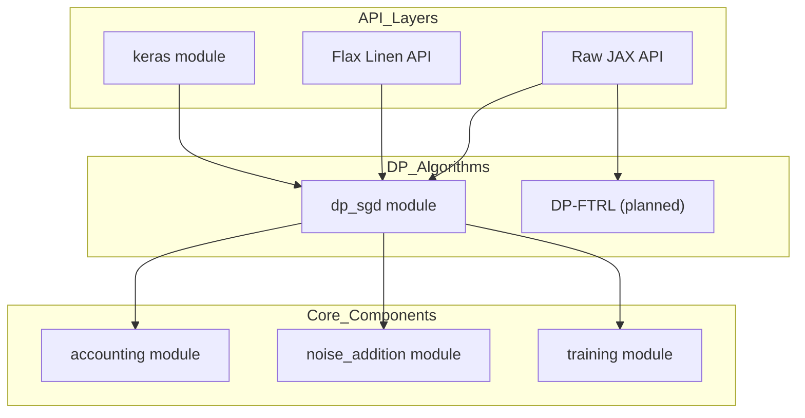
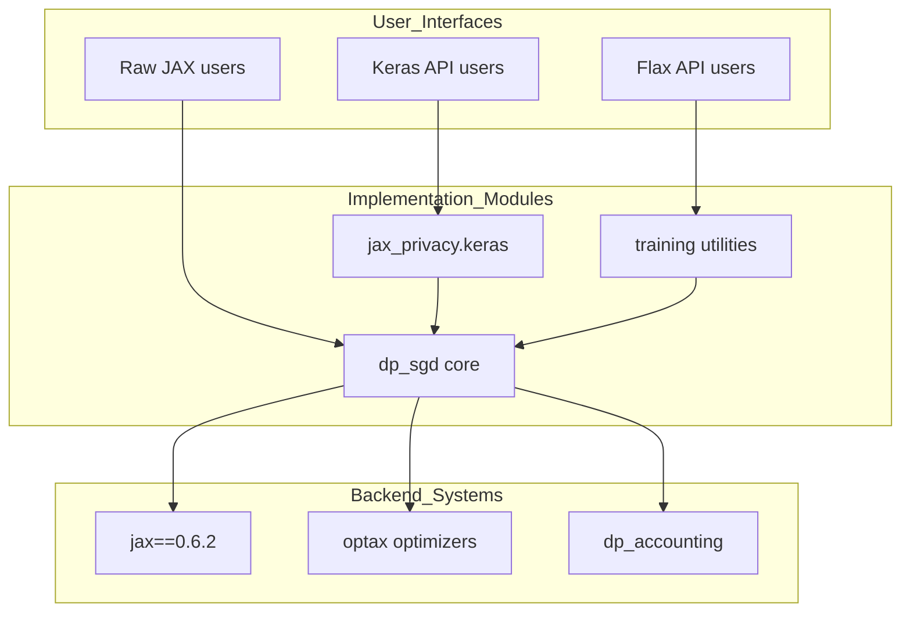
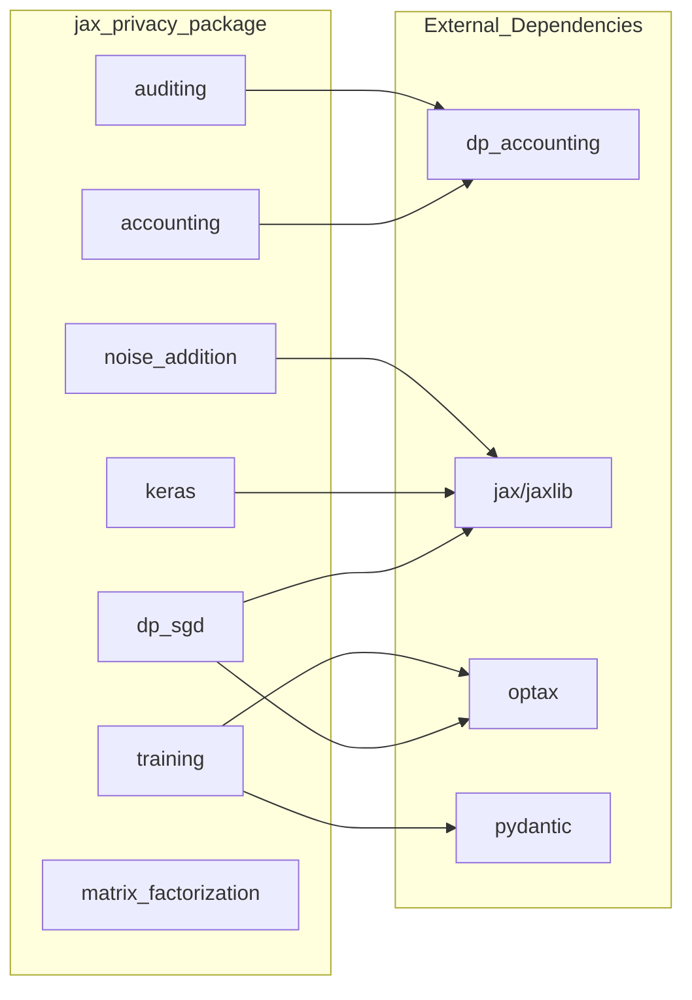
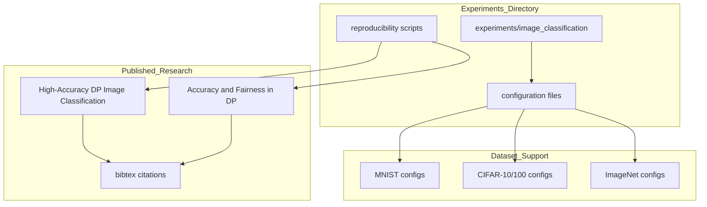

<!-- source: DeepWiki mcp.deepwiki.com · repo google-deepmind/jax_privacy · page 1 Overview · fetched 2026-10-26 -->

# Overview

Relevant source files

The following files were used as context for generating this wiki page:

- [README.md](README.md)
- [requirements.txt](requirements.txt)

## Purpose and Scope

This document provides a high-level introduction to JAX-Privacy, a library for differentially private machine learning built on JAX. It covers the core purpose, architecture, API layers, and main components of the system. For detailed installation instructions and usage examples, see [Getting Started](#2). For in-depth documentation of specific modules, see [Core Library](#3). For experimental components and research reproducibility, see [Research Components](#4).

## What is JAX-Privacy

JAX-Privacy is a production-focused library for implementing differentially private (DP) machine learning algorithms in JAX. The library provides multiple API abstraction levels to accommodate different use cases, from high-level production deployments to low-level research experimentation.

The library serves two primary purposes:
- **Production API**: Streamlined interfaces for deploying DP ML models in production environments
- **Research Components**: Core building blocks and experimental frameworks for DP algorithm development

**Core Algorithm Architecture**

Sources: [README.md:9-14](), [README.md:29-31]()

## Multi-Level API Architecture

JAX-Privacy provides three distinct API levels, each targeting different user needs and expertise levels:

| API Level | Target Users | Use Cases | Flexibility | Examples |
|-----------|--------------|-----------|-------------|----------|
| **Keras API** | ML Practitioners | LLM fine-tuning, production deployment | High-level, streamlined | Gemma fine-tuning |
| **Flax Linen API** | ML Engineers | Custom architectures, training loops | Medium flexibility | MNIST classification |
| **Raw JAX API** | Researchers | Algorithm development, framework integration | Maximum control | Research experimentation |

**API Layer Implementation**

Sources: [README.md:32-49](), [requirements.txt:12-13](), [requirements.txt:8](), [requirements.txt:19]()

## Core Package Structure

The `jax_privacy` package is organized into several key modules that provide different aspects of differentially private machine learning:

**Primary Modules**

Sources: [requirements.txt:7-20]()

- **`accounting`**: Privacy budget tracking and management using the `dp_accounting` library
- **`dp_sgd`**: Core implementation of the Differentially Private Stochastic Gradient Descent algorithm
- **`keras`**: High-level API integration with Keras for streamlined DP training
- **`noise_addition`**: Calibrated noise generation for differential privacy guarantees
- **`training`**: Training utilities and helper functions for DP model training
- **`auditing`**: Privacy guarantee verification and auditing tools
- **`matrix_factorization`**: DP matrix operations and factorization algorithms

For detailed documentation of each module's functionality, see [Package Structure](#3.1).

## Research and Experimental Components

Beyond the production API, JAX-Privacy includes research components for reproducibility and experimentation:

**Research Pipeline Architecture**

Sources: [README.md:95-111](), [README.md:100](), [README.md:103](), [README.md:111]()

The experimental framework supports image classification tasks with configurations for multiple datasets and architectures. For details on running experiments and reproducing published results, see [Image Classification Experiments](#4.1) and [Configuration Examples](#4.2).

## Key Dependencies and Integration

JAX-Privacy is built on a carefully selected set of dependencies that provide the foundation for differentially private machine learning:

| Dependency | Version | Purpose |
|------------|---------|---------|
| `jax` / `jaxlib` | 0.6.2 | Core numerical computation and auto-differentiation |
| `dp_accounting` | Latest | Privacy budget tracking and accounting |
| `optax` | Latest | Optimization algorithms and utilities |
| `pydantic` | Latest | Data validation and type checking |
| `ml_collections` | Latest | Configuration management |
| `jaxtyping` | Latest | Enhanced type annotations for JAX arrays |

Sources: [requirements.txt:12-20]()

The library integrates with the broader JAX ecosystem while providing specialized components for differential privacy. For a comprehensive overview of the dependency architecture and how these components interact, see [Dependencies & Architecture](#3.2).

## Installation and Development

JAX-Privacy supports two installation methods:

- **Static Installation**: `pip install git+https://github.com/google-deepmind/jax_privacy` for using the library without modifications
- **Local Installation**: Clone and install with `pip install -e .` for development and accessing the experimental pipeline

The codebase includes comprehensive testing infrastructure, code quality tools, and packaging configuration. For development setup, testing procedures, and contribution guidelines, see [Development](#5).

Sources: [README.md:64-93]()

---

