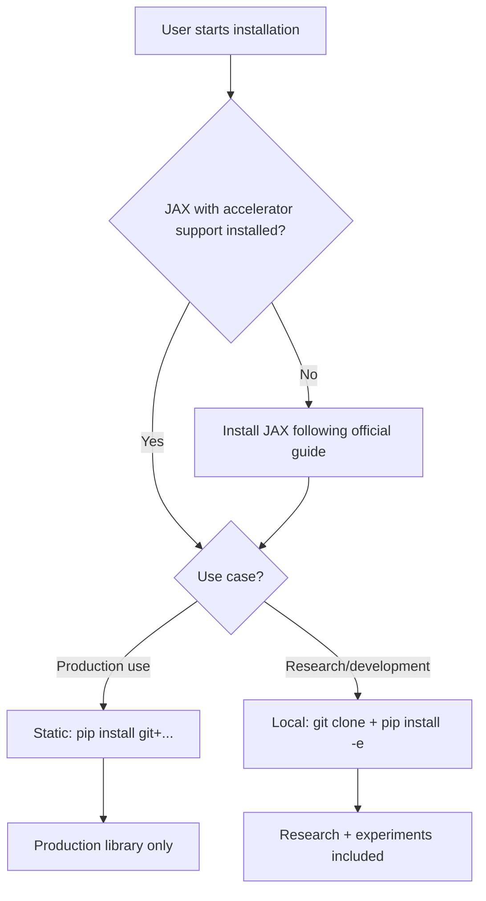
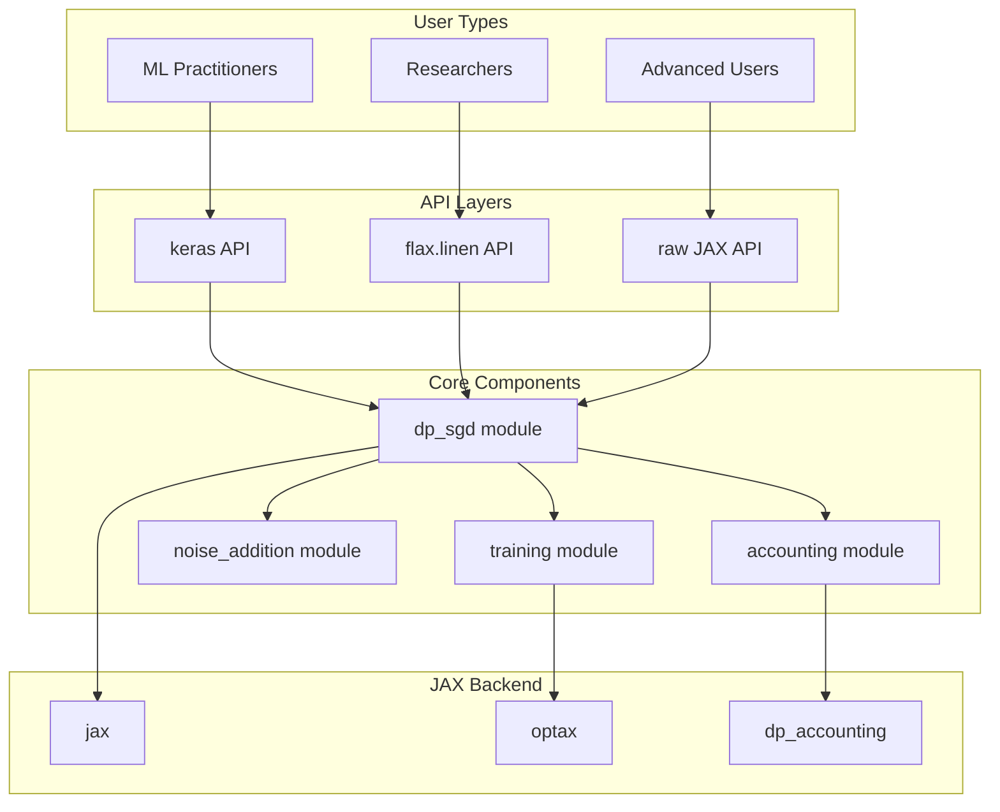
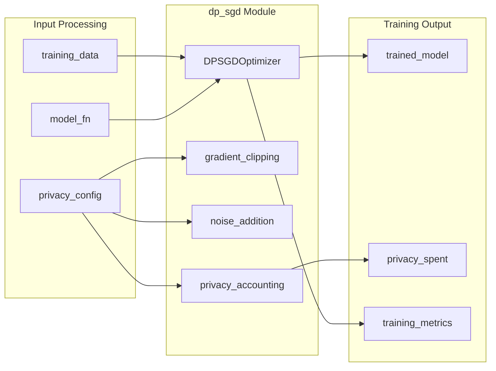

<!-- source: DeepWiki mcp.deepwiki.com · repo google-deepmind/jax_privacy · page 2 Getting Started · fetched 2026-10-26 -->

# Getting Started

<details>
<summary>Relevant source files</summary>

The following files were used as context for generating this wiki page:

- [README.md](README.md)
- [setup.py](setup.py)

</details>


This document provides installation instructions, basic usage patterns, and API layer guidance for JAX-Privacy. It covers the production-focused library components and demonstrates how to begin using differentially private machine learning with JAX. For detailed documentation of core library modules, see [Core Library](#3). For experimental research components and image classification experiments, see [Research Components](#4).

## Installation

JAX-Privacy supports two installation methods depending on your use case. Both require Python 3.11+ as specified in [setup.py:45]().

### Prerequisites

Install JAX with appropriate accelerator support before installing JAX-Privacy. Follow the [JAX installation guide](https://github.com/jax-ml/jax#installation) to ensure compatibility with your GPU/TPU hardware.

### Static Installation

For production use cases where you need library functionality without modifications:

```bash
pip install git+https://github.com/google-deepmind/jax_privacy
```

This installs the `jax_privacy` package as defined in [setup.py:34]() but excludes experimental training pipelines via the `exclude` parameter in [setup.py:42]().

### Local Development Installation

For research, experimentation, or contributing to the codebase:

```bash
git clone https://github.com/google-deepmind/jax_privacy
cd jax_privacy
pip install -e .
```

The `-e` flag enables editable installation, allowing code modifications to be reflected immediately without reinstallation. This method includes all components including experimental code in the `experiments/` directory.

**Installation Flow**



Sources: [README.md:58-94](), [setup.py:33-51]()

## API Architecture Overview

JAX-Privacy provides three API abstraction levels, each targeting different user needs and offering varying degrees of control and complexity.

**API Layer Hierarchy**



Sources: [README.md:32-49]()

### Keras API

High-level interface optimized for common tasks like LLM fine-tuning. Provides streamlined experience with minimal boilerplate code.

**Target Users**: ML practitioners implementing DP training in production environments
**Complexity**: Low
**Flexibility**: Limited to supported model architectures

Example files: `examples/keras_api_example.py`, `examples/dp_sgd_keras_gemma3_lora_finetuning_samsum.ipynb`

### Flax Linen API  

Medium-level interface offering greater flexibility for custom model architectures and training loop control, with moderate additional complexity.

**Target Users**: Researchers needing custom architectures while maintaining structured training patterns
**Complexity**: Medium
**Flexibility**: High for model architectures, medium for training logic

Example files: `examples/dp_sgd_flax_linen_mnist.ipynb`

### Raw JAX API

Low-level interface providing maximum control over all aspects of DP training. Recommended for framework integration and novel research.

**Target Users**: Advanced users, researchers testing new ideas, developers integrating with non-supported frameworks
**Complexity**: High
**Flexibility**: Maximum

Sources: [README.md:34-48]()

## Basic Usage Patterns

### Package Import Structure

```python
import jax_privacy
from jax_privacy import dp_sgd
from jax_privacy import accounting
from jax_privacy import keras
```

The main package modules are organized as specified in [setup.py:41]() using `find_namespace_packages()`.

### Core Algorithm Support

Currently supports DP-SGD (Differentially Private Stochastic Gradient Descent) algorithm through the `dp_sgd` module. Future support planned for DP-FTRL as mentioned in [README.md:31]().

**DP-SGD Integration Points**



Sources: [README.md:29-31]()

## Examples and Next Steps

### Running Examples

The repository includes comprehensive examples for each API level:

| API Level | Example File | Use Case |
|-----------|--------------|----------|
| Keras | `examples/keras_api_example.py` | Basic DP training workflow |
| Keras | `examples/dp_sgd_keras_gemma3_lora_finetuning_samsum.ipynb` | LLM fine-tuning |
| Flax Linen | `examples/dp_sgd_flax_linen_mnist.ipynb` | Custom architecture training |

To run examples with local installation:

```bash
# After local installation (see Installation section)
cd examples/
python keras_api_example.py
# or open Jupyter notebooks
jupyter notebook dp_sgd_flax_linen_mnist.ipynb
```

### Development Workflow

For users planning to extend or modify JAX-Privacy:

1. **Local Installation**: Use [Option 2 installation](#install-option2) for editable codebase
2. **Testing**: Run test suite as configured in [setup.py:27-30]()
3. **Core Library**: Explore [Core Library](#3) documentation for module details
4. **Research Components**: See [Research Components](#4) for experimental features

### Framework Integration

For integrating JAX-Privacy with existing JAX-based frameworks:

- **Supported**: Direct integration with Keras, Flax Linen
- **Custom Frameworks**: Use Raw JAX API for frameworks like Equinox
- **NumPy-like Experience**: Raw JAX API provides familiar array operation patterns

Sources: [README.md:36-48](), [setup.py:27-30]()

## Dependencies and Compatibility

JAX-Privacy requires Python 3.11+ and depends on core JAX ecosystem packages as defined in `requirements.txt`. Key dependencies include:

- `jax==0.6.2` and `jaxlib==0.6.2` for core computation
- `dp_accounting` for privacy budget tracking  
- `optax` for optimization algorithms
- `pydantic` and `jaxtyping` for data validation and type safety

The package configuration in [setup.py:44]() automatically handles dependency installation.

Sources: [setup.py:44-45]()

---

