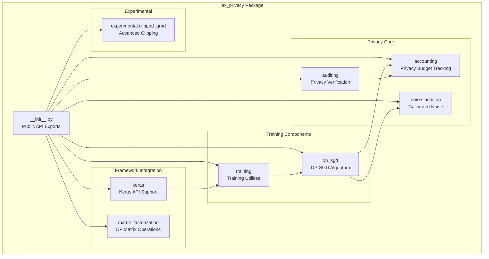
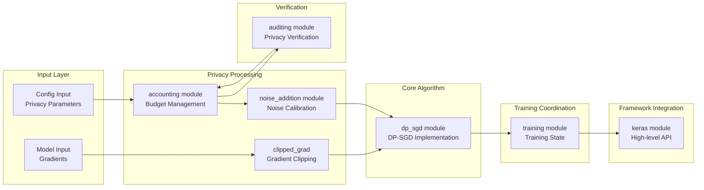
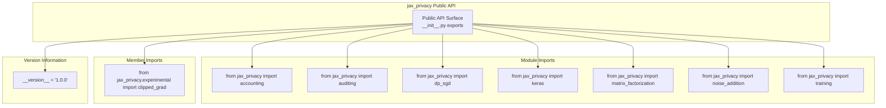

<!-- source: DeepWiki mcp.deepwiki.com · repo google-deepmind/jax_privacy · page 3 Core Library · fetched 2026-10-26 -->

# Core Library

Relevant source files

The following files were used as context for generating this wiki page:

- [.github/workflows/ci.yml](.github/workflows/ci.yml)
- [jax_privacy/__init__.py](jax_privacy/__init__.py)

## Purpose and Scope

This page documents the core `jax_privacy` package structure, including its main modules, their roles, and how they work together to provide differentially private machine learning capabilities. The core library provides the foundational components that power all API layers in JAX-Privacy.

For information about specific API usage patterns, see [Getting Started](#2). For research experiments and configurations, see [Research Components](#4). For development setup and testing, see [Development](#5).

## Package Structure Overview

The JAX-Privacy core library is organized into specialized modules that handle different aspects of differentially private machine learning. The main package exposes eight core modules plus experimental components.

### Core Module Architecture

**Sources:** [jax_privacy/__init__.py:16-29]()

## Core Module Breakdown

### Privacy Management Modules

The privacy management modules handle the mathematical foundations of differential privacy, including budget tracking, noise calibration, and verification.

| Module | Primary Role | Key Components |
|--------|-------------|----------------|
| `accounting` | Privacy budget tracking and composition | Budget management, ε/δ calculations |
| `auditing` | Privacy guarantee verification | Audit mechanisms, guarantee validation |
| `noise_addition` | Calibrated noise generation | Gaussian noise, privacy-preserving perturbations |

### Training System Modules

The training system provides the core algorithms and utilities for differentially private model training.

| Module | Primary Role | Key Components |
|--------|-------------|----------------|
| `dp_sgd` | DP-SGD algorithm implementation | Gradient clipping, noisy aggregation |
| `training` | Training loop utilities | Training state, metrics, coordination |

### Integration Modules

Integration modules provide bridges to popular machine learning frameworks and specialized operations.

| Module | Primary Role | Key Components |
|--------|-------------|----------------|
| `keras` | Keras API integration | High-level training interface |
| `matrix_factorization` | DP matrix operations | Private matrix factorization algorithms |

### Experimental Components

Experimental modules contain cutting-edge features under active development.

| Module | Primary Role | Key Components |
|--------|-------------|----------------|
| `experimental.clipped_grad` | Advanced gradient clipping | Per-example gradient processing |

**Sources:** [jax_privacy/__init__.py:17-27]()

## Module Interaction Flow

The core modules work together in a coordinated flow to provide end-to-end differentially private training capabilities.

### Training Pipeline Data Flow

**Sources:** [jax_privacy/__init__.py:17-27]()

## Public API Surface

The main package carefully controls what functionality is exposed through its public API. The `__init__.py` file serves as the gateway that determines which components users can directly access.

### Direct Module Exports

The package follows a conservative approach to API exposure:
- **Full module imports**: All core modules are available as `jax_privacy.module_name`
- **Selective member imports**: Only `clipped_grad` from experimental is directly exposed
- **Version tracking**: Package version is available as `jax_privacy.__version__`

**Sources:** [jax_privacy/__init__.py:17-29]()

## Dependencies and External Integration

The core library integrates with several external systems to provide its functionality. Key dependencies include JAX for computation, dp_accounting for privacy mathematics, and optax for optimization.

### External Dependency Integration Points

| External Library | Integration Point | Purpose |
|-----------------|-------------------|---------|
| `jax` | All modules | Core array operations and autodiff |
| `dp_accounting` | `accounting` module | Privacy budget mathematics |
| `optax` | `training` module | Optimization algorithms |
| `pydantic` | Various modules | Data validation and type safety |

The core library acts as a coordinating layer that combines these external capabilities into a cohesive differentially private ML system.

**Sources:** [jax_privacy/__init__.py:16-29]()

---

