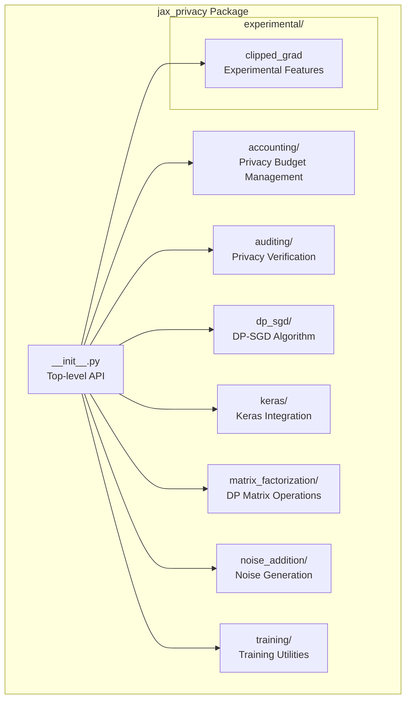
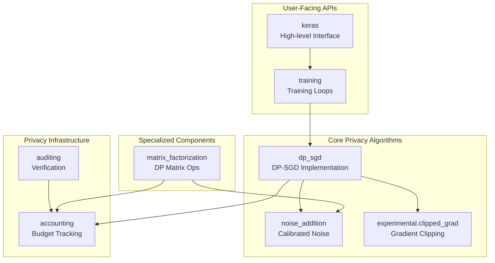
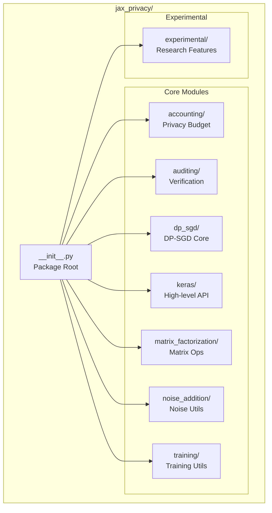

<!-- source: DeepWiki mcp.deepwiki.com · repo google-deepmind/jax_privacy · page 3.1 Package Structure · fetched 2026-10-26 -->

# Package Structure

Relevant source files

The following files were used as context for generating this wiki page:

- [.github/workflows/ci.yml](.github/workflows/ci.yml)
- [jax_privacy/__init__.py](jax_privacy/__init__.py)

This document provides an overview of the main `jax_privacy` package modules, their hierarchical organization, and inter-module relationships. It covers the core library structure as exposed through the top-level package imports and the functional dependencies between different components.

For information about external dependencies and system architecture, see [Dependencies & Architecture](#3.2). For installation and basic usage patterns, see [Getting Started](#2).

## Top-Level Package Organization

The `jax_privacy` package is organized as a collection of specialized modules, each focusing on specific aspects of differentially private machine learning. The top-level package interface is defined through selective imports that expose the most important functionality.

### Main Package Interface

The package exposes seven core modules and selected experimental functionality through direct imports in [jax_privacy/__init__.py:17-27](). This creates a clean top-level API where users can access `jax_privacy.dp_sgd`, `jax_privacy.accounting`, etc.

**Sources:** [jax_privacy/__init__.py:17-27]()

### Package Version and Metadata

The package defines its version as `__version__ = '1.0.0'` in [jax_privacy/__init__.py:29](), indicating a stable release with established API contracts.

**Sources:** [jax_privacy/__init__.py:29]()

## Core Module Functional Relationships

The modules within `jax_privacy` have specific functional relationships that form the privacy-preserving machine learning pipeline.

### Module Dependency Graph

**Sources:** [jax_privacy/__init__.py:17-27]()

## Module Categories and Responsibilities

The package modules can be categorized into distinct functional groups based on their roles in the privacy-preserving ML workflow.

### Algorithm Implementation Layer

| Module | Primary Responsibility | Key Functions |
|--------|----------------------|---------------|
| `dp_sgd` | Core DP-SGD algorithm implementation | Gradient processing, privacy-preserving optimization |
| `noise_addition` | Noise generation and calibration | Gaussian noise, calibrated noise injection |
| `experimental.clipped_grad` | Advanced gradient clipping | Per-example gradient bounds |

### Privacy Management Layer

| Module | Primary Responsibility | Key Functions |
|--------|----------------------|---------------|
| `accounting` | Privacy budget tracking | Epsilon-delta accounting, composition |
| `auditing` | Privacy guarantee verification | Empirical privacy analysis |

### Integration and Utilities Layer

| Module | Primary Responsibility | Key Functions |
|--------|----------------------|---------------|
| `keras` | High-level Keras API integration | Streamlined DP training workflows |
| `training` | Training loop utilities | Generic training infrastructure |
| `matrix_factorization` | Specialized DP matrix operations | Private matrix decomposition |

**Sources:** [jax_privacy/__init__.py:17-27]()

## Import Structure and API Design

The package follows a deliberate import strategy that balances ease of use with explicit dependency management.

### Selective Member Imports

The package uses selective member imports only for experimental features, as indicated by the comment in [jax_privacy/__init__.py:25-27](). The `clipped_grad` functionality is imported directly from `jax_privacy.experimental`, making it available as `jax_privacy.clipped_grad`.

### Module-Level Imports

All core modules are imported at the module level (e.g., `from jax_privacy import accounting`), requiring users to access specific functions through module namespaces. This design:

- Prevents namespace pollution
- Makes dependencies explicit
- Allows for clear attribution of functionality
- Maintains backward compatibility

**Sources:** [jax_privacy/__init__.py:17-27]()

## Package Hierarchy and Organization

The physical organization of the package reflects the logical separation of concerns established in the import structure.

### Directory Structure

Each module is implemented as a separate directory containing its own `__init__.py` and implementation files, following standard Python package conventions.

**Sources:** [jax_privacy/__init__.py:17-27]()

---

