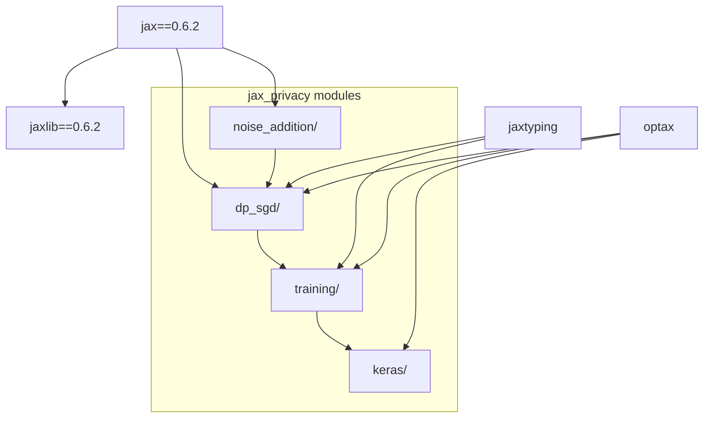
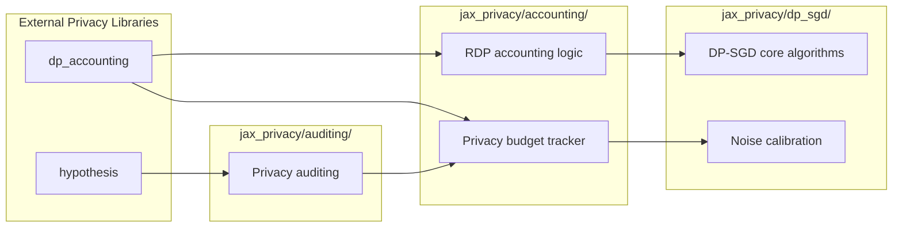
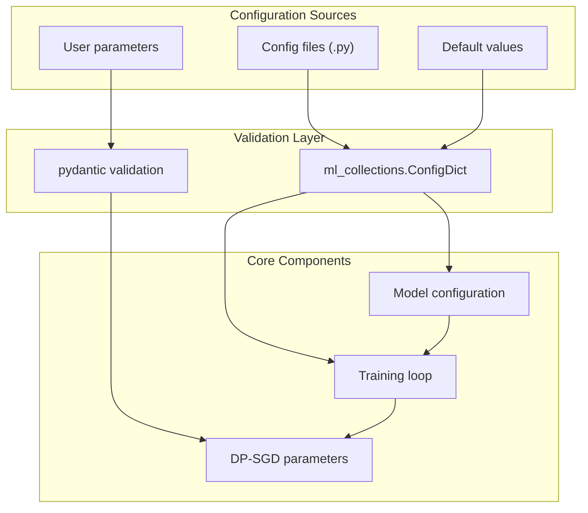
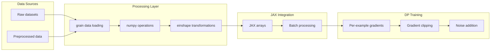
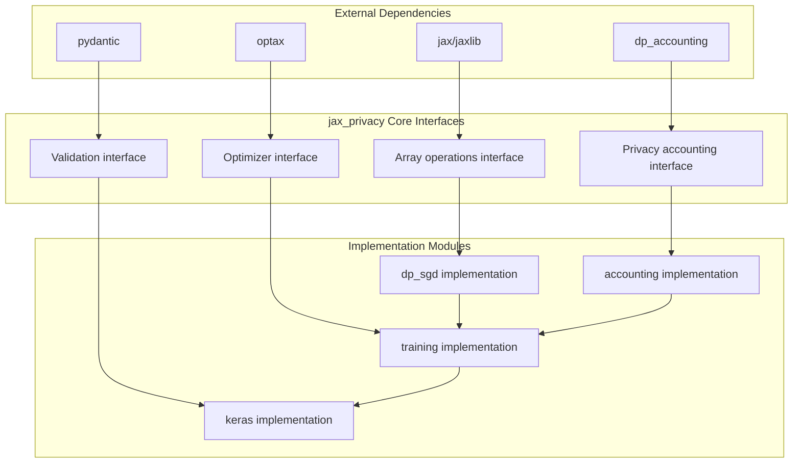

<!-- source: DeepWiki mcp.deepwiki.com · repo google-deepmind/jax_privacy · page 3.2 Dependencies & Architecture · fetched 2026-10-26 -->

# Dependencies & Architecture

Relevant source files

The following files were used as context for generating this wiki page:

- [requirements.txt](requirements.txt)

This document provides a comprehensive overview of JAX-Privacy's core dependencies and system architecture. It explains how external libraries integrate with the core `jax_privacy` package to enable differentially private machine learning. For information about the internal package structure and modules, see [Package Structure](#3.1). For development environment setup and dependency management, see [Development](#5).

## Core Dependencies Overview

JAX-Privacy builds upon a carefully curated set of external libraries that provide essential functionality for differentially private machine learning. The dependencies are organized into several functional categories, each serving specific architectural roles.

### JAX Ecosystem Dependencies

The JAX ecosystem forms the computational foundation of JAX-Privacy, providing array operations, automatic differentiation, and just-in-time compilation capabilities.

| Dependency | Version | Purpose |
|------------|---------|---------|
| `jax` | `==0.6.2` | Core numerical computing and autodiff |
| `jaxlib` | `==0.6.2` | JAX backend implementations |
| `jaxtyping` | Latest | Type annotations for JAX arrays |
| `optax` | Latest | Optimization algorithms and utilities |

The pinned JAX versions ensure compatibility with the differentially private algorithms implemented in the library. The `jaxtyping` dependency provides enhanced type safety for array operations, while `optax` supplies the optimization primitives used in DP-SGD implementations.

**JAX Ecosystem Integration**

Sources: [requirements.txt:12-14](), [requirements.txt:19]()

### Privacy and Accounting Infrastructure

The privacy guarantees in JAX-Privacy rely on dedicated libraries for privacy budget tracking and differential privacy accounting.

| Dependency | Purpose | Integration Points |
|------------|---------|-------------------|
| `dp_accounting` | Privacy budget calculation and tracking | `accounting/` module |
| `hypothesis` | Property-based testing for privacy properties | Test infrastructure |

The `dp_accounting` library provides the mathematical foundations for computing privacy budgets under the Rényi Differential Privacy framework. It integrates directly with the `accounting` module to track cumulative privacy expenditure across training epochs.

**Privacy Architecture Integration**

Sources: [requirements.txt:8](), [requirements.txt:11]()

### Configuration and Validation Framework

JAX-Privacy employs a robust configuration and validation system to ensure type safety and parameter correctness across the differentially private training pipeline.

| Dependency | Purpose | Usage Pattern |
|------------|---------|---------------|
| `ml_collections` | Hierarchical configuration management | Experiment configs, hyperparameters |
| `pydantic` | Runtime data validation and parsing | Input validation, model parameters |

The `ml_collections` library provides the `ConfigDict` class used throughout the experimental framework for managing complex hierarchical configurations. The `pydantic` library ensures type safety and validation for critical parameters in the privacy-preserving training pipeline.

**Configuration Flow Architecture**

Sources: [requirements.txt:16](), [requirements.txt:15]()

### Data Processing and Mathematical Utilities

JAX-Privacy leverages specialized libraries for efficient data processing and mathematical operations required in differentially private machine learning.

| Dependency | Purpose | Integration |
|------------|---------|-------------|
| `grain` | High-performance data loading and processing | Training data pipelines |
| `einshape` | Tensor shape manipulation and validation | Array reshaping operations |
| `numpy` | Fundamental array operations | Interoperability with JAX |
| `scipy` | Scientific computing functions | Statistical operations |

The `grain` library provides efficient data loading capabilities optimized for JAX, while `einshape` offers advanced tensor manipulation with shape validation. These libraries integrate seamlessly with JAX's array model to provide robust data processing pipelines.

**Data Processing Pipeline**

Sources: [requirements.txt:10](), [requirements.txt:9](), [requirements.txt:18](), [requirements.txt:20]()

### Infrastructure and Utility Dependencies

Supporting infrastructure dependencies provide essential utilities for logging, iteration, and general-purpose operations.

| Dependency | Version | Purpose |
|------------|---------|---------|
| `absl-py` | Latest | Google-style command-line flags and logging |
| `more_itertools` | `==10.1.0` | Extended iteration utilities |

The `absl-py` library provides the flag-based configuration system used in experimental scripts, while `more_itertools` supplies advanced iteration patterns used throughout the codebase.

Sources: [requirements.txt:7](), [requirements.txt:17]()

## Architectural Integration Patterns

The dependencies integrate with JAX-Privacy through well-defined patterns that maintain separation of concerns while enabling seamless interoperability.

### Dependency Injection and Composition

JAX-Privacy follows a composition-based architecture where external dependencies are injected into core components rather than tightly coupled. This pattern enables easy testing and allows users to substitute alternative implementations when needed.

**Core Integration Architecture**

Sources: [requirements.txt:1-21]()

### Version Management and Compatibility

JAX-Privacy maintains strict version constraints for critical dependencies to ensure reproducible privacy guarantees. The JAX ecosystem dependencies are pinned to specific versions (`jax==0.6.2`, `jaxlib==0.6.2`) to maintain compatibility with the differentially private implementations.

The `more_itertools` dependency is also pinned (`==10.1.0`) to ensure consistent behavior across environments. Other dependencies use flexible versioning to allow for security updates and compatibility improvements while maintaining API stability.

Sources: [requirements.txt:12-13](), [requirements.txt:17]()

## Runtime Dependency Resolution

The dependency architecture supports both static installation and dynamic loading patterns. The core privacy algorithms maintain minimal dependency requirements, while advanced features and experimental components may require additional dependencies that are loaded on demand.

This layered dependency approach enables users to install only the components they need while maintaining the ability to access the full feature set when required.

Sources: [requirements.txt:3-4]()

---

