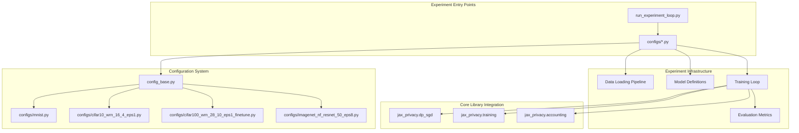
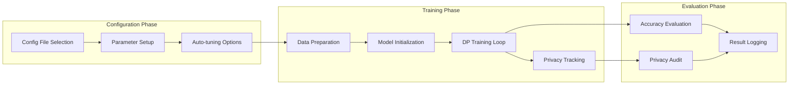
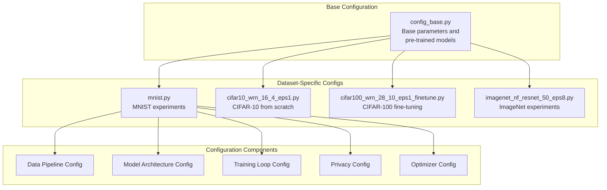
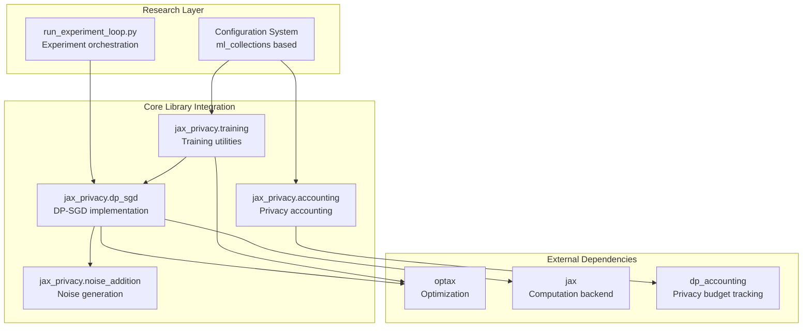

<!-- source: DeepWiki mcp.deepwiki.com · repo google-deepmind/jax_privacy · page 4 Research Components · fetched 2026-10-26 -->

# Research Components

Relevant source files

The following files were used as context for generating this wiki page:

- [.gitignore](.gitignore)
- [experiments/image_classification/README.md](experiments/image_classification/README.md)

The Research Components subsystem provides experimental code, reproducible research implementations, and configuration frameworks for conducting differentially private machine learning experiments. This system enables researchers to reproduce published results, run custom experiments, and benchmark different approaches to DP machine learning.

For information about the core production APIs, see [Core Library](#3). For development and testing workflows, see [Development](#5).

## Overview

The research components are organized around reproducible image classification experiments that support the paper "Unlocking High-Accuracy Differentially Private Image Classification through Scale". The system provides a flexible configuration-driven framework for running experiments across different datasets, model architectures, and privacy parameters.

### Research Framework Architecture

**Sources:** [experiments/image_classification/README.md:1-102]()

### Experimental Workflow

The research framework follows a standardized workflow that integrates configuration management with the core DP-SGD implementation:

**Sources:** [experiments/image_classification/README.md:25-29](), [experiments/image_classification/README.md:33-46]()

## Configuration System

The experimental framework uses a hierarchical configuration system built on `ml_collections` that allows precise control over all experimental parameters:

### Key Configuration Parameters

| Parameter Category | Configuration Path | Purpose |
|-------------------|-------------------|---------|
| Data Augmentation | `config.experiment_kwargs.config.data.augmult` | Controls augmentation multiplier |
| Batch Size | `config.experiment_kwargs.config.training.batch_size.init_value` | Training batch size |
| Learning Rate | `config.experiment_kwargs.config.optimizer.lr.kwargs.value` | Optimizer learning rate |
| Model Architecture | `config.experiment_kwargs.config.model` | Model definition |
| Noise Multiplier | `config.experiment_kwargs.config.training.dp.noise_multiplier` | DP-SGD noise level |
| Training Duration | `config.experiment_kwargs.config.num_updates` | Number of training updates |
| Privacy Budget (δ) | `config.experiment_kwargs.config.dp.delta` | Privacy parameter delta |
| Privacy Budget (ε) | `config.experiment_kwargs.config.dp.auto_tune_target_epsilon` | Target epsilon value |

**Sources:** [experiments/image_classification/README.md:33-46]()

### Configuration Hierarchy

**Sources:** [experiments/image_classification/README.md:76-77]()

## Available Experiments

The research framework supports several categories of experiments that demonstrate different aspects of differentially private image classification:

### Training from Scratch

These experiments train models from random initialization using DP-SGD:

- **MNIST**: Basic demonstration using the MNIST dataset
- **CIFAR-10**: Wide ResNet 16-4 architecture with ε=1.0 privacy budget
- **ImageNet**: NFNet ResNet-50 architecture with ε=8.0 privacy budget

### Fine-tuning Experiments

These experiments start from pre-trained checkpoints and fine-tune with differential privacy:

- **CIFAR-100**: Wide ResNet 28-10 fine-tuning with ε=1.0 privacy budget

### Experiment Execution Commands

| Experiment Type | Command | Configuration File |
|-----------------|---------|-------------------|
| MNIST | `python run_experiment_loop.py --config=configs/mnist.py` | `configs/mnist.py` |
| CIFAR-10 Scratch | `python run_experiment_loop.py --config=configs/cifar10_wrn_16_4_eps1.py` | `configs/cifar10_wrn_16_4_eps1.py` |
| ImageNet Scratch | `python run_experiment_loop.py --config=configs/imagenet_nf_resnet_50_eps8.py` | `configs/imagenet_nf_resnet_50_eps8.py` |
| CIFAR-100 Fine-tune | `python run_experiment_loop.py --config=configs/cifar100_wrn_28_10_eps1_finetune.py` | `configs/cifar100_wrn_28_10_eps1_finetune.py` |

**Sources:** [experiments/image_classification/README.md:52-77]()

## Integration with Core Library

The research components integrate directly with the core JAX-Privacy library modules to provide production-ready DP-SGD implementations:

**Sources:** [experiments/image_classification/README.md:1-102]()

## Advanced Features

The research framework includes several advanced features for sophisticated experimentation:

### Auto-tuning Capabilities

The `auto_tune` feature allows automatic calibration of privacy parameters:
- Noise multiplier calibration under pre-specified privacy budgets
- Automatic stopping when privacy budget is exhausted
- Dynamic parameter adjustment based on privacy accounting

### Memory Management

The framework includes memory optimization features:
- Configurable `per_device_per_step` batch sizes for memory constraints
- Automatic batch size validation and divisibility checks
- Support for multi-accelerator setups

### Learning Rate Scheduling

Integration with `optax` learning rate schedules is supported, though not used in the paper's best results.

**Sources:** [experiments/image_classification/README.md:93-101]()

## Research Reproducibility

The research components are designed to ensure reproducibility of published results:

### Paper Integration

The experiments directly reproduce results from "Unlocking High-Accuracy Differentially Private Image Classification through Scale" (arXiv:2204.13650), with hyperparameters documented in Appendix C of the paper.

### Citation and References

The system includes proper citation handling through bibtex references and links to the original paper.

### Result Validation

- Training and evaluation accuracies are logged throughout training
- Privacy budget consumption is tracked and reported
- Automatic validation of experimental configurations

**Sources:** [experiments/image_classification/README.md:1-12](), [experiments/image_classification/README.md:81-82]()

---

