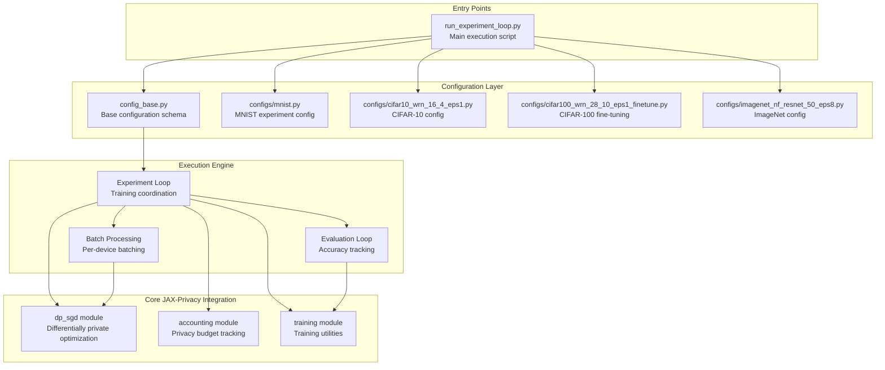
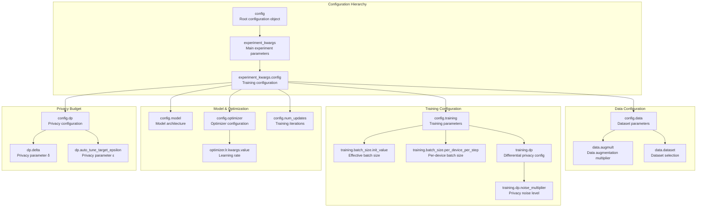

<!-- source: DeepWiki mcp.deepwiki.com · repo google-deepmind/jax_privacy · page 4.1 Image Classification Experiments · fetched 2026-10-26 -->

# Image Classification Experiments

<details>
<summary>Relevant source files</summary>

The following files were used as context for generating this wiki page:

- [.gitignore](.gitignore)
- [experiments/image_classification/README.md](experiments/image_classification/README.md)

</details>


This document covers the experimental framework for running differentially private image classification experiments using JAX-Privacy. The framework provides a reproducible environment for conducting research on large-scale differentially private image classification, supporting datasets like MNIST, CIFAR-10/100, and ImageNet.

For information about the core library components used by these experiments, see [Core Library](#3). For configuration examples and detailed parameter specifications, see [Configuration Examples](#4.2).

## Purpose and Scope

The image classification experiments framework enables researchers to:

- Reproduce results from published differential privacy research papers
- Conduct new experiments with differentially private training
- Compare performance across different datasets and model architectures
- Tune hyperparameters for optimal privacy-utility tradeoffs

This framework is built on top of the core JAX-Privacy library and provides a higher-level interface specifically designed for image classification research.

## Experimental Framework Architecture

The experimental system follows a modular design that separates configuration, execution, and core differential privacy algorithms:



**Sources:** [experiments/image_classification/README.md:25-29](), [experiments/image_classification/README.md:76-77]()

## Configuration System Structure

The configuration system uses `ml_collections` to define experiment parameters in a hierarchical structure:



**Sources:** [experiments/image_classification/README.md:33-46](), [experiments/image_classification/README.md:76-77]()

## Running Experiments

### Basic Execution

Experiments are executed using the main script with a configuration file:

```bash
python run_experiment_loop.py --config=<relative/path/to/config.py>
```

### Environment Setup

Before running experiments, the Python path must be configured to make experiment modules discoverable:

```bash
cd experiments
export PYTHONPATH=$PYTHONPATH:`pwd`
```

**Sources:** [experiments/image_classification/README.md:16-23](), [experiments/image_classification/README.md:25-29]()

## Dataset-Specific Examples

### MNIST Training

Basic MNIST experiment using the provided configuration:

```bash
python run_experiment_loop.py --config=configs/mnist.py
```

### CIFAR-10 Training from Scratch

Training a Wide ResNet on CIFAR-10 with ε=1 privacy budget:

```bash
python run_experiment_loop.py --config=configs/cifar10_wrn_16_4_eps1.py
```

### ImageNet Training

Large-scale ImageNet training with NFNet ResNet-50:

```bash
python run_experiment_loop.py --config=configs/imagenet_nf_resnet_50_eps8.py
```

### CIFAR-100 Fine-tuning

Fine-tuning a pre-trained model on CIFAR-100:

```bash
python run_experiment_loop.py --config=configs/cifar100_wrn_28_10_eps1_finetune.py
```

**Sources:** [experiments/image_classification/README.md:52-77]()

## Key Configuration Parameters

| Parameter Category | Configuration Path | Description |
|-------------------|-------------------|-------------|
| **Data Augmentation** | `config.experiment_kwargs.config.data.augmult` | Data augmentation multiplier |
| **Batch Size** | `config.experiment_kwargs.config.training.batch_size.init_value` | Effective batch size for training |
| **Per-Device Batching** | `config.experiment_kwargs.config.training.batch_size.per_device_per_step` | Batch size per device per step |
| **Learning Rate** | `config.experiment_kwargs.config.optimizer.lr.kwargs.value` | Optimizer learning rate |
| **Model Architecture** | `config.experiment_kwargs.config.model` | Model definition and architecture |
| **Noise Multiplier** | `config.experiment_kwargs.config.training.dp.noise_multiplier` | DP-SGD noise level (σ) |
| **Training Iterations** | `config.experiment_kwargs.config.num_updates` | Number of training updates |
| **Privacy Delta** | `config.experiment_kwargs.config.dp.delta` | Privacy parameter δ |
| **Privacy Epsilon** | `config.experiment_kwargs.config.dp.auto_tune_target_epsilon` | Target privacy parameter ε |

**Sources:** [experiments/image_classification/README.md:33-46]()

## Advanced Features

### Automatic Privacy Budget Tuning

The framework supports automatic calibration of the noise multiplier for a given privacy budget:

- Set `auto_tune_target_epsilon` to automatically tune noise multiplier
- Training stops automatically when privacy budget is exhausted if `stop_training_at_epsilon` is enabled
- Privacy accounting tracks cumulative privacy expenditure throughout training

### Memory Management

For Out of Memory errors, adjust the per-device batch size while maintaining the effective batch size:

- Reduce `per_device_per_step` to fit memory constraints
- Ensure `init_value` is divisible by `per_device_per_step × num_devices`
- This affects training speed but preserves convergence properties

### Learning Rate Scheduling

The framework supports `optax` learning rate schedules, though simple constant learning rates are used for best results in the reference paper.

**Sources:** [experiments/image_classification/README.md:83-101]()

## Research Reproducibility

This framework reproduces experiments from "Unlocking High-Accuracy Differentially Private Image Classification through Scale" (arXiv:2204.13650). To reproduce paper results:

1. Refer to hyperparameters listed in Appendix C of the paper
2. Update the relevant configuration file with those parameters
3. Pre-trained models are available through the base configuration system

**Sources:** [experiments/image_classification/README.md:1-9](), [experiments/image_classification/README.md:48-50](), [experiments/image_classification/README.md:76-77]()

---

