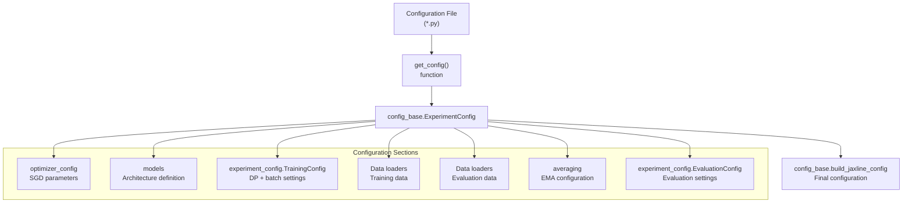
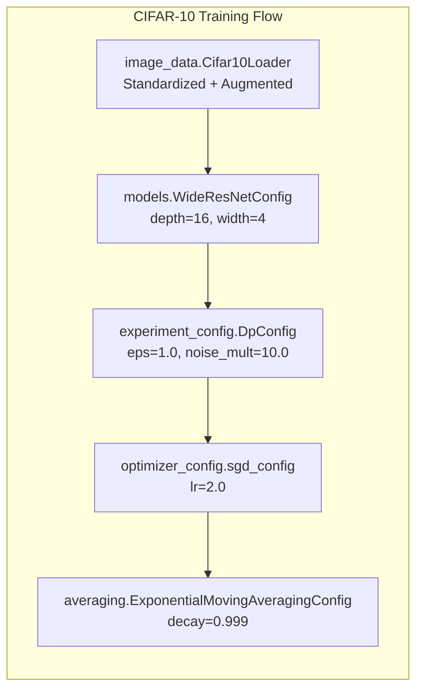
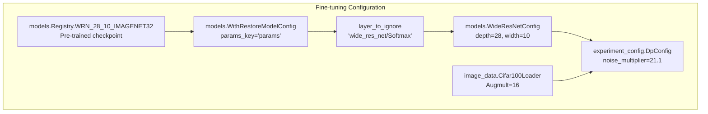
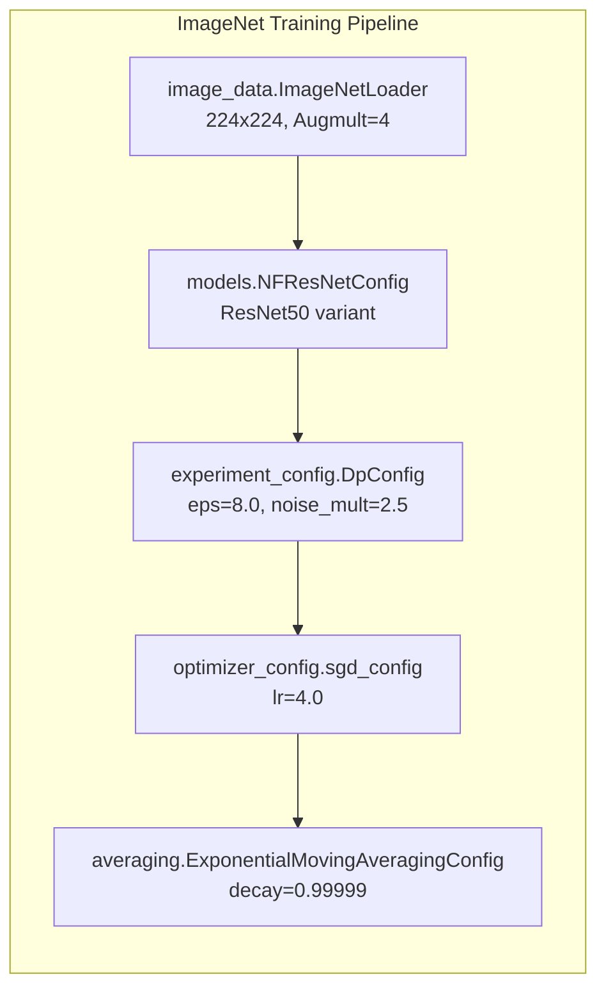
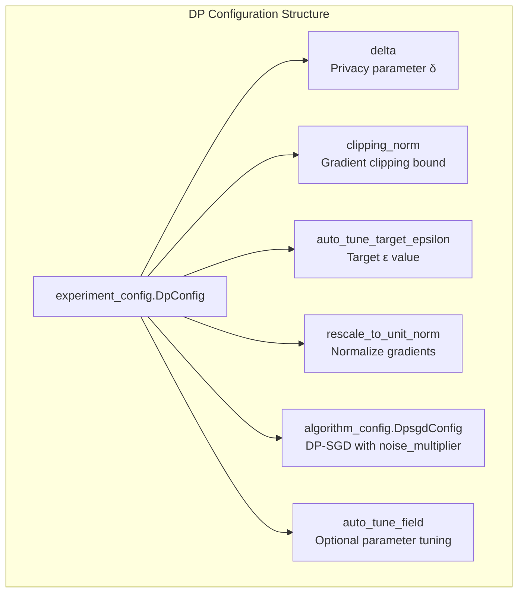
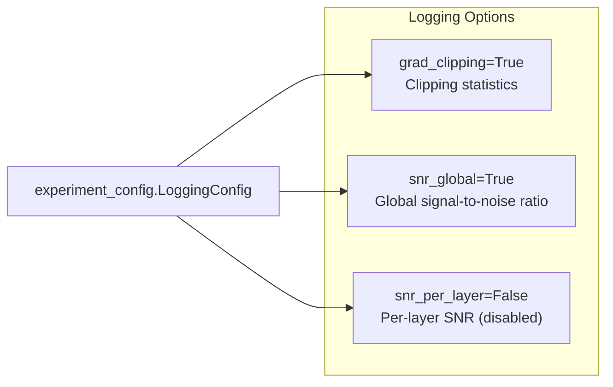
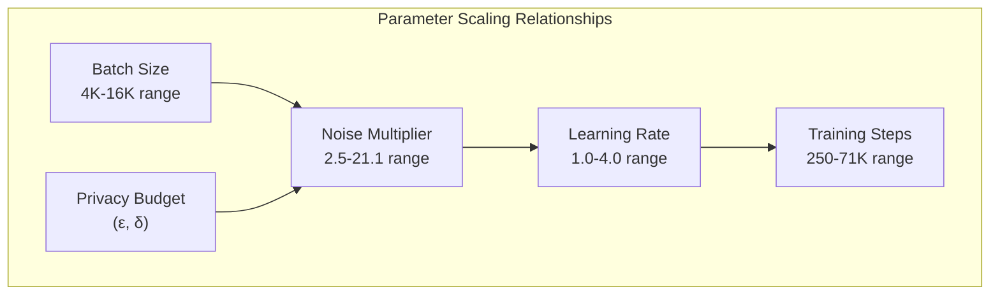

<!-- source: DeepWiki mcp.deepwiki.com · repo google-deepmind/jax_privacy · page 4.2 Configuration Examples · fetched 2026-10-26 -->

# Configuration Examples

Relevant source files

The following files were used as context for generating this wiki page:

- [bibtex/berrada2023unlocking.bib](bibtex/berrada2023unlocking.bib)
- [experiments/image_classification/configs/cifar100_wrn_28_10_eps1_finetune.py](experiments/image_classification/configs/cifar100_wrn_28_10_eps1_finetune.py)
- [experiments/image_classification/configs/cifar10_wrn_16_4_eps1.py](experiments/image_classification/configs/cifar10_wrn_16_4_eps1.py)
- [experiments/image_classification/configs/imagenet_nf_resnet_50_eps8.py](experiments/image_classification/configs/imagenet_nf_resnet_50_eps8.py)

This page provides detailed examples of experiment configurations for the JAX-Privacy image classification framework. These configurations demonstrate how to set up differentially private training experiments across different datasets (MNIST, CIFAR-10, CIFAR-100, ImageNet) and model architectures. For information about running these experiments, see [Image Classification Experiments](#4.1).

## Configuration File Structure

All configuration files follow a standardized structure using `ml_collections.ConfigDict` and the `config_base.ExperimentConfig` class. The configuration system provides type safety and validation for experiment parameters.

### Core Configuration Components

Sources: [experiments/image_classification/configs/cifar10_wrn_16_4_eps1.py:28-91](), [experiments/image_classification/configs/cifar100_wrn_28_10_eps1_finetune.py:28-91](), [experiments/image_classification/configs/imagenet_nf_resnet_50_eps8.py:30-91]()

## Dataset-Specific Configuration Examples

### CIFAR-10 Configuration

The CIFAR-10 configuration demonstrates training from scratch with moderate privacy budget:

| Configuration Aspect | Value | Purpose |
|----------------------|-------|---------|
| Model | `models.WideResNetConfig(depth=16, width=4)` | WRN-16-4 architecture optimized for CIFAR-10 |
| Privacy Budget | `(ε=1.0, δ=1e-5)` | Standard privacy parameters |
| Batch Size | `total=4096, per_device_per_step=64` | Efficient distributed training |
| Learning Rate | `2.0` | Higher LR compensates for DP noise |
| Training Steps | `875` | Sufficient for CIFAR-10 convergence |
| Noise Multiplier | `10.0` | Calibrated for target epsilon |

Sources: [experiments/image_classification/configs/cifar10_wrn_16_4_eps1.py:35-67]()

### CIFAR-100 Fine-tuning Configuration  

The CIFAR-100 configuration shows fine-tuning from a pre-trained model:

| Configuration Aspect | Value | Purpose |
|----------------------|-------|---------|
| Model | `models.WithRestoreModelConfig` | Fine-tuning from ImageNet32 checkpoint |
| Base Model | `models.Registry.WRN_28_10_IMAGENET32.path` | Pre-trained WRN-28-10 |
| Layer Ignore | `'wide_res_net/Softmax'` | Replace final classification layer |
| Privacy Budget | `(ε=1.0, δ=1e-5)` | Same privacy level as CIFAR-10 |
| Batch Size | `total=16384, per_device_per_step=16` | Larger batch for fine-tuning |
| Learning Rate | `1.0` | Lower LR for fine-tuning |
| Training Steps | `250` | Fewer steps needed for fine-tuning |
| Noise Multiplier | `21.1` | Higher noise due to larger batch |

Sources: [experiments/image_classification/configs/cifar100_wrn_28_10_eps1_finetune.py:35-67]()

### ImageNet Configuration

The ImageNet configuration demonstrates large-scale training with relaxed privacy:

| Configuration Aspect | Value | Purpose |
|----------------------|-------|---------|
| Model | `models.NFResNetConfig(variant='ResNet50')` | Normalizer-Free ResNet for efficiency |
| Privacy Budget | `(ε=8.0, δ=8e-7)` | Higher epsilon for utility |
| Batch Size | `total=16384, per_device_per_step=32` | Large-scale distributed training |
| Learning Rate | `4.0` | High LR for large batch training |
| Training Steps | `71589` | Full ImageNet training schedule |
| Noise Multiplier | `2.5` | Lower noise due to higher epsilon |
| Image Size | `(224, 224)` | Standard ImageNet resolution |

Sources: [experiments/image_classification/configs/imagenet_nf_resnet_50_eps8.py:32-87]()

## Common Configuration Patterns

### Differential Privacy Configuration

All configurations use the `experiment_config.DpConfig` class with these standard patterns:

**Standard DP Parameters:**
- `delta`: Always `1e-5` for CIFAR, `8e-7` for ImageNet
- `clipping_norm`: Always `1.0` 
- `rescale_to_unit_norm`: Always `True`
- `noise_multiplier`: Varies by dataset and epsilon target

Sources: [experiments/image_classification/configs/cifar10_wrn_16_4_eps1.py:47-54](), [experiments/image_classification/configs/cifar100_wrn_28_10_eps1_finetune.py:53-60](), [experiments/image_classification/configs/imagenet_nf_resnet_50_eps8.py:50-56]()

### Data Augmentation Patterns

Data loaders consistently use `image_data.AugmultConfig` for augmentation:

| Dataset | `augmult` | `random_flip` | `random_crop` | `random_color` |
|---------|-----------|---------------|---------------|----------------|
| CIFAR-10 | 16 | True | True | False |
| CIFAR-100 | 16 | True | True | False |
| ImageNet | 4 | True | True | False |

The pattern shows higher augmentation multipliers for smaller datasets and consistent use of geometric augmentations without color distortion.

Sources: [experiments/image_classification/configs/cifar10_wrn_16_4_eps1.py:68-73](), [experiments/image_classification/configs/cifar100_wrn_28_10_eps1_finetune.py:72-77](), [experiments/image_classification/configs/imagenet_nf_resnet_50_eps8.py:71-76]()

### Logging Configuration

All configurations enable standard logging through `experiment_config.LoggingConfig`:

This provides visibility into gradient clipping behavior and overall noise levels during training.

Sources: [experiments/image_classification/configs/cifar10_wrn_16_4_eps1.py:55-59](), [experiments/image_classification/configs/cifar100_wrn_28_10_eps1_finetune.py:61-65](), [experiments/image_classification/configs/imagenet_nf_resnet_50_eps8.py:57-61]()

## Parameter Selection Guidelines

### Privacy-Utility Trade-offs

The configurations demonstrate different approaches to balancing privacy and utility:

| Use Case | Privacy Budget (ε, δ) | Strategy | Performance Impact |
|----------|----------------------|----------|-------------------|
| High Privacy | (1.0, 1e-5) | Conservative epsilon | Moderate utility loss |
| Practical Privacy | (8.0, 8e-7) | Higher epsilon | Minimal utility loss |
| Fine-tuning | (1.0, 1e-5) | Transfer learning | Reduced training needed |

### Batch Size and Learning Rate Scaling

The configurations follow established patterns for DP training:

- **Batch Size**: Larger batches reduce privacy cost but require more memory
- **Learning Rate**: Higher LR compensates for gradient noise
- **Training Steps**: Fewer steps needed with larger batches and higher LR

These patterns ensure efficient training while maintaining the target privacy guarantees.

Sources: [experiments/image_classification/configs/cifar10_wrn_16_4_eps1.py:40-52](), [experiments/image_classification/configs/cifar100_wrn_28_10_eps1_finetune.py:46-58](), [experiments/image_classification/configs/imagenet_nf_resnet_50_eps8.py:42-55]()

---

