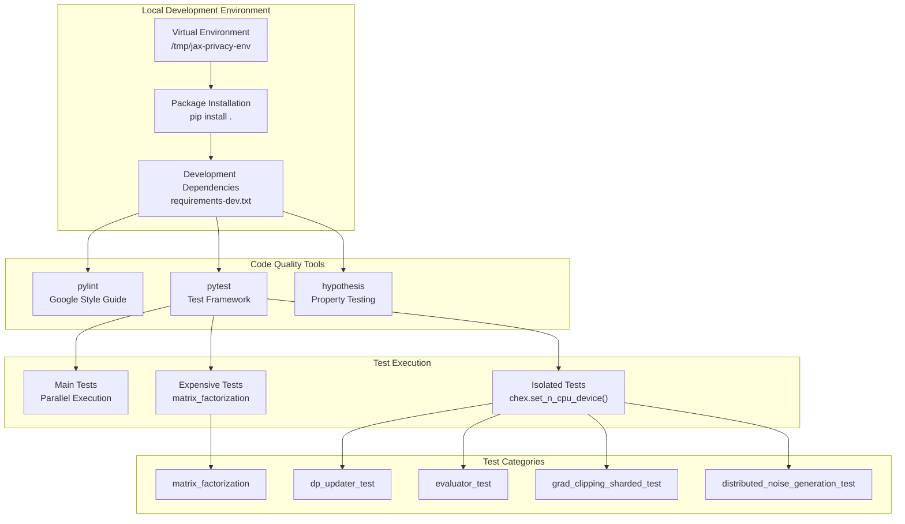
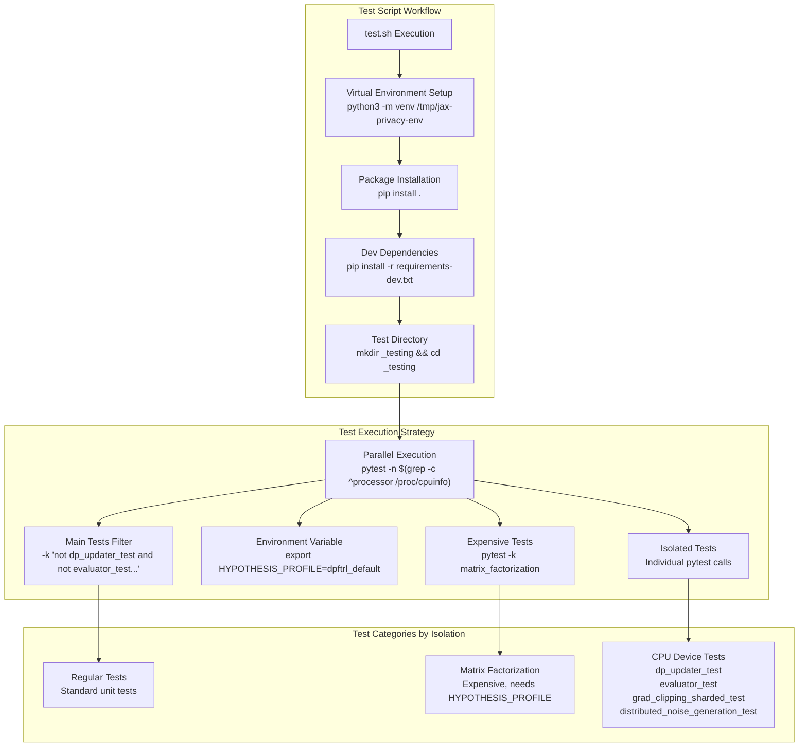
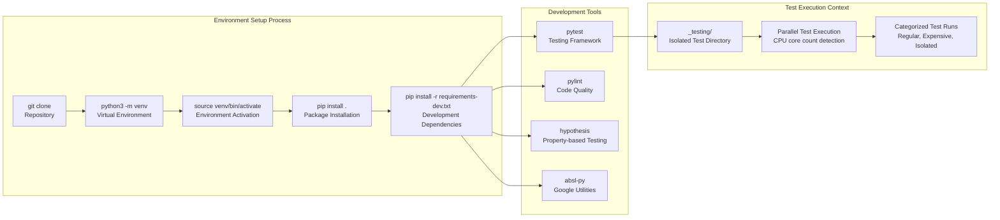

<!-- source: DeepWiki mcp.deepwiki.com · repo google-deepmind/jax_privacy · page 5 Development · fetched 2026-10-26 -->

# Development

Relevant source files

The following files were used as context for generating this wiki page:

- [.pylintrc](.pylintrc)
- [conftest.py](conftest.py)
- [test.sh](test.sh)

This page provides an overview of the development infrastructure and practices for contributing to the JAX-Privacy library. It covers the essential tools, processes, and guidelines that developers need to understand when working on the codebase.

For detailed information about specific development aspects, see the following subsections: testing infrastructure ([Testing](#5.1)), code style and linting ([Code Quality](#5.2)), package management ([Packaging & Distribution](#5.3)), and academic citations ([Citation & References](#5.4)).

## Development Overview

JAX-Privacy follows modern Python development practices with a focus on code quality, comprehensive testing, and reproducible builds. The development workflow emphasizes automated testing, strict code style enforcement, and proper dependency management.

### Development Workflow

**Sources:** [test.sh:1-57](), [.pylintrc:1-412](), [conftest.py:1-22]()

### Testing Infrastructure

The testing system is designed to handle different categories of tests with varying computational requirements and isolation needs. The test execution strategy separates expensive tests from regular tests and isolates tests that modify global JAX device settings.

**Sources:** [test.sh:16-56]()

## Code Quality Standards

The project enforces strict code quality standards through automated linting and style checking. The configuration follows Google's Python style guide with specific adaptations for the JAX-Privacy codebase.

### Pylint Configuration

| Setting | Value | Purpose |
|---------|-------|---------|
| Line Length | 80 characters | Readability and consistency |
| Indentation | 2 spaces | Google internal style |
| Jobs | 4 | Parallel linting |
| Naming Style | snake_case variables, CamelCase classes | Google style guide |
| Disabled Checks | 100+ specific rules | JAX/ML-specific adaptations |

Key pylint configuration details:
- **Function naming**: `^(?:(?P<exempt>setUp|tearDown|setUpModule|tearDownModule)|(?P<camel_case>_?[A-Z][a-zA-Z0-9]*)|(?P<snake_case>_?[a-z][a-z0-9_]*))$`
- **Class naming**: `^_?[A-Z][a-zA-Z0-9]*$`
- **Variable naming**: `^[a-z][a-z0-9_]*$`
- **Constant naming**: `^(_?[A-Z][A-Z0-9_]*|__[a-z0-9_]+__|_?[a-z][a-z0-9_]*)$`

**Sources:** [.pylintrc:188-224](), [.pylintrc:257-287]()

## Development Environment Setup

Setting up a development environment follows a standardized process that ensures consistency across different machines and contributors.

### Environment Configuration

**Sources:** [test.sh:19-30](), [conftest.py:18-21]()

## Test Categories and Execution

The testing infrastructure recognizes several distinct categories of tests, each with specific execution requirements and isolation needs.

### Test Category Matrix

| Category | Tests | Execution Method | Special Requirements |
|----------|-------|------------------|---------------------|
| Regular | Most unit tests | Parallel (`pytest -n`) | Standard isolation |
| Expensive | `matrix_factorization` | Parallel with profile | `HYPOTHESIS_PROFILE=dpftrl_default` |
| CPU Device | `dp_updater_test`, `evaluator_test` | Sequential, isolated | `chex.set_n_cpu_device()` calls |
| Sharded | `grad_clipping_sharded_test` | Sequential, isolated | Distributed processing |
| Distributed | `distributed_noise_generation_test` | Sequential, isolated | Multi-device coordination |

The test execution strategy uses CPU core detection for optimal parallelization: `$(grep -c ^processor /proc/cpuinfo)` determines the number of parallel test workers.

**Sources:** [test.sh:38-50]()

## Development Dependencies

The development environment relies on several key dependencies that support testing, code quality, and build processes. The `requirements-dev.txt` file contains all development-specific dependencies that are not required for runtime usage.

Key development tools include:
- **pytest**: Primary testing framework with parallel execution support
- **hypothesis**: Property-based testing library with configurable profiles
- **pylint**: Code quality and style enforcement
- **absl-py**: Google utilities for argument parsing and logging

The `conftest.py` file provides global pytest configuration, specifically handling absl flags initialization to prevent conflicts during test execution.

**Sources:** [conftest.py:16-21](), [test.sh:30]()

---

