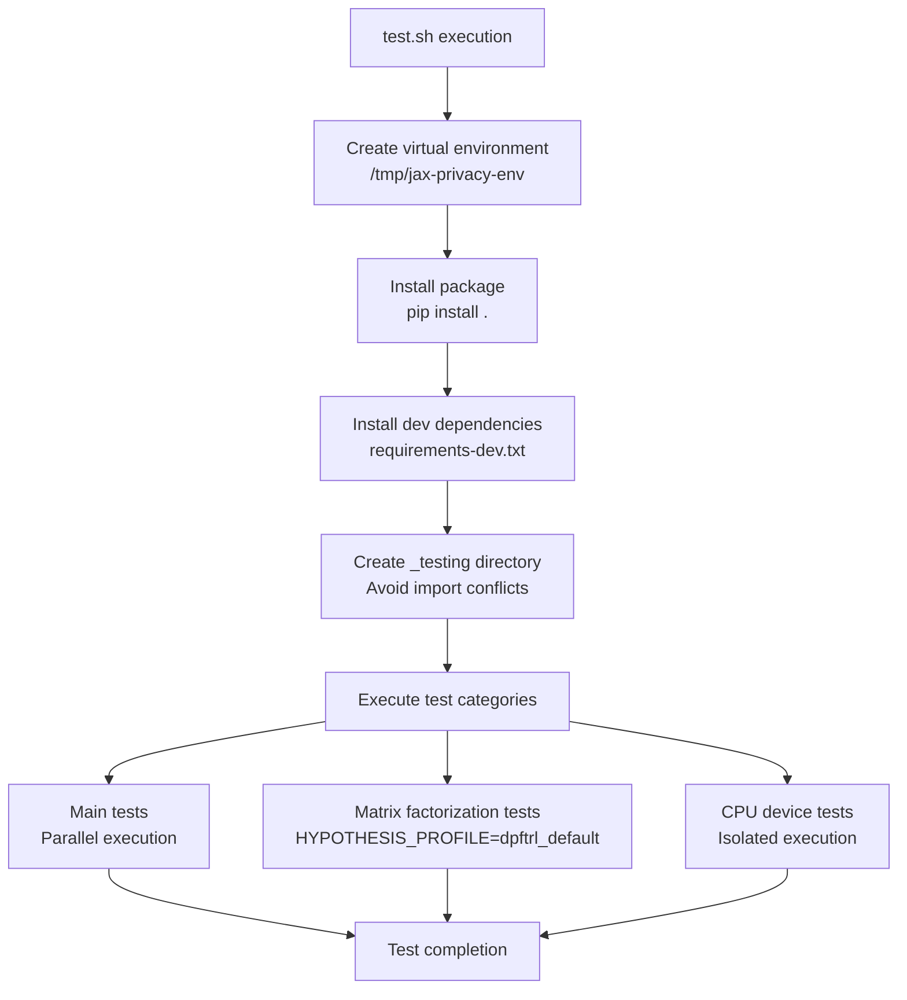
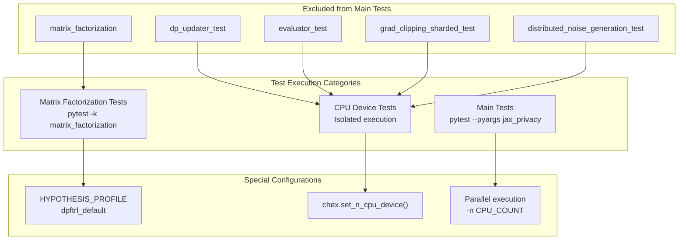
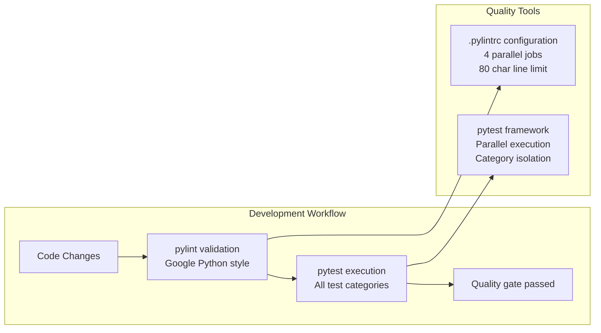
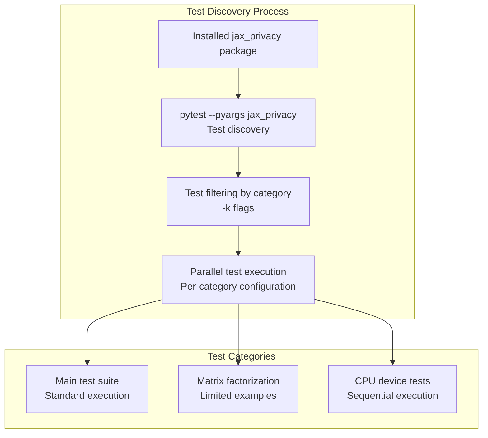

<!-- source: DeepWiki mcp.deepwiki.com · repo google-deepmind/jax_privacy · page 5.1 Testing · fetched 2026-10-26 -->

# Testing

<details>
<summary>Relevant source files</summary>

The following files were used as context for generating this wiki page:

- [.pylintrc](.pylintrc)
- [conftest.py](conftest.py)
- [test.sh](test.sh)

</details>


This document covers the testing infrastructure and practices for the JAX-Privacy library. It describes how to run tests, understand test categorization, and work with the code quality tools that ensure the library's reliability and maintainability.

For information about code quality standards and linting configuration, see [Code Quality](#5.2). For package distribution and development setup, see [Packaging & Distribution](#5.3).

## Test Execution

The JAX-Privacy codebase uses `pytest` as the primary testing framework with a comprehensive test suite that covers all core functionality. Tests are executed through a standardized script that handles environment setup and test categorization.

### Local Test Execution

The primary method for running tests locally is through the [test.sh:1-57]() script. This script establishes a clean testing environment and executes all test categories:

```bash
./test.sh
```

The script performs the following operations:
- Creates an isolated virtual environment at `/tmp/jax-privacy-env`
- Installs the package and development dependencies
- Executes tests in a separate directory to prevent import conflicts
- Runs different test categories with appropriate configurations

**Test Environment Setup Flow**



Sources: [test.sh:19-35](), [test.sh:38-50]()

### Test Categories

Tests are organized into distinct categories based on their computational requirements and dependencies:

| Test Category | Execution Method | Special Requirements |
|---------------|------------------|---------------------|
| Main Tests | Parallel execution with exclusions | Standard pytest configuration |
| Matrix Factorization | Separate execution with `HYPOTHESIS_PROFILE=dpftrl_default` | Expensive computations, limited examples |
| CPU Device Tests | Isolated execution | Uses `chex.set_n_cpu_device()` |

**Test Category Architecture**



Sources: [test.sh:38-44](), [test.sh:47-50]()

### Parallel Test Execution

Tests are executed in parallel to optimize runtime performance. The parallelization is configured based on the system's CPU count:

```bash
pytest -n "$(grep -c ^processor /proc/cpuinfo)" --pyargs jax_privacy
```

This approach automatically scales test execution to the available hardware resources while maintaining test isolation and reliability.

Sources: [test.sh:38](), [test.sh:44](), [test.sh:47-50]()

## Test Infrastructure Components

### Pytest Configuration

The testing infrastructure is configured through [conftest.py:1-22](), which provides minimal but essential setup:

- Marks `absl.flags` as parsed to prevent flag parsing conflicts
- Establishes consistent testing environment across test modules

### Code Quality Integration

Testing is integrated with code quality tools through the [.pylintrc:1-412]() configuration:

**Code Quality Pipeline**



Sources: [.pylintrc:26](), [.pylintrc:260](), [conftest.py:18-21]()

## Special Test Configurations

### Matrix Factorization Tests

Matrix factorization tests require special handling due to their computational intensity:

- Executed separately with `HYPOTHESIS_PROFILE=dpftrl_default`
- Limited number of test examples to prevent excessive runtime
- Isolated from main test suite to avoid performance impact

### CPU Device Tests

Certain tests require CPU device isolation and are executed separately:

- `dp_updater_test`
- `evaluator_test`
- `grad_clipping_sharded_test`
- `distributed_noise_generation_test`

These tests use `chex.set_n_cpu_device()` and cannot be run in parallel with other tests due to device configuration conflicts.

Sources: [test.sh:43-44](), [test.sh:47-50]()

## Development Testing Workflow

### Environment Isolation

The testing script ensures complete environment isolation by:

1. Creating a fresh virtual environment for each test run
2. Installing the package and dependencies in isolation
3. Executing tests from a separate directory to prevent import conflicts
4. Cleaning up the environment after test completion

### Test Discovery

Tests are discovered using pytest's `--pyargs` flag, which:

- Locates tests within the installed `jax_privacy` package
- Ensures tests run against the installed version, not the source directory
- Prevents import issues with compiled extensions

**Test Discovery and Execution Flow**



Sources: [test.sh:32-35](), [test.sh:38]()

This testing infrastructure ensures comprehensive coverage while maintaining performance and reliability across different computational requirements and hardware configurations.

---

