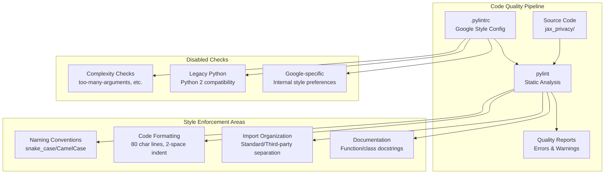
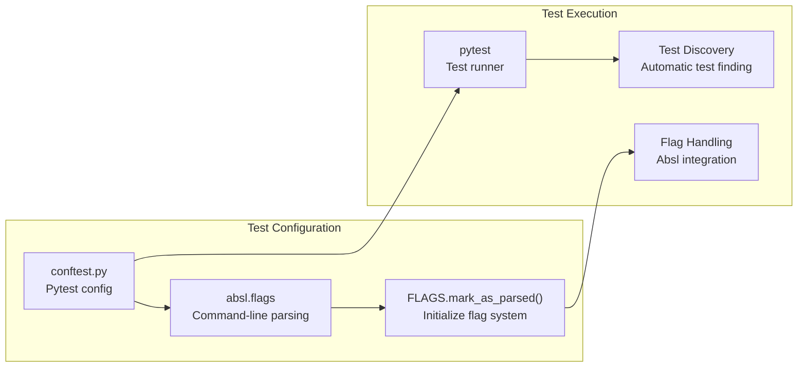
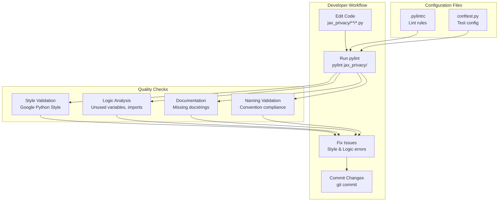

<!-- source: DeepWiki mcp.deepwiki.com · repo google-deepmind/jax_privacy · page 5.2 Code Quality · fetched 2026-10-26 -->

# Code Quality

<details>
<summary>Relevant source files</summary>

The following files were used as context for generating this wiki page:

- [.pylintrc](.pylintrc)
- [conftest.py](conftest.py)

</details>


This document covers the code style guidelines, linting configuration, and development environment setup for maintaining high code quality in the JAX-Privacy library. It focuses on the automated tools and standards used to ensure consistent, readable, and maintainable code across the project.

For information about testing infrastructure and test execution, see [Testing](#5.1). For details about package distribution and build processes, see [Packaging & Distribution](#5.3).

## Code Style Standards

JAX-Privacy follows the **Google Python Style Guide** as its primary code style standard. The project uses automated linting tools to enforce these standards consistently across the codebase.

### Google Python Style Guide Compliance

The project strictly adheres to Google's Python style conventions, including:

| Style Aspect | Requirement | Configuration Location |
|--------------|-------------|----------------------|
| Line Length | 80 characters maximum | [.pylintrc:260]() |
| Indentation | 2 spaces (Google internal style) | [.pylintrc:281]() |
| Import Formatting | Specific patterns allowed for long imports | [.pylintrc:266-268]() |
| Naming Conventions | Snake_case for variables, CamelCase for classes | [.pylintrc:189-216]() |

### Naming Convention Details

The pylint configuration enforces specific naming patterns:

- **Functions**: `^(?:(?P<exempt>setUp|tearDown|setUpModule|tearDownModule)|(?P<camel_case>_?[A-Z][a-zA-Z0-9]*)|(?P<snake_case>_?[a-z][a-z0-9_]*))$`
- **Variables**: `^[a-z][a-z0-9_]*$`
- **Classes**: `^_?[A-Z][a-zA-Z0-9]*$`
- **Constants**: `^(_?[A-Z][A-Z0-9_]*|__[a-z0-9_]+__|_?[a-z][a-z0-9_]*)$`

**Sources:** [.pylintrc:189-216]()

## Pylint Configuration

### Configuration Overview

The project uses a comprehensive `.pylintrc` file that extends Google's canonical pylint configuration. This configuration is specifically designed to uphold Google Python style guide best practices.



**Sources:** [.pylintrc:1-412]()

### Key Configuration Settings

#### Master Configuration
- **Parallel Processing**: 4 jobs for faster linting ([.pylintrc:26]())
- **Ignored Directories**: `third_party` excluded from analysis ([.pylintrc:12]())
- **Plugin Loading**: Extensible plugin architecture ([.pylintrc:23]())

#### Message Control
The configuration disables numerous pylint warnings that conflict with Google's style preferences or are not relevant to modern Python development:

| Category | Examples | Rationale |
|----------|----------|-----------|
| Complexity Checks | `too-many-arguments`, `too-many-locals` | Google style prioritizes readability over artificial limits |
| Python 2 Legacy | `print-statement`, `xrange-builtin` | Project targets Python 3 only |
| Style Preferences | `no-else-return`, `global-statement` | Conflicts with Google style guide |

**Sources:** [.pylintrc:59-144]()

#### Logging Integration
Special handling for logging modules including `absl.logging`, which is commonly used in Google projects:

```python
logging-modules=logging,absl.logging
```

**Sources:** [.pylintrc:322]()

## Testing Configuration

### Pytest Setup

The project uses pytest as its primary testing framework with minimal configuration in `conftest.py`:



The `conftest.py` file handles the integration between pytest and Google's `absl` flag system by marking flags as parsed, preventing conflicts during test execution.

**Sources:** [conftest.py:16-22]()

## Development Environment Setup

### Required Tools

| Tool | Purpose | Configuration |
|------|---------|---------------|
| `pylint` | Static code analysis | [.pylintrc]() |
| `pytest` | Test execution | [conftest.py]() |
| Google Style Guide | Code style reference | External documentation |

### Code Quality Enforcement

#### Static Analysis Pipeline



**Sources:** [.pylintrc:1-412](), [conftest.py:16-22]()

### Import Organization

The pylint configuration enforces proper import organization with specific handling for:

- **Standard Library**: Automatic recognition ([.pylintrc:380]())
- **Third Party**: Explicit listing including `enchant`, `absl` ([.pylintrc:383]())
- **Long Import Lines**: Special regex patterns allow imports to exceed 80-character limit ([.pylintrc:266-268]())

### Documentation Requirements

Functions and classes require docstrings based on:
- **Minimum Length**: 10 lines ([.pylintrc:224]())
- **Exemption Pattern**: Test functions and private methods (`__.*__`) exempt ([.pylintrc:220]())

**Sources:** [.pylintrc:220-224]()

---

