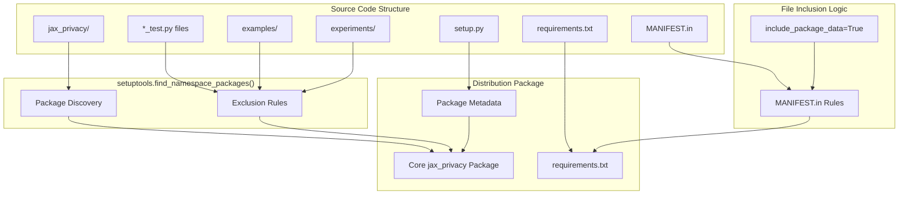
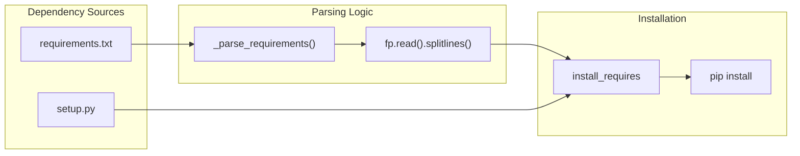
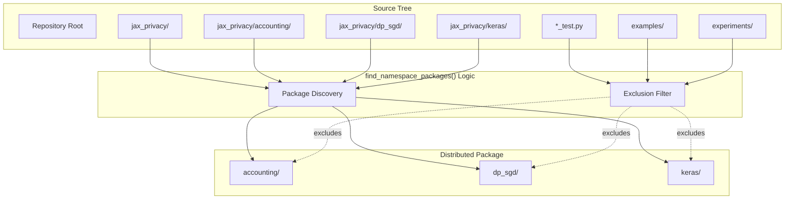
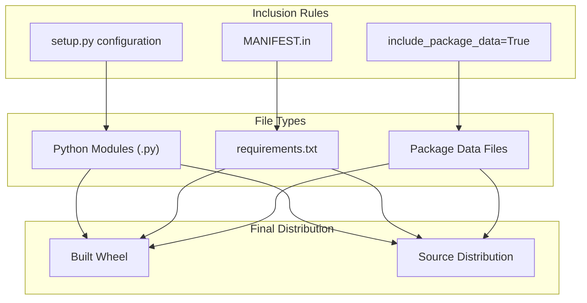
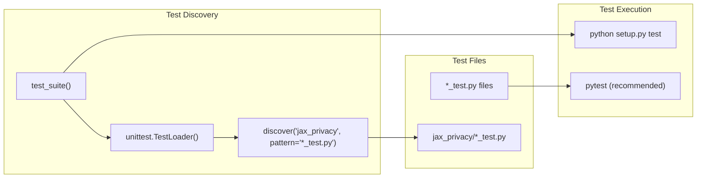

<!-- source: DeepWiki mcp.deepwiki.com · repo google-deepmind/jax_privacy · page 5.3 Packaging & Distribution · fetched 2026-10-26 -->

# Packaging & Distribution

<details>
<summary>Relevant source files</summary>

The following files were used as context for generating this wiki page:

- [MANIFEST.in](MANIFEST.in)
- [setup.py](setup.py)

</details>


This document covers the packaging and distribution configuration for the JAX-Privacy library, including package metadata, dependency management, file inclusion policies, and distribution mechanisms. This focuses specifically on the technical aspects of how the library is packaged for PyPI distribution and local development installation.

For information about development environment setup and code quality standards, see [Code Quality](#5.2). For testing infrastructure, see [Testing](#5.1).

## Package Configuration

The JAX-Privacy library uses a standard Python packaging setup based on `setuptools`. The main package configuration is defined in the root `setup.py` file, which handles metadata, dependencies, and package discovery.

### Package Metadata

The library is configured with the following core metadata:

| Field | Value | Source |
|-------|--------|---------|
| Package Name | `jax_privacy` | [setup.py:34]() |
| Version | `1.0.0` | [setup.py:35]() |
| Description | "Algorithms for Privacy-Preserving Machine Learning in JAX." | [setup.py:36]() |
| Repository URL | https://github.com/google-deepmind/jax_privacy | [setup.py:37]() |
| Author | Google DeepMind | [setup.py:38]() |
| License | Apache 2.0 | [setup.py:47]() |
| Python Requirement | `>=3.11` | [setup.py:45]() |

**Package Discovery and Distribution Workflow**



Sources: [setup.py:41-43](), [setup.py:49](), [MANIFEST.in:1]()

## Dependency Management

Dependencies are managed through a separate `requirements.txt` file that is parsed by the setup script. This separation allows for easier maintenance and version management.

**Dependency Resolution Process**



The `_parse_requirements()` function reads the requirements file line by line and returns a list of dependency specifications. This approach allows the same requirements file to be used for both development and distribution.

Sources: [setup.py:22-24](), [setup.py:44]()

## Package Discovery and Exclusions

The library uses `setuptools.find_namespace_packages()` with specific exclusion patterns to control what code is included in the distributed package.

### Inclusion Rules

- All modules under the `jax_privacy/` namespace are included by default
- Package data is included via `include_package_data=True`
- Additional files are controlled by `MANIFEST.in`

### Exclusion Rules

The following patterns are explicitly excluded from the distribution package:

| Pattern | Purpose | Examples |
|---------|---------|----------|
| `*_test.py` | Test files | All unit tests, integration tests |
| `examples*` | Example code | Tutorial and demonstration code |
| `experiments*` | Research code | Image classification experiments, research configurations |

**Package Structure Filtering**



Sources: [setup.py:41-43]()

## File Inclusion Policies

Additional files beyond Python modules are controlled through the `MANIFEST.in` file and the `include_package_data` setting.

### MANIFEST.in Configuration

The `MANIFEST.in` file explicitly includes the requirements file in the distribution:

```
include requirements.txt
```

This ensures that the dependency specification is available within the installed package, which can be useful for introspection and debugging.

### Package Data Inclusion

The `include_package_data=True` setting instructs setuptools to include any additional data files found within the package directories, subject to the rules in `MANIFEST.in`.

**File Inclusion Hierarchy**



Sources: [setup.py:49](), [MANIFEST.in:1]()

## Test Integration

The package setup includes integration with the testing infrastructure through the `test_suite` configuration.

### Test Discovery

The `test_suite()` function uses `unittest.TestLoader` to automatically discover test files within the `jax_privacy` package:

```python
def test_suite():
  test_loader = unittest.TestLoader()
  all_tests = test_loader.discover('jax_privacy', pattern='*_test.py')
  return all_tests
```

This allows running tests via `python setup.py test`, though this method is deprecated in favor of using pytest directly.

**Test Integration Architecture**



Sources: [setup.py:27-30](), [setup.py:48]()

## Distribution Configuration

The package is configured for cross-platform distribution with specific settings for compatibility and installation behavior.

### Platform and Installation Settings

| Setting | Value | Purpose |
|---------|--------|---------|
| `platforms` | `['any']` | Cross-platform compatibility |
| `zip_safe` | `False` | Prevents installation as zip file |
| `requires_python` | `>=3.11` | Minimum Python version requirement |

The `zip_safe=False` setting is particularly important for JAX-based packages, as it ensures that the package is installed as a directory structure rather than a compressed archive, which can be necessary for proper loading of JAX extensions and compiled components.

Sources: [setup.py:45-50]()

---

