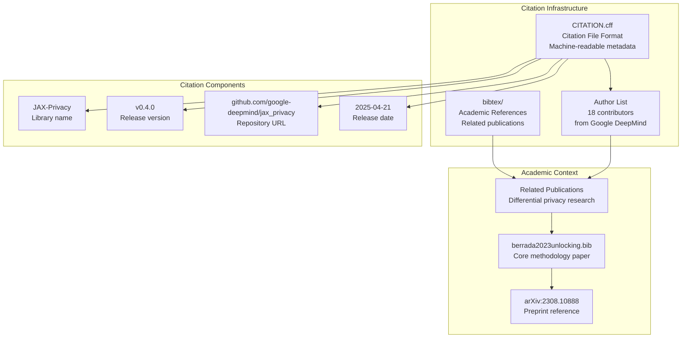
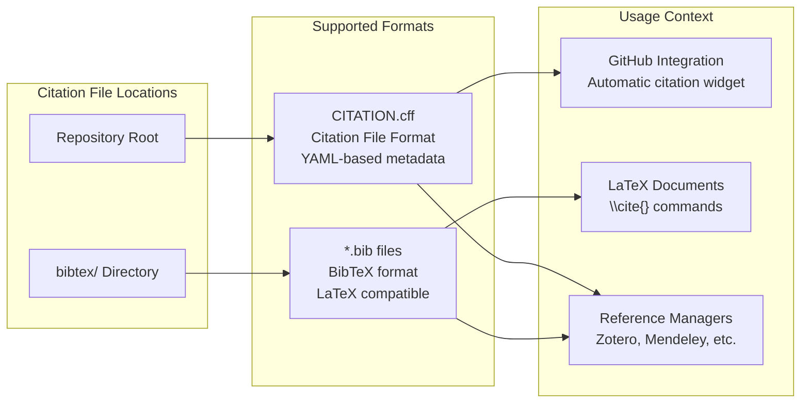

<!-- source: DeepWiki mcp.deepwiki.com · repo google-deepmind/jax_privacy · page 5.4 Citation & References · fetched 2026-10-26 -->

# Citation & References

Relevant source files

The following files were used as context for generating this wiki page:

- [CITATION.cff](CITATION.cff)
- [bibtex/berrada2023unlocking.bib](bibtex/berrada2023unlocking.bib)

This section provides information on how to properly cite JAX-Privacy in academic work and research publications, along with references to related academic papers that inform the library's design and implementation.

## Purpose and Scope

This page covers the citation mechanisms built into JAX-Privacy, including the structured citation metadata and related academic literature. For information about the overall development workflow, see [Development](#5). For details about the research experiments that can be reproduced using this library, see [Research Components](#4).

## Citation Metadata Structure

JAX-Privacy includes structured citation metadata to facilitate proper academic attribution. The project maintains its citation information in standardized formats that can be automatically processed by citation management tools.

Sources: [CITATION.cff:1-48](), [bibtex/berrada2023unlocking.bib:1-7]()

## Primary Citation Format

To cite JAX-Privacy in academic work, use the following information extracted from the project's citation metadata:

| Field | Value |
|-------|--------|
| **Title** | JAX-Privacy |
| **Version** | 0.4.0 |
| **Release Date** | 2025-04-21 |
| **URL** | https://github.com/google-deepmind/jax_privacy |
| **Authors** | 18 contributors (see detailed list below) |

### Complete Author List

The JAX-Privacy library is developed by a team of researchers and engineers from Google DeepMind:

- Borja Balle
- Leonard Berrada  
- Zachary Charles
- Christopher A. Choquette-Choo
- Soham De
- Vadym Doroshenko
- Dj Dvijotham
- Andrew Galen
- Arun Ganesh
- Sahra Ghalebikesabi
- Jamie Hayes
- Peter Kairouz
- Ryan McKenna
- Brendan McMahan
- Aneesh Pappu
- Natalia Ponomareva
- Mikhail Pravilov
- Keith Rush
- Samuel L. Smith
- Robert Stanforth

Sources: [CITATION.cff:3-43]()

## Citation File Formats

The project provides citation metadata in multiple standardized formats to support different citation management workflows.

Sources: [CITATION.cff:1-48](), [bibtex/berrada2023unlocking.bib:1-7]()

### CITATION.cff Format

The primary citation metadata is stored in `CITATION.cff` using the Citation File Format (CFF) standard. This file follows the CFF version 1.2.0 specification and includes:

- Complete author list with family and given names
- Project title and version information  
- Release date and repository URL
- Structured metadata for automatic processing

Sources: [CITATION.cff:1-2](), [CITATION.cff:44-47]()

### BibTeX References

The `bibtex/` directory contains BibTeX files for related academic publications. Each file provides citation information for papers that are relevant to the JAX-Privacy library's methodology and implementation.

## Related Academic Publications

JAX-Privacy is informed by and implements methods from several academic publications in the differential privacy and machine learning research literature.

### Core Methodology Paper

The primary academic reference for JAX-Privacy's approach to differentially private image classification is:

**Title:** Unlocking Accuracy and Fairness in Differentially Private Image Classification

**Authors:** Leonard Berrada, Soham De, Judy Hanwen Shen, Jamie Hayes, Robert Stanforth, David Stutz, Pushmeet Kohli, Samuel L. Smith, Borja Balle

**Publication:** arXiv preprint arXiv:2308.10888 (2023)

This paper presents the core techniques implemented in JAX-Privacy for achieving high accuracy in differentially private image classification while maintaining fairness across different groups.

Sources: [bibtex/berrada2023unlocking.bib:1-6]()

## Integration with Citation Tools

The citation metadata provided by JAX-Privacy integrates with various academic and development tools:

| Tool Category | Integration Method | File Format |
|---------------|-------------------|-------------|
| **GitHub** | Automatic citation widget | `CITATION.cff` |
| **Reference Managers** | Direct import | `CITATION.cff`, `*.bib` |
| **LaTeX Documents** | `\cite{}` commands | `*.bib` files |
| **Academic Databases** | Metadata harvesting | `CITATION.cff` |

The structured citation format ensures that academic attribution is maintained consistently across different platforms and use cases.

Sources: [CITATION.cff:1-48](), [bibtex/berrada2023unlocking.bib:1-7]()