# Page: Overview

# Overview

<details>
<summary>Relevant source files</summary>

The following files were used as context for generating this wiki page:

- [README.md](README.md)
- [requirements.txt](requirements.txt)

</details>


## Purpose and Scope

This document provides a high-level introduction to JAX-Privacy, a library for differentially private machine learning built on JAX. It covers the core purpose, architecture, API layers, and main components of the system. For detailed installation instructions and usage examples, see [Getting Started](#2). For in-depth documentation of specific modules, see [Core Library](#3). For experimental components and research reproducibility, see [Research Components](#4).

## What is JAX-Privacy

JAX-Privacy is a production-focused library for implementing differentially private (DP) machine learning algorithms in JAX. The library provides multiple API abstraction levels to accommodate different use cases, from high-level production deployments to low-level research experimentation.

The library serves two primary purposes:
- **Production API**: Streamlined interfaces for deploying DP ML models in production environments
- **Research Components**: Core building blocks and experimental frameworks for DP algorithm development

**Core Algorithm Architecture**

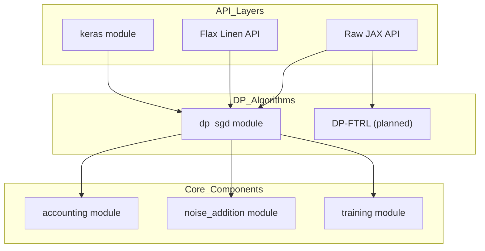

Sources: [README.md:9-14](), [README.md:29-31]()

## Multi-Level API Architecture

JAX-Privacy provides three distinct API levels, each targeting different user needs and expertise levels:

| API Level | Target Users | Use Cases | Flexibility | Examples |
|-----------|--------------|-----------|-------------|----------|
| **Keras API** | ML Practitioners | LLM fine-tuning, production deployment | High-level, streamlined | Gemma fine-tuning |
| **Flax Linen API** | ML Engineers | Custom architectures, training loops | Medium flexibility | MNIST classification |
| **Raw JAX API** | Researchers | Algorithm development, framework integration | Maximum control | Research experimentation |

**API Layer Implementation**

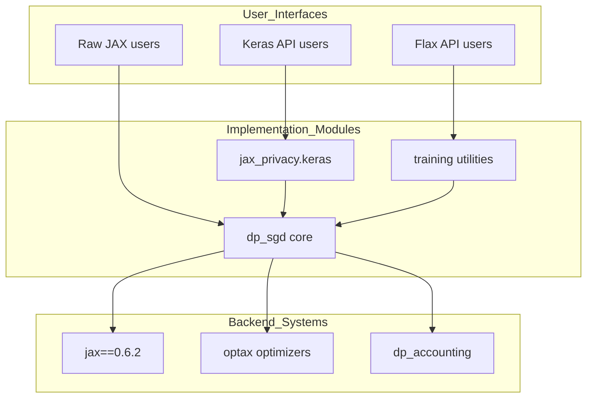

Sources: [README.md:32-49](), [requirements.txt:12-13](), [requirements.txt:8](), [requirements.txt:19]()

## Core Package Structure

The `jax_privacy` package is organized into several key modules that provide different aspects of differentially private machine learning:

**Primary Modules**

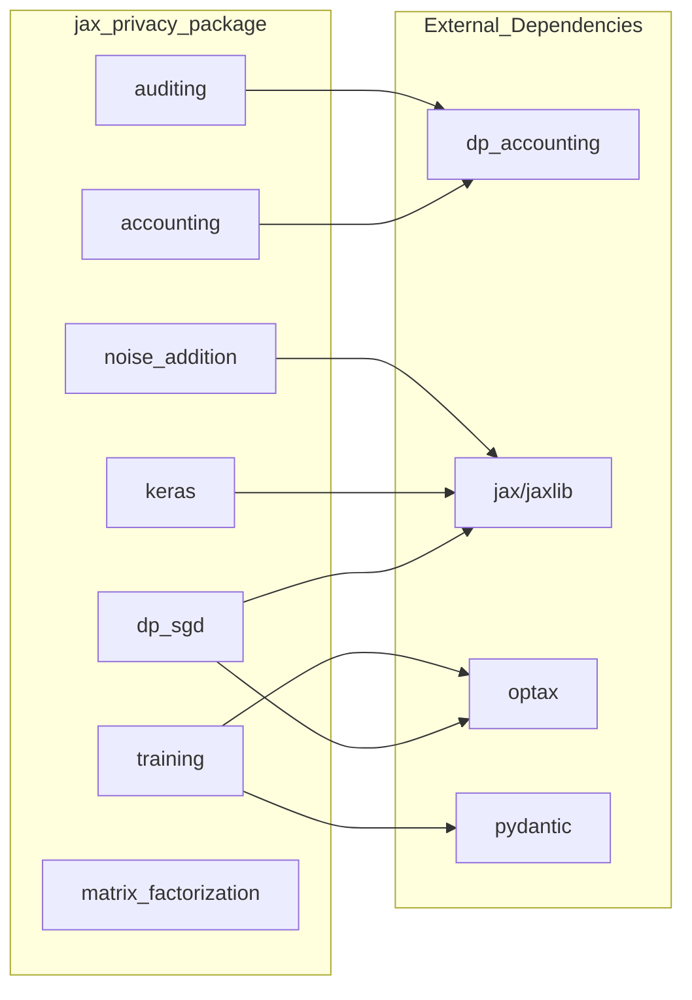

Sources: [requirements.txt:7-20]()

- **`accounting`**: Privacy budget tracking and management using the `dp_accounting` library
- **`dp_sgd`**: Core implementation of the Differentially Private Stochastic Gradient Descent algorithm
- **`keras`**: High-level API integration with Keras for streamlined DP training
- **`noise_addition`**: Calibrated noise generation for differential privacy guarantees
- **`training`**: Training utilities and helper functions for DP model training
- **`auditing`**: Privacy guarantee verification and auditing tools
- **`matrix_factorization`**: DP matrix operations and factorization algorithms

For detailed documentation of each module's functionality, see [Package Structure](#3.1).

## Research and Experimental Components

Beyond the production API, JAX-Privacy includes research components for reproducibility and experimentation:

**Research Pipeline Architecture**

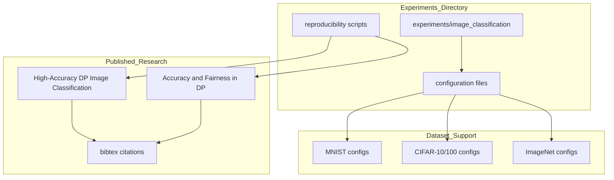

Sources: [README.md:95-111](), [README.md:100](), [README.md:103](), [README.md:111]()

The experimental framework supports image classification tasks with configurations for multiple datasets and architectures. For details on running experiments and reproducing published results, see [Image Classification Experiments](#4.1) and [Configuration Examples](#4.2).

## Key Dependencies and Integration

JAX-Privacy is built on a carefully selected set of dependencies that provide the foundation for differentially private machine learning:

| Dependency | Version | Purpose |
|------------|---------|---------|
| `jax` / `jaxlib` | 0.6.2 | Core numerical computation and auto-differentiation |
| `dp_accounting` | Latest | Privacy budget tracking and accounting |
| `optax` | Latest | Optimization algorithms and utilities |
| `pydantic` | Latest | Data validation and type checking |
| `ml_collections` | Latest | Configuration management |
| `jaxtyping` | Latest | Enhanced type annotations for JAX arrays |

Sources: [requirements.txt:12-20]()

The library integrates with the broader JAX ecosystem while providing specialized components for differential privacy. For a comprehensive overview of the dependency architecture and how these components interact, see [Dependencies & Architecture](#3.2).

## Installation and Development

JAX-Privacy supports two installation methods:

- **Static Installation**: `pip install git+https://github.com/google-deepmind/jax_privacy` for using the library without modifications
- **Local Installation**: Clone and install with `pip install -e .` for development and accessing the experimental pipeline

The codebase includes comprehensive testing infrastructure, code quality tools, and packaging configuration. For development setup, testing procedures, and contribution guidelines, see [Development](#5).

Sources: [README.md:64-93]()

---

# Page: Getting Started

# Getting Started

<details>
<summary>Relevant source files</summary>

The following files were used as context for generating this wiki page:

- [README.md](README.md)
- [setup.py](setup.py)

</details>


This document provides installation instructions, basic usage patterns, and API layer guidance for JAX-Privacy. It covers the production-focused library components and demonstrates how to begin using differentially private machine learning with JAX. For detailed documentation of core library modules, see [Core Library](#3). For experimental research components and image classification experiments, see [Research Components](#4).

## Installation

JAX-Privacy supports two installation methods depending on your use case. Both require Python 3.11+ as specified in [setup.py:45]().

### Prerequisites

Install JAX with appropriate accelerator support before installing JAX-Privacy. Follow the [JAX installation guide](https://github.com/jax-ml/jax#installation) to ensure compatibility with your GPU/TPU hardware.

### Static Installation

For production use cases where you need library functionality without modifications:

```bash
pip install git+https://github.com/google-deepmind/jax_privacy
```

This installs the `jax_privacy` package as defined in [setup.py:34]() but excludes experimental training pipelines via the `exclude` parameter in [setup.py:42]().

### Local Development Installation

For research, experimentation, or contributing to the codebase:

```bash
git clone https://github.com/google-deepmind/jax_privacy
cd jax_privacy
pip install -e .
```

The `-e` flag enables editable installation, allowing code modifications to be reflected immediately without reinstallation. This method includes all components including experimental code in the `experiments/` directory.

**Installation Flow**

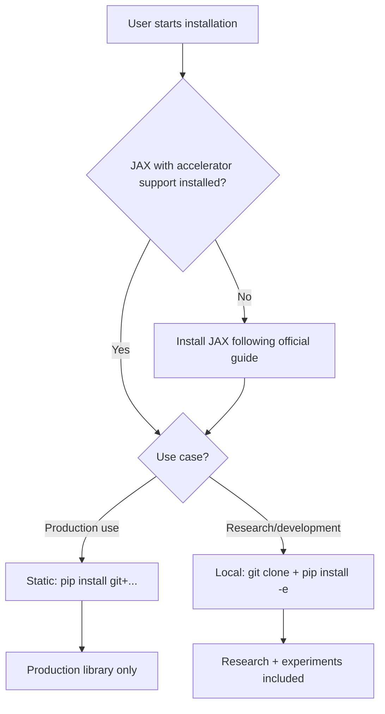

Sources: [README.md:58-94](), [setup.py:33-51]()

## API Architecture Overview

JAX-Privacy provides three API abstraction levels, each targeting different user needs and offering varying degrees of control and complexity.

**API Layer Hierarchy**

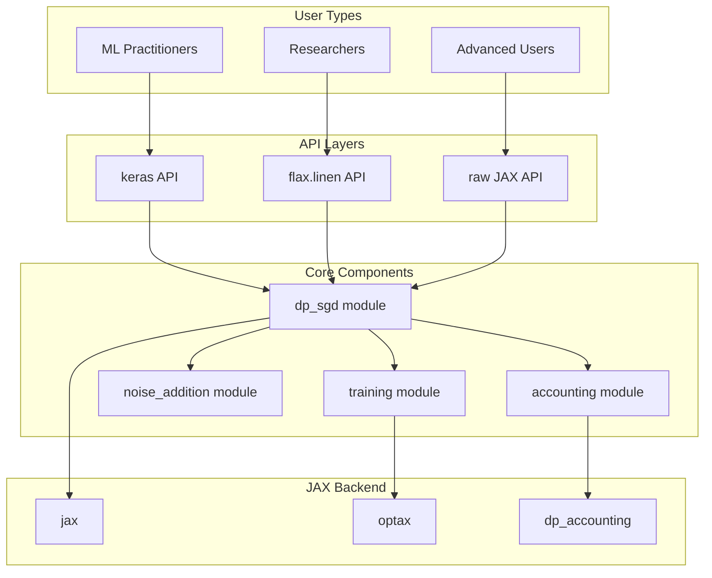

Sources: [README.md:32-49]()

### Keras API

High-level interface optimized for common tasks like LLM fine-tuning. Provides streamlined experience with minimal boilerplate code.

**Target Users**: ML practitioners implementing DP training in production environments
**Complexity**: Low
**Flexibility**: Limited to supported model architectures

Example files: `examples/keras_api_example.py`, `examples/dp_sgd_keras_gemma3_lora_finetuning_samsum.ipynb`

### Flax Linen API  

Medium-level interface offering greater flexibility for custom model architectures and training loop control, with moderate additional complexity.

**Target Users**: Researchers needing custom architectures while maintaining structured training patterns
**Complexity**: Medium
**Flexibility**: High for model architectures, medium for training logic

Example files: `examples/dp_sgd_flax_linen_mnist.ipynb`

### Raw JAX API

Low-level interface providing maximum control over all aspects of DP training. Recommended for framework integration and novel research.

**Target Users**: Advanced users, researchers testing new ideas, developers integrating with non-supported frameworks
**Complexity**: High
**Flexibility**: Maximum

Sources: [README.md:34-48]()

## Basic Usage Patterns

### Package Import Structure

```python
import jax_privacy
from jax_privacy import dp_sgd
from jax_privacy import accounting
from jax_privacy import keras
```

The main package modules are organized as specified in [setup.py:41]() using `find_namespace_packages()`.

### Core Algorithm Support

Currently supports DP-SGD (Differentially Private Stochastic Gradient Descent) algorithm through the `dp_sgd` module. Future support planned for DP-FTRL as mentioned in [README.md:31]().

**DP-SGD Integration Points**

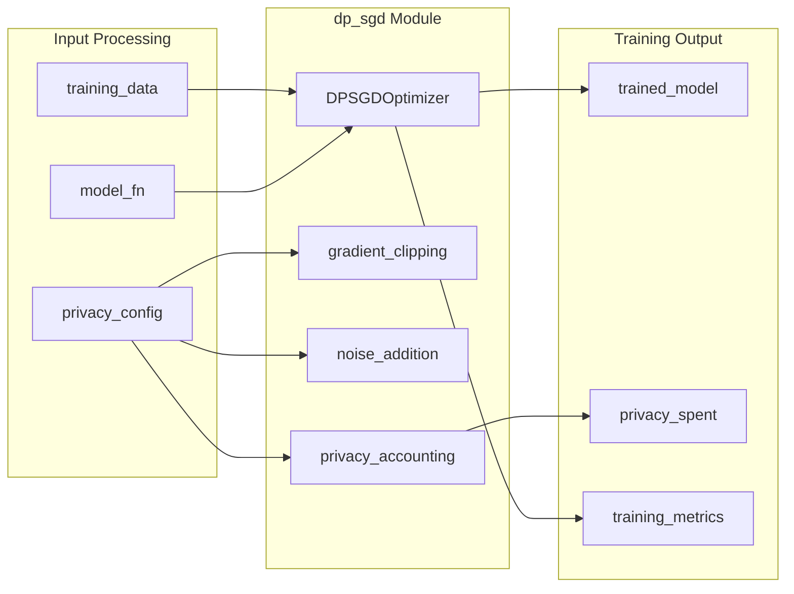

Sources: [README.md:29-31]()

## Examples and Next Steps

### Running Examples

The repository includes comprehensive examples for each API level:

| API Level | Example File | Use Case |
|-----------|--------------|----------|
| Keras | `examples/keras_api_example.py` | Basic DP training workflow |
| Keras | `examples/dp_sgd_keras_gemma3_lora_finetuning_samsum.ipynb` | LLM fine-tuning |
| Flax Linen | `examples/dp_sgd_flax_linen_mnist.ipynb` | Custom architecture training |

To run examples with local installation:

```bash
# After local installation (see Installation section)
cd examples/
python keras_api_example.py
# or open Jupyter notebooks
jupyter notebook dp_sgd_flax_linen_mnist.ipynb
```

### Development Workflow

For users planning to extend or modify JAX-Privacy:

1. **Local Installation**: Use [Option 2 installation](#install-option2) for editable codebase
2. **Testing**: Run test suite as configured in [setup.py:27-30]()
3. **Core Library**: Explore [Core Library](#3) documentation for module details
4. **Research Components**: See [Research Components](#4) for experimental features

### Framework Integration

For integrating JAX-Privacy with existing JAX-based frameworks:

- **Supported**: Direct integration with Keras, Flax Linen
- **Custom Frameworks**: Use Raw JAX API for frameworks like Equinox
- **NumPy-like Experience**: Raw JAX API provides familiar array operation patterns

Sources: [README.md:36-48](), [setup.py:27-30]()

## Dependencies and Compatibility

JAX-Privacy requires Python 3.11+ and depends on core JAX ecosystem packages as defined in `requirements.txt`. Key dependencies include:

- `jax==0.6.2` and `jaxlib==0.6.2` for core computation
- `dp_accounting` for privacy budget tracking  
- `optax` for optimization algorithms
- `pydantic` and `jaxtyping` for data validation and type safety

The package configuration in [setup.py:44]() automatically handles dependency installation.

Sources: [setup.py:44-45]()

---

# Page: Core Library

# Core Library

<details>
<summary>Relevant source files</summary>

The following files were used as context for generating this wiki page:

- [.github/workflows/ci.yml](.github/workflows/ci.yml)
- [jax_privacy/__init__.py](jax_privacy/__init__.py)

</details>


## Purpose and Scope

This page documents the core `jax_privacy` package structure, including its main modules, their roles, and how they work together to provide differentially private machine learning capabilities. The core library provides the foundational components that power all API layers in JAX-Privacy.

For information about specific API usage patterns, see [Getting Started](#2). For research experiments and configurations, see [Research Components](#4). For development setup and testing, see [Development](#5).

## Package Structure Overview

The JAX-Privacy core library is organized into specialized modules that handle different aspects of differentially private machine learning. The main package exposes eight core modules plus experimental components.

### Core Module Architecture

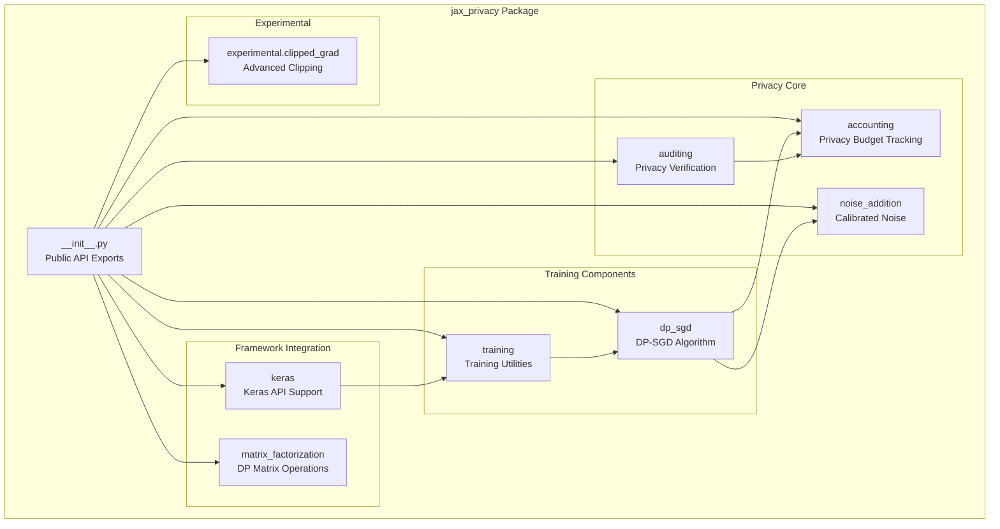

**Sources:** [jax_privacy/__init__.py:16-29]()

## Core Module Breakdown

### Privacy Management Modules

The privacy management modules handle the mathematical foundations of differential privacy, including budget tracking, noise calibration, and verification.

| Module | Primary Role | Key Components |
|--------|-------------|----------------|
| `accounting` | Privacy budget tracking and composition | Budget management, ε/δ calculations |
| `auditing` | Privacy guarantee verification | Audit mechanisms, guarantee validation |
| `noise_addition` | Calibrated noise generation | Gaussian noise, privacy-preserving perturbations |

### Training System Modules

The training system provides the core algorithms and utilities for differentially private model training.

| Module | Primary Role | Key Components |
|--------|-------------|----------------|
| `dp_sgd` | DP-SGD algorithm implementation | Gradient clipping, noisy aggregation |
| `training` | Training loop utilities | Training state, metrics, coordination |

### Integration Modules

Integration modules provide bridges to popular machine learning frameworks and specialized operations.

| Module | Primary Role | Key Components |
|--------|-------------|----------------|
| `keras` | Keras API integration | High-level training interface |
| `matrix_factorization` | DP matrix operations | Private matrix factorization algorithms |

### Experimental Components

Experimental modules contain cutting-edge features under active development.

| Module | Primary Role | Key Components |
|--------|-------------|----------------|
| `experimental.clipped_grad` | Advanced gradient clipping | Per-example gradient processing |

**Sources:** [jax_privacy/__init__.py:17-27]()

## Module Interaction Flow

The core modules work together in a coordinated flow to provide end-to-end differentially private training capabilities.

### Training Pipeline Data Flow

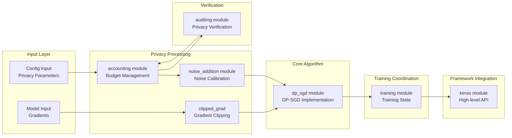

**Sources:** [jax_privacy/__init__.py:17-27]()

## Public API Surface

The main package carefully controls what functionality is exposed through its public API. The `__init__.py` file serves as the gateway that determines which components users can directly access.

### Direct Module Exports

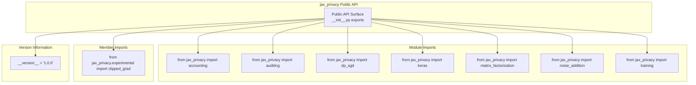

The package follows a conservative approach to API exposure:
- **Full module imports**: All core modules are available as `jax_privacy.module_name`
- **Selective member imports**: Only `clipped_grad` from experimental is directly exposed
- **Version tracking**: Package version is available as `jax_privacy.__version__`

**Sources:** [jax_privacy/__init__.py:17-29]()

## Dependencies and External Integration

The core library integrates with several external systems to provide its functionality. Key dependencies include JAX for computation, dp_accounting for privacy mathematics, and optax for optimization.

### External Dependency Integration Points

| External Library | Integration Point | Purpose |
|-----------------|-------------------|---------|
| `jax` | All modules | Core array operations and autodiff |
| `dp_accounting` | `accounting` module | Privacy budget mathematics |
| `optax` | `training` module | Optimization algorithms |
| `pydantic` | Various modules | Data validation and type safety |

The core library acts as a coordinating layer that combines these external capabilities into a cohesive differentially private ML system.

**Sources:** [jax_privacy/__init__.py:16-29]()

---

# Page: Package Structure

# Package Structure

<details>
<summary>Relevant source files</summary>

The following files were used as context for generating this wiki page:

- [.github/workflows/ci.yml](.github/workflows/ci.yml)
- [jax_privacy/__init__.py](jax_privacy/__init__.py)

</details>


This document provides an overview of the main `jax_privacy` package modules, their hierarchical organization, and inter-module relationships. It covers the core library structure as exposed through the top-level package imports and the functional dependencies between different components.

For information about external dependencies and system architecture, see [Dependencies & Architecture](#3.2). For installation and basic usage patterns, see [Getting Started](#2).

## Top-Level Package Organization

The `jax_privacy` package is organized as a collection of specialized modules, each focusing on specific aspects of differentially private machine learning. The top-level package interface is defined through selective imports that expose the most important functionality.

### Main Package Interface

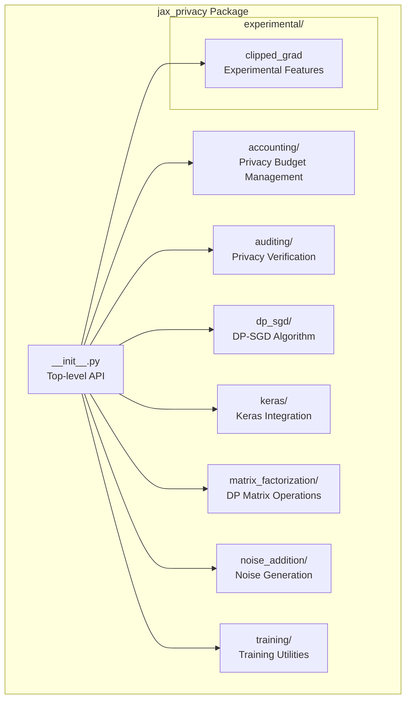

The package exposes seven core modules and selected experimental functionality through direct imports in [jax_privacy/__init__.py:17-27](). This creates a clean top-level API where users can access `jax_privacy.dp_sgd`, `jax_privacy.accounting`, etc.

**Sources:** [jax_privacy/__init__.py:17-27]()

### Package Version and Metadata

The package defines its version as `__version__ = '1.0.0'` in [jax_privacy/__init__.py:29](), indicating a stable release with established API contracts.

**Sources:** [jax_privacy/__init__.py:29]()

## Core Module Functional Relationships

The modules within `jax_privacy` have specific functional relationships that form the privacy-preserving machine learning pipeline.

### Module Dependency Graph

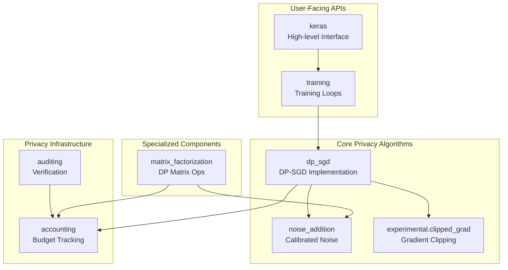

**Sources:** [jax_privacy/__init__.py:17-27]()

## Module Categories and Responsibilities

The package modules can be categorized into distinct functional groups based on their roles in the privacy-preserving ML workflow.

### Algorithm Implementation Layer

| Module | Primary Responsibility | Key Functions |
|--------|----------------------|---------------|
| `dp_sgd` | Core DP-SGD algorithm implementation | Gradient processing, privacy-preserving optimization |
| `noise_addition` | Noise generation and calibration | Gaussian noise, calibrated noise injection |
| `experimental.clipped_grad` | Advanced gradient clipping | Per-example gradient bounds |

### Privacy Management Layer

| Module | Primary Responsibility | Key Functions |
|--------|----------------------|---------------|
| `accounting` | Privacy budget tracking | Epsilon-delta accounting, composition |
| `auditing` | Privacy guarantee verification | Empirical privacy analysis |

### Integration and Utilities Layer

| Module | Primary Responsibility | Key Functions |
|--------|----------------------|---------------|
| `keras` | High-level Keras API integration | Streamlined DP training workflows |
| `training` | Training loop utilities | Generic training infrastructure |
| `matrix_factorization` | Specialized DP matrix operations | Private matrix decomposition |

**Sources:** [jax_privacy/__init__.py:17-27]()

## Import Structure and API Design

The package follows a deliberate import strategy that balances ease of use with explicit dependency management.

### Selective Member Imports

The package uses selective member imports only for experimental features, as indicated by the comment in [jax_privacy/__init__.py:25-27](). The `clipped_grad` functionality is imported directly from `jax_privacy.experimental`, making it available as `jax_privacy.clipped_grad`.

### Module-Level Imports

All core modules are imported at the module level (e.g., `from jax_privacy import accounting`), requiring users to access specific functions through module namespaces. This design:

- Prevents namespace pollution
- Makes dependencies explicit
- Allows for clear attribution of functionality
- Maintains backward compatibility

**Sources:** [jax_privacy/__init__.py:17-27]()

## Package Hierarchy and Organization

The physical organization of the package reflects the logical separation of concerns established in the import structure.

### Directory Structure

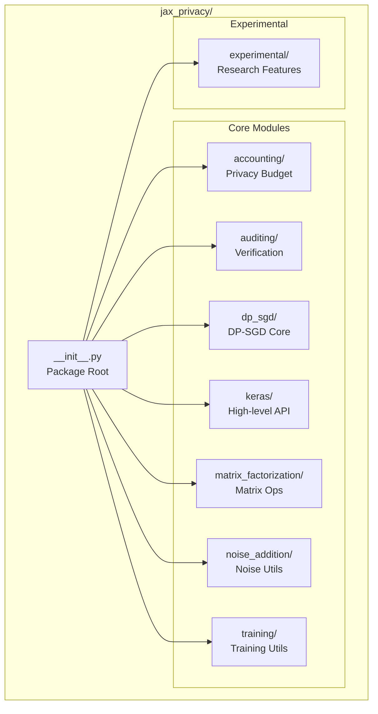

Each module is implemented as a separate directory containing its own `__init__.py` and implementation files, following standard Python package conventions.

**Sources:** [jax_privacy/__init__.py:17-27]()

---

# Page: Dependencies & Architecture

# Dependencies & Architecture

<details>
<summary>Relevant source files</summary>

The following files were used as context for generating this wiki page:

- [requirements.txt](requirements.txt)

</details>


This document provides a comprehensive overview of JAX-Privacy's core dependencies and system architecture. It explains how external libraries integrate with the core `jax_privacy` package to enable differentially private machine learning. For information about the internal package structure and modules, see [Package Structure](#3.1). For development environment setup and dependency management, see [Development](#5).

## Core Dependencies Overview

JAX-Privacy builds upon a carefully curated set of external libraries that provide essential functionality for differentially private machine learning. The dependencies are organized into several functional categories, each serving specific architectural roles.

### JAX Ecosystem Dependencies

The JAX ecosystem forms the computational foundation of JAX-Privacy, providing array operations, automatic differentiation, and just-in-time compilation capabilities.

| Dependency | Version | Purpose |
|------------|---------|---------|
| `jax` | `==0.6.2` | Core numerical computing and autodiff |
| `jaxlib` | `==0.6.2` | JAX backend implementations |
| `jaxtyping` | Latest | Type annotations for JAX arrays |
| `optax` | Latest | Optimization algorithms and utilities |

The pinned JAX versions ensure compatibility with the differentially private algorithms implemented in the library. The `jaxtyping` dependency provides enhanced type safety for array operations, while `optax` supplies the optimization primitives used in DP-SGD implementations.

**JAX Ecosystem Integration**
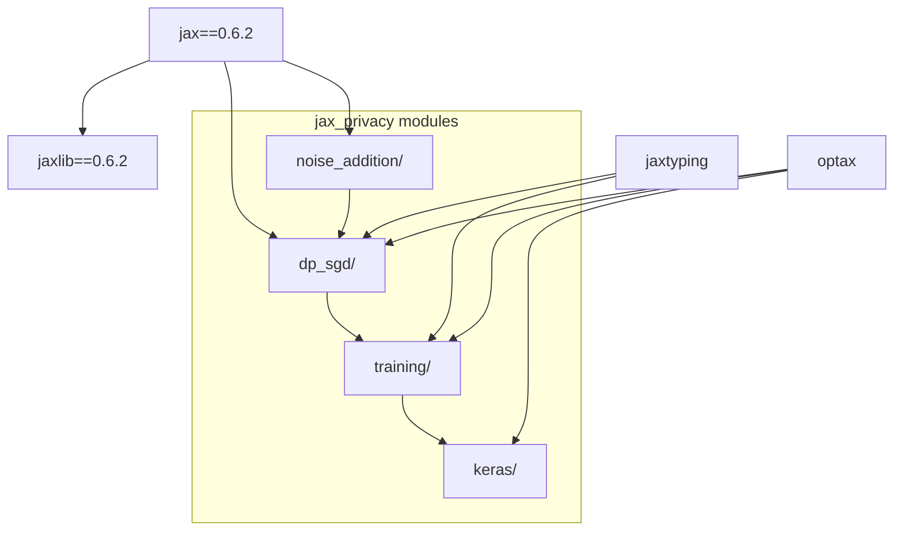

Sources: [requirements.txt:12-14](), [requirements.txt:19]()

### Privacy and Accounting Infrastructure

The privacy guarantees in JAX-Privacy rely on dedicated libraries for privacy budget tracking and differential privacy accounting.

| Dependency | Purpose | Integration Points |
|------------|---------|-------------------|
| `dp_accounting` | Privacy budget calculation and tracking | `accounting/` module |
| `hypothesis` | Property-based testing for privacy properties | Test infrastructure |

The `dp_accounting` library provides the mathematical foundations for computing privacy budgets under the Rényi Differential Privacy framework. It integrates directly with the `accounting` module to track cumulative privacy expenditure across training epochs.

**Privacy Architecture Integration**
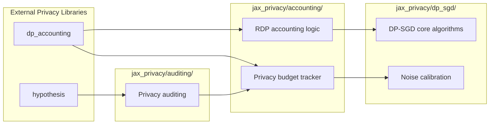

Sources: [requirements.txt:8](), [requirements.txt:11]()

### Configuration and Validation Framework

JAX-Privacy employs a robust configuration and validation system to ensure type safety and parameter correctness across the differentially private training pipeline.

| Dependency | Purpose | Usage Pattern |
|------------|---------|---------------|
| `ml_collections` | Hierarchical configuration management | Experiment configs, hyperparameters |
| `pydantic` | Runtime data validation and parsing | Input validation, model parameters |

The `ml_collections` library provides the `ConfigDict` class used throughout the experimental framework for managing complex hierarchical configurations. The `pydantic` library ensures type safety and validation for critical parameters in the privacy-preserving training pipeline.

**Configuration Flow Architecture**
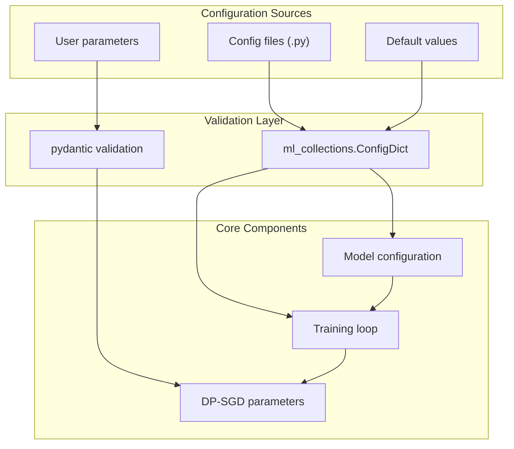

Sources: [requirements.txt:16](), [requirements.txt:15]()

### Data Processing and Mathematical Utilities

JAX-Privacy leverages specialized libraries for efficient data processing and mathematical operations required in differentially private machine learning.

| Dependency | Purpose | Integration |
|------------|---------|-------------|
| `grain` | High-performance data loading and processing | Training data pipelines |
| `einshape` | Tensor shape manipulation and validation | Array reshaping operations |
| `numpy` | Fundamental array operations | Interoperability with JAX |
| `scipy` | Scientific computing functions | Statistical operations |

The `grain` library provides efficient data loading capabilities optimized for JAX, while `einshape` offers advanced tensor manipulation with shape validation. These libraries integrate seamlessly with JAX's array model to provide robust data processing pipelines.

**Data Processing Pipeline**
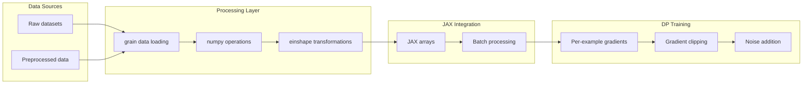

Sources: [requirements.txt:10](), [requirements.txt:9](), [requirements.txt:18](), [requirements.txt:20]()

### Infrastructure and Utility Dependencies

Supporting infrastructure dependencies provide essential utilities for logging, iteration, and general-purpose operations.

| Dependency | Version | Purpose |
|------------|---------|---------|
| `absl-py` | Latest | Google-style command-line flags and logging |
| `more_itertools` | `==10.1.0` | Extended iteration utilities |

The `absl-py` library provides the flag-based configuration system used in experimental scripts, while `more_itertools` supplies advanced iteration patterns used throughout the codebase.

Sources: [requirements.txt:7](), [requirements.txt:17]()

## Architectural Integration Patterns

The dependencies integrate with JAX-Privacy through well-defined patterns that maintain separation of concerns while enabling seamless interoperability.

### Dependency Injection and Composition

JAX-Privacy follows a composition-based architecture where external dependencies are injected into core components rather than tightly coupled. This pattern enables easy testing and allows users to substitute alternative implementations when needed.

**Core Integration Architecture**
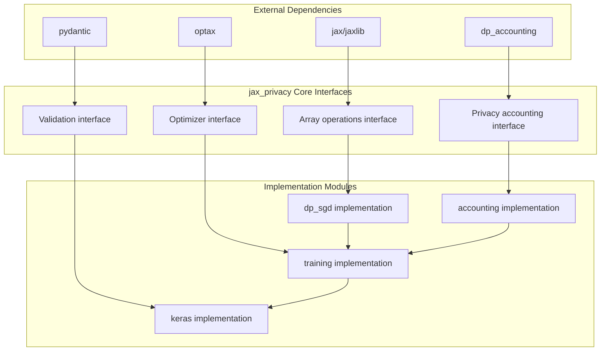

Sources: [requirements.txt:1-21]()

### Version Management and Compatibility

JAX-Privacy maintains strict version constraints for critical dependencies to ensure reproducible privacy guarantees. The JAX ecosystem dependencies are pinned to specific versions (`jax==0.6.2`, `jaxlib==0.6.2`) to maintain compatibility with the differentially private implementations.

The `more_itertools` dependency is also pinned (`==10.1.0`) to ensure consistent behavior across environments. Other dependencies use flexible versioning to allow for security updates and compatibility improvements while maintaining API stability.

Sources: [requirements.txt:12-13](), [requirements.txt:17]()

## Runtime Dependency Resolution

The dependency architecture supports both static installation and dynamic loading patterns. The core privacy algorithms maintain minimal dependency requirements, while advanced features and experimental components may require additional dependencies that are loaded on demand.

This layered dependency approach enables users to install only the components they need while maintaining the ability to access the full feature set when required.

Sources: [requirements.txt:3-4]()

---

# Page: Research Components

# Research Components

<details>
<summary>Relevant source files</summary>

The following files were used as context for generating this wiki page:

- [.gitignore](.gitignore)
- [experiments/image_classification/README.md](experiments/image_classification/README.md)

</details>


The Research Components subsystem provides experimental code, reproducible research implementations, and configuration frameworks for conducting differentially private machine learning experiments. This system enables researchers to reproduce published results, run custom experiments, and benchmark different approaches to DP machine learning.

For information about the core production APIs, see [Core Library](#3). For development and testing workflows, see [Development](#5).

## Overview

The research components are organized around reproducible image classification experiments that support the paper "Unlocking High-Accuracy Differentially Private Image Classification through Scale". The system provides a flexible configuration-driven framework for running experiments across different datasets, model architectures, and privacy parameters.

### Research Framework Architecture

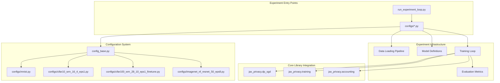

**Sources:** [experiments/image_classification/README.md:1-102]()

### Experimental Workflow

The research framework follows a standardized workflow that integrates configuration management with the core DP-SGD implementation:

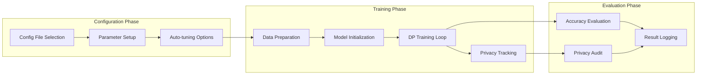

**Sources:** [experiments/image_classification/README.md:25-29](), [experiments/image_classification/README.md:33-46]()

## Configuration System

The experimental framework uses a hierarchical configuration system built on `ml_collections` that allows precise control over all experimental parameters:

### Key Configuration Parameters

| Parameter Category | Configuration Path | Purpose |
|-------------------|-------------------|---------|
| Data Augmentation | `config.experiment_kwargs.config.data.augmult` | Controls augmentation multiplier |
| Batch Size | `config.experiment_kwargs.config.training.batch_size.init_value` | Training batch size |
| Learning Rate | `config.experiment_kwargs.config.optimizer.lr.kwargs.value` | Optimizer learning rate |
| Model Architecture | `config.experiment_kwargs.config.model` | Model definition |
| Noise Multiplier | `config.experiment_kwargs.config.training.dp.noise_multiplier` | DP-SGD noise level |
| Training Duration | `config.experiment_kwargs.config.num_updates` | Number of training updates |
| Privacy Budget (δ) | `config.experiment_kwargs.config.dp.delta` | Privacy parameter delta |
| Privacy Budget (ε) | `config.experiment_kwargs.config.dp.auto_tune_target_epsilon` | Target epsilon value |

**Sources:** [experiments/image_classification/README.md:33-46]()

### Configuration Hierarchy

```mermaid
graph TB
    subgraph "Base Configuration"
        CONFIG_BASE["config_base.py<br/>Base parameters and<br/>pre-trained models"]
    end
    
    subgraph "Dataset-Specific Configs"
        MNIST["mnist.py<br/>MNIST experiments"]
        CIFAR10["cifar10_wrn_16_4_eps1.py<br/>CIFAR-10 from scratch"]
        CIFAR100["cifar100_wrn_28_10_eps1_finetune.py<br/>CIFAR-100 fine-tuning"]
        IMAGENET["imagenet_nf_resnet_50_eps8.py<br/>ImageNet experiments"]
    end
    
    subgraph "Configuration Components"
        DATA_CONFIG["Data Pipeline Config"]
        MODEL_CONFIG["Model Architecture Config"]
        TRAINING_CONFIG["Training Loop Config"]
        DP_CONFIG["Privacy Config"]
        OPTIMIZER_CONFIG["Optimizer Config"]
    end
    
    CONFIG_BASE --> MNIST
    CONFIG_BASE --> CIFAR10
    CONFIG_BASE --> CIFAR100
    CONFIG_BASE --> IMAGENET
    
    MNIST --> DATA_CONFIG
    MNIST --> MODEL_CONFIG
    MNIST --> TRAINING_CONFIG
    MNIST --> DP_CONFIG
    MNIST --> OPTIMIZER_CONFIG
```

**Sources:** [experiments/image_classification/README.md:76-77]()

## Available Experiments

The research framework supports several categories of experiments that demonstrate different aspects of differentially private image classification:

### Training from Scratch

These experiments train models from random initialization using DP-SGD:

- **MNIST**: Basic demonstration using the MNIST dataset
- **CIFAR-10**: Wide ResNet 16-4 architecture with ε=1.0 privacy budget
- **ImageNet**: NFNet ResNet-50 architecture with ε=8.0 privacy budget

### Fine-tuning Experiments

These experiments start from pre-trained checkpoints and fine-tune with differential privacy:

- **CIFAR-100**: Wide ResNet 28-10 fine-tuning with ε=1.0 privacy budget

### Experiment Execution Commands

| Experiment Type | Command | Configuration File |
|-----------------|---------|-------------------|
| MNIST | `python run_experiment_loop.py --config=configs/mnist.py` | `configs/mnist.py` |
| CIFAR-10 Scratch | `python run_experiment_loop.py --config=configs/cifar10_wrn_16_4_eps1.py` | `configs/cifar10_wrn_16_4_eps1.py` |
| ImageNet Scratch | `python run_experiment_loop.py --config=configs/imagenet_nf_resnet_50_eps8.py` | `configs/imagenet_nf_resnet_50_eps8.py` |
| CIFAR-100 Fine-tune | `python run_experiment_loop.py --config=configs/cifar100_wrn_28_10_eps1_finetune.py` | `configs/cifar100_wrn_28_10_eps1_finetune.py` |

**Sources:** [experiments/image_classification/README.md:52-77]()

## Integration with Core Library

The research components integrate directly with the core JAX-Privacy library modules to provide production-ready DP-SGD implementations:

```mermaid
graph TB
    subgraph "Research Layer"
        RUN_LOOP["run_experiment_loop.py<br/>Experiment orchestration"]
        CONFIG_SYS["Configuration System<br/>ml_collections based"]
    end
    
    subgraph "Core Library Integration"
        DP_SGD_CORE["jax_privacy.dp_sgd<br/>DP-SGD implementation"]
        TRAINING_UTILS["jax_privacy.training<br/>Training utilities"]
        PRIVACY_ACC["jax_privacy.accounting<br/>Privacy accounting"]
        NOISE_ADD["jax_privacy.noise_addition<br/>Noise generation"]
    end
    
    subgraph "External Dependencies"
        OPTAX_LIB["optax<br/>Optimization"]
        JAX_LIB["jax<br/>Computation backend"]
        DP_ACC_LIB["dp_accounting<br/>Privacy budget tracking"]
    end
    
    RUN_LOOP --> DP_SGD_CORE
    CONFIG_SYS --> TRAINING_UTILS
    CONFIG_SYS --> PRIVACY_ACC
    
    DP_SGD_CORE --> NOISE_ADD
    TRAINING_UTILS --> DP_SGD_CORE
    PRIVACY_ACC --> DP_ACC_LIB
    
    DP_SGD_CORE --> OPTAX_LIB
    DP_SGD_CORE --> JAX_LIB
    TRAINING_UTILS --> OPTAX_LIB
```

**Sources:** [experiments/image_classification/README.md:1-102]()

## Advanced Features

The research framework includes several advanced features for sophisticated experimentation:

### Auto-tuning Capabilities

The `auto_tune` feature allows automatic calibration of privacy parameters:
- Noise multiplier calibration under pre-specified privacy budgets
- Automatic stopping when privacy budget is exhausted
- Dynamic parameter adjustment based on privacy accounting

### Memory Management

The framework includes memory optimization features:
- Configurable `per_device_per_step` batch sizes for memory constraints
- Automatic batch size validation and divisibility checks
- Support for multi-accelerator setups

### Learning Rate Scheduling

Integration with `optax` learning rate schedules is supported, though not used in the paper's best results.

**Sources:** [experiments/image_classification/README.md:93-101]()

## Research Reproducibility

The research components are designed to ensure reproducibility of published results:

### Paper Integration

The experiments directly reproduce results from "Unlocking High-Accuracy Differentially Private Image Classification through Scale" (arXiv:2204.13650), with hyperparameters documented in Appendix C of the paper.

### Citation and References

The system includes proper citation handling through bibtex references and links to the original paper.

### Result Validation

- Training and evaluation accuracies are logged throughout training
- Privacy budget consumption is tracked and reported
- Automatic validation of experimental configurations

**Sources:** [experiments/image_classification/README.md:1-12](), [experiments/image_classification/README.md:81-82]()

---

# Page: Image Classification Experiments

# Image Classification Experiments

<details>
<summary>Relevant source files</summary>

The following files were used as context for generating this wiki page:

- [.gitignore](.gitignore)
- [experiments/image_classification/README.md](experiments/image_classification/README.md)

</details>


This document covers the experimental framework for running differentially private image classification experiments using JAX-Privacy. The framework provides a reproducible environment for conducting research on large-scale differentially private image classification, supporting datasets like MNIST, CIFAR-10/100, and ImageNet.

For information about the core library components used by these experiments, see [Core Library](#3). For configuration examples and detailed parameter specifications, see [Configuration Examples](#4.2).

## Purpose and Scope

The image classification experiments framework enables researchers to:

- Reproduce results from published differential privacy research papers
- Conduct new experiments with differentially private training
- Compare performance across different datasets and model architectures
- Tune hyperparameters for optimal privacy-utility tradeoffs

This framework is built on top of the core JAX-Privacy library and provides a higher-level interface specifically designed for image classification research.

## Experimental Framework Architecture

The experimental system follows a modular design that separates configuration, execution, and core differential privacy algorithms:

```mermaid
graph TD
    subgraph "Entry Points"
        RUN_EXP["run_experiment_loop.py<br/>Main execution script"]
    end
    
    subgraph "Configuration Layer"
        CONFIG_BASE["config_base.py<br/>Base configuration schema"]
        MNIST_CONFIG["configs/mnist.py<br/>MNIST experiment config"]
        CIFAR10_CONFIG["configs/cifar10_wrn_16_4_eps1.py<br/>CIFAR-10 config"]
        CIFAR100_CONFIG["configs/cifar100_wrn_28_10_eps1_finetune.py<br/>CIFAR-100 fine-tuning"]
        IMAGENET_CONFIG["configs/imagenet_nf_resnet_50_eps8.py<br/>ImageNet config"]
    end
    
    subgraph "Execution Engine"
        EXPERIMENT_LOOP["Experiment Loop<br/>Training coordination"]
        BATCH_PROCESSING["Batch Processing<br/>Per-device batching"]
        EVAL_LOOP["Evaluation Loop<br/>Accuracy tracking"]
    end
    
    subgraph "Core JAX-Privacy Integration"
        DP_SGD["dp_sgd module<br/>Differentially private optimization"]
        ACCOUNTING["accounting module<br/>Privacy budget tracking"]
        TRAINING_UTILS["training module<br/>Training utilities"]
    end
    
    RUN_EXP --> CONFIG_BASE
    RUN_EXP --> MNIST_CONFIG
    RUN_EXP --> CIFAR10_CONFIG
    RUN_EXP --> CIFAR100_CONFIG
    RUN_EXP --> IMAGENET_CONFIG
    
    CONFIG_BASE --> EXPERIMENT_LOOP
    EXPERIMENT_LOOP --> BATCH_PROCESSING
    EXPERIMENT_LOOP --> EVAL_LOOP
    
    EXPERIMENT_LOOP --> DP_SGD
    EXPERIMENT_LOOP --> ACCOUNTING
    EXPERIMENT_LOOP --> TRAINING_UTILS
    
    BATCH_PROCESSING --> DP_SGD
    EVAL_LOOP --> TRAINING_UTILS
```

**Sources:** [experiments/image_classification/README.md:25-29](), [experiments/image_classification/README.md:76-77]()

## Configuration System Structure

The configuration system uses `ml_collections` to define experiment parameters in a hierarchical structure:

```mermaid
graph TB
    subgraph "Configuration Hierarchy"
        CONFIG["config<br/>Root configuration object"]
        EXP_KWARGS["experiment_kwargs<br/>Main experiment parameters"]
        EXP_CONFIG["experiment_kwargs.config<br/>Training configuration"]
    end
    
    subgraph "Data Configuration"
        DATA_CONFIG["config.data<br/>Dataset parameters"]
        AUGMULT["data.augmult<br/>Data augmentation multiplier"]
        DATASET["data.dataset<br/>Dataset selection"]
    end
    
    subgraph "Training Configuration"
        TRAINING_CONFIG["config.training<br/>Training parameters"]
        BATCH_SIZE["training.batch_size.init_value<br/>Effective batch size"]
        PER_DEVICE["training.batch_size.per_device_per_step<br/>Per-device batch size"]
        DP_CONFIG["training.dp<br/>Differential privacy config"]
        NOISE_MULT["training.dp.noise_multiplier<br/>Privacy noise level"]
    end
    
    subgraph "Model & Optimization"
        MODEL_CONFIG["config.model<br/>Model architecture"]
        OPT_CONFIG["config.optimizer<br/>Optimizer configuration"]
        LR_CONFIG["optimizer.lr.kwargs.value<br/>Learning rate"]
        NUM_UPDATES["config.num_updates<br/>Training iterations"]
    end
    
    subgraph "Privacy Budget"
        DP_ROOT["config.dp<br/>Privacy configuration"]
        DELTA["dp.delta<br/>Privacy parameter δ"]
        EPSILON["dp.auto_tune_target_epsilon<br/>Privacy parameter ε"]
    end
    
    CONFIG --> EXP_KWARGS
    EXP_KWARGS --> EXP_CONFIG
    
    EXP_CONFIG --> DATA_CONFIG
    EXP_CONFIG --> TRAINING_CONFIG
    EXP_CONFIG --> MODEL_CONFIG
    EXP_CONFIG --> OPT_CONFIG
    EXP_CONFIG --> DP_ROOT
    
    DATA_CONFIG --> AUGMULT
    DATA_CONFIG --> DATASET
    
    TRAINING_CONFIG --> BATCH_SIZE
    TRAINING_CONFIG --> PER_DEVICE
    TRAINING_CONFIG --> DP_CONFIG
    DP_CONFIG --> NOISE_MULT
    
    OPT_CONFIG --> LR_CONFIG
    EXP_CONFIG --> NUM_UPDATES
    
    DP_ROOT --> DELTA
    DP_ROOT --> EPSILON
```

**Sources:** [experiments/image_classification/README.md:33-46](), [experiments/image_classification/README.md:76-77]()

## Running Experiments

### Basic Execution

Experiments are executed using the main script with a configuration file:

```bash
python run_experiment_loop.py --config=<relative/path/to/config.py>
```

### Environment Setup

Before running experiments, the Python path must be configured to make experiment modules discoverable:

```bash
cd experiments
export PYTHONPATH=$PYTHONPATH:`pwd`
```

**Sources:** [experiments/image_classification/README.md:16-23](), [experiments/image_classification/README.md:25-29]()

## Dataset-Specific Examples

### MNIST Training

Basic MNIST experiment using the provided configuration:

```bash
python run_experiment_loop.py --config=configs/mnist.py
```

### CIFAR-10 Training from Scratch

Training a Wide ResNet on CIFAR-10 with ε=1 privacy budget:

```bash
python run_experiment_loop.py --config=configs/cifar10_wrn_16_4_eps1.py
```

### ImageNet Training

Large-scale ImageNet training with NFNet ResNet-50:

```bash
python run_experiment_loop.py --config=configs/imagenet_nf_resnet_50_eps8.py
```

### CIFAR-100 Fine-tuning

Fine-tuning a pre-trained model on CIFAR-100:

```bash
python run_experiment_loop.py --config=configs/cifar100_wrn_28_10_eps1_finetune.py
```

**Sources:** [experiments/image_classification/README.md:52-77]()

## Key Configuration Parameters

| Parameter Category | Configuration Path | Description |
|-------------------|-------------------|-------------|
| **Data Augmentation** | `config.experiment_kwargs.config.data.augmult` | Data augmentation multiplier |
| **Batch Size** | `config.experiment_kwargs.config.training.batch_size.init_value` | Effective batch size for training |
| **Per-Device Batching** | `config.experiment_kwargs.config.training.batch_size.per_device_per_step` | Batch size per device per step |
| **Learning Rate** | `config.experiment_kwargs.config.optimizer.lr.kwargs.value` | Optimizer learning rate |
| **Model Architecture** | `config.experiment_kwargs.config.model` | Model definition and architecture |
| **Noise Multiplier** | `config.experiment_kwargs.config.training.dp.noise_multiplier` | DP-SGD noise level (σ) |
| **Training Iterations** | `config.experiment_kwargs.config.num_updates` | Number of training updates |
| **Privacy Delta** | `config.experiment_kwargs.config.dp.delta` | Privacy parameter δ |
| **Privacy Epsilon** | `config.experiment_kwargs.config.dp.auto_tune_target_epsilon` | Target privacy parameter ε |

**Sources:** [experiments/image_classification/README.md:33-46]()

## Advanced Features

### Automatic Privacy Budget Tuning

The framework supports automatic calibration of the noise multiplier for a given privacy budget:

- Set `auto_tune_target_epsilon` to automatically tune noise multiplier
- Training stops automatically when privacy budget is exhausted if `stop_training_at_epsilon` is enabled
- Privacy accounting tracks cumulative privacy expenditure throughout training

### Memory Management

For Out of Memory errors, adjust the per-device batch size while maintaining the effective batch size:

- Reduce `per_device_per_step` to fit memory constraints
- Ensure `init_value` is divisible by `per_device_per_step × num_devices`
- This affects training speed but preserves convergence properties

### Learning Rate Scheduling

The framework supports `optax` learning rate schedules, though simple constant learning rates are used for best results in the reference paper.

**Sources:** [experiments/image_classification/README.md:83-101]()

## Research Reproducibility

This framework reproduces experiments from "Unlocking High-Accuracy Differentially Private Image Classification through Scale" (arXiv:2204.13650). To reproduce paper results:

1. Refer to hyperparameters listed in Appendix C of the paper
2. Update the relevant configuration file with those parameters
3. Pre-trained models are available through the base configuration system

**Sources:** [experiments/image_classification/README.md:1-9](), [experiments/image_classification/README.md:48-50](), [experiments/image_classification/README.md:76-77]()

---

# Page: Configuration Examples

# Configuration Examples

<details>
<summary>Relevant source files</summary>

The following files were used as context for generating this wiki page:

- [bibtex/berrada2023unlocking.bib](bibtex/berrada2023unlocking.bib)
- [experiments/image_classification/configs/cifar100_wrn_28_10_eps1_finetune.py](experiments/image_classification/configs/cifar100_wrn_28_10_eps1_finetune.py)
- [experiments/image_classification/configs/cifar10_wrn_16_4_eps1.py](experiments/image_classification/configs/cifar10_wrn_16_4_eps1.py)
- [experiments/image_classification/configs/imagenet_nf_resnet_50_eps8.py](experiments/image_classification/configs/imagenet_nf_resnet_50_eps8.py)

</details>


This page provides detailed examples of experiment configurations for the JAX-Privacy image classification framework. These configurations demonstrate how to set up differentially private training experiments across different datasets (MNIST, CIFAR-10, CIFAR-100, ImageNet) and model architectures. For information about running these experiments, see [Image Classification Experiments](#4.1).

## Configuration File Structure

All configuration files follow a standardized structure using `ml_collections.ConfigDict` and the `config_base.ExperimentConfig` class. The configuration system provides type safety and validation for experiment parameters.

### Core Configuration Components

```mermaid
graph TB
    CONFIG_FILE["Configuration File<br/>(*.py)"]
    GET_CONFIG["get_config()<br/>function"]
    EXPERIMENT_CONFIG["config_base.ExperimentConfig"]
    
    subgraph "Configuration Sections"
        OPTIMIZER["optimizer_config<br/>SGD parameters"]
        MODEL["models<br/>Architecture definition"]
        TRAINING["experiment_config.TrainingConfig<br/>DP + batch settings"]
        DATA_TRAIN["Data loaders<br/>Training data"]
        DATA_EVAL["Data loaders<br/>Evaluation data"]
        AVERAGING["averaging<br/>EMA configuration"]
        EVALUATION["experiment_config.EvaluationConfig<br/>Evaluation settings"]
    end
    
    JAXLINE_CONFIG["config_base.build_jaxline_config<br/>Final configuration"]
    
    CONFIG_FILE --> GET_CONFIG
    GET_CONFIG --> EXPERIMENT_CONFIG
    
    EXPERIMENT_CONFIG --> OPTIMIZER
    EXPERIMENT_CONFIG --> MODEL
    EXPERIMENT_CONFIG --> TRAINING
    EXPERIMENT_CONFIG --> DATA_TRAIN
    EXPERIMENT_CONFIG --> DATA_EVAL
    EXPERIMENT_CONFIG --> AVERAGING
    EXPERIMENT_CONFIG --> EVALUATION
    
    EXPERIMENT_CONFIG --> JAXLINE_CONFIG
```

Sources: [experiments/image_classification/configs/cifar10_wrn_16_4_eps1.py:28-91](), [experiments/image_classification/configs/cifar100_wrn_28_10_eps1_finetune.py:28-91](), [experiments/image_classification/configs/imagenet_nf_resnet_50_eps8.py:30-91]()

## Dataset-Specific Configuration Examples

### CIFAR-10 Configuration

The CIFAR-10 configuration demonstrates training from scratch with moderate privacy budget:

| Configuration Aspect | Value | Purpose |
|----------------------|-------|---------|
| Model | `models.WideResNetConfig(depth=16, width=4)` | WRN-16-4 architecture optimized for CIFAR-10 |
| Privacy Budget | `(ε=1.0, δ=1e-5)` | Standard privacy parameters |
| Batch Size | `total=4096, per_device_per_step=64` | Efficient distributed training |
| Learning Rate | `2.0` | Higher LR compensates for DP noise |
| Training Steps | `875` | Sufficient for CIFAR-10 convergence |
| Noise Multiplier | `10.0` | Calibrated for target epsilon |

```mermaid
graph LR
    subgraph "CIFAR-10 Training Flow"
        CIFAR10_DATA["image_data.Cifar10Loader<br/>Standardized + Augmented"]
        WRN_16_4["models.WideResNetConfig<br/>depth=16, width=4"]
        DP_CONFIG["experiment_config.DpConfig<br/>eps=1.0, noise_mult=10.0"]
        SGD_OPT["optimizer_config.sgd_config<br/>lr=2.0"]
        EMA_AVG["averaging.ExponentialMovingAveragingConfig<br/>decay=0.999"]
    end
    
    CIFAR10_DATA --> WRN_16_4
    WRN_16_4 --> DP_CONFIG
    DP_CONFIG --> SGD_OPT
    SGD_OPT --> EMA_AVG
```

Sources: [experiments/image_classification/configs/cifar10_wrn_16_4_eps1.py:35-67]()

### CIFAR-100 Fine-tuning Configuration  

The CIFAR-100 configuration shows fine-tuning from a pre-trained model:

| Configuration Aspect | Value | Purpose |
|----------------------|-------|---------|
| Model | `models.WithRestoreModelConfig` | Fine-tuning from ImageNet32 checkpoint |
| Base Model | `models.Registry.WRN_28_10_IMAGENET32.path` | Pre-trained WRN-28-10 |
| Layer Ignore | `'wide_res_net/Softmax'` | Replace final classification layer |
| Privacy Budget | `(ε=1.0, δ=1e-5)` | Same privacy level as CIFAR-10 |
| Batch Size | `total=16384, per_device_per_step=16` | Larger batch for fine-tuning |
| Learning Rate | `1.0` | Lower LR for fine-tuning |
| Training Steps | `250` | Fewer steps needed for fine-tuning |
| Noise Multiplier | `21.1` | Higher noise due to larger batch |

```mermaid
graph TB
    subgraph "Fine-tuning Configuration"
        PRETRAINED["models.Registry.WRN_28_10_IMAGENET32<br/>Pre-trained checkpoint"]
        RESTORE_CONFIG["models.WithRestoreModelConfig<br/>params_key='params'"]
        LAYER_IGNORE["layer_to_ignore<br/>'wide_res_net/Softmax'"]
        NEW_MODEL["models.WideResNetConfig<br/>depth=28, width=10"]
        
        CIFAR100_DATA["image_data.Cifar100Loader<br/>Augmult=16"]
        DP_FINETUNE["experiment_config.DpConfig<br/>noise_multiplier=21.1"]
    end
    
    PRETRAINED --> RESTORE_CONFIG
    RESTORE_CONFIG --> LAYER_IGNORE
    LAYER_IGNORE --> NEW_MODEL
    NEW_MODEL --> DP_FINETUNE
    CIFAR100_DATA --> DP_FINETUNE
```

Sources: [experiments/image_classification/configs/cifar100_wrn_28_10_eps1_finetune.py:35-67]()

### ImageNet Configuration

The ImageNet configuration demonstrates large-scale training with relaxed privacy:

| Configuration Aspect | Value | Purpose |
|----------------------|-------|---------|
| Model | `models.NFResNetConfig(variant='ResNet50')` | Normalizer-Free ResNet for efficiency |
| Privacy Budget | `(ε=8.0, δ=8e-7)` | Higher epsilon for utility |
| Batch Size | `total=16384, per_device_per_step=32` | Large-scale distributed training |
| Learning Rate | `4.0` | High LR for large batch training |
| Training Steps | `71589` | Full ImageNet training schedule |
| Noise Multiplier | `2.5` | Lower noise due to higher epsilon |
| Image Size | `(224, 224)` | Standard ImageNet resolution |

```mermaid
graph LR
    subgraph "ImageNet Training Pipeline"
        IMAGENET_DATA["image_data.ImageNetLoader<br/>224x224, Augmult=4"]
        NF_RESNET["models.NFResNetConfig<br/>ResNet50 variant"]
        DP_LARGE["experiment_config.DpConfig<br/>eps=8.0, noise_mult=2.5"]
        SGD_LARGE["optimizer_config.sgd_config<br/>lr=4.0"]
        EMA_LONG["averaging.ExponentialMovingAveragingConfig<br/>decay=0.99999"]
    end
    
    IMAGENET_DATA --> NF_RESNET
    NF_RESNET --> DP_LARGE
    DP_LARGE --> SGD_LARGE
    SGD_LARGE --> EMA_LONG
```

Sources: [experiments/image_classification/configs/imagenet_nf_resnet_50_eps8.py:32-87]()

## Common Configuration Patterns

### Differential Privacy Configuration

All configurations use the `experiment_config.DpConfig` class with these standard patterns:

```mermaid
graph TB
    subgraph "DP Configuration Structure"
        DP_CONFIG["experiment_config.DpConfig"]
        
        DELTA["delta<br/>Privacy parameter δ"]
        CLIPPING["clipping_norm<br/>Gradient clipping bound"]
        TARGET_EPS["auto_tune_target_epsilon<br/>Target ε value"]
        RESCALE["rescale_to_unit_norm<br/>Normalize gradients"]
        ALGORITHM["algorithm_config.DpsgdConfig<br/>DP-SGD with noise_multiplier"]
        AUTO_TUNE["auto_tune_field<br/>Optional parameter tuning"]
    end
    
    DP_CONFIG --> DELTA
    DP_CONFIG --> CLIPPING
    DP_CONFIG --> TARGET_EPS
    DP_CONFIG --> RESCALE
    DP_CONFIG --> ALGORITHM
    DP_CONFIG --> AUTO_TUNE
```

**Standard DP Parameters:**
- `delta`: Always `1e-5` for CIFAR, `8e-7` for ImageNet
- `clipping_norm`: Always `1.0` 
- `rescale_to_unit_norm`: Always `True`
- `noise_multiplier`: Varies by dataset and epsilon target

Sources: [experiments/image_classification/configs/cifar10_wrn_16_4_eps1.py:47-54](), [experiments/image_classification/configs/cifar100_wrn_28_10_eps1_finetune.py:53-60](), [experiments/image_classification/configs/imagenet_nf_resnet_50_eps8.py:50-56]()

### Data Augmentation Patterns

Data loaders consistently use `image_data.AugmultConfig` for augmentation:

| Dataset | `augmult` | `random_flip` | `random_crop` | `random_color` |
|---------|-----------|---------------|---------------|----------------|
| CIFAR-10 | 16 | True | True | False |
| CIFAR-100 | 16 | True | True | False |
| ImageNet | 4 | True | True | False |

The pattern shows higher augmentation multipliers for smaller datasets and consistent use of geometric augmentations without color distortion.

Sources: [experiments/image_classification/configs/cifar10_wrn_16_4_eps1.py:68-73](), [experiments/image_classification/configs/cifar100_wrn_28_10_eps1_finetune.py:72-77](), [experiments/image_classification/configs/imagenet_nf_resnet_50_eps8.py:71-76]()

### Logging Configuration

All configurations enable standard logging through `experiment_config.LoggingConfig`:

```mermaid
graph LR
    LOGGING_CONFIG["experiment_config.LoggingConfig"]
    
    subgraph "Logging Options"
        GRAD_CLIP["grad_clipping=True<br/>Clipping statistics"]
        SNR_GLOBAL["snr_global=True<br/>Global signal-to-noise ratio"]
        SNR_LAYER["snr_per_layer=False<br/>Per-layer SNR (disabled)"]
    end
    
    LOGGING_CONFIG --> GRAD_CLIP
    LOGGING_CONFIG --> SNR_GLOBAL
    LOGGING_CONFIG --> SNR_LAYER
```

This provides visibility into gradient clipping behavior and overall noise levels during training.

Sources: [experiments/image_classification/configs/cifar10_wrn_16_4_eps1.py:55-59](), [experiments/image_classification/configs/cifar100_wrn_28_10_eps1_finetune.py:61-65](), [experiments/image_classification/configs/imagenet_nf_resnet_50_eps8.py:57-61]()

## Parameter Selection Guidelines

### Privacy-Utility Trade-offs

The configurations demonstrate different approaches to balancing privacy and utility:

| Use Case | Privacy Budget (ε, δ) | Strategy | Performance Impact |
|----------|----------------------|----------|-------------------|
| High Privacy | (1.0, 1e-5) | Conservative epsilon | Moderate utility loss |
| Practical Privacy | (8.0, 8e-7) | Higher epsilon | Minimal utility loss |
| Fine-tuning | (1.0, 1e-5) | Transfer learning | Reduced training needed |

### Batch Size and Learning Rate Scaling

The configurations follow established patterns for DP training:

- **Batch Size**: Larger batches reduce privacy cost but require more memory
- **Learning Rate**: Higher LR compensates for gradient noise
- **Training Steps**: Fewer steps needed with larger batches and higher LR

```mermaid
graph TB
    subgraph "Parameter Scaling Relationships"
        BATCH_SIZE["Batch Size<br/>4K-16K range"]
        NOISE_MULT["Noise Multiplier<br/>2.5-21.1 range"]
        LEARNING_RATE["Learning Rate<br/>1.0-4.0 range"]
        NUM_STEPS["Training Steps<br/>250-71K range"]
        
        PRIVACY_BUDGET["Privacy Budget<br/>(ε, δ)"]
    end
    
    BATCH_SIZE --> NOISE_MULT
    NOISE_MULT --> LEARNING_RATE
    LEARNING_RATE --> NUM_STEPS
    PRIVACY_BUDGET --> NOISE_MULT
```

These patterns ensure efficient training while maintaining the target privacy guarantees.

Sources: [experiments/image_classification/configs/cifar10_wrn_16_4_eps1.py:40-52](), [experiments/image_classification/configs/cifar100_wrn_28_10_eps1_finetune.py:46-58](), [experiments/image_classification/configs/imagenet_nf_resnet_50_eps8.py:42-55]()

---

# Page: Development

# Development

<details>
<summary>Relevant source files</summary>

The following files were used as context for generating this wiki page:

- [.pylintrc](.pylintrc)
- [conftest.py](conftest.py)
- [test.sh](test.sh)

</details>


This page provides an overview of the development infrastructure and practices for contributing to the JAX-Privacy library. It covers the essential tools, processes, and guidelines that developers need to understand when working on the codebase.

For detailed information about specific development aspects, see the following subsections: testing infrastructure ([Testing](#5.1)), code style and linting ([Code Quality](#5.2)), package management ([Packaging & Distribution](#5.3)), and academic citations ([Citation & References](#5.4)).

## Development Overview

JAX-Privacy follows modern Python development practices with a focus on code quality, comprehensive testing, and reproducible builds. The development workflow emphasizes automated testing, strict code style enforcement, and proper dependency management.

### Development Workflow

```mermaid
graph TB
    subgraph "Local Development Environment"
        VENV["Virtual Environment<br/>/tmp/jax-privacy-env"]
        INSTALL["Package Installation<br/>pip install ."]
        DEV_DEPS["Development Dependencies<br/>requirements-dev.txt"]
    end
    
    subgraph "Code Quality Tools"
        PYLINT["pylint<br/>Google Style Guide"]
        PYTEST["pytest<br/>Test Framework"]
        HYPOTHESIS["hypothesis<br/>Property Testing"]
    end
    
    subgraph "Test Execution"
        MAIN_TESTS["Main Tests<br/>Parallel Execution"]
        EXPENSIVE_TESTS["Expensive Tests<br/>matrix_factorization"]
        ISOLATED_TESTS["Isolated Tests<br/>chex.set_n_cpu_device()"]
    end
    
    subgraph "Test Categories"
        DP_UPDATER["dp_updater_test"]
        EVALUATOR["evaluator_test"]
        MATRIX_FACT["matrix_factorization"]
        GRAD_CLIP["grad_clipping_sharded_test"]
        DIST_NOISE["distributed_noise_generation_test"]
    end
    
    VENV --> INSTALL
    INSTALL --> DEV_DEPS
    DEV_DEPS --> PYLINT
    DEV_DEPS --> PYTEST
    DEV_DEPS --> HYPOTHESIS
    
    PYTEST --> MAIN_TESTS
    PYTEST --> EXPENSIVE_TESTS
    PYTEST --> ISOLATED_TESTS
    
    EXPENSIVE_TESTS --> MATRIX_FACT
    ISOLATED_TESTS --> DP_UPDATER
    ISOLATED_TESTS --> EVALUATOR
    ISOLATED_TESTS --> GRAD_CLIP
    ISOLATED_TESTS --> DIST_NOISE
```

**Sources:** [test.sh:1-57](), [.pylintrc:1-412](), [conftest.py:1-22]()

### Testing Infrastructure

The testing system is designed to handle different categories of tests with varying computational requirements and isolation needs. The test execution strategy separates expensive tests from regular tests and isolates tests that modify global JAX device settings.

```mermaid
graph TB
    subgraph "Test Script Workflow"
        START["test.sh Execution"]
        VENV_SETUP["Virtual Environment Setup<br/>python3 -m venv /tmp/jax-privacy-env"]
        PKG_INSTALL["Package Installation<br/>pip install ."]
        DEV_INSTALL["Dev Dependencies<br/>pip install -r requirements-dev.txt"]
        TEST_DIR["Test Directory<br/>mkdir _testing && cd _testing"]
    end
    
    subgraph "Test Execution Strategy"
        PARALLEL["Parallel Execution<br/>pytest -n $(grep -c ^processor /proc/cpuinfo)"]
        MAIN_FILTER["Main Tests Filter<br/>-k 'not dp_updater_test and not evaluator_test...'"]
        HYPOTHESIS_PROFILE["Environment Variable<br/>export HYPOTHESIS_PROFILE=dpftrl_default"]
        EXPENSIVE_RUN["Expensive Tests<br/>pytest -k matrix_factorization"]
        ISOLATED_RUN["Isolated Tests<br/>Individual pytest calls"]
    end
    
    subgraph "Test Categories by Isolation"
        REGULAR["Regular Tests<br/>Standard unit tests"]
        MATRIX["Matrix Factorization<br/>Expensive, needs HYPOTHESIS_PROFILE"]
        CPU_DEVICE["CPU Device Tests<br/>dp_updater_test<br/>evaluator_test<br/>grad_clipping_sharded_test<br/>distributed_noise_generation_test"]
    end
    
    START --> VENV_SETUP
    VENV_SETUP --> PKG_INSTALL
    PKG_INSTALL --> DEV_INSTALL
    DEV_INSTALL --> TEST_DIR
    TEST_DIR --> PARALLEL
    
    PARALLEL --> MAIN_FILTER
    PARALLEL --> HYPOTHESIS_PROFILE
    PARALLEL --> EXPENSIVE_RUN
    PARALLEL --> ISOLATED_RUN
    
    MAIN_FILTER --> REGULAR
    EXPENSIVE_RUN --> MATRIX
    ISOLATED_RUN --> CPU_DEVICE
```

**Sources:** [test.sh:16-56]()

## Code Quality Standards

The project enforces strict code quality standards through automated linting and style checking. The configuration follows Google's Python style guide with specific adaptations for the JAX-Privacy codebase.

### Pylint Configuration

| Setting | Value | Purpose |
|---------|-------|---------|
| Line Length | 80 characters | Readability and consistency |
| Indentation | 2 spaces | Google internal style |
| Jobs | 4 | Parallel linting |
| Naming Style | snake_case variables, CamelCase classes | Google style guide |
| Disabled Checks | 100+ specific rules | JAX/ML-specific adaptations |

Key pylint configuration details:
- **Function naming**: `^(?:(?P<exempt>setUp|tearDown|setUpModule|tearDownModule)|(?P<camel_case>_?[A-Z][a-zA-Z0-9]*)|(?P<snake_case>_?[a-z][a-z0-9_]*))$`
- **Class naming**: `^_?[A-Z][a-zA-Z0-9]*$`
- **Variable naming**: `^[a-z][a-z0-9_]*$`
- **Constant naming**: `^(_?[A-Z][A-Z0-9_]*|__[a-z0-9_]+__|_?[a-z][a-z0-9_]*)$`

**Sources:** [.pylintrc:188-224](), [.pylintrc:257-287]()

## Development Environment Setup

Setting up a development environment follows a standardized process that ensures consistency across different machines and contributors.

### Environment Configuration

```mermaid
graph LR
    subgraph "Environment Setup Process"
        CLONE["git clone<br/>Repository"]
        VENV["python3 -m venv<br/>Virtual Environment"]
        ACTIVATE["source venv/bin/activate<br/>Environment Activation"]
        INSTALL_PKG["pip install .<br/>Package Installation"]
        INSTALL_DEV["pip install -r requirements-dev.txt<br/>Development Dependencies"]
    end
    
    subgraph "Development Tools"
        PYTEST_TOOL["pytest<br/>Testing Framework"]
        PYLINT_TOOL["pylint<br/>Code Quality"]
        HYPOTHESIS_TOOL["hypothesis<br/>Property-based Testing"]
        ABSL_TOOL["absl-py<br/>Google Utilities"]
    end
    
    subgraph "Test Execution Context"
        TEST_DIR["_testing/<br/>Isolated Test Directory"]
        PARALLEL_EXEC["Parallel Test Execution<br/>CPU core count detection"]
        CATEGORY_EXEC["Categorized Test Runs<br/>Regular, Expensive, Isolated"]
    end
    
    CLONE --> VENV
    VENV --> ACTIVATE
    ACTIVATE --> INSTALL_PKG
    INSTALL_PKG --> INSTALL_DEV
    
    INSTALL_DEV --> PYTEST_TOOL
    INSTALL_DEV --> PYLINT_TOOL
    INSTALL_DEV --> HYPOTHESIS_TOOL
    INSTALL_DEV --> ABSL_TOOL
    
    PYTEST_TOOL --> TEST_DIR
    TEST_DIR --> PARALLEL_EXEC
    PARALLEL_EXEC --> CATEGORY_EXEC
```

**Sources:** [test.sh:19-30](), [conftest.py:18-21]()

## Test Categories and Execution

The testing infrastructure recognizes several distinct categories of tests, each with specific execution requirements and isolation needs.

### Test Category Matrix

| Category | Tests | Execution Method | Special Requirements |
|----------|-------|------------------|---------------------|
| Regular | Most unit tests | Parallel (`pytest -n`) | Standard isolation |
| Expensive | `matrix_factorization` | Parallel with profile | `HYPOTHESIS_PROFILE=dpftrl_default` |
| CPU Device | `dp_updater_test`, `evaluator_test` | Sequential, isolated | `chex.set_n_cpu_device()` calls |
| Sharded | `grad_clipping_sharded_test` | Sequential, isolated | Distributed processing |
| Distributed | `distributed_noise_generation_test` | Sequential, isolated | Multi-device coordination |

The test execution strategy uses CPU core detection for optimal parallelization: `$(grep -c ^processor /proc/cpuinfo)` determines the number of parallel test workers.

**Sources:** [test.sh:38-50]()

## Development Dependencies

The development environment relies on several key dependencies that support testing, code quality, and build processes. The `requirements-dev.txt` file contains all development-specific dependencies that are not required for runtime usage.

Key development tools include:
- **pytest**: Primary testing framework with parallel execution support
- **hypothesis**: Property-based testing library with configurable profiles
- **pylint**: Code quality and style enforcement
- **absl-py**: Google utilities for argument parsing and logging

The `conftest.py` file provides global pytest configuration, specifically handling absl flags initialization to prevent conflicts during test execution.

**Sources:** [conftest.py:16-21](), [test.sh:30]()

---

# Page: Testing

# Testing

<details>
<summary>Relevant source files</summary>

The following files were used as context for generating this wiki page:

- [.pylintrc](.pylintrc)
- [conftest.py](conftest.py)
- [test.sh](test.sh)

</details>


This document covers the testing infrastructure and practices for the JAX-Privacy library. It describes how to run tests, understand test categorization, and work with the code quality tools that ensure the library's reliability and maintainability.

For information about code quality standards and linting configuration, see [Code Quality](#5.2). For package distribution and development setup, see [Packaging & Distribution](#5.3).

## Test Execution

The JAX-Privacy codebase uses `pytest` as the primary testing framework with a comprehensive test suite that covers all core functionality. Tests are executed through a standardized script that handles environment setup and test categorization.

### Local Test Execution

The primary method for running tests locally is through the [test.sh:1-57]() script. This script establishes a clean testing environment and executes all test categories:

```bash
./test.sh
```

The script performs the following operations:
- Creates an isolated virtual environment at `/tmp/jax-privacy-env`
- Installs the package and development dependencies
- Executes tests in a separate directory to prevent import conflicts
- Runs different test categories with appropriate configurations

**Test Environment Setup Flow**

```mermaid
graph TD
    A["test.sh execution"] --> B["Create virtual environment<br/>/tmp/jax-privacy-env"]
    B --> C["Install package<br/>pip install ."]
    C --> D["Install dev dependencies<br/>requirements-dev.txt"]
    D --> E["Create _testing directory<br/>Avoid import conflicts"]
    E --> F["Execute test categories"]
    
    F --> G["Main tests<br/>Parallel execution"]
    F --> H["Matrix factorization tests<br/>HYPOTHESIS_PROFILE=dpftrl_default"]
    F --> I["CPU device tests<br/>Isolated execution"]
    
    G --> J["Test completion"]
    H --> J
    I --> J
```

Sources: [test.sh:19-35](), [test.sh:38-50]()

### Test Categories

Tests are organized into distinct categories based on their computational requirements and dependencies:

| Test Category | Execution Method | Special Requirements |
|---------------|------------------|---------------------|
| Main Tests | Parallel execution with exclusions | Standard pytest configuration |
| Matrix Factorization | Separate execution with `HYPOTHESIS_PROFILE=dpftrl_default` | Expensive computations, limited examples |
| CPU Device Tests | Isolated execution | Uses `chex.set_n_cpu_device()` |

**Test Category Architecture**

```mermaid
graph TB
    subgraph "Test Execution Categories"
        MAIN["Main Tests<br/>pytest --pyargs jax_privacy"]
        MATRIX["Matrix Factorization Tests<br/>pytest -k matrix_factorization"]
        CPU["CPU Device Tests<br/>Isolated execution"]
    end
    
    subgraph "Excluded from Main Tests"
        EXCL1["dp_updater_test"]
        EXCL2["evaluator_test"]
        EXCL3["matrix_factorization"]
        EXCL4["grad_clipping_sharded_test"]
        EXCL5["distributed_noise_generation_test"]
    end
    
    subgraph "Special Configurations"
        HYPOTHESIS["HYPOTHESIS_PROFILE<br/>dpftrl_default"]
        CHEX["chex.set_n_cpu_device()"]
        PARALLEL["Parallel execution<br/>-n CPU_COUNT"]
    end
    
    MAIN --> PARALLEL
    MATRIX --> HYPOTHESIS
    CPU --> CHEX
    
    EXCL1 --> CPU
    EXCL2 --> CPU
    EXCL3 --> MATRIX
    EXCL4 --> CPU
    EXCL5 --> CPU
```

Sources: [test.sh:38-44](), [test.sh:47-50]()

### Parallel Test Execution

Tests are executed in parallel to optimize runtime performance. The parallelization is configured based on the system's CPU count:

```bash
pytest -n "$(grep -c ^processor /proc/cpuinfo)" --pyargs jax_privacy
```

This approach automatically scales test execution to the available hardware resources while maintaining test isolation and reliability.

Sources: [test.sh:38](), [test.sh:44](), [test.sh:47-50]()

## Test Infrastructure Components

### Pytest Configuration

The testing infrastructure is configured through [conftest.py:1-22](), which provides minimal but essential setup:

- Marks `absl.flags` as parsed to prevent flag parsing conflicts
- Establishes consistent testing environment across test modules

### Code Quality Integration

Testing is integrated with code quality tools through the [.pylintrc:1-412]() configuration:

**Code Quality Pipeline**

```mermaid
graph LR
    subgraph "Development Workflow"
        CODE["Code Changes"]
        LINT["pylint validation<br/>Google Python style"]
        TEST["pytest execution<br/>All test categories"]
        PASS["Quality gate passed"]
    end
    
    subgraph "Quality Tools"
        PYLINT[".pylintrc configuration<br/>4 parallel jobs<br/>80 char line limit"]
        PYTEST["pytest framework<br/>Parallel execution<br/>Category isolation"]
    end
    
    CODE --> LINT
    LINT --> TEST
    TEST --> PASS
    
    LINT --> PYLINT
    TEST --> PYTEST
```

Sources: [.pylintrc:26](), [.pylintrc:260](), [conftest.py:18-21]()

## Special Test Configurations

### Matrix Factorization Tests

Matrix factorization tests require special handling due to their computational intensity:

- Executed separately with `HYPOTHESIS_PROFILE=dpftrl_default`
- Limited number of test examples to prevent excessive runtime
- Isolated from main test suite to avoid performance impact

### CPU Device Tests

Certain tests require CPU device isolation and are executed separately:

- `dp_updater_test`
- `evaluator_test`
- `grad_clipping_sharded_test`
- `distributed_noise_generation_test`

These tests use `chex.set_n_cpu_device()` and cannot be run in parallel with other tests due to device configuration conflicts.

Sources: [test.sh:43-44](), [test.sh:47-50]()

## Development Testing Workflow

### Environment Isolation

The testing script ensures complete environment isolation by:

1. Creating a fresh virtual environment for each test run
2. Installing the package and dependencies in isolation
3. Executing tests from a separate directory to prevent import conflicts
4. Cleaning up the environment after test completion

### Test Discovery

Tests are discovered using pytest's `--pyargs` flag, which:

- Locates tests within the installed `jax_privacy` package
- Ensures tests run against the installed version, not the source directory
- Prevents import issues with compiled extensions

**Test Discovery and Execution Flow**

```mermaid
graph TD
    subgraph "Test Discovery Process"
        PKG["Installed jax_privacy package"]
        DISCOVER["pytest --pyargs jax_privacy<br/>Test discovery"]
        FILTER["Test filtering by category<br/>-k flags"]
        EXECUTE["Parallel test execution<br/>Per-category configuration"]
    end
    
    subgraph "Test Categories"
        MAIN_TESTS["Main test suite<br/>Standard execution"]
        EXPENSIVE["Matrix factorization<br/>Limited examples"]
        ISOLATED["CPU device tests<br/>Sequential execution"]
    end
    
    PKG --> DISCOVER
    DISCOVER --> FILTER
    FILTER --> EXECUTE
    
    EXECUTE --> MAIN_TESTS
    EXECUTE --> EXPENSIVE
    EXECUTE --> ISOLATED
```

Sources: [test.sh:32-35](), [test.sh:38]()

This testing infrastructure ensures comprehensive coverage while maintaining performance and reliability across different computational requirements and hardware configurations.

---

# Page: Code Quality

# Code Quality

<details>
<summary>Relevant source files</summary>

The following files were used as context for generating this wiki page:

- [.pylintrc](.pylintrc)
- [conftest.py](conftest.py)

</details>


This document covers the code style guidelines, linting configuration, and development environment setup for maintaining high code quality in the JAX-Privacy library. It focuses on the automated tools and standards used to ensure consistent, readable, and maintainable code across the project.

For information about testing infrastructure and test execution, see [Testing](#5.1). For details about package distribution and build processes, see [Packaging & Distribution](#5.3).

## Code Style Standards

JAX-Privacy follows the **Google Python Style Guide** as its primary code style standard. The project uses automated linting tools to enforce these standards consistently across the codebase.

### Google Python Style Guide Compliance

The project strictly adheres to Google's Python style conventions, including:

| Style Aspect | Requirement | Configuration Location |
|--------------|-------------|----------------------|
| Line Length | 80 characters maximum | [.pylintrc:260]() |
| Indentation | 2 spaces (Google internal style) | [.pylintrc:281]() |
| Import Formatting | Specific patterns allowed for long imports | [.pylintrc:266-268]() |
| Naming Conventions | Snake_case for variables, CamelCase for classes | [.pylintrc:189-216]() |

### Naming Convention Details

The pylint configuration enforces specific naming patterns:

- **Functions**: `^(?:(?P<exempt>setUp|tearDown|setUpModule|tearDownModule)|(?P<camel_case>_?[A-Z][a-zA-Z0-9]*)|(?P<snake_case>_?[a-z][a-z0-9_]*))$`
- **Variables**: `^[a-z][a-z0-9_]*$`
- **Classes**: `^_?[A-Z][a-zA-Z0-9]*$`
- **Constants**: `^(_?[A-Z][A-Z0-9_]*|__[a-z0-9_]+__|_?[a-z][a-z0-9_]*)$`

**Sources:** [.pylintrc:189-216]()

## Pylint Configuration

### Configuration Overview

The project uses a comprehensive `.pylintrc` file that extends Google's canonical pylint configuration. This configuration is specifically designed to uphold Google Python style guide best practices.

```mermaid
graph TB
    subgraph "Code Quality Pipeline"
        SOURCE["Source Code<br/>jax_privacy/"]
        PYLINTRC[".pylintrc<br/>Google Style Config"]
        PYLINT["pylint<br/>Static Analysis"]
        REPORTS["Quality Reports<br/>Errors & Warnings"]
    end
    
    subgraph "Style Enforcement Areas"
        NAMING["Naming Conventions<br/>snake_case/CamelCase"]
        FORMAT["Code Formatting<br/>80 char lines, 2-space indent"]
        IMPORTS["Import Organization<br/>Standard/Third-party separation"]
        DOCSTRINGS["Documentation<br/>Function/class docstrings"]
    end
    
    subgraph "Disabled Checks"
        COMPLEXITY["Complexity Checks<br/>too-many-arguments, etc."]
        LEGACY["Legacy Python<br/>Python 2 compatibility"]
        GOOGLE_SPECIFIC["Google-specific<br/>Internal style preferences"]
    end
    
    SOURCE --> PYLINT
    PYLINTRC --> PYLINT
    PYLINT --> REPORTS
    
    PYLINT --> NAMING
    PYLINT --> FORMAT
    PYLINT --> IMPORTS
    PYLINT --> DOCSTRINGS
    
    PYLINTRC --> COMPLEXITY
    PYLINTRC --> LEGACY
    PYLINTRC --> GOOGLE_SPECIFIC
```

**Sources:** [.pylintrc:1-412]()

### Key Configuration Settings

#### Master Configuration
- **Parallel Processing**: 4 jobs for faster linting ([.pylintrc:26]())
- **Ignored Directories**: `third_party` excluded from analysis ([.pylintrc:12]())
- **Plugin Loading**: Extensible plugin architecture ([.pylintrc:23]())

#### Message Control
The configuration disables numerous pylint warnings that conflict with Google's style preferences or are not relevant to modern Python development:

| Category | Examples | Rationale |
|----------|----------|-----------|
| Complexity Checks | `too-many-arguments`, `too-many-locals` | Google style prioritizes readability over artificial limits |
| Python 2 Legacy | `print-statement`, `xrange-builtin` | Project targets Python 3 only |
| Style Preferences | `no-else-return`, `global-statement` | Conflicts with Google style guide |

**Sources:** [.pylintrc:59-144]()

#### Logging Integration
Special handling for logging modules including `absl.logging`, which is commonly used in Google projects:

```python
logging-modules=logging,absl.logging
```

**Sources:** [.pylintrc:322]()

## Testing Configuration

### Pytest Setup

The project uses pytest as its primary testing framework with minimal configuration in `conftest.py`:

```mermaid
graph LR
    subgraph "Test Configuration"
        CONFTEST["conftest.py<br/>Pytest config"]
        ABSL_FLAGS["absl.flags<br/>Command-line parsing"]
        MARK_PARSED["FLAGS.mark_as_parsed()<br/>Initialize flag system"]
    end
    
    subgraph "Test Execution"
        PYTEST["pytest<br/>Test runner"]
        TEST_DISCOVERY["Test Discovery<br/>Automatic test finding"]
        FLAG_HANDLING["Flag Handling<br/>Absl integration"]
    end
    
    CONFTEST --> ABSL_FLAGS
    ABSL_FLAGS --> MARK_PARSED
    CONFTEST --> PYTEST
    PYTEST --> TEST_DISCOVERY
    MARK_PARSED --> FLAG_HANDLING
```

The `conftest.py` file handles the integration between pytest and Google's `absl` flag system by marking flags as parsed, preventing conflicts during test execution.

**Sources:** [conftest.py:16-22]()

## Development Environment Setup

### Required Tools

| Tool | Purpose | Configuration |
|------|---------|---------------|
| `pylint` | Static code analysis | [.pylintrc]() |
| `pytest` | Test execution | [conftest.py]() |
| Google Style Guide | Code style reference | External documentation |

### Code Quality Enforcement

#### Static Analysis Pipeline

```mermaid
flowchart TD
    subgraph "Developer Workflow"
        EDIT["Edit Code<br/>jax_privacy/**/*.py"]
        LINT["Run pylint<br/>pylint jax_privacy/"]
        FIX["Fix Issues<br/>Style & Logic errors"]
        COMMIT["Commit Changes<br/>git commit"]
    end
    
    subgraph "Quality Checks"
        STYLE_CHECK["Style Validation<br/>Google Python Style"]
        LOGIC_CHECK["Logic Analysis<br/>Unused variables, imports"]
        DOC_CHECK["Documentation<br/>Missing docstrings"]
        NAMING_CHECK["Naming Validation<br/>Convention compliance"]
    end
    
    subgraph "Configuration Files"
        PYLINTRC_FILE[".pylintrc<br/>Lint rules"]
        CONFTEST_FILE["conftest.py<br/>Test config"]
    end
    
    EDIT --> LINT
    LINT --> STYLE_CHECK
    LINT --> LOGIC_CHECK
    LINT --> DOC_CHECK
    LINT --> NAMING_CHECK
    
    PYLINTRC_FILE --> LINT
    CONFTEST_FILE --> LINT
    
    STYLE_CHECK --> FIX
    LOGIC_CHECK --> FIX
    DOC_CHECK --> FIX
    NAMING_CHECK --> FIX
    
    FIX --> COMMIT
```

**Sources:** [.pylintrc:1-412](), [conftest.py:16-22]()

### Import Organization

The pylint configuration enforces proper import organization with specific handling for:

- **Standard Library**: Automatic recognition ([.pylintrc:380]())
- **Third Party**: Explicit listing including `enchant`, `absl` ([.pylintrc:383]())
- **Long Import Lines**: Special regex patterns allow imports to exceed 80-character limit ([.pylintrc:266-268]())

### Documentation Requirements

Functions and classes require docstrings based on:
- **Minimum Length**: 10 lines ([.pylintrc:224]())
- **Exemption Pattern**: Test functions and private methods (`__.*__`) exempt ([.pylintrc:220]())

**Sources:** [.pylintrc:220-224]()

---

# Page: Packaging & Distribution

# Packaging & Distribution

<details>
<summary>Relevant source files</summary>

The following files were used as context for generating this wiki page:

- [MANIFEST.in](MANIFEST.in)
- [setup.py](setup.py)

</details>


This document covers the packaging and distribution configuration for the JAX-Privacy library, including package metadata, dependency management, file inclusion policies, and distribution mechanisms. This focuses specifically on the technical aspects of how the library is packaged for PyPI distribution and local development installation.

For information about development environment setup and code quality standards, see [Code Quality](#5.2). For testing infrastructure, see [Testing](#5.1).

## Package Configuration

The JAX-Privacy library uses a standard Python packaging setup based on `setuptools`. The main package configuration is defined in the root `setup.py` file, which handles metadata, dependencies, and package discovery.

### Package Metadata

The library is configured with the following core metadata:

| Field | Value | Source |
|-------|--------|---------|
| Package Name | `jax_privacy` | [setup.py:34]() |
| Version | `1.0.0` | [setup.py:35]() |
| Description | "Algorithms for Privacy-Preserving Machine Learning in JAX." | [setup.py:36]() |
| Repository URL | https://github.com/google-deepmind/jax_privacy | [setup.py:37]() |
| Author | Google DeepMind | [setup.py:38]() |
| License | Apache 2.0 | [setup.py:47]() |
| Python Requirement | `>=3.11` | [setup.py:45]() |

**Package Discovery and Distribution Workflow**

```mermaid
graph TB
    subgraph "Source Code Structure"
        SRC["jax_privacy/"]
        TESTS["*_test.py files"]
        EXAMPLES["examples/"]
        EXPERIMENTS["experiments/"]
        SETUP["setup.py"]
        REQUIREMENTS["requirements.txt"]
        MANIFEST["MANIFEST.in"]
    end
    
    subgraph "setuptools.find_namespace_packages()"
        DISCOVERY["Package Discovery"]
        EXCLUSIONS["Exclusion Rules"]
    end
    
    subgraph "File Inclusion Logic"
        INCLUDE_DATA["include_package_data=True"]
        MANIFEST_RULES["MANIFEST.in Rules"]
    end
    
    subgraph "Distribution Package"
        CORE_PKG["Core jax_privacy Package"]
        REQ_FILE["requirements.txt"]
        METADATA["Package Metadata"]
    end
    
    SRC --> DISCOVERY
    TESTS --> EXCLUSIONS
    EXAMPLES --> EXCLUSIONS
    EXPERIMENTS --> EXCLUSIONS
    
    DISCOVERY --> CORE_PKG
    EXCLUSIONS --> CORE_PKG
    
    REQUIREMENTS --> REQ_FILE
    MANIFEST --> MANIFEST_RULES
    INCLUDE_DATA --> MANIFEST_RULES
    MANIFEST_RULES --> REQ_FILE
    
    SETUP --> METADATA
    METADATA --> CORE_PKG
```

Sources: [setup.py:41-43](), [setup.py:49](), [MANIFEST.in:1]()

## Dependency Management

Dependencies are managed through a separate `requirements.txt` file that is parsed by the setup script. This separation allows for easier maintenance and version management.

**Dependency Resolution Process**

```mermaid
graph LR
    subgraph "Dependency Sources"
        REQ_TXT["requirements.txt"]
        SETUP_PY["setup.py"]
    end
    
    subgraph "Parsing Logic"
        PARSE_FUNC["_parse_requirements()"]
        READ_FILE["fp.read().splitlines()"]
    end
    
    subgraph "Installation"
        INSTALL_REQ["install_requires"]
        PIP_INSTALL["pip install"]
    end
    
    REQ_TXT --> PARSE_FUNC
    PARSE_FUNC --> READ_FILE
    READ_FILE --> INSTALL_REQ
    SETUP_PY --> INSTALL_REQ
    INSTALL_REQ --> PIP_INSTALL
```

The `_parse_requirements()` function reads the requirements file line by line and returns a list of dependency specifications. This approach allows the same requirements file to be used for both development and distribution.

Sources: [setup.py:22-24](), [setup.py:44]()

## Package Discovery and Exclusions

The library uses `setuptools.find_namespace_packages()` with specific exclusion patterns to control what code is included in the distributed package.

### Inclusion Rules

- All modules under the `jax_privacy/` namespace are included by default
- Package data is included via `include_package_data=True`
- Additional files are controlled by `MANIFEST.in`

### Exclusion Rules

The following patterns are explicitly excluded from the distribution package:

| Pattern | Purpose | Examples |
|---------|---------|----------|
| `*_test.py` | Test files | All unit tests, integration tests |
| `examples*` | Example code | Tutorial and demonstration code |
| `experiments*` | Research code | Image classification experiments, research configurations |

**Package Structure Filtering**

```mermaid
graph TB
    subgraph "Source Tree"
        ROOT["Repository Root"]
        JAX_PRIVACY["jax_privacy/"]
        ACCOUNTING["jax_privacy/accounting/"]
        DP_SGD["jax_privacy/dp_sgd/"]
        KERAS_MOD["jax_privacy/keras/"]
        TEST_FILES["*_test.py"]
        EXAMPLES_DIR["examples/"]
        EXPERIMENTS_DIR["experiments/"]
    end
    
    subgraph "find_namespace_packages() Logic"
        DISCOVER["Package Discovery"]
        FILTER["Exclusion Filter"]
    end
    
    subgraph "Distributed Package"
        DIST_ACCOUNTING["accounting/"]
        DIST_DP_SGD["dp_sgd/"]
        DIST_KERAS["keras/"]
    end
    
    JAX_PRIVACY --> DISCOVER
    ACCOUNTING --> DISCOVER
    DP_SGD --> DISCOVER
    KERAS_MOD --> DISCOVER
    
    TEST_FILES --> FILTER
    EXAMPLES_DIR --> FILTER
    EXPERIMENTS_DIR --> FILTER
    
    DISCOVER --> DIST_ACCOUNTING
    DISCOVER --> DIST_DP_SGD
    DISCOVER --> DIST_KERAS
    
    FILTER -.-> |"excludes"| DIST_ACCOUNTING
    FILTER -.-> |"excludes"| DIST_DP_SGD
    FILTER -.-> |"excludes"| DIST_KERAS
```

Sources: [setup.py:41-43]()

## File Inclusion Policies

Additional files beyond Python modules are controlled through the `MANIFEST.in` file and the `include_package_data` setting.

### MANIFEST.in Configuration

The `MANIFEST.in` file explicitly includes the requirements file in the distribution:

```
include requirements.txt
```

This ensures that the dependency specification is available within the installed package, which can be useful for introspection and debugging.

### Package Data Inclusion

The `include_package_data=True` setting instructs setuptools to include any additional data files found within the package directories, subject to the rules in `MANIFEST.in`.

**File Inclusion Hierarchy**

```mermaid
graph TB
    subgraph "Inclusion Rules"
        INCLUDE_PKG_DATA["include_package_data=True"]
        MANIFEST_IN["MANIFEST.in"]
        SETUP_CFG["setup.py configuration"]
    end
    
    subgraph "File Types"
        PYTHON_MODULES["Python Modules (.py)"]
        REQ_TXT["requirements.txt"]
        PKG_DATA["Package Data Files"]
    end
    
    subgraph "Final Distribution"
        WHEEL["Built Wheel"]
        SDIST["Source Distribution"]
    end
    
    SETUP_CFG --> PYTHON_MODULES
    MANIFEST_IN --> REQ_TXT
    INCLUDE_PKG_DATA --> PKG_DATA
    
    PYTHON_MODULES --> WHEEL
    REQ_TXT --> WHEEL
    PKG_DATA --> WHEEL
    
    PYTHON_MODULES --> SDIST
    REQ_TXT --> SDIST
    PKG_DATA --> SDIST
```

Sources: [setup.py:49](), [MANIFEST.in:1]()

## Test Integration

The package setup includes integration with the testing infrastructure through the `test_suite` configuration.

### Test Discovery

The `test_suite()` function uses `unittest.TestLoader` to automatically discover test files within the `jax_privacy` package:

```python
def test_suite():
  test_loader = unittest.TestLoader()
  all_tests = test_loader.discover('jax_privacy', pattern='*_test.py')
  return all_tests
```

This allows running tests via `python setup.py test`, though this method is deprecated in favor of using pytest directly.

**Test Integration Architecture**

```mermaid
graph LR
    subgraph "Test Discovery"
        TEST_SUITE_FUNC["test_suite()"]
        UNITTEST_LOADER["unittest.TestLoader()"]
        DISCOVERY["discover('jax_privacy', pattern='*_test.py')"]
    end
    
    subgraph "Test Execution"
        SETUP_TEST["python setup.py test"]
        PYTEST["pytest (recommended)"]
    end
    
    subgraph "Test Files"
        TEST_PATTERN["*_test.py files"]
        JAX_PRIVACY_TESTS["jax_privacy/*_test.py"]
    end
    
    TEST_SUITE_FUNC --> UNITTEST_LOADER
    UNITTEST_LOADER --> DISCOVERY
    DISCOVERY --> JAX_PRIVACY_TESTS
    
    TEST_SUITE_FUNC --> SETUP_TEST
    TEST_PATTERN --> PYTEST
```

Sources: [setup.py:27-30](), [setup.py:48]()

## Distribution Configuration

The package is configured for cross-platform distribution with specific settings for compatibility and installation behavior.

### Platform and Installation Settings

| Setting | Value | Purpose |
|---------|--------|---------|
| `platforms` | `['any']` | Cross-platform compatibility |
| `zip_safe` | `False` | Prevents installation as zip file |
| `requires_python` | `>=3.11` | Minimum Python version requirement |

The `zip_safe=False` setting is particularly important for JAX-based packages, as it ensures that the package is installed as a directory structure rather than a compressed archive, which can be necessary for proper loading of JAX extensions and compiled components.

Sources: [setup.py:45-50]()

---

# Page: Citation & References

# Citation & References

<details>
<summary>Relevant source files</summary>

The following files were used as context for generating this wiki page:

- [CITATION.cff](CITATION.cff)
- [bibtex/berrada2023unlocking.bib](bibtex/berrada2023unlocking.bib)

</details>


This section provides information on how to properly cite JAX-Privacy in academic work and research publications, along with references to related academic papers that inform the library's design and implementation.

## Purpose and Scope

This page covers the citation mechanisms built into JAX-Privacy, including the structured citation metadata and related academic literature. For information about the overall development workflow, see [Development](#5). For details about the research experiments that can be reproduced using this library, see [Research Components](#4).

## Citation Metadata Structure

JAX-Privacy includes structured citation metadata to facilitate proper academic attribution. The project maintains its citation information in standardized formats that can be automatically processed by citation management tools.

```mermaid
graph TB
    subgraph "Citation Infrastructure"
        CFF["CITATION.cff<br/>Citation File Format<br/>Machine-readable metadata"]
        BIBTEX["bibtex/<br/>Academic References<br/>Related publications"]
        AUTHORS["Author List<br/>18 contributors<br/>from Google DeepMind"]
    end
    
    subgraph "Citation Components"
        TITLE["JAX-Privacy<br/>Library name"]
        VERSION["v0.4.0<br/>Release version"]
        URL["github.com/google-deepmind/jax_privacy<br/>Repository URL"]
        DATE["2025-04-21<br/>Release date"]
    end
    
    subgraph "Academic Context"
        PAPERS["Related Publications<br/>Differential privacy research"]
        UNLOCKING["berrada2023unlocking.bib<br/>Core methodology paper"]
        ARXIV["arXiv:2308.10888<br/>Preprint reference"]
    end
    
    CFF --> TITLE
    CFF --> VERSION
    CFF --> URL
    CFF --> DATE
    CFF --> AUTHORS
    
    BIBTEX --> PAPERS
    PAPERS --> UNLOCKING
    UNLOCKING --> ARXIV
    
    AUTHORS --> PAPERS
```

Sources: [CITATION.cff:1-48](), [bibtex/berrada2023unlocking.bib:1-7]()

## Primary Citation Format

To cite JAX-Privacy in academic work, use the following information extracted from the project's citation metadata:

| Field | Value |
|-------|--------|
| **Title** | JAX-Privacy |
| **Version** | 0.4.0 |
| **Release Date** | 2025-04-21 |
| **URL** | https://github.com/google-deepmind/jax_privacy |
| **Authors** | 18 contributors (see detailed list below) |

### Complete Author List

The JAX-Privacy library is developed by a team of researchers and engineers from Google DeepMind:

- Borja Balle
- Leonard Berrada  
- Zachary Charles
- Christopher A. Choquette-Choo
- Soham De
- Vadym Doroshenko
- Dj Dvijotham
- Andrew Galen
- Arun Ganesh
- Sahra Ghalebikesabi
- Jamie Hayes
- Peter Kairouz
- Ryan McKenna
- Brendan McMahan
- Aneesh Pappu
- Natalia Ponomareva
- Mikhail Pravilov
- Keith Rush
- Samuel L. Smith
- Robert Stanforth

Sources: [CITATION.cff:3-43]()

## Citation File Formats

The project provides citation metadata in multiple standardized formats to support different citation management workflows.

```mermaid
graph LR
    subgraph "Citation File Locations"
        ROOT["Repository Root"]
        BIBTEX_DIR["bibtex/ Directory"]
    end
    
    subgraph "Supported Formats"
        CFF_FORMAT["CITATION.cff<br/>Citation File Format<br/>YAML-based metadata"]
        BIB_FORMAT["*.bib files<br/>BibTeX format<br/>LaTeX compatible"]
    end
    
    subgraph "Usage Context"
        GITHUB["GitHub Integration<br/>Automatic citation widget"]
        LATEX["LaTeX Documents<br/>\\cite{} commands"]
        MENDELEY["Reference Managers<br/>Zotero, Mendeley, etc."]
    end
    
    ROOT --> CFF_FORMAT
    BIBTEX_DIR --> BIB_FORMAT
    
    CFF_FORMAT --> GITHUB
    CFF_FORMAT --> MENDELEY
    BIB_FORMAT --> LATEX
    BIB_FORMAT --> MENDELEY
```

Sources: [CITATION.cff:1-48](), [bibtex/berrada2023unlocking.bib:1-7]()

### CITATION.cff Format

The primary citation metadata is stored in `CITATION.cff` using the Citation File Format (CFF) standard. This file follows the CFF version 1.2.0 specification and includes:

- Complete author list with family and given names
- Project title and version information  
- Release date and repository URL
- Structured metadata for automatic processing

Sources: [CITATION.cff:1-2](), [CITATION.cff:44-47]()

### BibTeX References

The `bibtex/` directory contains BibTeX files for related academic publications. Each file provides citation information for papers that are relevant to the JAX-Privacy library's methodology and implementation.

## Related Academic Publications

JAX-Privacy is informed by and implements methods from several academic publications in the differential privacy and machine learning research literature.

### Core Methodology Paper

The primary academic reference for JAX-Privacy's approach to differentially private image classification is:

**Title:** Unlocking Accuracy and Fairness in Differentially Private Image Classification

**Authors:** Leonard Berrada, Soham De, Judy Hanwen Shen, Jamie Hayes, Robert Stanforth, David Stutz, Pushmeet Kohli, Samuel L. Smith, Borja Balle

**Publication:** arXiv preprint arXiv:2308.10888 (2023)

This paper presents the core techniques implemented in JAX-Privacy for achieving high accuracy in differentially private image classification while maintaining fairness across different groups.

Sources: [bibtex/berrada2023unlocking.bib:1-6]()

## Integration with Citation Tools

The citation metadata provided by JAX-Privacy integrates with various academic and development tools:

| Tool Category | Integration Method | File Format |
|---------------|-------------------|-------------|
| **GitHub** | Automatic citation widget | `CITATION.cff` |
| **Reference Managers** | Direct import | `CITATION.cff`, `*.bib` |
| **LaTeX Documents** | `\cite{}` commands | `*.bib` files |
| **Academic Databases** | Metadata harvesting | `CITATION.cff` |

The structured citation format ensures that academic attribution is maintained consistently across different platforms and use cases.

Sources: [CITATION.cff:1-48](), [bibtex/berrada2023unlocking.bib:1-7]()