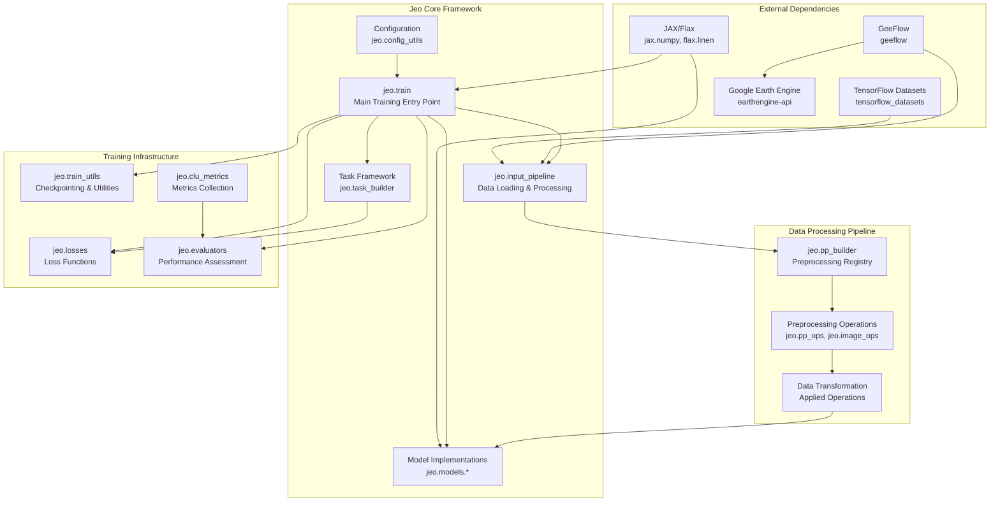
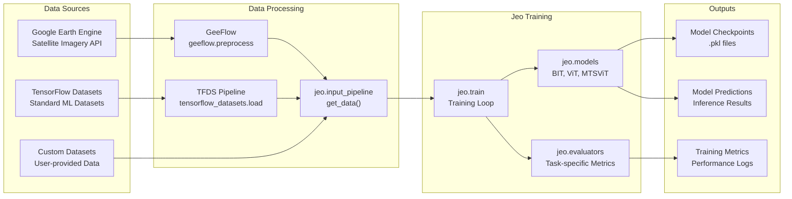

<!-- source: DeepWiki mcp.deepwiki.com · repo google-deepmind/jeo · page 1 Overview · fetched 2026-10-26 -->

# Overview

<details>
<summary>Relevant source files</summary>

The following files were used as context for generating this wiki page:

- [README.md](README.md)
- [jeo/__init__.py](jeo/__init__.py)

</details>


## Purpose and Scope

This document provides a high-level introduction to the Jeo repository, a JAX-based machine learning framework specifically designed for geospatial remote sensing and Earth Observation applications. Jeo enables researchers and practitioners to train and deploy ML models on satellite imagery and other geospatial data using modern distributed computing frameworks.

This overview covers the framework's core architecture, key dependencies, and integration patterns. For detailed installation and setup instructions, see [Getting Started](#2). For in-depth technical documentation of specific components, see [Core Architecture](#3) and its subsections.

Sources: [README.md:1-126](), [jeo/__init__.py:1-15]()

## Core Design Philosophy

Jeo is built around several key design principles that make it effective for geospatial ML workflows:

| Design Principle | Implementation | Benefits |
|------------------|----------------|----------|
| **JAX-First** | Built on JAX/Flax for computation | Hardware-agnostic execution (CPU/GPU/TPU) |
| **Scalable Data** | TensorFlow Datasets integration | Reproducible, version-controlled datasets |
| **Geospatial Focus** | GeeFlow integration for Earth Engine | Direct access to petabyte-scale satellite data |
| **Modular Architecture** | Component-based system design | Easy customization and extension |
| **Research-Ready** | Configuration-driven experiments | Rapid prototyping and reproducible research |

The framework has been successfully used in multiple research publications focusing on deforestation monitoring, forest classification, and global environmental analysis.

Sources: [README.md:10-25](), [README.md:31-54]()

## High-Level System Architecture



Sources: [README.md:10-18](), [README.md:22-25]()

## Core Components

### Training System
The `jeo.train` module serves as the main entry point for all training workflows. It orchestrates the interaction between data loading, model initialization, training loops, and evaluation cycles. The system supports distributed training across multiple devices and provides comprehensive checkpointing capabilities.

### Data Pipeline
Jeo's data pipeline is built around TensorFlow Datasets (`tensorflow_datasets`) for standardized dataset access, with specialized support for geospatial data through GeeFlow integration. The `jeo.input_pipeline` module handles data loading, while the preprocessing system (`jeo.pp_builder`, `jeo.pp_ops`) provides extensible data transformation capabilities.

### Model Architecture Framework
The framework supports multiple model architectures optimized for different geospatial tasks:
- **BIT (Big Transfer)**: ResNetV1-based convolutional networks with GroupNorm
- **ViT (Vision Transformer)**: Standard vision transformer architecture
- **MTSViT**: Multi-Modal Temporal-Spatial Vision Transformers for time-series analysis

### Task Abstraction
The `jeo.task_builder` provides a unified interface for defining different ML tasks (classification, segmentation, regression) with task-specific loss functions and evaluation metrics.

Sources: [README.md:83-89]()

## Integration with Geospatial Ecosystem



The integration pattern shown above demonstrates how Jeo serves as a bridge between large-scale geospatial data sources and modern ML training infrastructure. GeeFlow handles the complexity of interfacing with Google Earth Engine's API, while Jeo provides the ML training and evaluation framework.

Sources: [README.md:22-29]()

## Quick Start Example

The simplest way to understand Jeo's operation is through the provided demo configuration:

```bash
python -m jeo.train --config configs/tests/tiny_bit.py:runlocal \
--workdir /tmp/jeo/demo_tiny_bit
```

This command demonstrates the key components in action:
- `jeo.train`: Main training module
- `configs/tests/tiny_bit.py`: Configuration file defining model, data, and training parameters
- `:runlocal`: Configuration modifier for local CPU execution
- `--workdir`: Directory for checkpoints and output artifacts

The example trains a BIT model on CIFAR-10 data, showcasing the framework's ability to work with both standard ML datasets and geospatial data using the same unified interface.

Sources: [README.md:74-92]()

## Hardware and Deployment Support

Jeo is designed to run efficiently across different computing environments:

| Environment | Support Level | Key Features |
|-------------|---------------|--------------|
| **Local CPU** | Full support | Development and small-scale experiments |
| **GPU** | Full support | Accelerated training with CUDA |
| **Google Cloud TPU VMs** | Full support | Large-scale distributed training |
| **Multi-device** | Native support | Automatic sharding and parallelization |

The JAX foundation provides automatic device placement and distributed computing capabilities, making it straightforward to scale from laptop development to cloud-scale training without code changes.

Sources: [README.md:16-18]()

---

