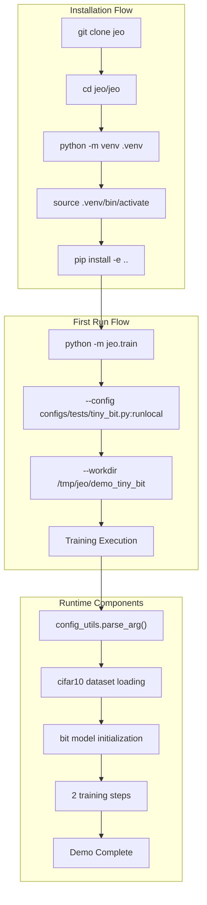
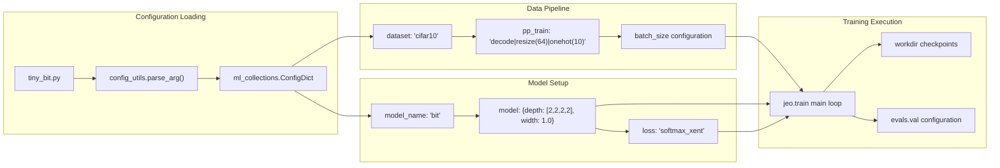

<!-- source: DeepWiki mcp.deepwiki.com · repo google-deepmind/jeo · page 2 Getting Started · fetched 2026-10-26 -->

# Getting Started

<details>
<summary>Relevant source files</summary>

The following files were used as context for generating this wiki page:

- [README.md](README.md)
- [jeo/configs/tests/tiny_bit.py](jeo/configs/tests/tiny_bit.py)
- [jeo/configs/tests/tiny_vit.py](jeo/configs/tests/tiny_vit.py)

</details>


This document provides a step-by-step guide to installing Jeo and running your first training experiment. It covers the basic installation process, demonstrates how to execute a simple training job, and introduces the core configuration concepts needed to get started with the framework.

For detailed information about the core architecture and system components, see [Core Architecture](#3). For comprehensive configuration options and advanced training features, see [Training and Configuration](#6).

## Installation

Jeo requires Python and can be installed directly from the source repository. The framework is built on JAX/Flax and integrates with TensorFlow Datasets for data loading.

### Prerequisites

- Python 3.8 or higher
- Git for cloning the repository
- Virtual environment (recommended)

### Installation Steps

```bash
# Clone the repository
git clone https://github.com/google-deepmind/jeo

# Navigate to the code directory
cd jeo/jeo

# Create and activate virtual environment
python -m venv .venv
source .venv/bin/activate  # On Windows: .venv\Scripts\activate

# Install Jeo in development mode
pip install -e ..
```

The installation process sets up all required dependencies including JAX, Flax, TensorFlow Datasets, and other supporting libraries needed for geospatial machine learning workflows.

**Sources:** [README.md:58-72]()

## First Training Run

Once installed, you can immediately test the installation by running a demonstration training job. This uses a minimal configuration to train a small model on CIFAR-10 for just a few steps.

### Demo Command

```bash
python -m jeo.train --config configs/tests/tiny_bit.py:runlocal \
--workdir /tmp/jeo/demo_tiny_bit
```

This command demonstrates the basic training interface:
- `jeo.train` is the main training module
- `--config` specifies the configuration file and variant (`:runlocal`)
- `--workdir` sets the directory for checkpoints and artifacts

The demo will train a BIT model (a modified ResNet architecture) on the CIFAR-10 dataset for just 2 training steps to verify everything works correctly.



**Sources:** [README.md:74-92](), [configs/tests/tiny_bit.py:84-98]()

## Configuration System Overview

Jeo uses Python-based configuration files that return `ml_collections.ConfigDict` objects. The configuration system supports different execution modes and parameter overrides.

### Basic Configuration Structure

The configuration files follow a standard pattern:

```python
def get_config(arg=None):
    """Returns config."""
    arg = config_utils.parse_arg(arg, runlocal=False, test=False)
    config = ml_collections.ConfigDict()
    
    # Core configuration sections
    config.task_type = "classification"
    config.dataset = "cifar10"
    config.model_name = "bit"
    # ... additional parameters
    
    return config
```

### Configuration Modes

The configuration system supports different execution modes:

| Mode | Purpose | Characteristics |
|------|---------|----------------|
| Default | Full training | Normal batch sizes, full epochs, complete evaluation |
| `:runlocal` | Local testing | Small batch size (2), limited steps (2), minimal model |
| `:test` | Unit testing | Minimal configuration for automated tests |
| `:colab` | Colab demos | Medium batch size (16), short training (2 epochs) |

**Sources:** [configs/tests/tiny_bit.py:21-28, 84-98](), [configs/tests/tiny_vit.py:21-24, 88-103]()

## Basic Training Workflow

Understanding the basic workflow helps in configuring and running training experiments effectively.



### Key Configuration Parameters

The essential parameters for any training configuration:

| Parameter | Purpose | Example |
|-----------|---------|---------|
| `task_type` | Defines the ML task | `"classification"`, `"segmentation"` |
| `dataset` | Dataset identifier | `"cifar10"`, custom dataset name |
| `model_name` | Model architecture | `"bit"`, `"vit"`, `"mtsvit"` |
| `batch_size` | Training batch size | `4096`, `2` (for testing) |
| `total_epochs` | Training duration | `200`, `None` (use total_steps) |
| `pp_train` | Preprocessing pipeline | `"decode|resize(64)|onehot(10)"` |

**Sources:** [configs/tests/tiny_bit.py:25-60](), [configs/tests/tiny_vit.py:21-57]()

## Understanding the Demo Configuration

The `tiny_bit.py` configuration demonstrates a complete setup for image classification:

### Data Configuration
```python
config.dataset = "cifar10"
config.train_split = "train"
config.num_classes = 10
config.shuffle_buffer_size = 10_000
```

### Model Configuration
```python
config.model_name = "bit"
config.model = dict(
    depth=[2, 2, 2, 2],  # ResNet architecture depth
    width=1.0,           # Width multiplier
    num_classes=config.get_ref("num_classes"),
)
```

### Training Configuration
```python
config.batch_size = 4096
config.total_epochs = 200
config.optax_name = "big_vision.momentum_hp"
config.lr = (0.1 / 256) * config.batch_size
```

The `:runlocal` mode overrides these settings for quick testing, reducing batch size to 2, limiting to 2 total steps, and using a smaller model architecture.

**Sources:** [configs/tests/tiny_bit.py:32-68, 84-98]()

## Next Steps

After successfully running the demo, you can:

1. **Explore Different Models**: Try the ViT configuration with `configs/tests/tiny_vit.py`
2. **Understand Data Processing**: Learn about preprocessing pipelines in [Data Processing](#4)
3. **Configure Custom Training**: Study the configuration system in [Configuration System](#6.2)
4. **Add Custom Models**: Review model implementations in [Model Implementations](#5.1)
5. **Set Up Evaluation**: Configure metrics and evaluation in [Evaluation Framework](#3.4)

The framework is designed to scale from quick local experiments to large-scale distributed training on TPUs, with the same configuration patterns applying across different scales and hardware configurations.

**Sources:** [README.md:56-93]()

---

