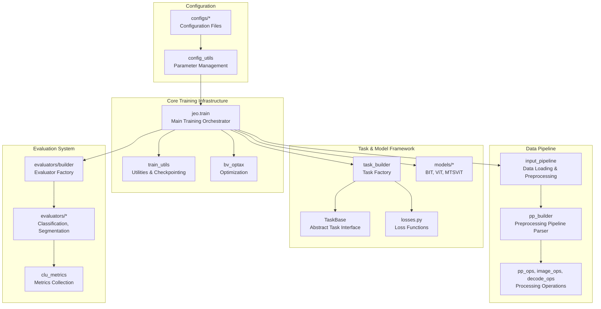
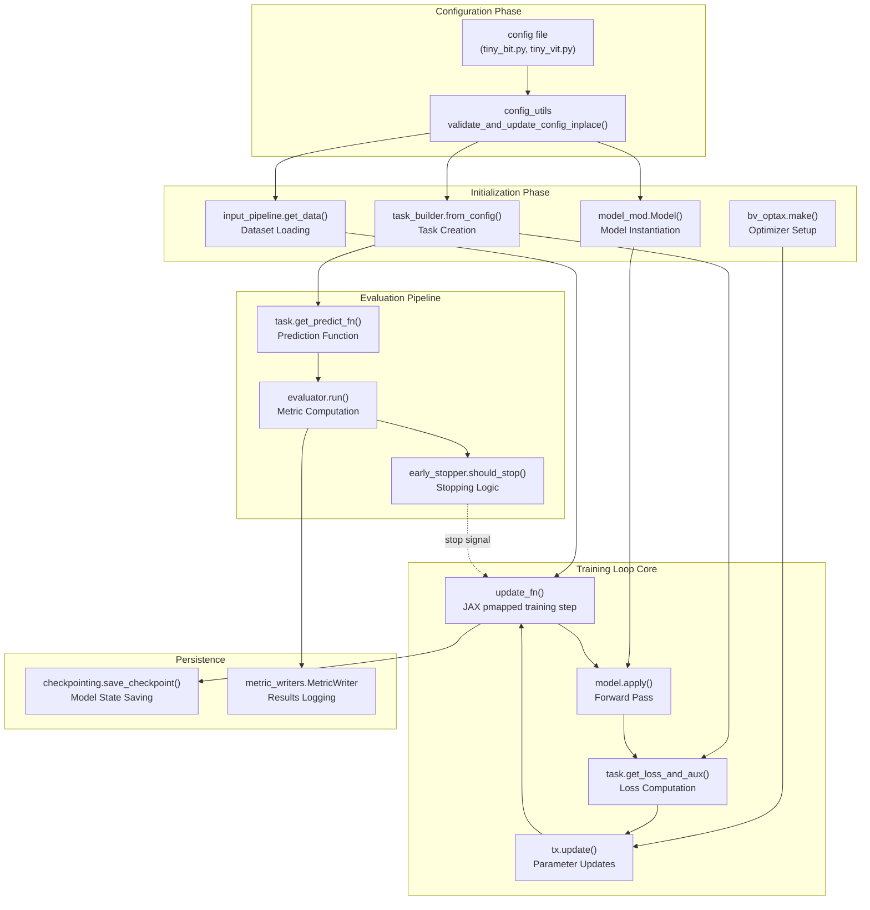

<!-- source: DeepWiki mcp.deepwiki.com · repo google-deepmind/jeo · page 3 Core Architecture · fetched 2026-10-26 -->

# Core Architecture

Relevant source files

The following files were used as context for generating this wiki page:

- [README.md](README.md)
- [jeo/tasks/task_builder.py](jeo/tasks/task_builder.py)
- [jeo/train.py](jeo/train.py)

This document provides a detailed overview of the main architectural components within the Jeo framework and how they interact to enable geospatial machine learning training. It covers the core systems, data flow patterns, and key abstractions that make up the framework's foundation.

For information about specific model implementations, see [Model Implementations](#5.1). For details about the training configuration system, see [Configuration System](#6.2). For evaluation and metrics specifics, see [Evaluation and Metrics](#7).

## Architecture Overview

Jeo is built around a modular architecture that separates concerns between data processing, model definition, task configuration, training orchestration, and evaluation. The framework is designed to work seamlessly with JAX/Flax for computation and TensorFlow Datasets for data loading.

### High-Level System Components

**Sources:** [README.md:10-25](), [jeo/train.py:29-43](), [jeo/tasks/task_builder.py:132-146]()

## Core Components

### Training Orchestrator

The `jeo.train` module serves as the central orchestrator that coordinates all components during training. The main training loop is implemented in the `_main` function, which handles:

- Configuration loading and validation
- Dataset initialization via `input_pipeline.get_data()`
- Model and task setup through factory patterns
- Training step execution with the `update_fn` function
- Evaluation scheduling and execution
- Checkpointing and metrics collection

The training script follows a clear sectioned approach with 8 main phases: Setup, Dataset initialization, Model/task/optimizer initialization, Train step function definition, Checkpoint initialization, Pre-loop setup, Main training loop, and Post-loop finalization.

**Sources:** [jeo/train.py:70-481]()

### Task Framework

The task system is built around the `TaskBase` abstract class, which defines the interface for different types of machine learning tasks. Tasks are responsible for:

- Processing model inputs via the `model_inputs()` method
- Computing losses and auxiliary outputs through `get_loss_and_aux()`
- Creating prediction functions with `get_predict_fn()`

The `task_builder.from_config()` factory function instantiates tasks based on configuration, supporting common task types like classification, segmentation, regression, and contrastive learning.

**Sources:** [jeo/tasks/task_builder.py:35-146]()

### Input Pipeline System

The input pipeline handles data loading, preprocessing, and batching. It integrates with TensorFlow Datasets and supports custom dataset modules. The system uses a string-based preprocessing specification that gets parsed into executable operations.

Key components include:
- `input_pipeline.get_data()` for dataset loading
- `pp_builder` for parsing preprocessing specifications
- Various operation modules (`pp_ops`, `image_ops`, `decode_ops`) for data transformations

**Sources:** [jeo/train.py:137-159]()

## Training Pipeline Flow

### Data and Computation Flow

**Sources:** [jeo/train.py:255-300](), [jeo/train.py:361-385](), [jeo/train.py:398-464]()

## Key Architectural Patterns

### Factory Pattern for Component Creation

The framework extensively uses factory patterns to create components based on configuration:

| Factory Function | Purpose | Configuration Key |
|------------------|---------|-------------------|
| `task_builder.from_config()` | Creates task instances | `task_type` |
| `eval_builder.from_config()` | Creates evaluators | `evals` |
| `bv_optax.make()` | Creates optimizers | `optax_name` |
| `input_pipeline.get_data()` | Creates datasets | `dataset` |

**Sources:** [jeo/tasks/task_builder.py:132-146](), [jeo/train.py:186-189](), [jeo/train.py:247-249](), [jeo/train.py:351-354]()

### Modular Preprocessing System

The preprocessing system uses a registry pattern where operations are registered by module name and can be composed using string specifications. The `pp_builder` parses these specifications into executable pipelines.

**Sources:** [jeo/train.py:86-91]()

### JAX Transformation Integration

The framework is designed around JAX's functional programming model:
- Training steps use `jax.pmap` for multi-device execution
- Model initialization uses `jax.jit` with CPU backend
- State management follows JAX's immutable patterns
- Random number generation uses JAX's PRNG system

**Sources:** [jeo/train.py:194-209](), [jeo/train.py:256-300]()

### Evaluation Integration

Evaluators are integrated into the training loop with configurable scheduling. They receive a prediction function from the task and can trigger early stopping based on performance metrics.

**Sources:** [jeo/train.py:361-385]()

This architecture provides a flexible, extensible framework for geospatial machine learning that separates concerns while maintaining tight integration between components during training execution.

---

