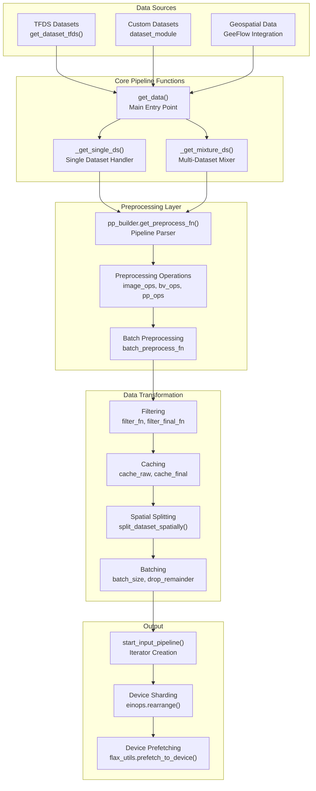
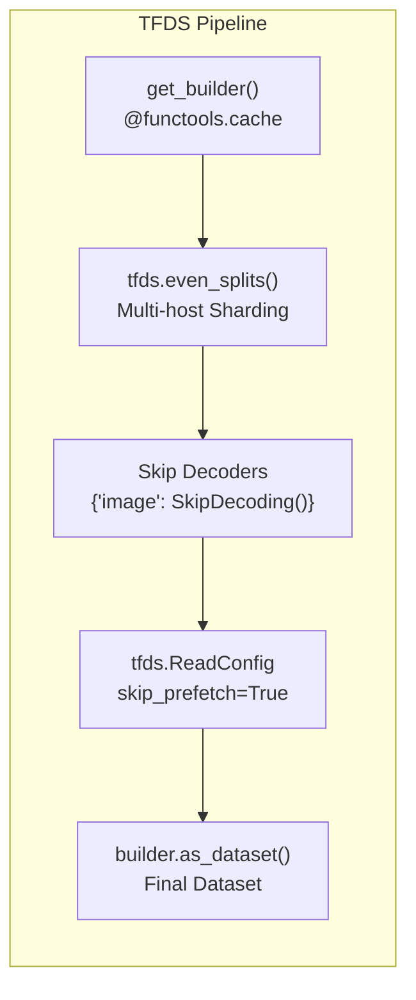
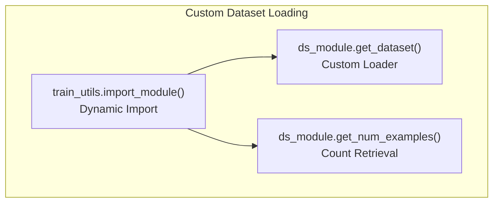
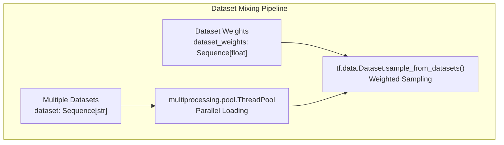
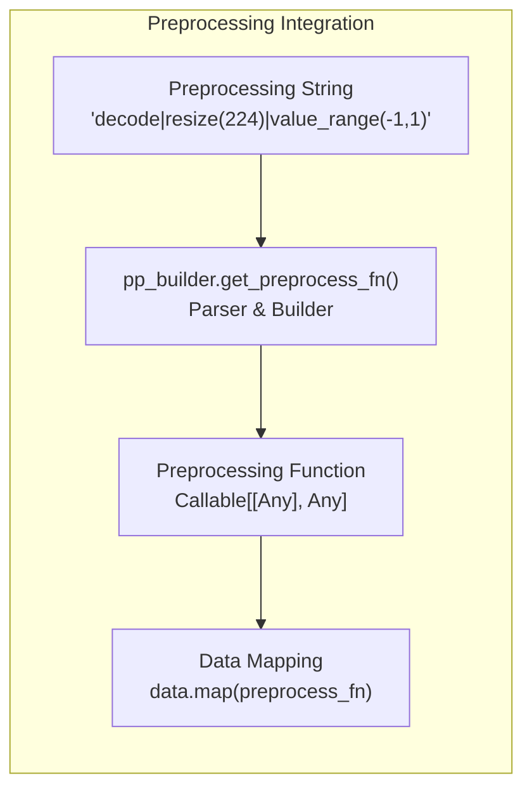
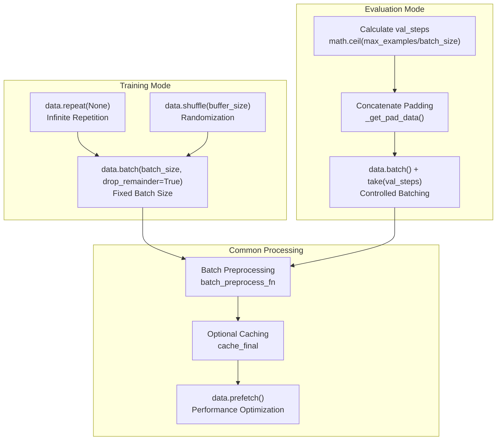
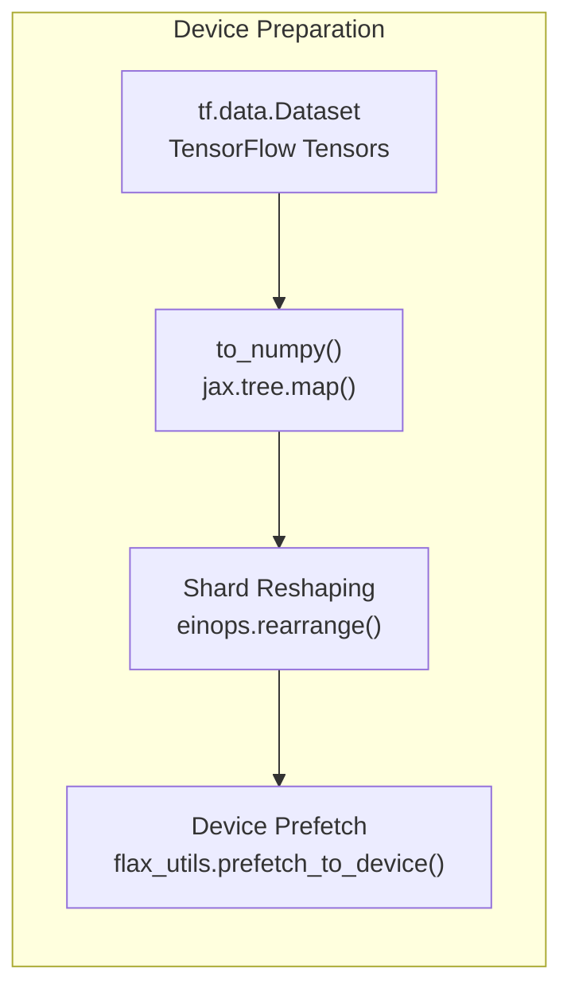
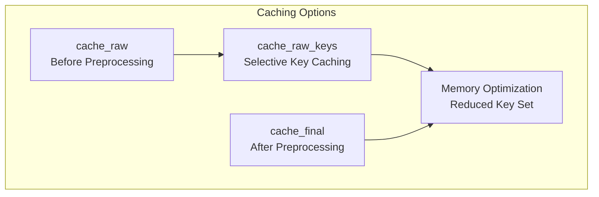
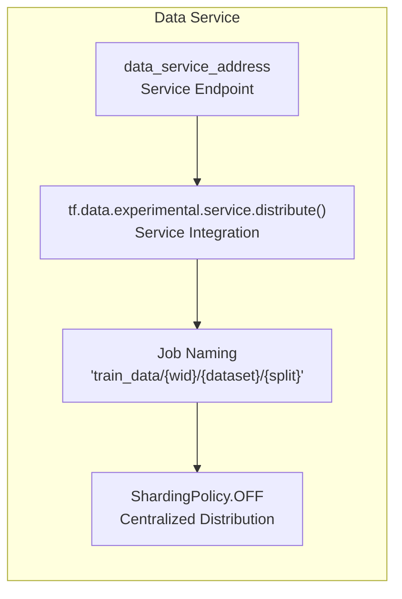

<!-- source: DeepWiki mcp.deepwiki.com · repo google-deepmind/jeo · page 3.1 Input Pipeline System · fetched 2026-10-26 -->

# Input Pipeline System

Relevant source files

The following files were used as context for generating this wiki page:

- [jeo/input_pipeline.py](jeo/input_pipeline.py)
- [jeo/pp/pp_utils.py](jeo/pp/pp_utils.py)

## Purpose and Scope

The Input Pipeline System is responsible for loading, preprocessing, and batching data for training and evaluation in the Jeo framework. This system handles data from multiple sources including TensorFlow Datasets (TFDS), custom dataset modules, and geospatial data through GeeFlow integration. For information about preprocessing operations and pipeline configuration, see [Data Processing](#4). For details about model architectures that consume this data, see [Model Architecture Framework](#3.2).

## System Overview

The input pipeline transforms raw data into model-ready batches through a multi-stage process involving data loading, preprocessing, filtering, batching, and device sharding.

**Sources:** [jeo/input_pipeline.py:1-514]()

## Data Loading Architecture

The system supports three primary data loading mechanisms through a unified interface:

### TFDS Integration

The `get_dataset_tfds()` function provides seamless integration with TensorFlow Datasets:

| Parameter | Purpose | Type |
|-----------|---------|------|
| `dataset` | TFDS dataset name | `str` |
| `split` | Dataset split specification | `str` |
| `shuffle_files` | Whether to shuffle input files | `bool` |
| `skip_decode` | Features to skip decoding | `Sequence[str]` |
| `interleave_cycle_length` | Parallel file reading | `int \| None` |

**Sources:** [jeo/input_pipeline.py:433-473]()

### Custom Dataset Modules

For non-TFDS datasets, the system loads custom dataset modules dynamically:

**Sources:** [jeo/input_pipeline.py:188-193](), [jeo/input_pipeline.py:50-53]()

### Dataset Mixing

The `_get_mixture_ds()` function enables training on multiple datasets simultaneously:

**Sources:** [jeo/input_pipeline.py:323-388]()

## Preprocessing Integration

The input pipeline integrates with the preprocessing system through string-based pipeline specifications:

### Pipeline Construction

### Preprocessing Utilities

The `pp_utils.py` module provides essential utilities for preprocessing operations:

| Utility | Function | Purpose |
|---------|----------|---------|
| `InKeyOutKey` | Decorator class | Single-input single-output operation wrapper |
| `get_lookup_table()` | Label mapping | Creates TensorFlow lookup tables |
| `load_normalization_ranges()` | Statistics loading | Loads normalization parameters with caching |
| `maybe_repeat()` | Argument handling | Repeats arguments for multi-element processing |

**Sources:** [jeo/pp/pp_utils.py:87-125](), [jeo/pp/pp_utils.py:32-51](), [jeo/pp/pp_utils.py:54-84]()

## Batching and Device Sharding

The system provides sophisticated batching and sharding capabilities for multi-device training:

### Training vs Evaluation Modes

### Device Sharding Pipeline

The `start_input_pipeline()` function handles conversion to device-ready format:

**Sources:** [jeo/input_pipeline.py:409-430]()

## Advanced Features

### Spatial Dataset Splitting

The `split_dataset_spatially()` function enables splitting large geospatial images into smaller patches:

| Parameter | Type | Purpose |
|-----------|------|---------|
| `n` | `int` | Number of splits per axis (n×n total) |
| `shift` | `int` | Pixel-wise shift between patches |
| `size` | `int` | Size of each sub-patch |
| `keep_keys` | `Sequence[str]` | Keys to preserve unchanged |
| `split_keys` | `Sequence[str]` | Keys to spatially split |

**Sources:** [jeo/input_pipeline.py:78-115]()

### Caching Strategies

The system supports two caching levels:

### Data Service Integration

For distributed training, the system supports TensorFlow Data Service:

**Sources:** [jeo/input_pipeline.py:257-269]()

## Core API Reference

### Primary Functions

| Function | Purpose | Key Parameters |
|----------|---------|----------------|
| `get_data()` | Main entry point for dataset loading | `dataset`, `split`, `preprocess_fn`, `batch_size` |
| `get_num_examples()` | Retrieve dataset size information | `dataset`, `split`, `data_dir`, `dataset_module` |
| `start_input_pipeline()` | Convert dataset to device-ready iterator | `data`, `n_prefetch`, `shard` |

### Configuration Parameters

The system accepts extensive configuration through the `_get_single_ds()` function:

| Category | Parameters | Purpose |
|----------|------------|---------|
| Data Source | `dataset`, `split`, `data_dir`, `dataset_module` | Dataset identification |
| Preprocessing | `preprocess_fn`, `batch_preprocess_fn`, `pp_modules` | Data transformation |
| Performance | `prefetch`, `num_parallel_calls`, `shuffle_buffer_size` | Optimization settings |
| Filtering | `filter_fn`, `filter_final_fn` | Data selection |
| Caching | `cache_raw`, `cache_final`, `cache_raw_keys` | Performance caching |
| Evaluation | `val_steps`, `split_dataset_args` | Evaluation-specific options |

**Sources:** [jeo/input_pipeline.py:118-183](), [jeo/input_pipeline.py:391-406]()

---

