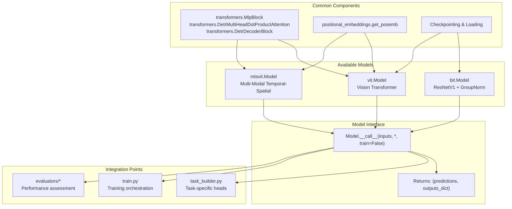
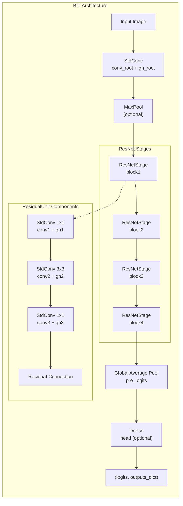
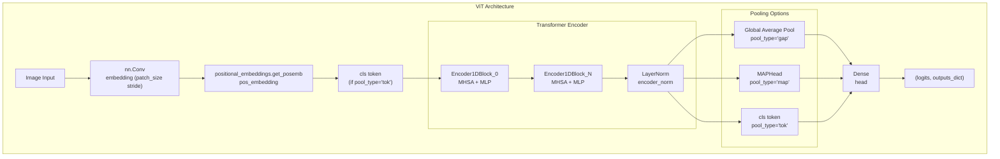
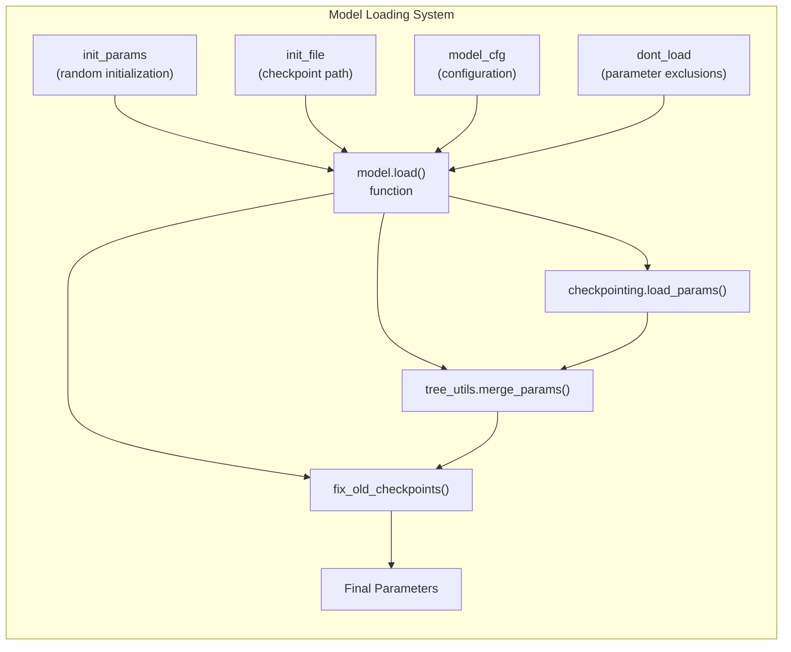
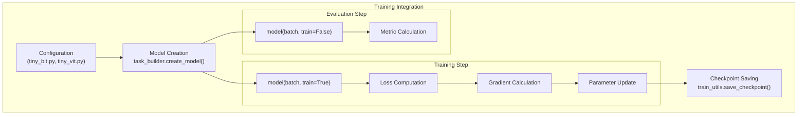

<!-- source: DeepWiki mcp.deepwiki.com · repo google-deepmind/jeo · page 3.2 Model Architecture Framework · fetched 2026-10-26 -->

# Model Architecture Framework

Relevant source files

The following files were used as context for generating this wiki page:

- [jeo/components/transformers.py](jeo/components/transformers.py)
- [jeo/models/bit.py](jeo/models/bit.py)
- [jeo/models/mtsvit.py](jeo/models/mtsvit.py)
- [jeo/models/vit.py](jeo/models/vit.py)

This document covers the model architecture framework in Jeo, including the available model implementations, common components, and how models integrate with the training and evaluation systems. For information about training configuration and parameter management, see [Training System](#3.3). For details about specific model usage in tasks, see [Task Definitions](#5.2).

## Overview

The Jeo model architecture framework provides a standardized approach to implementing and using deep learning models for geospatial applications. The framework supports three main model families: BIT (ResNet-based), ViT (Vision Transformer), and MTSViT (Multi-Modal Temporal-Spatial Vision Transformer), along with shared transformer components that enable consistent implementation patterns across different architectures.

### Model Framework Architecture

**Sources:** [jeo/models/bit.py:94-141](), [jeo/models/vit.py:142-230](), [jeo/models/mtsvit.py:43-229]()

## Model Implementations

### BIT (ResNet with GroupNorm)

The BIT model implements ResNet V1 architecture with GroupNorm instead of BatchNorm, making it suitable for various batch sizes and geospatial applications.

Key characteristics:
- Uses `StdConv` with weight standardization ([jeo/models/bit.py:36-42]())
- Adaptive GroupNorm with `min(32, channels)` groups ([jeo/models/bit.py:45-48]())
- Configurable depth (26, 50, 101, 152, 200 layers) ([jeo/models/bit.py:146-155]())
- Returns intermediate activations in `outputs_dict` ([jeo/models/bit.py:110-140]())

**Sources:** [jeo/models/bit.py:94-141](), [jeo/models/bit.py:51-77](), [jeo/models/bit.py:80-91]()

### ViT (Vision Transformer)

The ViT implementation provides a flexible transformer architecture with various scaling options and pooling strategies.

Key characteristics:
- Factory function `Model()` with variant support (Ti/S/M/B/L/H/g/G/e) ([jeo/models/vit.py:233-257]())
- Multiple pooling strategies: `gap`, `map`, `tok` ([jeo/models/vit.py:192-208]())
- Learnable or sinusoidal positional embeddings ([jeo/models/vit.py:172-173]())
- Support for high-resolution fine-tuning ([jeo/models/vit.py:260-275]())

**Sources:** [jeo/models/vit.py:142-230](), [jeo/models/vit.py:84-105](), [jeo/models/vit.py:55-81]()

### MTSViT (Multi-Modal Temporal-Spatial Vision Transformer)

MTSViT handles multi-modal temporal-spatial data with separate spatial and temporal processing stages.

```mermaid
graph TB
    subgraph "MTSViT Architecture"
        MultiModalInput["Multi-modal Inputs<br/>inputs[mod_name]"]
        
        subgraph "Tokenization"
            Tokenize["tokenize()<br/>Separate tokenization per modality"]
            SpatialMods["Spatial Modalities<br/>(patch_h > 1)"]
            NonSpatialMods["Non-spatial Modalities<br/>(patch_h = 1)"]
        end
        
        subgraph "Spatial Processing"
            SpatialPE["positional_embeddings<br/>pe_spatial"]
            SpatialEnc["vit.Encoder<br/>transformer_spatial"]
        end
        
        subgraph "Temporal Processing"  
            TemporalPE["positional_embeddings<br/>pe_temp"]
            ClsTokens["cls_temp tokens<br/>(num_classes)"]
            TemporalEnc["vit.Encoder<br/>transformer_temporal"]
        end
        
        subgraph "Multi-Modal Decoder"
            ChunkDec["ChunkDecoder<br/>spatial_decoder"]
            DetrBlocks["transformers.DetrDecoderBlock<br/>Cross-attention layers"]
        end
        
        subgraph "Task Heads"
            ClassHead["Classification Head<br/>cls token → Dense"]
            SegHead["Segmentation Head<br/>patches → Dense → reshape"]
        end
        
        Output["(predictions, outputs_dict)"]
    end
    
    MultiModalInput --> Tokenize
    Tokenize --> SpatialMods
    Tokenize --> NonSpatialMods
    
    SpatialMods --> SpatialPE
    SpatialPE --> SpatialEnc
    
    SpatialEnc --> TemporalPE
    NonSpatialMods --> TemporalPE
    TemporalPE --> ClsTokens
    ClsTokens --> TemporalEnc
    
    TemporalEnc --> ChunkDec
    ChunkDec --> DetrBlocks
    
    DetrBlocks --> ClassHead
    DetrBlocks --> SegHead
    
    ClassHead --> Output
    SegHead --> Output
```

Key characteristics:
- Multi-modal input support with configurable patch sizes ([jeo/models/mtsvit.py:55-56]())
- Spatial-first or temporal-first processing ([jeo/models/mtsvit.py:68](), [jeo/models/mtsvit.py:94-177]())
- DETR-style decoder for cross-modal attention ([jeo/models/mtsvit.py:273-376]())
- Support for both classification and segmentation heads ([jeo/models/mtsvit.py:184-228]())

**Sources:** [jeo/models/mtsvit.py:43-229](), [jeo/models/mtsvit.py:273-376](), [jeo/models/mtsvit.py:231-270]()

## Common Components

### Transformer Building Blocks

The framework provides shared transformer components that are used across different model architectures:

| Component | Purpose | Used By |
|-----------|---------|---------|
| `MlpBlock` | Feed-forward layers with GELU activation | ViT, MTSViT |
| `DetrMultiHeadDotProductAttention` | Multi-head attention with positional embeddings | MTSViT decoder |
| `DetrDecoderBlock` | Complete transformer decoder block | MTSViT cross-modal processing |
| `PatchMerger3D` | Hierarchical patch merging for multi-scale | MTSViT (optional) |

**Sources:** [jeo/components/transformers.py:28-63](), [jeo/components/transformers.py:127-256](), [jeo/components/transformers.py:259-395]()

### Model Loading and Checkpointing

All models support a consistent loading interface:

**Sources:** [jeo/models/bit.py:169-175](), [jeo/models/vit.py:317-336](), [jeo/tools/checkpointing.py](), [jeo/tools/tree_utils.py]()

## Model Integration with Training System

### Training Loop Integration

Models integrate with the training system through a standardized interface:

### Model Output Format

All models follow a consistent output format that integrates with the task and evaluation systems:

| Output Key | Description | Usage |
|------------|-------------|-------|
| `logits` | Main predictions (1D for classification) | Loss computation, metrics |
| `logits_2d` | Spatial predictions (for segmentation) | Segmentation tasks, dense prediction |
| `pre_logits` | Pre-classification features | Feature extraction, analysis |
| `pre_logits_2d` | Spatial features before final layer | Dense feature maps |
| Intermediate activations | Layer-wise outputs (stem, stages, etc.) | Analysis, visualization, multi-scale |

**Sources:** [jeo/models/bit.py:110-140](), [jeo/models/vit.py:190-230](), [jeo/models/mtsvit.py:203-229]()

## Configuration and Variants

### Model Variants

Each model family supports different size variants:

**BIT Variants:**
- Configurable depth: 26, 50, 101, 152, 200 layers
- Configurable width multiplier
- Customizable stem and pooling configurations

**ViT Variants:**
- Predefined sizes: Ti, S, M, B, L, H, g, G, e
- Patch sizes: /8, /16, /32
- Example: `"B/16"` = Base model with 16x16 patches

**MTSViT Configuration:**
- Multi-modal patch sizes per modality
- Configurable encoder depths (spatial, temporal, decoder)
- Head type selection (classification vs segmentation)

**Sources:** [jeo/models/bit.py:97-102](), [jeo/models/vit.py:238-257](), [jeo/models/mtsvit.py:55-68]()

---

