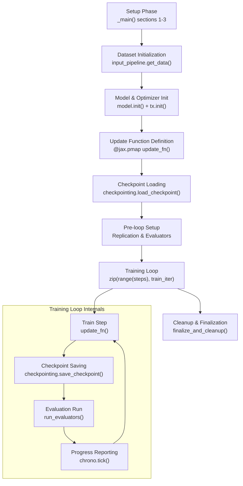
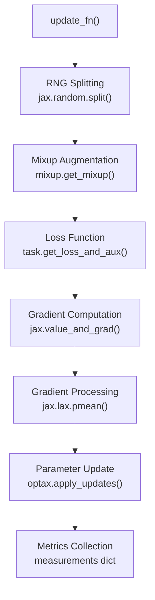
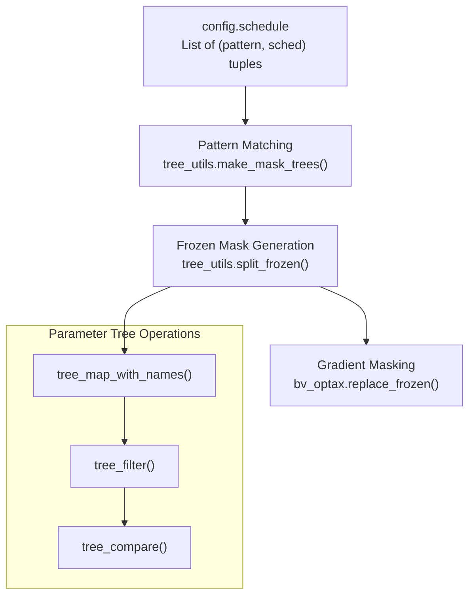
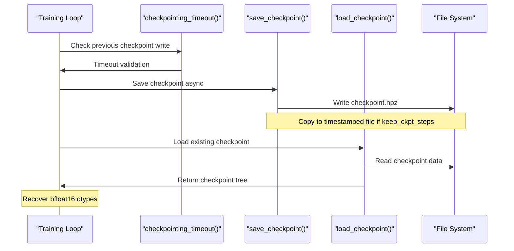
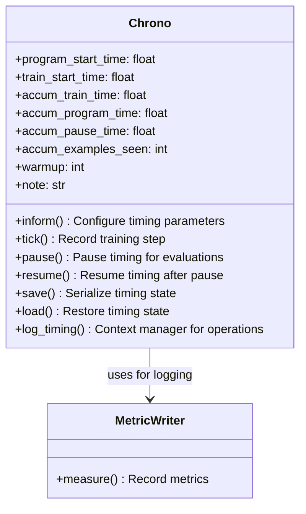
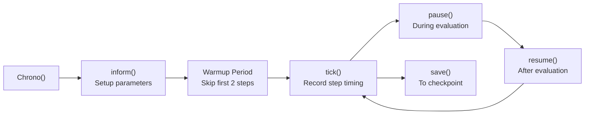
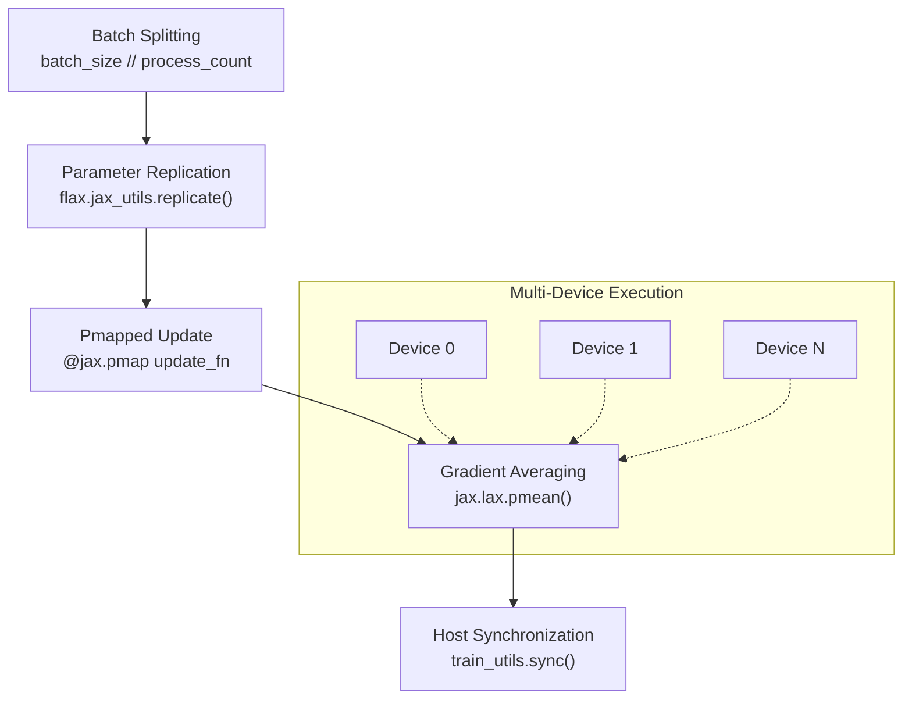
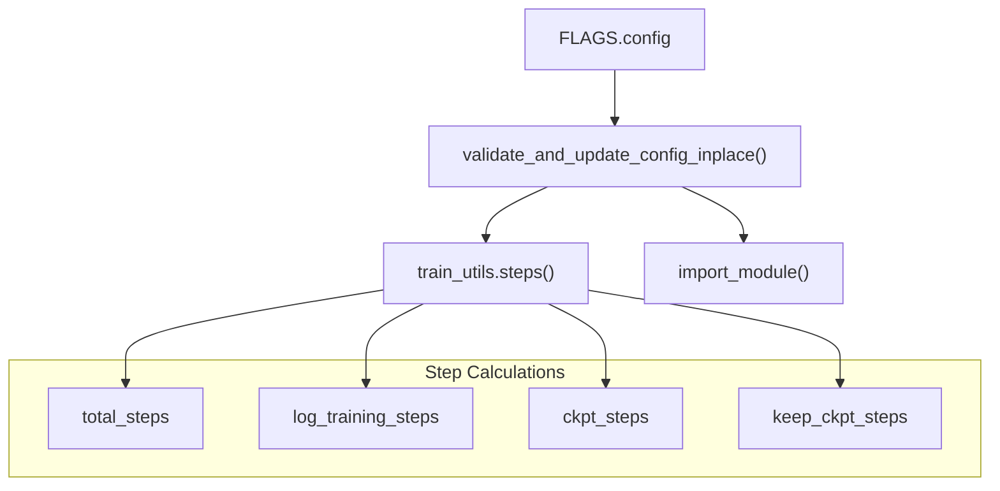

<!-- source: DeepWiki mcp.deepwiki.com · repo google-deepmind/jeo · page 3.3 Training System · fetched 2026-10-26 -->

# Training System

Relevant source files

The following files were used as context for generating this wiki page:

- [jeo/tools/tree_utils.py](jeo/tools/tree_utils.py)
- [jeo/train.py](jeo/train.py)
- [jeo/train_utils.py](jeo/train_utils.py)

The Training System is the core orchestrator of model training in Jeo, responsible for executing the training loop, managing model parameters, handling checkpointing, and coordinating distributed training across multiple devices. This system integrates all components including data loading, model execution, optimization, and evaluation.

For information about data preprocessing and pipeline configuration, see [Input Pipeline System](#3.1). For details about model architectures and implementations, see [Model Architecture Framework](#3.2). For evaluation and metrics collection, see [Evaluation Framework](#3.4).

## Training Loop Architecture

The training system is built around a structured multi-section training loop implemented in the main training script. The architecture follows a clear separation between setup, execution, and cleanup phases.

### Training Loop Flow

Sources: [jeo/train.py:70-481]()

### Update Function Architecture

The core training step is implemented as a pmapped function that handles parameter updates, gradient computation, and metric collection:

Sources: [jeo/train.py:256-300]()

## Parameter Management

The training system provides sophisticated parameter management capabilities including parameter freezing, initialization from checkpoints, and parameter tree manipulation.

### Parameter Initialization and Loading

| Operation | Function | Purpose |
|-----------|----------|---------|
| Model Initialization | `model.init()` | Initialize parameters on CPU |
| Parameter Loading | `train_utils.load()` | Load from checkpoint with validation |
| Parameter Merging | `tree_utils.merge_params()` | Merge loaded and initialized parameters |
| Parameter Freezing | `train_utils.get_frozen_mask()` | Create freeze masks from schedule |

### Frozen Parameter System

Sources: [jeo/train_utils.py:175-196](), [jeo/tools/tree_utils.py:316-334](), [jeo/tools/tree_utils.py:447-463]()

## Checkpointing System

The checkpointing system handles model state persistence, restoration, and distributed coordination across training processes.

### Checkpoint Operations

### Checkpoint Structure

The checkpoint contains:

| Component | Source | Description |
|-----------|--------|-------------|
| `params` | `params_cpu` | Model parameters |
| `opt` | `opt_cpu` | Optimizer state |
| `chrono` | `chrono.save()` | Timing and progress data |
| `state` | `state_cpu` | Model state (batch norm, etc.) |

Sources: [jeo/train.py:315-333](), [jeo/train.py:415-438]()

## Timing and Progress Tracking

The `Chrono` class provides comprehensive timing, progress tracking, and performance monitoring throughout training.

### Chrono Architecture

### Timing Flow

Sources: [jeo/train_utils.py:270-468]()

## Distributed Training Support

The training system includes built-in support for distributed training across multiple devices and hosts using JAX's pmap functionality.

### Distributed Components

| Component | Function | Purpose |
|-----------|----------|---------|
| Device Coordination | `jax.pmap()` | Parallel execution across devices |
| Host Synchronization | `train_utils.sync()` | Synchronize all hosts |
| Batch Distribution | `local_batch_size = batch_size // jax.process_count()` | Distribute batches |
| Gradient Aggregation | `jax.lax.pmean()` | Average gradients across devices |
| Parameter Replication | `flax.jax_utils.replicate()` | Replicate parameters to devices |

### Distributed Training Flow

Sources: [jeo/train.py:118-129](), [jeo/train.py:256](), [jeo/train.py:287](), [jeo/train_utils.py:119-124]()

## Configuration and Utilities

The training system includes extensive configuration validation, module importing, and utility functions for managing training workflows.

### Configuration Management

### Utility Functions

| Function | Purpose | Usage |
|----------|---------|-------|
| `itstime()` | Determine when to execute periodic actions | Checkpoint saving, logging, evaluation |
| `steps()` | Convert duration specifications to step counts | Handle epochs/examples/percent configs |
| `hms()` | Format time durations | Progress reporting |
| `log_memory()` | Log memory usage statistics | Performance monitoring |
| `get_files()` | Resolve file patterns | Checkpoint and data file discovery |

Sources: [jeo/train_utils.py:145-163](), [jeo/train_utils.py:198-237](), [jeo/train_utils.py:493-572](), [jeo/train.py:162-169]()

---

