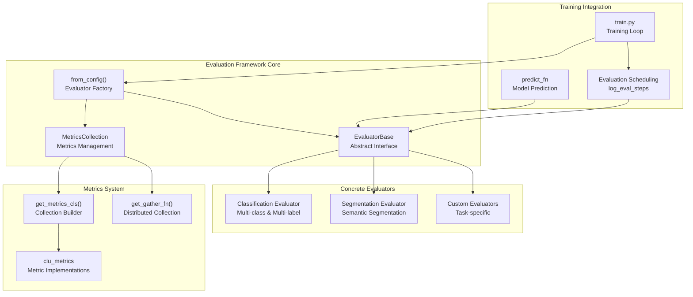
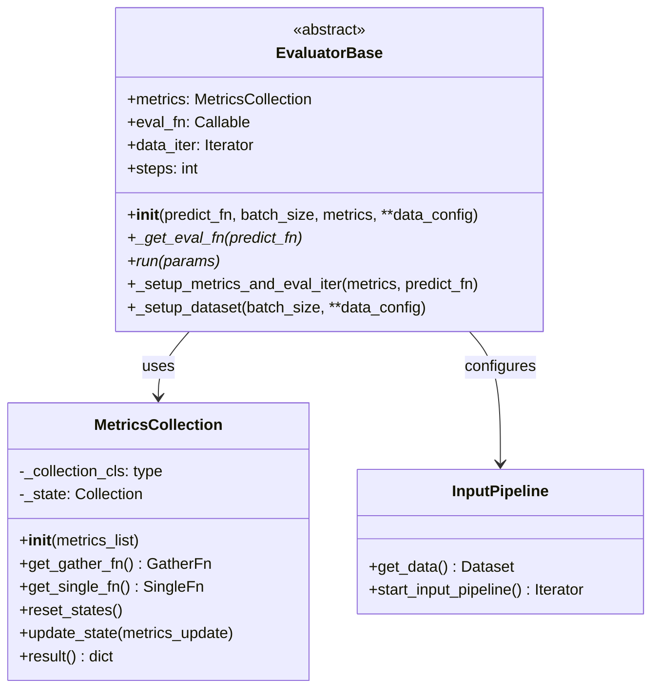
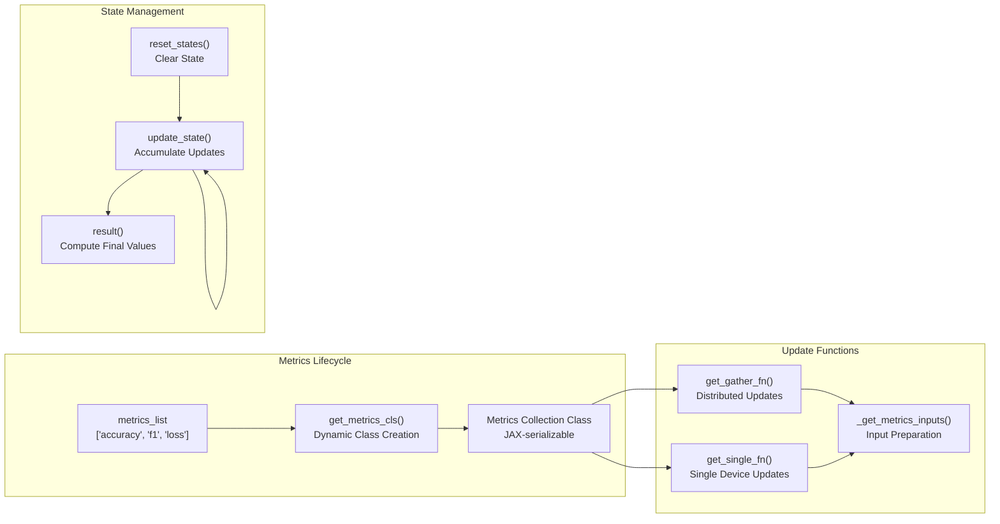
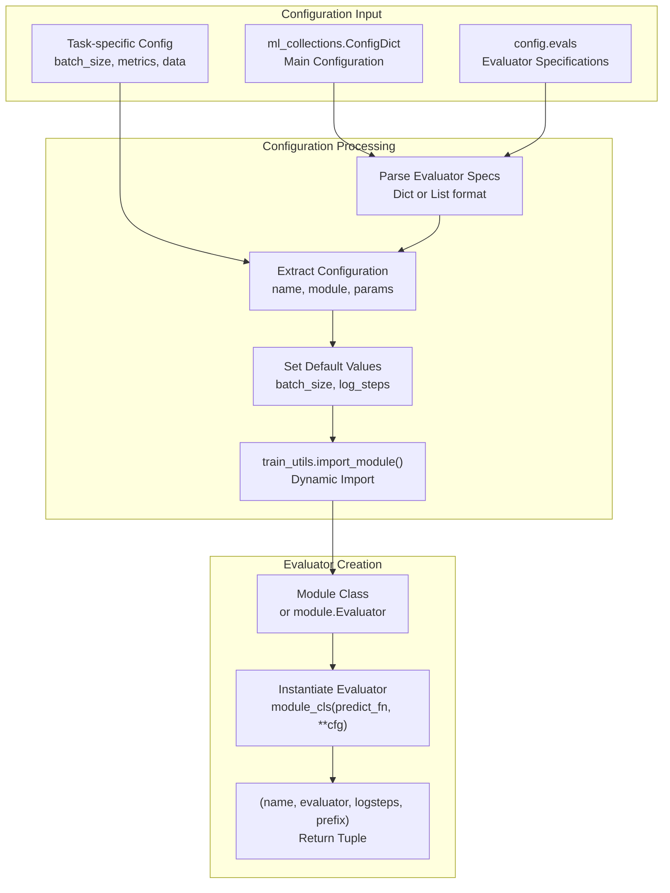
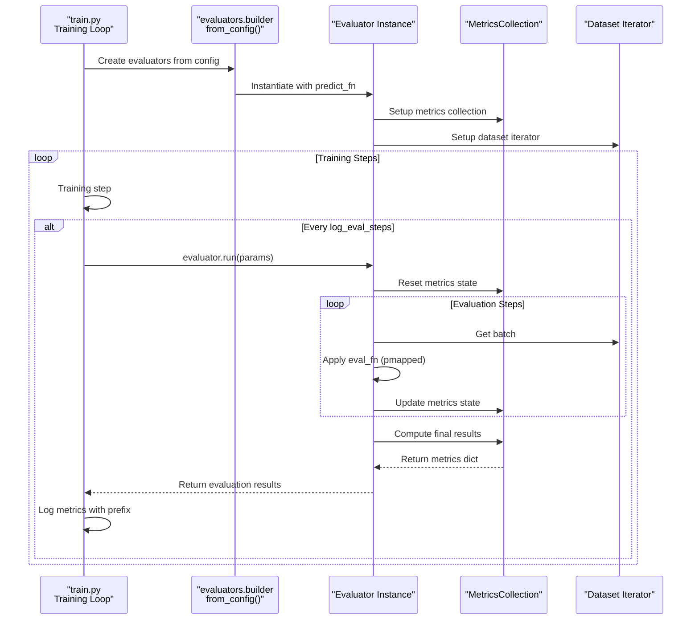

<!-- source: DeepWiki mcp.deepwiki.com · repo google-deepmind/jeo · page 3.4 Evaluation Framework · fetched 2026-10-26 -->

# Evaluation Framework

<details>
<summary>Relevant source files</summary>

The following files were used as context for generating this wiki page:

- [jeo/evaluators/builder.py](jeo/evaluators/builder.py)
- [jeo/metrics/clu_metrics_builder.py](jeo/metrics/clu_metrics_builder.py)

</details>


The Evaluation Framework provides a comprehensive system for assessing model performance during training and validation. It includes abstract interfaces for evaluators, a flexible metrics collection system, and seamless integration with the training loop for periodic performance monitoring and early stopping.

For information about specific metrics implementations, see [Metrics Library](#7.1). For details on configuring evaluators for different task types, see [Evaluators](#7.2).

## Core Architecture

The evaluation framework is built around three main components: the `EvaluatorBase` abstract interface, the `MetricsCollection` system, and the evaluator builder that creates configured evaluator instances from configuration specifications.



**Evaluator Framework Architecture**

Sources: [jeo/evaluators/builder.py:32-46](), [jeo/metrics/clu_metrics_builder.py:34-73]()

## EvaluatorBase Interface

The `EvaluatorBase` class defines the core interface that all evaluators must implement. It provides a standardized way to set up metrics, configure datasets, and run evaluation across distributed environments.



**EvaluatorBase Class Structure**

The abstract methods that concrete evaluators must implement are:
- `__init__`: Initialize the evaluator with prediction function, batch size, metrics list, and data configuration
- `_get_eval_fn`: Create the evaluation function and apply `pmap` for distributed execution  
- `run`: Execute evaluation across the dataset and compute all configured metrics

Sources: [jeo/evaluators/builder.py:32-81]()

## Metrics Collection System

The `MetricsCollection` class manages the lifecycle of metrics computation, from initialization through state updates to final result computation. It builds on the CLU metrics library and provides both single-device and distributed computation patterns.



**Metrics Collection Workflow**

The system supports a wide range of metric types through string-based registration:

| Metric Category | Supported Metrics | Implementation |
|-----------------|-------------------|----------------|
| **Classification** | `accuracy`, `f1`, `f1_macro`, `precision`, `recall` | `clu_metrics.Accuracy`, `clu_metrics.F1` |
| **Regression** | `mse`, `rmse`, `mae`, `bias` | `clu_metrics.MSE`, `clu_metrics.RMSE` |
| **Correlation** | `pearson`, `spearman_correlation` | `clu_metrics.PearsonCorrelation` |
| **Segmentation** | `miou`, `confusion_matrix` | `clu_metrics.MIoU` |
| **Ranking** | `aucpr`, `roc_auc`, `map` | `clu_metrics.AUCPR`, `clu_metrics.ROCAUC` |
| **Calibration** | `ece` | `clu_metrics.ECE` |

Sources: [jeo/metrics/clu_metrics_builder.py:75-179](), [jeo/metrics/clu_metrics_builder.py:191-257]()

## Evaluator Configuration and Building

The `from_config` function serves as the main factory for creating evaluator instances from configuration specifications. It supports both dictionary-based and list-based configuration formats and handles module importation dynamically.



**Evaluator Configuration and Building Process**

Configuration examples for different evaluator types:

```python
# Dictionary format
config.evals = {
    'val': {'type': 'classification', 'split': 'validation'},  
    'test': {'type': 'segmentation', 'split': 'test'}
}

# List format  
config.evals = [
    ('val_acc', 'classification'),
    ('test_seg', 'segmentation')
]
```

The builder handles several important configuration aspects:
- **Batch Size**: Uses `batch_size_eval` or falls back to training `batch_size`
- **Logging Steps**: Configures evaluation frequency via `log_eval_steps` or evaluator-specific `log_steps`
- **Data Steps**: Uses global `val_steps` for JEO evaluators or evaluator-specific `steps`
- **Module Import**: Dynamically imports evaluator classes using `train_utils.import_module`

Sources: [jeo/evaluators/builder.py:83-132]()

## Integration with Training Loop

The evaluation framework integrates seamlessly with the training loop through periodic evaluation scheduling and metric aggregation. Evaluators receive the model's prediction function and are called at configured intervals during training.



**Evaluation Integration Sequence**

The training loop manages evaluator scheduling based on:
- **Global scheduling**: `log_eval_steps` configuration parameter
- **Per-evaluator scheduling**: Individual `log_steps` in evaluator config
- **Early stopping**: Evaluation results can trigger training termination
- **Metric prefixing**: Each evaluator's results are prefixed (e.g., `"val/"`, `"test/"`)

Sources: [jeo/evaluators/builder.py:83-132](), [jeo/evaluators/builder.py:47-81]()

---

