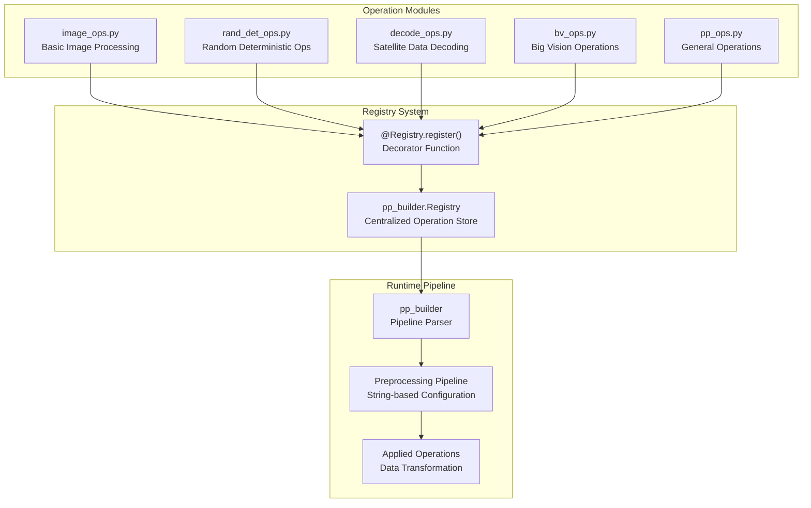
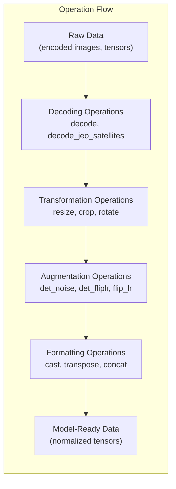
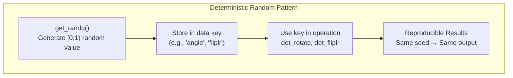

<!-- source: DeepWiki mcp.deepwiki.com · repo google-deepmind/jeo · page 4.1 Preprocessing Operations · fetched 2026-10-26 -->

# Preprocessing Operations

<details>
<summary>Relevant source files</summary>

The following files were used as context for generating this wiki page:

- [jeo/pp/bv_ops.py](jeo/pp/bv_ops.py)
- [jeo/pp/decode_ops.py](jeo/pp/decode_ops.py)
- [jeo/pp/image_ops.py](jeo/pp/image_ops.py)
- [jeo/pp/pp_ops.py](jeo/pp/pp_ops.py)
- [jeo/pp/rand_det_ops.py](jeo/pp/rand_det_ops.py)

</details>


This page documents all available preprocessing operations in the Jeo framework. Preprocessing operations are modular, composable functions that transform input data before feeding it to models. They handle tasks such as image decoding, resizing, augmentation, normalization, and satellite-specific data processing.

For information about how these operations are composed into preprocessing pipelines, see [Pipeline Configuration](#4.2). For details about the broader input pipeline system that uses these operations, see [Input Pipeline System](#3.1).

## Operation Registry System

All preprocessing operations in Jeo are registered using a centralized registry system. Operations are registered as factory functions that return the actual preprocessing function, enabling parameterization and reuse across different configurations.



**Sources:** [jeo/pp/pp_builder.py](), [jeo/pp/image_ops.py:22](), [jeo/pp/rand_det_ops.py:22](), [jeo/pp/decode_ops.py:19](), [jeo/pp/bv_ops.py:21](), [jeo/pp/pp_ops.py:29]()

## Operation Categories

Preprocessing operations are organized into five main categories based on their functionality:

| Category | Module | Purpose | Key Operations |
|----------|--------|---------|----------------|
| **Image Processing** | `image_ops.py` | Basic image transformations | `decode`, `resize`, `central_crop`, `random_crop` |
| **Random Deterministic** | `rand_det_ops.py` | Reproducible augmentations | `det_rotate`, `det_fliplr`, `det_crop`, `det_noise` |
| **Satellite Decoding** | `decode_ops.py` | Satellite-specific processing | `decode_jeo_satellites` |
| **Big Vision Operations** | `bv_ops.py` | Forked from big_vision | `value_range`, `onehot`, `lookup`, `keep`, `drop` |
| **General Operations** | `pp_ops.py` | Multi-modal and utility ops | `cast`, `transpose`, `jeo_concat`, `select_channels` |



**Sources:** [jeo/pp/image_ops.py:15-18](), [jeo/pp/rand_det_ops.py:15-18](), [jeo/pp/decode_ops.py:15](), [jeo/pp/bv_ops.py:15](), [jeo/pp/pp_ops.py:15-24]()

## Image Processing Operations

The `image_ops.py` module provides fundamental image processing operations for decoding, resizing, cropping, and basic augmentations.

### Decoding Operations

| Operation | Function | Description |
|-----------|----------|-------------|
| `decode` | `get_decode()` | Decode encoded image strings with optional precision control |
| `decode_jpeg_and_inception_crop` | `get_decode_jpeg_and_inception_crop()` | Combined JPEG decoding and inception-style cropping |

### Resizing Operations

| Operation | Function | Description |
|-----------|----------|-------------|
| `resize` | `get_resize()` | Resize image to specified dimensions |
| `resize_small` | `get_resize_small()` | Resize keeping aspect ratio, targeting smaller side |
| `resize_long` | `get_resize_long()` | Resize keeping aspect ratio, targeting longer side |

### Cropping Operations

| Operation | Function | Description |
|-----------|----------|-------------|
| `central_crop` | `get_central_crop()` | Extract center crop of specified size |
| `random_crop` | `get_random_crop()` | Random crop with optional multiple crops |
| `inception_crop` | `get_inception_crop()` | Inception-style random crop with area/aspect ratio control |

**Sources:** [jeo/pp/image_ops.py:26-51](), [jeo/pp/image_ops.py:53-86](), [jeo/pp/image_ops.py:104-158](), [jeo/pp/image_ops.py:160-202](), [jeo/pp/image_ops.py:204-229](), [jeo/pp/image_ops.py:231-264]()

## Random Deterministic Operations

The `rand_det_ops.py` module provides reproducible augmentation operations that use pre-generated random values stored in data keys for deterministic behavior.

### Key Pattern: Deterministic Randomness

These operations use the pattern of generating random values once and storing them in data keys (e.g., `"rollx"`, `"rolly"`, `"angle"`), then using these values consistently across operations:



### Core Operations

| Operation | Function | Random Key | Description |
|-----------|----------|------------|-------------|
| `randu` | `get_randu()` | User-specified | Generate random uniform float [0, 1) |
| `det_roll` | `get_det_roll()` | `rollx`, `rolly` | Deterministic image rolling |
| `det_rotate` | `get_det_rotate()` | `angle` | Smooth rotation using affine transform |
| `det_rotate90` | `get_det_rotate90()` | `angle` | Orthogonal rotation (90° increments) |
| `det_fliplr` | `get_det_fliplr()` | `fliplr` | Horizontal flip based on threshold |
| `det_crop` | `get_det_crop()` | `crop` | Deterministic random crop |
| `det_noise` | `get_det_noise()` | `noise` | Multiplicative or additive noise |

**Sources:** [jeo/pp/rand_det_ops.py:28-36](), [jeo/pp/rand_det_ops.py:39-49](), [jeo/pp/rand_det_ops.py:60-86](), [jeo/pp/rand_det_ops.py:89-120](), [jeo/pp/rand_det_ops.py:123-135](), [jeo/pp/rand_det_ops.py:173-193](), [jeo/pp/rand_det_ops.py:221-244]()

## Satellite Data Operations

The `decode_ops.py` module provides specialized operations for processing satellite imagery and geospatial data.

### Satellite Decoding

The primary operation `decode_jeo_satellites` handles standardized satellite data decoding with normalization and masking:


**Parameters:**
- `sat_keys`: List of satellite data keys to process
- `normalize`: Enable normalization (default: True)
- `zero_pad`: Set masked values to 0 (default: True)
- `clip`: Clip values to range (default: False)
- `vmin`, `vmax`: Clipping range (default: -1, 1)

**Sources:** [jeo/pp/decode_ops.py:23-59]()

## Big Vision Operations

The `bv_ops.py` module contains operations forked from the big_vision codebase, providing data manipulation and formatting utilities.

### Data Manipulation

| Operation | Function | Description |
|-----------|----------|-------------|
| `value_range` | `get_value_range()` | Transform values from one range to another |
| `lookup` | `get_lookup()` | Map strings to numbers using lookup tables |
| `onehot` | `get_onehot()` | One-hot encode labels with multi-label support |

### Data Structure Operations

| Operation | Function | Description |
|-----------|----------|-------------|
| `keep` | `get_keep()` | Keep only specified keys in data dictionary |
| `drop` | `get_drop()` | Remove specified keys from data dictionary |
| `copy` | `get_copy()` | Copy values between keys |
| `concat` | `get_concat()` | Concatenate tensors along specified axis |
| `pad_to_shape` | `get_pad_to_shape()` | Pad tensor to target shape |
| `choice` | `get_choice()` | Randomly sample entries from tensors |

**Sources:** [jeo/pp/bv_ops.py:27-66](), [jeo/pp/bv_ops.py:68-103](), [jeo/pp/bv_ops.py:106-141](), [jeo/pp/bv_ops.py:144-161](), [jeo/pp/bv_ops.py:164-176](), [jeo/pp/bv_ops.py:187-196](), [jeo/pp/bv_ops.py:211-236](), [jeo/pp/bv_ops.py:284-339]()

## General Operations

The `pp_ops.py` module provides general-purpose operations for multi-modal data processing and tensor manipulation.

### Data Type and Shape Operations

| Operation | Function | Description |
|-----------|----------|-------------|
| `cast` | `get_cast()` | Cast tensor to specified dtype |
| `transpose` | `get_transpose()` | Transpose tensor dimensions |
| `squeeze_dim` | `get_squeeze_dim()` | Remove dimension at specified axis |
| `expand_dim` | `get_expand_dim()` | Add dimension at specified axis |
| `ensure_4d` | `get_ensure_4d()` | Ensure tensor has 4 dimensions |
| `reshape` | `get_reshape()` | Reshape tensor to new shape |

### Multi-Modal Operations

| Operation | Function | Description |
|-----------|----------|-------------|
| `jeo_concat` | `get_concat()` | Concatenate with broadcasting support |
| `select_channels` | `get_select_channels()` | Select specific channels by index |
| `select_channels_by_name` | `get_select_channels_by_name()` | Select channels by name |
| `extract_channels` | `get_extract_channels()` | Extract channels to separate tensors |
| `add_meta_as_channel` | `get_add_meta_as_channel()` | Add metadata as image channel |

**Sources:** [jeo/pp/pp_ops.py:33-41](), [jeo/pp/pp_ops.py:44-52](), [jeo/pp/pp_ops.py:132-143](), [jeo/pp/pp_ops.py:174-185](), [jeo/pp/pp_ops.py:188-199](), [jeo/pp/pp_ops.py:245-258](), [jeo/pp/pp_ops.py:83-109](), [jeo/pp/pp_ops.py:261-266](), [jeo/pp/pp_ops.py:269-280](), [jeo/pp/pp_ops.py:283-292]()

## Common Patterns and Utilities

### InKeyOutKey Decorator

Many operations use the `@pp_utils.InKeyOutKey` decorator to standardize input/output key handling:

```python
@Registry.register("preprocess_ops.resize", replace=True)
@pp_utils.InKeyOutKey(indefault="image", outdefault="image")
def get_resize(size, method="bilinear", antialias=False):
    # Implementation handles single tensor
    def _resize(image):
        return tf.image.resize(image, size, method=method, antialias=antialias)
    return _resize
```

### Key Naming Conventions

- **Input keys**: Usually `"image"` for images, specific names for satellite data
- **Mask keys**: Suffix `"_mask"` for padding/validity masks  
- **Random keys**: Descriptive names like `"angle"`, `"fliplr"`, `"crop"`
- **Output keys**: Often same as input, or specified via `outkey` parameter

### Registration Pattern

All operations follow the registration pattern:
```python
@Registry.register("preprocess_ops.operation_name", replace=True)
def get_operation_name(parameters):
    def _operation(data):
        # Implementation
        return transformed_data
    return _operation
```

**Sources:** [jeo/pp/pp_utils.py](), [jeo/pp/image_ops.py:53-54](), [jeo/pp/rand_det_ops.py:28](), [jeo/pp/pp_ops.py:33]()

---

