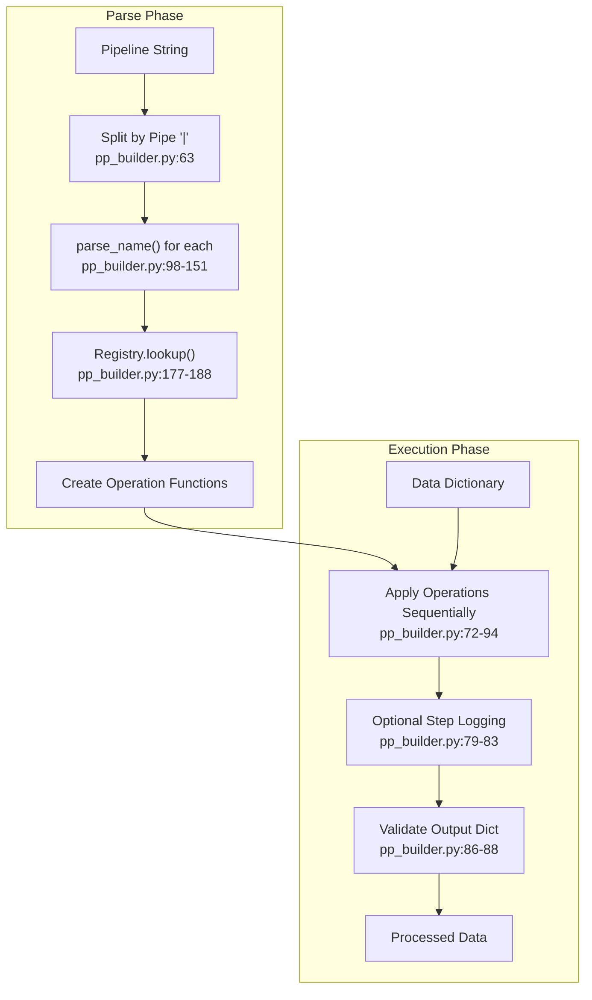

<!-- source: DeepWiki mcp.deepwiki.com · repo google-deepmind/jeo · page 4.2 Pipeline Configuration · fetched 2026-10-26 -->

# Pipeline Configuration

<details>
<summary>Relevant source files</summary>

The following files were used as context for generating this wiki page:

- [jeo/pp/pp_builder.py](jeo/pp/pp_builder.py)
- [jeo/pp/pp_utils.py](jeo/pp/pp_utils.py)
- [jeo/tools/bv_optax.py](jeo/tools/bv_optax.py)

</details>


This page describes how to configure and compose preprocessing pipelines in Jeo using the string-based specification language. Pipeline configuration defines the sequence of data transformations applied to input data before it reaches the model training loop.

For documentation of individual preprocessing operations available in pipelines, see [Preprocessing Operations](#4.1). For information about the broader data processing system, see [Data Processing](#4).

## Overview

Jeo uses a string-based mini-language to define preprocessing pipelines. This system, adapted from BigVision, allows you to specify complex data transformation sequences using a simple syntax. The pipeline configuration system consists of:

- **Pipeline Specification Language**: A string-based syntax for defining operation sequences
- **Registry System**: A global registry for preprocessing operations
- **Parser**: Converts pipeline strings into executable functions
- **Execution Engine**: Applies operations sequentially to data dictionaries

## Pipeline Specification Language

### Basic Syntax

Pipeline strings use the pipe (`|`) character to separate operations:

```
operation1|operation2(arg1, arg2)|operation3(key=value)
```

Each operation in the pipeline:
- Takes a dictionary as input and returns a dictionary as output
- Can have positional and keyword arguments
- Is applied sequentially from left to right

### Operation Format

Operations follow this format:
- Simple operation: `resize`
- With positional args: `resize(224, 224)`
- With keyword args: `resize(size=224)`
- Mixed arguments: `resize(224, interpolation="bilinear")`

**Sources**: [jeo/pp/pp_builder.py:31-96]()

## System Architecture

```mermaid
graph TB
    subgraph "Pipeline Configuration System"
        PipelineString["Pipeline String<br/>\"decode|resize(224)|normalize\""]
        Parser["pp_builder.parse_name()<br/>String Parser"]
        Registry["pp_builder.Registry<br/>Global Operation Registry"]
        Builder["pp_builder.get_preprocess_fn()<br/>Pipeline Builder"]
    end
    
    subgraph "Operation Registry"
        ImageOps["image_ops.py<br/>Registered Operations"]
        PPOps["pp_ops.py<br/>Registered Operations"] 
        DecodeOps["decode_ops.py<br/>Registered Operations"]
        CustomOps["Custom Operations<br/>User-defined"]
    end
    
    subgraph "Runtime Execution"
        DataDict["Input Data Dict<br/>{\"image\": tensor, ...}"]
        OpSequence["Sequential Operation<br/>Application"]
        ProcessedData["Processed Data Dict<br/>{\"image\": processed, ...}"]
    end
    
    PipelineString --> Parser
    Parser --> Registry
    Registry --> Builder
    Builder --> OpSequence
    
    ImageOps --> Registry
    PPOps --> Registry
    DecodeOps --> Registry
    CustomOps --> Registry
    
    DataDict --> OpSequence
    OpSequence --> ProcessedData
```

**Sources**: [jeo/pp/pp_builder.py:31-96](), [jeo/pp/pp_builder.py:153-196]()

## Pipeline Parsing and Execution Flow



**Sources**: [jeo/pp/pp_builder.py:31-96](), [jeo/pp/pp_builder.py:98-151]()

## Registry System

The Registry class manages global registration and lookup of preprocessing operations.

### Registration

Operations are registered using the `@Registry.register()` decorator:

```python
@Registry.register("preprocess_ops.my_operation")
def my_operation(arg1, arg2=None):
    def _operation(data):
        # Transform data dictionary
        return data
    return _operation
```

### Lookup Process

The registry lookup process handles:

1. **Name Parsing**: Extract operation name and arguments using `parse_name()`
2. **Registry Lookup**: Find registered function in global registry
3. **Partial Application**: Apply parsed arguments using `functools.partial()`

| Component | Function | Purpose |
|-----------|----------|---------|
| `parse_name()` | Parse operation strings | Extracts name, args, kwargs |
| `Registry.lookup()` | Find operations | Returns configured function |
| `Registry.register()` | Register operations | Adds to global registry |
| `Registry.knows()` | Check availability | Validates operation exists |

**Sources**: [jeo/pp/pp_builder.py:153-196](), [jeo/pp/pp_builder.py:98-151]()

## Configuration Examples

### Basic Image Pipeline

```
decode|resize(224)|normalize
```

This pipeline:
1. Decodes image data
2. Resizes to 224x224 pixels  
3. Normalizes pixel values

### Complex Pipeline with Arguments

```
decode|resize(size=256)|random_crop(224)|flip_lr(prob=0.5)|normalize(mean=[0.485, 0.456, 0.406])
```

This pipeline applies:
- Image decoding
- Resize to 256 pixels
- Random crop to 224x224
- Random horizontal flip with 50% probability
- Normalization with specified mean values

### Conditional Operations

```
decode|maybe_resize(224)|augment_if_training|normalize
```

Operations can include conditional logic based on training/evaluation mode.

**Sources**: [jeo/pp/pp_builder.py:31-59]()

## Utility Functions and Helpers

### InKeyOutKey Decorator

The `InKeyOutKey` decorator simplifies writing preprocessing operations that work on specific dictionary keys:

```python
@InKeyOutKey(indefault="image", outdefault="image")
def my_transform(scale_factor):
    def _transform(image_tensor):
        return image_tensor * scale_factor
    return _transform
```

### Key Features

| Feature | Description | Usage |
|---------|-------------|-------|
| `indefault` | Default input key | Specify source data key |
| `outdefault` | Default output key | Specify destination key |
| `with_data` | Access full data dict | Enable auxiliary data access |

### Helper Functions

| Function | Purpose | Location |
|----------|---------|----------|
| `maybe_repeat()` | Repeat arguments | [jeo/pp/pp_utils.py:26-29]() |
| `get_lookup_table()` | Create label mapping | [jeo/pp/pp_utils.py:32-51]() |
| `load_normalization_ranges()` | Load statistics | [jeo/pp/pp_utils.py:54-84]() |

**Sources**: [jeo/pp/pp_utils.py:87-126](), [jeo/pp/pp_utils.py:26-84]()

## Debugging and Logging

### Pipeline Logging

The `get_preprocess_fn()` function supports debugging through logging parameters:

| Parameter | Purpose | Effect |
|-----------|---------|---------|
| `log_data` | Log input/output data | Shows data before/after pipeline |
| `log_steps` | Log individual steps | Shows data at each operation |

### Example Usage

```python
preprocess_fn = get_preprocess_fn(
    "decode|resize(224)|normalize",
    log_data="my_dataset",
    log_steps=True
)
```

This configuration logs:
- Input data before preprocessing
- Data state after each operation
- Final output after all operations

**Sources**: [jeo/pp/pp_builder.py:31-96]()

## Temporary Operations

For testing or specialized use cases, you can register temporary operations using the `temporary_ops` context manager:

```python
with temporary_ops(
    custom_op=lambda alpha: lambda d: transform_data(d, alpha)):
    pp_fn = get_preprocess_fn("decode|custom_op(alpha=2.0)")
    result = pp_fn(data)
```

This allows:
- Runtime operation registration
- Scoped operation availability
- Testing of new operations without permanent registration

**Sources**: [jeo/pp/pp_builder.py:198-228]()

## Error Handling

### Common Errors

| Error Type | Cause | Solution |
|------------|-------|----------|
| `ValueError` | Syntax error in pipeline string | Check operation syntax |
| `KeyError` | Unknown operation name | Verify operation is registered |
| `SyntaxError` | Invalid argument parsing | Check argument format |

### Validation

The system validates:
- Pipeline string syntax during parsing
- Operation existence in registry
- Output dictionary format after execution

**Sources**: [jeo/pp/pp_builder.py:69-70](), [jeo/pp/pp_builder.py:86-88](), [jeo/pp/pp_builder.py:180-183]()

---

