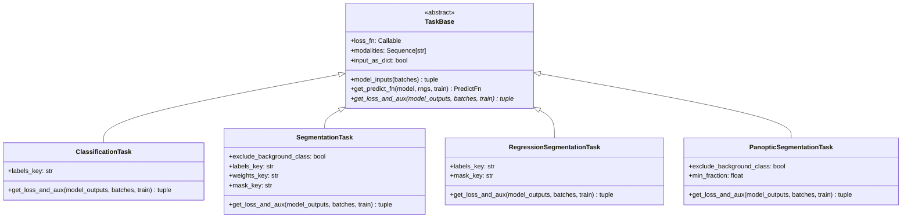
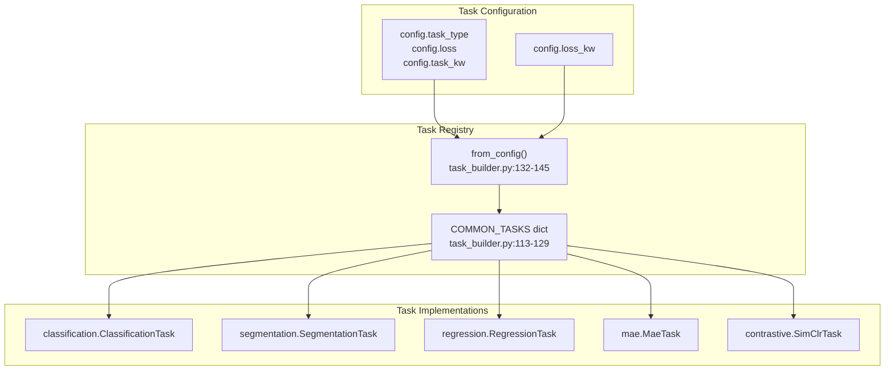
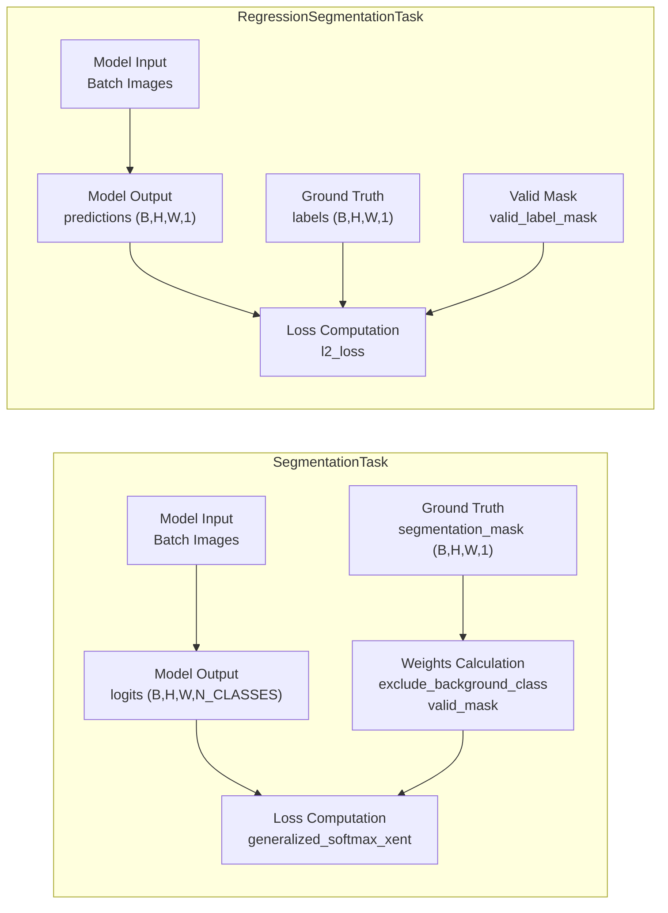
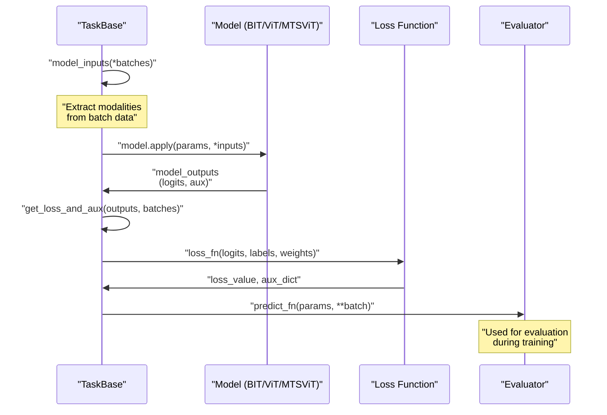
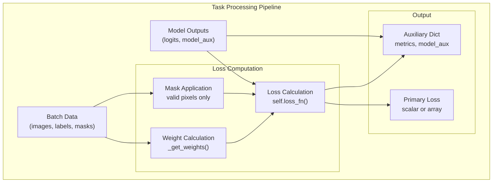

<!-- source: DeepWiki mcp.deepwiki.com · repo google-deepmind/jeo · page 5 Models and Tasks · fetched 2026-10-26 -->

# Models and Tasks

Relevant source files

The following files were used as context for generating this wiki page:

- [jeo/tasks/segmentation.py](jeo/tasks/segmentation.py)
- [jeo/tasks/task_builder.py](jeo/tasks/task_builder.py)

This document provides an overview of the model architectures and task definitions supported by the Jeo framework. It covers the abstract task system, available task types, and how models integrate with tasks during training and evaluation.

For detailed implementation information about specific model architectures, see [Model Implementations](#5.1). For information about configuring and defining custom tasks, see [Task Definitions](#5.2).

## Task System Architecture

The Jeo framework uses an abstract task system that separates the concerns of model computation, loss calculation, and data processing. Tasks define how to compute losses and auxiliary metrics from model outputs and batch data.

### Task Framework Hierarchy

*Sources: [jeo/tasks/task_builder.py:35-111](), [jeo/tasks/segmentation.py:22-157]()*

### Task Registration and Factory System

The framework uses a registration system to map task names to their implementations, allowing for easy configuration and extensibility.

*Sources: [jeo/tasks/task_builder.py:113-146]()*

## Available Task Types

The framework provides a comprehensive set of task types for different machine learning scenarios:

| Task Type | Implementation | Purpose |
|-----------|----------------|---------|
| `classification` | `classification.ClassificationTask` | Standard multi-class classification |
| `classification_multihead` | `classification.MultiHeadClassificationTask` | Multi-output classification |
| `classification_multilabel` | `classification.ClassificationTask` | Multi-label classification |
| `segmentation` | `segmentation.SegmentationTask` | Semantic segmentation |
| `regression_segmentation` | `segmentation.RegressionSegmentationTask` | Regression over spatial data |
| `panoptic_segmentation` | `segmentation.PanopticSegmentationTask` | Combined semantic + instance segmentation |
| `regression` | `regression.RegressionTask` | Standard regression |
| `masked_autoencoder` | `mae.MaeTask` | Self-supervised masked reconstruction |
| `simclr` | `contrastive.SimClrTask` | Contrastive learning |
| `ssl_classification` | `ssl_tasks.SslClassificationTask` | Semi-supervised classification |

*Sources: [jeo/tasks/task_builder.py:113-129]()*

### Segmentation Task Details

The segmentation tasks demonstrate the flexibility of the task system:

*Sources: [jeo/tasks/segmentation.py:22-106]()*

## Model-Task Integration

Tasks define how models interact with data and losses during training. The integration follows a standardized pattern:

### Model Input Processing

*Sources: [jeo/tasks/task_builder.py:53-111]()*

### Loss and Auxiliary Information Flow

Tasks are responsible for computing both the primary loss and auxiliary information that can be used for monitoring and evaluation:

*Sources: [jeo/tasks/segmentation.py:42-70]()*

## Task Configuration

Tasks are configured through the main configuration system and can accept various parameters:

### Base Task Parameters

All tasks inherit common configuration options from `TaskBase`:

- `loss_name`: Name of the loss function to use
- `loss_kw`: Additional keyword arguments for the loss function  
- `modalities`: Input modalities to extract from batch data (default: `("image",)`)
- `input_as_dict`: Whether to pass inputs as dictionary to model

### Task-Specific Parameters

Different task types accept specialized parameters:

**SegmentationTask**:
- `exclude_background_class`: Whether to exclude background pixels from loss
- `labels_key`: Key for segmentation labels in batch (default: `"segmentation_mask"`)
- `weights_key`: Optional key for pixel-wise weights
- `mask_key`: Key for valid pixel mask
- `model_aux_metrics`: Model auxiliary metrics to include in output

**RegressionSegmentationTask**:
- `labels_key`: Key for regression target values
- `mask_key`: Key for valid pixel mask

*Sources: [jeo/tasks/task_builder.py:38-51](), [jeo/tasks/segmentation.py:25-40](), [jeo/tasks/segmentation.py:76-81]()*

The task system provides a flexible foundation for defining how models, losses, and evaluation metrics interact during training, making it easy to extend Jeo to new problem domains and model architectures.

---

