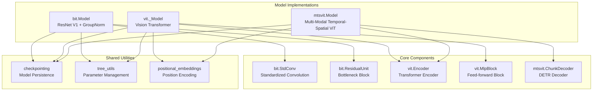
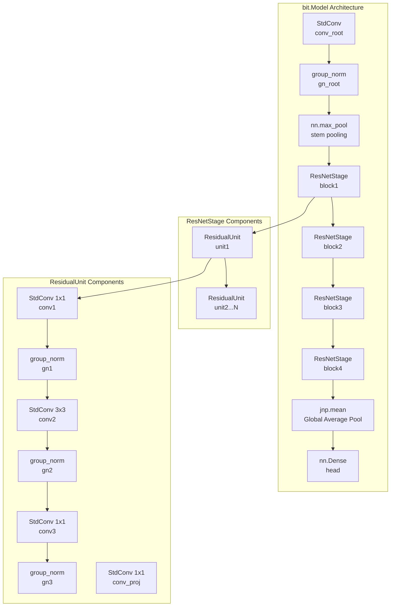
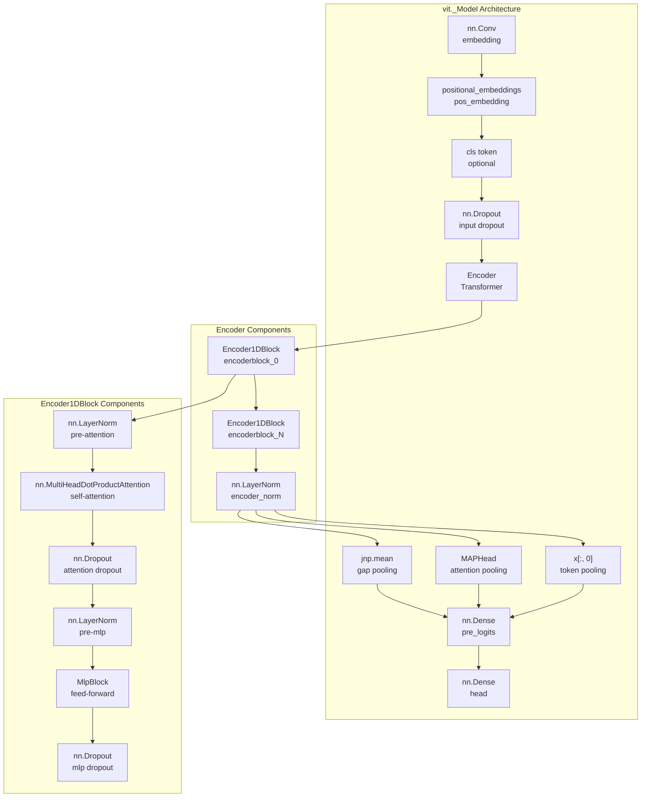
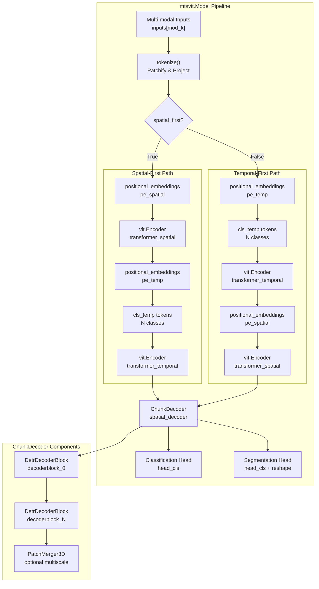
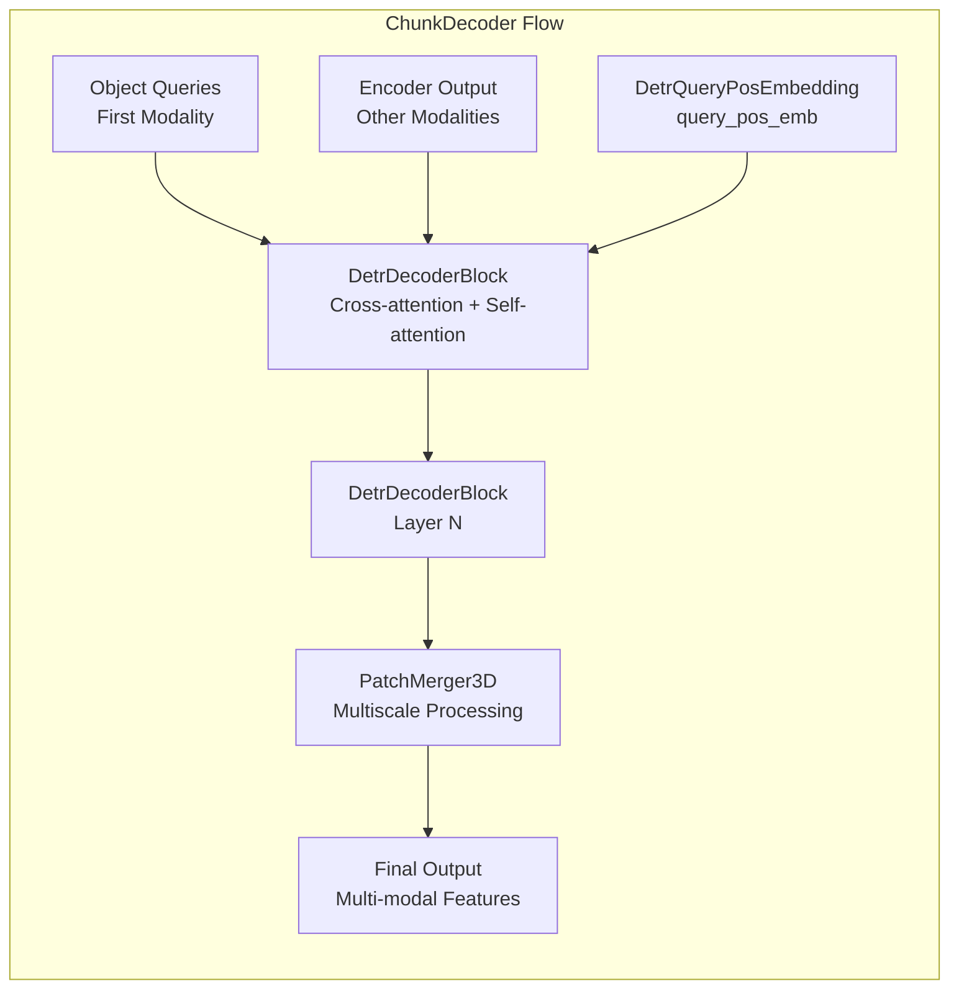

<!-- source: DeepWiki mcp.deepwiki.com · repo google-deepmind/jeo · page 5.1 Model Implementations · fetched 2026-10-26 -->

# Model Implementations

Relevant source files

The following files were used as context for generating this wiki page:

- [jeo/models/bit.py](jeo/models/bit.py)
- [jeo/models/mtsvit.py](jeo/models/mtsvit.py)
- [jeo/models/vit.py](jeo/models/vit.py)

This document provides detailed documentation of the three core model architectures implemented in the Jeo framework: BIT (ResNet V1), ViT (Vision Transformer), and MTSViT (Multi-Modal Temporal-Spatial Vision Transformer). Each model is designed for different use cases within geospatial machine learning tasks.

For information about how these models are integrated into training tasks, see [Task Definitions](#5.2). For details on the training system that orchestrates these models, see [Training System](#3.3).

## Model Architecture Overview

The Jeo framework implements three distinct model architectures, each optimized for different types of geospatial data and tasks:

**Sources:** [jeo/models/bit.py:1-176](), [jeo/models/vit.py:1-358](), [jeo/models/mtsvit.py:1-459]()

## BIT: ResNet V1 with GroupNorm

The BIT (Big Transfer) model is a ResNet V1 implementation enhanced with Group Normalization and weight standardization. It is particularly effective for transfer learning scenarios in geospatial applications.

### Architecture Components

**Sources:** [jeo/models/bit.py:94-141](), [jeo/models/bit.py:51-78](), [jeo/models/bit.py:80-92]()

### Key Implementation Details

| Component | Implementation | Purpose |
|-----------|---------------|---------|
| `StdConv` | [jeo/models/bit.py:36-43]() | Applies weight standardization to convolution kernels |
| `group_norm` | [jeo/models/bit.py:45-48]() | Adaptive GroupNorm with `min(32, channels)` groups |
| `ResidualUnit` | [jeo/models/bit.py:51-78]() | Bottleneck residual block with 1x1→3x3→1x1 convolutions |
| `get_block_desc` | [jeo/models/bit.py:146-155]() | Maps depth (26, 50, 101, 152, 200) to block configurations |

The model supports configurable depth, width scaling, and stem configurations through parameters like `depth`, `width`, `stem_conv_kernel`, and `stem_pool_kernel`.

**Sources:** [jeo/models/bit.py:94-103]()

## ViT: Vision Transformer

The Vision Transformer implementation follows the standard ViT architecture with support for various model sizes and configurations through a factory pattern.

### Architecture Components

**Sources:** [jeo/models/vit.py:142-231](), [jeo/models/vit.py:84-106](), [jeo/models/vit.py:55-82]()

### Model Variants and Configuration

The ViT implementation supports standard model variants through the `decode_variant` function:

| Variant | Width | Depth | MLP Dim | Heads |
|---------|-------|-------|---------|-------|
| Ti (Tiny) | 192 | 12 | 768 | 3 |
| S (Small) | 384 | 12 | 1536 | 6 |
| B (Base) | 768 | 12 | 3072 | 12 |
| L (Large) | 1024 | 24 | 4096 | 16 |
| H (Huge) | 1280 | 32 | 5120 | 16 |

**Sources:** [jeo/models/vit.py:238-257]()

The model factory function `Model` allows specifying variants like `"B/16"` for Base model with 16x16 patches:

**Sources:** [jeo/models/vit.py:233-236]()

## MTSViT: Multi-Modal Temporal-Spatial Vision Transformer

The MTSViT model extends the Vision Transformer architecture to handle multi-modal temporal-spatial data, making it particularly suitable for satellite time series analysis.

### Architecture Overview

**Sources:** [jeo/models/mtsvit.py:43-229](), [jeo/models/mtsvit.py:273-376]()

### Multi-Modal Processing

The MTSViT model handles multiple modalities with different spatial and temporal resolutions:

| Processing Stage | Function | Purpose |
|------------------|----------|---------|
| Tokenization | `tokenize()` | Converts each modality to patches and embeddings |
| Spatial/Non-spatial Split | [mtsvit.py:82-93]() | Separates modalities by spatial extent |
| Sequence Padding | `pad_and_pack_sequences()` | Handles variable temporal lengths |
| Attention Masking | `get_attention_masks()` | Creates masks for padded sequences |

**Sources:** [jeo/models/mtsvit.py:231-270](), [jeo/models/mtsvit.py:379-439]()

### ChunkDecoder Implementation

The `ChunkDecoder` implements a DETR-style transformer decoder for multi-modal interaction:

**Sources:** [jeo/models/mtsvit.py:273-376]()

## Common Patterns and Utilities

All three models share common implementation patterns and utilities:

### Checkpoint Loading and Parameter Management

Each model implements a `load` function for checkpoint initialization with support for parameter merging and compatibility fixes:

| Model | Load Function | Key Features |
|-------|---------------|--------------|
| BIT | [bit.py:169-175]() | Handles old GroupNorm parameter format |
| ViT | [vit.py:317-336]() | Position embedding resampling, old checkpoint fixes |
| MTSViT | Inherits from components | Uses shared checkpointing utilities |

**Sources:** [jeo/models/bit.py:158-175](), [jeo/models/vit.py:278-336]()

### Parameter Initialization and Configuration

All models follow consistent patterns for parameter initialization:

- Zero initialization for classification heads when `head_zeroinit=True`
- Xavier uniform initialization for attention weights
- Learnable or sinusoidal position embeddings
- Configurable dropout rates for training

**Sources:** [jeo/models/bit.py:135-136](), [jeo/models/vit.py:224-226](), [jeo/models/mtsvit.py:121-122]()

### Output Format Standardization

All models return a tuple `(logits, outputs_dict)` where:
- `logits`: Primary model output for the task
- `outputs_dict`: Dictionary containing intermediate representations like `pre_logits`, `logits_2d`, `stem`, etc.

This standardization enables consistent integration with the training and evaluation framework.

**Sources:** [jeo/models/bit.py:140](), [jeo/models/vit.py:230](), [jeo/models/mtsvit.py:229]()

---

