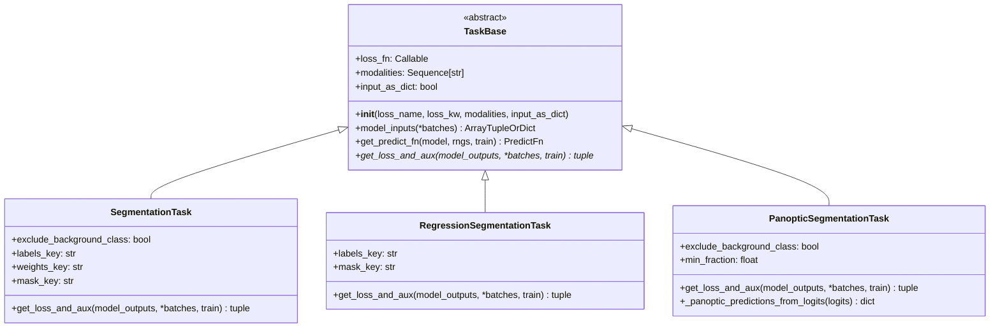
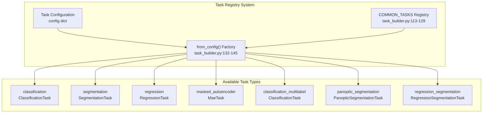
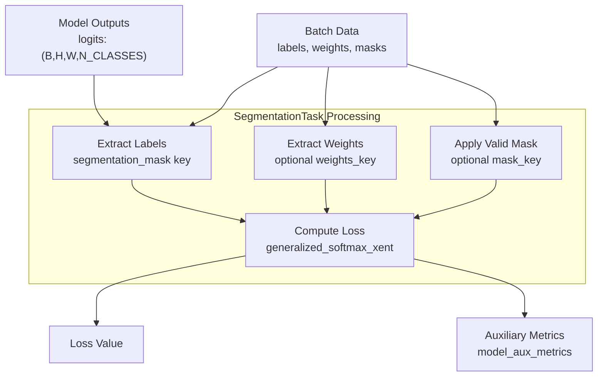
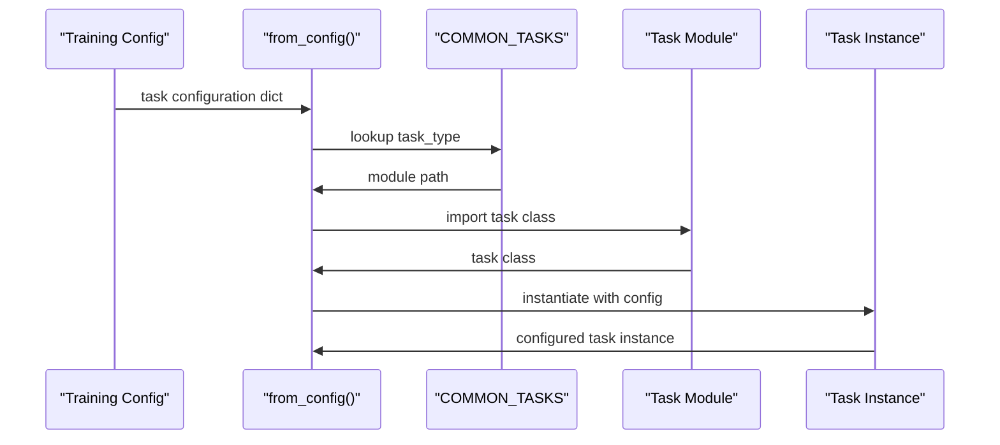
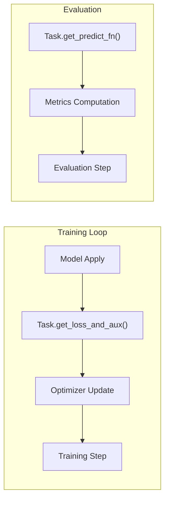

<!-- source: DeepWiki mcp.deepwiki.com · repo google-deepmind/jeo · page 5.2 Task Definitions · fetched 2026-10-26 -->

# Task Definitions

Relevant source files

The following files were used as context for generating this wiki page:

- [jeo/tasks/segmentation.py](jeo/tasks/segmentation.py)
- [jeo/tasks/task_builder.py](jeo/tasks/task_builder.py)

This document covers the task definition system in Jeo, which provides an abstraction layer for different machine learning tasks such as classification, segmentation, and regression. Tasks bridge the gap between model outputs and loss computation by defining how to extract meaningful predictions from model outputs and compute appropriate losses for different problem types.

For information about specific model architectures, see [Model Implementations](#5.1). For details about loss functions used by tasks, see [Loss Functions](#8). For evaluation and metrics, see [Evaluation and Metrics](#7).

## Overview

The task system in Jeo follows an object-oriented design where all tasks inherit from a common `TaskBase` abstract class. Tasks are responsible for:

- Processing model inputs before feeding them to the model
- Extracting loss values and auxiliary metrics from model outputs
- Providing prediction functions for evaluation
- Managing task-specific configuration parameters

## Task Interface

The core task interface is defined by the `TaskBase` abstract class, which provides a consistent API for all task types.

**Sources:** [jeo/tasks/task_builder.py:35-111](), [jeo/tasks/segmentation.py:22-41](), [jeo/tasks/segmentation.py:73-82](), [jeo/tasks/segmentation.py:109-116]()

### Core Methods

#### `model_inputs()`
Processes raw batch data into the format expected by the model. By default, extracts specified modalities from the batch and returns them as a tuple.

#### `get_predict_fn()`
Returns a prediction function that applies the model to inputs and formats outputs for evaluation. This function handles the interface between the model and evaluation system.

#### `get_loss_and_aux()` (Abstract)
The core method that must be implemented by each task. Takes model outputs and batch data, returning a loss value and auxiliary metrics dictionary.

**Sources:** [jeo/tasks/task_builder.py:53-72](), [jeo/tasks/task_builder.py:74-104](), [jeo/tasks/task_builder.py:106-111]()

## Task Registry and Factory

Jeo provides a registry system for common task types and a factory function for creating tasks from configuration.

**Sources:** [jeo/tasks/task_builder.py:113-129](), [jeo/tasks/task_builder.py:132-145]()

The `COMMON_TASKS` registry maps task type strings to their implementation paths:

| Task Type | Implementation Path | Description |
|-----------|-------------------|-------------|
| `classification` | `classification.ClassificationTask` | Standard image classification |
| `segmentation` | `segmentation.SegmentationTask` | Semantic segmentation |
| `regression` | `regression.RegressionTask` | Regression tasks |
| `panoptic_segmentation` | `segmentation.PanopticSegmentationTask` | Panoptic segmentation |
| `regression_segmentation` | `segmentation.RegressionSegmentationTask` | Pixel-wise regression |
| `masked_autoencoder` | `mae.MaeTask` | Masked autoencoder tasks |

## Segmentation Task Implementations

The segmentation module demonstrates how different task variations can be implemented while sharing common functionality.

### SegmentationTask

The standard semantic segmentation task handles pixel-wise classification with support for background exclusion and masking.

**Key Parameters:**
- `exclude_background_class`: Whether to exclude background pixels from loss computation
- `labels_key`: Key for segmentation masks in batch data (default: "segmentation_mask")  
- `weights_key`: Optional key for pixel weights
- `mask_key`: Key for valid pixel mask (default: "{labels_key}_mask")

**Sources:** [jeo/tasks/segmentation.py:22-41](), [jeo/tasks/segmentation.py:42-70]()

### RegressionSegmentationTask

Handles pixel-wise regression tasks where each pixel predicts a continuous value rather than a class.

**Key Features:**
- Uses L2 loss by default instead of cross-entropy
- Supports valid pixel masking
- Handles single-channel regression outputs

**Sources:** [jeo/tasks/segmentation.py:73-106]()

### PanopticSegmentationTask

Combines semantic and instance segmentation into a unified panoptic segmentation task.

**Key Features:**
- Processes both semantic and instance predictions
- Filters small objects based on `min_fraction` parameter
- Computes separate losses for semantic and instance branches

**Sources:** [jeo/tasks/segmentation.py:109-157]()

## Task Configuration

Tasks are typically configured through the training configuration system. The `from_config()` factory function handles task instantiation:

**Configuration Parameters:**
- `task_type`: String identifying the task type (maps to `COMMON_TASKS`)
- `loss`: Loss function name (passed as `loss_name`)
- `loss_kw`: Additional loss function parameters
- `task_kw`: Task-specific parameters

**Sources:** [jeo/tasks/task_builder.py:132-145]()

## Integration with Training System

Tasks integrate with the broader training system by providing a standardized interface for loss computation and model evaluation.

The task system ensures consistent interfaces across different problem types while allowing for task-specific customizations in loss computation, input processing, and evaluation metrics.

**Sources:** [jeo/tasks/task_builder.py:74-104](), [jeo/tasks/task_builder.py:106-111]()

---

