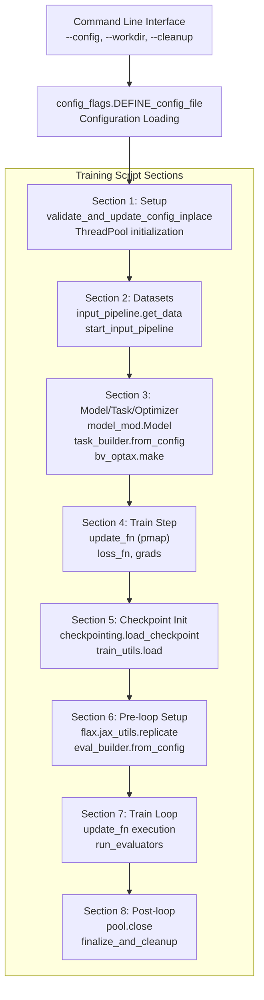
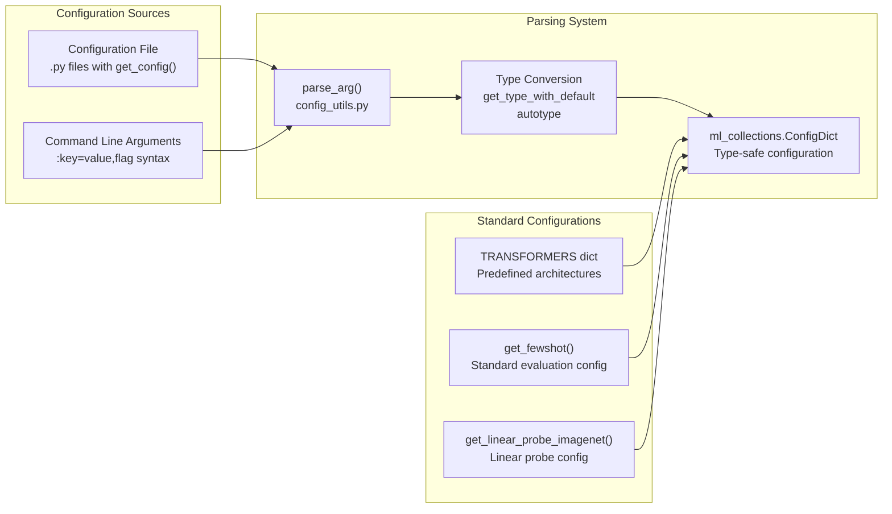
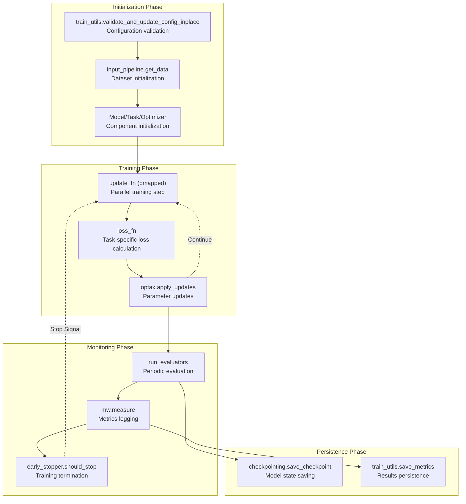
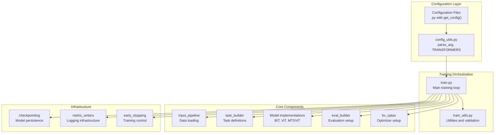

<!-- source: DeepWiki mcp.deepwiki.com · repo google-deepmind/jeo · page 6 Training and Configuration · fetched 2026-10-26 -->

# Training and Configuration

<details>
<summary>Relevant source files</summary>

The following files were used as context for generating this wiki page:

- [jeo/configs/config_utils.py](jeo/configs/config_utils.py)
- [jeo/train.py](jeo/train.py)

</details>


This page provides a comprehensive guide to configuring and running training experiments in Jeo. It covers the main training script, configuration system, command-line interface, and available utilities for experiment management.

For information about specific model architectures and task definitions, see [Models and Tasks](#5). For details about the evaluation system and metrics, see [Evaluation and Metrics](#7). For training utilities like checkpointing and distributed training, see [Training Utilities](#6.3).

## Overview

Jeo's training and configuration system is built around a central training script (`train.py`) that orchestrates the entire training process through a modular configuration system. The framework uses ML Collections for configuration management and provides flexible parameter parsing for experiment customization.

## Training Script Architecture

The main training script follows a structured approach with eight distinct sections that handle different aspects of the training lifecycle.



Sources: [jeo/train.py:70-481]()

The training script uses a systematic approach where each section has specific responsibilities:

| Section | Purpose | Key Functions |
|---------|---------|---------------|
| Setup | Environment initialization, config validation | `validate_and_update_config_inplace`, `import_module` |
| Datasets | Data pipeline setup | `input_pipeline.get_data`, `start_input_pipeline` |
| Model/Task/Optimizer | Core component initialization | `task_builder.from_config`, `bv_optax.make` |
| Train Step | Update function definition | `update_fn` (pmapped), `loss_fn` |
| Checkpoint | Model state loading | `checkpointing.load_checkpoint`, `train_utils.load` |
| Pre-loop | Replication and evaluator setup | `flax.jax_utils.replicate`, `eval_builder.from_config` |
| Train Loop | Main training execution | Training step execution, evaluation |
| Post-loop | Cleanup and finalization | `pool.close`, `finalize_and_cleanup` |

Sources: [jeo/train.py:72-481]()

## Configuration System

Jeo uses a sophisticated configuration parsing system that supports both file-based configurations and command-line parameter overrides.



Sources: [jeo/configs/config_utils.py:47-108](), [jeo/configs/config_utils.py:19-39](), [jeo/configs/config_utils.py:144-212]()

### Parameter Parsing

The `parse_arg` function provides flexible configuration parsing with several supported formats:

```python
# Examples of configuration syntax
--config amazing.py:runlocal,schedule=long,res=128
--config amazing.py:res=128
--config amazing.py:runlocal              # Boolean flag
--config amazing.py:runlocal=False        # Explicit false
--config amazing.py:128                   # Unnamed first parameter
```

The parser supports automatic type conversion and strict boolean parsing for robust configuration handling.

Sources: [jeo/configs/config_utils.py:47-108]()

### Predefined Configurations

Jeo includes several standard configuration templates:

**Transformer Architectures**
```python
TRANSFORMERS = {
    "TinyToy": dict(num_layers=3, num_heads=1, mlp_dim=192, emb_dim=48),
    "B": dict(num_layers=12, num_heads=12, mlp_dim=3072, emb_dim=768),
    "L": dict(num_layers=24, num_heads=16, mlp_dim=4096, emb_dim=1024),
    # ... additional architectures
}
```

**Standard Evaluation Configurations**
- `get_fewshot()`: Few-shot learning evaluation setup
- `get_linear_probe_imagenet()`: ImageNet linear probing configuration

Sources: [jeo/configs/config_utils.py:19-39](), [jeo/configs/config_utils.py:144-176](), [jeo/configs/config_utils.py:178-212]()

## Command-Line Interface

The training script provides several command-line flags for experiment control:

| Flag | Type | Purpose |
|------|------|---------|
| `--config` | config_file | Training configuration file path |
| `--workdir` | string | Work unit directory for outputs |
| `--cleanup` | boolean | Delete workdir after successful completion |
| `--file_group` | string | Permission group for file storage |
| `--data_service_address` | string | tf.data service address |

Sources: [jeo/train.py:45-58]()

### Configuration File Integration

The training script uses ML Collections' `config_flags.DEFINE_config_file()` to load configuration files with lock protection to prevent accidental modification during training.

Sources: [jeo/train.py:45-46]()

## Training Flow and Lifecycle

The training process follows a well-defined lifecycle with clear separation of concerns:



Sources: [jeo/train.py:80-463]()

### Key Training Components

**Update Function**: The core training step is implemented as a pmapped function that handles:
- Random number generation for stochastic components
- Mixup augmentation for segmentation tasks
- Loss computation and gradient calculation
- Parameter updates and state management

**Evaluation Integration**: Training integrates with the evaluation system through:
- `eval_builder.from_config()` for evaluator initialization
- `run_evaluators()` for periodic evaluation
- Early stopping based on evaluation metrics

**Checkpointing**: Model persistence is handled through:
- Automatic checkpoint saving at configured intervals
- Resume functionality from existing checkpoints
- Model initialization from pretrained weights

Sources: [jeo/train.py:256-301](), [jeo/train.py:361-381](), [jeo/train.py:308-332]()

## Integration with Framework Components

The training and configuration system serves as the central orchestrator that integrates all framework components:



Sources: [jeo/train.py:29-41](), [jeo/train.py:185-355]()

This architecture provides a clean separation between configuration management, training orchestration, and component integration, enabling flexible experimentation while maintaining code organization and reusability.

---

