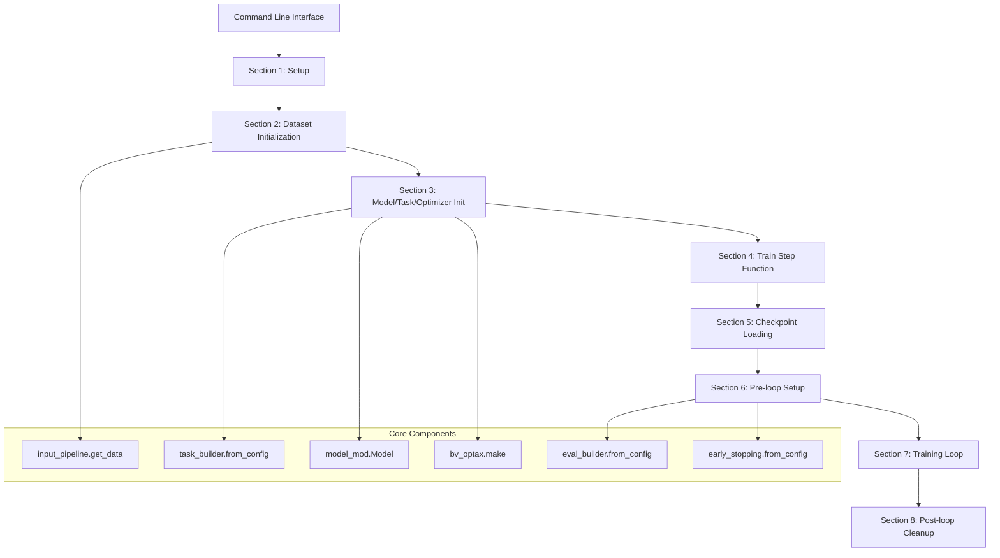
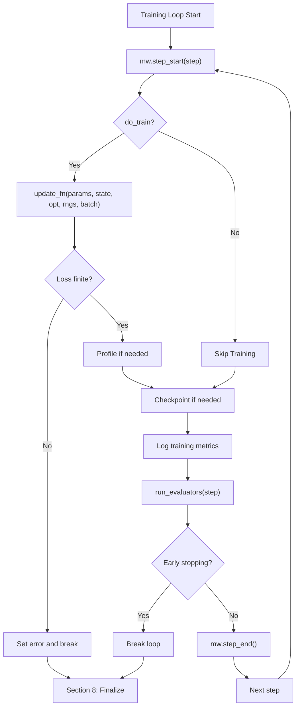
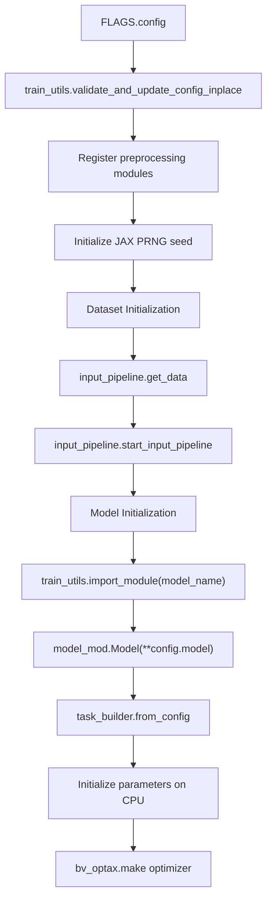
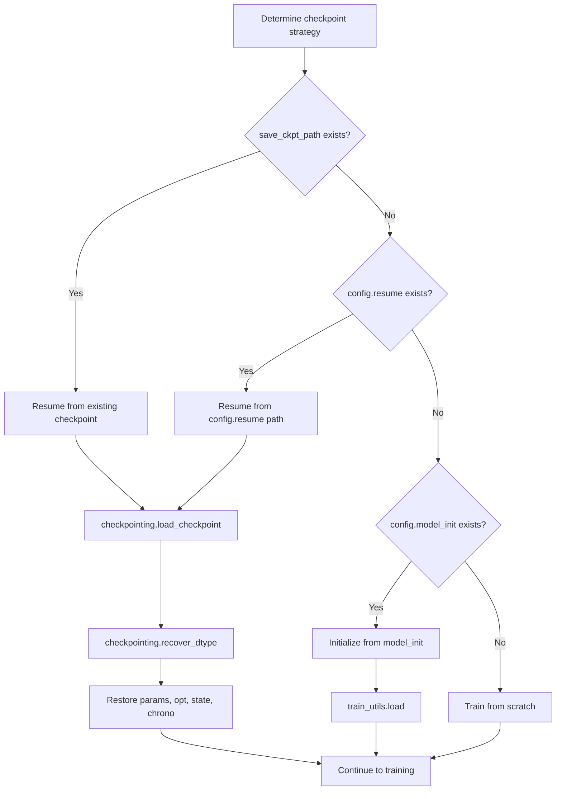
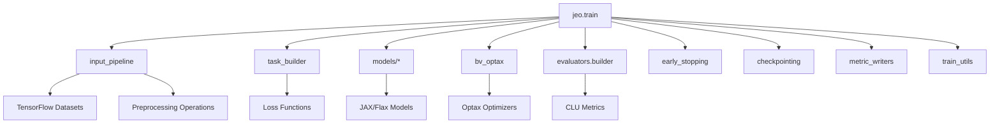
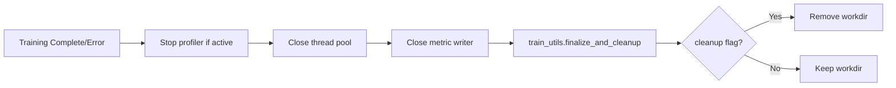

<!-- source: DeepWiki mcp.deepwiki.com · repo google-deepmind/jeo · page 6.1 Training Script · fetched 2026-10-26 -->

# Training Script

Relevant source files

The following files were used as context for generating this wiki page:

- [README.md](README.md)
- [jeo/train.py](jeo/train.py)

## Purpose and Scope

The training script serves as the main entry point for training machine learning models in the Jeo framework. It orchestrates the complete training workflow from data loading through model training to evaluation and checkpointing. This document covers the `jeo.train` module which implements the core training loop and coordinates all training-related components.

For information about specific model architectures, see [Model Implementations](#5.1). For details about task definitions and loss functions, see [Task Definitions](#5.2) and [Loss Functions](#8). For evaluation specifics, see [Evaluators](#7.2).

## Command-Line Interface

The training script is invoked through the `jeo.train` module and accepts several command-line flags for configuration:

| Flag | Type | Description |
|------|------|-------------|
| `--config` | config_file | Training configuration file (required) |
| `--workdir` | string | Work unit directory for outputs |
| `--cleanup` | boolean | Delete workdir after successful completion |
| `--file_group` | string | Permission group for file storage |
| `--data_service_address` | string | Address for tf.data service |

The script follows the standard pattern of configuration-driven training where most parameters are specified in configuration files rather than command-line arguments.

Sources: [jeo/train.py:45-58]()

## Training Script Architecture

The training script implements a structured 8-section architecture that coordinates all training components:

Sources: [jeo/train.py:70-481]()

## Training Loop Flow

The core training loop implements a pmapped JAX training step with comprehensive monitoring and evaluation:

The `update_fn` is a pmapped JAX function that performs the actual parameter updates:

```mermaid
flowchart LR
    UpdateFn["update_fn(params, state, opt, rng, batch)"] --> RNG["Split RNG"]
    RNG --> Mixup["Apply mixup if configured"]
    Mixup --> LossFn["loss_fn(params, state, batch)"]
    LossFn --> ModelApply["model.apply with train=True"]
    ModelApply --> TaskLoss["task.get_loss_and_aux"]
    TaskLoss --> Grads["jax.value_and_grad"]
    Grads --> PMean["jax.lax.pmean across devices"]
    PMean --> OptUpdate["tx.update(grads, opt, params)"]
    OptUpdate --> ApplyUpdates["optax.apply_updates"]
    ApplyUpdates --> Measurements["Collect measurements"]
    Measurements --> Return["Return updated params, state, opt"]
```

Sources: [jeo/train.py:256-300](), [jeo/train.py:398-464]()

## Configuration and Initialization

The training script implements a comprehensive initialization process that handles model setup, optimizer configuration, and component registration:

### Component Registration and Setup

### Parameter Initialization

The script uses a careful approach to parameter initialization, ensuring all parameters are created on CPU before being replicated to devices:

- Parameters are initialized using a CPU-backed JIT function
- Model state and parameters are separated using `flax.core.pop`
- Optional head bias initialization for better convergence
- Parameter freezing support through the schedule configuration

Sources: [jeo/train.py:184-254]()

## Checkpointing and Resuming

The training script implements a sophisticated checkpointing system with multiple resumption strategies:

### Checkpoint Resolution Priority

### Checkpoint Saving

The script implements asynchronous checkpoint saving with configurable retention:

- Checkpoints are saved at intervals specified by `ckpt_steps`
- Optional checkpoint copying at `keep_ckpt_steps` intervals
- Asynchronous saving using thread pool to avoid blocking training
- Timeout handling for checkpoint operations

Sources: [jeo/train.py:308-332](), [jeo/train.py:415-438]()

## Integration with Other Components

The training script serves as the central orchestrator, integrating multiple framework components:

### Component Integration Map

### Evaluation Integration

The script implements periodic evaluation through the `run_evaluators` function:

- Evaluators are run at specified intervals or when early stopping is triggered
- Metrics are collected and written to the metric writer
- Early stopping decisions are made based on evaluation results
- Final metrics are saved at training completion

Sources: [jeo/train.py:361-381]()

## Error Handling and Cleanup

The training script implements comprehensive error handling and cleanup procedures:

### Error Detection and Handling

- **Loss validation**: Training stops if loss becomes NaN or infinite
- **Early stopping**: Configurable early stopping based on metric thresholds
- **Timeout handling**: Checkpoint operations have configurable timeouts
- **Exception propagation**: Errors are collected and reported after cleanup

### Cleanup Procedures

The script ensures proper resource cleanup regardless of how training terminates, including:

- Thread pool closure and join
- Metric writer cleanup
- Optional workdir deletion
- Error reporting through the cleanup process

Sources: [jeo/train.py:465-481]()

---

