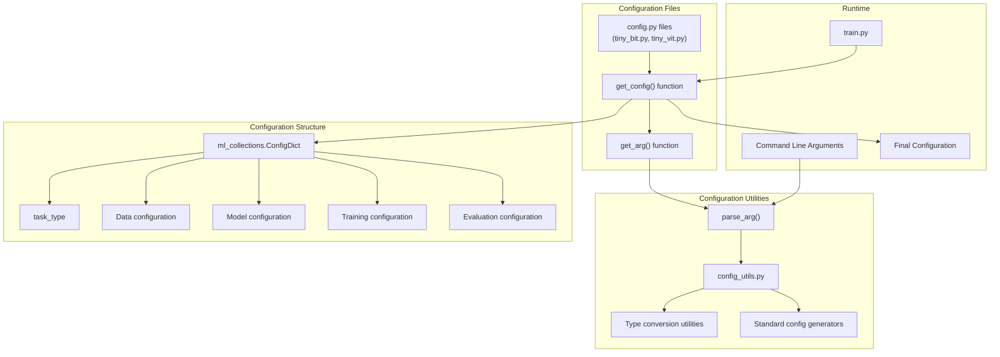
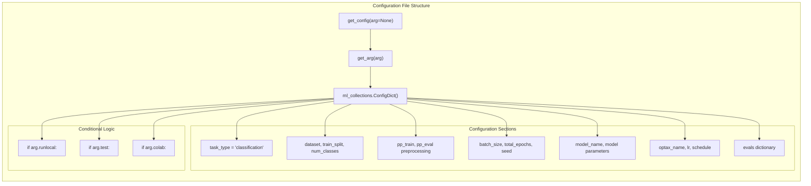
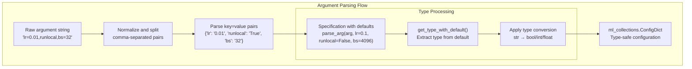
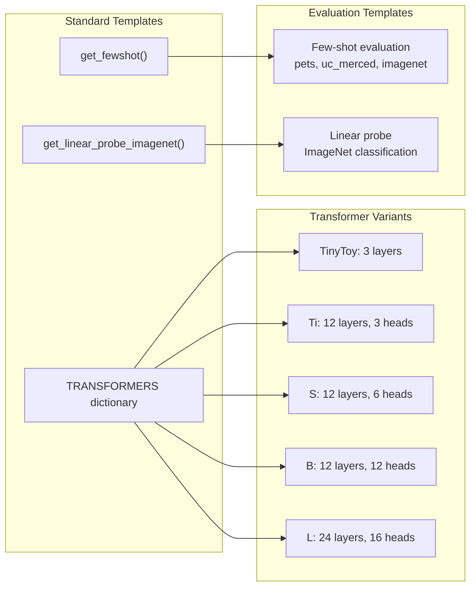
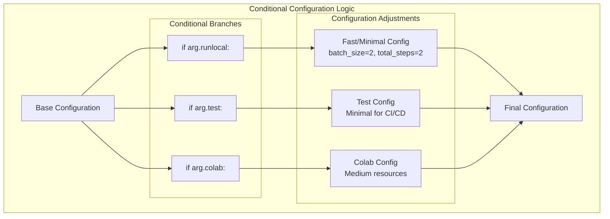

<!-- source: DeepWiki mcp.deepwiki.com · repo google-deepmind/jeo · page 6.2 Configuration System · fetched 2026-10-26 -->

# Configuration System

<details>
<summary>Relevant source files</summary>

The following files were used as context for generating this wiki page:

- [jeo/configs/config_utils.py](jeo/configs/config_utils.py)
- [jeo/configs/tests/tiny_bit.py](jeo/configs/tests/tiny_bit.py)
- [jeo/configs/tests/tiny_vit.py](jeo/configs/tests/tiny_vit.py)

</details>


The Configuration System in Jeo provides a flexible, Python-based approach to defining and managing training configurations. It uses `ml_collections.ConfigDict` objects to represent hierarchical configurations and supports dynamic parameter overrides through command-line arguments.

For information about training execution and the main training script, see [Training Script](#6.1). For details about training utilities like checkpointing, see [Training Utilities](#6.3).

## Overview

The configuration system is built around Python configuration files that define training parameters, model architectures, data processing pipelines, and evaluation settings. Each configuration file contains a `get_config()` function that returns a structured configuration object, with support for command-line parameter overrides.



Sources: [jeo/configs/config_utils.py:1-212](), [jeo/configs/tests/tiny_bit.py:1-128](), [jeo/configs/tests/tiny_vit.py:1-137]()

## Configuration File Structure

Configuration files follow a standardized pattern with specific functions and structure:

### Core Functions

| Function | Purpose | Arguments |
|----------|---------|-----------|
| `get_config()` | Main entry point that returns the complete configuration | `arg=None` (command-line arguments) |
| `get_arg()` | Parses command-line arguments with defaults | `arg` (raw argument string) |
| `nosweep()` | Placeholder for hyperparameter sweeps | `add` (unused) |
| `metrics()` | Defines which metrics to track | Variable arguments |

### Configuration Sections

Each configuration contains these main sections:

- **Task Configuration**: `task_type`, model selection
- **Data Configuration**: Dataset, splits, preprocessing
- **Training Configuration**: Batch size, epochs, logging intervals
- **Model Configuration**: Architecture-specific parameters
- **Optimizer Configuration**: Learning rate, weight decay, schedules
- **Evaluation Configuration**: Evaluators and metrics



Sources: [jeo/configs/tests/tiny_bit.py:25-116](), [jeo/configs/tests/tiny_vit.py:21-125]()

## Argument Parsing System

The `parse_arg()` function in `config_utils.py` provides flexible command-line argument parsing with automatic type conversion:

### Argument Syntax

Arguments can be passed in several formats:

| Format | Example | Description |
|--------|---------|-------------|
| Key-value pairs | `--config config.py:lr=0.01,bs=32` | Explicit parameter setting |
| Boolean flags | `--config config.py:runlocal` | Boolean flag (defaults to True) |
| Explicit boolean | `--config config.py:runlocal=False` | Explicit boolean value |
| Unnamed single value | `--config config.py:128` | Value for first spec parameter |

### Type Conversion

The system automatically converts string arguments to appropriate types:

- **Boolean**: `'True'`/`'true'` → `True`, `'False'`/`'false'`/`''` → `False`
- **Integer**: Numeric strings → `int`
- **Float**: Decimal strings → `float`
- **String**: Everything else remains as string



Sources: [jeo/configs/config_utils.py:47-108](), [jeo/configs/config_utils.py:111-142]()

## Standard Configuration Templates

The `config_utils.py` module provides standard configuration templates for common use cases:

### Transformer Configurations

The `TRANSFORMERS` dictionary contains predefined transformer architectures:

| Variant | Layers | Heads | MLP Dim | Embedding Dim | Use Case |
|---------|--------|-------|---------|---------------|-----------|
| `"TinyToy"` | 3 | 1 | 192 | 48 | Testing |
| `"Ti"` | 12 | 3 | 768 | 192 | Tiny models |
| `"S"` | 12 | 6 | 1536 | 384 | Small models |
| `"B"` | 12 | 12 | 3072 | 768 | Base models |
| `"L"` | 24 | 16 | 4096 | 1024 | Large models |

### Standard Evaluation Configurations

- **Few-shot evaluation**: `get_fewshot()` creates standard few-shot learning configurations
- **Linear probe**: `get_linear_probe_imagenet()` creates ImageNet linear probing setups



Sources: [jeo/configs/config_utils.py:19-39](), [jeo/configs/config_utils.py:144-175](), [jeo/configs/config_utils.py:178-211]()

## Conditional Configuration

Configuration files support conditional logic based on runtime flags to adapt for different execution environments:

### Common Conditional Flags

| Flag | Purpose | Typical Changes |
|------|---------|-----------------|
| `runlocal` | Fast local testing | Small batch sizes, fewer steps, reduced model size |
| `test` | Unit testing | Minimal configuration for CI/CD |
| `colab` | Colab notebook execution | Medium batch sizes, shorter training |

### Configuration Overrides

When conditional flags are set, configurations are automatically adjusted:

```python
if arg.runlocal:
    config.batch_size = 2
    config.total_steps = 2
    config.model.variant = "Ti/16"  # Smaller model
    config.evals.val.steps = 2
    del config.ckpt_steps  # No checkpointing
```



Sources: [jeo/configs/tests/tiny_bit.py:84-115](), [jeo/configs/tests/tiny_vit.py:88-124]()

## Integration with Training Pipeline

The configuration system integrates seamlessly with Jeo's training pipeline:

1. **Configuration Loading**: The training script imports and calls `get_config()` from the specified configuration file
2. **Argument Processing**: Command-line arguments are parsed and merged with base configuration
3. **Configuration Validation**: Type checking and validation occur during parsing
4. **Runtime Access**: Training components access configuration parameters via dot notation

The configuration object becomes the single source of truth for all training parameters, ensuring consistency across data loading, model initialization, training loops, and evaluation.

Sources: [jeo/configs/config_utils.py:1-212](), [jeo/configs/tests/tiny_bit.py:1-128](), [jeo/configs/tests/tiny_vit.py:1-137]()

---

