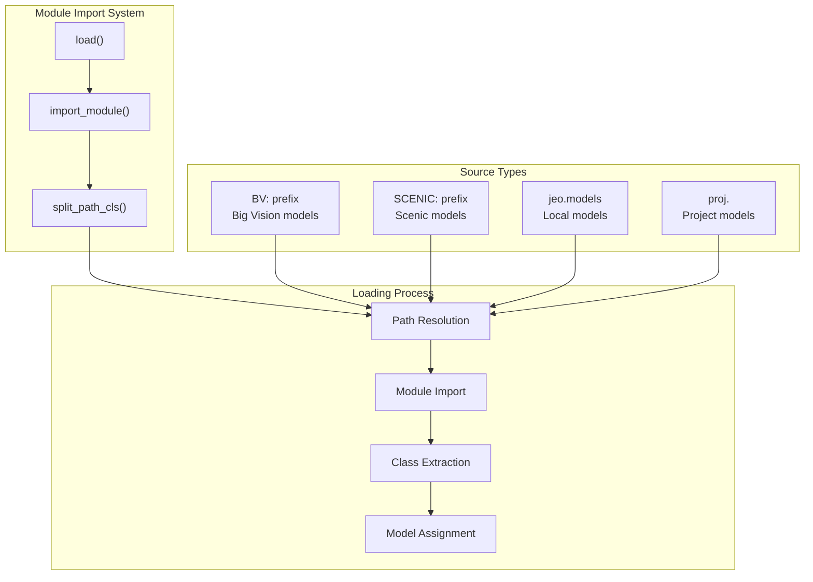
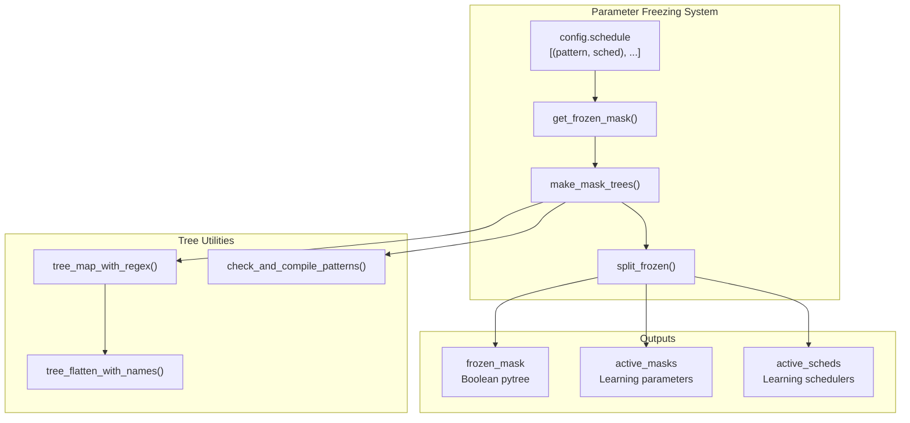
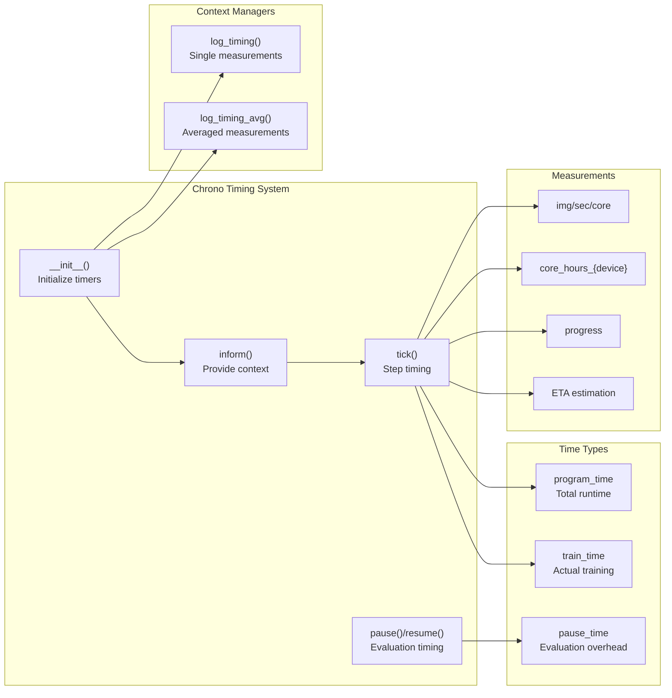
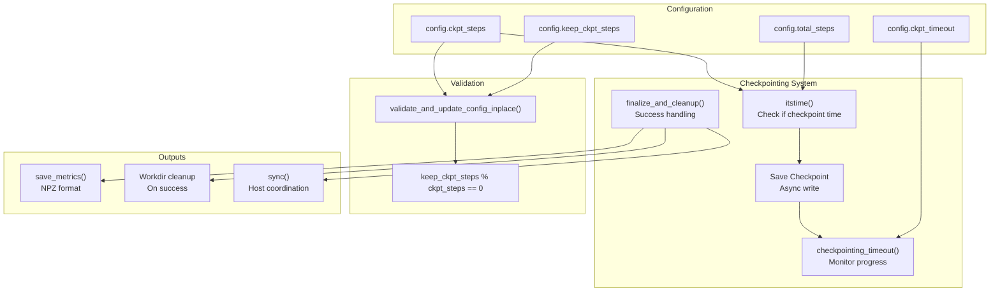
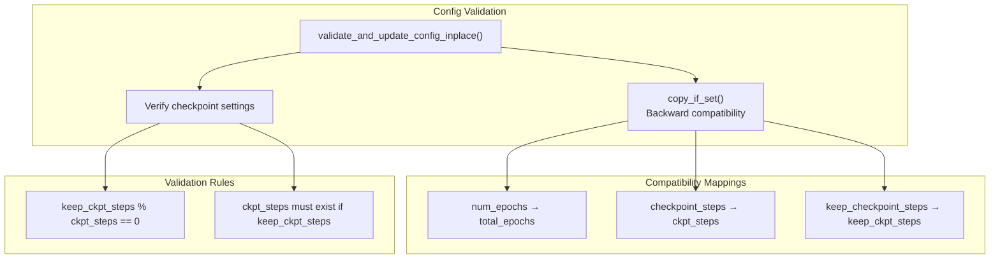
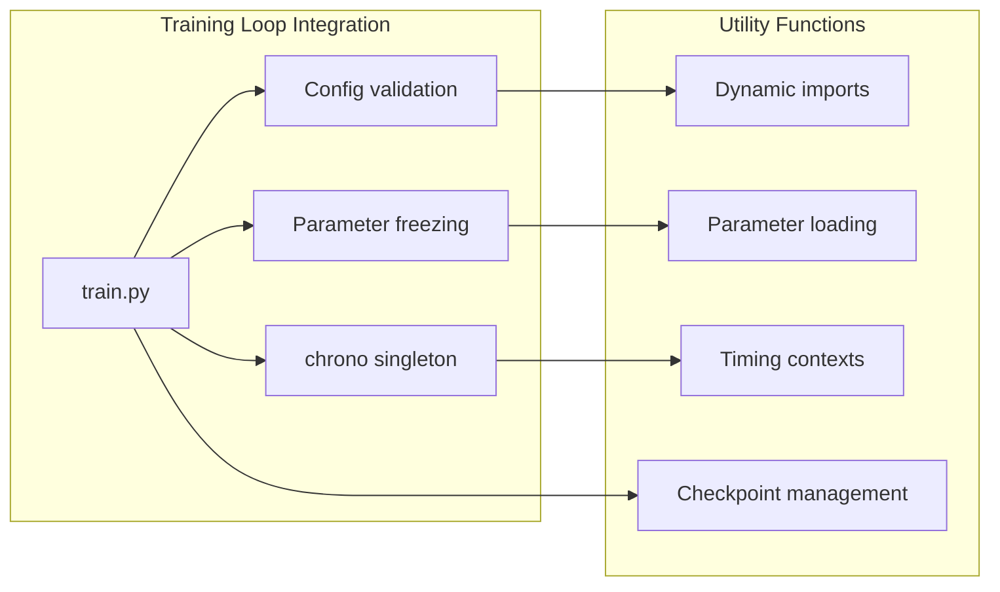

<!-- source: DeepWiki mcp.deepwiki.com · repo google-deepmind/jeo · page 6.3 Training Utilities · fetched 2026-10-26 -->

# Training Utilities

Relevant source files

The following files were used as context for generating this wiki page:

- [jeo/tools/tree_utils.py](jeo/tools/tree_utils.py)
- [jeo/train_utils.py](jeo/train_utils.py)

This document covers the advanced training utilities provided by Jeo for managing training experiments, including checkpointing, parameter freezing, timing, distributed training support, and tree manipulation utilities. For information about the main training script and orchestration, see [Training Script](#6.1). For configuration file management, see [Configuration System](#6.2).

## Overview

The training utilities in Jeo provide essential infrastructure for managing complex training experiments. These utilities are primarily implemented in `train_utils.py` and `tree_utils.py`, offering functionality for parameter management, performance monitoring, distributed coordination, and checkpoint handling.

## Module Import and Loading System

### Dynamic Module Loading

The training utilities provide a flexible module import system that supports loading models and components from different codebases including Big Vision and Scenic.

**Sources:** [jeo/train_utils.py:42-74](), [jeo/train_utils.py:76-81](), [jeo/train_utils.py:83-104]()

### Parameter Loading

The `load` function provides sophisticated parameter loading with support for both parameters and state:

| Feature | Description | Implementation |
|---------|-------------|----------------|
| Signature Detection | Automatically detects if load function supports `init_state` | `inspect.signature(load_fn).parameters` |
| State Handling | Returns both parameters and state when available | Tuple unpacking logic |
| Fallback Support | Gracefully handles load functions without state support | Conditional parameter passing |

**Sources:** [jeo/train_utils.py:83-104]()

## Parameter Management and Freezing

### Parameter Freezing Workflow

Jeo provides comprehensive support for selectively freezing model parameters during training using regex-based pattern matching.

**Sources:** [jeo/train_utils.py:175-196](), [jeo/tools/tree_utils.py:316-335](), [jeo/tools/tree_utils.py:447-464]()

### Tree Manipulation Utilities

The tree utilities provide powerful functions for manipulating JAX pytrees:

| Function | Purpose | Key Features |
|----------|---------|--------------|
| `tree_flatten_with_names` | Flatten trees with parameter names | Custom traversal alignment |
| `tree_map_with_names` | Apply functions with name context | Path-aware transformations |
| `tree_map_with_regex` | Regex-based tree transformations | Pattern matching support |
| `merge_params` | Merge loaded and initialized parameters | Mismatch handling |
| `tree_replace` | Rename/remove nested keys | Regex-based key transformations |

**Sources:** [jeo/tools/tree_utils.py:33-86](), [jeo/tools/tree_utils.py:88-118](), [jeo/tools/tree_utils.py:150-193](), [jeo/tools/tree_utils.py:337-418]()

## Timing and Performance Monitoring

### Chrono Class Architecture

The `Chrono` class provides comprehensive timing and progress reporting for training loops.

**Sources:** [jeo/train_utils.py:270-469]()

### Timing Utilities

| Utility | Purpose | Usage |
|---------|---------|-------|
| `hms()` | Human-readable time formatting | Duration display |
| `itstime()` | Conditional execution timing | Step-based scheduling |
| `log_memory()` | Memory usage monitoring | Host and device memory |
| `sync()` | Host synchronization | Distributed coordination |

**Sources:** [jeo/train_utils.py:256-268](), [jeo/train_utils.py:198-238](), [jeo/train_utils.py:471-491](), [jeo/train_utils.py:119-124]()

## Checkpointing and Persistence

### Checkpointing Infrastructure

**Sources:** [jeo/train_utils.py:145-163](), [jeo/train_utils.py:165-173](), [jeo/train_utils.py:240-254](), [jeo/train_utils.py:126-143]()

## Step Conversion Utilities

The `steps()` function provides flexible duration specification for training configurations:

| Duration Type | Config Key | Description |
|---------------|------------|-------------|
| Steps | `{prefix}_steps` | Direct step count |
| Examples | `{prefix}_examples` | Converted via batch size |
| Epochs | `{prefix}_epochs` | Converted via dataset size |
| Percent | `{prefix}_percent` | Fraction of total steps |

**Sources:** [jeo/train_utils.py:493-573]()

## Configuration Management

### Configuration Validation

The training utilities include comprehensive configuration validation and backward compatibility support:

**Sources:** [jeo/train_utils.py:145-163]()

## File and Pattern Utilities

### File Handling

| Function | Purpose | Features |
|----------|---------|----------|
| `get_files()` | Glob pattern file resolution | Comma-separated patterns, validation |
| `check_and_compile_patterns()` | Regex pattern validation | Common mistake detection |
| Parameter pattern matching | Tree-based parameter selection | First-match priority |

**Sources:** [jeo/train_utils.py:106-117](), [jeo/tools/tree_utils.py:420-444]()

## Integration with Training Loop

The training utilities integrate seamlessly with the main training infrastructure:

**Sources:** [jeo/train_utils.py:467-469](), [jeo/train_utils.py:145-163](), [jeo/train_utils.py:175-196]()

---

