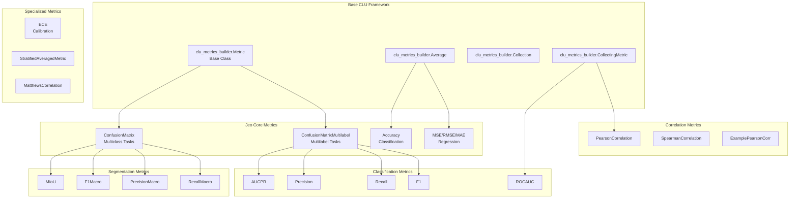
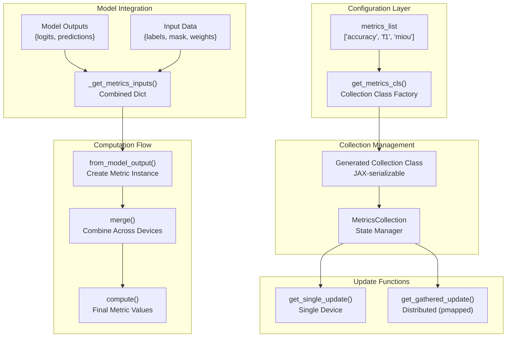
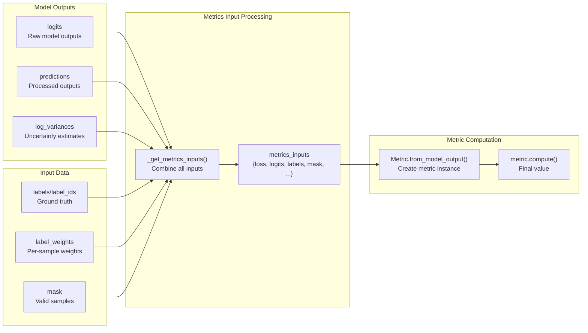

<!-- source: DeepWiki mcp.deepwiki.com · repo google-deepmind/jeo · page 7 Evaluation and Metrics · fetched 2026-10-26 -->

# Evaluation and Metrics

<details>
<summary>Relevant source files</summary>

The following files were used as context for generating this wiki page:

- [jeo/metrics/clu_metrics.py](jeo/metrics/clu_metrics.py)
- [jeo/metrics/clu_metrics_builder.py](jeo/metrics/clu_metrics_builder.py)

</details>


This document covers the comprehensive metrics system in Jeo, which provides a wide range of evaluation metrics for classification, segmentation, regression, and correlation tasks. The system is built on top of CLU (Common Loop Utils) metrics and provides JAX-compatible, distributed-training-ready metric computation.

For information about how these metrics are used within evaluators during training, see [Evaluators](#7.2). For details about the training loop integration, see [Training System](#3.3).

## Overview

The Jeo metrics system consists of two main components:

1. **Core Metrics Library** - Individual metric implementations for different task types
2. **Metrics Collection System** - Infrastructure for managing and computing multiple metrics together

All metrics are designed to work efficiently with JAX's functional programming model and support distributed training through automatic gathering and merging of metric states across devices.

## Metrics Architecture



**Sources:** [jeo/metrics/clu_metrics.py:1-1184]()

## Available Metrics by Category

### Classification Metrics

| Metric | Class | Purpose | Key Features |
|--------|-------|---------|--------------|
| Accuracy | `Accuracy` | Overall classification accuracy | Supports per-pixel weights and masking |
| Precision | `Precision` | Precision at threshold 0.5 | Micro-averaged across classes |
| Recall | `Recall` | Recall at threshold 0.5 | Micro-averaged across classes |
| F1 Score | `F1` | F1 score at threshold 0.5 | Micro-averaged across classes |
| AUC-PR | `AUCPR` | Area under Precision-Recall curve | Supports multilabel classification |
| ROC-AUC | `ROCAUC` | Area under ROC curve | Binary classification with subsampling |
| Matthews Correlation | `MatthewsCorrelation` | Matthews correlation coefficient | Binary classification only |

### Segmentation Metrics

| Metric | Class | Purpose | Key Features |
|--------|-------|---------|--------------|
| Mean IoU | `MIoU` | Mean Intersection over Union | Excludes background class option |
| F1 Macro | `F1Macro` | Macro-averaged F1 score | Per-class averaging |
| Precision Macro | `PrecisionMacro` | Macro-averaged precision | Handles class imbalance |
| Recall Macro | `RecallMacro` | Macro-averaged recall | NaN-safe averaging |

### Regression Metrics

| Metric | Class | Purpose | Key Features |
|--------|-------|---------|--------------|
| MSE | `MSE` | Mean Squared Error | Basic regression metric |
| RMSE | `RMSE` | Root Mean Squared Error | Square root of MSE |
| MAE | `MAE` | Mean Absolute Error | L1 loss metric |
| Bias | `Bias` | Prediction bias | Average prediction - label |

### Correlation Metrics

| Metric | Class | Purpose | Key Features |
|--------|-------|---------|--------------|
| Pearson Correlation | `PearsonCorrelation` | Linear correlation | Supports label weights |
| Spearman Correlation | `SpearmanCorrelation` | Rank correlation | Robust to outliers |
| Example Pearson | `ExamplePearsonCorr` | Example-wise correlation | For multi-instance tasks |

**Sources:** [jeo/metrics/clu_metrics.py:547-1184](), [jeo/metrics/clu_metrics_builder.py:99-179]()

## Metrics Collection System



**Sources:** [jeo/metrics/clu_metrics_builder.py:34-258]()

### MetricsCollection Class

The `MetricsCollection` class provides a stateful interface for managing multiple metrics:

```python
# Key methods from MetricsCollection
class MetricsCollection:
    def reset_states(self)           # Clear metric states
    def update_state(self, update)   # Accumulate metric update  
    def result(self)                 # Compute final results
    def get_gather_fn(self)          # Get pmapped update function
    def get_single_fn(self)          # Get single-device update function
```

**Sources:** [jeo/metrics/clu_metrics_builder.py:34-73]()

### Metrics Registration System

The system uses a string-based registration approach where metric names are mapped to implementations:

| Registration Name | Mapped Class | Notes |
|------------------|--------------|-------|
| `"accuracy"`, `"acc"` | `Accuracy` | Basic classification accuracy |
| `"aucpr"`, `"map"` | `AUCPR` | Mean Average Precision |
| `"roc_auc"`, `"auc"` | `ROCAUC` | ROC Area Under Curve |
| `"f1"` | `F1` | Micro-averaged F1 |
| `"f1_macro"` | `F1Macro` | Macro-averaged F1 |
| `"miou"` | `MIoU` | Mean Intersection over Union |
| `"mse"`, `"rmse"`, `"mae"` | `MSE`, `RMSE`, `MAE` | Regression metrics |
| `"pearson_correlation"` | `PearsonCorrelation` | Linear correlation |
| `"stratified_*"` | Dynamic | Stratified versions of base metrics |

**Sources:** [jeo/metrics/clu_metrics_builder.py:99-179]()

## Model Output Integration



**Sources:** [jeo/metrics/clu_metrics_builder.py:191-227]()

### Supported Model Output Keys

The metrics system automatically extracts relevant data from model outputs and inputs:

**Model Outputs:**
- `logits` - Raw model predictions
- `predictions` - Processed predictions (probabilities)
- `log_variances` - Uncertainty estimates
- `pred_uncertainty` - Prediction uncertainty

**Input Data:**
- `labels`, `label_ids`, `label` - Ground truth labels
- `label_weights` - Per-sample or per-pixel weights
- `mask` - Valid sample indicators
- `corrupt_pixels` - Corrupted pixel masks

**Sources:** [jeo/metrics/clu_metrics_builder.py:203-226]()

## Distributed Training Support

The metrics system is designed for distributed training with JAX's `pmap`:

### Single vs Gathered Updates

```mermaid
graph TB
    subgraph "Single Device Mode"
        SingleModel["Model Forward Pass"]
        SingleUpdate["get_single_update()"]
        SingleMetrics["Local Metrics"]
    end
    
    subgraph "Distributed Mode (pmap)"
        PmappedModel["pmapped Model Forward"]
        GatheredUpdate["get_gathered_update()"]
        GatherAxis["axis_name='batch'"]
        AllGatherOp["jax.lax.all_gather()"]
        MergedMetrics["Merged Metrics"]
    end
    
    SingleModel --> SingleUpdate
    SingleUpdate --> SingleMetrics
    
    PmappedModel --> GatheredUpdate
    GatheredUpdate --> GatherAxis
    GatherAxis --> AllGatherOp
    AllGatherOp --> MergedMetrics
```



**Sources:** [jeo/metrics/clu_metrics_builder.py:229-258]()

### Metric State Merging

All metrics implement a `merge()` method that combines states across devices:

```python
# Example from ConfusionMatrix
def merge(self, other: "ConfusionMatrix") -> "ConfusionMatrix":
    return type(self)(matrix=self.matrix + other.matrix)

# Example from Average-based metrics  
def merge(self, other):
    return type(self)(
        total=self.total + other.total,
        count=self.count + other.count
    )
```

**Sources:** [jeo/metrics/clu_metrics.py:143-158](), [jeo/metrics/clu_metrics.py:399-407]()

## Advanced Features

### Stratified Metrics

The system supports stratified evaluation where metrics are computed separately for different ranges of the target variable:

```python
# Dynamically created stratified metrics
StratifiedMAE = get_stratified_avg_metric("mae")
StratifiedRMSE = get_stratified_avg_metric("rmse")
```

**Sources:** [jeo/metrics/clu_metrics.py:702-782]()

### Threshold-based Metrics

Many metrics support custom thresholds and provide precision-recall curves:

- `recall_at_precision_function(precision_point)` - Creates recall@precision metrics
- `ConfusionMatrixMultilabel` - Uses 200 threshold points by default
- Expensive variants that use sklearn for higher accuracy

**Sources:** [jeo/metrics/clu_metrics.py:215-273]()

### Masking and Weighting

All metrics support sophisticated masking and weighting:

- **Label weights** - Per-sample or per-pixel importance weights
- **Masks** - Exclude padded or invalid samples
- **Background class exclusion** - Ignore background in segmentation

**Sources:** [jeo/metrics/clu_metrics.py:78-141](), [jeo/metrics/clu_metrics.py:362-397]()

---

