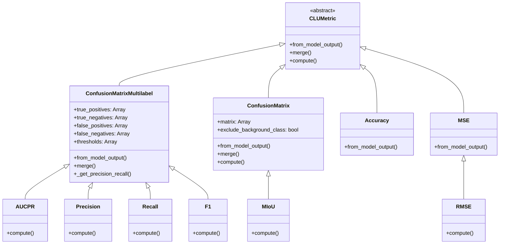
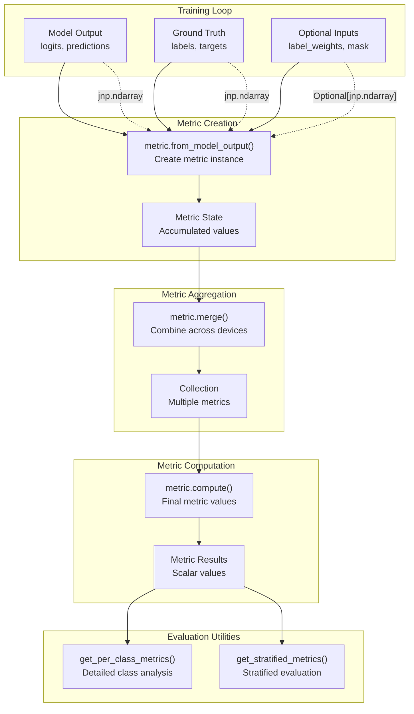

<!-- source: DeepWiki mcp.deepwiki.com · repo google-deepmind/jeo · page 7.1 Metrics Library · fetched 2026-10-26 -->

# Metrics Library

<details>
<summary>Relevant source files</summary>

The following files were used as context for generating this wiki page:

- [.github/workflows/ci.yml](.github/workflows/ci.yml)
- [docs/index.md](docs/index.md)
- [jeo/evaluators/utils.py](jeo/evaluators/utils.py)
- [jeo/metrics/clu_metrics.py](jeo/metrics/clu_metrics.py)

</details>


The Metrics Library provides comprehensive metric computation capabilities for machine learning evaluation in Jeo. It implements a wide range of metrics for classification, regression, segmentation, and correlation analysis, with particular emphasis on geospatial and remote sensing applications. The library is built on top of CLU (Common Loop Utils) metrics framework and integrates seamlessly with JAX/Flax training pipelines.

For information about metric evaluation during training, see [Evaluators](#7.2). For training system integration, see [Training System](#3.3).

## Metrics Architecture Overview

The metrics system is organized into core metric implementations and evaluation utilities, with support for both standard and specialized geospatial metrics.

```mermaid
graph TB
    subgraph "Core Metrics Library"
        CLUBase["clu_metrics_builder.Metric<br/>Base CLU Metric Interface"]
        CLUCollection["clu_metrics_builder.Collection<br/>Metric Collection Manager"]
        CLUCollecting["clu_metrics_builder.CollectingMetric<br/>Data Collecting Base"]
        CLUAverage["clu_metrics_builder.Average<br/>Averaging Base"]
    end
    
    subgraph "Jeo Classification Metrics"
        ConfusionMatrixMultilabel["ConfusionMatrixMultilabel<br/>Multilabel Classification Base"]
        ConfusionMatrix["ConfusionMatrix<br/>Multiclass Classification Base"]
        AUCPR["AUCPR<br/>Area Under PR Curve"]
        Precision["Precision<br/>At Threshold 0.5"]
        Recall["Recall<br/>At Threshold 0.5"]
        F1["F1<br/>At Threshold 0.5"]
        Accuracy["Accuracy<br/>Classification Accuracy"]
        ROCAUC["ROCAUC<br/>ROC AUC Score"]
    end
    
    subgraph "Jeo Regression Metrics"
        MSE["MSE<br/>Mean Squared Error"]
        RMSE["RMSE<br/>Root Mean Squared Error"]
        MAE["MAE<br/>Mean Absolute Error"]
        Bias["Bias<br/>Prediction Bias"]
    end
    
    subgraph "Jeo Segmentation Metrics"
        MIoU["MIoU<br/>Mean Intersection over Union"]
        F1Macro["F1Macro<br/>Macro-averaged F1"]
        PrecisionMacro["PrecisionMacro<br/>Macro-averaged Precision"]
        RecallMacro["RecallMacro<br/>Macro-averaged Recall"]
    end
    
    subgraph "Jeo Correlation Metrics"
        PearsonCorrelation["PearsonCorrelation<br/>Pearson Correlation"]
        SpearmanCorrelation["SpearmanCorrelation<br/>Spearman Correlation"]
        ExamplePearsonCorr["ExamplePearsonCorr<br/>Example-wise Pearson"]
    end
    
    subgraph "Evaluation Utilities"
        PerClassMetrics["get_per_class_metrics()<br/>Per-class F1, Precision, Recall"]
        StratifiedMetrics["get_stratified_metrics()<br/>Stratified Evaluation"]
    end
    
    %% Inheritance relationships
    CLUBase --> ConfusionMatrixMultilabel
    CLUBase --> ConfusionMatrix
    CLUAverage --> Accuracy
    CLUAverage --> MSE
    CLUAverage --> MAE
    CLUAverage --> Bias
    CLUCollecting --> ROCAUC
    CLUCollecting --> PearsonCorrelation
    CLUCollecting --> SpearmanCorrelation
    
    %% Derived metrics
    ConfusionMatrixMultilabel --> AUCPR
    ConfusionMatrixMultilabel --> Precision
    ConfusionMatrixMultilabel --> Recall
    ConfusionMatrixMultilabel --> F1
    ConfusionMatrix --> MIoU
    ConfusionMatrix --> F1Macro
    ConfusionMatrix --> PrecisionMacro
    ConfusionMatrix --> RecallMacro
    MSE --> RMSE
    
    %% Integration with evaluation
    ConfusionMatrix -.-> PerClassMetrics
    ConfusionMatrix -.-> StratifiedMetrics
```



Sources: [jeo/metrics/clu_metrics.py:1-1184](), [jeo/evaluators/utils.py:1-211]()

## Metric Class Hierarchy

The metrics system follows a clear inheritance pattern with specialized base classes for different metric types.



Sources: [jeo/metrics/clu_metrics.py:46-412](), [jeo/metrics/clu_metrics.py:548-663]()

## Classification Metrics

Classification metrics support both binary and multi-class scenarios, with specialized handling for multilabel classification tasks common in geospatial applications.

### Multilabel Classification Metrics

| Metric Class | Purpose | Key Features |
|--------------|---------|--------------|
| `ConfusionMatrixMultilabel` | Base for multilabel metrics | Threshold-based evaluation, supports masking |
| `AUCPR` | Area Under Precision-Recall Curve | Interpolation-based AUCPR computation |
| `Precision` | Precision at threshold 0.5 | Microaveraged across classes |
| `Recall` | Recall at threshold 0.5 | Microaveraged across classes |
| `F1` | F1 score at threshold 0.5 | Microaveraged across classes |
| `MatthewsCorrelation` | Matthews correlation coefficient | Binary classification only |

### Multiclass Classification Metrics

| Metric Class | Purpose | Key Features |
|--------------|---------|--------------|
| `ConfusionMatrix` | Base for multiclass metrics | Supports per-pixel weights, background class exclusion |
| `Accuracy` | Classification accuracy | Supports masking and label weights |
| `ROCAUC` | ROC Area Under Curve | Subsampling support for large datasets |

Sources: [jeo/metrics/clu_metrics.py:46-328](), [jeo/metrics/clu_metrics.py:548-578](), [jeo/metrics/clu_metrics.py:827-882]()

## Regression Metrics

Regression metrics are designed for continuous value prediction tasks, with support for masking and label weighting.

| Metric Class | Formula | Use Case |
|--------------|---------|----------|
| `MSE` | `mean((logits - labels)²)` | Standard regression evaluation |
| `RMSE` | `sqrt(MSE)` | Regression with interpretable units |
| `MAE` | `mean(abs(logits - labels))` | Robust to outliers |
| `Bias` | `mean(logits - labels)` | Systematic prediction bias |

### Stratified Regression Metrics

The `get_stratified_avg_metric()` function creates stratified versions of regression metrics for analysis across different value ranges:

```python
# Available stratified metrics
stratified_mae = get_stratified_avg_metric("mae")
stratified_mse = get_stratified_avg_metric("mse") 
stratified_rmse = get_stratified_avg_metric("rmse")
```

Sources: [jeo/metrics/clu_metrics.py:618-700](), [jeo/metrics/clu_metrics.py:702-782]()

## Segmentation Metrics

Segmentation metrics operate on confusion matrices to compute class-wise and averaged performance measures.

| Metric Class | Computation | Description |
|--------------|-------------|-------------|
| `MIoU` | `mean(tp / (tp + fp + fn))` | Mean Intersection over Union |
| `F1Macro` | `mean(2*tp / (2*tp + fp + fn))` | Macro-averaged F1 score |
| `PrecisionMacro` | `mean(tp / (tp + fp))` | Macro-averaged precision |
| `RecallMacro` | `mean(tp / (tp + fn))` | Macro-averaged recall |

All segmentation metrics support background class exclusion via the `exclude_background_class` parameter.

Sources: [jeo/metrics/clu_metrics.py:481-545]()

## Correlation Metrics

Correlation metrics analyze relationships between predictions and targets, particularly useful for geospatial regression tasks.

### Correlation Metric Types

| Metric Class | Correlation Type | Implementation |
|--------------|------------------|----------------|
| `PearsonCorrelation` | Linear correlation | `scipy.stats.pearsonr` |
| `SpearmanCorrelation` | Rank correlation | `scipy.stats.spearmanr` |
| `ExamplePearsonCorr` | Example-wise Pearson | Per-example correlation analysis |

Sources: [jeo/metrics/clu_metrics.py:885-1050]()

## Evaluation Utilities

The evaluation utilities provide higher-level functions for computing comprehensive metric sets.

### Per-Class Metrics

The `get_per_class_metrics()` function computes detailed per-class performance:

```python
# Default metrics: f1, precision, recall
DEFAULT_PER_CLASS_METRICS = ("f1", "prec", "recall")

# Available metric types
supported_metrics = {"f1", "prec", "recall", "iou", "miou", "acc"}
```

### Stratified Metrics

The `get_stratified_metrics()` function implements stratified sampling evaluation with standard error computation:

- Overall Accuracy (OA) with stratification
- User's Accuracy (UA) and Producer's Accuracy (PA) per class
- F1 scores with confidence intervals
- Area proportion estimates with standard errors

Sources: [jeo/evaluators/utils.py:19-211]()

## Metric Integration Flow



Sources: [jeo/metrics/clu_metrics.py:30-36](), [jeo/evaluators/utils.py:22-211]()

## Specialized Metrics

### Calibration Metrics

| Metric | Purpose | Implementation |
|--------|---------|----------------|
| `ECE` | Expected Calibration Error | Binned calibration analysis |

### Uncertainty Metrics

| Metric | Purpose | Use Case |
|--------|---------|----------|
| `MinLogvar` | Minimum log variance | Uncertainty lower bound |
| `MaxLogvar` | Maximum log variance | Uncertainty upper bound |

### Utility Metrics

| Metric | Purpose | Output |
|--------|---------|--------|
| `MaskCount` | Count unmasked examples | Sample size tracking |

Sources: [jeo/metrics/clu_metrics.py:785-1147]()

---

