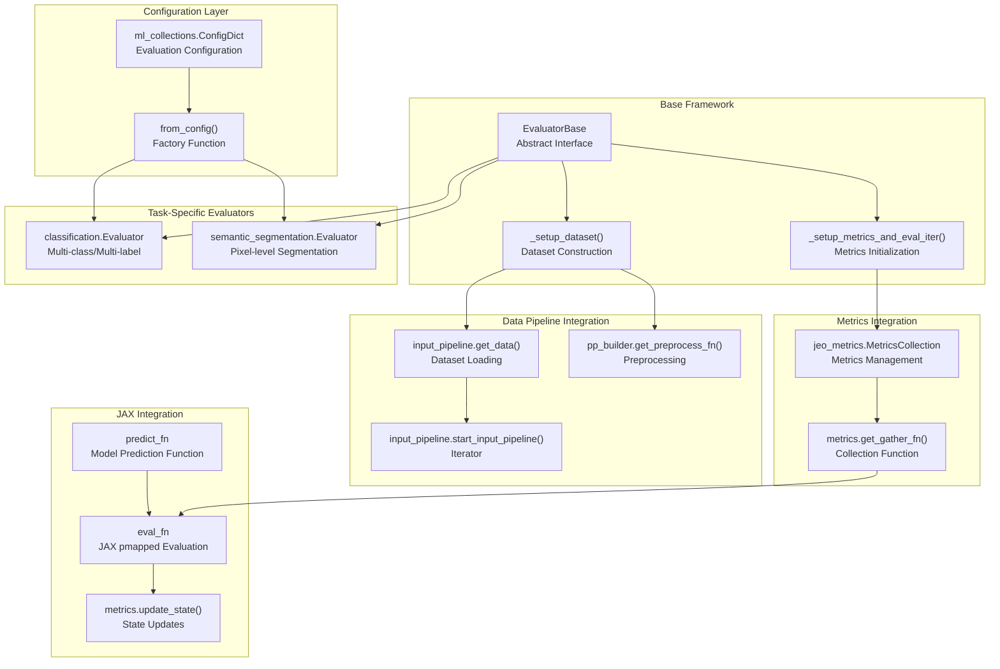
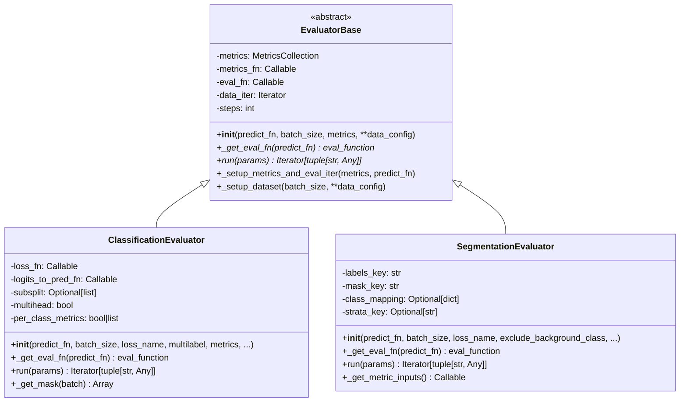
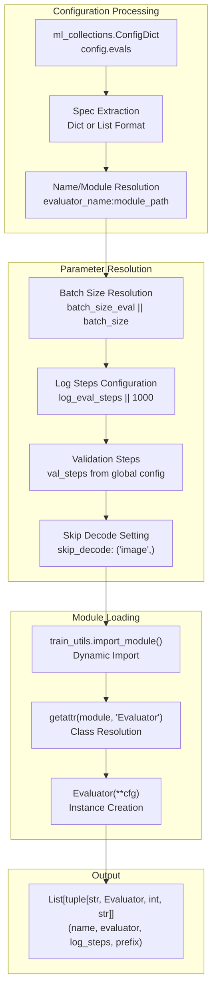
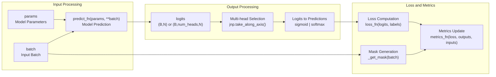
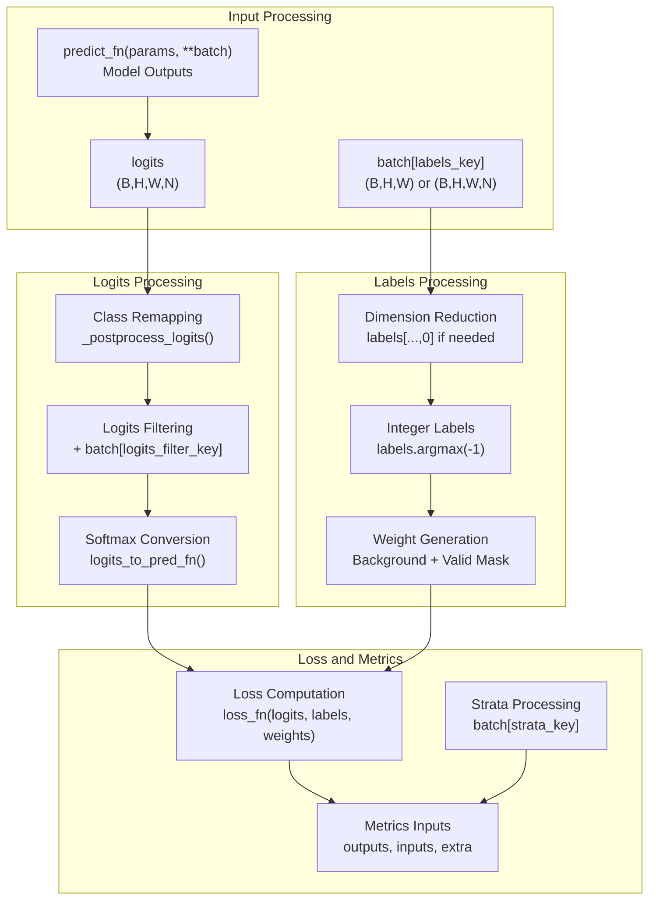
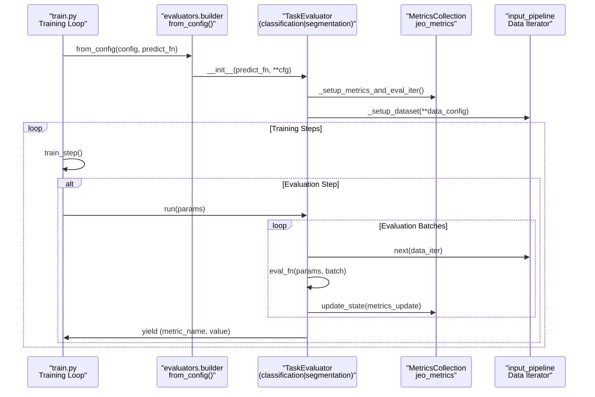

<!-- source: DeepWiki mcp.deepwiki.com · repo google-deepmind/jeo · page 7.2 Evaluators · fetched 2026-10-26 -->

# Evaluators

<details>
<summary>Relevant source files</summary>

The following files were used as context for generating this wiki page:

- [jeo/evaluators/builder.py](jeo/evaluators/builder.py)
- [jeo/evaluators/classification.py](jeo/evaluators/classification.py)
- [jeo/evaluators/semantic_segmentation.py](jeo/evaluators/semantic_segmentation.py)

</details>


This document covers the evaluation framework in Jeo, which provides standardized interfaces and implementations for assessing model performance across different tasks. Evaluators coordinate between model predictions, datasets, and metrics collection to produce comprehensive performance assessments during training and validation.

For information about the underlying metrics computations, see [Metrics Library](#7.1). For details about loss functions used during evaluation, see [Loss Functions](#8).

## Architecture Overview

The evaluator system follows a modular architecture with abstract base classes, concrete implementations for specific tasks, and a configuration-driven factory system.



**Sources:** [jeo/evaluators/builder.py:32-82](), [jeo/evaluators/classification.py:29-98](), [jeo/evaluators/semantic_segmentation.py:41-168]()

## Base Evaluator Interface

The `EvaluatorBase` class defines the standard interface that all evaluators must implement:



**Sources:** [jeo/evaluators/builder.py:32-81](), [jeo/evaluators/classification.py:29-46](), [jeo/evaluators/semantic_segmentation.py:41-75]()

### Core Methods

| Method | Purpose | Implementation |
|--------|---------|----------------|
| `__init__` | Initialize evaluator with prediction function and configuration | Sets up metrics, data pipeline, and task-specific parameters |
| `_get_eval_fn` | Create JAX-compiled evaluation function | Returns pmapped function for distributed evaluation |
| `run` | Execute evaluation across dataset | Iterates through data, computes metrics, yields results |
| `_setup_metrics_and_eval_iter` | Initialize metrics collection and evaluation function | Shared setup for metrics and JAX compilation |
| `_setup_dataset` | Configure dataset loading and preprocessing | Handles batch sizing, preprocessing pipelines, and data iteration |

**Sources:** [jeo/evaluators/builder.py:35-81]()

## Configuration and Factory System

The `from_config` function provides a unified interface for creating evaluators from configuration dictionaries:



**Sources:** [jeo/evaluators/builder.py:83-132]()

### Configuration Structure

The evaluator configuration supports both dictionary and list formats:

**Dictionary Format:**
```python
config.evals = {
    "val_clean": {
        "type": "classification",  # Optional, defaults to key name
        "dataset": "cifar10",
        "split": "test",
        "metrics": ["acc", "f1", "aucpr"],
        "batch_size": 512,
        "log_steps": 1000
    }
}
```

**List Format:**
```python
config.evals = [
    ("val_clean", "classification"),  # (name, module)
    "semantic_segmentation"  # Shortcut when name == module
]
```

**Sources:** [jeo/evaluators/builder.py:92-132]()

## Classification Evaluator

The classification evaluator handles binary, multi-class, and multi-label classification tasks with support for various prediction configurations.

### Key Features

| Feature | Configuration | Purpose |
|---------|---------------|---------|
| Multi-label Support | `multilabel=True` | Uses sigmoid activation instead of softmax |
| Multi-head Models | `multihead=True` | Selects task-specific head from model outputs |
| Subsplit Filtering | `subsplit=[0,1,2]` | Evaluates only specific data subsets |
| Per-class Metrics | `per_class_metrics=True` | Computes metrics for individual classes |
| Custom Loss Functions | `loss_name="sigmoid_xent"` | Configurable loss computation |

**Sources:** [jeo/evaluators/classification.py:32-46]()

### Default Metrics

The classification evaluator uses these metrics by default:

```python
DEFAULT_METRICS = ("acc", "f1", "aucpr", "prec", "recall", "loss")
```

**Sources:** [jeo/evaluators/classification.py:26]()

### Evaluation Function Structure



**Sources:** [jeo/evaluators/classification.py:47-74]()

## Semantic Segmentation Evaluator

The semantic segmentation evaluator handles pixel-level prediction tasks with support for class remapping, background exclusion, and stratified evaluation.

### Advanced Features

| Feature | Configuration | Purpose |
|---------|---------------|---------|
| Background Exclusion | `exclude_background_class=True` | Ignores background pixels in metrics |
| Class Remapping | `class_mapping={0:1, 1:0}` | Remaps prediction classes post-hoc |
| Valid Pixel Masking | `mask_key="segmentation_mask_mask"` | Uses validity masks for pixels |
| Stratified Evaluation | `strata_key="elevation", strata_weights=[0.3,0.7]` | Evaluates across data strata |
| Custom Label Keys | `labels_key="land_cover"` | Configurable label field names |

**Sources:** [jeo/evaluators/semantic_segmentation.py:44-75]()

### Default Metrics

```python
DEFAULT_METRICS = ("acc", "loss", "miou")
```

**Sources:** [jeo/evaluators/semantic_segmentation.py:27]()

### Segmentation Processing Pipeline



**Sources:** [jeo/evaluators/semantic_segmentation.py:76-129]()

## Integration with Training System

Evaluators integrate with the main training loop through the configuration system and are executed at specified intervals:



**Sources:** [jeo/evaluators/builder.py:83-132](), [jeo/evaluators/classification.py:83-97](), [jeo/evaluators/semantic_segmentation.py:146-167]()

### Evaluation Scheduling

Evaluators are scheduled based on configuration parameters:

| Parameter | Default | Purpose |
|-----------|---------|---------|
| `log_eval_steps` | 1000 | Global evaluation frequency |
| `log_steps` | Inherits from global | Per-evaluator override |
| `val_steps` | None | Number of validation steps |
| `batch_size_eval` | Uses `batch_size` | Evaluation batch size |

**Sources:** [jeo/evaluators/builder.py:112-122]()

---

