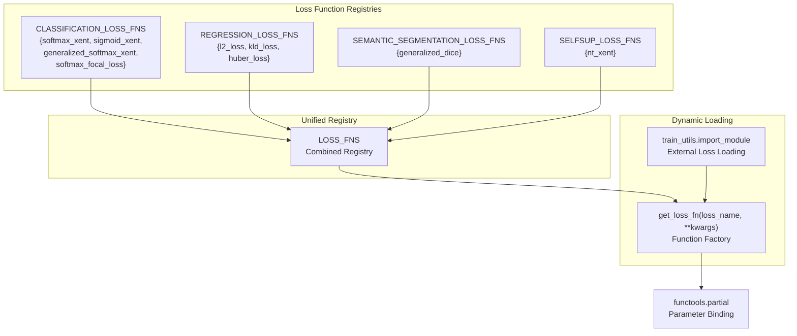
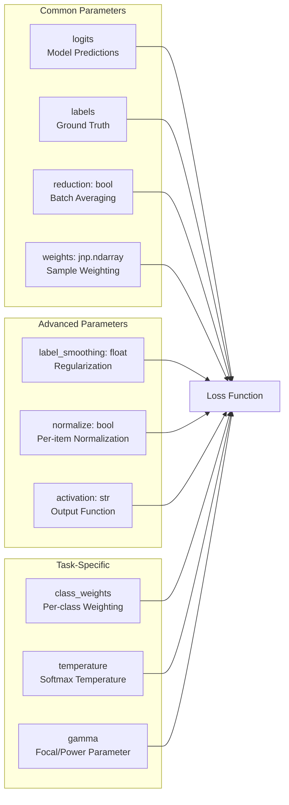
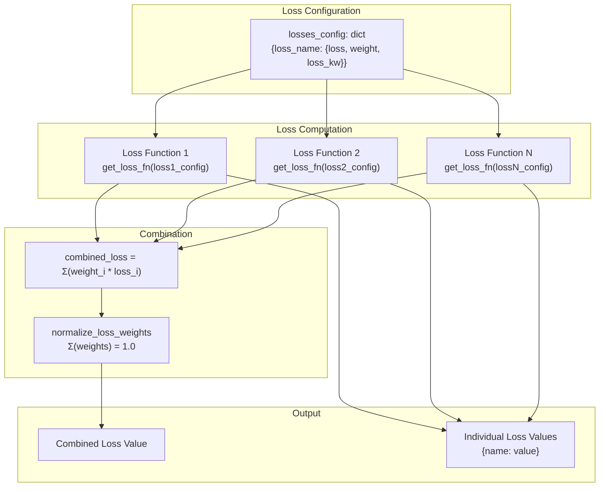
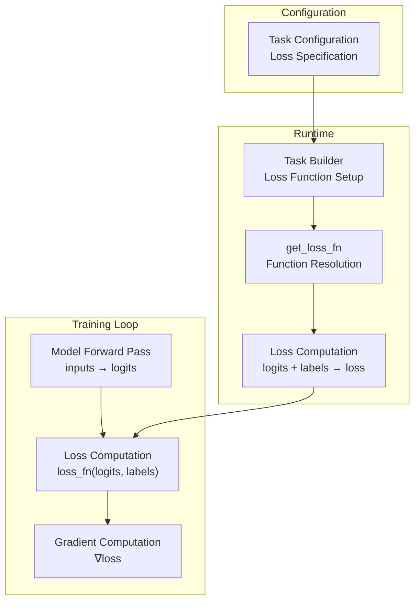

<!-- source: DeepWiki mcp.deepwiki.com · repo google-deepmind/jeo · page 8 Loss Functions · fetched 2026-10-26 -->

# Loss Functions

<details>
<summary>Relevant source files</summary>

The following files were used as context for generating this wiki page:

- [jeo/losses/losses.py](jeo/losses/losses.py)

</details>


The Loss Functions system provides a comprehensive library of loss functions for training machine learning models in Jeo. This module implements various loss functions organized by task type, supports loss combination, and provides utilities for dynamic loss function loading.

For information about how loss functions integrate with the training loop, see [Training System](#3.3). For evaluation metrics computation, see [Metrics Library](#7.1).

## Loss Function Taxonomy

The loss functions are organized into distinct categories based on their intended use cases and mathematical properties:

```mermaid
graph TD
    LossLibrary["Loss Functions Library<br/>jeo/losses/losses.py"]
    
    subgraph "Classification Losses"
        SoftmaxXent["softmax_xent<br/>Standard Cross-Entropy"]
        GenSoftmaxXent["generalized_softmax_xent<br/>Weighted + Smoothed"]
        SigmoidXent["sigmoid_xent<br/>Binary/Multi-label"]
        FocalLoss["softmax_focal_loss<br/>Focal Loss"]
        DiceLoss["generalized_dice<br/>Dice/Tversky Loss"]
    end
    
    subgraph "Regression Losses"
        L2Loss["l2_loss<br/>MSE Loss"]
        HuberLoss["huber_loss<br/>Robust L2"]
        KLDLoss["kld_loss<br/>KL Divergence"]
    end
    
    subgraph "Probabilistic Losses"
        GNLLLoss["gnll_loss<br/>Gaussian NLL"]
    end
    
    subgraph "Self-Supervised Losses"
        NTXent["nt_xent<br/>Contrastive Loss"]
    end
    
    subgraph "Super-Resolution"
        SupresLoss["supres_losses<br/>Multi-metric SR"]
        SSIMLoss["ssim<br/>Structural Similarity"]
    end
    
    subgraph "Loss Combiners"
        WeightedSum["weighted_losses_sum<br/>Multi-loss Combination"]
    end
    
    LossLibrary --> SoftmaxXent
    LossLibrary --> GenSoftmaxXent
    LossLibrary --> SigmoidXent
    LossLibrary --> FocalLoss
    LossLibrary --> DiceLoss
    LossLibrary --> L2Loss
    LossLibrary --> HuberLoss
    LossLibrary --> KLDLoss
    LossLibrary --> GNLLLoss
    LossLibrary --> NTXent
    LossLibrary --> SupresLoss
    LossLibrary --> SSIMLoss
    LossLibrary --> WeightedSum
```



Sources: [jeo/losses/losses.py:15-26](), [jeo/losses/losses.py:683-714]()

## Loss Function Registry System

The system uses a registry pattern to organize and dynamically load loss functions:



Sources: [jeo/losses/losses.py:683-714](), [jeo/losses/losses.py:717-727]()

## Available Loss Functions

### Classification Loss Functions

| Function Name | Purpose | Key Parameters | Use Cases |
|---------------|---------|----------------|-----------|
| `softmax_xent` | Standard cross-entropy | `logits`, `labels`, `reduction`, `kl` | Multi-class classification |
| `generalized_softmax_xent` | Extended cross-entropy | `weights`, `label_smoothing`, `normalize` | Weighted/smoothed classification |
| `sigmoid_xent` | Binary cross-entropy | `weights`, `label_smoothing`, `normalize` | Binary/multi-label classification |
| `softmax_focal_loss` | Focal loss for imbalanced data | `alpha`, `gamma`, `weights` | Imbalanced classification |
| `generalized_dice` | Dice/Tversky loss | `norm_type`, `beta`, `class_weights`, `dual` | Semantic segmentation |

Sources: [jeo/losses/losses.py:41-46](), [jeo/losses/losses.py:49-90](), [jeo/losses/losses.py:92-123](), [jeo/losses/losses.py:237-291](), [jeo/losses/losses.py:125-199]()

### Regression Loss Functions

| Function Name | Purpose | Key Parameters | Use Cases |
|---------------|---------|----------------|-----------|
| `l2_loss` | Mean squared error | `as_mse`, `weights` | Continuous regression |
| `huber_loss` | Robust L2 loss | `delta`, `weights` | Robust regression |
| `kld_loss` | KL divergence loss | `gamma`, `activation` | Probabilistic regression |

Sources: [jeo/losses/losses.py:327-347](), [jeo/losses/losses.py:349-368](), [jeo/losses/losses.py:397-429]()

### Specialized Loss Functions

| Function Name | Purpose | Key Parameters | Use Cases |
|---------------|---------|----------------|-----------|
| `gnll_loss` | Gaussian negative log-likelihood | `log_variances`, `eps` | Uncertainty quantification |
| `nt_xent` | NT-Xent contrastive loss | `temperature`, `axis_name` | Self-supervised learning |
| `supres_losses` | Super-resolution metrics | `border`, `use_l1`, `with_sigma` | Image super-resolution |

Sources: [jeo/losses/losses.py:373-395](), [jeo/losses/losses.py:584-630](), [jeo/losses/losses.py:434-524]()

## Loss Function Parameters

Most loss functions support common parameters for flexibility:



Sources: [jeo/losses/losses.py:54-56](), [jeo/losses/losses.py:96-99](), [jeo/losses/losses.py:130-137]()

## Multi-Loss Combination

The system supports combining multiple loss functions through the `weighted_losses_sum` function:



Sources: [jeo/losses/losses.py:640-678]()

## Helper Functions and Utilities

The module provides several utility functions for loss computation:

| Function | Purpose | Location |
|----------|---------|----------|
| `get_soft_targets` | Convert labels to soft targets with smoothing | [jeo/losses/losses.py:301-322]() |
| `onehot` | One-hot encoding with custom on/off values | [jeo/losses/losses.py:293-299]() |
| `get_loss_fn` | Dynamic loss function loading and partial application | [jeo/losses/losses.py:717-727]() |
| `ssim` | Structural similarity metric | [jeo/losses/losses.py:526-555]() |

## Integration with Training Pipeline

Loss functions integrate with the training system through the task builder and training utilities:



Sources: [jeo/losses/losses.py:717-727]()

## Usage Examples

### Single Loss Function
```python
# Basic softmax cross-entropy
loss_fn = get_loss_fn("softmax_xent")
loss = loss_fn(logits=model_output, labels=targets)

# With parameters
loss_fn = get_loss_fn("generalized_softmax_xent", 
                      label_smoothing=0.1, 
                      normalize=True)
```

### Multi-Loss Configuration
```python
losses_config = {
    "main_loss": {
        "loss": "softmax_xent",
        "weight": 1.0
    },
    "regularization": {
        "loss": "l2_loss", 
        "weight": 0.1,
        "loss_kw": {"as_mse": True}
    }
}
combined_loss, individual_losses = weighted_losses_sum(
    logits=logits, 
    labels=labels,
    losses_config=losses_config
)
```

Sources: [jeo/losses/losses.py:640-678](), [jeo/losses/losses.py:717-727]()

---

