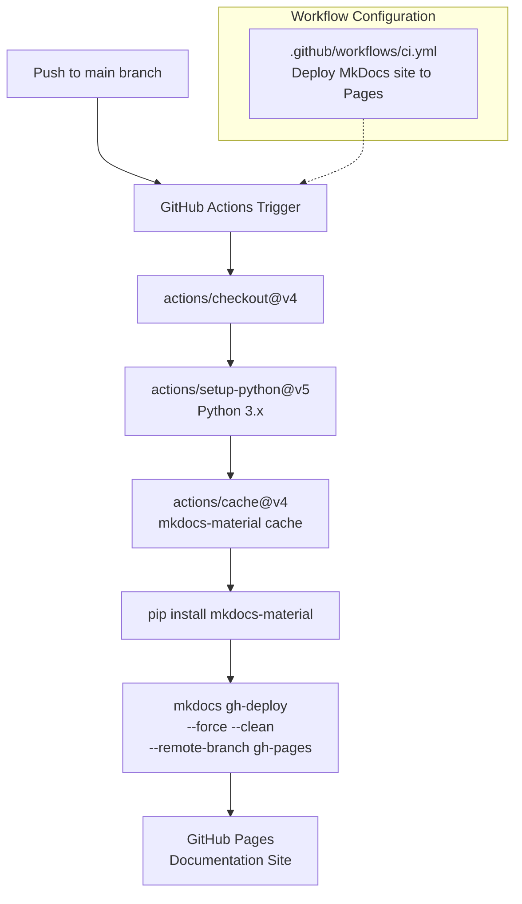
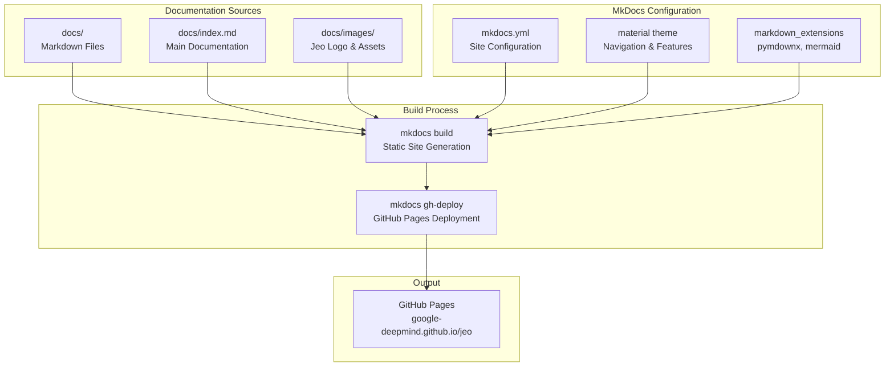
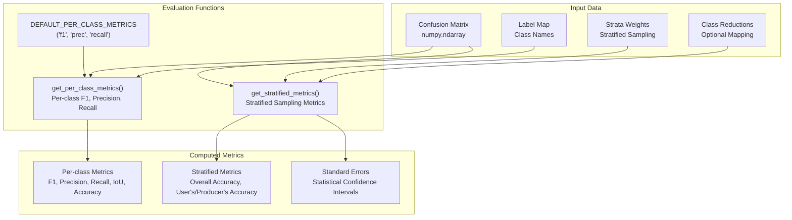

<!-- source: DeepWiki mcp.deepwiki.com · repo google-deepmind/jeo · page 9 Development and Contributing · fetched 2026-10-26 -->

# Development and Contributing

<details>
<summary>Relevant source files</summary>

The following files were used as context for generating this wiki page:

- [.github/workflows/ci.yml](.github/workflows/ci.yml)
- [docs/index.md](docs/index.md)
- [jeo/evaluators/utils.py](jeo/evaluators/utils.py)
- [mkdocs.yml](mkdocs.yml)

</details>


This document provides guidance for developers who want to contribute to or extend the Jeo framework. It covers the development setup, CI/CD pipeline, documentation system, testing framework, and contribution guidelines.

For information about using Jeo for training and inference, see [Getting Started](#2). For details about the core architecture and systems, see [Core Architecture](#3).

## Development Infrastructure

Jeo uses a modern development infrastructure built around GitHub Actions for continuous integration and MkDocs for documentation. The framework emphasizes automated testing, documentation generation, and streamlined contribution workflows.

### CI/CD Pipeline

The Jeo project uses GitHub Actions for continuous integration and deployment. The primary workflow automatically deploys documentation to GitHub Pages whenever changes are pushed to the main branch.



**CI/CD Pipeline Workflow**

The continuous integration workflow includes the following key steps:

| Step | Action | Purpose |
|------|--------|---------|
| **Checkout** | `actions/checkout@v4` | Retrieves source code from repository |
| **Python Setup** | `actions/setup-python@v5` | Configures Python 3.x environment |
| **Caching** | `actions/cache@v4` | Caches MkDocs Material dependencies |
| **Installation** | `pip install mkdocs-material` | Installs documentation dependencies |
| **Deployment** | `mkdocs gh-deploy` | Builds and deploys docs to GitHub Pages |

Sources: [.github/workflows/ci.yml:1-28]()

### Documentation System

Jeo uses MkDocs Material for generating and hosting documentation. The system is configured to support advanced markdown features, code highlighting, and interactive diagrams.



**Documentation System Architecture**

The documentation system includes several key components:

- **Site Configuration**: Managed through `mkdocs.yml` with Material theme
- **Markdown Extensions**: Supports code highlighting, diagrams, and advanced formatting
- **Navigation**: Automatic section generation with tabs and search functionality
- **Assets**: Logo and images stored in `docs/images/`
- **Deployment**: Automated via GitHub Actions to GitHub Pages

Key configuration features:

| Feature | Configuration | Purpose |
|---------|---------------|---------|
| **Theme** | `material` | Modern, responsive documentation theme |
| **Code Highlighting** | `pymdownx.highlight` | Syntax highlighting with line numbers |
| **Diagrams** | `pymdownx.superfences` + `mermaid` | Interactive diagram rendering |
| **Navigation** | `navigation.tabs`, `navigation.sections` | Organized content structure |
| **Search** | `search.highlight`, `search.suggest` | Enhanced search functionality |

Sources: [mkdocs.yml:1-108](), [docs/index.md:1-95]()

## Testing and Evaluation Framework

Jeo includes comprehensive testing utilities, particularly for evaluating model performance and metrics computation. The evaluation framework supports both standard and stratified metrics calculations.

### Evaluation Utilities

The `jeo.evaluators.utils` module provides specialized functions for computing per-class and stratified metrics from confusion matrices.



**Evaluation Utilities Architecture**

The evaluation system supports multiple types of metrics:

| Metric Type | Function | Supported Metrics |
|-------------|----------|-------------------|
| **Per-class** | `get_per_class_metrics()` | F1, Precision, Recall, IoU, Accuracy |
| **Stratified** | `get_stratified_metrics()` | Overall Accuracy, User's/Producer's Accuracy, F1 |
| **Statistical** | Built-in to stratified | Standard errors and confidence intervals |

Key features:

- **Confusion Matrix Processing**: Supports both 2D and 3D confusion matrices
- **Class Filtering**: Option to exclude unknown classes or specific patterns
- **Stratified Sampling**: Handles weighted strata for unbiased estimations
- **Class Reduction**: Supports mapping multiple classes to fewer categories
- **Statistical Robustness**: Computes standard errors for stratified metrics

Sources: [jeo/evaluators/utils.py:1-211]()

## Development Workflow

### Setting Up Development Environment

To contribute to Jeo, developers should follow these steps:

1. **Fork and Clone**: Fork the repository and clone it locally
2. **Dependencies**: Install JAX, Flax, TensorFlow, and other required packages
3. **Documentation**: Install MkDocs Material for local documentation development
4. **Testing**: Set up evaluation utilities and test data

### Documentation Development

The documentation system uses MkDocs Material with the following structure:

```bash
docs/
├── index.md                 # Main documentation page
├── images/                  # Logo and visual assets
└── (additional pages)       # Wiki pages as they are added
```

To develop documentation locally:

```bash
pip install mkdocs-material
mkdocs serve  # Local development server
mkdocs build  # Build static site
```

### Testing Framework

Jeo includes comprehensive testing utilities for model evaluation:

- **Metrics Computation**: Use `jeo.evaluators.utils` for performance metrics
- **Confusion Matrix Analysis**: Support for multi-class and stratified evaluation
- **Statistical Validation**: Standard error computation for robust evaluation

### Contributing Guidelines

When contributing to Jeo:

1. **Code Quality**: Follow JAX and Flax best practices
2. **Documentation**: Update relevant wiki pages and docstrings
3. **Testing**: Include evaluation utilities and test cases
4. **CI/CD**: Ensure all automated checks pass
5. **Review Process**: Submit pull requests with clear descriptions

### Repository Structure

The Jeo repository follows a modular architecture:

- **Core Framework**: Training, models, and evaluation systems
- **Documentation**: MkDocs-based wiki and API documentation
- **CI/CD**: GitHub Actions for automated testing and deployment
- **Examples**: Configuration files and usage examples

Sources: [.github/workflows/ci.yml:1-28](), [mkdocs.yml:1-108](), [docs/index.md:1-95]()

---

