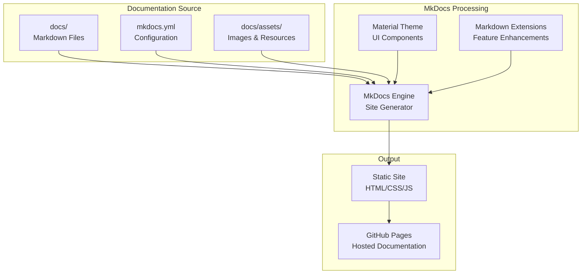
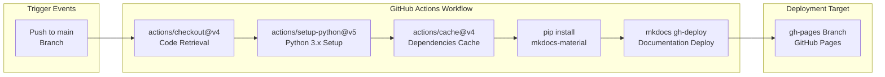
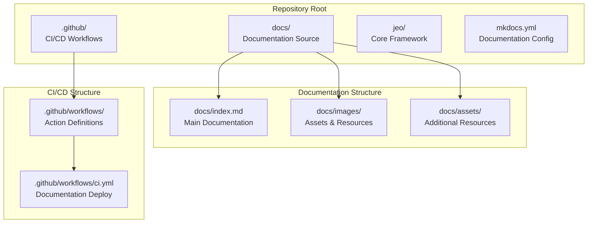
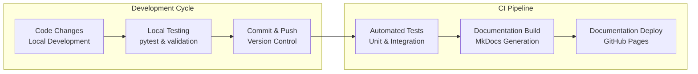

<!-- source: DeepWiki mcp.deepwiki.com · repo google-deepmind/jeo · page 9.1 Development Setup · fetched 2026-10-26 -->

# Development Setup

<details>
<summary>Relevant source files</summary>

The following files were used as context for generating this wiki page:

- [.github/workflows/ci.yml](.github/workflows/ci.yml)
- [docs/index.md](docs/index.md)
- [jeo/evaluators/utils.py](jeo/evaluators/utils.py)
- [mkdocs.yml](mkdocs.yml)

</details>


This document covers the development infrastructure for the Jeo framework, including documentation generation, continuous integration/continuous deployment (CI/CD) pipeline, and development workflow. This guide is intended for contributors who want to extend or modify the Jeo codebase.

For information about example configurations and reference implementations, see [Example Configurations](#9.2).

## Documentation System

Jeo uses **MkDocs** with the **Material** theme for documentation generation and hosting. The documentation system is configured to automatically deploy to GitHub Pages when changes are pushed to the main branch.

### MkDocs Configuration

The documentation system is configured through the `mkdocs.yml` file, which defines the site structure, theme settings, and markdown extensions.



**Documentation Build Process**

Sources: [mkdocs.yml:1-108]()

### Key Configuration Features

| Feature Category | Configuration | Purpose |
|------------------|---------------|---------|
| **Site Information** | `site_name`, `site_url`, `repo_url` | Basic site metadata and repository linking |
| **Theme Features** | `navigation.tabs`, `content.code.copy`, `search.highlight` | Enhanced navigation and user experience |
| **Markdown Extensions** | `pymdownx.superfences`, `pymdownx.mermaid`, `admonition` | Advanced formatting and diagram support |
| **Content Features** | `toc.follow`, `navigation.footer`, `content.tooltips` | Improved content navigation and accessibility |

The documentation supports **Mermaid diagrams** through the `pymdownx.superfences` extension, enabling technical documentation with flowcharts and system diagrams.

Sources: [mkdocs.yml:16-51](), [mkdocs.yml:94-98]()

## CI/CD Pipeline

The continuous integration and deployment pipeline is implemented using **GitHub Actions** and automatically deploys documentation updates to GitHub Pages.

### GitHub Actions Workflow



**CI/CD Workflow Architecture**

Sources: [.github/workflows/ci.yml:1-28]()

### Workflow Configuration Details

The CI/CD pipeline implements several optimization strategies:

- **Caching Strategy**: Uses weekly cache rotation with `cache_id=$(date --utc '+%V')` to balance cache freshness with build performance
- **Permissions**: Requires `contents: write` permission for deployment to GitHub Pages
- **Environment**: Runs on `ubuntu-latest` with Python 3.x
- **Deployment**: Uses `mkdocs gh-deploy --force --clean --remote-branch gh-pages` for atomic deployments

The workflow automatically triggers when commits are pushed to the `main` branch, ensuring documentation stays synchronized with code changes.

Sources: [.github/workflows/ci.yml:5-8](), [.github/workflows/ci.yml:19-27]()

## Development Workflow

### Local Development Setup

For local development and testing of documentation changes:

1. **Install Dependencies**:
   ```bash
   pip install mkdocs-material
   ```

2. **Local Development Server**:
   ```bash
   mkdocs serve
   ```

3. **Build Documentation**:
   ```bash
   mkdocs build
   ```

### File Structure



**Development File Organization**

Sources: [docs/index.md:1-95](), [.github/workflows/ci.yml:1-28]()

## Testing Framework

While the provided files don't show explicit testing configuration, a complete development setup for Jeo would typically include:

### Expected Testing Infrastructure

| Component | Purpose | Implementation |
|-----------|---------|----------------|
| **Unit Tests** | Test individual functions and classes | `pytest` framework with JAX/Flax test utilities |
| **Integration Tests** | Test component interactions | End-to-end pipeline testing |
| **Documentation Tests** | Validate code examples in docs | `doctest` or similar |
| **Performance Tests** | Benchmark training and inference | JAX profiling tools |

### Testing Workflow Integration



**Expected Testing and Deployment Flow**

## Contributing Guidelines

### Documentation Contributions

When contributing to documentation:

1. **Markdown Standards**: Follow the configured markdown extensions in `mkdocs.yml`
2. **Diagram Standards**: Use Mermaid for technical diagrams, avoiding colors for accessibility
3. **Asset Management**: Place images in `docs/images/` and reference with appropriate paths
4. **Navigation**: Update navigation structure in `mkdocs.yml` when adding new pages

### Code Documentation

The documentation system supports several advanced features for code documentation:

- **Code Highlighting**: Syntax highlighting with line numbers via `pymdownx.highlight`
- **Code Annotations**: Inline code annotations with `content.code.annotate`
- **Code Copying**: One-click code copying with `content.code.copy`
- **Snippets**: Reusable code snippets with `pymdownx.snippets`

Sources: [mkdocs.yml:78-93]()

## Development Environment Requirements

### System Dependencies

- **Python**: Version 3.x (configured in CI/CD)
- **MkDocs Material**: Documentation theme and extensions
- **Git**: Version control for contribution workflow
- **JAX/Flax**: Core framework dependencies (for code development)

### Optional Development Tools

- **Local Preview**: `mkdocs serve` for real-time documentation preview
- **Build Validation**: `mkdocs build` for local build testing
- **Cache Management**: Understanding of GitHub Actions caching for CI/CD optimization

Sources: [.github/workflows/ci.yml:16-18](), [mkdocs.yml:4-6]()

---

