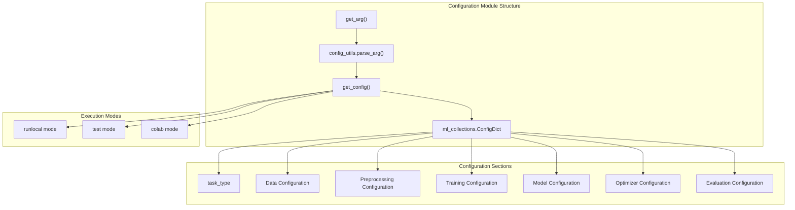
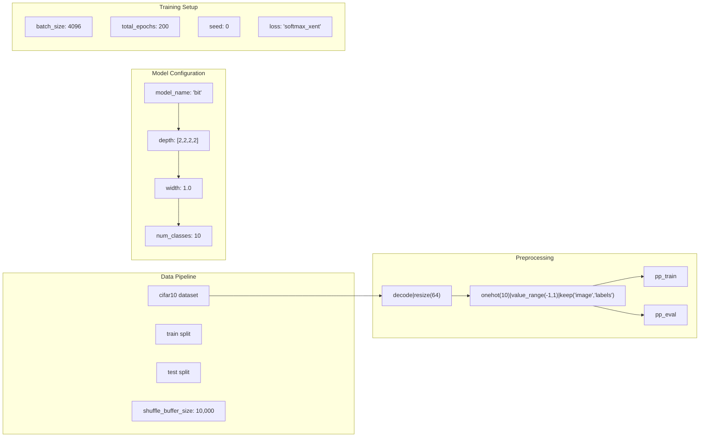
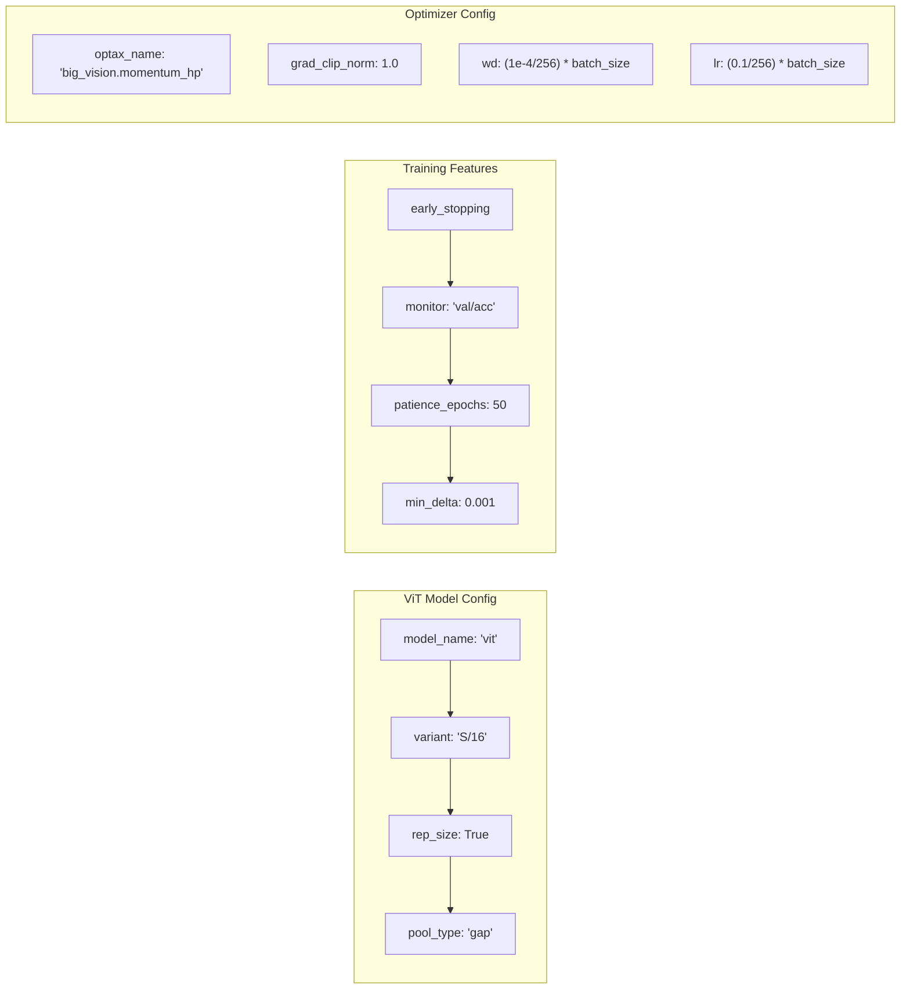
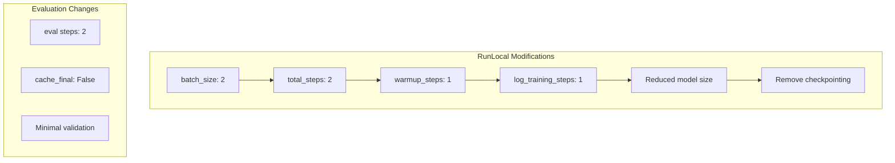

<!-- source: DeepWiki mcp.deepwiki.com · repo google-deepmind/jeo · page 9.2 Example Configurations · fetched 2026-10-26 -->

# Example Configurations

<details>
<summary>Relevant source files</summary>

The following files were used as context for generating this wiki page:

- [jeo/configs/tests/tiny_bit.py](jeo/configs/tests/tiny_bit.py)
- [jeo/configs/tests/tiny_vit.py](jeo/configs/tests/tiny_vit.py)

</details>


This document provides reference implementations and example configurations for different use cases and testing scenarios in the Jeo framework. These configurations serve as templates for setting up training experiments and demonstrate how to configure various components of the system.

For information about the configuration system architecture, see [Configuration System](#6.2). For details about the training process that uses these configurations, see [Training Script](#6.1).

## Overview

The Jeo framework includes several pre-built configuration files designed for testing and development scenarios. These configurations provide working examples of how to set up training experiments for different models and tasks, with built-in support for various execution modes including local testing, continuous integration, and development environments.

## Configuration File Structure

All example configurations follow a standardized structure that defines the complete training setup. The configurations are implemented as Python modules that return `ml_collections.ConfigDict` objects containing all necessary parameters.



**Sources:** [jeo/configs/tests/tiny_bit.py:21-28](), [jeo/configs/tests/tiny_vit.py:21-26]()

### Core Functions

Each configuration module implements these standard functions:

| Function | Purpose | Parameters |
|----------|---------|------------|
| `get_config(arg=None)` | Main configuration entry point | Optional argument string |
| `get_arg(arg)` | Parse command-line arguments | Argument string from training script |
| `nosweep(add)` | Sweep configuration placeholder | Sweep parameters (unused in examples) |
| `metrics(*_)` | Define metrics to track | Variable arguments (unused in examples) |

## Example Configurations

### Tiny BIT Configuration

The `tiny_bit.py` configuration provides a minimal setup for testing the BIT (ResNetV1) model on CIFAR-10:



**Sources:** [jeo/configs/tests/tiny_bit.py:32-61]()

Key configuration parameters:

- **Dataset**: CIFAR-10 with train/test splits
- **Model**: BIT architecture with depth `[2,2,2,2]` (R26 variant)
- **Training**: 200 epochs, batch size 4096, cosine learning rate schedule
- **Preprocessing**: Decode, resize to 64x64, one-hot encoding, value normalization

### Tiny ViT Configuration

The `tiny_vit.py` configuration demonstrates Vision Transformer setup:



**Sources:** [jeo/configs/tests/tiny_vit.py:50-86]()

Notable features:
- **Model**: ViT-S/16 variant with global average pooling
- **Early Stopping**: Monitors validation accuracy with 50-epoch patience
- **Optimizer**: Big Vision momentum with gradient clipping

## Execution Modes

Both configurations support multiple execution modes that modify parameters for different use cases:

### Standard Mode

Default configuration for full training runs with complete datasets and normal batch sizes.

### RunLocal Mode  

Optimized for local development and quick testing:



**Sources:** [jeo/configs/tests/tiny_bit.py:84-98](), [jeo/configs/tests/tiny_vit.py:88-102]()

### Test Mode

Configured for continuous integration and automated testing:

- **Batch Size**: 2 (minimal memory usage)
- **Steps**: 2 total steps for quick execution  
- **Validation**: 2 evaluation steps only
- **Model**: Reduced architecture (e.g., `depth=[1,1,1,1]` for BIT)
- **Features**: Disabled checkpointing and profiling

**Sources:** [jeo/configs/tests/tiny_bit.py:100-114](), [jeo/configs/tests/tiny_vit.py:111-124]()

### Colab Mode (ViT Only)

Optimized for Google Colab environments:

- **Batch Size**: 16 (Colab GPU memory constraints)
- **Epochs**: 2 (quick demonstration)
- **Buffer Size**: 10 (reduced memory usage)
- **Warmup**: 1,000 steps

**Sources:** [jeo/configs/tests/tiny_vit.py:104-110]()

## Configuration Sections Breakdown

### Data Configuration

| Parameter | Purpose | Example Value |
|-----------|---------|---------------|
| `dataset` | Dataset name for TFDS | `"cifar10"` |
| `train_split` | Training data split | `"train"` |
| `shuffle_buffer_size` | Shuffle buffer per host | `10_000` |
| `num_classes` | Number of output classes | `10` |
| `download_and_prepare` | Auto-download dataset | `True` |

### Preprocessing Configuration

Both configurations use similar preprocessing pipelines:

```python
pp_pre = "decode|resize(64)"
pp_post = "|onehot(10, key='label', key_result='labels')" + \
          "|value_range(-1,1)|keep('image','labels')"
```

This pipeline:
1. Decodes images from raw format
2. Resizes to 64×64 pixels  
3. Converts labels to one-hot encoding
4. Normalizes pixel values to [-1,1] range
5. Keeps only image and label fields

### Model Configuration

**BIT Model:**
```python
config.model = dict(
    depth=[2, 2, 2, 2],  # ResNet layer depths
    width=1.0,           # Width multiplier
    num_classes=10,      # Output classes
)
```

**ViT Model:**
```python
config.model = dict(
    variant="S/16",      # Small model, 16x16 patches
    rep_size=True,       # Include representation size
    pool_type="gap",     # Global average pooling
    num_classes=10,      # Output classes
)
```

### Evaluation Configuration

Both configurations define validation evaluators:

```python
config.evals.val = {
    "type": "classification",
    "dataset": config.dataset,
    "split": "test",
    "pp": pp_eval,
    "loss_name": config.loss,
    "metrics": ("acc", "f1", "aucpr", "prec", "recall", "loss"),
    "cache_final": True
}
```

**Sources:** [jeo/configs/tests/tiny_bit.py:71-82](), [jeo/configs/tests/tiny_vit.py:69-80]()

## Customizing Configurations

### Creating New Configurations

To create a new configuration file:

1. **Import required modules**:
   ```python
   from jeo.configs import config_utils
   import ml_collections
   ```

2. **Implement required functions**:
   - `get_config(arg=None)` - Main configuration
   - `get_arg(arg)` - Argument parsing (optional)
   - `nosweep(add)` - Sweep configuration
   - `metrics(*_)` - Metrics definition

3. **Define configuration sections** following the standard pattern shown in the examples

4. **Add execution mode support** by checking parsed arguments and modifying configuration accordingly

### Common Customization Patterns

| Customization | Configuration Change |
|---------------|---------------------|  
| Different dataset | Modify `config.dataset`, `config.num_classes`, preprocessing |
| Model architecture | Change `config.model_name`, `config.model` parameters |
| Learning schedule | Update `config.schedule` dictionary |
| Additional metrics | Extend `metrics` tuple in evaluators |
| Custom preprocessing | Modify `pp_train` and `pp_eval` strings |

**Sources:** [jeo/configs/tests/tiny_bit.py](), [jeo/configs/tests/tiny_vit.py]()